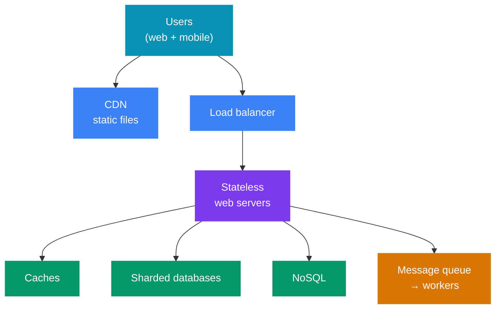

# Ch 1: Scale From Zero to Millions of Users

> 📖 **Vol 1, Chapter 1** (book pages 5–33) &nbsp;·&nbsp; 🔥🔥 Very High Priority &nbsp;·&nbsp; 💬 **19 Questions**  
> **Source:** Alex Xu, *System Design Interview Vol 1*, Ch 1. Page and figure numbers below are the book's. This PDF edition prints no page numbers in the footer, so pages are the PDF page numbers (the chapter starts on page 5).

---

📊 **Question Count**

| # | Section | Questions |
|---|---|---|
| 1 | [Single Server and the Database Tier ⚡](#1--single-server-and-the-database-tier-p58-) | 1 |
| 2 | [Vertical vs Horizontal Scaling and the Load Balancer 🔥](#2--vertical-vs-horizontal-scaling-and-the-load-balancer-p910-) | 2 |
| 3 | [Database Replication 🔥🔥](#3--database-replication-p1214-) | 2 |
| 4 | [Cache 🔥🔥](#4--cache-p1516-) | 4 |
| 5 | [Content Delivery Network 🔥](#5--content-delivery-network-p1719-) | 2 |
| 6 | [Stateless Web Tier 🔥🔥](#6--stateless-web-tier-p2022-) | 2 |
| 7 | [Data Centers, Message Queue and Tools 🔥](#7--data-centers-message-queue-and-tools-p2327-) | 3 |
| 8 | [Database Scaling and Sharding 🔥🔥](#8--database-scaling-and-sharding-p2831-) | 2 |
| 9 | [Millions of Users and Beyond 🔥](#9--millions-of-users-and-beyond-p32-) | 1 |
| | **Total** | **19** |

> 🔥🔥 Very high priority — asked in almost every Tier-1 interview loop &nbsp;·&nbsp; 🔥 High priority — very frequent in Tier-1 interviews &nbsp;·&nbsp; ⚡ Medium priority — commonly asked &nbsp;·&nbsp; 💤 Low priority — good to know, rarely asked

> **How to read this note.** Sections 1–9 follow the book, in the book's order: one server first, then one new building block at a time. Anything the book does not say is marked **📎 Beyond the book**. Where the book has a mistake or an unclear point, the note says so and gives the fix.  
> Related notes: load balancer algorithms are in [the load balancing note](../../02_distributed_systems/02_load_balancing_strategies.md). Replication and consistency models are in [the distributed fundamentals note](../../02_distributed_systems/01_distributed_fundamentals.md). Resharding is solved in [Ch 5 — Consistent Hashing](./ch05_design_consistent_hashing.md). The book's "one master database" example is in [the Stack Overflow case study](../../03_case_studies/01_stack_overflow_architecture.md).

---

## 🗒️ Cheat Sheet

<details>
<summary><strong>🗒️ Show cheat sheet</strong></summary>

### 🎯 Clarifying Questions (📎 the book asks none in this chapter)

This chapter is a tour of building blocks, not a "Design X" problem. When an interviewer says "scale this system", these questions decide which block comes first:

| Question | Why it matters |
|---|---|
| What is the read/write ratio? | Read-heavy → replicas and a cache first. Write-heavy → sharding sooner |
| How many users now, and at peak? | Decides whether one server is still fine |
| Can a read be a little stale? | Decides if reads can go to replicas and the cache |
| Are users in one region or many? | Many regions → CDN and multiple data centers |
| Is the data relational, or just keys and blobs? | SQL vs NoSQL (§1) |

### 🏗️ Core Components (Figure 1-23, p.31)

- **DNS** — turns a domain name into an IP address. Usually a paid third-party service (p.7).
- **Load balancer** — spreads traffic across web servers. Clients see only its **public IP**. It talks to servers on **private IPs** (Figure 1-4).
- **Web tier** — **stateless** servers that can be added or removed by **autoscaling** (Figure 1-14).
- **Database** — master for writes, slaves for reads (Figure 1-5). Later **sharded** by `user_id` (Figure 1-21).
- **Cache** — in-memory store in front of the database. The book's flow: check cache, on a miss read the DB and fill the cache (Figure 1-7).
- **CDN** — serves static files (JS, CSS, images, video) from a server near the user (Figure 1-10).
- **NoSQL store** — holds the session data, and later the "non-relational functionalities" (p.22, p.30).
- **Message queue + workers** — slow jobs run in the background (Figure 1-18).
- **Tools** — logging, metrics, monitoring, automation (Figure 1-19).
- **Multiple data centers** — users are geo-routed to the nearest one (Figure 1-15).

### 💡 Key Insights

1. **Every tier needs redundancy.** One web server, one database or one cache server is a **single point of failure (SPOF)**. The book adds a second copy of each tier, one by one.
2. **Stateless web servers come before horizontal scaling.** If a server keeps session data, every request from that user must go back to it (sticky sessions). That makes adding, removing and losing servers hard (p.20).
3. **Most apps read far more than they write** (p.12). So add read copies (slaves) and a cache before you touch writes.
4. **Writes scale only by sharding** (p.28). Sharding brings three new problems: resharding, the celebrity (hotspot) problem, and joins (p.30).
5. **Decouple slow work with a queue.** The producer and consumer then scale on their own (p.25).

### ⚖️ Trade-offs / Alternatives

| Option | Pro | Con | Book's verdict |
|---|---|---|---|
| Vertical scaling (web tier) | Simple | Hard limit; no failover | ✅ Great when traffic is low; ❌️ for large scale (p.9) |
| Horizontal scaling + load balancer | Failover; add servers any time | Needs a stateless web tier | ✅ "More desirable for large scale" (p.9) |
| Relational database | Joins, tables, 40+ years of use | Harder to scale writes | ✅ "Best option" for most developers (p.8) |
| Non-relational (NoSQL) database | Low latency, massive data, no schema | Joins usually not supported | Use if you need super-low latency, unstructured data, only (de)serialization, or massive data (p.8) |
| Sticky sessions | No shared session store needed | Hard to add/remove servers; hard to handle failures | ❌️ Adds overhead (p.20) |
| Shared session store (stateless tier) | Any server serves any user; easy autoscaling | One more store to run | ✅ Chosen — and the book picks **NoSQL**, "easy to scale" (p.22) |
| CDN for rarely used files | — | You pay for data transfer | ❌️ Move them out of the CDN (p.18) |
| Vertical scaling (database) | Simple; one server can be huge (24 TB RAM) | Hardware limit; SPOF risk; very expensive | Works for a long time (Stack Overflow, 2013), then hits limits (p.28) |
| Sharding | Scales writes and storage | Resharding, hotspots, cross-shard joins | ✅ "A great technique" but "far from perfect" (p.30) |
| Multi-master / circular replication | Fixes some failover problems | Much more complex | Out of the book's scope (p.13) |

### 🔢 Numbers to Remember

| What | Value | Arithmetic |
|---|---|---|
| CDN vs origin load time (Figure 1-9) | **40 ms vs 120 ms** | 120 − 40 = 80 ms saved, **3×** faster |
| Memcached TTL in the book's snippet (p.15) | **3600 seconds = 1 hour** | `3600 * SECONDS`, with `SECONDS = 1` |
| Shard for a user (Figure 1-21) | `user_id % 4` | User 13: 13 % 4 = 1 → **shard 1** (Figure 1-22 shows 1, 5, 9, 13 on shard 1) |
| Biggest single server the book quotes | **24 TB of RAM** | p.28 (see the Book inconsistency in §8) |
| Stack Overflow, 2013 | **> 10 million** monthly unique visitors, **1** master database | p.28 |
| Relational databases | **> 40 years** in use | p.8 |
| Two data centers (Figure 1-15) | **x%** US-East, **(100 − x)%** US-West | One DC down → **100%** to the healthy DC (Figure 1-16) |
| Load balancer IPs (Figure 1-4) | public **88.88.88.1**; private **10.0.0.1**, **10.0.0.2** | Clients never see the private IPs |
| 📎 Read split across replicas | 10K QPS at 9:1 read/write → **3K reads per replica** with 3 replicas | 10,000 × 0.9 = 9,000 reads ÷ 3 = 3,000. The 1,000 writes all go to the master |
| 📎 Session store size | **~1 GB** for 1M sessions | 1,000,000 × 1 KB = 1 GB. Fits on one Redis node |
| 📎 Modulo resharding, 4 → 5 shards | **~80%** of keys move | A key stays only if `k % 4 == k % 5`. That is true for 4 of every 20 keys → 20% stay. Consistent hashing moves only ~1/5 (Ch 5) |
| 📎 Cache vs database read | Redis **< 1 ms** in the same data center; a DB query is often **several ms** | Rough order of magnitude, not from the book |

---

</details>
<br/>

---

## 1. 🌱 Single Server and the Database Tier (p.5–8) ⚡

The chapter starts with **one user** and grows the system step by step to **millions of users** (p.5).

### Single server setup (Figure 1-1, p.6)

Everything runs on one server: the web app, the database, the cache, and so on.

**The request flow (Figure 1-2, p.7):**

1. Users reach the site through a domain name, such as `api.mysite.com`. DNS is usually a **paid service from a third party**, not hosted on our servers.
2. DNS returns an **IP address** to the browser or mobile app. In the example: `15.125.23.214`.
3. The client sends **HTTP** requests straight to the web server at that IP.
4. The web server returns **HTML pages** or a **JSON response**.

**The traffic sources (p.7):**

- **Web application** — server-side languages (Java, Python, etc.) handle business logic and storage. Client-side languages (HTML and JavaScript) handle the display.
- **Mobile application** — talks to the web server over HTTP. **JSON** is the usual response format, because it is simple. The book's example is `GET /users/12`, which returns a user object (id, first name, last name, address, phone numbers).

### Separate the database (Figure 1-3, p.8)

As the user base grows, one server is not enough. Use **two servers**: one for web/mobile traffic (the **web tier**), one for the database (the **data tier**). Now each tier can **scale on its own**.

### Which database? (p.8)

| | Relational (RDBMS / SQL) | Non-relational (NoSQL) |
|---|---|---|
| Examples (book) | MySQL, Oracle, PostgreSQL | CouchDB, Neo4j, Cassandra, HBase, Amazon DynamoDB |
| Data model | Tables and rows | Four groups: **key-value**, **graph**, **column**, **document** stores |
| Joins | ✅ SQL joins across tables | ❌️ Generally not supported |

**The book's verdict:** for most developers, a **relational database is the best option**. They have been around for **over 40 years** and have worked well.

**Choose NoSQL if** (p.8):

- your app needs **super-low latency**;
- your data is **unstructured**, or there is no relational data;
- you only need to **serialize and deserialize** data (JSON, XML, YAML, etc.);
- you need to store a **massive amount of data**.

### ❓ Interview Questions

1. **SQL or NoSQL — how do you choose? 🔥**

<!-- -->
<details>
<summary>💡 Show Answer</summary>

**Answer:**

**The book's default (p.8):** a **relational database** is the best option for most developers. It has worked well for **over 40 years**. It stores tables and rows and supports **joins**.

**Pick NoSQL when:**

- you need **super-low latency**;
- the data is **unstructured**, or not relational;
- you only **serialize and deserialize** data (JSON, XML, YAML);
- you must store a **massive amount** of data.

NoSQL comes in four kinds: **key-value, graph, column, document**. Joins are generally not supported.

📎 **At scale, many systems use both.** The book does this too (Figure 1-23): the core data stays in sharded SQL, and some non-relational features move to NoSQL. SQL fits data that needs ACID transactions, such as orders and payments. NoSQL fits sessions, feeds and logs. NoSQL consistency is often tunable — DynamoDB and Cassandra are eventually consistent by default, but can do strong reads.

</details>

---

## 2. 📈 Vertical vs Horizontal Scaling and the Load Balancer (p.9–10) 🔥

### Vertical vs horizontal (p.9)

- **Vertical scaling ("scale up")** — add more power (CPU, RAM, etc.) to a server.
- **Horizontal scaling ("scale out")** — add more servers to the pool.

Vertical scaling is a **great option when traffic is low**. Its main advantage is simplicity. But it has two serious limits:

- **A hard limit.** You cannot add unlimited CPU and memory to one server.
- **No failover and no redundancy.** If the one server goes down, the whole site goes down.

So **horizontal scaling is more desirable for large-scale apps** (p.9).

With users connected straight to one web server, two things go wrong. The server goes offline, and users cannot reach the site. Or too many users arrive at once, and responses get slow or fail. The book's answer to both is a **load balancer**.

### Load balancer (Figure 1-4, p.10)

A load balancer **evenly distributes** incoming traffic among the web servers in a **load-balanced set**.

- Users connect to the **public IP** of the load balancer (`88.88.88.1` in the figure). Clients **cannot reach the web servers directly** any more.
- For better security, servers talk to each other over **private IPs** (`10.0.0.1`, `10.0.0.2`). A private IP is reachable only between servers in the same network, not over the internet.

**What it fixes** (p.10):

- **Failover.** Server 1 goes offline → all traffic goes to server 2. The site stays up. Then we add a new healthy server to the pool.
- **Growth.** Two servers are not enough → add more servers to the pool. The load balancer starts sending them requests automatically.

The web tier is now fine. But the data tier still has **one database** — no failover, no redundancy (p.10–11). That is the next step.

> 📎 **The load balancer itself must not be a SPOF.** Use a managed one (AWS ALB/NLB runs on many nodes). Or use a pair of load balancers with a floating IP that moves on failure. The algorithms (round robin, least connections, hashing) are in [the load balancing note](../../02_distributed_systems/02_load_balancing_strategies.md).

### ❓ Interview Questions

1. **What is the difference between vertical and horizontal scaling? When would you choose each? 🔥**

<!-- -->
<details>
<summary>💡 Show Answer</summary>

**Answer:**

- **Vertical ("scale up")** — more CPU, RAM or disk on one machine. Simple. But it has a **hard limit**, and **no failover** — if the server dies, the site dies (p.9).
- **Horizontal ("scale out")** — more machines in the pool, behind a load balancer. It gives failover and can keep growing. But the web tier must be **stateless** (§6).

**When:** vertical is a great option **when traffic is low** — simplicity is its main advantage. For **large scale**, horizontal is more desirable (p.9).

**For the database** (p.28): vertical can go far. Servers with 24 TB of RAM exist. In 2013, Stack Overflow had over 10 million monthly uniques on **1 master**. But vertical has hardware limits, a higher SPOF risk, and a high cost. Then you shard.

</details>

---

2. **How does a load balancer help both scalability and availability? ⚡**

<!-- -->
<details>
<summary>💡 Show Answer</summary>

**Answer:**

**Book view (Figure 1-4, p.10):**

- Clients connect to the load balancer's **public IP**. The web servers are not reachable directly. The load balancer talks to them over **private IPs**, which is safer.
- **Availability:** server 1 goes offline → all traffic goes to server 2. Then add a new healthy server.
- **Scalability:** traffic grows → add servers to the pool. The load balancer starts sending them requests automatically.

📎 **How it knows a server is down:** health checks. With AWS ALB defaults (30 s interval, 2 failed checks), it takes about 1 minute. You can tune this lower.

📎 **The load balancer must not be a SPOF.** Use a managed load balancer, or an active-passive pair with a floating IP.

</details>

---

## 3. 🔄 Database Replication (p.12–14) 🔥🔥

The book quotes Wikipedia: replication is "usually with a **master/slave** relationship between the original (master) and the copies (slaves)" (p.12).

- The **master** generally supports **only writes**. All data-changing commands — insert, delete, update — go to the master.
- A **slave** gets copies of the data from the master. It supports **only reads**.
- Most apps need **many more reads than writes**. So there are usually **more slaves than masters** (Figure 1-5).

> 📎 Today most docs say **primary / replica** (or leader / follower) instead of master / slave. Both mean the same thing. This note keeps the book's words.

### Advantages (p.12–13)

| Advantage | Why |
|---|---|
| **Better performance** | Writes go to the master. Reads are spread across slaves. More queries run in parallel |
| **Reliability** | A disaster (typhoon, earthquake) destroys one server, and the data still exists in other places |
| **High availability** | One database is offline → the site still works, using another copy |

### What if a database goes offline? (p.13)

- **One slave, and it goes offline** → reads go to the **master for a short time**. A new slave replaces the old one.
- **Many slaves, one goes offline** → reads go to the other **healthy slaves**. A new server replaces the old one.
- **The master goes offline** → a **slave is promoted** to be the new master. All operations run on the new master for now. A new slave replaces the old one for replication.

**The catch the book names (p.13):** in production, promoting a master is harder. The slave's data **may not be up to date**. The missing data must be fixed with **data recovery scripts**. Multi-master and circular replication could help. But they are more complex, and the book leaves them out.

> 📎 **Why the slave is behind:** replication is usually **asynchronous**. The master confirms a write before the slaves have it. So a promoted slave can miss the last few writes. **Semi-synchronous** replication (MySQL waits for at least one replica to get the change) reduces this loss. It costs some write latency.

### The design so far (Figure 1-6, p.14)

- A user gets the **load balancer's IP** from DNS, and connects to it.
- The HTTP request goes to **Server 1 or Server 2**.
- A web server **reads** user data from a **slave**.
- A web server sends every **data-changing** operation (write, update, delete) to the **master**.

The next goal is faster load and response time. Two tools: a **cache layer**, and moving static content to a **CDN** (p.14).

### ❓ Interview Questions

1. **How does master-slave replication work, and what happens when a database fails? 🔥🔥**

<!-- -->
<details>
<summary>💡 Show Answer</summary>

**Answer:**

**How it works (p.12):** the **master** takes all writes (insert, update, delete). **Slaves** copy data from the master and serve **reads**. Apps read much more than they write, so there are more slaves than masters.

**Advantages:** better performance (reads run in parallel), reliability (data survives a disaster in one place), and high availability.

**Failures (p.13):**

- The only slave fails → reads go to the **master** for a short time, until a new slave is ready.
- One of many slaves fails → reads go to the **other slaves**.
- The master fails → **promote a slave** to master. A new slave replaces it.

**The catch:** the promoted slave **may not be up to date**. The book fixes the gap with **data recovery scripts**. Multi-master and circular replication can help, but they are more complex.

📎 **Limits to add:**

- **Replication lag** — replication is usually async, so a slave can return stale data.
- **Writes do not scale** — every write still goes to one master. Only sharding fixes that (§8 Q1).

</details>

---

2. **A user updates their profile and then sees the old data. Why, and how do you fix it? 📎 🔥**

<!-- -->
<details>
<summary>💡 Show Answer</summary>

**Answer:**

**Why:** the write went to the **master**, but the next read went to a **slave** that has not received it yet (**replication lag**). It can also be a cached copy that was not deleted.

**Fixes (read-your-writes consistency):**

- Read **from the master** for that user for a short time after a write (for example, a few seconds).
- Send the user's own data reads to the master, and everyone else's to slaves.
- Track the write position and read only from a slave that has caught up to it.
- **Delete the cache key** on every write (§4 Q3).

</details>

---

## 4. 🚀 Cache (p.15–16) 🔥🔥

A **cache** is a temporary storage area. It keeps the results of expensive responses, or data that is read often, **in memory**. Then later requests are served faster (p.15).

Without a cache, every page load runs one or more database calls (Figure 1-6). Calling the database again and again slows the app a lot.

### Cache tier (Figure 1-7, p.15)

The cache tier is a temporary data layer, **much faster than the database**. A separate cache tier gives:

- better system performance;
- less work for the database;
- a tier you can **scale on its own**.

**The flow (Figure 1-7):**

1. The web server gets a request. It checks the cache first.
2. **Hit** → return the data to the client.
3. **Miss** → query the database, **store the response in the cache**, then return it.

> ⚠️ **Book inconsistency — "read-through" vs cache-aside.** Page 15 calls this flow a **read-through cache**. But in the text, the **web server** reads the database and fills the cache. Most sources call that **cache-aside** (lazy loading). In a true read-through cache, the **cache itself** loads the missing data from the database. Figure 1-7 is unclear: its arrow 2.1 runs from the database to the cache. In an interview, call the book's flow **cache-aside**, and name read-through as the variant where the cache library does the loading.

Most cache servers give simple APIs. The book's Memcached example (p.15):

```python
SECONDS = 1
cache.set('myKey', 'hi there', 3600 * SECONDS)
cache.get('myKey')
```

📎 The same cache-aside flow in Spring, with a `StringRedisTemplate`:

```java
public String getUserName(long userId) {
    String key = "user:name:" + userId;
    String cached = redis.opsForValue().get(key);
    if (cached != null) {
        return cached;                                  // cache hit
    }
    String name = userRepository.findNameById(userId);  // cache miss → database
    redis.opsForValue().set(key, name, Duration.ofHours(1));
    return name;
}
```

### Considerations for using a cache (p.15–16)

| Consideration | What the book says |
|---|---|
| **When to use it** | Data is **read often but changed rarely**. Cache memory is **volatile** — a restart loses everything. So keep important data in a persistent store |
| **Expiration policy** | Always have one. Without it, data stays in memory forever. **Not too short** (the system reloads from the DB too often). **Not too long** (data goes stale) |
| **Consistency** | Keep the data store and the cache in sync. They go out of sync because the DB write and the cache write are **not in one transaction**. Across regions this is hard — see "Scaling Memcache at Facebook" |
| **Handling failures** | One cache server is a **SPOF** (Figure 1-8). Use **multiple cache servers across data centers**. Also **overprovision memory** by some percentage, as a buffer for growth |
| **Eviction policy** | When the cache is full, adding an item removes an old one. **LRU** (least recently used) is the most popular. **LFU** (least frequently used) and **FIFO** fit other cases |

**SPOF** (Wikipedia, quoted on p.16): "a part of a system that, if it fails, will stop the entire system from working."

### ❓ Interview Questions

1. **How does the cache tier work, and what must you think about before adding one? 🔥🔥**

<!-- -->
<details>
<summary>💡 Show Answer</summary>

**Answer:**

**The flow (Figure 1-7, p.15):** the web server checks the cache. Hit → return. Miss → read the database, put the result in the cache, return. The book calls this "read-through". Most sources call it **cache-aside** (see the Book inconsistency above).

**The book's five considerations (p.15–16):**

- **When to use it** — data read often, changed rarely. The cache is volatile, so important data must also be in a persistent store.
- **Expiration** — always set a TTL. Too short → reloads from the DB too often. Too long → stale data.
- **Consistency** — the DB write and the cache write are not one transaction, so they can drift. Across regions it is hard (Facebook's Memcache paper).
- **Failures** — one cache server is a **SPOF**. Use multiple cache servers across data centers, and overprovision memory.
- **Eviction** — when full, remove old items. **LRU** is the most popular; LFU and FIFO also exist.

📎 **Pitfalls to add:** a **cache stampede** when a hot key expires (§4 Q2). A **cold cache** after a restart. **Stale data** if a write does not delete the cached key (§4 Q3).

</details>

---

2. **How do you stop a "thundering herd" (cache stampede) on a hot key? 📎 🔥**

<!-- -->
<details>
<summary>💡 Show Answer</summary>

**Answer:**

**The problem:** a popular key expires. Many requests miss at the same moment, and all of them hit the database together.

**Ways to reduce it:**

1. **A lock per key.** Only one request reloads from the database. The others wait or get the old value.
2. **TTL jitter.** Add a small random amount to each TTL, so keys do not all expire together.
3. **Refresh before expiry.** A background job reloads hot keys before they expire.
4. **Copy very hot keys** to several cache nodes, so one node does not take all the load.

</details>

---

3. **The cache TTL is 1 hour, but the data changes after 30 minutes. What do you do? 📎 🔥**

<!-- -->
<details>
<summary>💡 Show Answer</summary>

**Answer:**

Use **active invalidation**. When the app writes to the database, it also **deletes** the matching cache key. The next read misses and loads the new value. Users see the change at once, not after the TTL.

Delete the key; do not update it. Two writers updating the cache in a different order can leave the old value there.

For data that must be fresh, use **write-through**: write to the cache and the database together. Every write then waits for both, so write latency goes up.

The book's own warning applies here. The DB write and the cache change are **not in one transaction** (p.15). So a small gap is always possible.

</details>

---

4. **What happens to the system if the cache (Redis) goes down? 📎 🔥**

<!-- -->
<details>
<summary>💡 Show Answer</summary>

**Answer:**

All reads go straight to the database. If the database can take the full load, the system just gets slower. If not, the database overloads, and the failure spreads to other parts.

**How to reduce the risk:**

- **Replication with automatic failover** (a primary and replicas). This is the book's "multiple cache servers" point (p.16).
- **Persistence** (RDB snapshots or AOF), so Redis restarts with data instead of empty. AOF loses less data; RDB loads faster.
- A **circuit breaker** around the database. For a short time, serve stale data or a default instead of overloading the database.

</details>

---

## 5. 🌍 Content Delivery Network (p.17–19) 🔥

A **CDN** is a network of servers spread across many places. It delivers **static content**: images, videos, CSS, JavaScript files (p.17).

- **Dynamic content caching** (HTML pages cached by path, query string, cookies and headers) is newer. The book leaves it out. It covers **static content only**.
- A user gets static content from the **closest CDN server**. The farther the user is from the CDN servers, the slower the site loads. Example: CDN servers in San Francisco → users in Los Angeles get content faster than users in Europe.
- **Figure 1-9:** the client gets an image in **40 ms** from the CDN, against **120 ms** from the origin.

### The CDN workflow (Figure 1-10, p.17–18)

1. User A asks for `image.png` by its URL. The URL's domain comes from the **CDN provider**. Examples: `https://mysite.cloudfront.net/logo.jpg` (Amazon) and `https://mysite.akamai.com/image-manager/img/logo.jpg` (Akamai).
2. The CDN does not have the image → it asks the **origin** for it. The origin is a web server or online storage like **Amazon S3**.
3. The origin returns the image, with an optional **TTL** HTTP header. TTL (time-to-live) says how long to cache it.
4. The CDN caches the image and returns it to User A. It stays cached **until the TTL expires**.
5. User B asks for the same image.
6. The CDN returns it from its cache, as long as the TTL has not expired.

### Considerations of using a CDN (p.18)

| Consideration | What the book says |
|---|---|
| **Cost** | Third parties run CDNs. You pay for data transfer in and out. Caching **rarely used** files gives little benefit — move them out of the CDN |
| **Cache expiry** | For time-sensitive content, set an expiry. **Too long** → content is not fresh. **Too short** → the CDN reloads from the origin again and again |
| **CDN fallback** | Plan for a CDN outage. Clients should **detect the problem** and request files from the **origin** |
| **Invalidating files** | To remove a file before it expires, call the **CDN vendor's invalidation API**. Or use **object versioning**: add a version to the URL, such as `image.png?v=2` |

### The design after cache and CDN (Figure 1-11, p.19)

- Static assets (JS, CSS, images) are **no longer served by the web servers**. They come from the CDN.
- **Caching data** lightens the database load.

> 📎 **Pull vs push CDN** (not in the book). The book's workflow is a **pull** CDN: the CDN fetches from the origin on the first miss. In a **push** CDN, you upload files to the CDN before anyone asks. Pull is simple and fits most sites. Push fits large files that change rarely, and gives you full control over what is at the edge.

<details>
<summary><strong>🤔 Doubt: If images are not served by the web servers, how does the client know which image URLs belong to a user?</strong></summary>

📎 *Not in the book.*

The client **does** call the web servers. It gets the image **URLs** from them, not the image **bytes**. Small JSON goes through the web tier. Heavy files go through the CDN.

```
1. Browser  ──GET /api/users/123──►  Web server  ──►  DB
2. Browser  ◄── JSON with URLs ────  Web server
3. Browser  ──GET image URL──────►  CDN  (hit → returns image)
                                     │
                                     └─ miss → fetch from origin (S3), cache it, return it
```

**1. The DB stores a pointer, not the image.** The `users` row holds a key such as `users/123/avatar_v7.jpg`. The image itself lives in object storage (S3), which is the CDN's **origin**.

**2. The API builds the CDN URL and returns it.**

```json
{
  "id": 123,
  "avatarUrl": "https://cdn.example.com/users/123/avatar_v7.jpg",
  "photos": [
    "https://cdn.example.com/users/123/photo_a1.jpg"
  ]
}
```

**3. The browser fetches each URL from the CDN.** The page puts each URL in an `` tag. The web server is not involved in this step.

So the link "this image belongs to this user" lives **only in the server and the DB**. The CDN knows nothing about users. It only maps a URL to a file.

**Upload works the same way.**

1. The client asks the server to upload a photo.
2. The server returns a short-lived **pre-signed S3 URL**.
3. The client uploads the file **directly to S3**. The bytes skip the web server.
4. The server saves the new key in the DB.

**JS and CSS need no API call.** Their CDN URLs are written into the HTML at build time, for example `<script src="https://cdn.example.com/static/app.3f9a1c.js">`. The hash in the name changes on every build. A new name means a new URL, so the CDN never serves an old file (**cache busting**).

**Follow-ups an interviewer may ask:**

| Question | Answer |
|---|---|
| The user changes their photo. How do you avoid a stale CDN copy? | Do not overwrite the file. Upload it under a **new name** (`avatar_v8.jpg`) and update the key in the DB. Nobody asks for the old URL any more, so no invalidation call is needed. This is the book's **object versioning** idea, applied to the file name. |
| What about private files, like KYC documents? | A plain CDN URL is public: anyone with the link can open it. The server returns a **signed URL** instead (for example, a CloudFront signed URL) with an expiry time. The server decides *who* may see *which* file. The CDN only checks the signature and the expiry. |

> **One line:** the server owns the **mapping** (user → key → URL). The CDN owns the **bytes**. The client gets the mapping from the API, then fetches the bytes from the CDN.

---

</details>
<br/>

### ❓ Interview Questions

1. **When should you use a CDN, and how does it work? ⚡**

<!-- -->
<details>
<summary>💡 Show Answer</summary>

**Answer:**

**Use it** for **static content** — images, videos, CSS, JavaScript — for users in many places (p.17). The nearest CDN server answers. In Figure 1-9, that is **40 ms** instead of **120 ms** from the origin.

**Workflow (Figure 1-10):**

1. The client asks for `image.png` on the CDN's domain.
2. Miss → the CDN fetches it from the **origin** (a web server or S3).
3. The origin returns it with a **TTL** header.
4. The CDN caches it and serves every later user until the TTL expires.

**Considerations (p.18):**

- **Cost** — you pay for transfer. Move rarely used files out.
- **Expiry** — not too long (stale), not too short (reloads from origin).
- **Fallback** — on a CDN outage, clients should fetch from the origin.
- **Invalidation** — a vendor API, or versioned URLs (§5 Q2).

📎 This is a **pull** CDN. A **push** CDN gets files uploaded before anyone asks. It fits large files that change rarely.

</details>

---

2. **How do you remove or update a file in the CDN before its TTL ends? 💤**

<!-- -->
<details>
<summary>💡 Show Answer</summary>

**Answer:**

The book gives two ways (p.18):

- **Invalidate** the object with the **CDN vendor's API**.
- **Object versioning** — serve a new URL. Add a version to the URL, such as `image.png?v=2`.

📎 **Versioning is the safer default.** The old URL stays cached but nobody asks for it. The new URL is a fresh miss, so users get the new file at once. Build tools often put a content hash in the file name (`app.3f9a1c.js`). Invalidation APIs fit content that cannot change its URL, like an HTML page. They can cost money, and they take time to reach every edge server.

</details>

---

## 6. 🔓 Stateless Web Tier (p.20–22) 🔥🔥

To scale the web tier **horizontally**, move **state** (for example user session data) **out of the web tier** (p.20). Store session data in **persistent storage**, such as a relational database or NoSQL. Each web server reads state from there. This is a **stateless web tier**.

### Stateful architecture (Figure 1-12, p.20)

A **stateful** server remembers client data (state) from one request to the next. A **stateless** server keeps no state.

- In Figure 1-12, User A's **session data and profile image** live on **Server 1**. To authenticate User A, every request must go to Server 1. If it goes to Server 2, **authentication fails** — Server 2 has no session data for User A.
- In the same way, User B must always hit Server 2, and User C must always hit Server 3.

Most load balancers can do this with **sticky sessions**. But this adds overhead (p.20):

- **adding or removing servers** is much harder;
- **handling a server failure** is hard too.

### Stateless architecture (Figure 1-13, p.21)

- HTTP requests can go to **any web server**.
- Each server fetches state from a **shared data store**. State stays out of the web servers.
- A stateless system is **simpler, more robust, and scalable** (p.21).

### The design with a stateless tier (Figure 1-14, p.22)

- Session data moves out of the web tier into a **persistent data store**. It could be a relational database, Memcached/Redis, or NoSQL.
- **The book picks a NoSQL store, because it is easy to scale** (p.22).
- **Autoscaling** = adding or removing web servers automatically, based on traffic. With state out of the servers, autoscaling becomes easy.

> 📎 **Redis vs the book's NoSQL choice.** Many teams use **Redis** for sessions: it is fast and has built-in expiry (TTL = session timeout). But a plain Redis node keeps data in memory, so a restart without persistence logs everyone out. That is the trade-off behind the book's "persistent" store. Either answer is fine if you say why.

> 📎 **The other way to be stateless:** put the state in the client. A signed token (JWT) holds the user's identity. Any server can check the signature without a shared store. The cost: you cannot easily cancel a token before it expires.

### ❓ Interview Questions

1. **What does a "stateless" web tier mean, and why does it matter? 🔥**

<!-- -->
<details>
<summary>💡 Show Answer</summary>

**Answer:**

**Stateful (Figure 1-12, p.20):** a server remembers client data between requests. User A's session lives on Server 1, so every request from User A must go to Server 1. Any other server fails to authenticate User A. Load balancers do this with **sticky sessions**, but:

- adding or removing servers is much harder;
- a server failure is hard to handle.

**Stateless (Figure 1-13, p.21):** no web server keeps state. State lives in a **shared data store**. Any server can handle any request. The book says this is **simpler, more robust, and scalable**.

**Why it matters:** it is what makes **autoscaling** easy (p.22). Servers can come and go with the traffic, because none of them owns a user.

</details>

---

2. **How would you store user sessions in a stateless web tier? ⚡**

<!-- -->
<details>
<summary>💡 Show Answer</summary>

**Answer:**

**Book (p.22):** move session data to a **shared persistent store** — a relational database, Memcached/Redis, or NoSQL. The book picks **NoSQL**, because it is **easy to scale**.

📎 **A common real setup with Redis:**

1. The session ID lives in a cookie.
2. On each request, the server reads the session ID and loads the session from Redis.
3. A Redis TTL gives you the session timeout.

📎 **Two traps:**

- **Replica reads.** Redis replication is async. A session written a moment ago (just after login) may not be on the replica yet. Read sessions from the primary.
- **Restarts.** Without persistence (RDB or AOF), a Redis restart logs everyone out. That is why the book wants a persistent store.

📎 **Size:** 1M sessions × 1 KB = 1 GB, which fits one Redis node.

</details>

---

## 7. 🌐 Data Centers, Message Queue and Tools (p.23–27) 🔥

### Multiple data centers (Figures 1-15 and 1-16, p.23–24)

The site grows and gets many users in other countries. **Multiple data centers** improve availability and give a better experience over a wider area (p.22).

- **Normal operation (Figure 1-15):** users are **geoDNS-routed** (geo-routed) to the closest data center. Traffic splits **x% to US-East** and **(100 − x)% to US-West**.
- **geoDNS** is a DNS service that resolves a domain name to an IP address **based on the user's location**.
- **Outage (Figure 1-16):** a data center fails → **all traffic goes to a healthy one**. US-West is offline, so **100%** goes to US-East.

> ⚠️ **Book inconsistency — who does the geo-routing?** The text says **geoDNS** routes users. But Figures 1-15 and 1-16 draw one **load balancer** above both data centers, with "Geo-routed" arrows. In practice, geoDNS returns the IP of a load balancer **inside** the nearest data center. Each data center has its own load balancer. Say "geoDNS picks the data center; the local load balancer picks the server."

**Three challenges to solve** (p.24):

| Challenge | What the book says |
|---|---|
| **Traffic redirection** | You need tools that send traffic to the right data center. **GeoDNS** can send users to the nearest one |
| **Data synchronization** | Users in different regions may use different local databases or caches. After a failover, traffic may land where the data is missing. Common fix: **replicate data across data centers**. Netflix does **asynchronous multi-data-center replication** |
| **Test and deployment** | Test the site from different locations. **Automated deployment tools** keep services the same in all data centers |

> 📎 The book's setup is **active-active**: both data centers serve traffic. In **active-passive**, only one serves and the other waits. Active-passive is simpler but wastes the standby capacity. With async replication, a failover can lose the last few writes.

### Message queue (Figures 1-17 and 1-18, p.25)

To scale further, **decouple** the parts of the system so each can scale on its own (p.24). A message queue is the key tool.

- A message queue is a **durable** component, **stored in memory**, that supports **asynchronous communication**. It is a **buffer**, and it hands out async requests (p.25).
- **Producers / publishers** create messages and publish them to the queue.
- **Consumers / subscribers** connect to the queue and perform the action in each message.

**Why decoupling helps** (p.25):

- The producer can post a message **when the consumer is unavailable**.
- The consumer can read messages **when the producer is unavailable**.

**The book's use case — photo processing (Figure 1-18):**

- The app supports photo customization: cropping, sharpening, blurring. These tasks take time.
- **Web servers** (producers) publish photo jobs to the queue.
- **Photo processing workers** (consumers) pick up jobs and run them asynchronously.
- The two sides **scale on their own**. The queue grows large → **add workers**. The queue is empty most of the time → **remove workers**.

> 📎 **"Durable" and "stored in memory" pull in different directions.** A queue that keeps messages only in memory loses them in a crash. Real durable queues write to disk and copy to other nodes. Kafka keeps a replicated log on disk. RabbitMQ has durable queues with persistent messages. Read the book's line as "fast, and it does not lose messages."

### Logging, metrics, automation (p.26)

For a small site these are good practice. For a large business they are **essential**.

- **Logging** — watch error logs to find problems. Per server, or **aggregated** in a central service for easy search.
- **Metrics** — three kinds:
  - **host level**: CPU, memory, disk I/O;
  - **aggregated level**: for example, the whole database tier or cache tier;
  - **key business metrics**: daily active users, retention, revenue.
- **Automation** — **continuous integration** checks every code check-in automatically, so teams find problems early. Automate build, test and deploy to make developers faster.

**Figure 1-19** (p.26–27) adds the **message queue** (the system becomes more loosely coupled and survives failures better) and the **tools** box. To save space, it shows only one data center.

### ❓ Interview Questions

1. **What are the challenges of running in multiple data centers? ⚡**

<!-- -->
<details>
<summary>💡 Show Answer</summary>

**Answer:**

**Normal case (Figure 1-15):** **geoDNS** sends each user to the nearest data center — x% to US-East, (100 − x)% to US-West. **Outage (Figure 1-16):** send **100%** of traffic to the healthy data center.

**The book's three challenges (p.24):**

- **Traffic redirection** — tools like geoDNS to send users to the right data center.
- **Data synchronization** — after a failover, users may land where their data is missing. Replicate data across data centers. Netflix uses **async** multi-data-center replication.
- **Test and deployment** — test from many locations; use **automated deployment** to keep all data centers the same.

📎 **Things to add:**

- **DNS failover is not instant.** Clients cache DNS answers until the TTL ends. Keep the TTL short.
- **Async replication can lose the last writes** on failover, and two regions can write the same row. You need a conflict rule, such as last-write-wins.

</details>

---

2. **How does a message queue help with scale? Give a concrete use case. 🔥🔥**

<!-- -->
<details>
<summary>💡 Show Answer</summary>

**Answer:**

**What it is (p.25):** a durable buffer for **asynchronous** communication. **Producers** publish messages. **Consumers** read them and do the work.

**Why it helps — decoupling:**

- The producer can publish **while the consumer is down**.
- The consumer can read **while the producer is down**.
- Each side **scales on its own**.

**The book's use case — photo processing (Figure 1-18):**

- Cropping, sharpening and blurring take time.
- Web servers publish photo jobs to a queue and return at once.
- Photo processing workers take jobs and do them in the background.
- Queue gets long → **add workers**. Queue mostly empty → **remove workers**.

📎 **Other common jobs:** sending email, building PDFs, video transcoding, and fan-out to many services. Use Kafka, RabbitMQ or SQS.

</details>

---

3. **When should you add a message queue — and when not? 📎 ⚡**

<!-- -->
<details>
<summary>💡 Show Answer</summary>

**Answer:**

**Add one** when a task is:

1. **slow or heavy** (email, PDF generation, image or video processing);
2. **spiky** — bursts that would overload a downstream service;
3. **in need of retries** when it fails, without re-running the whole request.

**Do not add one** only because it looks cleaner. A queue adds latency, one more system to run, and harder debugging. For a fast, reliable call whose result the user needs now, a direct call is better.

</details>

---

## 8. 🧩 Database Scaling and Sharding (p.28–31) 🔥🔥

Data grows every day, and the database gets overloaded (p.27). There are two broad ways to scale it: **vertical** and **horizontal** (p.28).

### Vertical scaling (p.28)

Add more power (CPU, RAM, DISK) to the existing machine. Some database servers are very powerful: the book says you can get one with **24 TB of RAM**. Example: **stackoverflow.com in 2013** had **over 10 million monthly unique visitors**, with only **1 master database**.

**The drawbacks:**

- **Hardware limits.** With a large user base, one server is not enough.
- **Greater SPOF risk.**
- **High cost.** Powerful servers are much more expensive.

> ⚠️ **Book inconsistency — RDS or EC2?** Page 28 says "According to Amazon Relational Database Service (RDS) [12], you can get a database server with 24 TB of RAM". But reference [12] is the **Amazon EC2 High Memory Instances** page. The 24 TB number belongs to those **EC2** machines, not to RDS. The point still stands: one machine can be very big. Just say "a single cloud server can have up to 24 TB of RAM", not "RDS gives 24 TB".

### Horizontal scaling = sharding (Figures 1-20 to 1-22, p.28–29)

- **Sharding** splits a large database into smaller parts called **shards**.
- Every shard has the **same schema**. The **data** on each shard is unique to it.
- **Figure 1-21:** user data goes to a server based on the user ID. A **hash function** finds the shard: `user_id % 4`. Result 0 → shard 0, result 1 → shard 1, and so on.
- **Figure 1-22:** the `Users` table. Shard 0 holds 0, 4, 8, 12. Shard 1 holds 1, 5, 9, 13. Shard 2 holds 2, 6, 10, 14. Shard 3 holds 3, 7, 11, 15.

**The sharding key** (also called the **partition key**) is the most important choice (p.29). It is one or more columns that decide where data goes. In Figure 1-22 it is `user_id`. A good key **routes each query to the right database**. The key criterion: choose a key that **spreads data evenly** (p.29–30).

### The three new problems (p.30)

| Problem | Cause | The book's fix |
|---|---|---|
| **Resharding data** | (1) One shard cannot hold more data because of fast growth. (2) Uneven data makes some shards fill up first (**shard exhaustion**). Both need a new sharding function and moving data | **Consistent hashing** (Chapter 5) |
| **Celebrity problem** (hotspot key) | Too much traffic to one shard. Imagine Katy Perry, Justin Bieber and Lady Gaga all on the same shard. In a social app it gets overwhelmed with reads | Give **each celebrity its own shard**. A shard may even need further partitioning |
| **Join and de-normalization** | Joins across shards are hard | **De-normalize** the database, so a query can run on a single table |

📎 **Why `% N` makes resharding painful:** going from 4 to 5 shards changes the shard of **~80% of keys** (only keys where `k % 4 == k % 5` stay — 4 of every 20). Consistent hashing moves only about **1/5** of the keys. Details in [Ch 5](./ch05_design_consistent_hashing.md).

📎 **Pick a key that most queries contain.** If a query does not include the shard key, it must go to **every** shard (scatter-gather). For a user-centred app, `user_id` is the usual choice.

### The design with sharding (Figure 1-23, p.30–31)

- The database is **sharded** to support fast-growing data traffic.
- Some **non-relational functionalities** move to a **NoSQL** store, to reduce the database load.



### ❓ Interview Questions

1. **A single master can no longer handle the writes. How do you scale the database? 🔥🔥**

<!-- -->
<details>
<summary>💡 Show Answer</summary>

**Answer:**

**First, vertical** (p.28): a bigger machine. It goes far, but has hardware limits, a SPOF risk and a high cost.

**Then, sharding** (p.28–29): split the data across servers. Every shard has the same schema but different rows. A hash of the shard key picks the shard — the book uses `user_id % 4` (Figure 1-21).

**The three new problems (p.30):**

- **Resharding** — a shard fills up, or uneven data exhausts some shards first. You must change the function and move data. Fix: **consistent hashing** (Ch 5).
- **Celebrity / hotspot** — one hot key (Katy Perry, Justin Bieber, Lady Gaga on one shard) overloads one shard. Fix: **a shard per celebrity**, maybe split further.
- **Joins** — cross-shard joins are hard. Fix: **de-normalize**, so a query hits one table.

The book also moves **non-relational data to NoSQL** to take load off the database (Figure 1-23).

📎 With `% N`, going from 4 to 5 shards moves ~80% of keys. Consistent hashing moves ~20%.

</details>

---

2. **How do you choose a shard key? 🔥**

<!-- -->
<details>
<summary>💡 Show Answer</summary>

**Answer:**

**Book (p.29–30):** the shard key (partition key) is **the most important factor** in a sharding plan. It is one or more columns. It routes each query to the right database. The main rule: it must **spread data evenly**.

📎 **A full checklist:**

- **High cardinality** — many distinct values.
- **Even spread of data and traffic** — no single hot value.
- **In most queries** — otherwise a query must visit every shard (scatter-gather).

For a user-centred app, `user_id` is the usual key (the book's choice). With **range** sharding, avoid timestamps or sequential IDs: all new rows land on the last shard, which becomes a hotspot. **Hash** sharding spreads them out.

</details>

---

## 9. 🏁 Millions of Users and Beyond (p.32) 🔥

Scaling is an **iterative process**. Beyond millions of users you need more fine-tuning and new strategies. For example, you may **split the system into even smaller services** (p.32).

**The book's summary — how to scale to millions of users:**

- Keep the web tier **stateless**.
- Build **redundancy at every tier**.
- **Cache** data as much as you can.
- Support **multiple data centers**.
- Host static assets in a **CDN**.
- Scale the data tier by **sharding**.
- **Split tiers** into individual services.
- **Monitor** your system and use **automation** tools.

**The order the book adds things** (this order is the answer to "walk me through scaling"):

| Step | Block | Problem it solves |
|---|---|---|
| 1 | Single server (Figure 1-1) | Start simple |
| 2 | Separate database (Figure 1-3) | Web and data tiers scale on their own |
| 3 | Load balancer + 2nd web server (Figure 1-4) | Web-tier failover; more capacity |
| 4 | Master/slave replication (Figure 1-5) | Data-tier failover; spread reads |
| 5 | Cache + CDN (Figure 1-11) | Faster responses; less DB load |
| 6 | Stateless web tier (Figure 1-14) | Autoscaling |
| 7 | Multiple data centers (Figure 1-15) | Availability across regions |
| 8 | Message queue + tools (Figure 1-19) | Decoupling; visibility |
| 9 | Sharding + NoSQL (Figure 1-23) | Write and storage scale |

### ❓ Interview Questions

1. **Walk me through how you would evolve a system from a single server to millions of users. 🔥🔥**

<!-- -->
<details>
<summary>💡 Show Answer</summary>

**Answer:**

Follow the book's order (the table above). Add one block at a time, and name the problem it solves:

1. **One server** runs everything. DNS gives the client its IP.
2. **Move the database** to its own server, so web and data tiers scale on their own.
3. **Load balancer + more web servers.** Failover and more capacity.
4. **Master/slave replication.** Writes to the master, reads to slaves. Failover for the data tier.
5. **Cache** for hot data, and a **CDN** for static files.
6. **Stateless web tier.** Sessions move to a shared store, so autoscaling works.
7. **Multiple data centers** with geoDNS, and data replicated between them.
8. **Message queue** for slow work, plus logging, metrics and automation.
9. **Shard** the database, and move non-relational data to NoSQL.

Close with the book's eight-point summary above (p.32).

</details>

---
