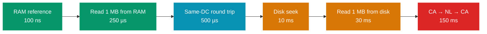
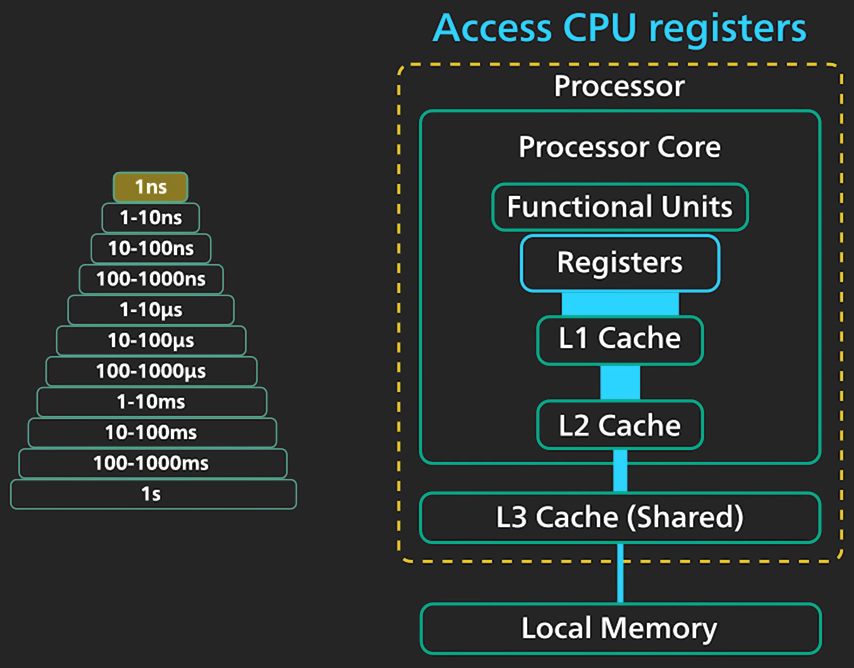
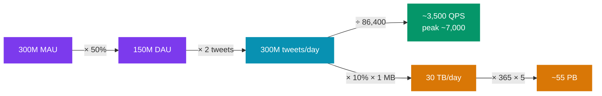

# Ch 2: Back-of-the-Envelope Estimation

> 📖 **Vol 1, Chapter 2** (book pages 34–41) &nbsp;·&nbsp; 🔥 High Priority &nbsp;·&nbsp; 💬 **17 Questions · 15 Practice Problems**  
> **Source:** Alex Xu, *System Design Interview Vol 1*, Ch 2. Page, table and figure numbers below are the book's.

---

📊 **Question Count**

| # | Section | Questions |
|---|---|---|
| 1 | [Why Estimate, and the Power of Two ⚡](#1--why-estimate-and-the-power-of-two-p3435-) | 2 |
| 2 | [Latency Numbers Every Programmer Should Know 🔥](#2--latency-numbers-every-programmer-should-know-p3637-) | 2 |
| 3 | [Availability Numbers 🔥](#3--availability-numbers-p38-) | 1 |
| 4 | [Worked Example — Twitter QPS and Storage 🔥🔥](#4--worked-example--twitter-qps-and-storage-p39-) | 1 |
| 5 | [Tips, and the Common Estimates 🔥](#5--tips-and-the-common-estimates-p40-) | 6 |
| 6 | [Estimation Framework and Starting Numbers 🔥](#6--estimation-framework-and-starting-numbers--beyond-the-book-) | 5 |
| 7 | [Practice Problems — Easy 🔥🔥](#7--practice-problems--easy-) | 5 problems |
| 8 | [Practice Problems — Medium 🔥](#8--practice-problems--medium-) | 6 problems |
| 9 | [Practice Problems — Hard ⚡](#9--practice-problems--hard-) | 4 problems |
| | **Total** | **17 + 15 problems** |

> 🔥🔥 Very high priority — asked in almost every Tier-1 interview loop &nbsp;·&nbsp; 🔥 High priority — very frequent in Tier-1 interviews &nbsp;·&nbsp; ⚡ Medium priority — commonly asked &nbsp;·&nbsp; 💤 Low priority — good to know, rarely asked

---

## 🗒️ Cheat Sheet

<details>
<summary><strong>🗒️ Show cheat sheet</strong></summary>

### 🎯 Clarifying Questions — and the book's answers
The book's only worked example is Twitter (p.39). These are the inputs you must fix before you calculate.

| Question | Book's answer (p.39) |
|---|---|
| How many users? MAU or DAU? | **300 million MAU** |
| What share of them is active each day? | **50%** → 150 million DAU |
| How many writes per user per day? | **2 tweets** per user per day |
| How big is one object? | tweet_id 64 bytes · text 140 bytes · media **1 MB** |
| What share of objects has media? | **10%** of tweets |
| How long do we keep the data? | **5 years** |
| What is peak traffic? | **2 × average QPS** |

📎 Also ask: the read/write ratio, and the latency and availability targets. The book's example does not need them.

### 🏗️ Core Components
The book says three concepts must be "well understood" (p.34):

- **Power of two** — data volume units (Table 2-1, p.35).
- **Latency numbers** — how long common computer operations take (Table 2-2, Figure 2-1, p.36–37).
- **Availability numbers** — how many "nines" mean how much downtime (Table 2-3, p.38).

Then it applies them in one example (Twitter, p.39) and gives four tips (p.40).

### 💡 Key Insights
1. **The process matters more than the result** (p.40). The interviewer tests how you solve the problem, not your arithmetic.
2. **Round hard.** `99987 / 9.1` becomes `100,000 / 10` (p.40). Precision is not expected.
3. **Write down your assumptions and label your units.** "5" is unclear. "5 MB" is not (p.40).
4. **Memory is fast, disk is slow, and the network between regions is slowest** (p.37). Most design choices (cache, compress, stay in one region) come from this one line.
5. **Each extra nine cuts the downtime by 10×** (Table 2-3). 99.9% allows 8.77 hours a year; 99.99% allows only 52.60 minutes.

### ⚖️ Trade-offs / Alternatives
| Option | Pro | Con | Book's verdict |
|---|---|---|---|
| Exact maths (`99987 / 9.1`) | Precise | Wastes interview time | ❌️ "Precision is not expected" (p.40) |
| Round numbers (`100,000 / 10`) | Fast; easy to check | Small error | ✅ Use round numbers (p.40) |
| Keep assumptions in your head | Faster to start | You forget them; the interviewer cannot follow | ❌️ Write them down (p.40) |
| Bare numbers ("5") | Faster to write | You confuse KB and MB | ❌️ Label your units (p.40) |
| Estimate everything (text + media) | Complete | More time | The book estimates **media only** (p.39) — text is too small to matter (§4) |
| Peak = average | Simple | Outages at every spike | The book uses **peak = 2 × average** (p.39) |

### 🔢 Numbers to Remember
| What | Value | Arithmetic |
|---|---|---|
| Seconds in a day | **86,400** (≈ 10^5) | 24 × 60 × 60 = 86,400 |
| 1 KB / MB / GB / TB / PB | **2^10 / 2^20 / 2^30 / 2^40 / 2^50** bytes | ≈ thousand / million / billion / trillion / quadrillion (Table 2-1) |
| One ASCII character | **1 byte** (8 bits) | p.35 |
| RAM access vs disk seek (2010) | **100 ns vs 10 ms** | 10,000,000 ÷ 100 = **10^5 ×** slower |
| Read 1 MB: memory vs disk (2010) | **250 µs vs 30 ms** | 30,000 ÷ 250 = **120 ×** slower |
| Same-datacenter round trip | **500 µs** (0.5 ms) | Table 2-2 |
| California → Netherlands → California | **150 ms** | Table 2-2; still 150 ms in the 2020 figure |
| Cloud provider SLAs | **99.9% or above** | Amazon, Google, Microsoft (p.38) |
| 99.9% downtime | **8.77 h/year · 1.44 min/day** | 0.001 × 8,766 h = 8.77 h · 0.001 × 1,440 min = 1.44 min |
| 99.99% downtime | **52.60 min/year · 8.64 s/day** | 0.0001 × 525,960 min = 52.60 · 0.0001 × 86,400 s = 8.64 |
| Twitter DAU | **150 million** | 300M MAU × 50% |
| Twitter tweet QPS | **~3,500** | 150M × 2 ÷ 86,400 = 3,472 |
| Twitter peak QPS | **~7,000** | 2 × 3,500 |
| Twitter media per day | **30 TB** | 150M × 2 × 10% × 1 MB = 30M MB |
| Twitter media in 5 years | **~55 PB** | 30 TB × 365 × 5 = 54,750 TB |
| 📎 Requests per day → QPS | **divide by ~10^5** | 10M/day ÷ 10^5 = 100 QPS (exact: 116) |
| 📎 Bandwidth | **10K QPS × 1 KB = 10 MB/s** | 10^4 × 10^3 B = 10^7 B/s |
| 📎 Seconds in a month / a year | **~2.5M / ~31.5M** | 30 × 86,400 = 2.59M · 365 × 86,400 = 31.5M |
| 📎 Bengaluru → us-east-1 round trip | **~200 ms** | The reason for a CDN, an India region, or an async design (§2) |
| 📎 Five services at 99.9% in series | **99.5%** | 0.999^5 = 0.995 (§3) |
| 📎 Redis, one instance | **~100K ops/s** | §5 capacity anchors |
| 📎 Typical object sizes | photo **~300 KB** · 1 min of 720p video **~50 MB** · DB row **100 B–1 KB** | Rough anchors; state them as assumptions |

---

</details>
<br/>

---

## 1. 🔢 Why Estimate, and the Power of Two (p.34–35) ⚡

Sometimes the interviewer asks you to estimate **system capacity** or **performance requirements** (p.34). You do it "on the back of an envelope": quick, rough, and out loud.

The book quotes **Jeff Dean** (Google Senior Fellow) (p.34):

> "Back-of-the-envelope calculations are estimates you create using a combination of thought experiments and common performance numbers to get a good feel for which designs will meet your requirements."

So the goal is **to choose a design**, not to get an exact number. You need three basics first: power of two, latency numbers, and availability numbers.

### Power of two (Table 2-1, p.35)

Data volume can be huge in a distributed system. But the maths always comes down to the basics. You must know the data volume units as powers of 2.

- A **byte** is 8 bits.
- One **ASCII character** uses one byte.

| Power | Approximate value | Full name | Short name |
|---|---|---|---|
| 10 | 1 Thousand | 1 Kilobyte | 1 KB |
| 20 | 1 Million | 1 Megabyte | 1 MB |
| 30 | 1 Billion | 1 Gigabyte | 1 GB |
| 40 | 1 Trillion | 1 Terabyte | 1 TB |
| 50 | 1 Quadrillion | 1 Petabyte | 1 PB |

**Quick trick:** 2^10 = 1,024 ≈ 10^3. So each step up the table is about **1,000×**.

📎 **The unit ladder — moving between units.** Each step up the ladder is **÷ 1,000** (3 zeros).

| Power of 10 | Bytes | Unit |
|---|---|---|
| 10^0 | 1 | 1 byte |
| 10^3 | 1,000 | 1 KB |
| 10^6 | 1,000,000 | 1 MB |
| 10^9 | 1,000,000,000 | 1 GB |
| 10^12 | 1,000,000,000,000 | 1 TB |
| 10^15 | 1,000,000,000,000,000 | 1 PB |

**How to use it:** subtract the powers. MB → TB is 10^12 ÷ 10^6 = 10^6, so divide by 1 million: 30 million MB = **30 TB** (§4).

<details>
<summary><strong>📎 Examples — moving between units</strong></summary>

| From → To | Steps | Divide by | Example |
|---|---|---|---|
| KB → MB | 1 | 10^3 | 5,000 KB = 5 MB |
| MB → GB | 1 | 10^3 | 30,000 MB = 30 GB |
| GB → TB | 1 | 10^3 | 30,000 GB = 30 TB |
| TB → PB | 1 | 10^3 | 54,750 TB ≈ 55 PB |
| KB → GB | 2 | 10^6 | 2,000,000 KB = 2 GB |
| MB → TB | 2 | 10^6 | 30,000,000 MB = 30 TB |
| GB → PB | 2 | 10^6 | 5,000,000 GB = 5 PB |
| KB → TB | 3 | 10^9 | 15,000,000,000 KB = 15 TB |
| MB → PB | 3 | 10^9 | 612,000,000 MB ≈ 0.6 PB |

---

</details>
<br/>

Going down the ladder (TB → MB) is the same, but you **multiply**. Say each step out loud: "million MB is thousand GB is one TB". Missing one step makes the answer **1,000× wrong**.

📎 **The time ladder:**

```
seconds → minutes → hours → days           60, 60, 24
1 day   = 86,400 s       (≈ 100,000 — round to 10^5 and fix at the end)
1 month ≈ 2.6M s         1 year ≈ 31.5M s (≈ 3 × 10^7)
```

**Shortcut:** 1 million requests per day ≈ **12 per second** (10^6 ÷ 86,400 = 11.6). Example: 300 million per day ≈ 300 × 12 = 3,600 per second.

📎 **Three common unit mistakes.** Almost every wrong estimate comes from a unit error, not a modelling error. Each one below appeared in earlier versions of these notes:

| Mistake | Example | Guard |
|---|---|---|
| **Skipping rungs** | `612,000,000 MB` written as "612 PB" (it is **612 TB** — two divisions by 1,000, not three) | Say the ladder aloud: MB → GB → TB |
| **Monthly read as daily** | UPI's published ~16.7B is **per month** (~550M/day). If you treat it as daily, everything becomes ~30× too big | Ask "per day or per month?" before you divide |
| **Multiplying a duration by a rate** | `60B minutes × 4 Mbps` has no meaning — the units do not match | Convert to *concurrency* first: viewer-seconds ÷ 86,400 |

📎 **The concurrency conversion.** You need it for any bandwidth estimate (P05, P08):

```
total minutes watched/day × 60  =  viewer-seconds/day
viewer-seconds/day ÷ 86,400     =  average concurrent users
average concurrent × per-user bitrate = aggregate bandwidth
```

> 📎 **The 2.4% gap does not matter.** 2^10 is 1,024, not 1,000. At the PB level, 2^50 is about 1.13 × 10^15, so the gap grows to ~13%. In an interview this never changes the design. Use powers of 10 and move on.

### 📎 Indian ↔ Western number system

You need this when the interviewer gives Indian numbers (Swiggy, PhonePe, Zomato users in lakh or crore).

| Value | Western | Indian | Power of 10 |
|---|---|---|---|
| 1,000 | 1 Thousand | 1 Hazaar | 10³ |
| 1,00,000 | 100 Thousand | **1 Lakh** | 10⁵ |
| 10,00,000 | **1 Million** | 10 Lakh | 10⁶ |
| 1,00,00,000 | 10 Million | **1 Crore** | 10⁷ |
| 1,00,00,00,000 | **1 Billion** | **100 Crore** | 10⁹ |
| 1,00,00,00,00,000 | **1 Trillion** | **1 Lakh Crore** | 10¹² |

**Three anchors to memorize:**
```
1 Million   =  10 Lakh       (10⁶)
1 Billion   = 100 Crore      (10⁹)
1 Trillion  =   1 Lakh Crore (10¹²)
```

**Common trap:** in the Western system, each named step (thousand → million → billion → trillion) is **1,000×**, not 100×.

**India-scale reference:**

| Scenario | Western | Indian |
|---|---|---|
| Small app DAU | 1M users | 10 Lakh users |
| Mid-scale app DAU | 10M users | 1 Crore users |
| Large app (Swiggy / Zomato scale) | 50M users | 5 Crore users |
| India scale (WhatsApp / YouTube) | 500M users | 50 Crore users |
| Global scale | 1B users | 100 Crore users |
| Storage: 1 TB of files per day | 1 Billion KB | 100 Crore KB |

### ❓ Interview Questions

1. **What is a back-of-the-envelope estimation, and why do interviewers ask for one? 🔥**

<!-- -->
<details>
<summary>💡 Show Answer</summary>

**Answer:**

It is a quick, rough estimate of **capacity** or **performance**. You use a few thought experiments and common performance numbers (p.34). Jeff Dean's definition: the goal is "to get a good feel for which designs will meet your requirements".

Interviewers ask for it because:

- **The process matters more than the result** (p.40). They test how you break a problem down.
- The numbers decide the design. 100 QPS fits on one server. 100,000 QPS needs caching, sharding and many servers.

You need three basics: power of two, latency numbers, and availability numbers (p.34).

---

</details>

---

## 2. 🚦 Latency Numbers Every Programmer Should Know (p.36–37) 🔥

Dr. Dean published these numbers in **2010** (p.36). Some are out of date, because computers are now faster. But they still show which operations are fast and which are slow.

### Table 2-2 — Dean's numbers (2010)

| Operation name | Time |
|---|---|
| L1 cache reference | 0.5 ns |
| Branch mispredict | 5 ns |
| L2 cache reference | 7 ns |
| Mutex lock/unlock | 100 ns |
| Main memory reference | 100 ns |
| Compress 1K bytes with Zippy | 10,000 ns = 10 µs |
| Send 2K bytes over 1 Gbps network | 20,000 ns = 20 µs |
| Read 1 MB sequentially from memory | 250,000 ns = 250 µs |
| Round trip within the same datacenter | 500,000 ns = 500 µs |
| Disk seek | 10,000,000 ns = 10 ms |
| Read 1 MB sequentially from the network | 10,000,000 ns = 10 ms |
| Read 1 MB sequentially from disk | 30,000,000 ns = 30 ms |
| Send packet CA (California) → Netherlands → CA | 150,000,000 ns = 150 ms |

**Units** (p.36): 1 ns = 10^-9 s · 1 µs = 10^-6 s = 1,000 ns · 1 ms = 10^-3 s = 1,000 µs = 1,000,000 ns.

📎 Two rows you can check yourself:

- **Send 2K bytes over 1 Gbps:** 2,000 × 8 = 16,000 bits ÷ 10^9 bits/s = 16 µs ≈ **20 µs**.
- **Read 1 MB from the network:** 8 × 10^6 bits ÷ 10^9 bits/s = 8 ms ≈ **10 ms**.

### Figure 2-1 — the same numbers as of 2020 (p.37)

A Google engineer built a tool that shows Dean's numbers by year. Figure 2-1 shows the **2020** values:

> 📎 **These are projections, not measurements.** The tool's slider stops at 2020, and no newer official table exists. For numbers measured on today's hardware, see **Latency by order of magnitude (modern hardware)** at the end of §2.

| Operation | 2010 (Table 2-2) | 2020 (Figure 2-1) |
|---|---|---|
| L1 cache reference | 0.5 ns | 1 ns |
| Branch mispredict | 5 ns | 3 ns |
| L2 cache reference | 7 ns | 4 ns |
| Mutex lock/unlock | 100 ns | 17 ns |
| Main memory reference | 100 ns | 100 ns |
| Compress 1 KB with Zippy | 10 µs | 2 µs |
| Send 2,000 bytes over the network | 20 µs | 44 ns (commodity network) |
| **SSD random read** | — | **16 µs** |
| Read 1 MB sequentially from memory | 250 µs | 3 µs |
| Read 1 MB sequentially from **SSD** | — | **49 µs** |
| Round trip in the same datacenter | 500 µs | 500 µs |
| Disk seek | 10 ms | 2 ms |
| Read 1 MB sequentially from disk | 30 ms | 825 µs |
| Packet round trip CA → Netherlands | 150 ms | 150 ms |

> 📎 **Why the two columns differ so much.** The tool projects the 2010 numbers forward with growth trends. Its 2020 values are estimates, not measurements. Note what did **not** change: memory reference (100 ns), datacenter round trip (500 µs) and the cross-ocean round trip (150 ms). The speed of light does not improve.

### The book's five conclusions (p.37)

- Memory is fast but the disk is slow.
- Avoid disk seeks if possible.
- Simple compression algorithms are fast.
- Compress data before sending it over the internet if possible.
- Data centers are usually in different regions, and it takes time to send data between them.



*The 2010 numbers from Table 2-2, slowest on the right.*

<details>
<summary><strong>🤔 Doubt: Do I have to memorize the entire latency table?</strong></summary>

**No. Memorize a few anchors and the ratios, not every row.**

**The numbers worth memorizing:**

| Operation | Latency | Why it matters in interviews |
|---|---|---|
| Main memory reference | 100 ns | Why an in-memory cache is fast |
| Same-datacenter round trip | 0.5 ms | The cost of every service-to-service call |
| Disk seek (HDD) | 10 ms | Why you avoid random disk reads |
| Cross-continent round trip | 150 ms | Why you add a CDN or a second region |
| 📎 Indexed DB query | ~1–5 ms | Baseline for "is the DB fast enough?" |

📎 A **Redis call** from your service costs about **one same-DC round trip** (≤ 0.5 ms by the book's number). The work inside Redis is only microseconds. So "Redis vs DB" is roughly **0.5 ms vs 1–5 ms**, about **2–10× faster**. The gap grows when the DB query is not indexed.

**What you never need to recite:** L1 (0.5 ns), L2 (7 ns) and branch mispredict (5 ns). They matter for low-level programming, not for system design.

**How to use them in an interview (this is the real skill).** You do not recite numbers. You use them to justify a decision:
- "An indexed DB query is a few ms. A Redis call is under 1 ms. For a hot read path, the cache is worth it."
- "Cross-continent is 150 ms. That breaks a 100 ms latency SLO, so we need a regional deployment." (📎 A latency target is usually an **SLO**, not an SLA — see the SLI / SLO / SLA doubt in §3.)
- "An HDD seek is 10 ms. One disk does only ~100 random reads per second. We need SSDs or a cache."

📎 The last line: 1 s ÷ 10 ms = **100 seeks per second** per disk.

---

</details>
<br/>

<details>
<summary><strong>🤔 Doubt: Redis vs DB in the same data centre — where does the time go?</strong></summary>

📎 **Short answer:** for Redis, the network round trip is the bottleneck. For the DB, the database's own work is.

**A Redis read takes about 1–10 µs inside Redis, not 1 ns.** One RAM access is ~100 ns. A Redis GET also reads the command, finds the key in a hash table, and writes the reply. That adds up to a few microseconds.

**Both calls pay the same network trip.** The DB's 1–5 ms already includes it:
```
Redis GET  = network round trip (~0.5 ms) + work in Redis (~0.005 ms)  ≈ 0.5 ms
DB query   = network round trip (~0.5 ms) + work in the DB (0.5–4.5 ms) ≈ 1–5 ms
```
- **Redis:** ~99% of the time is the network.
- **DB:** most of the time is the database's work — parse and plan the query, read the index, maybe read from disk.

So Redis saves the **database's work**, not the network trip.

**What follows from this:**
- **A faster Redis server does not help much.** The time is in the network.
- **To make Redis reads faster, cut the round trips:**
  - `MGET` or pipelining: 100 keys in 1 round trip, not 100.
  - A **local in-process cache** (Caffeine, a `HashMap`): no network at all, so ~100 ns to a few µs. That is ~100× faster than Redis. The cost is that each app instance has its own copy, which can go stale.
- **The usual layers:** local cache → Redis → DB. Each layer is about 10–100× faster than the one below it.

---

</details>
<br/>

### 📎 Latency by order of magnitude (modern hardware)

Do not memorise this table. Memorise the **pattern**:

- Each unit (ns → µs → ms → s) is 1,000× the one before it. Each table row is 10×.
- A network round trip is ~5,000× a memory reference inside one data centre, and ~10^6× across continents.

| Magnitude | Operations |
|---|---|
| **< 1 ns** | CPU register access, one clock cycle |
| **1 – 10 ns** | L1 / L2 cache access; branch mispredict (~20 cycles) |
| **10 – 100 ns** | L3 cache; **main memory reference** |
| **100 ns – 1 µs** | Linux syscall (trap/return); MD5 of a 64-bit value (~200 ns) |
| **1 – 10 µs** | Thread context switch; copy 64 KB in memory |
| **10 – 100 µs** | nginx handling an HTTP request (~50 µs); read 1 MB sequentially from memory (~50 µs); **SSD read** (8K page, ~100 µs) |
| **100 µs – 1 ms** | SSD **fsync'd write** (~1 ms on consumer drives with no power-loss protection; a cached write is ~10–30 µs); **intra-AZ RTT** (few hundred µs, e.g. ~250 µs measured on AWS); **inter-AZ RTT** (~0.8 ms average measured on AWS; AWS says "single-digit ms" is typical); Redis/Memcached GET (~1 ms measured at the client, network included) |
| **1 – 10 ms** | HDD seek (~5 ms); inter-AZ RTT on a bad day (AWS's own upper bound) |
| **10 – 100 ms** | US-East ↔ US-West RTT; US-East ↔ Europe RTT; read 1 GB sequentially from memory |
| **100 ms – 1 s** | **bcrypt** (~300 ms, slow on purpose); TLS handshake (1–2 RTTs; 250–500 ms across continents); US-West ↔ Singapore RTT; read 1 GB from SSD; transfer 1 GB in-region at 10 Gbps (~1 s) |
| **> 1 s** | Transfer 1 GB over a 1 Gbps link (~10 s — the old figure; cloud instances now get 10–25 Gbps) |

**The three you will actually use in an answer:**

- Memory reference ≈ **100 ns** · SSD read ≈ **100 µs** · same-DC round trip ≈ **0.5 ms**
- **Bengaluru → us-east-1 ≈ 200 ms RTT** (AWS Mumbai ap-south-1 ↔ us-east-1 is ~193 ms; from a home ISP it can reach ~280 ms). This number is the reason for a CDN, an India region, or an async design.
- Sequential disk ≈ **600 MB/s** vs random ≈ **100 KB/s** (Kafka docs: six 7200-rpm SATA HDDs in RAID-5). The *ratio* explains why append-only logs (Kafka, LSM trees) are fast. The absolute figures do not.

> ⚠️ **Dean's 2010 figures are out of date as absolute values — and so are some 2020 projections.**
>
> - 1 MB from RAM is ~50 µs on real hardware — not 250 µs (Table 2-2), and not the 3 µs that Figure 2-1 projects.
> - 1 MB from NVMe is ~70–300 µs (3.5–14 GB/s, PCIe 3.0–5.0) — not 1 ms, and slower than Figure 2-1's 49 µs.
>
> The *ratios* still teach the lesson. Say how many times faster or slower one thing is, not old absolute numbers.

*Network numbers last checked 2026-10-16: AWS Architecture Blog (AZ affinity), ThousandEyes inter-AZ study (NANOG75), economize.cloud AWS inter-region table. Hardware rows come from vendor specs (NVMe PCIe 3.0–5.0: 3.5–14 GB/s) and the Kafka docs.*



### 📎 The memory and storage map — from L1 cache to CDN

<details>
<summary><strong>🗺️ Show the map</strong></summary>

The latency tables mix two different kinds of things. Separate them first:

- **Hardware inside one computer:** L1, L2, L3, RAM, SSD, HDD. These are physical parts.
- **Software services on other computers:** Redis, the DB, the CDN. These are programs. Each one runs on its own servers and uses the same hardware.

**Part 1 — Inside one computer (hardware).** Each level down is bigger, cheaper and slower.

```
                 ┌──────────── CPU chip ────────────┐
                 │  Core                            │
   fastest       │   ├─ Registers     (< 1 ns)      │
   smallest      │   ├─ L1 cache      (~1 ns)   KB  │
      ▲          │   └─ L2 cache      (~4 ns)   MB  │
      │          │  L3 cache (shared) (~10–40 ns) MB│
      │          └──────────────────────────────────┘
      │                        │
      │          RAM = main memory   (~100 ns)    GB      ← lost when power goes off
      │                        │
      │          ┌──── Disk (storage) ────┐
      ▼          │  SSD   (~100 µs)   TB  │               ← survives power off
   slowest       │  HDD   (~5–10 ms)  TB  │
   biggest       └────────────────────────┘
```

**Three facts that remove most of the confusion:**

1. **Main memory and RAM are the same thing.** "Main memory reference" in Table 2-2 means "read from RAM".
2. **"Disk" is the general word for permanent storage.** SSD and HDD are the two kinds:
   - **SSD:** flash chips, no moving parts, fast.
   - **HDD:** a spinning plate and a moving arm. A "seek" means moving the arm. That is why it is slow.
3. **L1, L2 and L3 sit on the CPU chip itself.** The CPU fills them automatically. They keep recently used RAM data close to the core. A backend engineer never controls them, so in system design you can almost ignore them.

**Part 2 — Across the network (software services).** Each of these runs on **another machine**. So every call also pays a **network round trip**: ~0.5 ms in the same data centre, ~200 ms from India to the US.

| Service | What it really is | Where it keeps data | Typical time per call |
|---|---|---|---|
| **Redis** | A program that holds key-value data | In the **RAM** of the Redis server | ~0.5 ms (almost all of it is network) |
| **DB** (MySQL, Postgres) | A program that stores tables safely | On the **SSD/HDD** of the DB server, with hot pages cached in its RAM (the "buffer pool") | ~1–5 ms (indexed query) |
| **CDN** (CloudFront, Akamai) | Many servers placed close to users | Copies of files (images, video, JS) on those servers' RAM/SSD | ~10–30 ms, instead of ~200 ms to the origin |

- **Redis is fast because it lives in RAM.**
- **The DB is slower because it must write to disk** to keep data safe.
- **The CDN is fast for a different reason:** it is **close to the user**. It cuts the network distance, not the storage time.

**Part 3 — How they fit together in one request.** A user in Bengaluru opens a product page:

```
User (Bengaluru)
   │
   ├── image, JS, CSS ──► CDN edge in Mumbai            (~20 ms, not ~200 ms)
   │
   └── API call ──► App server (your Spring Boot service)
                       │
                       ├─ 1. Local cache (its own RAM)    ~100 ns – µs   hit? done
                       ├─ 2. Redis (RAM, other server)    ~0.5 ms        hit? done
                       └─ 3. DB (disk, other server)      ~1–5 ms        the source of truth
                                 └─ inside: buffer pool (RAM) → SSD
```

The app checks the local cache first, then Redis, then the DB. It stops at the first hit. The DB is the **source of truth** — the caches only hold copies.

**The pattern is the same at every level: keep a small, fast copy in front of a big, slow store.**

| Small, fast copy | In front of |
|---|---|
| L1 / L2 / L3 | RAM |
| RAM (buffer pool) | The DB's disk |
| Local cache, Redis | The DB |
| CDN | Your origin servers |

Every "cache" question in system design is this one idea at a different level.

**One table to remember:**

| Thing | Type | Speed | Size | Survives restart? |
|---|---|---|---|---|
| L1 / L2 / L3 | Hardware, on the CPU | 1–40 ns | KB–MB | No |
| RAM (main memory) | Hardware | ~100 ns | GB | No |
| SSD | Hardware (disk) | ~100 µs | TB | Yes |
| HDD | Hardware (disk) | ~5–10 ms | TB | Yes |
| Redis | Software, uses RAM | ~0.5 ms over the network | GB | Only with persistence turned on |
| DB | Software, uses disk + RAM | ~1–5 ms | TB | Yes |
| CDN | Software, servers near users | ~10–30 ms to the user | PB, spread out | Yes (it is a copy) |

---

</details>
<br/>

### ❓ Interview Questions

1. **Why do latency numbers matter in system design, and what does the book conclude from them? 🔥**

<!-- -->
<details>
<summary>💡 Show Answer</summary>

**Answer:**

Latency numbers let you **justify** architecture decisions. The book's conclusions from Figure 2-1 (p.37):

- **Memory is fast, disk is slow.** RAM reference 100 ns vs disk seek 10 ms = 10^5× (2010 numbers). → Cache hot data in memory.
- **Avoid disk seeks.** → Use indexes, sequential writes, SSDs.
- **Simple compression is fast** (Zippy: 10 µs per 1 KB in 2010). → It costs little CPU.
- **Compress before sending over the internet.** → Network time is far bigger than compression time.
- **Data centers are in different regions, and data takes time to travel** (CA → Netherlands → CA = 150 ms). → Avoid synchronous calls across regions.

📎 Rule-of-thumb numbers to add: an indexed DB query is ~1–5 ms. A Redis call is about one same-DC round trip (≤ 0.5 ms).

---

</details>

---

2. **The book shows latency numbers for 2010 and 2020. What changed, and what did not? ⚡**

<!-- -->
<details>
<summary>💡 Show Answer</summary>

**Answer:**

- **Changed a lot** (Table 2-2 → Figure 2-1): read 1 MB from memory 250 µs → **3 µs** · disk seek 10 ms → **2 ms** · read 1 MB from disk 30 ms → **825 µs**. New **SSD** rows: random read **16 µs**, read 1 MB sequentially **49 µs**.
- **Did not change:** main memory reference **100 ns** · same-datacenter round trip **500 µs** · California → Netherlands round trip **150 ms**.

**The lesson:** hardware gets faster, but **distance does not**. Network round trips are now the biggest cost. So the conclusions "avoid calls between regions" and "compress before sending" matter even more today.

📎 The 2020 values come from a tool that projects trends. They are estimates, not measurements.

---

</details>

---

## 3. 📈 Availability Numbers (p.38) 🔥

**High availability** means a system keeps working for a long time without stopping. It is measured as a percentage. 100% means **zero downtime**. Most services are between 99% and 100% (p.38).

A **service level agreement (SLA)** is an agreement between you (the service provider) and your customer. It formally defines the level of **uptime** your service will deliver. Amazon, Google and Microsoft set their SLAs at **99.9% or above**. Uptime is measured in **nines**. More nines is better.

<details>
<summary><strong>🤔 Doubt: SLI vs SLO vs SLA — what is the difference?</strong></summary>

📎 The book defines only the SLA. The three terms are easy to mix up:

| Term | Full form | What it is | Example |
|---|---|---|---|
| **SLI** | Service Level **Indicator** | The number you measure | p99 latency = 120 ms |
| **SLO** | Service Level **Objective** | Your internal target for that number | p99 latency < 100 ms |
| **SLA** | Service Level **Agreement** | A contract with a customer, with a penalty | 99.9% uptime, or you get service credits |

- **SLI → SLO → SLA.** You measure an SLI. You set a target on it (SLO). You promise a looser version of it to customers (SLA).
- **A latency target is usually an SLO.** It is an internal goal. Nobody pays a penalty when you miss it.
- **SLAs are mostly about uptime**, like the 99.9% cloud SLAs above. Few SLAs promise a latency number.
- **The SLO is stricter than the SLA.** Example: SLO 99.95%, SLA 99.9%. You break your own target first, so you have time to fix things before you break the contract.

**In an interview:** say "a 100 ms latency SLO", not "SLA". Most interviewers understand both, but the exact word shows you know the difference.

---

</details>
<br/>

### Table 2-3 (p.38)

| Availability % | Downtime per day | 📎 Downtime per month | Downtime per year |
|---|---|---|---|
| 99% | 14.40 minutes | 7.31 hours | 3.65 days |
| 99.9% ("three nines") | 1.44 minutes | **43.83 minutes** | 8.77 hours |
| 📎 99.95% | 43.20 seconds | 21.92 minutes | 4.38 hours |
| 99.99% ("four nines") | 8.64 seconds | **4.38 minutes** | 52.60 minutes |
| 99.999% ("five nines") | 864.00 milliseconds | 26.30 seconds | 5.26 minutes |
| 99.9999% | 86.40 milliseconds | 2.63 seconds | 31.56 seconds |

📎 The book's table has only the per-day and per-year columns. The **per-month** column and the **99.95%** row are added here, because SLAs are often measured per month and 99.95% is a common cloud SLA. A month here is 1/12 of the book's 365.25-day year (30.44 days).

📎 **How to work out any row:** downtime = (1 − availability) × period.

```
99.99% per day:   0.0001 × 86,400 s          = 8.64 s
99.99% per year:  0.0001 × 365.25 × 1,440 min = 52.60 min
```

📎 The book's year has **365.25 days**. That is why it prints 52.60 minutes, not 52.56 (which you get with 365 days). Either is fine in an interview.

📎 **Rule of thumb:** each extra nine divides the downtime by 10. "Three nines" ≈ 9 hours a year. "Four nines" ≈ 1 hour. "Five nines" ≈ 5 minutes.

📎 **Combining availabilities — the part candidates miss:**

```
Series (a request needs all of them):    A_total = A₁ × A₂ × … × Aₙ
Parallel (redundant copies):             A_total = 1 − (1−A)ⁿ
```

Five services at 99.9% in a **serial** call chain give **99.5%**. That is worse than any single one.

- This arithmetic is why you add async steps, caching and graceful degradation.
- Mention it yourself, before the interviewer asks for it.

> Redundancy raises availability **only** when failures are *independent*.
> Copies on the same rack, in the same AZ, with the same deploy or the same expired certificate are not independent.
> Copies in different **failure domains** (parts that fail separately) give you availability. Redundancy of identical
> things does not.

### ❓ Interview Questions

1. **What does 99.99% availability mean in practice, and how do you achieve it? 🔥**

<!-- -->
<details>
<summary>💡 Show Answer</summary>

**Answer:**

**The book's numbers** (Table 2-3, p.38): 99.99% ("four nines") allows **8.64 seconds** of downtime per day, or **52.60 minutes** per year. Compare: 99.9% allows **8.77 hours** a year. Each extra nine cuts the downtime by 10×.

An **SLA** is the agreement that formally defines the uptime you promise your customer. Amazon, Google and Microsoft set theirs at **99.9% or above** (p.38).

📎 **How to reach four nines:**

- Redundant servers, so there is no single point of failure (SPOF).
- Load balancers with health checks.
- Automatic database failover (for example RDS Multi-AZ).
- A CDN for static assets.
- Several availability zones or data centers.

📎 Going from 99.9% to 99.99% is much harder. It needs mature runbooks and chaos testing. For a small company it can cost more than the downtime it prevents.

📎 **Serial dependencies multiply.** If a request needs two services, each at 99.9%, the total is 0.999 × 0.999 ≈ **99.8%**.

---

</details>

---

## 4. 🐦 Worked Example — Twitter QPS and Storage (p.39) 🔥🔥

The book says these numbers are **for the exercise only**. They are not real Twitter numbers.

**Assumptions** (p.39):

- 300 million monthly active users (MAU).
- 50% of users use Twitter daily.
- Users post 2 tweets per day on average.
- 10% of tweets contain media.
- Data is stored for 5 years.

**QPS estimate:**
```
DAU        = 300 million × 50%                           = 150 million
Tweets QPS = 150 million × 2 tweets ÷ 24 h ÷ 3,600 s     ≈ 3,500    (exact: 3,472)
Peak QPS   = 2 × QPS                                     ≈ 7,000
```

<details>
<summary><strong>🤔 Doubt: How does "150 million × 2 tweets ÷ 24 hours ÷ 3,600 seconds ≈ 3,500" work?</strong></summary>

The formula changes **tweets per day** into **tweets per second**. Servers are sized by load per second.

**Step 1 — Tweets per day**
```
150 million users × 2 tweets each = 300 million tweets per day
```

**Step 2 — Seconds in a day**
```
24 hours × 3,600 seconds = 86,400 seconds per day
```
Dividing by 24 and then by 3,600 is the same as dividing once by 86,400.

**Step 3 — Divide**
```
300,000,000 ÷ 86,400 ≈ 3,472  →  round to ~3,500 tweets per second
```
So on an average second, about 3,500 new tweets arrive. This is the **write QPS**.

**How to do it in your head.** Exact division by 86,400 is hard in an interview. Round 86,400 to **100,000 (10^5)**:
```
300,000,000 ÷ 100,000 = 3,000
```
You divided by a slightly bigger number, so the answer is about 14% low. Say "about 3,000 to 3,500" and move on. Precision is not expected (p.40).

📎 **Second shortcut:** 1 million requests per day ≈ **12 per second** (10^6 ÷ 86,400 = 11.6).
```
300 million per day ≈ 300 × 12 = 3,600 per second
```
This is also close to 3,500.

**What the number is for:**
- **Peak QPS** — the book doubles the average: 2 × 3,500 ≈ **7,000**. You size the system for the peak, not the average.
- **Design choice** — 📎 7,000 writes per second is too much for one plain database server. You need to plan for sharding or a write queue.
- **Reads are a different number** — 3,500 counts only *writes*. People read timelines far more often than they post. With a 100:1 read/write ratio, reads are about **350,000 QPS**. That is why caching matters.

---

</details>
<br/>

**Storage estimate.** The book estimates **media storage only**. Average tweet size:

- `tweet_id` — 64 bytes
- `text` — 140 bytes
- `media` — 1 MB

```
Media per day  = 150 million × 2 × 10% × 1 MB  = 30 million MB = 30 TB per day
Media, 5 years = 30 TB × 365 × 5               = 54,750 TB     ≈ 55 PB
```

<details>
<summary><strong>🤔 Doubt: How does "150 million × 2 × 10% × 1 MB = 30 million MB = 30 TB per day" work?</strong></summary>

This line works out how much new photo and video data arrives each day.

**Step 1 — Tweets per day**
```
150 million users × 2 tweets = 300 million tweets per day
```

**Step 2 — Tweets that carry media.** The book assumes only 10% of tweets have media.
```
300 million × 10% = 30 million media tweets per day
```

**Step 3 — Size per day.** Each media file is 1 MB.
```
30 million × 1 MB = 30 million MB per day
```

**Step 4 — Change the unit (MB → TB).** MB to TB is **two** steps on the unit ladder (§1), so divide by 1,000 twice:
```
30,000,000 MB ÷ 1,000 = 30,000 GB
30,000 GB     ÷ 1,000 = 30 TB
```
So the system stores **30 TB of new media every day**.

**The power-of-10 shortcut:**
```
30 million MB = 30 × 10^6 MB
10^6 MB       = 1 TB   (MB → GB → TB: 3 zeros + 3 zeros)
→ 30 TB
```

**Why only media?** Tweet text plus ID is about 204 bytes. 300 million tweets × 204 bytes ≈ **61 GB per day**. That is about 0.2% of the 30 TB, so the book leaves it out.

**The next line:**
```
30 TB × 365 days × 5 years = 54,750 TB ≈ 55 PB
```
This is one copy. 📎 With 3 copies (replication) it is about **165 PB**.

---

</details>
<br/>



> ⚠️ **Book inconsistency — `tweet_id` is 64 bytes.** Page 39 lists `tweet_id 64 bytes`. A tweet ID is normally a **64-bit** number, which is **8 bytes**. Chapter 7 of the same book designs exactly that: a 64-bit unique ID. The book probably meant 64 bits. It does not change the answer, because the book counts only media.

📎 **Why "media only" is right.** Text and ID together are 64 + 140 = 204 bytes per tweet:
```
Text per day  = 300 million tweets × 204 B = 61.2 GB per day
Text, 5 years = 61.2 GB × 365 × 5           ≈ 112 TB
```
112 TB is about **0.2%** of 55 PB. Media is everything. Saying this out loud shows you know **which number drives the design**.

📎 **What the book does not estimate.** "Tweets QPS" is the **write** QPS only. A real timeline is read far more often than it is written. If the interviewer asks, assume a read/write ratio (for example 100:1) and say it out loud. Then read QPS ≈ 350,000 average, ≈ 700,000 peak.

### ❓ Interview Questions

1. **Walk me through the book's estimate of Twitter QPS and storage. 🔥🔥**

<!-- -->
<details>
<summary>💡 Show Answer</summary>

**Answer:**

**Assumptions** (p.39, not real Twitter numbers): 300M MAU · 50% daily · 2 tweets per user per day · 10% of tweets have media · keep data 5 years.

**QPS:**
```
DAU        = 300M × 50%              = 150M
Tweets QPS = 150M × 2 ÷ 86,400       ≈ 3,500
Peak QPS   = 2 × 3,500               ≈ 7,000
```

**Media storage** (the book counts media only; media = 1 MB):
```
Per day  = 150M × 2 × 10% × 1 MB = 30 TB
5 years  = 30 TB × 365 × 5       ≈ 55 PB
```

📎 **Three points that make the answer stronger:**

- Text is tiny: 300M × 204 B ≈ 61 GB per day, ~112 TB in 5 years. That is ~0.2% of the media. So media drives storage.
- 3,500 is the **write** QPS. Reads are much higher. Assume a ratio, for example 100:1 → ~350K read QPS.
- Add 3× replication: ~55 PB becomes ~165 PB of disk.

---

</details>

---

## 5. 💡 Tips, and the Common Estimates (p.40) 🔥

**"Back-of-the-envelope estimation is all about the process. Solving the problem is more important than obtaining results"** (p.40). The interviewer tests your problem-solving skills. The book's tips:

- **Rounding and approximation.** Complex maths is hard in an interview. What is `99987 / 9.1`? Do not spend time on it. Use `100,000 / 10` instead. Precision is not expected.
- **Write down your assumptions.** You can refer to them later.
- **Label your units.** Does "5" mean 5 KB or 5 MB? Write "5 MB" to remove the doubt.
- **Commonly asked estimates:** QPS, peak QPS, storage, cache, number of servers. Practise them before the interview.

📎 The book names five estimates but shows only QPS, peak QPS and storage. One formula for each:

| Estimate | Formula | Example |
|---|---|---|
| QPS | requests per day ÷ 86,400 (≈ ÷ 10^5) | 10M per day (10^6) ÷ 10^5 = **100 QPS** |
| Peak QPS | 2 × average (the book's factor; some teams use 2–5×) | 3,500 → **7,000** |
| Storage | new objects per day × size × retention days × copies | §4: 30 TB × 365 × 5 ≈ **55 PB** (one copy) |
| Bandwidth out | read QPS × response size | 10K × 100 KB = 10^9 B/s = **1 GB/s** |
| Cache | 20% of daily read data (80/20 rule) | 1B reads × 1 KB = 1 TB → **200 GB**; 200 ÷ 64 GB = 3.1 → **4 Redis nodes** |
| Servers | peak QPS ÷ QPS per server, + 20–30% headroom | 100K ÷ 10K = 10 → **12–13 servers** (§5 Q4) |

📎 **A five-step order that always works:**

- **Find the scale input** — DAU, MAU or requests per day. Ask if it is not given.
- **Fix the read/write ratio** — for example 10:1 → cache the reads.
- **Compute QPS** — average first, then peak.
- **Compute storage** — object size × volume × retention × copies.
- **Sanity check** — does the number feel right? Compare it to a system you know.

📎 **Traffic rules of thumb:**

| Rule | Value |
|---|---|
| Registered users → DAU | ~10% (1M users → ~100K DAU). For MAU → DAU, see §6 |
| Peak vs average traffic | **2–5×** (use 2–3× unless the product's traffic comes in sudden spikes) |
| Read:write ratio, social/content | ~10:1 to 100:1 |
| Typical request/record size | 1 KB – 10 KB |

📎 **Capacity anchors worth carrying** — you need them for the "number of servers" estimate:

| Thing | Anchor |
|---|---|
| Single well-tuned SQL box | Single-digit TB, tens of thousands of QPS before sharding is forced |
| One modern app instance | 10K–100K req/s for cache-backed reads (the DB hits its limit first, not the app tier) |
| Redis, single instance | **~100K ops/s** (200–500K on good hardware; millions only pipelined/clustered) |
| Kafka, single partition | ~10–100 MB/s; parallelism is capped by partition count |
| DynamoDB, per partition | 3,000 RCU / 1,000 WCU, splits at 10 GB |
| Cassandra partition | Keep under ~100 MB |
| Largest single cloud instance | ~1,900 vCPU / 32 TB RAM — most "we need sharding" is really "we need an index" |

> 📎 **The rule that matters more than any number:**
>
> - Say your assumptions aloud to the interviewer.
> - Use very round numbers.
> - Check the answer against a system you know.
>
> If your estimate is bigger than the real system's known capacity, you made an arithmetic error. Say so and redo it, aloud. Interviewers see this self-correction as *better* than never making a mistake.

📎 Platform user counts change every year. Pick one set and stay consistent: see the DAU table in §6. For timed drills, use §7–9 (15 problems).

### ❓ Interview Questions

1. **How do you handle a situation where you're unsure of an assumption during estimation? 🔥🔥**

<!-- -->
<details>
<summary>💡 Show Answer</summary>

**Answer:**

The book's tip: **write down your assumptions**, so you can refer to them later (p.40).

State the assumption clearly and move on. Say: *"I'll assume 10 requests per user per day — tell me if you have a different number."* This shows you work in a clear order. It shows you are not just guessing.

Interviewers usually prefer a clear assumption that you state openly, even if it is wrong. They like it more than silence or a vague answer. If the interviewer corrects you, change the number and work it out again. It is a conversation, not an exam.

Also **label your units** (p.40). "5" can mean 5 KB or 5 MB. "5 MB" cannot.

---

</details>

---

2. **Why is 86,400 an important number, and how do you use it quickly? 🔥**

<!-- -->
<details>
<summary>💡 Show Answer</summary>

**Answer:**

86,400 is the number of **seconds in a day** (24 × 60 × 60). You divide by it to turn "per day" into "per second" (QPS). The book does exactly this in the Twitter example: `150M × 2 ÷ 24 h ÷ 3,600 s ≈ 3,500` (p.39).

The book's rounding tip (p.40) applies here. Round 86,400 to **10^5**:

- 10M requests per day ÷ 10^5 = **100 QPS** (exact: 116).
- 1B requests per day ÷ 10^5 = **10,000 QPS** (exact: 11,574).

The rounded answer is about 14% low. That is fine for choosing a design. Say "about" and move on.

---

</details>

---

3. **What's the difference between average QPS and peak QPS, and why does it matter for design? 🔥**

<!-- -->
<details>
<summary>💡 Show Answer</summary>

**Answer:**

- **Average QPS** = total requests ÷ total time. It is the load on a typical second.
- **Peak QPS** = the highest burst the system must handle. The book uses **peak = 2 × average** (p.39): ~3,500 → ~7,000 for Twitter.

📎 Many teams use 2–5× for consumer apps. Event spikes (a flash sale, a cricket final) can go much higher.

**Why it matters:** you size the system for **peak**, not average. If you size for average, every traffic spike becomes an outage. 📎 Auto-scaling and message queues help absorb bursts, so you do not need to over-provision all the time.

---

</details>

---

4. **How would you quickly estimate the number of servers needed for a system? 📎 🔥**

<!-- -->
<details>
<summary>💡 Show Answer</summary>

**Answer:**

The book lists "number of servers" as a common estimate (p.40), but does not show how. Steps:

1. Take your **peak** QPS.
2. Estimate what one server can handle. It depends on the work:
   - CPU-bound ≈ 1K–5K QPS per server.
   - I/O-bound with caching ≈ 10K–50K QPS per server.
3. Divide, then add **20–30% headroom**.

Example: 100K peak QPS ÷ 10K per server = **10 servers** → with headroom, **12–13 servers**. Always add a buffer, so an unexpected spike does not slow the system down.

---

</details>

---

5. **Should you memorize these numbers or derive them? 📎 💤**

<!-- -->
<details>
<summary>💡 Show Answer</summary>

**Answer:**

Memorize the **anchors**:

- 86,400 seconds per day,
- the power-of-two ladder,
- a few latency numbers (RAM 100 ns, same-DC round trip 0.5 ms, disk seek 10 ms, cross-continent 150 ms),
- the nines (99.9% ≈ 8.77 h/year, 99.99% ≈ 52.60 min/year).

Derive everything else from them. Interviewers like it when you build up from first principles. It shows real understanding.

---

</details>

---

6. **How do replication and compression change a storage estimate? 📎 🔥**

<!-- -->
<details>
<summary>💡 Show Answer</summary>

**Answer:**

- **Replication multiplies.** Most systems keep **3 copies** (one primary + two replicas). CDNs may also cache copies at many edge nodes.
- **Compression divides — but only text.** gzip can cut text-heavy data by 50–80%, so divide text by 2–5. Photos and videos are already compressed. They barely shrink.

**Apply them in order** — compress first, then replicate. Example: 15 PB of raw text.
```
After 3× compression = 15 PB ÷ 3 = 5 PB
With 3× replication  = 5 PB × 3  = 15 PB on disk
```
State each step: *"15 PB raw, about 5 PB compressed, about 15 PB on disk with 3 copies."*

For the book's Twitter example, compression changes almost nothing: the 55 PB is media. Replication still makes it about **165 PB**.

---

</details>

---

## 6. 🧭 Estimation Framework and Starting Numbers (📎 beyond the book) 🔥

> §6–9 go beyond the book: the book has one worked example (§4), and these sections add more, with answers hidden. The book has only one worked example (§4). These sections add 15 more, with answers hidden.  
> **Goal:** finish any estimate in 3–5 minutes, with no calculator. Do each problem on paper first. Then open the answer.

**How to practise — calculate, do not remember answers:**

1. Start with a blank page and a three-minute timer.
2. State your assumptions aloud.
3. Only *then* open the answer.

Grade yourself on two things: was your answer within one order of magnitude, and did you state how you got the number? Do not grade yourself on matching the exact number here.

The India-context problems (P13 UPI, P14 Swiggy/Zomato, P08 Hotstar/IPL) are the closest practice you have for a Tier-1 India interview loop.

### The four steps (use them every time)

```
1. CLARIFY    → What are we estimating? (QPS, storage, bandwidth?)
2. ASSUME     → State DAU, usage patterns, data sizes out loud
3. CALCULATE  → Break into: daily volume → per second → per unit
4. SUMMARIZE  → State the bottleneck and what it implies for design
5. CHECK      → Before the final number: point to where each assumption was used
```

**Self-check before you say the final number** (the three mistakes most often made in P01–P03):
- **Every assumption is used.** A retention or TTL rule caps storage (`daily × retention days`, flat after that). It does not grow for 10 years. A media size of 10 MB in the assumptions must be 10 MB in the maths, not 5 MB.
- **Write numbers as `a × 10ⁿ` before multiplying.** Then add exponents and map to units: KB 10³ · MB 10⁶ · GB 10⁹ · TB 10¹² · PB 10¹⁵. Example: `100 B × 100B msgs = 10² × 10¹¹ = 10¹³ B = 10 TB`. Most errors here are 10× or 100× slips.
- **Define what one "read" is.** "100:1" can mean one timeline load or one tweet viewed. These differ by ~20× (one page shows ~20 tweets). Say which one you mean.
- **Say whether a QPS number is average or peak**, and size servers on peak.

**Useful shortcuts:**
- `1 day ≈ 86,400 sec ≈ 10^5 sec` (use 100K for easy math)
- `QPS × 86,400 = daily volume`
- `Peak QPS = avg × 2 to 5` (2 is the default)
- `1 million users × 1 req/day = ~12 QPS`

### Common DAU benchmarks

Use these as starting assumptions in interviews — state them confidently.

| Platform | MAU | DAU | DAU/MAU Ratio |
|----------|-----|-----|---------------|
| Facebook | 3B | 2B | ~67% |
| YouTube | 2.5B | 122M (unofficial) | ~5% |
| WhatsApp | 3B | 1B | ~33% |
| Instagram | 3B | 500M | ~17% |
| Twitter / X | 550M | 250M | ~45% |
| TikTok | 1.5B | 700M | ~47% |
| Snapchat | 800M | 430M | ~54% |
| LinkedIn | 1B members | 134M | ~13% |
| Netflix | 270M subscribers | 200M | ~74% |
| Uber | 150M | 25M | ~17% |
| Spotify | 600M | 250M | ~42% |

> These numbers are rough and change every year. Most companies publish only monthly users, so most DAU values here are unofficial estimates.

**Other anchors:**
- WhatsApp: ~100B messages/day.
- YouTube: 500 hours of video uploaded per minute.
- **UPI (India):** ~16.7B transactions/**month** → **~550M/day** → ~6,400 TPS average, ~15K peak (P13).

> **Pick one set and stay consistent.** Nobody grades the exact values. They check whether you use the same numbers every time. If you remember two different numbers for the same platform, you will hesitate in the interview. That costs more than being 20% off.

**Rules of thumb for interviews:**
- If not given, assume **DAU = 10–20% of MAU** (conservative)
- **Peak traffic = 2–5x average** (use 2x for most estimations)
- **Active hours ≈ 12 hrs/day** (not 24) for consumer apps

### Problem index

| # | Problem | Level | Section |
|---|---|---|---|
| P01 | [URL Shortener: QPS & Storage](#p01--url-shortener-qps--storage) | Easy | §7 |
| P02 | [Twitter: QPS & Media Storage](#p02--twitter-qps--media-storage) | Easy | §7 |
| P03 | [WhatsApp: Message Throughput](#p03--whatsapp-message-throughput) | Easy | §7 |
| P10 | [News Feed: Fan-out Write vs Read](#p10--news-feed-fan-out-write-vs-read) | Easy | §7 |
| P11 | [Typeahead / Autocomplete: Query Throughput](#p11--typeahead--autocomplete-query-throughput) | Easy | §7 |
| P04 | [Instagram: Photo Storage Over 10 Years](#p04--instagram-photo-storage-over-10-years) | Medium | §8 |
| P05 | [YouTube: Video Storage & Bandwidth](#p05--youtube-video-storage--bandwidth) | Medium | §8 |
| P06 | [Google Search: Index Storage](#p06--google-search-index-storage) | Medium | §8 |
| P12 | [Rate Limiter: Request Throughput & Memory](#p12--rate-limiter-request-throughput--memory) | Medium | §8 |
| P13 | [Payment System: Transaction Throughput & Storage](#p13--payment-system-transaction-throughput--storage) | Medium | §8 |
| P14 | [Food Delivery (Swiggy / Zomato): Order & Location Throughput](#p14--food-delivery-swiggy--zomato-order--location-throughput) | Medium | §8 |
| P07 | [Uber: Location Update Throughput](#p07--uber-location-update-throughput) | Hard | §9 |
| P08 | [Live Streaming: CDN Bandwidth](#p08--live-streaming-cdn-bandwidth) | Hard | §9 |
| P09 | [Global Notification System: Push Throughput](#p09--global-notification-system-push-throughput) | Hard | §9 |
| P15 | [Stock Trading Platform: Order Throughput & Tick Storage](#p15--stock-trading-platform-order-throughput--tick-storage) | Hard | §9 |

### ❓ Interview Questions

1. **How would you estimate the storage needed for a photo-sharing app like Instagram for 5 years? 📎 🔥🔥**

<!-- -->
<details>
<summary>💡 Show Answer</summary>

**Answer:**

Assume 500M DAU, and 10% upload one photo a day → **50M photos per day**. Average photo = 300 KB.
```
Per day      = 50M × 300 KB      = 15 TB per day
5 years, raw = 15 TB × 365 × 5   = 27,375 TB ≈ 27 PB
3 copies     = 27 PB × 3         ≈ 80 PB
```
This does not fit on single servers. Use a distributed object store (S3-like).

---

</details>
<br/>
<details>
<summary><strong>🤔 Doubt: What does "Factor in replication (3×) → ~80 PB" mean?</strong></summary>

Most production systems store **3 copies** of every file:
```
Copy 1 — Primary   (serves reads and writes)
Copy 2 — Replica 1 (failover, same region)
Copy 3 — Replica 2 (another AZ or region, for disaster recovery)
```

So the real storage cost is `raw × 3`:
```
27 PB raw × 3 = 81 PB ≈ 80 PB
```

This is the default in:
- **HDFS** — replication factor 3 by default.
- **AWS S3** — S3 Standard (and most classes) stores data across at least 3 AZs. One Zone classes use 1 AZ.
- **Cassandra** — replication factor 3 is standard.

> In interviews, always mention replication after you compute raw storage. Say: *"Raw storage is 27 PB. With 3× replication, it is about 80 PB."* It shows you know how real systems work.

---

</details>
<br/>

<details>
<summary><strong>🤔 Doubt: How do I quickly approximate 15 TB × 365 × 5?</strong></summary>

Round 365 to a cleaner number first, then multiply:

```
365 ≈ 400        (round up ~10%, a safe buffer)
400 × 5 = 2,000

15 × 2,000 = 30,000 TB = 30 PB
```

Exact answer = `15 × 1,825 = 27,375 TB ≈ 27 PB`. So **30 PB** is a fast estimate that is slightly high. That is close enough for any interview.

The same trick works for any number of years: 365 × N ≈ 400 × N, always about 10% high.

> Round **365 → 400** when you multiply by years. It is faster. A slightly high estimate is also safer than too little capacity.

---

</details>
<br/>

---

2. **How would you estimate bandwidth requirements for a video streaming platform? 📎 ⚡**

<!-- -->
<details>
<summary>💡 Show Answer</summary>

**Answer:**

Assume 100M DAU, and 10% are watching at any given moment → **10M concurrent streams**. Average bitrate = 5 Mbps (HD).
```
Outgoing bandwidth = 10M × 5 Mbps = 50M Mbps = 50 Tbps
```
This is very large. That is why streaming platforms use CDNs. Edge servers serve most of this traffic. The origin may serve only 1–5% of the edge bandwidth.

---

</details>

---

3. **Walk me through estimating storage for a messaging app like WhatsApp over 10 years. 📎 ⚡**

<!-- -->
<details>
<summary>💡 Show Answer</summary>

**Answer:**

Assume 2B MAU, 50% daily → **1B DAU**. Each user sends 20 messages a day → **20B messages per day**.
```
Text per day   = 20B × 100 B                = 2 TB per day
Media per day  = 1B × 5% × one 50 KB photo  = 2.5 TB per day
Total per day                               ≈ 4.5 TB
10 years       = 4.5 TB × 365 × 10          ≈ 16 PB
3 copies       = 16 PB × 3                  ≈ 50 PB
```
These numbers justify a sharded database for messages and object storage for media.

---

</details>

---

4. **How do you know when your estimate is "close enough"? 📎 ⚡**

<!-- -->
<details>
<summary>💡 Show Answer</summary>

**Answer:**

Within **one order of magnitude (10×)** is usually acceptable. The goal is to pick the right kind of solution. For example: "one DB, or a sharded cluster?"

An estimate of 5 PB vs 8 PB does not change the architecture. Both need distributed storage. So round hard, and focus on what the number tells you about the design.

---

</details>

---

5. **What happens if you estimate QPS is 500 but the real number is 50,000? 📎 💤**

<!-- -->
<details>
<summary>💡 Show Answer</summary>

**Answer:**

The system would be badly under-provisioned:

- single-server assumptions would break,
- caching and sharding would be needed but missing,
- the system would fail under real load.

This error is **100× (two orders of magnitude)**. It usually means a different kind of architecture, not just more servers. That is why the estimate matters: the design must match the real scale.

---

</details>

---

## 7. 🟢 Practice Problems — Easy 🔥🔥

Core QPS and storage problems. Each one uses the same steps as the book's Twitter example (§4).

---

### P01 — URL Shortener: QPS & Storage

**Assumptions to make before solving:**
- How many new URLs are created per day?
- Read:Write ratio? (one read = one redirect)
- How long do URLs live? Kept forever, or deleted after a TTL?
- Size of one row: which columns, and how many bytes each? (Watch bits vs bytes.)
- Peak multiplier (2× is the default)

**Problem:**
Design a URL shortener. Estimate:
1. Write QPS (new URLs/sec): average and peak
2. Read QPS (redirects/sec): average and peak
3. Storage needed for 10 years. How does your TTL assumption change this number?
4. How many characters does the short code need for this many URLs?

<details>
<summary>💡 Show Answer</summary>

**Assumptions:**
- 100M new URLs/day
- Read:Write = 10:1 (1B reads/day)
- Average URL entry size = 500 bytes (long URL + short URL + metadata)
- Data retained for 10 years

**Write QPS:**
```
100M / 24 / 3600 = 100,000,000 / 86,400 ≈ 1,160 writes/sec
Peak (2x): ~2,300 writes/sec
```

**Read QPS:**
```
1B / 86,400 ≈ 11,600 reads/sec
Peak (2x): ~23,000 reads/sec
```

**Storage (10 years):**
```
100M URLs/day × 365 × 10 = 365 Billion URLs
365B × 500 bytes = 182.5 TB
```

**Summary:**
| Metric | Value |
|--------|-------|
| Write QPS | ~1,200 (peak ~2,400) |
| Read QPS | ~12,000 (peak ~24,000) |
| Storage (10yr) | ~183 TB |

**Key insight:** Read-heavy system → cache aggressively. Storage is manageable with sharding.

**If URLs expire** (for example, a 30-day TTL), storage does not grow for 10 years. It stays flat at `100M/day × 30 days × 500 B ≈ 1.5 TB`. The TTL also needs a cleanup job or a database TTL feature. Use your retention assumption in the storage maths, or do not state it.

**Row size, done right:** `id` is a `BIGINT` = 64 **bits** = 8 bytes (not 64 bytes). A 7-character Base62 short code ≈ 7 bytes (62⁷ ≈ 3.5 trillion codes). Add `created_at` / `expires_at` (8 bytes each).

---

</details>

---

### P02 — Twitter: QPS & Media Storage

**Assumptions to make before solving:**
- DAU?
- Tweets per user per day?
- Timeline loads per user per day, and tweets shown per load? (Decide what one "read" is.)
- Size of one text tweet, including metadata (`tweet_id`, `user_id`, timestamp)?
- % of tweets with an image, and % with a video (separately)?
- Average image size, and average video size (separately)?
- Replication: 3 copies, or erasure coding?

**Problem:**
Estimate for a Twitter-like system:
1. Tweet write QPS: average and peak
2. Timeline read QPS: average and peak
3. Storage over 5 years, split into text and media. Which store holds each one?
4. Raw disk needed after replication

<details>
<summary>💡 Show Answer</summary>

**Assumptions:**
- 300M DAU
- Average user posts 1 tweet/day, reads timeline 5 times/day (20 tweets per read)
- 10% of tweets have an image (300 KB avg), 1% have a video (3 MB avg)
- Tweet metadata = 280 bytes text + 500 bytes overhead = ~1 KB

**Write QPS (tweets):**
```
300M tweets/day / 86,400 ≈ 3,500 writes/sec
Peak (2x): ~7,000 writes/sec
```

**Read QPS (timeline):**
```
300M users × 5 reads × 20 tweets = 30B tweet reads/day
30B / 86,400 ≈ 347,000 reads/sec
Peak (2x): ~700,000 reads/sec
```

**Storage (5 years):**
```
Text:
  300M tweets/day × 1 KB = 300 GB/day
  300 GB × 365 × 5 = 547.5 TB

Images (10% of tweets):
  30M images/day × 300 KB = 9 TB/day
  9 TB × 365 × 5 = 16,425 TB ≈ 16 PB

Videos (1% of tweets):
  3M videos/day × 3 MB = 9 TB/day
  9 TB × 365 × 5 = 16,425 TB ≈ 16 PB

Total ≈ 32+ PB (media dominates)
```

**Summary:**
| Metric | Value |
|--------|-------|
| Write QPS | ~3,500 (peak ~7,000) |
| Read QPS | ~350,000 (peak ~700,000) |
| Text storage (5yr) | ~550 TB |
| Media storage (5yr) | ~32 PB |

**Key insight:** Text is trivial. Media storage dominates → use object store (S3), CDN for delivery.

**Points that earn extra marks:**
- **Replication cost depends on the store.** A database or HDFS keeps 3 copies (3×). Object stores like S3 use **erasure coding** (~1.4–1.5× overhead). So 32 PB of media needs ~45–50 PB of raw disk, not ~96 PB.
- **Video is stored in several resolutions** (360p / 720p / 1080p). The real video size is ~2–3× the upload size.
- **Hot vs cold:** most media is read in its first few days. Move older media to cold storage (for example, S3 Glacier) to cut cost.
- **Text is small, but not zero.** ~550 TB in 5 years still needs a sharded tweet database. It is a different store from the media.

---

</details>

---

### P03 — WhatsApp: Message Throughput

**Assumptions to make before solving:**
- DAU?
- Messages per user per day?
- Size of one text message?
- % of messages with media, and average media size? (WhatsApp compresses images.)
- % of messages sent to groups, and average group size?
- Message retention: does the server keep a message after it is delivered?
- % of users online at the same time at peak?

**Problem:**
Estimate for a WhatsApp-like system:
1. Message write QPS: average and peak
2. Delivery rate: how many messages are pushed to phones per second, with group fan-out?
3. Storage per year, split into text and media. How does your retention assumption change it?
4. Number of chat servers. What limits one chat server: requests per second, or something else?

<details>
<summary>💡 Show Answer</summary>

**Assumptions:**
- 500M DAU (a safe interview number. Real WhatsApp is much bigger — see the DAU table in §6)
- 40 messages/user/day
- 10% messages have media (100 KB avg image)
- Text message = 100 bytes

**Write QPS:**
```
500M × 40 = 20B messages/day
20B / 86,400 ≈ 231,500 msg/sec
Peak (2x): ~460,000 msg/sec
```

**Storage per year:**
```
Text:
  20B × 100 bytes = 2 TB/day
  2 TB × 365 = 730 TB/year

Media (10%):
  2B × 100 KB = 200 TB/day
  200 TB × 365 = 73 PB/year
```

**Summary:**
| Metric | Value |
|--------|-------|
| Write QPS | ~230,000 (peak ~460,000) |
| Text storage/year | ~730 TB |
| Media storage/year | ~73 PB |

**Key insight:** WhatsApp servers delete a message once it is delivered. An undelivered message is kept, encrypted, for up to 30 days. So the server needs a durable store only for pending messages, not a full history. This changes the storage design a lot.

**Chat servers: count connections, not QPS.** A message is delivered by a **push** over a persistent WebSocket, not by a read query. Pushing a 100-byte message is cheap. The real limit on a chat server is **how many open connections it can hold**:
```
Online at peak ≈ 25–50% of 500M DAU = 125M–250M connections
Per server     ≈ 1M connections (WhatsApp ran ~1–2M per Erlang server)
Chat servers   ≈ 125–250   (plus headroom)
```
Dividing deliveries/sec by a "1K–2K CPU-bound QPS" figure gives a server count about 10× too high. That figure is for request/response APIs.

**Group fan-out:** one message to a 200-member group is **1 write but 200 deliveries**. Count writes per send, and state the delivery fan-out as a separate number. For example, if ~4.5% of messages go to 200-member groups, the delivery:write ratio is `1 + 199 × 0.045 ≈ 10:1`. With this answer's numbers: `231,500 writes/sec × 10 ≈ 2.3M deliveries/sec` (peak ~4.6M).

---

</details>

---

### P10 — News Feed: Fan-out Write vs Read

**Assumptions to make before solving:**
- DAU?
- Posts per user per day?
- Average friends/followers per user?
- Feed loads per user per day?
- Fan-out strategy: on write (pre-computed feed) or on read? What about accounts with millions of followers?
- What does one feed cache entry hold: the full post, or only the post ID? How many entries per feed?
- Peak multiplier (2× is the default)

**Problem:**
Estimate for a Facebook-style news feed:
1. Post write QPS: average and peak
2. Fan-out write QPS (pushing each post into followers' feeds): average and peak. How many times bigger than #1?
3. Feed read QPS: average and peak
4. Memory for the pre-computed feed cache
5. A celebrity with 10M followers posts once. What does that cost, and how do you handle it?

<details>
<summary>💡 Show Answer</summary>

**Assumptions:**
- 2B DAU
- Avg user has 500 friends
- Each user posts 2 times/day
- Each user reads feed 10 times/day
- Fan-out on write (pre-computed feed per user)
- Feed cache keeps the latest 500 **post IDs** per user (8 bytes each), not full posts

**Post Write QPS:**
```
2B × 2 posts/day = 4B posts/day
4B / 86,400 ≈ 46,000 writes/sec
Peak (2x): ~92,000 writes/sec
```

**Fan-out Write QPS:**
```
Each post fans out to 500 friends
46,000 writes/sec × 500 = 23,000,000 feed writes/sec = 23M/sec
Peak (2x): ~46M/sec
```

**Feed Read QPS:**
```
2B × 10 reads/day = 20B reads/day
20B / 86,400 ≈ 231,000 reads/sec
Peak (2x): ~460,000 reads/sec
```

**Feed cache memory:**
```
2B users × 500 post IDs × 8 B = 2×10⁹ × 4×10³ B = 8×10¹² B = 8 TB
```
8 TB fits in a Redis cluster of ~150 nodes (64 GB each: 8 TB / 64 GB = 125, plus ~20% headroom; double it for replicas). Full posts (~1 KB each) would need ~1 PB, 125× more. That is why the feed cache stores IDs only, and the posts are fetched from a separate post cache.

**Celebrity post:**
```
1 post × 10M followers = 10M feed writes for one post
At ~100K feed writes/sec per worker pool, that is ~100 seconds to finish
```
The last follower sees the post minutes late, and one post uses the whole fan-out capacity. So skip fan-out for celebrities, and merge their posts into the feed at read time.

**Summary:**
| Metric | Average | Peak (2x) |
|--------|---------|-----------|
| Post write QPS | ~46,000/sec | ~92,000/sec |
| Fan-out write QPS | ~23M/sec | ~46M/sec |
| Feed read QPS | ~231,000/sec | ~460,000/sec |
| Feed cache memory | ~8 TB (post IDs only) | — |

**Key insight:** Fan-out write is 500x heavier than the original post write. For celebrity accounts (10M followers), fan-out write becomes 10M writes per post — this is why Twitter-style systems (and Alex Xu's design) use a **hybrid approach**: fan-out on write for regular users, fan-out on read for celebrities. Facebook's own feed (Multifeed) builds the feed at read time.

---

</details>

---

### P11 — Typeahead / Autocomplete: Query Throughput

**Assumptions to make before solving:**
- DAU? Searches per user per day?
- Keystrokes per search query?
- Each keystroke = 1 API call?

**Problem:**
Estimate for a Google-style autocomplete:
1. QPS for autocomplete API
2. Storage for prefix trie/index

<details>
<summary>💡 Show Answer</summary>

**Assumptions:**
- 500M DAU on search
- Each user performs 10 searches/day
- Avg query = 5 words, avg word = 5 chars → ~25 keystrokes per query
- Each keystroke triggers 1 autocomplete API call
- Top 10 suggestions returned per call
- Unique query prefixes stored in trie: ~1B unique prefixes, avg 30 bytes each

**Autocomplete QPS:**
```
500M users × 10 searches × 25 keystrokes = 125B API calls/day
125B / 86,400 ≈ 1,447,000 ≈ 1.5M requests/sec
Peak (2x): ~3M requests/sec
```

**Trie storage:**
```
1B unique prefixes × 30 bytes = 30 GB
With metadata (frequency, top suggestions): × 3 = ~90 GB
```

**Summary:**
| Metric | Value |
|--------|-------|
| Autocomplete QPS | ~1.5M/sec (peak ~3M/sec) |
| Trie storage | ~90 GB |

**Key insight:** 90 GB fits in RAM on modern servers — the entire trie can be in-memory. This is why autocomplete feels instant. Replicate across regions for low latency (<100ms target). Update trie asynchronously (batch updates every few hours, not real-time).

---

</details>

---

## 8. 🟡 Practice Problems — Medium 🔥

Bigger storage numbers, unit-ladder traps, and memory sizing.

---

### P04 — Instagram: Photo Storage Over 10 Years

**Problem:**
Estimate total photo storage needed for an Instagram-like system over 10 years.

<details>
<summary>💡 Show Answer</summary>

**Assumptions:**
- 1B DAU
- 10% of users upload 1 photo/day = 100M photos/day
- Average photo size = 3 MB (original)
- Store 3 versions: original (3MB), compressed (300KB), thumbnail (10KB)
- Total per photo ≈ 3.31 MB ≈ ~3.5 MB

**Daily storage:**
```
100M photos × 3.5 MB = 350 TB/day
```

**10-year storage:**
```
350 TB × 365 × 10 = 1,277.5 PB ≈ 1.3 EB (exabytes)
```

**Summary:**
| Metric | Value |
|--------|-------|
| Photos/day | 100M |
| Storage/day | 350 TB |
| Storage (10yr) | ~1.3 EB |

**Key insight:** At this scale, object storage (S3/GCS) with tiered storage (hot/warm/cold) is essential. Cold storage (Glacier) for old photos cuts cost dramatically.

---

</details>

---

### P05 — YouTube: Video Storage & Bandwidth

**Problem:**
Estimate for a YouTube-like system:
1. Storage needed per year
2. Bandwidth for video serving

<details>
<summary>💡 Show Answer</summary>

**Assumptions:**
- 2B DAU
- 500 hours of video uploaded per minute
- Average video = 1 GB raw, encoded to 4 qualities: 1080p(500MB), 720p(200MB), 480p(100MB), 360p(50MB) → total ~850 MB per video
- Average raw upload duration = 1 hour
- Users watch avg 30 min/day, avg bitrate 4 Mbps (720p)

**Storage per year (uploads):**
```
500 hours/min = 30,000 hours/hour = 720,000 hours/day

Average video file (all qualities) = 850 MB/hour of content
720,000 × 850 MB = 612,000,000 MB

Convert carefully:  612,000,000 MB ÷ 1,000 = 612,000 GB ÷ 1,000 = 612 TB/day

Per year: 612 TB × 365 ≈ 223 PB/year
```

> ⚠️ **Unit-ladder discipline.** MB → GB → TB → PB is three divisions by 1,000, not one.
> Here we climb only two steps (MB → TB). Writing 612,000,000 MB as "612 PB" is a 1000× error. It is the single most common
> back-of-envelope mistake under time pressure. Say the ladder out loud as you climb it.

*(Simplification for interview: 500 hrs/min × 1 GB/hr = 500 GB/min → × 60 = **30 TB/hour** → × 24 ≈ **720 TB/day**. Note this lands in the same order of magnitude as the detailed figure above — that agreement is the check.)*

**Bandwidth (serving):**
```
2B users × 30 min = 60B minutes/day of watched video

Minutes are not a rate — convert to *concurrent viewers* first:
  60e9 min/day × 60 = 3.6e12 viewer-seconds/day
  3.6e12 ÷ 86,400 s = ~41.7M concurrent viewers

  41.7M × 4 Mbps ≈ 167 Tbps average
Peak (2x): ~334 Tbps
```

> ⚠️ **The two halves use different bitrates.** The storage part stores 720p at 200 MB/hour (~0.45 Mbps). The bandwidth part streams at 4 Mbps (~1.8 GB/hour). Each is fine alone, but an interviewer may notice. Pick one bitrate and say it.

**Key insight:** YouTube's serving bandwidth is enormous (~167 Tbps average) → CDN is non-negotiable. Cache popular videos at edge nodes. Top 20% videos = 80% of views (Pareto).

---

</details>

---

### P06 — Google Search: Index Storage

**Problem:**
Estimate the storage needed for Google's web index.

<details>
<summary>💡 Show Answer</summary>

**Assumptions:**
- ~50B web pages indexed
- Average page size (compressed) = 100 KB
- Index (inverted index, metadata) ≈ 30% overhead on raw content
- Replicated 3x for availability

**Raw content storage:**
```
50B pages × 100 KB = 5,000 TB = 5 PB
```

**With index overhead:**
```
5 PB × 1.3 = 6.5 PB
```

**With 3x replication:**
```
6.5 PB × 3 = 19.5 PB ≈ 20 PB
```

**Summary:**
| Metric | Value |
|--------|-------|
| Pages indexed | 50B |
| Raw storage | 5 PB |
| Total (with index + replication) | ~20 PB |

**Key insight:** Real Google is much larger (100s of PB). The point isn't the exact number — it's showing structured thinking: raw data → overhead → replication factor.

---

</details>

---

### P12 — Rate Limiter: Request Throughput & Memory

**Assumptions to make before solving:**
- How many services/APIs to protect?
- Rules: per user, per IP, per API key?
- What algorithm? (Token bucket, sliding window?)

**Problem:**
Estimate for a centralized rate limiter (think API gateway):
1. Request check QPS
2. Memory needed to store rate limit counters

<details>
<summary>💡 Show Answer</summary>

**Assumptions:**
- 10M active API users
- Each user makes 100 requests/min on average
- Rate limit rule: 1000 req/min per user
- Using sliding window log: store timestamp of each request per user
- Each timestamp = 8 bytes, max 1000 timestamps stored per user

**Request check QPS:**
```
10M users × 100 req/min = 1B requests/min
1B / 60 ≈ 16,700,000 ≈ 17M checks/sec
```

**Memory (sliding window log):**
```
10M users × 1000 timestamps × 8 bytes = 80 GB
```

**Memory (fixed window counter — much leaner):**
```
10M users × 1 counter (8 bytes) + 1 expiry (8 bytes) = 160 MB
```

**Summary:**
| Metric | Value |
|--------|-------|
| Check QPS | ~17M/sec |
| Memory (sliding window) | ~80 GB |
| Memory (fixed window counter) | ~160 MB |

**Key insight:** Sliding window is accurate but memory-hungry. Fixed window is cheap but allows 2x burst at window boundaries. **Token bucket** is the industry sweet spot — O(1) memory per user, handles bursts gracefully. Redis is the standard backend for distributed rate limiting.

---

</details>

---

### P13 — Payment System: Transaction Throughput & Storage

**Assumptions to make before solving:**
- How many transactions per day? (think India UPI scale or global card network)
- Average transaction record size?
- Retention period (regulatory)?

**Problem:**
Estimate for a UPI/payment system at scale:
1. Peak transaction QPS
2. Storage for 7 years (a common retention assumption; India's PMLA asks for at least 5)

<details>
<summary>💡 Show Answer</summary>

> ⚠️ **Get the unit right — this is the trap.** UPI's published volumes are **monthly**, not daily
> (~16.7B transactions in the *month* of Dec 2024). Quoting the monthly figure as a daily rate
> inflates every downstream number by ~30×. Always ask yourself "per day or per month?" before dividing.

**Assumptions:**
- ~16.7B transactions/**month** → **~550M transactions/day** (UPI, Dec 2024)
- Transaction record = 1 KB (payer, payee, amount, timestamp, status, metadata)
- Non-uniform distribution: 80% of transactions in 8 waking hours
- Retained for 7 years (assumption; above the 5-year PMLA minimum)

**Average TPS:**
```
550M / 86,400 ≈ 6,400 TPS
```

**Peak TPS (80% load in 8hrs):**
```
440M transactions in 8 hrs = 440M / 28,800 ≈ 15,300 TPS
Spike (festival / salary day, ~3x): ~45,000 TPS
```

**Storage (7 years):**
```
550M × 1 KB ≈ 550 GB/day
550 GB × 365 × 7 ≈ 1,400 TB ≈ ~1.4 PB
```

**Summary:**
| Metric | Value |
|--------|-------|
| Avg TPS | ~6,400/sec |
| Peak TPS | ~15,300/sec |
| Spike TPS (festival) | ~45,000/sec |
| Storage (7yr) | ~1.4 PB |

> **Sanity check against reality:** UPI's capacity is often quoted (unofficially) at about **100K TPS**.
> An estimate that lands in the tens of thousands is credible; one that lands at 830,000 TPS is
> ~8× the whole UPI system's capacity and will be challenged immediately. If your answer
> exceeds the real system's known ceiling, you have made an arithmetic error — say so and redo it.

**Key insight:** Payment systems prioritize **consistency over availability** (you cannot double-charge). This drives ACID transactions and strong-consistency stores. ~1.4 PB over 7 years → tiered storage: hot (1yr) on SSD, warm (3yr) on HDD, cold (7yr) on object storage/Glacier.

---

</details>

---

### P14 — Food Delivery (Swiggy / Zomato): Order & Location Throughput

**Assumptions to make before solving:**
- DAU? Orders per user per day?
- Active delivery agents at peak?
- Location update frequency?

**Problem:**
Estimate for a Swiggy/Zomato-scale food delivery platform:
1. Order write QPS
2. Delivery agent location update QPS
3. Storage per year

<details>
<summary>💡 Show Answer</summary>

**Assumptions:**
- 20M DAU combined (a round interview number. Swiggy and Zomato each do only a few million food orders a day, not 10M+)
- 20% of DAU place 1 order each per day
- 4M orders/day
- 500K active delivery agents at peak (lunchtime/dinner rush)
- Agent location update every 5 seconds
- Order record = 2 KB (items, address, pricing, status history)

**Order Write QPS:**
```
4M orders/day / 86,400 ≈ 46 orders/sec
Peak (lunchtime, 3x): ~140 orders/sec
```

**Agent Location Update QPS:**
```
500K agents / 5 sec = 100,000 location writes/sec
```

**Storage per year:**
```
Orders: 4M × 2 KB = 8 GB/day → 8 GB × 365 = 2.9 TB/year
Agent locations (keep 24hr): 100K writes/sec × 86,400 × 50 bytes = 432 GB/day (ephemeral)
```

**Summary:**
| Metric | Value |
|--------|-------|
| Order write QPS | ~46/sec (peak ~140/sec) |
| Location update QPS | ~100,000/sec |
| Order storage/year | ~3 TB |
| Location data | Ephemeral, ~432 GB/day |

**Key insight:** Orders are low QPS but high value — use RDBMS (PostgreSQL). Location updates are high QPS but low value and ephemeral — use Redis (in-memory, TTL-based). Never store location in the same DB as orders.

---

</details>

---

## 9. 🔴 Practice Problems — Hard ⚡

Very high write rates and bandwidth. Here the number decides the type of store or network you need.

---

### P07 — Uber: Location Update Throughput

**Problem:**
Estimate the write throughput for storing real-time driver location updates.

<details>
<summary>💡 Show Answer</summary>

**Assumptions:**
- 10M active drivers at peak globally (an upper-bound assumption — Uber had about 10M monthly active drivers and couriers in total at end-2025, so far fewer are online at the same time)
- Location update every 5 seconds per driver
- Each update = 50 bytes (driver_id, lat, long, timestamp)

**Write QPS:**
```
10M drivers / 5 sec = 2,000,000 writes/sec = 2M writes/sec
```

**Bandwidth:**
```
2M × 50 bytes = 100 MB/sec write throughput
```

**Storage (keep 24hrs of history):**
```
2M writes/sec × 86,400 sec × 50 bytes = 8.64 TB/day
```

**Summary:**
| Metric | Value |
|--------|-------|
| Write QPS | 2,000,000/sec |
| Write bandwidth | 100 MB/sec |
| Storage (24hr history) | ~8.64 TB |

**Key insight:** 2M writes/sec needs a specialized time-series or in-memory store (Redis, Cassandra). You don't use MySQL for this.

---

</details>

---

### P08 — Live Streaming: CDN Bandwidth

**Problem:**
Estimate CDN bandwidth for a live streaming platform (think Hotstar during IPL).

<details>
<summary>💡 Show Answer</summary>

**Assumptions:**
- 50M concurrent viewers at peak
- Average stream quality = 2 Mbps (480p/720p mix)
- Stream delivered via CDN (edge nodes)

**CDN Bandwidth:**
```
50M × 2 Mbps = 100,000,000 Mbps = 100 Tbps
```

**Data delivered per hour:**
```
100 Tbps × 3600 sec = 360,000 Tb = 45,000 TB = 45 PB/hour
```

**Summary:**
| Metric | Value |
|--------|-------|
| Concurrent viewers | 50M |
| CDN bandwidth | 100 Tbps |
| Data served/hour | 45 PB |

**Key insight:** No single data center can serve this. Multi-region CDN (Akamai, CloudFront) with aggressive edge caching is mandatory. The origin only serves the stream once per edge node, not per viewer.

---

</details>

---

### P09 — Global Notification System: Push Throughput

**Problem:**
Estimate QPS for a global push notification system (like Firebase FCM).

<details>
<summary>💡 Show Answer</summary>

**Assumptions:**
- 5B devices registered
- Average 10 notifications/device/day
- Notifications are not uniformly distributed — heavy during business hours (peak = 5x average)
- Each notification payload = 1 KB

**Average QPS:**
```
5B × 10 / 86,400 = 50B / 86,400 ≈ 578,000 notifications/sec
```

**Peak QPS (5x):**
```
578,000 × 5 ≈ 2,900,000 ≈ 3M notifications/sec
```

**Bandwidth:**
```
3M × 1 KB = 3 GB/sec at peak
```

**Summary:**
| Metric | Value |
|--------|-------|
| Avg QPS | ~580,000/sec |
| Peak QPS | ~3M/sec |
| Peak bandwidth | 3 GB/sec |

**Key insight:** Can't do this synchronously. Use Kafka/SQS to queue notifications, fan-out workers per platform (APNs for iOS, FCM for Android). Rate-limit per device to avoid overwhelming endpoints.

---

</details>

---

### P15 — Stock Trading Platform: Order Throughput & Tick Storage

**Assumptions to make before solving:**
- How many active traders? Orders per trader?
- How many stocks tracked? Tick frequency?
- Latency requirement (microseconds matter here)?

**Problem:**
Estimate for a stock exchange / trading platform (think NSE/BSE or NYSE):
1. Order QPS
2. Market tick data storage per year

<details>
<summary>💡 Show Answer</summary>

**Assumptions:**
- 10M active traders
- Each trader places avg 5 orders/day (heavily skewed — algo traders place thousands)
- 5,000 stocks listed
- Market tick = price update every 100ms per stock during 6.5hr trading day
- Tick record = 50 bytes (stock_id, price, volume, timestamp)
- Order record = 500 bytes

**Order QPS:**
```
10M traders × 5 orders/day = 50M orders/day
50M / 23,400 (6.5 trading hours) ≈ 2,137 orders/sec
Peak (market open/close, 10x): ~21,000 orders/sec

Algo traders (1% of traders, 1000 orders/day each):
100K traders × 1000 = 100M orders/day from algos alone
100M / 23,400 ≈ 4,273 orders/sec additional
```

**Tick storage per year:**
```
Ticks/day per stock: 6.5hrs × 3600 / 0.1 = 234,000 ticks/stock/day
Total ticks/day: 5,000 stocks × 234,000 = 1.17B ticks/day
Storage/day: 1.17B × 50 bytes = 58.5 GB/day
Per year: 58.5 GB × 252 trading days = 14,742 GB ≈ 14.7 TB/year
```

**Summary:**
| Metric | Value |
|--------|-------|
| Order QPS (retail) | ~2,000/sec |
| Order QPS (with algos) | ~6,000/sec (peak ~60,000/sec) |
| Tick data/day | ~58.5 GB |
| Tick storage/year | ~15 TB |

> Real NSE order traffic is far higher than this. Algo firms send and cancel huge numbers of orders. Treat these numbers as a teaching estimate, not the real exchange load.

**Key insight:** The exchange's matching engine needs **microsecond latency** — HTTP/REST is too slow there. Brokers connect over FIX or the exchange's own binary protocol. The fastest trading firms also use kernel-bypass networking (DPDK, RDMA). A retail broker's app can still use REST/WebSocket for its users. Tick data is append-only → time-series DB (InfluxDB, kdb+). **Consistency is non-negotiable** — no eventual consistency, no lost orders.

---

</details>

---
