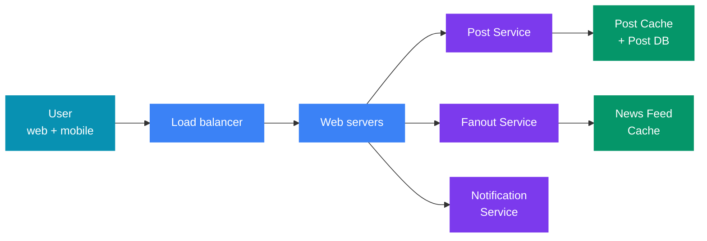
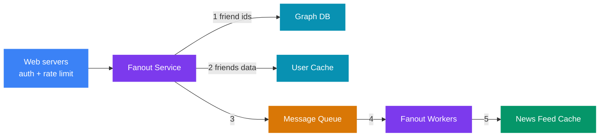

# Ch 3: A Framework for System Design Interviews

> 📖 **Vol 1, Chapter 3** (book pages 42–50) &nbsp;·&nbsp; ⚡ Medium Priority &nbsp;·&nbsp; 💬 **21 Questions**  
> **Source:** Alex Xu, *System Design Interview Vol 1*, Ch 3. Page and figure numbers below are the book's. This PDF edition prints no page numbers in the footer. So pages are the PDF page numbers (the chapter starts on page 42).

---

📊 **Question Count**

| # | Section | Questions |
|---|---|---|
| 1 | [What the Interviewer Is Looking For 🔥](#1--what-the-interviewer-is-looking-for-p42-) | 2 |
| 2 | [Step 1 — Understand the Problem and Establish Design Scope 🔥🔥](#2--step-1--understand-the-problem-and-establish-design-scope-p4344-) | 4 |
| 3 | [Step 2 — Propose High-level Design and Get Buy-in 🔥](#3--step-2--propose-high-level-design-and-get-buy-in-p4446-) | 1 |
| 4 | [Step 3 — Design Deep Dive 🔥](#4--step-3--design-deep-dive-p4649-) | 3 |
| 5 | [Step 4 — Wrap Up ⚡](#5--step-4--wrap-up-p49-) | 3 |
| 6 | [Dos and Don'ts 🔥](#6--dos-and-donts-p50-) | 5 |
| 7 | [Time Allocation on Each Step 🔥](#7--time-allocation-on-each-step-p50-) | 3 |
| | **Total** | **21** |

> 🔥🔥 Very high priority — asked in almost every Tier-1 interview loop &nbsp;·&nbsp; 🔥 High priority — very frequent in Tier-1 interviews &nbsp;·&nbsp; ⚡ Medium priority — commonly asked &nbsp;·&nbsp; 💤 Low priority — good to know, rarely asked

> **How to read this note.** Sections 1–7 follow the book in order. They cover what the interviewer wants, the 4 steps, the dos and don'ts, and the time per step. Anything the book does not say is marked **📎 Beyond the book**. Where the book has a mistake, the note says so and gives the fix.  
> Related notes: the book's running example is the news feed, covered in full in [Ch 11](./ch11_design_news_feed_system.md). The maths for Step 2 is in [Ch 2](./ch02_back_of_envelope_estimation.md) and the [Ch 2 estimation](./ch02_back_of_envelope_estimation.md).

---

## 🗒️ Cheat Sheet

<strong>🗒️ Show cheat sheet</strong>

### 🎯 Clarifying Questions — and the book's answers

The book's sample Step 1 talk for "Design a news feed system" (p.43–44):

| Question | Book's answer (p.43–44) |
|---|---|
| Mobile app, web app, or both? | **Both** |
| What are the most important features? | **Make a post, and see friends' news feed** |
| Feed sorted by reverse time order, or by weight (close friends first)? | **Reverse chronological** — to keep it simple |
| How many friends can a user have? | **5,000** |
| What is the traffic volume? | **10 million DAU** (daily active users) |
| Can the feed hold images and videos, or only text? | **Media files too** — images and videos |

The book's four starter questions for any problem (features, users, growth, tech stack) are in §2 (p.43).

### 🏗️ The 4 Steps (p.43–50)

- **Step 1 — Understand the problem and establish design scope.** Ask, do not answer. Write down every assumption.
- **Step 2 — Propose high-level design and get buy-in.** Draw boxes, check the scale with quick maths, and get the interviewer to agree.
- **Step 3 — Design deep dive.** With the interviewer, pick the most important components and go into detail.
- **Step 4 — Wrap up.** Bottlenecks, a recap, error cases, operations, the next scale step, more refinements.

### 💡 Key Insights

1. **The process counts more than the final design** (p.42). The interview copies two co-workers solving an unclear problem together. There is no perfect answer.
2. **It tests more than technical skill** (p.42). The interviewer looks for collaboration, working under pressure, resolving ambiguity, and asking good questions.
3. **Over-engineering is a red flag** — a warning sign that counts against you (p.42). So are narrow-mindedness and stubbornness.
4. **"DON'T be like Jimmy"** (p.43). A fast answer without thinking gets no bonus points. Answering before you understand the requirements is a huge red flag.
5. **You are not done until the interviewer says you are done** (p.50). Ask for feedback early and often.

### ⚖️ Trade-offs / Alternatives

| Choice | Pro | Con | Book's verdict |
|---|---|---|---|
| Ask clarifying questions first | You design the right system | Takes a few minutes | ✅ "Always ask for clarification" (p.50) |
| Jump straight to a solution | Feels fast | Likely the wrong system | ❌️ "Huge red flag" (p.43) |
| High-level design first, then drill down | Agreement before detail | Feels slow if the interviewer wants detail early | ✅ "Give the high-level design first then drill down" (p.50) |
| Deep detail on one component early | Shows depth | Time runs out for the rest | ❌️ Don't (p.50) |
| API endpoints + DB schema in Step 2 | Makes the contract clear | Too low-level for a huge problem | **"Depends on the problem"** — too low for Google search, fair for a poker game backend (p.44) |
| One approach only | Simple to explain | No trade-off shown | ❌️ "Suggest multiple approaches if possible" (p.50) |
| Say the design is perfect | Sounds confident | Shows no critical thinking | ❌️ "Never say your design is perfect" (p.49) |
| Think in silence | Fewer interruptions | The interviewer sees nothing | ❌️ "Communicate. Don't think in silence" (p.50) |

### 🔢 Numbers to Remember

| What | Value | Arithmetic |
|---|---|---|
| Interview length the book plans for | **45 minutes** | "45 minutes or an hour is not enough to cover the entire design" (p.50) |
| Step 1 — scope | **3–10 min** | — |
| Step 2 — high-level design | **10–15 min** | — |
| Step 3 — deep dive | **10–25 min** | The widest range. It takes whatever time is left |
| Step 4 — wrap up | **3–5 min** | — |
| 📎 Sum of the ranges | **26–55 min** | Low: 3 + 10 + 10 + 3 = 26. High: 10 + 15 + 25 + 5 = 55. So you cannot take the top of every range in 45 minutes |
| 📎 Sum of the midpoints | **≈ 40.5 min** | 6.5 + 12.5 + 17.5 + 4 = 40.5, which leaves about 4.5 minutes of buffer in 45 |
| Scale horizon to ask about | **3, 6, 12 months** | p.43 |
| News feed example | **5,000 friends · 10M DAU** | p.44 |
| "Next scale curve" example | **1M → 10M users** | p.49 — a 10× step |

---

 

---

## 1. 🎯 What the Interviewer Is Looking For (p.42) 🔥

System design questions are often vague, such as "design a well-known product X". Nobody expects you to build in one hour what took thousands of engineers years (p.42).

**What the interview really is.** It copies real problem solving. Two co-workers work on an unclear problem and reach a solution that meets their goals. The problem is open-ended, and there is no perfect answer. **The final design matters less than the work you put into the design process** (p.42). It lets you show three things:

- your design skill,
- that you can **defend** your design choices,
- that you can **respond to feedback** in a constructive way.

**The interviewer's goal** is to assess you accurately. The worst outcome for her is an unclear result because the session gave too few signals (p.42).

**Signals beyond technical skill** (p.42):

- the ability to **collaborate**,
- to **work under pressure**,
- to **resolve ambiguity** in a constructive way,
- to **ask good questions** — many interviewers look for this skill on purpose.

**Red flags** (p.42):

- **Over-engineering.** Many engineers enjoy design purity and ignore trade-offs. They do not see the growing costs of an over-engineered system. Companies pay a high price for that.
- **Narrow-mindedness.**
- **Stubbornness.**

### ❓ Interview Questions

1. **What is a system design interview really testing? 🔥🔥**

<!-- -->

💡 Show Answer

**Answer:**

It copies real work: two co-workers solve an unclear problem together (p.42). There is no perfect answer. **The final design matters less than the process.**

The interviewer collects signals about:

- your design skill,
- how you **defend** your choices,
- how you **respond to feedback**,
- how you **collaborate**, **work under pressure** and **resolve ambiguity**,
- whether you **ask good questions** — many interviewers look for this on purpose.

She also watches for red flags: **over-engineering**, narrow-mindedness and stubbornness (p.42).

---

2. **Is it okay to change your design mid-interview? 💤**

<!-- -->

💡 Show Answer

**Answer:**

Yes. The book wants you to **respond to feedback constructively** (p.42), and stubbornness is a red flag. A change based on new information shows you can adapt.

📎 Explain the change as you make it: "You said we need strong consistency. So instead of reading from async replicas, I'll read from the primary and use synchronous replication. The cost is higher write latency." This shows you use feedback. You are not defending a choice only because you already spent effort on it.

---

## 2. 🔍 Step 1 — Understand the Problem and Establish Design Scope (p.43–44) 🔥🔥

**The Jimmy story** (p.43). Jimmy is the student who always answers first, whether or not he knows the answer. The book's advice is: **"DON'T be like Jimmy."**

- A fast answer without thinking gets **no bonus points**.
- Answering without a full understanding of the requirements is a **huge red flag**. The interview is not a trivia contest. There is no right answer.
- So slow down. Think deeply. Ask questions to clarify **requirements and assumptions**.

Engineers like to jump to the final design. That often leads to **designing the wrong system** (p.43). A key engineering skill is to ask the right questions and make the right assumptions. Then gather all the information you need.

**When you ask a question, one of two things happens** (p.43):

1. The interviewer answers it directly.
2. The interviewer asks you to **make your own assumptions**. Then **write them down** on the whiteboard or paper. You might need them later.

**What to ask** — the book's starter list (p.43):

- What specific features are we going to build?
- How many users does the product have?
- How fast will the company scale up? What are the expected scales in 3 months, 6 months, and a year?
- What is the company's technology stack? Which existing services can you use to make the design simpler?

**Example — news feed** (p.43–44). The full talk is in the Cheat Sheet table above. In short: web and mobile, post + see the feed, reverse chronological order, 5,000 friends, 10M DAU, media allowed.

> 📎 **Beyond the book.** The book does not use the words "functional" and "non-functional", but its questions cover both. Features are **functional** requirements. Users, scale growth and traffic are **non-functional** ones (see Q4 below). Many candidates also ask about latency, availability and consistency here.

### ❓ Interview Questions

1. **Why is it a red flag to jump straight into design without asking questions? 🔥🔥**

<!-- -->

💡 Show Answer

**Answer:**

The book calls it **"a huge red flag"** (p.43) — "DON'T be like Jimmy", the student who always answers first.

- The interview is not a trivia contest. A fast answer gets **no bonus points**.
- Without the requirements, you will likely **design the wrong system**.

Every design choice depends on scale and constraints. 📎 A URL shortener for 1K QPS looks very different from one for 100K QPS. Without scope, your design may be:

- over-engineered,
- under-scaled, or
- a solution to a different problem.

So slow down, ask questions, and confirm your understanding before you draw.

---

2. **What questions do you ask in Step 1? Give an example. 🔥🔥**

<!-- -->

💡 Show Answer

**Answer:**

The book's starter list (p.43):

1. What specific features are we going to build?
2. How many users does the product have?
3. How fast will the company scale up — in 3 months, 6 months, a year?
4. What is the tech stack? Which existing services can make the design simpler?

**Example — news feed** (p.43–44):

| Candidate asks | Interviewer says |
|---|---|
| Mobile, web, or both? | Both |
| Most important features? | Make a post, see friends' feed |
| Reverse time order or ranked? | Reverse chronological |
| Friends per user? | 5,000 |
| Traffic? | 10M DAU |
| Media or text only? | Images and videos too |

---

3. **The interviewer says "just make your own assumptions". What do you do? ⚡**

<!-- -->

💡 Show Answer

**Answer:**

This is one of the two normal replies to a question. The book says: **write your assumptions down** on the whiteboard or paper. You might need them later (p.43).

📎 Then say them clearly as you design: "I'll assume 100M DAU and high availability. Tell me if that is wrong." This respects her choice. It also gives every later decision a clear base. Without stated assumptions, your choices look random. Most interviewers who skip requirements still want to see your assumptions. They just don't want 10 minutes of questions before you draw.

---

4. **What is the difference between functional and non-functional requirements, and why capture both? 📎 🔥🔥**

<!-- -->

💡 Show Answer

**Answer:**

- **Functional requirements** say **what** the system does — features and user actions. For example: "users can post", "URLs can be shortened and redirected".
- **Non-functional requirements** say **how well** it does it — availability, latency, throughput, consistency, durability.

Functional requirements drive the **API and data model**. Non-functional ones drive the **architecture** — caching, sharding, replication, multi-DC. The book's Step 1 questions cover both: features (functional), and users and growth (non-functional). Skipping non-functional needs is a common cause of shallow answers.

---

## 3. 📐 Step 2 — Propose High-level Design and Get Buy-in (p.44–46) 🔥

The goal: make a high-level design **and get the interviewer to agree to it** (p.44). Work together with her during the process.

**What to do** (p.44):

- Come up with an **initial blueprint**. **Ask for feedback.** Treat the interviewer as a teammate. Many good interviewers love to talk and take part.
- Draw **box diagrams** with the key components. Examples: clients (mobile/web), APIs, web servers, data stores, cache, CDN, message queue.
- Do **back-of-the-envelope calculations** to check that the blueprint fits the scale. Explain your thinking as you go. Ask the interviewer if the maths is needed before you start it.
- If possible, walk through **a few concrete use cases**. They help you frame the design. They also help you find edge cases you have not thought about yet.

**API endpoints and DB schema here?** "This depends on the problem" (p.44):

- For a large problem like "Design Google search engine", it is too low-level.
- For the backend of a multi-player poker game, it is fair game.
- Ask the interviewer.

**Example — news feed** (p.44–46). The design has two flows:

- **Feed publishing** — a user publishes a post. The data goes into the cache and the database. Then the post is added to friends' news feeds (**Figure 3-1**).
- **News feed building** — the feed is built by combining friends' posts in reverse chronological order (**Figure 3-2**).

In Figure 3-1, the client calls `v1/me/feed?content=Hello&auth_token={auth_token}` through DNS and a load balancer to the web servers. The web servers call three services:

- **Post Service** (Post Cache → Post DB),
- **Fanout Service** (News Feed Cache),
- **Notification Service**. In Figure 3-2, `v1/me/feed` goes through the load balancer and web servers to the **News Feed Service**. That service reads the **News Feed Cache**.

*Feed publishing at the high level (Figure 3-1, p.45). Figure 3-2 (p.46) is the read side: web servers → News Feed Service → News Feed Cache.*

The book says you do not need to understand how this system works yet. All details are in Chapter 11 (p.44).

### ❓ Interview Questions

1. **Should you include API endpoints and the DB schema in the high-level design? ⚡**

<!-- -->

💡 Show Answer

**Answer:**

**"This depends on the problem"** (p.44):

- For a large problem like "Design Google search engine", it is too low-level.
- For the backend of a multi-player poker game, it is fair game.
- Ask the interviewer.

📎 When you do give APIs, show the contract, not a full OpenAPI spec. List the key endpoints with method, path and key parameters. For a URL shortener: `POST /api/v1/data/shorten` with `longUrl`, and `GET /api/v1/{shortUrl}`. Mention auth, rate limiting and idempotency in one line each. Keep error codes for Step 3, if she asks.

---

## 4. 🔬 Step 3 — Design Deep Dive (p.46–49) 🔥

**Before you start Step 3, you and the interviewer should have** (p.46):

- agreed on the overall goals and the feature scope,
- sketched a high-level blueprint of the whole design,
- got her feedback on that blueprint,
- some first ideas about which areas to go deep on, based on her feedback.

**Pick the areas together.** Work with the interviewer to find and rank the components (p.46). Every interview is different:

- Some interviewers hint that they want to stay at the high level.
- For a **senior** candidate, the talk may be about **performance** — bottlenecks and resource estimates.
- **In most cases**, she wants details of some components. Book examples:
  - **URL shortener** — the **hash function** that turns a long URL into a short one.
  - **Chat system** — how to **reduce latency** and how to support **online/offline status**.

**Time management is essential** (p.46–47). It is easy to get lost in small details that do not show your abilities. Do not go into unnecessary detail. The book's example: explaining Facebook's **EdgeRank** feed-ranking algorithm in detail is a bad use of time. It does not prove that you can design a scalable system.

**Example — news feed** (p.47–49). The two most important use cases get a detailed design:

1. **Feed publishing (Figure 3-3).** The web servers now do **authentication and rate limiting**. Then the Fanout Service works in five steps:
   - (1) get friend IDs from a **graph DB**;
   - (2) get friends' data from the **user cache** (backed by the user DB);
   - (3) put the work on a **message queue**;
   - (4) **fanout workers** read the queue;
   - (5) the workers write to the **News Feed Cache**.
2. **News feed retrieval (Figure 3-4).** (1) `/v1/me/feed` goes to the load balancer, (2) then the web servers, (3) then the News Feed Service. (4) The service reads the News Feed Cache. (5) It fills in user and post data from the user cache and the post cache. (6) The response goes back to the client. Media comes from a **CDN**.

*Feed publishing in detail (Figure 3-3, p.48). The lesson for this chapter: Figure 3-3 keeps the boxes of Figure 3-1. It only opens up the one component that matters most.*

### ❓ Interview Questions

1. **How do you decide which component to deep-dive into in Step 3? 🔥🔥**

<!-- -->

💡 Show Answer

**Answer:**

**Decide together.** Work with the interviewer to find and rank the components (p.46). Her feedback from Step 2 should already give you first ideas.

What she wants differs (p.46):

- Some interviewers want to stay at the high level.
- For a senior candidate: **performance** — bottlenecks and resource estimates.
- In most cases: the details of some components. The book's examples:
  - URL shortener → the **hash function** that turns a long URL into a short one.
  - Chat system → **reducing latency** and **online/offline status**.

The book's rule: **design the most critical components first** (p.50).

📎 If she gives no hint, ask: "I could go deeper on the hash function, the storage, or the cache. Which one interests you?" If she still gives no hint, pick the part that makes this problem unique. Skip standard parts like a load balancer.

---

2. **How do you make sure your design meets the non-functional requirements from Step 1? 📎 ⚡**

<!-- -->

💡 Show Answer

**Answer:**

In the deep dive, link each decision back to a Step 1 requirement. For example:

- "We said 99.99% availability, so I'm using multi-AZ with automatic failover here."
- "Our read SLA is 100 ms, so the cache is required, not optional."

This keeps the story connected. It shows you know **when and why** to use a pattern, not just the pattern.

---

3. **Should you name specific technologies (Redis, Kafka, MySQL) or stay abstract? 📎 🔥**

<!-- -->

💡 Show Answer

**Answer:**

Name them, but always with a reason. "I'd use Redis" is fine. "I'd use Redis because session lookups need sub-millisecond latency and it supports TTL" is much better.

- In **Step 2**, general names like "a message queue" or "a cache" are fine. The book's own boxes are generic: "data stores, cache, CDN, message queue" (p.44).
- In **Step 3**, name the product and say why.
- If you are unsure between two (Kafka vs RabbitMQ), name both and say which you would pick and why.

---

## 5. 🏁 Step 4 — Wrap Up (p.49) ⚡

The interviewer may ask a few follow-up questions. Or she may let you talk about other points. The book's six directions (p.49):

- **Bottlenecks and improvements.** **Never say your design is perfect.** There is always something to improve. This shows critical thinking and leaves a good final impression.
- **A recap of your design.** This matters most if you suggested several solutions. It refreshes her memory after a long session.
- **Error cases** — server failure, network loss, and so on.
- **Operation issues** — how you monitor metrics and error logs, and how you roll out the system.
- **The next scale curve** — if the design supports 1 million users, what changes for 10 million?
- **Other refinements** you would make with more time.

> 📎 **Beyond the book.** Do not redesign a core part in the last 5 minutes. Ideas for the next scale step are fine, but call them future work. A new core idea this late suggests you did not think through your own design.

### ❓ Interview Questions

1. **Walk me through the 4 steps using the book's news feed example. 🔥**

<!-- -->

💡 Show Answer

**Answer:**

- **Step 1** (p.43–44): web + mobile, post and view feed, reverse chronological, 5,000 friends, 10M DAU, media allowed.
- **Step 2** (p.44–46): two flows. **Feed publishing** (Figure 3-1): web servers → Post Service (cache + DB), Fanout Service (news feed cache), Notification Service. **News feed building** (Figure 3-2): web servers → News Feed Service → News Feed Cache.
- **Step 3** (p.47–49): go deep on the two key use cases.
  - Publishing (Figure 3-3): fanout gets friend IDs from a graph DB and friend data from the user cache. A message queue feeds fanout workers. The workers write the news feed cache.
  - Retrieval (Figure 3-4): the News Feed Service reads the feed cache. It fills in user and post data from the caches. Media comes from a CDN.
- **Step 4** (p.49): bottlenecks, recap, error cases, monitoring and rollout, the next 10× of scale.

The full design is in [Ch 11](./ch11_design_news_feed_system.md).

---

2. **What should you do in the wrap-up step? 🔥**

<!-- -->

💡 Show Answer

**Answer:**

The book's six directions (p.49):

1. **Bottlenecks and improvements.** Never say the design is perfect.
2. **A recap**, most of all if you suggested several solutions.
3. **Error cases** — server failure, network loss.
4. **Operations** — monitoring metrics and error logs, and how you roll out the system.
5. **The next scale curve** — 1M users today, what changes for 10M?
6. **Refinements** you would make with more time.

📎 Most candidates only repeat the design. Name an unsolved bottleneck yourself, before she asks: "The single DB primary is still a write bottleneck. I'd shard by user_id next."

---

3. **Apply the 4-step framework to "Design a URL Shortener". 📎 🔥**

<!-- -->

💡 Show Answer

**Answer:**

A short outline, using the numbers from the book's Chapter 8:

- **Step 1 — Clarify.** How many URLs per day? Read/write ratio? Custom aliases? Expiry? Chapter 8 assumes **100 million URLs per day** and a **10:1** read/write ratio.
- **Step 2 — High level.** Two APIs: shorten (POST) and redirect (GET). Redirect with HTTP **301** (permanent, less load) or **302** (temporary, better analytics). Store the short-to-long mapping.
- **Step 3 — Deep dive.** The **hash function** — the exact example this chapter gives (p.46). Two options: hash + collision resolution, or base-62 conversion of a unique ID. Add a cache for hot URLs.
- **Step 4 — Wrap up.** Rate limiting, scaling the web and DB tiers, analytics, availability.

Full design: [Ch 8](./ch08_design_url_shortener.md).

---

## 6. ✅ Dos and Don'ts (p.50) 🔥

| ✅ Dos (p.50) | ❌️ Don'ts (p.50) |
|---|---|
| Always ask for clarification. Do not assume your assumption is correct. | Don't be unprepared for typical interview questions. |
| Understand the requirements of the problem. | Don't jump into a solution without clarifying requirements and assumptions. |
| There is no right answer and no best answer. A design for a young startup differs from one for a company with millions of users. | Don't go into too much detail on one component at the start. Give the high-level design first, then drill down. |
| Tell the interviewer what you are thinking. Communicate. | If you get stuck, don't hesitate to ask for hints. |
| Suggest multiple approaches if possible. | Communicate. Don't think in silence. |
| Once you agree on the blueprint, go into detail on each component. **Design the most critical components first.** | Don't think the interview is done once you give the design. **You are not done until the interviewer says so.** Ask for feedback early and often. |
| Bounce ideas off the interviewer. A good interviewer works with you as a teammate. | |
| Never give up. | |

📎 **Beyond the book — more mistakes that cost candidates:**

- Saying "I would use Kafka" with no reason.
- Choosing an architecture before Step 1, then bending the requirements to fit it.
- Building your own component when a standard one exists (a managed queue, a managed load balancer, Redis). Not knowing the simple option looks like a lack of experience, not creativity.
- Forgetting the scale and limits you agreed in Step 1 when you reach Step 3.

### ❓ Interview Questions

1. **How do you handle it when the interviewer pushes back on your design choice? 🔥**

<!-- -->

💡 Show Answer

**Answer:**

The book wants you to **defend your choices** and **respond to feedback constructively** (p.42). Stubbornness is a red flag (p.42). "Bounce ideas off the interviewer" and "never give up" (p.50).

📎 Treat it as a joint check of the design, not an attack. First accept the concern: "Fair point. Redis adds operational work." Then do one of two things:

- **Defend** with a reason: "But our read SLA is 5 ms. Going to the DB each time will not work."
- **Update** the design: "If consistency matters more here, let me switch to a write-through cache."

Don't give up at once. Don't refuse to change only because you feel defensive.

---

2. **What do you do when you get stuck or don't know a topic well? 🔥**

<!-- -->

💡 Show Answer

**Answer:**

The book: **"If you get stuck, don't hesitate to ask for hints"** (p.50). And: "Communicate. Don't think in silence."

📎 Be honest and reason from the basics: "I haven't run Kafka at this scale. But I know partitions, consumer groups and ordering. Based on that, here's my approach." Interviewers respect honesty more than fake confidence. Then move toward your strength: "I have direct experience with DB sharding. Shall I go deeper there?"

---

3. **What separates a senior candidate from a junior one in this round? 🔥**

<!-- -->

💡 Show Answer

**Answer:**

From the book:

- For a senior candidate, the deep dive may be about **performance** — bottlenecks and resource estimates (p.46).
- **Over-engineering** is a red flag. Many engineers chase design purity and ignore trade-offs (p.42).
- A design for a young startup differs from one for an established company with millions of users (p.50).

📎 In practice, a senior finds failure modes and trade-offs without being asked:

- A junior designs the happy path (the case where nothing goes wrong).
- A senior asks "what happens when this fails?" and adds redundancy and graceful degradation.

A senior also sizes the design to the real requirements. No Google-scale design for a startup-scale problem.

---

4. **What red flags do interviewers look for in a system design round? 🔥**

<!-- -->

💡 Show Answer

**Answer:**

From the book:

- **Over-engineering** — design purity over trade-offs (p.42).
- **Narrow-mindedness** and **stubbornness** (p.42).
- **Answering without understanding the requirements** — "a huge red flag" (p.43).
- **Saying the design is perfect** (p.49).
- **Thinking in silence**, and **too much detail on one component early** (p.50).
- **Treating the design as the end.** "You are not done until your interviewer says you are done" (p.50).

---

5. **How do you explain a trade-off without sounding unsure? 📎 🔥**

<!-- -->

💡 Show Answer

**Answer:**

The book only says "suggest multiple approaches if possible" (p.50). The way to do it: **context → trade-off → recommendation with a reason.**

> "Option A gives lower latency but may return stale data. Option B is always consistent but adds 10 ms per request. Our latency SLA is 50 ms, so I'd pick A and limit stale data with a TTL."

Never end with "it depends" alone. Say **what** it depends on and **which option you prefer**.

---

## 7. ⏳ Time Allocation on Each Step (p.50) 🔥

System design questions are very broad. **45 minutes or an hour is not enough to cover the entire design** (p.50). So time management is essential.

The book's "very rough guide" for a **45-minute** session:

| Step | Book's time (p.50) |
|---|---|
| Step 1 — Understand the problem and establish design scope | **3–10 minutes** |
| Step 2 — Propose high-level design and get buy-in | **10–15 minutes** |
| Step 3 — Design deep dive | **10–25 minutes** |
| Step 4 — Wrap | **3–5 minutes** |

The book says this is a rough estimate. The real split depends on the **scope of the problem** and on **what the interviewer asks for** (p.50).

> 📎 **Beyond the book — read the ranges together.** The ranges add up to 26–55 minutes, so they cannot all hit the top. If Step 1 takes 10 minutes, Step 3 has to shrink. A safe default is the midpoints: about 6–7, 12–13, 17–18 and 4 minutes, which is ≈ 40 minutes plus buffer.

### ❓ Interview Questions

1. **How do you manage time if you're going too deep into one area? 🔥**

<!-- -->

💡 Show Answer

**Answer:**

The book says it is easy to get lost in small details that show nothing (p.46–47). Its example: explaining Facebook's **EdgeRank** ranking algorithm in detail. It takes a lot of time and does not prove you can design a scalable system. Also: "Don't go into too much detail on a single component in the beginning" (p.50).

📎 Keep checking the time. After about 15 minutes on one part, say: "I could go deeper here. But I want to cover the data model and scaling too. Let me step back." Cover 4 components at 70% depth. Do not finish one and leave the rest as empty boxes.

---

2. **What if you don't finish the design in 45 minutes? ⚡**

<!-- -->

💡 Show Answer

**Answer:**

That is normal. The book says **45 minutes or an hour is not enough to cover the entire design** (p.50). The goal is good time management, not a complete system.

What matters:

- clear progress on the **most critical components** (p.50),
- that you **know what is unfinished**. Step 4 lists "refinements you need if you had more time" (p.49).

📎 In the wrap-up, say: "With more time, I'd go deep on X and Y. Here's the direction." This is better than a shallow answer on every part.

---

3. **How do you know when to stop clarifying and start designing? ⚡**

<!-- -->

💡 Show Answer

**Answer:**

The book gives Step 1 **3–10 minutes** of a 45-minute session (p.50). Its starter list is short: features, users, growth, tech stack (p.43).

📎 Start designing when you have:

- the scale (DAU, QPS, storage),
- the 3–5 core features,
- the top 2–3 non-functional needs (availability, latency, consistency).

If you are still asking after 10 minutes, move on with stated assumptions. A rough rule: 5–7 targeted questions, then summarize what you heard and start.

---
