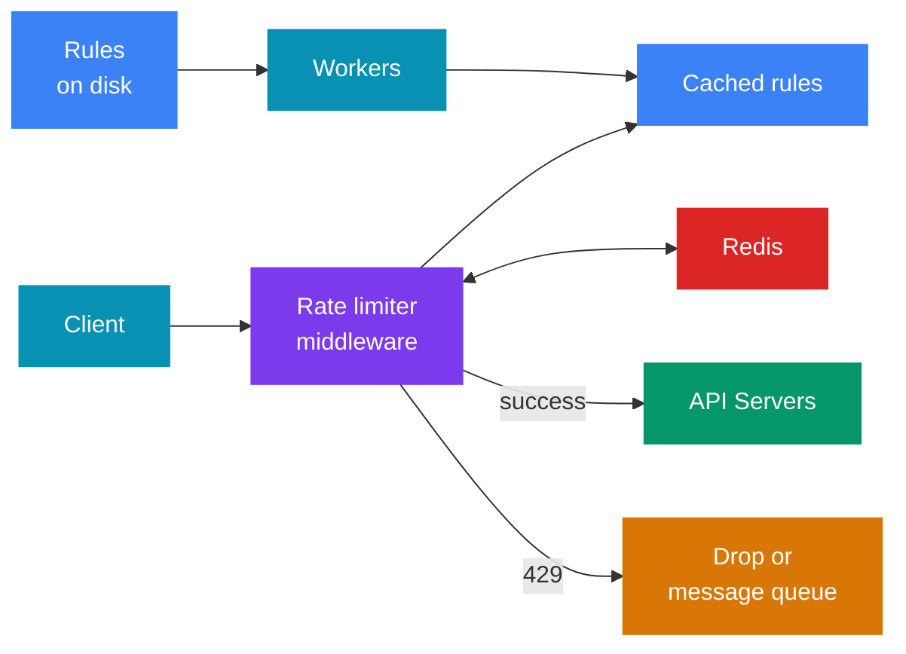
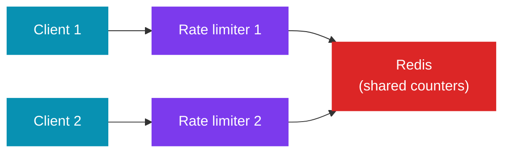
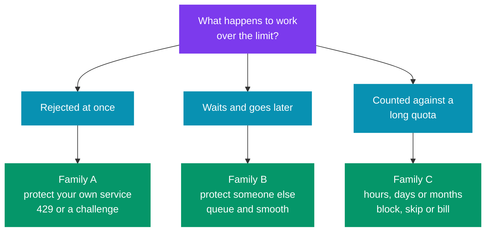

# Ch 4: Design a Rate Limiter

> 📖 **Vol 1, Chapter 4** (book pages 51–70) &nbsp;·&nbsp; 🔥🔥 Very High Priority &nbsp;·&nbsp; 💬 **20 Questions**  
> **Source:** Alex Xu, *System Design Interview Vol 1*, Ch 4. Page and figure numbers below are the book's. This PDF edition prints no page numbers in the footer, so pages are the PDF page numbers (the chapter starts on page 51).

---

📊 **Question Count**

| # | Section | Questions |
|---|---|---|
| 1 | [Requirements and Scope ⚡](#1--requirements-and-scope-p5152-) | 2 |
| 2 | [Where to Put the Rate Limiter 🔥](#2--where-to-put-the-rate-limiter-p5354-) | 2 |
| 3 | [Algorithms — Token Bucket and Leaking Bucket 🔥🔥](#3--algorithms--token-bucket-and-leaking-bucket-p5458-) | 1 |
| 4 | [Algorithms — Window Counters and the Log 🔥🔥](#4--algorithms--window-counters-and-the-log-p5862-) | 3 |
| 5 | [High-level Architecture 🔥](#5--high-level-architecture-p6263-) | 1 |
| 6 | [Rules, Headers and the Detailed Design 🔥](#6--rules-headers-and-the-detailed-design-p6465-) | 3 |
| 7 | [Rate Limiter in a Distributed Environment 🔥🔥](#7--rate-limiter-in-a-distributed-environment-p6667-) | 4 |
| 8 | [Performance, Monitoring and Wrap-up ⚡](#8--performance-monitoring-and-wrap-up-p6769-) | 3 |
| 9 | [Similar Problems This Design Solves 📎 🔥](#9--similar-problems-this-design-solves--) | 1 |
| | **Total** | **20** |

> 🔥🔥 Very high priority — asked in almost every Tier-1 interview loop &nbsp;·&nbsp; 🔥 High priority — very frequent in Tier-1 interviews &nbsp;·&nbsp; ⚡ Medium priority — commonly asked &nbsp;·&nbsp; 💤 Low priority — good to know, rarely asked

---

## 🗒️ Cheat Sheet

<details>
<summary><strong>🗒️ Show cheat sheet</strong></summary>

### 🎯 Clarifying Questions — and the book's answers
| Question | Book's answer (p.52) |
|---|---|
| Client-side or server-side limiter? | **Server-side API rate limiter** |
| Throttle by IP, user ID, or something else? | **Flexible** — support different sets of throttle rules |
| Scale? | **A large number of requests** |
| Distributed environment? | **Yes** |
| Separate service, or inside the application code? | **Your design decision** |
| Tell users when they are throttled? | **Yes** |

**Requirements** (p.52): accurate · low latency · little memory · distributed · clear errors when throttled · fault tolerant. Details in §1.

### 🏗️ Core Components (Figure 4-13)
- **Rate limiter middleware** — sits between the client and the API servers. It decides allow or reject.
- **Rules** — written in config files and saved on disk (the book uses Lyft's format).
- **Workers** — pull the rules from disk often and put them in a cache.
- **Cached rules** — the middleware reads rules from here, never from disk.
- **Redis** — holds the counters (and the last request timestamp) for each bucket.
- **API servers** — get only the requests that pass.
- **Rejected requests** — get HTTP **429**. The request is either **dropped** or put on a **message queue** to process later.

### 💡 Key Insights
1. The hard part is **not one server**. It is **many servers sharing one count** (p.66). A local counter per server cannot work when any client can hit any server.
2. Counters go in an **in-memory cache like Redis**, not a database. Disk is too slow, and Redis has time-based expiry built in (`EXPIRE`) (p.62).
3. The naive flow — read the counter, check it, write it back — has a **race** (Figure 4-14). The book's fixes are a **Lua script** or **Redis sorted sets**, not locks (p.66).
4. To share state across limiters, **sticky sessions are not advisable** — neither scalable nor flexible. Use a **central store** (Figure 4-16, p.67).
5. The algorithm is a **business choice**. Token bucket allows bursts. Leaking bucket gives a steady outflow. Sliding window counter is a cheap and nearly exact rolling window.

### 📊 The Five Algorithms (p.54–62)
| Algorithm | How it works | Pros (book) | Cons (book) | Used by (book) |
|---|---|---|---|---|
| **Token bucket** | Refiller adds tokens at a fixed rate up to a capacity. Each request takes one token; no token → drop | Easy; memory efficient; **allows short bursts** | Two parameters (bucket size, refill rate) are hard to tune | Amazon, Stripe |
| **Leaking bucket** | FIFO queue. Full queue → drop. Requests leave the queue at a fixed rate | Memory efficient (queue is bounded); **stable outflow rate** | A burst fills the queue with old requests, so new ones get limited; two parameters to tune | Shopify |
| **Fixed window counter** | One counter per fixed time window. Counter at the limit → drop until the next window | Memory efficient; easy; reset at a window end fits some use cases | **Spike at window edges** lets up to 2× the quota through | — |
| **Sliding window log** | Keep each request timestamp (Redis sorted set). Drop old ones, add the new one, accept if count ≤ limit | **Very accurate** — no rolling window ever goes over the limit | **A lot of memory** — even rejected timestamps stay in the log | — |
| **Sliding window counter** | Current window count + previous window count × overlap % | Smooths spikes; memory efficient | An approximation — assumes the previous window was even. Cloudflare: only 0.003% wrong | Tested by Cloudflare |

### ⚖️ Trade-offs / Alternatives
| Option | Pro | Con | Book's verdict |
|---|---|---|---|
| Client-side limiter | No server work | Requests are easy to forge; you may not control the client | ❌️ Unreliable (p.53) |
| Inside the API servers (Figure 4-1) | Full control of the algorithm | Every service must build it | Possible — depends on your stack |
| Middleware / API gateway (Figure 4-2) | One place; a gateway also does auth, SSL, IP allow-list | A third-party gateway may limit your choice of algorithm | **"No absolute answer"** — use the gateway if you already have one, or if you lack people to build it (p.54) |
| Counters in a database | Durable | Disk access is slow | ❌️ Not a good idea (p.62) |
| Counters in Redis | Fast; `INCR` + `EXPIRE` | Another network hop; a shared dependency | ✅ Chosen (p.62) |
| Locks vs Lua script / sorted sets (the race) | Lua and sorted sets are atomic inside Redis | Locks slow the system down a lot | ❌️ locks · ✅ Lua or sorted sets (p.66) |
| Sticky sessions | Each client always hits one limiter | Not scalable, not flexible | ❌️ Not advisable (p.67) |
| Central Redis for all limiters | Every limiter sees the same count | Every check is a network call | ✅ Chosen (Figure 4-16) |

### 🔢 Numbers to Remember
| What | Value | Arithmetic |
|---|---|---|
| HTTP status for throttled requests | **429 Too Many Requests** | — |
| Token bucket, Figure 4-4 | **capacity 4, refill 2/s** | Burst of up to 4 at once; then about 2 requests per second |
| Token bucket, Figure 4-6 | **size 4, refill 4 per minute** | 1:00:00 has 4 → 1 used. 1:00:05 has 3 → all 3 used. 1:00:20 has 0 → dropped. 1:01:00 → refilled to 4 |
| Fixed window spike, Figure 4-9 | **10 requests in one minute, limit 5** | 5 in the second half of 2:00 + 5 in the first half of 2:01 → 10 in 2:00:30–2:01:30 = **2×** the limit |
| Sliding window counter, Figure 4-11 | **6.5 → 6, limit 7 → allowed** | 3 (current) + 5 (previous) × 0.7 (overlap) = 3 + 3.5 = 6.5, rounded down to 6 |
| Cloudflare error rate | **0.003% of 400M requests** | 400,000,000 × 0.00003 = **12,000** requests wrongly allowed or limited |
| Buckets per user | **3** | 1 post/s + 150 friends/day + 5 likes/s = 3 rules → 3 buckets (p.57) |
| Real API limits (book examples) | Twitter **300 tweets / 3 h**; Google Docs **300 reads / user / 60 s** | — |
| Cloudflare edge locations | **194** (as of May 2020) | — |
| 📎 Redis throughput | **~100K ops/s per instance** | Quote this, and say you shard the keyspace to go higher. "Millions" needs pipelining or a cluster |
| 📎 Memory: log vs counter | **~1.6 GB vs ~16 MB** | 1M users × 100 timestamps × 16 B = 1.6 GB, vs 1M users × 2 counters × 8 B = 16 MB. Raw data only; Redis adds overhead on top |

### ⏱️ 45-Minute Round Plan
| Minutes | Phase | What to say or draw | Trap to avoid |
|---|---|---|---|
| 0–5 | Clarify | Server-side, flexible rules, distributed, tell the user (429) | Starting with an algorithm before you know the rules |
| 5–10 | Where to put it | Client ❌️ · in the servers · middleware / API gateway — pick one and say why | Saying "the gateway is always best" — the book says it depends |
| 10–22 | Algorithms | Name all five, one line each. Pick one and justify it (bursts? steady outflow? cheap rolling window?) | Deep maths on all five. One worked example is enough |
| 22–30 | High-level design | Client → middleware → API servers; counters in Redis with `INCR` + `EXPIRE` | Counters in a database |
| 30–40 | **Deep dive** | Rules + cache + workers; 429 + headers; drop or queue; **race → Lua**; **many limiters → central Redis** | Proposing locks or sticky sessions |
| 40–45 | Wrap-up | Multi-DC edge, monitoring, hard vs soft, L7 vs L3, client best practices | Forgetting what happens when Redis is down (§7 Q3) |

> 📎 The timings are a suggestion, not from the book. The book gives the steps; the minutes are ours.

---

</details>
<br/>

---

## 1. 📋 Requirements and Scope (p.51–52) ⚡

A rate limiter controls the rate of traffic that a client or a service sends. In HTTP, it limits how many requests a client can send in a time period. Requests above the limit are blocked (p.51).

**The book's examples** (p.51):

- A user can write no more than 2 posts per second.
- You can create at most 10 accounts per day from the same IP address.
- You can claim rewards no more than 5 times per week from the same device.

**Why use one** (p.51):

| Benefit | Detail |
|---|---|
| Prevent resource starvation from **DoS** | Blocks the extra calls, whether the attack is on purpose or not. Almost every big API has a limit — Twitter: 300 tweets per 3 hours; Google Docs: 300 read requests per user per 60 seconds |
| **Reduce cost** | Fewer servers. More resources for high-priority APIs. Very important when you pay per call to a third-party API (credit check, payment, health records) |
| Prevent **server overload** | Filters out extra requests from bots or users who misbehave |

**Step 1 — the clarifying questions** are in the Cheat Sheet table. The six requirements that come out of them (p.52):

- Accurately limit excessive requests.
- **Low latency.** The limiter must not slow down the HTTP response.
- Use as little memory as possible.
- **Distributed.** One limit is shared across many servers or processes.
- **Exception handling.** Show a clear error when a user is throttled.
- **High fault tolerance.** A problem in the limiter (for example, a cache server goes down) must not affect the whole system.

### ❓ Interview Questions

1. **How does rate limiting differ from circuit breaking? 📎 🔥**

<!-- -->
<details>
<summary>💡 Show Answer</summary>

**Answer:**

- **Rate limiting** controls the volume of **incoming** requests. It protects a service from overload by its clients.
- **Circuit breaking** protects a service from **cascading failures** when a downstream dependency is slow or failing. It trips open when failures cross a threshold (N failures in a row, or a failure rate over a sliding window in Resilience4j). Then it stops calls for a cool-off period.

So rate limiting is **inbound** traffic control. Circuit breaking is **outbound** dependency protection.

</details>

---

2. **What is the difference between a rate limit and a concurrency limit? When do you need both? 📎 ⚡**

<!-- -->
<details>
<summary>💡 Show Answer</summary>

**Answer:**

- **Rate limit** — how many requests **per unit of time** (100/s). It does not care how long each request takes.
- **Concurrency limit** — how many requests are **in flight at the same moment** (say 20). A new request waits or is rejected until one finishes.

**Why a rate limit alone is not enough — Little's law:** in flight = rate × latency.

- 100 req/s × 50 ms = **5** requests in flight. Fine.
- The database slows down, and latency becomes 2 s. The same 100 req/s now means 100 × 2 = **200** in flight.
- The rate limiter still lets all 100/s through. But 200 requests now hold threads and DB connections, and the service runs out of them and fails. A concurrency limit stops this, because it reacts to slow requests too.

**Who protects what:**

- A rate limit gives **fairness between clients** — a per-user or per-key quota. Over it → **429**.
- A concurrency limit protects **the server's own resources** — threads, connections, memory. Over it → usually **503**, or a short wait in a queue.

**In Java:** Resilience4j `Bulkhead` (`maxConcurrentCalls`) is a concurrency limit. Resilience4j `RateLimiter` is a rate limit. The Tomcat thread pool (`server.tomcat.threads.max`, default 200) and the HikariCP pool (`maximumPoolSize`, default 10) are concurrency limits too.

*"A rate limit decides how often a client may call. A concurrency limit decides how much work the server holds at once. I use both: rate limits per user at the gateway, and a bulkhead around each slow downstream call."*

</details>

---

## 2. 📍 Where to Put the Rate Limiter (p.53–54) 🔥

**Step 2** starts with a simple client-server model. There are three places for the limiter:

- **Client side** — ❌️ unreliable. A bad actor can forge requests easily. Also, you may not control the client code (p.53).
- **Server side** — the limiter lives inside the API servers (Figure 4-1).
- **Middleware** — a separate layer in front of the API servers throttles requests (Figure 4-2).

**Example (Figure 4-3):** the API allows **2 requests per second**. A client sends 3 in one second. The first two reach the API servers. The middleware throttles the third and returns **HTTP 429** ("too many requests").

**API gateway** (p.54). In cloud microservices, rate limiting usually lives in an **API gateway**. A gateway is a fully managed service. It does rate limiting, SSL termination, authentication, IP allow-listing, serving static content, and more. For this chapter, a gateway is just "a middleware that supports rate limiting".

**Server or gateway? "There is no absolute answer"** (p.54). The book's four guidelines:

1. Check your **current tech stack** — language, cache service, and so on. Make sure your language is efficient enough to do rate limiting on the server side.
2. Pick the **algorithm that fits your business**. On the server side you control the algorithm fully. A third-party gateway may limit your choice.
3. If you **already have a gateway** (for auth, IP allow-listing), add the rate limiter there.
4. Building your own service **takes time**. Without enough engineers, a **commercial API gateway** is the better option.

<details>
<summary><strong>🤔 Doubt: What does "evaluate your current technology stack" mean, and what is the "efficient language" hint about?</strong></summary>

The book asks you to check what you already have before you design (p.54). The answer can change with the language, the cache, and the infrastructure.

It covers:
- **Programming language** — is it fast enough to check a limit on every request? It also decides the concurrency model (Python GIL, Node.js single thread, Java threads).
- **Cache / store** — Redis, Memcached or in-memory. This choice decides what atomic operations you get.
- **Existing infrastructure** — an API gateway (Kong, AWS API Gateway) may already have rate limiting built in.

The book's own point is **performance**: the limiter runs on every request, so the language must be efficient.

📎 A second point, not in the book: a **local in-memory counter breaks** when you run more than one instance. Java's `AtomicInteger` is safe inside one JVM, but each server still has its own count. Only a shared store (§7) fixes that.

**How to answer in an interview:**
> "I'll assume Java and Spring Boot on the server, and Redis for the counters. Redis gives atomic `INCR` and `EXPIRE`, which a distributed setup needs. If an API gateway is already in place, I could move rate limiting there."

---

</details>
<br/>

### ❓ Interview Questions

1. **Where would you put the rate limiter — client, server, middleware or API gateway? 🔥**

<!-- -->
<details>
<summary>💡 Show Answer</summary>

**Answer:**

- **Client** — ❌️ unreliable. Requests can be forged, and you may not control the client (p.53).
- **Inside the API servers** (Figure 4-1) — full control of the algorithm.
- **Middleware / API gateway** (Figure 4-2) — one place in front of all APIs.

The book says **"there is no absolute answer"** (p.54). Decide by:

- your tech stack,
- the algorithm you need (a third-party gateway may limit it),
- whether a gateway already exists (then add the limiter there),
- your engineering resources (few people → a commercial gateway).

📎 **With 20 microservices:** put global per-user limits at the gateway, so services do not repeat the logic. For limits specific to one service, add a small limiter library in that service, backed by the same Redis.

</details>

---

2. **In a Java/Spring stack, would you build the rate limiter yourself or use a library? 📎 🔥**

<!-- -->
<details>
<summary>💡 Show Answer</summary>

**Answer:**

Use a library first. Build your own only for a rule no library can express.

- **Spring Cloud Gateway — `RequestRateLimiter` filter** with `RedisRateLimiter`. It is a token bucket that runs as a Lua script in Redis. You set `replenishRate` and `burstCapacity`, and a `KeyResolver` bean picks the key (user ID, API key). Over the limit, it returns **429**. Use it if you already have this gateway.
- **Bucket4j** — a token bucket library for Java. With its Redis module, the bucket lives in Redis, so all instances share one count. Updates are atomic (compare-and-swap). Use it in a servlet filter when there is no Spring Cloud Gateway.
- **Resilience4j `RateLimiter`** — ⚠️ it counts **inside one JVM only**. With 5 instances, a limit of 100/s is really 500/s. Use it to protect an **outbound** call (do not call a partner API more than X times per second from this instance). Do not use it for an inbound per-user limit.
- **Your own** — the Lua script in §7. Choose it only when you need a rule the libraries do not support.

*"With Spring Cloud Gateway I use its Redis rate limiter. Without it, Bucket4j backed by Redis. Not Resilience4j for this — it limits per JVM, not across the cluster."*

</details>

---

## 3. 🪣 Algorithms — Token Bucket and Leaking Bucket (p.54–58) 🔥🔥

The book lists five popular algorithms (p.54): token bucket, leaking bucket, fixed window counter, sliding window log, sliding window counter. The chapter does not focus on algorithms. But you need them at a high level to pick the right one, or a mix of them.

### Token bucket (p.54–58)

It is simple, well understood, and widely used. **Amazon** and **Stripe** use it to throttle their APIs.

How it works:

- A bucket has a **fixed capacity**. A **refiller** adds tokens at a preset rate. When the bucket is full, extra tokens **overflow** (are lost). In Figure 4-4, capacity is **4** and the refiller adds **2 tokens every second**.
- **Each request takes one token** (Figure 4-5).
  - Enough tokens → take one; the request goes through.
  - No tokens → the request is **dropped**.

**Figure 4-6** — bucket size 4, refill rate **4 per minute**:

| Time | Tokens at start | Requests | Result |
|---|---|---|---|
| 1:00:00 | 4 | 1 | Goes through; 1 token used |
| 1:00:05 | 3 | 3 | All 3 go through; 3 tokens used |
| 1:00:20 | 0 | 1 | **Dropped** |
| 1:01:00 | 4 | — | 4 tokens refilled at the 1-minute interval |

**Two parameters:**

- **Bucket size** — the most tokens the bucket can hold.
- **Refill rate** — tokens added every second.

**How many buckets?** It depends on the rules (p.57):

- **One bucket per API endpoint** per user. "1 post per second, 150 new friends per day, 5 likes per second" needs **3 buckets per user**.
- Throttle **by IP** → one bucket per IP address.
- A system-wide limit of **10,000 requests per second** → one **global bucket** shared by all requests.

**Pros:** easy to build; memory efficient; **allows short bursts** — a request goes through while tokens are left.
**Cons:** bucket size and refill rate can be hard to tune.

📎 A common way to build it without a timer thread: store `tokens` and `last_refill_ts`. On each request, add `(now − last_refill_ts) × rate` tokens (up to the capacity), then try to take one. This is "lazy refill". The book's Figure 4-13 hints at it: the middleware fetches "counters **and last request timestamp**" from Redis (p.65).

### Leaking bucket (p.58)

It is like the token bucket, but requests are **processed at a fixed rate**. It is usually a **FIFO queue** (Figure 4-7):

- A request arrives. If the queue is **not full**, add it to the queue.
- If the queue **is full**, drop the request.
- Workers pull requests from the queue and process them **at regular intervals**.

**Two parameters:**

- **Bucket size** — the queue size.
- **Outflow rate** — how many requests are processed per unit of time, usually per second.

**Shopify** uses leaky buckets for rate limiting.

**Pros:** memory efficient (the queue is bounded); a **stable outflow rate**, for systems that need one.
**Cons:** a burst fills the queue with **old requests**. If they are not processed in time, **recent requests get limited**. Two parameters to tune.

> 📎 **Token vs leaking bucket in one line:** the token bucket limits the **average rate** and lets bursts through. The leaking bucket **shapes** traffic into a steady stream, so the backend never sees a burst.

### ❓ Interview Questions

1. **How does the token bucket algorithm work? What are its parameters, and how many buckets do you need? 🔥🔥**

<!-- -->
<details>
<summary>💡 Show Answer</summary>

**Answer:**

- A bucket holds up to **N tokens**. A refiller adds tokens at a fixed rate. Extra tokens overflow.
- Each request takes **one token**. No token → the request is dropped.

**Parameters:** **bucket size** (max tokens) and **refill rate** (tokens per second). Figure 4-6 uses size 4 and refill 4 per minute.

**How many buckets** (p.57):

- One per endpoint per user. "1 post/s + 150 friends/day + 5 likes/s" = **3 buckets per user**.
- One per IP, if you throttle by IP.
- One **global** bucket for a system-wide limit like 10,000 requests/s.

**Pros:** easy, memory efficient, **allows bursts**. **Con:** the two parameters are hard to tune. Amazon and Stripe use it.

</details>

---

## 4. 🪟 Algorithms — Window Counters and the Log (p.58–62) 🔥🔥

### Fixed window counter (p.58–60)

- Split the timeline into **fixed-size windows**. Give each window a counter.
- Each request adds 1 to the counter.
- When the counter reaches the limit, drop new requests **until the next window starts**.

**Figure 4-8:** window = 1 second, limit = **3 per second**. In each second, requests after the third are dropped.

**The big problem — the edge spike (Figure 4-9).** The limit is **5 per minute**, and the quota resets at each round minute.

- Five requests arrive between 2:00:00 and 2:01:00 (late in that minute).
- Five more arrive between 2:01:00 and 2:02:00 (early in that minute).
- In the one-minute window **2:00:30–2:01:30**, **10 requests** go through. That is **twice** the limit.

**Pros:** memory efficient; easy to understand; resetting the quota at the end of a window fits some use cases.
**Cons:** a spike at the window edges lets more than the quota through.

### Sliding window log (p.60–61)

It fixes the edge spike:

- Keep the **timestamp of each request**. It usually lives in a cache, like a **Redis sorted set**.
- When a new request comes in, **remove all outdated timestamps** — those older than the start of the current window.
- **Add the new timestamp** to the log.
- If the log size is **≤ the limit**, accept. Otherwise, **reject**.

**Figure 4-10** — limit **2 per minute** (real logs store Unix timestamps; the book uses readable times):

| Request at | Log after the step | Size | Result |
|---|---|---|---|
| 1:00:01 | 1:00:01 | 1 | ✅ Allowed |
| 1:00:30 | 1:00:01, 1:00:30 | 2 | ✅ Allowed |
| 1:00:50 | 1:00:01, 1:00:30, 1:00:50 | 3 | ❌️ Rejected — **but the timestamp stays in the log** |
| 1:01:40 | 1:00:50, 1:01:40 (1:00:01 and 1:00:30 are older than 1:00:40, so they are removed) | 2 | ✅ Allowed |

**Pros:** very accurate. In **any** rolling window, requests never go over the limit.
**Cons:** **a lot of memory**. Even a rejected request's timestamp may stay in memory.

> 📎 **Side effect of keeping rejected timestamps.** A client that keeps sending above the limit stays blocked, even though none of its requests get through. Some versions log only accepted requests. That fixes this, and it also saves memory.

### Sliding window counter (p.61–62)

A **hybrid** of the fixed window counter and the sliding window log. There are two ways to build it; the book shows one (Figure 4-11).

**The formula:**
```
requests in rolling window = requests in current window
                           + requests in previous window × overlap % of the rolling window with the previous window
```

**The book's example:** limit **7 per minute**. The previous minute had **5** requests; the current minute has **3**. A new request arrives **30%** into the current minute, so the rolling window overlaps **70%** of the previous minute.

```
3 + 5 × 0.7 = 3 + 3.5 = 6.5  →  rounded down to 6
6 < 7  →  the request goes through. One more request will reach the limit.
```

You can round up or down, depending on the use case. The book rounds down.

> ⚠️ **Book bug — the sliding window counter example.** Page 62 writes `3 + 5 * 0.7% = 6.5`. But 5 × 0.7% is 0.035, not 3.5. The overlap is **70%**, which is **0.7**. Also, Figure 4-11 is labelled "Rate limit: **5** requests/min", while the text uses **7**. With a limit of 5, a count of 6 would be **rejected**. The fix: use `3 + 5 × 0.7 = 6.5` and a limit of **7**, as the text says.

**Pros:** smooths spikes, because the rate is based on the average of the previous window; memory efficient (two counters).
**Cons:** works only for a **not-so-strict** look-back window. It is an approximation, because it assumes the previous window's requests were **evenly spread**. In practice this is small: **Cloudflare** found only **0.003%** of **400 million** requests were wrongly allowed or limited.

### 🎯 Which algorithm for which use case

📎 The book says the choice is a business decision. It does not map algorithms to use cases. This table does. Pick by asking what you protect and what shape the traffic has.

| Algorithm | Real use case | Why this algorithm | Do not use it when |
|---|---|---|---|
| **Token bucket** | **A public API used by apps**: Stripe (book), AWS API Gateway. A page load sends 10 calls at once, then goes quiet | It allows a **short burst** but keeps the **average rate** fixed. Tokens build up while the client is idle, so a normal burst is not punished | The backend cannot take any burst at all |
| **Leaking bucket** | **Calling a partner with a fixed capacity**: a credit bureau, an SMS gateway or a bank's core system with a contract like "max 50 TPS". Also Shopify's Admin API and NGINX `limit_req` | It turns bursts into a **steady outflow**. The partner never sees more than 50/s. Extra requests wait in the queue instead of failing | Users need a fast answer. A queued request waits. In a burst, old requests fill the queue and new ones get rejected |
| **Fixed window counter** | **Quotas tied to the calendar**: "5 OTP SMS per day", "10,000 API calls per month on the free plan", GitHub's "5,000 requests per hour" | The cheapest: one counter and one `EXPIRE`. The reset matches how people think and how you bill ("your quota resets at midnight") | Strictness matters in a short window. The edge spike lets **2×** the limit through |
| **Sliding window log** | **Low-volume, high-risk actions**: login attempts (5 per 15 min), OTP verify attempts, password reset, "max 3 fund transfers per 10 min per account" | **Exact** — no rolling window ever goes over the limit. Memory is fine, because each key has only a few timestamps. With a fixed window, the edge spike would allow 10 password guesses instead of 5 | Volume is high. One timestamp per request makes memory grow fast (~1.6 GB vs ~16 MB — see Numbers to Remember) |
| **Sliding window counter** | **High-volume per-IP or per-key limits at the edge**: Cloudflare (book), a gateway that limits millions of IPs at "100 req/min" | Almost exact (Cloudflare: 0.003% wrong) with only **two counters** per key. No edge spike, for the cost of a fixed window | You need an exact limit. It assumes the previous window was evenly spread |

**A quick way to choose in the round:**

1. A security or money action, low volume → **sliding window log**. Exact matters.
2. Protecting a downstream with a fixed capacity → **leaking bucket**. The output must be steady.
3. Billing or a daily quota → **fixed window**. The reset is the feature.
4. A general API with bursty clients → **token bucket**.
5. A huge number of keys at the edge, and approximate is OK → **sliding window counter**.

**One system often uses several at once.** A lending app could use:

- a token bucket per user at the gateway;
- a sliding window log on login and OTP verify;
- a fixed daily window on OTP SMS sends;
- a leaking bucket in front of the credit bureau call.

Say this in the round. It shows you choose the algorithm **per rule**, not once for the whole system (Key Insight 5 in the Cheat Sheet).

### ❓ Interview Questions

1. **Compare the five algorithms. When would you pick token bucket, and when leaking bucket? 🔥🔥**

<!-- -->
<details>
<summary>💡 Show Answer</summary>

**Answer:**

In short:

- **Token bucket** — short bursts are fine.
- **Leaking bucket** — the backend needs a steady outflow.
- **Fixed window** — simple quotas that reset at a clock boundary.
- **Sliding log** — exact limits matter more than memory.
- **Sliding counter** — a cheap rolling window with a tiny error.

📎 **Real examples:**

- A public API → token bucket.
- A partner with a fixed TPS (credit bureau, SMS gateway) → leaking bucket.
- "5 OTP SMS per day" → fixed window.
- Login and OTP verify attempts → sliding log.
- Per-IP limits at the edge → sliding counter.

One system often uses several, one per rule (table above).

**Token vs leaking bucket:** both have a size and a rate. Token bucket lets a burst **through** while tokens are left. Leaking bucket puts the burst in a **queue** and releases it at a fixed rate. Its weak point: old requests fill the queue, so new requests get limited (p.58).

The book's monitoring advice (p.68): check that the **algorithm** and the **rules** work. If rules are too strict, relax them. If the limiter fails during a **flash sale**, switch to an algorithm that supports bursts — **token bucket**.

</details>

---

2. **What is the edge spike problem in the fixed window counter, and how does the sliding window log fix it? 🔥**

<!-- -->
<details>
<summary>💡 Show Answer</summary>

**Answer:**

**The spike (Figure 4-9):** the limit is **5 per minute**, reset at each round minute.

- 5 requests arrive late in 2:00–2:01.
- 5 more arrive early in 2:01–2:02.
- In the window **2:00:30–2:01:30**, **10 requests** pass — **2×** the limit.

**The fix — sliding window log** (p.60). For each request:

1. Remove timestamps older than the window start.
2. Add the new timestamp (to a Redis sorted set).
3. Accept only if the log size is ≤ the limit.

No rolling window can ever go over the limit.

**Its cost:** one timestamp per request, and the book keeps even **rejected** ones. So it uses **a lot of memory**. The sliding window counter (Q3 below) is the cheap middle ground.

</details>

---

3. **How does the sliding window counter work? Work through the book's example. 🔥**

<!-- -->
<details>
<summary>💡 Show Answer</summary>

**Answer:**

`count = current window count + previous window count × overlap %`

**Book example (Figure 4-11):** limit 7 per minute. Previous minute = 5, current minute = 3. A request arrives **30%** into the current minute. So the overlap with the previous minute is **70%**.

`3 + 5 × 0.7 = 6.5` → rounded down to **6**. 6 < 7, so the request **passes**. The next one reaches the limit. (The book prints `5 * 0.7%` — see the Book bug in §4.)

**Why it is a good trade-off:**

- It smooths spikes.
- It needs only **two counters** per key.
- The error is small: Cloudflare saw **0.003%** of **400M** requests wrongly allowed or limited.

**The catch:** it assumes the previous window's requests were evenly spread. So it suits only a "not-so-strict" window.

</details>

---

## 5. 🌐 High-level Architecture (p.62–63) 🔥

The basic idea is simple. Keep a **counter** of requests from the same user, IP address, and so on. If the counter is above the limit, reject the request.

**Where to store the counters?** (p.62)

- **Database** — ❌️ not a good idea, because disk access is slow.
- **In-memory cache** — ✅ fast, and it supports **time-based expiry**. **Redis** is a popular choice. It has two useful commands:
  - `INCR` — adds 1 to the stored counter.
  - `EXPIRE` — sets a timeout on the counter. When the timeout ends, Redis deletes the counter.

**The flow (Figure 4-12):**

1. The client sends a request to the **rate limiting middleware**.
2. The middleware fetches the counter from the matching bucket in Redis. It checks whether the limit is reached.
3. Limit reached → **reject** the request.
4. Limit not reached → send the request to the **API servers**. At the same time, increment the counter and save it back to Redis.

§6 shows the full picture (Figure 4-13), with the rules cache added.

> ⚠️ **Watch the order in steps 2–4.** "Read, check, then write back" is the exact pattern that causes the race in §7 (Figure 4-14). The book shows this simple flow first, then fixes it in the deep dive.
> 📎 The simplest safe version: call `INCR` **first**, then compare the returned value with the limit. `INCR` is atomic, so two requests can never both see the same old value. Set `EXPIRE` in the same Lua script, or the key may never expire if the app crashes between the two calls.

### ❓ Interview Questions

1. **Where do you store the counters, and why not in a database? 🔥**

<!-- -->
<details>
<summary>💡 Show Answer</summary>

**Answer:**

**In an in-memory cache like Redis** (p.62).

- A database is slow because of disk access. The check runs on **every** request, and low latency is a requirement.
- Redis is in memory. It has the two commands you need: `INCR` (add 1, atomic) and `EXPIRE` (delete the counter when the window ends).

📎 One Redis instance handles about **100K ops/second**. Shard the keyspace to go higher.

</details>

---

## 6. 📜 Rules, Headers and the Detailed Design (p.64–65) 🔥

**Step 3** answers two questions that Figure 4-12 leaves open (p.64):

- How are rules created, and where are they stored?
- What happens to a request that is rate limited?

### Rate limiting rules (p.64)

The book uses **Lyft's open-source rate limiting component**. Two example rules:

```yaml
domain: messaging
descriptors:
 - key: message_type
   Value: marketing
   rate_limit:
     unit: day
     requests_per_unit: 5
```

This allows at most **5 marketing messages per day**.

```yaml
domain: auth
descriptors:
 - key: auth_type
   Value: login
   rate_limit:
     unit: minute
     requests_per_unit: 5
```

Clients cannot log in more than **5 times in 1 minute**. Rules are usually written in **config files and saved on disk**.

> 📎 Lyft's real config uses lowercase `value`. The book prints `Value`.

📎 **The idea to name in an interview is the descriptor.** A limit is keyed by a tuple of attributes. Descriptors can nest. So one engine can say "5 marketing messages per day **per phone number**" and "1,000 API calls per minute per key". Neither needs special code:

```yaml
domain: messaging
descriptors:
  - key: message_type
    value: marketing
    descriptors:
      - key: to_number   # no value = a separate limit for each phone number
        rate_limit:
          unit: day
          requests_per_unit: 5
```

📎 Limits are **configuration, not code**. They change far more often than the limiter does. So a limit change must never need a deploy.

### Exceeding the rate limit (p.64)

- The API returns **HTTP 429 (too many requests)**.
- Depending on the use case, you can **queue** the limited request and process it later. Example: orders limited because of system overload can be kept and processed later.

### Rate limiter headers (p.64–65)

How does a client know it is throttled, and how many requests it has left? From the **HTTP response headers**. The book uses:

| Header (book) | Meaning |
|---|---|
| `X-Ratelimit-Remaining` | Requests still allowed in this window |
| `X-Ratelimit-Limit` | How many calls the client can make per window |
| `X-Ratelimit-Retry-After` | Seconds to wait before the next request will not be throttled |

When a user sends too many requests, the server returns **429** plus the `X-Ratelimit-Retry-After` header.

> 📎 **Standard names.** No spec defines `X-Ratelimit-Retry-After`. The standard retry header is plain **`Retry-After`** (RFC 9110; sent with 429 and 503). The `X-` prefix is deprecated (RFC 6648). The names `RateLimit-Limit`, `RateLimit-Remaining` and `RateLimit-Reset` come from an IETF **draft**, not an RFC. Since draft-07 (2023) the draft uses two fields: `RateLimit` and `RateLimit-Policy`. Many real APIs (for example GitHub) still send `X-RateLimit-*`. In an interview, say the book's names and mention `Retry-After`.

### Detailed design (Figure 4-13, p.65)

- **Rules are stored on disk.** **Workers** often pull the rules from disk and store them in the **cache**.
- A client request goes to the **rate limiter middleware** first.
- The middleware **loads rules from the cache**. It fetches **counters and the last request timestamp** from **Redis**. Then it decides:
  - **Not limited** → forward to the API servers.
  - **Limited** → return **429** to the client. The request is then either **dropped** (option 1) or sent to a **message queue** (option 2).



### ❓ Interview Questions

1. **Walk me through the high-level design of a rate limiter for a REST API. 🔥🔥**

<!-- -->
<details>
<summary>💡 Show Answer</summary>

**Answer:**

The book's design (Figures 4-12 and 4-13):

1. Every request first hits a **rate limiter middleware** (or an API gateway).
2. The middleware loads the matching **rule** from a **rules cache**. Workers fill that cache from config files on disk.
3. It checks the **counter** for this user, IP or key in **Redis**.
4. Over the limit → return **HTTP 429** with rate limit headers. Then **drop** the request, or put it on a **message queue** for later.
5. Under the limit → forward to the API servers, and increment the counter.

📎 Make step 3 atomic: `INCR` first and compare the result, inside a Lua script with `EXPIRE`. "Read, check, write back" has a race (§7 Q1).

</details>

---

2. **How are rate limiting rules defined and stored? How would you support different limits per endpoint and per user tier? ⚡**

<!-- -->
<details>
<summary>💡 Show Answer</summary>

**Answer:**

**The book** (p.64–65) uses Lyft's format: a `domain`, then `descriptors` with a `key`, a `value`, and a `rate_limit` (`unit`, `requests_per_unit`).

- Rules live in **config files on disk**.
- **Workers** pull them often into a **cache**.
- The middleware reads rules from the cache, never from disk.

📎 **Per tier and per endpoint:** add the tier and the endpoint as descriptor keys. For example, `{tier: free, endpoint: /search} → 100/min` and `{tier: premium, endpoint: /search} → 1,000/min`. The counter key in Redis is then like `rate:{user_id}:{endpoint}:{window}`. A limit change is a config change, not a deploy.

📎 **Limit by a field in the request body** (for example `account_id`)? Yes, but the limiter must parse the body. Do it in an application-layer filter, not at the gateway. Most gateways do not parse bodies.

📎 **Users who are not logged in:** key the limit by **IP address**, with a lower limit, because an IP is a weaker identity. Watch out for **NAT** — many users behind one office IP share one limit. A **CAPTCHA** lets real users get past a temporary IP block.

</details>

---

3. **What happens to a request that is rate limited? What headers do you return, and what should a good client do? 🔥**

<!-- -->
<details>
<summary>💡 Show Answer</summary>

**Answer:**

**The response:** HTTP **429 Too Many Requests**. **The request:** drop it, or **queue** it to process later — for example, orders limited during overload (p.64, Figure 4-13).

**Headers (book names, p.64):**

- `X-Ratelimit-Remaining` — requests left in this window.
- `X-Ratelimit-Limit` — calls allowed per window.
- `X-Ratelimit-Retry-After` — seconds to wait. Sent with the 429.

**A good client** (p.69): uses a client cache, knows the limit, catches errors so it can recover, and adds enough **back-off** to its retries.

📎 Send the limit and remaining headers on **every** response, so clients slow down early. The standard retry header is plain `Retry-After` (RFC 9110). Clients should add **jitter** (a small random delay) to the back-off. Then they do not all retry at the same moment.

</details>

---

## 7. 🔀 Rate Limiter in a Distributed Environment (p.66–67) 🔥🔥

One server is easy. Many servers and many threads bring **two challenges** (p.66):

- **Race condition**
- **Synchronization issue**

### Race condition (Figure 4-14)

The high-level flow is:

1. Read the `counter` value from Redis.
2. Check whether `counter + 1` is above the limit.
3. If not, add 1 to the counter in Redis.

Under high concurrency this breaks. The counter in Redis is **3**. Two requests read it **before either writes back**. Each adds 1 and writes **4**. Both think the value is 4, but it should be **5**. One increment is lost, so more requests get through than the limit allows.

**Fixes** (p.66):

- **Locks** — the obvious fix. But they **slow the system down a lot**. ❌️
- **Lua script** — ✅ Redis runs the whole script atomically. (The book's reference is Stripe's rate limiter gist.)
- **Redis sorted sets** — ✅ the sliding-window-log approach. (The book's reference is ClassDojo's rolling rate limiter.)

📎 A Lua script for a fixed window counter. Redis runs it as one atomic step, so the check and the increment cannot interleave:

```lua
-- KEYS[1] = counter key, ARGV[1] = window in seconds, ARGV[2] = limit
local current = redis.call('INCR', KEYS[1])
if current == 1 then
  redis.call('EXPIRE', KEYS[1], ARGV[1])
end
if current > tonumber(ARGV[2]) then
  return 0
end
return 1
```

> ⚠️ This script fixes the **race**, but it is still a **fixed window**. The 2× edge spike from §4 is still there. For a rolling limit, use the sorted set version below, or a sliding window counter.

📎 Calling it from Spring:

```java
public boolean allow(String userId) {
    String key = "rate:" + userId + ":" + (System.currentTimeMillis() / 60_000);
    Long allowed = redisTemplate.execute(LIMIT_SCRIPT, List.of(key), "60", "100");
    return allowed != null && allowed == 1L;
}
```

Here `redisTemplate` is a `StringRedisTemplate`, and `LIMIT_SCRIPT` is a `DefaultRedisScript<Long>` that holds the Lua code above.

> ⚠️ **Clock skew.** The window number comes from the app server's clock. If two servers' clocks differ, then near a minute boundary they write to different keys, and a few extra requests pass. To avoid it, read the time inside the script with `redis.call('TIME')`. Then every server uses the same clock — Redis's.

📎 The **sorted set** version runs these commands in one `MULTI`/`EXEC` transaction: `ZREMRANGEBYSCORE` (remove old timestamps), `ZADD` (add now), `ZCARD` (count), `EXPIRE`. Make each member unique (for example timestamp + request ID). Two requests in the same millisecond would otherwise share one member.

### Synchronization issue (Figures 4-15, 4-16)

To support millions of users, one rate limiter server may not be enough. With **many limiter servers**, they must share state (p.66–67).

- **Figure 4-15, left:** client 1 → limiter 1, client 2 → limiter 2. Works.
- **Figure 4-15, right:** the web tier is **stateless**, so client 1 can hit limiter 2 next time. Without sync, limiter 1 knows nothing about client 2's earlier requests. The limit breaks.

**Fixes:**

- **Sticky sessions** — always send a client to the same limiter. ❌️ **Not advisable**: neither scalable nor flexible.
- **A central data store like Redis** — ✅ the better approach (Figure 4-16).



### ❓ Interview Questions

1. **How would you handle race conditions in distributed rate limiting? 🔥🔥**

<!-- -->
<details>
<summary>💡 Show Answer</summary>

**Answer:**

**The race (Figure 4-14):** the counter is 3. Two requests both read 3 before either writes. Both write 4, but the right value is 5. One increment is lost, so extra requests pass.

**The book's options** (p.66):

- **Locks** — ❌️ they slow the system down a lot.
- **Lua script** — ✅ Redis runs the whole read-check-increment as one atomic step.
- **Redis sorted sets** — ✅ for the sliding window log, with the commands in one `MULTI`/`EXEC`.

📎 For a plain counter, call `INCR` **first** and compare the returned value with the limit. There is no "read, then write". Put `EXPIRE` in the same Lua script. Then a crash between two calls cannot leave a key that never expires. The script is in §7.

</details>

---

2. **You run many rate limiter servers. How do they share the count? 🔥🔥**

<!-- -->
<details>
<summary>💡 Show Answer</summary>

**Answer:**

**The problem (Figure 4-15):** the web tier is stateless. A client can hit limiter 1 now and limiter 2 next. If each limiter keeps its own count, neither sees the whole picture.

**Options** (p.67):

- **Sticky sessions** — ❌️ **not advisable**: not scalable and not flexible.
- **A central store like Redis** — ✅ every limiter uses the same counters (Figure 4-16).

**Across data centers** (p.67–68): put limiters at **edge servers** near users. Sync the data with an **eventual consistency** model. The limit may be a little loose for a moment, which is fine for most APIs.

📎 **Without a central store:** split the quota (each of N nodes allows about `limit / N`), or let nodes **gossip** their counts to each other. Both trade some accuracy for availability.

</details>

---

3. **What happens when Redis (the rate limiter store) goes down? 📎 🔥🔥**

<!-- -->
<details>
<summary>💡 Show Answer</summary>

**Answer:**

The book only sets the goal: a cache failure **must not affect the whole system** (p.52). It does not say how. Two strategies:

1. **Fail open** — let all traffic through while Redis is down. You accept some extra requests to stay available.
2. **Fail closed** — reject all requests. This protects the backend, but it is an outage.

For most APIs, **fail open with an alert** is preferred. Add a **local in-memory counter** as a rough fallback. For a security endpoint like `/login`, fail closed may be right.

Also use Redis replication with automatic failover. Set a short timeout on the Redis call, so a slow Redis does not slow every request.

</details>

---

4. **You have one global limit of 10,000 requests/s. That is one Redis key. What breaks, and how do you fix it? 📎 🔥**

<!-- -->
<details>
<summary>💡 Show Answer</summary>

**Answer:**

**What breaks:** all 10,000 checks per second hit **one key**. One key lives on **one shard**, and Redis runs commands on one thread. Adding shards does not help — sharding spreads **keys**, not one key. This is a **hot key**.

**Fixes:**

1. **Split the key.** Use N sub-keys, `global:0` … `global:N-1`, each with `limit / N`. Each request picks one at random. The load spreads across shards. Cost: one sub-key can be full while another still has room, so a few requests are rejected early.
2. **Local batches.** Each node takes, say, **100 tokens** from Redis in one call and spends them in memory. It asks again when they run out. 10,000 req/s ÷ 100 = **100 Redis calls/s** instead of 10,000. Cost: tokens a node holds but does not use are wasted, so the limit becomes approximate.
3. **Local limit only.** Each of N nodes allows `limit / N`, with no Redis at all. This works when the load balancer spreads traffic evenly.

*"A global limit is a hot key. I would batch tokens locally to cut Redis calls by about 100×. If one shard is still too hot, I split the key into sub-keys. The trade-off is the same in both: the limit becomes a little approximate."*

</details>

---

## 8. 📈 Performance, Monitoring and Wrap-up (p.67–69) ⚡

### Performance optimization (p.67–68)

- **Multi-data center setup.** Latency is high for users far from the data center. Cloud providers build many **edge servers** around the world. Cloudflare had **194** edge locations as of May 2020. Traffic goes to the nearest edge server automatically.
- **Sync data with an eventual consistency model.** The limiters in different data centers do not need to agree at every moment. (The book points to "Consistency" in Chapter 6, Key-value Store.)

### Monitoring (p.68)

After launch, collect analytics to check that the **algorithm** and the **rules** are effective. Two examples from the book:

- **Rules too strict** → many valid requests are dropped. Relax the rules a little.
- **The limiter fails during a sudden burst** (for example a **flash sale**) → change the algorithm to one that supports bursts. **Token bucket** fits here.

### Step 4 — Wrap-up talking points (p.69)

**Hard vs soft rate limiting:**

- **Hard** — the number of requests can **never** go above the limit. 📎 Use it for `/login` and OTP endpoints, to stop brute force.
- **Soft** — requests **can** go above the limit **for a short period**. 📎 Use it for batch APIs, where a valid spike is followed by normal traffic.

**Rate limiting at different layers.** This chapter covers only the **application layer (HTTP, layer 7)**. You can also limit at other layers. For example, limit by IP address with **iptables** (IP, **layer 3**).

The OSI model has 7 layers: 1 Physical, 2 Data link, 3 Network, 4 Transport, 5 Session, 6 Presentation, 7 Application.

📎 How the layers fit together:

- **L7 (application)** — knows HTTP. Limits per user, per endpoint, per API key. Everything above is this layer.
- **L4 / L3 (network)** — per-IP limits with `iptables`, security groups, or the cloud load balancer. Rough, but it stops an attacker who never completes an HTTP request. L7 limits never see that traffic.
- **Edge / CDN** — a Cloudflare or WAF rule drops traffic before it reaches your servers at all.

*"Application-layer limits protect business logic, per identity. Floods of traffic must be dropped at L3/L4 or at the edge. By the time a request reaches my filter, I have already spent resources on it."*

**Avoid being rate limited — client best practices:**

- Use a **client cache** to avoid frequent API calls.
- Know the limit. Do not send too many requests in a short time.
- Catch exceptions and errors, so the client can recover cleanly.
- Add enough **back-off time** to the retry logic.

### ❓ Interview Questions

1. **What is the difference between hard and soft rate limiting? And what does "rate limiting at different layers" mean? ⚡**

<!-- -->
<details>
<summary>💡 Show Answer</summary>

**Answer:**

**Hard vs soft** (p.69):

- **Hard** — requests can never go above the limit. 📎 Example: `/login`, to stop brute force.
- **Soft** — requests can go above the limit for a short period. 📎 Example: a batch API with a valid spike. Token bucket fits soft limits, because tokens build up while the client is idle.

**Layers** (p.69): the chapter limits at **layer 7** (HTTP). You can also limit at **layer 3** (IP), for example with **iptables**.

📎 L3/L4 and edge (CDN/WAF) limits stop floods that never become a full HTTP request. L7 limits protect business logic per user or per key. A senior answer names both.

</details>

---

2. **How do you stop the rate limiter from becoming a performance bottleneck? 📎 ⚡**

<!-- -->
<details>
<summary>💡 Show Answer</summary>

**Answer:**

- Keep **rules in memory** (the book's rules cache), so a rule lookup is in-process.
- Do **one** Redis round trip per request — a single Lua script, not several commands.
- Use **connection pooling** and **pipelining** for Redis.
- Keep synchronous database calls off the hot path.
- Shard the keyspace across Redis nodes when one instance is not enough (~100K ops/s each).
- Put the first layer at the **edge**, near users (the book's multi-data-center point, p.67).

</details>

---

3. **How would you test a rate limiter? 📎 💤**

<!-- -->
<details>
<summary>💡 Show Answer</summary>

**Answer:**

- Send N+1 requests in one window in an integration test. Assert that request N+1 gets a 429.
- Boundary cases: requests exactly at the limit, the window reset, and many threads at once (to check atomicity).
- A load test with `k6` or `Gatling`, to check that Redis keeps up.
- Failure cases: Redis down (fail-open vs fail-closed), and clock skew between servers.

</details>

---

## 9. 🧬 Similar Problems This Design Solves 📎 🔥

📎 The book does not list similar design problems for this chapter. It only gives three example rules (p.51). A user writes at most 2 posts per second. One IP creates at most 10 accounts per day. One device claims at most 5 rewards per week. But the same core solves **at least 15 common interview problems**. Learn the core once, then change only a few parts for each one.

**The core that never changes:**
- **A key** that says who is counted — user, IP, API key, tenant, phone number or partner.
- **A counter per key per window**, kept in a fast shared store (Redis), with a TTL.
- **One atomic check-and-update** per request — a Lua script, so two servers cannot both take the last slot (§7).
- **Rules kept outside the code**, cached in memory (§6).
- **A decision for traffic over the limit.**
- **A plan for when the store is down** — fail open or fail closed (§7 Q3).

**The tag on each problem** says how often it is asked as an HLD round on its own (same legend as the questions). 🔥🔥 = learn its "what is different" column well; 💤 = knowing the family is enough.

**The one choice that splits them into three families:** what happens to work that is over the limit?



### Family A — reject at once, to protect your own service (like this chapter)

The window is short (seconds or minutes). The count can be a little wrong. Speed matters most.

| # | Problem | Key | What is different from this chapter |
|---|---|---|---|
| 1 | **Rate limiter 🔥🔥** (this chapter) | user / IP / API key | — |
| 2 | **API gateway throttling per plan tier ⚡** | API key + plan | The limit comes from the customer's plan (free, pro, enterprise), not one fixed rule. Each plan has a steady rate and a burst, so token bucket fits. The plan table is the rules store of §6. AWS API Gateway usage plans work this way |
| 3 | **Login and OTP brute-force protection ⚡** | account + IP + device | A hard limit (§8 Q1). Count **failed** attempts only. Check several keys at once, because an attacker spreads tries across accounts or IPs. Over the limit: lock the account for a time, or ask for a CAPTCHA. After a few wrong tries, make the OTP itself invalid |
| 4 | **Sign-up and spam limits 💤** (the book's p.51 examples) | IP + device | Long window (a day), but the action is still "reject". Many users share one IP (office NAT, mobile carriers), so an IP-only key blocks real users. Add a device fingerprint |
| 5 | **DDoS protection / WAF at the edge ⚡** | IP, at each edge location | Runs at the CDN edge, before traffic reaches your servers. Each edge location counts on its own — no central Redis. A botnet uses millions of IPs, so a per-IP limit alone is weak. Over the limit: block, or send a JavaScript or CAPTCHA challenge. AWS WAF has rate-based rules for this |
| 6 | **Multi-tenant fairness (noisy neighbour) ⚡** | tenant ID | Many customers share one cluster or database. One big tenant must not slow the rest. A rate limit is not enough: add a **concurrency limit** per tenant (§1 Q2), or a separate queue per tenant |
| 7 | **Load shedding / adaptive limits 💤** | priority class | The limit is not fixed. It moves with server health — latency, CPU or queue length. Drop low-priority requests first. Netflix's concurrency-limits library does this |

### Family B — make it wait, to protect someone else

You are the **client** now. The limit belongs to the system you call. Work over the limit waits in a queue — it is not thrown away.

| # | Problem | Key | What is different from this chapter |
|---|---|---|---|
| 8 | **Calls to a paid or rate-limited partner API (credit bureau, SMS, payment) ⚡** | partner | The book's "reduce cost" point (p.51). All your instances share the partner's one limit, so the bucket is in Redis, keyed by partner. If the partner returns 429, back off and read `Retry-After`. See [Ch 10 §7](ch10_design_notification_system.md#7--additional-components-p160162-), which throttles calls to each provider |
| 9 | **Web crawler politeness 🔥** — [Ch 9 §5](ch09_design_web_crawler.md#5--dfs-vs-bfs-and-the-url-frontier-p140145-) | host | One queue per host, one worker per queue, and a delay between downloads to the same host. This is a leaking bucket per host (§3). Also obey `robots.txt` |
| 10 | **Webhook delivery per endpoint ⚡** — [Ch 10 §9](ch10_design_notification_system.md#9--similar-problems-this-design-solves--) | customer endpoint | A limit and a queue per endpoint, so one slow customer cannot block the rest. Failed calls retry with backoff |
| 11 | **Message queue back-pressure and quotas ⚡** — [Vol 2 Ch 4 §5](../vol_2/ch04_distributed_message_queue.md#5--producer-flow-and-consumer-flow--push-vs-pull-p102105-) | consumer / client ID | A consumer that **pulls** takes only what it can handle — that is back-pressure for free. Kafka also has broker quotas per client. It slows a client by delaying its responses, not by returning an error |

### Family C — count against a long quota

The window is hours, days or a month. A Redis counter with a TTL is fine for the fast check. But when the count is money, a durable store must hold the true count.

| # | Problem | Key | What is different from this chapter |
|---|---|---|---|
| 12 | **API quota and usage billing ⚡** | API key + month | The counter must survive a Redis restart, because it becomes an invoice. Send one usage event per call to Kafka, and add them up in a durable store — see [Vol 2 Ch 6](../vol_2/ch06_ad_click_event_aggregation.md). Redis only gives the fast "quota left?" answer. Over the quota: block, or bill the extra calls |
| 13 | **Notification frequency cap 🔥** — [Ch 10 §7](ch10_design_notification_system.md#7--additional-components-p160162-) | user + channel + day | Over the limit: skip or delay the message, never return 429 — no client is waiting. Low-priority messages (marketing) are capped. An OTP is never capped this way |
| 14 | **Ad frequency capping ⚡** | user + campaign + day | "Show this ad at most N times a day to one user." The check runs inside the ad-serving path, so it must be very fast. The count comes from impression events, which arrive after the decision, so a small overshoot is accepted |
| 15 | **Reward or coupon claims per user 💤** (the book's p.51 example) | user / device + week | Each claim costs real money, so the count must be exact. Use a conditional `UPDATE` in the database, not a Redis counter. This is the count-based inventory pattern of [Vol 2 Ch 7 §9](../vol_2/ch07_hotel_reservation_system.md#9--similar-problems-this-design-solves-) |

### How to use this in an interview — five questions

When you get any "limit how often" problem, answer these five questions aloud. Each answer picks one part of the design:

| Ask | It decides |
|---|---|
| 1. What happens to work over the limit — reject, wait, or count against a quota? | The **family** |
| 2. Who is counted — user, IP, API key, tenant, host or partner? | The **key**, and whether you need several keys at once |
| 3. How long is the window — seconds, a day, or a month? | **Redis with a TTL**, or a **durable store** behind it |
| 4. How bad is a small error in the count? | **Local or approximate** counting (§7 Q4), or an **exact** atomic check in Redis or the database |
| 5. What if the counter store is down? | **Fail open** (stay available) or **fail closed** (stay safe) — §7 Q3 |

> **Where this does *not* transfer directly:**
>
> - **Counters for display only** — view counts and like counts. No request is allowed or blocked by them. Batch and aggregate them instead ([Vol 2 Ch 6](../vol_2/ch06_ad_click_event_aggregation.md)).
> - **Stopping one slow dependency from taking you down.** That is a **circuit breaker**, not a rate limiter (§1 Q1).
> - **Limits on stock or money that is reserved and later released** — seats, rooms, wallet balance. That is inventory, not a rate ([Vol 2 Ch 7](../vol_2/ch07_hotel_reservation_system.md)).

### ❓ Interview Questions

1. **Where else can you use this rate limiter design? Pick three problems and say what changes. 📎 🔥**

<!-- -->
<details>
<summary>💡 Show Answer</summary>

**Answer:**

The core stays the same. A key says who is counted. A counter per key per window lives in Redis. One atomic Lua script checks and updates it. Rules sit outside the code. What changes is **what happens over the limit**, **how long the window is**, and **how exact the count must be**.

| | API rate limiter (this chapter) | Login brute-force protection | Partner API throttling | API quota and billing |
|---|---|---|---|---|
| Key | user / IP / API key | account + IP + device | partner | API key + month |
| Window | Seconds to minutes | Minutes to hours | Seconds (the partner's limit) | A month |
| Over the limit | 429 + `Retry-After` | Lock or CAPTCHA | Wait in a queue | Block, or bill the extra calls |
| Exact count needed? | No — small errors are fine | Close enough | No, but stay under the partner's limit | **Yes** — it becomes an invoice |
| Store | Redis + TTL | Redis + TTL | Redis bucket shared by all instances | Usage events → durable store; Redis only for the fast check |

**Three families to name:**

- **Reject at once** (API throttling, login limits, WAF, tenant fairness): this chapter, with a different key or limit.
- **Make it wait** (partner APIs, crawler politeness, webhooks, queue back-pressure): you are the client, so you queue instead of reject.
- **Count against a long quota** (billing, notification caps, ad caps, reward claims): the window is long, and money needs a durable, exact count.

🧬 **The full list — 15 problems in three families, plus five questions that map any new one:** see the tables above.

</details>

---
