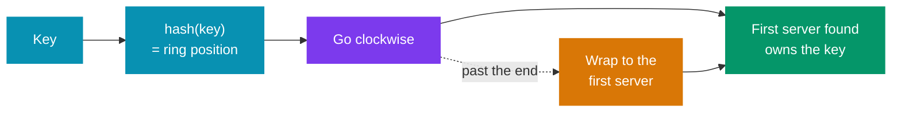
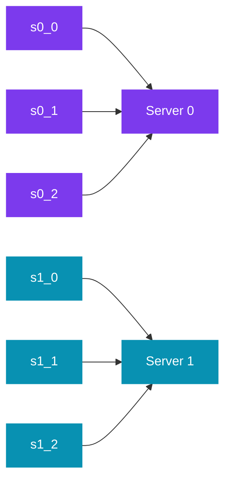

# Ch 5: Design Consistent Hashing

> 📖 **Vol 1, Chapter 5** (book pages 71–86) &nbsp;·&nbsp; 🔥🔥 Very High Priority &nbsp;·&nbsp; 💬 **16 Questions**  
> **Source:** Alex Xu, *System Design Interview Vol 1*, Ch 5. Page and figure numbers below are the book's. This PDF edition prints no page numbers in the footer, so pages are the PDF page numbers (the chapter starts on page 71).

---

📊 **Question Count**

| # | Section | Questions |
|---|---|---|
| 1 | [The Rehashing Problem 🔥🔥](#1--the-rehashing-problem-p7174-) | 1 |
| 2 | [Hash Space and Hash Ring 🔥🔥](#2--hash-space-and-hash-ring-p7576-) | — |
| 3 | [Server Lookup, Add and Remove a Server 🔥🔥](#3--server-lookup-add-and-remove-a-server-p7678-) | 4 |
| 4 | [Two Issues in the Basic Approach 🔥](#4--two-issues-in-the-basic-approach-p7980-) | 1 |
| 5 | [Virtual Nodes 🔥🔥](#5--virtual-nodes-p8082-) | 3 |
| 6 | [Find Affected Keys 🔥](#6--find-affected-keys-p8284-) | 1 |
| 7 | [Wrap Up — Benefits and Real-World Use 🔥](#7--wrap-up--benefits-and-real-world-use-p8586-) | 6 |
| | **Total** | **16** |

> 🔥🔥 Very high priority — asked in almost every Tier-1 interview loop &nbsp;·&nbsp; 🔥 High priority — very frequent in Tier-1 interviews &nbsp;·&nbsp; ⚡ Medium priority — commonly asked &nbsp;·&nbsp; 💤 Low priority — good to know, rarely asked

> **How to read this note.** Sections 1–7 follow the book, in the book's order. This chapter is a technique, not a full "Design X" system, so it has no Step 1–4 and no 45-minute plan. Anything the book does not say is marked **📎 Beyond the book**. Each section ends with its own interview questions; a question with 📎 before its tag is a common follow-up the book does not ask. Where the book has a mistake, the note says so and gives the fix.  
> Related notes: the next chapter uses this ring for partitioning and replication: [Ch 6: Key-value Store](./ch06_design_a_key_value_store.md). Consistent hashing as a load-balancing algorithm is in [the load balancing note](../../02_distributed_systems/02_load_balancing_strategies.md). Redis Cluster hash slots are in [the Redis Q&A](../../iq/03_Redis_Interview_Questions.md).

---

## 🗒️ Cheat Sheet

<details>
<summary><strong>🗒️ Show cheat sheet</strong></summary>

### 🎯 Clarifying Questions to Ask

📎 The book has no clarifying-question step for this chapter. These are the useful ones to ask when an interviewer says "use consistent hashing":

| Question | Why it matters |
|---|---|
| What are we spreading — cache keys, database rows, or requests? | Cache: a moved key is only a miss. Database: a moved key is data you must copy |
| How many servers, and how often do they join or leave? | Frequent change is the reason to use consistent hashing at all |
| Are all servers the same size? | Different sizes → give bigger servers more virtual nodes |
| Do we need range scans? | Hashing spreads related keys apart. Range scans need range partitioning instead |
| Are some keys much hotter than others? | Consistent hashing balances keys, not traffic to one key |

### 🏗️ Core Components (Figures 5-4 to 5-13)
- **Hash space** — every value the hash function can return. For SHA-1 that is **0 to 2^160 − 1** (p.75).
- **Hash ring** — the hash space with its two ends joined (Figure 5-4).
- **Servers on the ring** — each server is hashed by its **IP or name** with the same function (Figure 5-5).
- **Keys on the ring** — each key is hashed onto the ring. There is **no modulo** (p.76).
- **Lookup rule** — go **clockwise** from the key until you meet the first server (Figure 5-7).
- **Virtual nodes** — each real server appears at **many** places on the ring (`s0_0`, `s0_1`, `s0_2`), Figure 5-12.
- 📎 **In code** — a sorted map from ring position to server. In Java, a `TreeMap<Long, String>` with `ceilingEntry()`.

### 💡 Key Insights
1. `hash(key) % N` puts the **server count inside the formula**. Change N and most keys move. In the book's example, **5 of 8** keys move when 1 of 4 servers goes away (p.73–74).
2. On the ring, the server count is **not** in the formula. A change moves only the keys next to the changed server: about **k/n** keys on average (p.75).
3. The basic ring has **two issues**: partitions of very different sizes, and keys that pile up on one server (p.79–80).
4. **Virtual nodes** fix both. More virtual nodes → smaller standard deviation → more even load. The cost is more space for ring data (p.82).
5. To find the keys that move, start at the changed server and go **anticlockwise** to the previous server. The keys in that range move (p.82–83).

### ⚖️ Trade-offs / Alternatives
| Option | Pro | Con | Book's verdict |
|---|---|---|---|
| `hash(key) % N` | Very simple, no extra data | Most keys move when N changes → a storm of cache misses | ❌️ Fine only when the pool is fixed (p.73–74) |
| Basic hash ring (one point per server) | Only nearby keys move | Uneven partitions; uneven keys (Figures 5-10, 5-11) | ❌️ Two issues (p.79) |
| Ring with virtual nodes | Even load; only nearby keys move | More space for virtual node data | ✅ The book's design (p.80–82) |
| More vs fewer virtual nodes | More → smaller standard deviation | More → more space | "A tradeoff… tune the number to fit our system requirements" (p.82) |
| 📎 Rendezvous (highest random weight) hashing | No ring; each key picks the server with the highest `hash(key, server)` | O(N) work per lookup | Not in the book |
| 📎 Fixed hash slots (Redis Cluster, 16,384 slots) | Move whole slots; easy to inspect | Fixed slot count | Not in the book |
| 📎 Range partitioning | Fast range scans | Hot ranges; boundaries need managing | Not in the book |

### 🔢 Numbers to Remember
| What | Value | Arithmetic |
|---|---|---|
| Keys moved in the book's modulo example | **5 of 8** (62.5%) | Table 5-1 vs 5-2: key0, key3, key4, key5, key7 change server. Only key0 and key4 were on the dead server 1 |
| Keys that moved for no reason | **3** | key3, key5, key7 were on healthy servers but still moved |
| Keys that move with consistent hashing | **k/n on average** | 8 keys, 4 servers → about 2 keys |
| 📎 Modulo, add one server (N → N+1) | **N/(N+1)** of keys move | A key stays only if `h % N == h % (N+1)`. That is true for N of every N(N+1) values → 1/(N+1) stay. 4 → 5: **80%** move. 10 → 11: 90.9% |
| SHA-1 hash space | **0 to 2^160 − 1** | 160-bit output (p.75) |
| 📎 Common ring in code | **0 to 2^32 − 1** | 32 bits of MD5 or Murmur. 2^32 ≈ 4.29 billion positions |
| Partition after a removal, Figure 5-10 | **2×** | 4 servers evenly spaced → 25% each. Remove s1 → s2 owns 50% = twice s0 or s3 |
| Virtual nodes in Figure 5-12 | **3 per server** | "Arbitrarily chosen"; real systems use many more (p.81) |
| Standard deviation of load | **10% of mean at 100 vnodes, 5% at 200** | The book's cited experiment [2] (p.82) |
| 📎 Ring size in memory | **~1 MB** | 100 servers × 200 vnodes = 20,000 `TreeMap` entries × ~56 B (entry + `Long`) ≈ 1.1 MB |
| 📎 Lookup cost | **~15 comparisons** | log2(20,000) ≈ 14.3 for a `TreeMap` |
| 📎 Cassandra `num_tokens` | **256** before 4.0, **16** from 4.0 | Murmur3Partitioner token range: −2^63 to 2^63 − 1 |
| 📎 Redis Cluster | **16,384 hash slots** | `slot = CRC16(key) % 16384` |

---

</details>
<br/>

---

## 1. 🔀 The Rehashing Problem (p.71–74) 🔥🔥

To scale out, you must spread requests and data **evenly** across servers. Consistent hashing is a common way to do this (p.71). First, the problem.

With N cache servers, a common way to balance load is (p.72):

```
serverIndex = hash(key) % N        // N = size of the server pool
```

**Table 5-1** — 4 servers, 8 keys:

| Key | hash | hash % 4 |
|---|---|---|
| key0 | 18358617 | 1 |
| key1 | 26143584 | 0 |
| key2 | 18131146 | 2 |
| key3 | 35863496 | 0 |
| key4 | 34085809 | 1 |
| key5 | 27581703 | 3 |
| key6 | 38164978 | 2 |
| key7 | 22530351 | 3 |

So `hash(key0) % 4 = 1`, and a client asks **server 1** for key0. **Figure 5-1:** server 0 has key1, key3; server 1 has key0, key4; server 2 has key2, key6; server 3 has key5, key7.

This works well when the pool size is **fixed** and the data is even. It breaks when servers are added or removed (p.73).

**Server 1 goes offline.** The pool is now 3. The hash of each key is the same, but `% 3` gives new indexes. Index 0 → server 0, index 1 → server 2, index 2 → server 3.

**Table 5-2** and **Figure 5-2**:

| Key | hash % 3 | Server now | Server before | Moved? |
|---|---|---|---|---|
| key0 | 0 | server 0 | server 1 | ✅ yes (its server died) |
| key1 | 0 | server 0 | server 0 | no |
| key2 | 1 | server 2 | server 2 | no |
| key3 | 2 | server 3 | server 0 | ✅ yes |
| key4 | 1 | server 2 | server 1 | ✅ yes (its server died) |
| key5 | 0 | server 0 | server 3 | ✅ yes |
| key6 | 1 | server 2 | server 2 | no |
| key7 | 0 | server 0 | server 3 | ✅ yes |

**Most keys move**, not only the ones on server 1 (p.74). So most cache clients now ask the **wrong server**. The result is a **storm of cache misses**. Consistent hashing fixes this.

> 📎 **Adding a server is just as bad.** Going from N to N+1 servers moves **N/(N+1)** of all keys: 80% for 4 → 5, and over 99% for 100 → 101. The arithmetic is in the Numbers table. A cache that loses 80% of its hits at once sends that load straight to the database.

### ❓ Interview Questions

1. **Why is `hash(key) % N` a problem in a distributed cache? Use an example. 🔥🔥**

<!-- -->
<details>
<summary>💡 Show Answer</summary>

**Answer:**

The server count N is inside the formula. When N changes, almost every key gets a new server index.

**The book's example** (Tables 5-1 and 5-2, p.72–74): 4 servers, 8 keys. Server 1 goes offline, so the formula becomes `hash % 3`.

- **5 of 8 keys** move: key0, key3, key4, key5, key7.
- Only key0 and key4 were on server 1. The other 3 moved for **no reason**.
- Most clients now ask the wrong server. The result is a **storm of cache misses**, and the load falls on the database.

📎 Adding a server is as bad: N → N+1 moves N/(N+1) of keys, so 80% for 4 → 5.

**Consistent hashing** keeps the count out of the formula. Only about **k/n** keys move (p.75).

</details>

<details>
<summary><strong>🤔 Doubt: When server 1 dies, server 0 has no data for key0 — so is the data lost? And is consistent hashing only for reads?</strong></summary>

**Part 1 — the data is not lost, because these servers are a cache.**

In the book's example, the **database** is the source of truth. It holds every key, always. The cache servers only hold **copies**, to make reads fast. There is no replication between the cache servers.

What happens to key0 after server 1 dies:

1. The client computes `hash(key0) % 3 = 0` and asks **server 0**.
2. Server 0 does not have key0 → **cache miss**.
3. The client reads key0 from the **database**.
4. The client writes key0 into server 0. The next read is a hit.

The copy on server 1 is gone, but a copy is not the data. The cost is one slow read.

**Why "storm":** the problem is not one miss. **5 of 8 keys** miss at the same moment, and all those reads hit the database together. With millions of keys, this can overload or crash the database.

**The extra waste:** key3, key5 and key7 were on healthy servers. Their copies are still there (key3 still sits on server 0), but clients now ask a different server. So they miss too and are re-fetched for no reason. The old copies stay until they expire or are evicted.

**When the data *would* be lost:** if the servers were the **only store** (a key-value database, not a cache). That is why databases replicate each key to several servers — usually the first **3 distinct servers clockwise** on the ring. If one dies, another still has the data. See §7 Q3 and [Ch 6](./ch06_design_a_key_value_store.md).

**Part 2 — consistent hashing is not only for reads.**

It answers one question: **"which server owns this key?"** Reads and writes both use the same answer.

| | Cache in front of one database (§1 example) | Database split across many servers (Dynamo, Cassandra) |
|---|---|---|
| Where data really lives | One database | Spread across the ring — no single database |
| Writes | Go to the database. The ring tells the client which cache server to **update or delete**, or reads get stale data | Use the ring: the key is stored on its owner server (plus replicas) |
| Reads | Use the ring to find the cache server. On a miss, read the database | Use the ring to find the same owner server |
| When a key moves | Only a cache miss | The data must be **copied** to the new server |

**The weak point in "one database for all writes":** it works only while one machine can hold all the data and take all the writes. At large scale it cannot, so the data is split across many servers. Consistent hashing is mainly a tool for that split. Caching is only one use of it.

---

</details>
<br/>

---

## 2. 💍 Hash Space and Hash Ring (p.75–76) 🔥🔥

**Definition** (the book quotes Wikipedia, p.75): consistent hashing is a special kind of hashing. When the hash table is resized, **only k/n keys need to be remapped on average**. Here k is the number of keys and n is the number of slots. In most normal hash tables, a change in the slot count remaps **nearly all** keys.

### Hash space and hash ring

- Assume **SHA-1** is the hash function f. Its outputs are x0, x1, …, xn.
- SHA-1's hash space goes from **0 to 2^160 − 1**. So x0 = 0 and xn = 2^160 − 1 (Figure 5-3).
- Join the two ends, and you get a **hash ring** (Figure 5-4).

### Hash servers

Use the **same** function f to map each server onto the ring, by its **IP or name**. Figure 5-5 shows 4 servers, s0 to s3, on the ring.

### Hash keys

Hash each key onto the same ring (Figure 5-6). The book points out one thing (p.76):

- This hash function is **different** from the one in the rehashing problem.
- There is **no modulo** operation.

> 📎 **Why "no modulo" is the whole trick.** A key's position depends only on the key. A server's position depends only on that server. The server **count** appears nowhere. So adding or removing one server cannot move a key that is far away from it on the ring.

> 📎 In code, rings are usually 32 or 64 bits, not 160. Memcached clients take 32 bits of MD5 (the "ketama" scheme). Cassandra uses 64-bit Murmur3. The idea is the same.

---

## 3. 🔍 Server Lookup, Add and Remove a Server (p.76–78) 🔥🔥

### Server lookup (Figure 5-7)

To find a key's server, **go clockwise** from the key's position until you find a server (p.77).

Going clockwise round Figure 5-7, the order is: k0 → s0 → k1 → s1 → k2 → s2 → k3 → s3 → (back to k0). So:

| Key | First server clockwise |
|---|---|
| key0 | server 0 |
| key1 | server 1 |
| key2 | server 2 |
| key3 | server 3 |



### Add a server (Figure 5-8)

Adding a server moves only **a fraction** of the keys (p.77).

- **Server 4** is added between key0 and s0.
- Before: key0 went clockwise to **server 0**.
- Now: the first server clockwise from key0 is **server 4**. So key0 moves to server 4.
- k1, k2 and k3 stay where they were.

### Remove a server (Figure 5-9)

Removing a server also moves only a small fraction (p.78).

- **Server 1** is removed.
- Only **key1** must move. Going clockwise from key1, the next server is now **server 2**.
- All other keys are not affected.

> 📎 **Compare with §1.** With modulo, removing server 1 moved **5 of 8** keys. On the ring, removing server 1 moves **only the keys server 1 owned** — key1 here. Nothing else moves.

### 📎 A Java implementation

The book gives no code. This is the standard way to build the ring in Java. It already includes virtual nodes (§5):

```java
import java.nio.charset.StandardCharsets;
import java.security.MessageDigest;
import java.security.NoSuchAlgorithmException;
import java.util.Map;
import java.util.TreeMap;

public class ConsistentHashRing {

    private final TreeMap<Long, String> ring = new TreeMap<>();
    private final int virtualNodes;

    public ConsistentHashRing(int virtualNodes) {
        this.virtualNodes = virtualNodes;
    }

    public void addServer(String server) {
        for (int i = 0; i < virtualNodes; i++) {
            ring.put(hash(server + "_" + i), server);    // s0_0, s0_1, ... like Figure 5-12
        }
    }

    public void removeServer(String server) {
        for (int i = 0; i < virtualNodes; i++) {
            ring.remove(hash(server + "_" + i), server); // remove only if it is still ours
        }
    }

    public String serverFor(String key) {
        if (ring.isEmpty()) {
            throw new IllegalStateException("No servers on the ring");
        }
        Map.Entry<Long, String> entry = ring.ceilingEntry(hash(key)); // first position >= key
        if (entry == null) {
            entry = ring.firstEntry();                                // wrap around the ring
        }
        return entry.getValue();
    }

    private static long hash(String value) {
        try {
            MessageDigest md5 = MessageDigest.getInstance("MD5");
            byte[] d = md5.digest(value.getBytes(StandardCharsets.UTF_8));
            return ((long) (d[3] & 0xFF) << 24)
                    | ((long) (d[2] & 0xFF) << 16)
                    | ((long) (d[1] & 0xFF) << 8)
                    | (d[0] & 0xFF);                                  // 0 .. 2^32 - 1
        } catch (NoSuchAlgorithmException e) {
            throw new IllegalStateException(e);
        }
    }
}
```

- **Lookup:** O(log(N·V)) for N servers and V virtual nodes each.
- **Add or remove a server:** O(V·log(N·V)), because it touches V entries.
- `ceilingEntry` returns `null` past the last position. That is the "wrap around" of the ring.
- `TreeMap` is not thread-safe. For many reader threads, build a new map and swap it in through a `volatile` field. Or use `ConcurrentSkipListMap`, which has the same `ceilingEntry`.

### ❓ Interview Questions

1. **Walk me through how a key finds its server on a consistent hash ring. 🔥🔥**

<!-- -->
<details>
<summary>💡 Show Answer</summary>

**Answer:**

1. Build the ring: the hash space (0 to 2^160 − 1 for SHA-1) with the two ends joined (Figure 5-4).
2. Hash each **server** onto the ring by its IP or name (Figure 5-5).
3. Hash the **key** onto the same ring. There is no modulo (p.76).
4. Go **clockwise** from the key. The first server you meet owns the key (Figure 5-7).

📎 **In Java:** keep a `TreeMap<Long, String>` of ring position → server. Call `ceilingEntry(hash(key))`. If it returns `null`, you went past the end, so wrap to `firstEntry()`. A lookup is O(log(N·V)). The full class is above, in **📎 A Java implementation**.

</details>

---

2. **A new server is added to the ring. Which keys move, and where? 🔥🔥**

<!-- -->
<details>
<summary>💡 Show Answer</summary>

**Answer:**

Only the keys that now meet the new server **first** when they go clockwise.

**Book example** (Figure 5-8, p.77): server 4 is added between key0 and s0.

- Before, key0 went clockwise to server 0. Now it meets **server 4** first, so key0 moves to server 4.
- key1, key2 and key3 do not move.

**To find the range** (Figure 5-14, p.82): start at the new server s4. Go **anticlockwise** to the previous server, s3. The keys between s3 and s4 move to s4. They all come from s4's next server clockwise (s0 here).

📎 With virtual nodes, the new server has many positions. So it takes a small range from **many** servers, not one big range from one neighbour.

</details>

---

3. **A server is removed from the ring. Which keys move, and what is the risk? 🔥**

<!-- -->
<details>
<summary>💡 Show Answer</summary>

**Answer:**

Only the keys the removed server owned. They move to the **next server clockwise**.

**Book example** (Figure 5-9, p.78): server 1 is removed. Only **key1** moves, to **server 2**. All other keys stay.

**To find the range** (Figure 5-15, p.83): start at s1 and go **anticlockwise** to s0. The keys between s0 and s1 move to **s2**.

**The risk** — the book's Issue 1 (Figure 5-10, p.79): with one point per server, the whole range goes to **one** neighbour. In the figure, s2's partition becomes **twice** as large as the others. That server may be overloaded.

📎 Virtual nodes fix this. The removed server had positions all round the ring, so its keys are shared by **many** servers.

</details>

---

4. **How would you implement consistent hashing in Java? 📎 🔥**

<!-- -->
<details>
<summary>💡 Show Answer</summary>

**Answer:**

Use a `TreeMap<Long, String>`. The key is the ring position. The value is the server name. The full class is above, in **📎 A Java implementation**.

- **Add a server:** hash `server_0` … `server_(V-1)` and put all V entries.
- **Find a key's server:** `ceilingEntry(hash(key))`. If it is `null`, wrap to `firstEntry()`.
- **Remove a server:** remove its V entries. Use `remove(position, server)`, so a hash collision with another server's entry is not removed by mistake.

**Costs:** lookup O(log(N·V)); add or remove O(V·log(N·V)).

**Points an interviewer checks:**

- **The hash function** — use a well-spread hash (MD5, Murmur3). Never `String.hashCode()`: similar names give close values, so servers cluster.
- **Thread safety** — `TreeMap` is not thread-safe. Build a new map on each change and publish it through a `volatile` field. Or use `ConcurrentSkipListMap`.

</details>

---

## 4. 🚧 Two Issues in the Basic Approach (p.79–80) 🔥

The algorithm was introduced by **Karger et al. at MIT** (p.79). The basic steps are:

- Map servers and keys onto the ring with a **uniformly distributed** hash function.
- To find a key's server, go clockwise from the key until you find the first server.

The book names **two problems** with this.

**Issue 1 — partitions of very different sizes** (Figure 5-10). A **partition** is the hash space between two neighbouring servers. Servers are added and removed, so you cannot keep all partitions the same size. One server may get a very small partition, another a very large one.

- In Figure 5-10 the 4 servers are evenly spaced, so each partition is 25% of the ring.
- Remove **s1**. Now **s2's** partition runs from s0 all the way to s2.
- That is **twice** the size of s0's or s3's partition.

**Issue 2 — keys spread unevenly** (Figure 5-11). The keys on the ring may not be spread evenly across the servers (p.80).

- In Figure 5-11 the servers sit close together on one side of the ring.
- **Most keys land on server 2.** Server 1 and server 3 get **no data** at all.
- 📎 The cause is where the servers sit. Bunched servers leave one server with most of the ring, so it gets most of the keys. This is about key **count**, not key **popularity** — see the doubt below Q1.

The fix for both is a technique called **virtual nodes**, also called **replicas** (p.80).

> 📎 **"Replicas" here does not mean data copies.** It means more ring positions for the same server. Tom White's well-known Java code (the book's reference [2]) calls this parameter `numberOfReplicas`. Do not mix it up with the replication factor in Ch 6.

### ❓ Interview Questions

1. **What are the two issues with the basic consistent hashing approach? 🔥**

<!-- -->
<details>
<summary>💡 Show Answer</summary>

**Answer:**

The basic approach (Karger et al., MIT, p.79): map servers and keys with a uniform hash, then go clockwise to the first server. It has two issues:

1. **Partitions of very different sizes** (Figure 5-10). A partition is the hash space between two neighbouring servers. Servers come and go, so you cannot keep partitions equal. When s1 is removed, s2's partition becomes **twice** the size of s0's and s3's.
2. **Keys spread unevenly** (Figure 5-11). If the servers sit close together, **most keys land on server 2**. Server 1 and server 3 get **no data**.

The fix for both is **virtual nodes** (also called replicas) (p.80).

</details>

<details>
<summary><strong>🤔 Doubt: Is Issue 2 (keys spread unevenly) the same as the celebrity problem?</strong></summary>

**No.** They are related, but they are different problems. Both end in the same symptom — one overloaded server — and that is why people mix them up.

**Issue 2 is about how many keys each server gets.**

- In Figure 5-11 the servers sit close together on one side of the ring. Server 2 owns most of the ring, so most keys land on it.
- The cause is **where the servers sit on the ring**. Users have nothing to do with it.
- Even if every key gets the same traffic, server 2 is overloaded because it simply holds more keys.
- **Fix:** virtual nodes (§5). Many positions per server even out the key counts.

**The celebrity problem is about how often each key is used.**

- Key counts can be perfectly even, and Katy Perry's key can still get a million times more requests than a normal key.
- The cause is **user behaviour**. The ring layout has nothing to do with it.
- **Virtual nodes do not fix it.** All requests for one key still go to one server.
- **Fixes:** add suffixes to the hot key (`key#1` … `key#10`), cache it locally or on a CDN, add read replicas, or give each celebrity its own shard ([Ch 1](./ch01_scale_from_zero.md)).

| | Issue 2 (Figure 5-11) | Celebrity problem |
|---|---|---|
| What is uneven | Number of **keys** per server | **Traffic** per key |
| Cause | Server positions on the ring | User behaviour |
| Virtual nodes fix it? | ✅ Yes | ❌️ No |

**Where they connect:** the book links them in §7. Consistent hashing makes it **less likely that several** celebrities land on the same shard. It cannot split **one** celebrity key. See §7 Q1: *"virtual nodes fix uneven key counts. They do not fix uneven key popularity."*

---

</details>
<br/>

---

## 5. 🧩 Virtual Nodes (p.80–82) 🔥🔥

A **virtual node** points to a real node. Each server is shown by **many** virtual nodes on the ring (p.80).

- In Figure 5-12, server 0 and server 1 each have **3** virtual nodes. The 3 is **chosen at random**. Real systems use a much larger number (p.81).
- Server 0 appears as `s0_0`, `s0_1`, `s0_2`. Server 1 appears as `s1_0`, `s1_1`, `s1_2`.
- So **each server owns many partitions**. In the figure, edges labelled s0 belong to server 0, and edges labelled s1 belong to server 1.

Going clockwise in Figure 5-12, the order is: s1_0 → s0_0 → s1_1 → s0_1 → s1_2 → s0_2 → (back to s1_0). The two servers take turns, so each owns about half the ring.



**Lookup with virtual nodes** (Figure 5-13). Go clockwise from the key and take the **first virtual node**. Then map it to its real server. For k0, the first virtual node is **s1_1**, so k0 is on **server 1** (p.81).

**Why it balances the load** (p.82):

- As the number of virtual nodes grows, keys are spread more evenly.
- The reason: the **standard deviation** gets smaller. Standard deviation measures how spread out the data is.
- An online experiment (the book's reference [2]) found: with **100** virtual nodes, the standard deviation is **10%** of the mean. With **200**, it is **5%**.
- More virtual nodes make it smaller still.

**The cost** (p.82): more **space** is needed to store virtual node data. This is a trade-off. Tune the number of virtual nodes to fit the system's needs.

📎 Three more things virtual nodes give you. The book does not list them, but they follow from the design:

- **A removed server's load is shared.** Its virtual nodes sit all round the ring. So its keys go to **many** next servers, not to one neighbour. This fixes Issue 1.
- **A new server takes load from many servers**, not just from one neighbour.
- **Different server sizes.** Give a server with twice the capacity twice as many virtual nodes. It then gets about twice the keys.

📎 Real numbers: Cassandra used **256** virtual nodes (`num_tokens`) per node by default before 4.0. From 4.0 the default is **16**, with a smarter token allocator. Fewer tokens make repair and streaming cheaper.

### ❓ Interview Questions

1. **What is a virtual node, and why do we need it? 🔥🔥**

<!-- -->
<details>
<summary>💡 Show Answer</summary>

**Answer:**

A virtual node is one of **many** ring positions that point to the same real server (p.80).

- In Figure 5-12, server 0 is `s0_0`, `s0_1`, `s0_2`, and server 1 is `s1_0`, `s1_1`, `s1_2`. The 3 is arbitrary; real systems use many more.
- Each server now owns many small partitions, spread round the ring.
- **Lookup:** go clockwise to the first **virtual** node, then map it to its server. In Figure 5-13, k0 meets `s1_1`, so k0 is on server 1.

**Why:** it fixes both basic issues. More virtual nodes → smaller **standard deviation** → more even load. The book's numbers (p.82): **10%** of the mean with 100 virtual nodes, **5%** with 200.

📎 It also helps with **different server sizes**: give a bigger server more virtual nodes.

</details>

---

2. **What is the trade-off between more and fewer virtual nodes? ⚡**

<!-- -->
<details>
<summary>💡 Show Answer</summary>

**Answer:**

**The book** (p.82):

- **More** virtual nodes → smaller standard deviation → more balanced data.
- But **more space** is needed to store the virtual node data.
- It is a trade-off. Tune the number to fit the system's needs.

📎 Other costs of more virtual nodes:

- Adding or removing a server touches V ring entries, not one.
- Every client must keep (and update) a bigger ring.
- In a database like Cassandra, more token ranges make **repair** and **streaming** slower. This is why Cassandra 4.0 cut the default `num_tokens` from 256 to 16.

📎 The ring itself is small. 100 servers × 200 virtual nodes = 20,000 entries, about 1 MB in a `TreeMap`.

</details>

---

3. **Does consistent hashing give perfect load balance? 📎 💤**

<!-- -->
<details>
<summary>💡 Show Answer</summary>

**Answer:**

No.

- With one point per server, the load can be very uneven (the book's Figures 5-10 and 5-11).
- Virtual nodes make it **statistically** even, not exactly even. The book's numbers: standard deviation of 5–10% of the mean with 100–200 virtual nodes (p.82).
- Real traffic also has hot keys, which hashing cannot fix (§7 Q1).

For tighter balance:

- Watch per-node load, and change virtual node counts or move ranges by hand.
- Or assign token ranges on purpose, from a coordinator. Cassandra 4.0's token allocator does a version of this.
- Or use "consistent hashing with bounded loads": a server that is full passes the key on to the next server.

</details>

---

## 6. 🎯 Find Affected Keys (p.82–84) 🔥

When a server is added or removed, some data must move. How do you find the range of keys that moves? (p.82)

**Server added (Figure 5-14).** Server 4 is added to the ring.

- Start at **s4** (the new node) and go **anticlockwise** until you find a server — **s3**.
- The keys **between s3 and s4** must move to **s4**.

**Server removed (Figure 5-15).** Server s1 is removed (p.83).

- Start at **s1** (the removed node) and go **anticlockwise** until you find a server — **s0**.
- The keys **between s0 and s1** must move to **s2**, the next server clockwise.

| Change | Walk | Range that moves | Moves to |
|---|---|---|---|
| Add s4 | From s4, anticlockwise to s3 | (s3, s4] | s4 (the new server) |
| Remove s1 | From s1, anticlockwise to s0 | (s0, s1] | s2 (the next server clockwise) |

> 📎 **Why anticlockwise?** A server owns the keys **before** it, because keys go clockwise to find it. So the range a server owns runs **backwards** from it to the previous server. To find what changed, walk backwards.
>
> 📎 **With virtual nodes,** do this once **per virtual node** of the changed server. With V virtual nodes you get V small ranges. Each range moves to (or from) a different neighbour.

### ❓ Interview Questions

1. **When a server is added or removed, how do you find the keys that must move? 🔥**

<!-- -->
<details>
<summary>💡 Show Answer</summary>

**Answer:**

Start at the changed server and walk **anticlockwise** until you meet the previous server (p.82–83).

- **Added s4** (Figure 5-14): walk from s4 to s3. Keys between **s3 and s4** move **to s4**.
- **Removed s1** (Figure 5-15): walk from s1 to s0. Keys between **s0 and s1** move **to s2**.

**Why anticlockwise:** keys go clockwise to find a server. So a server owns the range **behind** it, back to the previous server.

📎 With virtual nodes, repeat this for every virtual node of the changed server. In a database, each range is then streamed from its old owner to its new owner.

</details>

---

## 7. 🌍 Wrap Up — Benefits and Real-World Use (p.85–86) 🔥

**The benefits** (p.85):

- **Few keys move** when servers are added or removed.
- **Easy to scale horizontally**, because data is spread more evenly.
- **Helps with the hotspot key problem.** Too many requests to one shard can overload a server. Imagine the data for Katy Perry, Justin Bieber and Lady Gaga all on the **same shard**. Consistent hashing spreads the data more evenly, so this is less likely.

> 📎 **Know the limit of that last point.** Consistent hashing stops **several** hot keys from landing on the same shard. It cannot split **one** hot key — all requests for one key still go to one server. For that you need other tools: a random suffix on the key (`key#1` … `key#10`), a local or CDN cache, or more read replicas. See Q1 below.

**Where it is used** (p.85, with the book's references):

| System | What it uses consistent hashing for | Book ref |
|---|---|---|
| **Amazon Dynamo** | The **partitioning** part of the database | [3] Dynamo paper, 2007 |
| **Apache Cassandra** | **Data partitioning** across the cluster | [4] Cassandra paper |
| **Discord** | The chat application (scaling Elixir to 5 million concurrent users) | [5] |
| **Akamai** | The **content delivery network** | [6] |
| **Maglev** | Google's **network load balancer** | [7] |

📎 What each one does with it:

📎 Two systems that are often named but **not** in the book:

- **Redis Cluster** does **not** use a ring. It uses 16,384 fixed hash slots: `CRC16(key) % 16384`. See Q5 below.
- **Memcached** clients (for example, the ketama library) do consistent hashing **on the client side**. The servers know nothing about each other.

### ❓ Interview Questions

1. **Does consistent hashing solve the hotspot key problem? 🔥**

<!-- -->
<details>
<summary>💡 Show Answer</summary>

**Answer:**

**Partly.** The book says it helps (p.85). Imagine the data for Katy Perry, Justin Bieber and Lady Gaga all on the **same shard**. That shard is overloaded. Consistent hashing spreads data more evenly, so this pile-up is less likely.

📎 But it cannot help with **one** very hot key. Every request for that key still goes to one server. Fixes for that:

1. **Key suffixes** — store the key as `key#1` … `key#10`, so the copies land on different servers.
   - Read-hot key: write all copies, read one copy at random.
   - Write-hot key (a counter): write to one random copy; read all copies and add them up.
2. **Cache the hot key** at a higher layer — a local in-process cache or a CDN.
3. **More read replicas** for the hot data, with reads sent to a random replica.

So: virtual nodes fix uneven **key counts**. They do not fix uneven **key popularity**.

</details>

---

2. **Where is consistent hashing used in real systems? 🔥**

<!-- -->
<details>
<summary>💡 Show Answer</summary>

**Answer:**

The book's list (p.85):

- **Amazon Dynamo** — the partitioning part of the database.
- **Apache Cassandra** — data partitioning across the cluster.
- **Discord** — its chat application.
- **Akamai** — its content delivery network.
- **Maglev** — Google's network load balancer.

📎 Details worth saying:

- **Dynamo (the 2007 paper)** puts each key on the first N distinct physical nodes clockwise, with virtual nodes. This is not the same as today's **DynamoDB** service. DynamoDB hashes the partition key into partitions and tracks them in a metadata service. It replicates data across several Availability Zones.
- **Cassandra** uses a token ring. With the default Murmur3Partitioner (since 1.2), tokens run from −2^63 to 2^63 − 1. A new node takes over token ranges from existing nodes, so little data moves.
- **Maglev** uses a lookup-table variant that gives almost equal load per backend.

</details>

---

3. **How do you handle replication with consistent hashing? 📎 🔥**

<!-- -->
<details>
<summary>💡 Show Answer</summary>

**Answer:**

Put each key on the first **N distinct physical** servers clockwise, not just the first one. N is the replication factor. With virtual nodes, skip positions that belong to a server you already picked. Otherwise two copies could sit on the same machine.

- In the Dynamo paper and in Cassandra, N is usually **3**.
- Writes go to all N replicas. Reads can use any replica, depending on the consistency level.
- While a node is down, writes for it go to the next healthy server with a **hint**. That server hands them back when the node recovers (**hinted handoff**).

The next chapter covers this in the book's own words: [Ch 6: Key-value Store](./ch06_design_a_key_value_store.md).

</details>

---

4. **How do you detect and handle node failures in a consistent hashing system? 📎 ⚡**

<!-- -->
<details>
<summary>💡 Show Answer</summary>

**Answer:**

Use **heartbeats**. Nodes ping each other, or a coordinator, at a fixed interval. After a number of missed heartbeats, the node is marked as failed.

What happens next depends on the system:

- **A cache client** (for example, a Memcached client) usually removes the node from its ring. Its keys go to the next servers. They are cache misses until filled again.
- **A Dynamo-style database** (like Cassandra) keeps a down node on the ring. It uses hinted handoff until the node returns. Only an admin removes a node for good.

In Cassandra, a **gossip** protocol spreads membership changes from node to node. So all nodes reach the same view of the ring within seconds, with no central coordinator.

</details>

---

5. **Why does Redis Cluster use hash slots instead of a consistent hash ring? 📎 🔥**

<!-- -->
<details>
<summary>💡 Show Answer</summary>

**Answer:**

Redis Cluster splits the key space into **16,384 fixed hash slots**: `slot = CRC16(key) % 16384`. Then it assigns slots to nodes.

- This is still "only nearby keys move": to add a node, you move **some slots** to it. Other keys do not move.
- The modulo here is safe, because 16,384 **never changes**. Only the slot → node map changes. (Compare §1, where the server count was in the formula.)
- Moving whole slots makes rebalancing simple and easy to inspect.
- The cost: the slot count is fixed, so balance is limited by slot size.

More detail: [the Redis Q&A](../../iq/03_Redis_Interview_Questions.md).

</details>

---

6. **How does consistent hashing compare to range-based partitioning? 📎 ⚡**

<!-- -->
<details>
<summary>💡 Show Answer</summary>

**Answer:**

**Range-based partitioning** (for example, keys A–F on node 1, G–N on node 2):

- Supports fast **range scans**, because nearby keys sit on the same node.
- But the boundaries need managing, by hand or by automatic splitting.
- Skewed keys give uneven partitions. Time-ordered keys put all new writes on the last node.

**Consistent hashing:**

- No boundaries to manage. Data spreads evenly by itself.
- But **no efficient range scans**. Nearby keys are spread round the ring in a random-looking way.

Pick range partitioning when queries scan ranges (time series, ordered IDs). Pick hashing when you only look up single keys.

</details>

---
