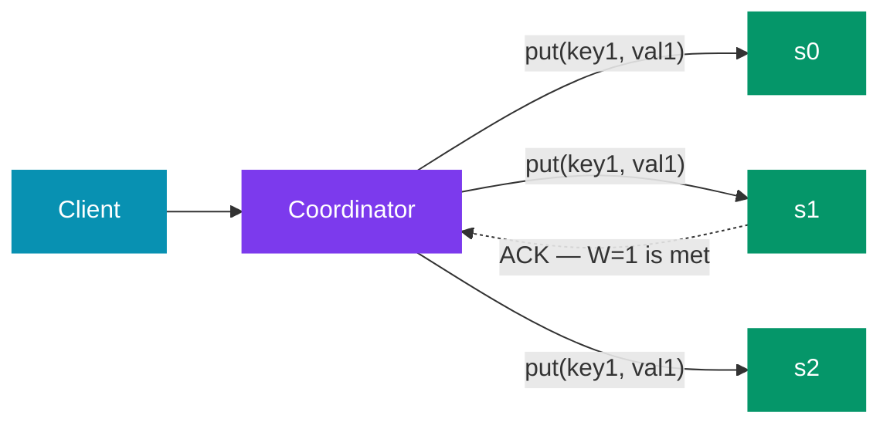
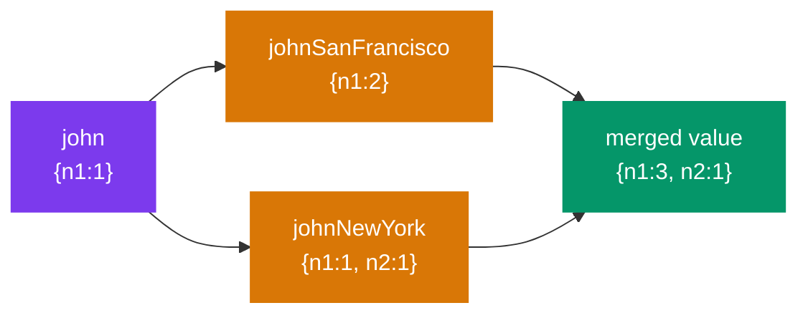
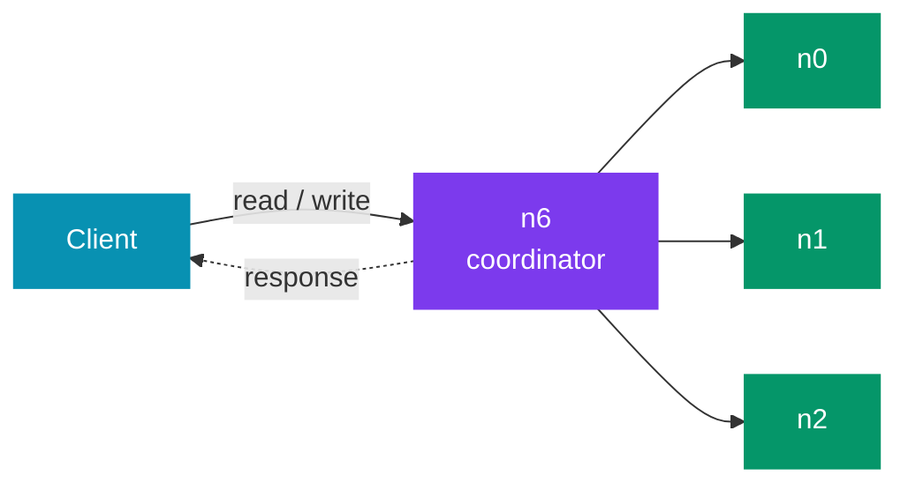
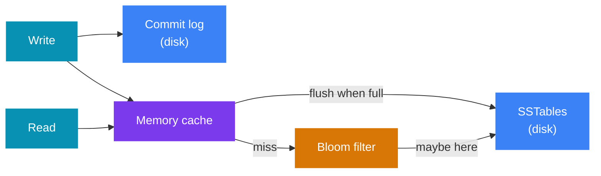
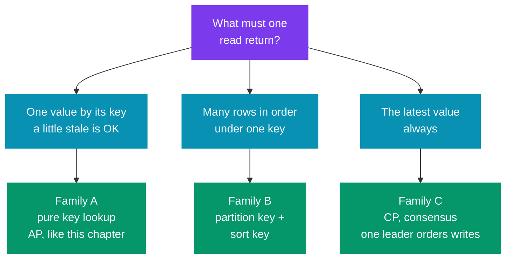

# Ch 6: Design a Key-Value Store

> 📖 **Vol 1, Chapter 6** (book pages 87–109) &nbsp;·&nbsp; 🔥🔥 Very High Priority &nbsp;·&nbsp; 💬 **24 Questions**  
> **Source:** Alex Xu, *System Design Interview Vol 1*, Ch 6. Page and figure numbers below are the book's. This PDF edition prints no page numbers in the footer, so pages are the PDF page numbers (the chapter starts on page 87).

---

📊 **Question Count**

| # | Section | Questions |
|---|---|---|
| 1 | [Problem and Design Scope ⚡](#1--problem-and-design-scope-p8788-) | — |
| 2 | [Single Server Key-Value Store 💤](#2--single-server-key-value-store-p89-) | 1 |
| 3 | [CAP Theorem 🔥🔥](#3--cap-theorem-p9092-) | 1 |
| 4 | [Data Partition and Replication 🔥](#4--data-partition-and-replication-p9294-) | 5 |
| 5 | [Consistency — Quorum and Consistency Models 🔥🔥](#5--consistency--quorum-and-consistency-models-p9596-) | 2 |
| 6 | [Inconsistency Resolution — Vector Clocks 🔥](#6--inconsistency-resolution--vector-clocks-p9799-) | 1 |
| 7 | [Handling Failures 🔥](#7--handling-failures-p99103-) | 5 |
| 8 | [Architecture, Write Path and Read Path 🔥](#8--architecture-write-path-and-read-path-p104108-) | 8 |
| 9 | [Similar Problems This Design Solves 📎 🔥](#9--similar-problems-this-design-solves--) | 1 |
| | **Total** | **24** |

> 🔥🔥 Very high priority — asked in almost every Tier-1 interview loop &nbsp;·&nbsp; 🔥 High priority — very frequent in Tier-1 interviews &nbsp;·&nbsp; ⚡ Medium priority — commonly asked &nbsp;·&nbsp; 💤 Low priority — good to know, rarely asked

> **How to read this note.** Sections 1–8 follow the book, step by step. §9, at the end, maps this design to 16 similar problems. Anything the book does not say is marked **📎 Beyond the book**. Each section ends with its own interview questions. A 📎 before a question's tag means the book does not ask it, so the answer is our own. Where the book has a mistake, the note says so and gives the fix.  
> Related notes: consistent hashing in depth is in [Ch 5](ch05_design_consistent_hashing.md). CAP, PACELC, consistency models and clocks in depth are in [the distributed fundamentals note](../../02_distributed_systems/01_distributed_fundamentals.md).

---

## 🗒️ Cheat Sheet

<details>
<summary><strong>🗒️ Show cheat sheet</strong></summary>

### 🎯 Clarifying Questions — and the book's answers
| Question | Book's answer (p.87–88) |
|---|---|
| Which operations? | **`put(key, value)`** and **`get(key)`** only (p.87) |
| How big is one key-value pair? | **Small — less than 10 KB** |
| How much data? | **Big data** — more than one server can hold |
| Availability? | **High** — the system responds quickly, even during failures |
| Scalability? | **High** — must support a large data set |
| Adding or removing servers? | **Automatic**, based on traffic |
| Consistency? | **Tunable** |
| Latency? | **Low** |

The book's framing (p.88): there is no perfect design. Every design balances reads, writes and memory. It also balances **consistency against availability**.

### 🏗️ Core Components (Table 6-2, p.108)
The book ends with this table. It is the whole design in ten rows:

| Goal / problem | Technique |
|---|---|
| Ability to store big data | Consistent hashing to spread the load across servers |
| High availability reads | Data replication · multi-data center setup |
| Highly available writes | Versioning and conflict resolution with vector clocks |
| Dataset partition | Consistent hashing |
| Incremental scalability | Consistent hashing |
| Heterogeneity | Consistent hashing |
| Tunable consistency | Quorum consensus |
| Handling temporary failures | Sloppy quorum and hinted handoff |
| Handling permanent failures | Merkle tree |
| Handling data center outage | Cross-data center replication |

Plus, on each node (p.105–107): a **commit log**, a **memory cache**, **SSTables** on disk, and a **Bloom filter** for reads.

### 💡 Key Insights
1. **One server is not enough** for big data, even with compression and a disk tier (p.89). So the real question is how to spread data and keep copies in sync.
2. **Partitions will happen**, so a real system picks **CP or AP**. A CA system cannot exist in practice (p.91). The book recommends **eventual consistency**, like Dynamo and Cassandra (p.96).
3. **W, R and N are the dial** for latency against consistency. `W + R > N` makes the read set and the write set overlap (p.95–96).
4. **AP has a price: conflicts.** Two replicas can accept different writes for the same key. **Vector clocks** detect this, and the **client** resolves it (p.97–99).
5. **Every failure has its own tool:** gossip finds failures. Sloppy quorum and hinted handoff cover short failures. 📎 Read repair fixes stale keys as they are read. Merkle trees repair everything else. Cross-DC replication covers a lost data center (p.99–103).

### ⚖️ Trade-offs / Alternatives
| Option | Pro | Con | Book's verdict |
|---|---|---|---|
| CP (block writes during a partition) | Never returns stale data | The system is unavailable during a partition | ✅ For a **bank balance** (p.92) |
| AP (keep accepting reads and writes) | Always responds | May return stale data; conflicts | ✅ For this key-value store — "discuss with your interviewer" (p.92) |
| Strong consistency | Clients never see old data | Blocks new operations until replicas agree | ❌️ Not ideal for highly available systems (p.96) |
| Eventual consistency | Highly available | Clients must reconcile conflicts | ✅ **Recommended** (p.96) |
| 📎 One leader per partition (Raft / Paxos) | No write conflicts; fresh reads from the leader | A partition takes no writes during a leader election; all its writes go through one node | Not the book's design. Choose it when a conflict is not acceptable (balances, stock counts) |
| All-to-all multicast for failure detection | Simple | Inefficient with many servers | ❌️ (p.99) |
| Gossip protocol | Decentralized; scales | Detection takes some rounds | ✅ (p.100) |
| Strict quorum | Keeps the quorum rule | Reads and writes can block | ❌️ for availability (p.101) |
| Sloppy quorum + hinted handoff | Stays available while a node is down | Weaker consistency for a while | ✅ (p.101) |
| 📎 Read repair | Fixes stale replicas for free, during normal reads | Never fixes a key nobody reads; a blocking repair adds latency to that read | Book does not discuss it; use it **with** Merkle-tree repair, not instead of it |
| Replicas in one data center | Fast links | They fail together (power, network, disaster) | ❌️ — place replicas in **distinct data centers** (p.94) |
| 📎 Last-write-wins (LWW) | Simple; no client logic | Silently loses one of two concurrent writes | Book does not discuss it; it uses vector clocks |

### 🔢 Numbers to Remember
| What | Value | Arithmetic |
|---|---|---|
| Key-value pair size | **< 10 KB** (p.88) | — |
| Usual quorum setup | **N = 3, W = R = 2** (p.96) | W + R = 4 > 3, so the read set and the write set share at least 4 − 3 = **1** node |
| Replicas that can be down (N=3, W=R=2) | **1** | Reads and writes each need 2 of 3, so 3 − 2 = 1 node can fail |
| Ring in Figures 6-4 and 6-5 | **8 servers** (s0–s7), N = 3 | key0 lands on s1, so its copies are on **s1, s2, s3** |
| Merkle bucket size in a real system | **1,000 keys per bucket** (p.103) | 1,000,000,000 keys ÷ 1,000,000 buckets = 1,000 |
| Gossip example (Figure 6-11) | s2 heartbeat **9908** at **11:58:02** | The other nodes are at about 10,230 and 12:00:xx, so s2 is about 2 minutes behind → marked down |
| 📎 Raw storage example | **1B keys × 10 KB = 10 TB**; **30 TB** with N = 3 | At 2 TB usable per node: 30 ÷ 2 = **15 nodes** before any headroom. The numbers are our assumption, not the book's |
| 📎 Bloom filter | **~1% false positives at ~10 bits per key** | With the best number of hash functions, the rate is about 0.6185^(bits per key) = 0.6185^10 ≈ 0.008 ≈ 1% |
| 📎 Quorum for N = 5 | **W = R = 3** | 3 + 3 = 6 > 5, and 5 − 3 = 2 nodes can be down |
| 📎 Memtable flush size | **64 MB** (RocksDB default), **128 MB** (HBase default) | Cassandra sizes it as a share of memory instead |
| 📎 Cassandra token range (Murmur3) | **−2^63 to 2^63 − 1** | A 64-bit ring. The old RandomPartitioner used 0 to 2^127 − 1 |
| 📎 Virtual nodes per server (Cassandra) | **16** (`num_tokens`, default since 4.0; 256 before) | Fewer tokens make repair and streaming faster, with a slightly less even spread |
| 📎 Hint window (Cassandra) | **3 hours** (`max_hint_window`) | After 3 h down, a node gets no new hints. Only Merkle-tree repair fixes the writes after that |
| 📎 Time for a new node to join | **~5.6 hours** for 2 TB | 2,000,000 MB ÷ 100 MB/s = 20,000 s ≈ 5.6 h. The 100 MB/s (throttled streaming) is our assumption |

### ⏱️ 45-Minute Round Plan
| Minutes | Phase | What to say or draw | Trap to avoid |
|---|---|---|---|
| 0–5 | Clarify | `put`/`get`, pairs < 10 KB, big data, high availability, automatic scaling, tunable consistency, low latency | Designing Redis on one box |
| 5–8 | Single server → why distributed | Hash table in memory; compression; hot data in memory, rest on disk; still not enough | Spending long here |
| 8–14 | CAP | CP vs AP with the n1/n2/n3 example; bank → CP; this store → AP | Claiming a CA system |
| 14–20 | Partition + replication | Consistent hashing ring; walk clockwise to N **unique** servers; replicas across DCs; 📎 leaderless vs one leader per partition | Forgetting that virtual nodes can repeat a server |
| 20–28 | **Consistency** | N/W/R, the coordinator, `W + R > N`, the four setups; eventual consistency → vector clocks | Saying "W = 1 means one copy" — it means one ack |
| 28–38 | **Failures** | Gossip; sloppy quorum + hinted handoff; 📎 read repair; Merkle tree anti-entropy; cross-DC replication (📎 `LOCAL_QUORUM`) | Mixing up temporary and permanent failures |
| 38–45 | Node internals + wrap-up | Coordinator ring (Figure 6-17); write path (commit log → memory → SSTable); read path (memory → Bloom filter → SSTables); Table 6-2 | Running out of time before the write and read paths |

> 📎 The timings are a suggestion, not from the book. The book gives the steps; the minutes are ours.

---

</details>
<br/>

---

## 1. 📋 Problem and Design Scope (p.87–88) ⚡

A **key-value store** (also called a key-value database) is a **non-relational** database. Each unique key is stored with its value. The pair is a "key-value pair" (p.87).

- The **key must be unique**. You read the value through the key.
- A key can be **plain text** (`"last_logged_in_at"`) or a **hashed value** (`253DDEC4`).
- **Short keys work better**, for performance.
- The value can be a string, a list, an object, and so on. The store treats it as an **opaque object**. Examples of such stores: Amazon Dynamo, Memcached, Redis.

**Table 6-1** shows a data snippet: `145 → john`, `147 → bob`, `160 → Julia`.

**The task:** support `put(key, value)` and `get(key)`.

**Step 1 — design scope** (p.88). The store must have:

- Small pairs: **less than 10 KB** each.
- The ability to store **big data**.
- **High availability** — it responds quickly, even during failures.
- **High scalability** — it supports a large data set.
- **Automatic scaling** — servers are added or removed automatically, based on traffic.
- **Tunable consistency**.
- **Low latency**.

> ⚠️ **Book inconsistency — "Amazon dynamo" vs DynamoDB.** Page 87 says "Amazon dynamo [1]", but reference [1] (p.109) is the **DynamoDB** product page. **Dynamo** is the 2007 paper (reference [4]). **DynamoDB** is a different AWS service. The chapter's design (vector clocks, sloppy quorum, hinted handoff) comes from the **Dynamo paper**, not from DynamoDB. Keep the two names apart in an interview. §8 Q8 has the details.

---

## 2. 💻 Single Server Key-Value Store (p.89) 💤

A key-value store on **one server** is easy. Keep the pairs in a **hash table** in memory (p.89).

Memory is fast, but it may not fit all the data. Two ways to fit more on one server:

- **Data compression.**
- Keep only **frequently used data in memory**, and the rest on disk.

Even with both, one server reaches its limit very quickly. **To support big data, you need a distributed key-value store.**

📎 Redis on one node is close to this design. It is a hash table in memory. It can also save data to disk (snapshots or an append-only file) and evict old keys (for example, LRU).

### ❓ Interview Questions

1. **How does a single-server key-value store differ from a distributed one? ⚡**

<!-- -->
<details>
<summary>💡 Show Answer</summary>

**Answer:**

**Single server** (p.89): a **hash table in memory**. To fit more data:

- compress the data,
- keep only frequently used data in memory, and the rest on disk.

It still hits its limit fast. So **big data needs a distributed store**.

**Distributed:** it adds partitioning (consistent hashing), replication, quorum consistency, failure detection and conflict resolution. Each one adds complexity. In return you get scale and fault tolerance.

</details>

---

## 3. 🔺 CAP Theorem (p.90–92) 🔥🔥

A distributed key-value store is also called a **distributed hash table**. It spreads the pairs across many servers (p.90).

**CAP theorem:** a distributed system **cannot provide more than two** of these three guarantees at the same time (Figure 6-1):

| Letter | Book's definition (p.90) |
|---|---|
| **C**onsistency | All clients see the **same data at the same time**, whatever node they connect to |
| **A**vailability | Any client that asks for data **gets a response**, even if some nodes are down |
| **P**artition tolerance | A partition is a **communication break between two nodes**. The system keeps working despite partitions |

**The three classes** (p.90–91):

- **CP** — consistency + partition tolerance. Gives up availability.
- **AP** — availability + partition tolerance. Gives up consistency.
- **CA** — consistency + availability. Gives up partition tolerance. **A network failure cannot be avoided, so a CA system cannot exist in real-world applications.**

### The example: three replicas (Figures 6-2, 6-3)

Data is copied to three replica nodes, **n1, n2, n3**.

- **Ideal world (Figure 6-2):** no partition ever happens. A write to n1 copies to n2 and n3. You get both consistency and availability.
- **Real world (Figure 6-3):** **n3 goes down** and cannot talk to n1 and n2.
  - A write to n1 or n2 **cannot reach n3**.
  - A write that reached n3 but not n1 and n2 leaves **n1 and n2 stale**.

**Two choices** (p.92):

| Choice | What the system does | Book's example |
|---|---|---|
| **CP** | **Block all writes** to n1 and n2, so the three servers never disagree. The system is unavailable | A **bank** must show the latest balance. During a partition it returns an error until the data is consistent again |
| **AP** | Keep accepting reads, even if they return **stale** data. n1 and n2 keep accepting writes. The data **syncs to n3** when the partition heals | This chapter's store |

**Choosing the right CAP guarantees is an important step.** Discuss it with your interviewer and design for it (p.92).

📎 CAP applies **only during a partition**. **PACELC** adds the normal case: **E**lse, choose **L**atency or **C**onsistency ([details](../../02_distributed_systems/01_distributed_fundamentals.md)). Examples: Cassandra and Riak are **AP**; HBase and ZooKeeper are **CP**.

### ❓ Interview Questions

1. **What is the CAP theorem, and how does it apply to a key-value store? 🔥🔥**

<!-- -->
<details>
<summary>💡 Show Answer</summary>

**Answer:**

A distributed system cannot give more than **two** of these three at the same time (p.90):

- **Consistency** — all clients see the same data at the same time.
- **Availability** — every client gets a response, even if some nodes are down.
- **Partition tolerance** — the system keeps working when nodes cannot talk.

**Partitions cannot be avoided**, so a **CA system cannot exist** in practice (p.91). The real choice is **CP or AP**.

**The book's example** (Figure 6-3): n3 is cut off from n1 and n2. **CP** blocks writes to n1 and n2 — right for a **bank balance**. **AP** keeps accepting reads (maybe stale) and writes, and syncs n3 when the partition heals.

The book's store is **AP with tunable consistency**. 📎 Cassandra and Riak are AP; HBase and ZooKeeper are CP.

</details>

---

## 4. 🧩 Data Partition and Replication (p.92–94) 🔥

The rest of the chapter covers the core components one by one. It is based on three systems: **Dynamo**, **Cassandra** and **BigTable** (p.92–93).

### Data partition (p.93–94)

A large data set cannot fit on one server. So split it into **partitions** on many servers. Two challenges:

- Spread the data **evenly** across servers.
- **Move as little data as possible** when nodes are added or removed.

**Consistent hashing** (Chapter 5) solves both:

- Servers are placed on a **hash ring**. Figure 6-4 has **8 servers**, s0 to s7.
- A key is hashed onto the same ring. It is stored on the **first server clockwise**. In Figure 6-4, **key0 is stored on s1**.

**Two advantages** (p.93–94):

- **Automatic scaling** — servers can be added and removed automatically, based on load.
- **Heterogeneity** — a server's number of **virtual nodes** is in proportion to its capacity. A bigger server gets more virtual nodes.

📎 The ring, virtual nodes and the data movement maths are in [Ch 5](ch05_design_consistent_hashing.md).

### Data replication (p.94)

For high availability and reliability, each key is copied **asynchronously** to **N servers**. N is configurable.

- **How to pick the N servers:** map the key onto the ring. Walk **clockwise**. Take the **first N servers**.
- **Figure 6-5 (N = 3):** key0 is copied to **s1, s2 and s3**.
- **Virtual nodes trap:** with virtual nodes, the first N nodes on the ring may belong to **fewer than N physical servers**. So the walk **only picks unique servers**.
- **Data centers:** nodes in one data center often fail together (power, network, natural disaster). So place replicas in **distinct data centers**, linked by high-speed networks.

📎 "Asynchronously" and "wait for W acks" (§5) fit together. The coordinator sends the write to all N replicas at once. It waits only for **W** of them. The other N − W copies finish in the background.

### 📎 Leader-based vs leaderless replication 🔥🔥

The book's design is **leaderless**: any replica can take a write for its keys, and a quorum decides success (§5). Many real systems use **one leader per partition** instead.

| | Leaderless (Dynamo, Cassandra, Riak) | One leader per partition (DynamoDB, Kafka, MongoDB, etcd, CockroachDB) |
|---|---|---|
| Who takes a write | Any replica, through the coordinator | Only the partition's leader |
| Write conflicts | Possible → vector clocks or last-write-wins (§6) | None — the leader puts all writes in one order |
| Fresh reads | Quorum read, `W + R > N` (§5) | Read from the leader. Followers may be stale |
| A replica goes down | Nothing special — sloppy quorum and hinted handoff (§7) | If it was the leader: an election. Writes to that partition stop for a short time (often a few seconds) |
| Compare-and-set, counters | Hard (Cassandra needs Paxos-based lightweight transactions) | Easy — the leader checks and writes in one step |

**Which one to choose:**

- **Leaderless** when writes must always succeed, even during failures or across data centers, and the app can merge or accept stale data. Examples: shopping carts, sessions, metrics.
- **One leader** when two conflicting values are not acceptable. Examples: account balances, stock counts, unique usernames.
- Both need a majority. With 3 replicas, a Raft group and a `W = R = 2` quorum both survive **1** failed node.

### 📎 Adding a node in practice ⚡

Ch 5 shows **which** keys move to a new node. Here is **how** they move. Cassandra calls this *bootstrap*:

1. The new node takes its positions (tokens) on the ring. It tells the cluster through gossip that it is **joining**.
2. It **streams** the data for its new ranges from the replicas that own them today. Streaming is throttled, so live traffic does not suffer.
3. **During streaming,** reads still go to the old owners. Writes for the moving ranges go to the old owners **and** the new node, so it misses no write.
4. When streaming ends, the node starts serving reads.
5. The old owners still keep the moved data on disk. In Cassandra, `nodetool cleanup` deletes it.

- **Add one node at a time.** Two nodes joining at once can take overlapping ranges. Cassandra blocks this by default.
- **Removing a node** is the reverse. `decommission` streams its data to the new owners before it leaves. If the node is already dead, the other replicas stream the data instead (`removenode`).
- **The time it takes:** a node with **2 TB** at **100 MB/s** needs 2,000,000 ÷ 100 = 20,000 s ≈ **5.6 hours** to join. So add capacity **before** the disks are full, not during a crisis.

### ❓ Interview Questions

1. **How do you partition and replicate the data? 🔥**

<!-- -->
<details>
<summary>💡 Show Answer</summary>

**Answer:**

**Partition** (p.93): use **consistent hashing**.

- Hash servers and keys onto one ring. Store the key on the **first server clockwise** (key0 → s1 in Figure 6-4).
- Benefits: **automatic scaling** (add or remove servers with little data movement) and **heterogeneity** (a bigger server gets more virtual nodes).

**Replicate** (p.94):

- Keep walking clockwise and take the **first N servers**. With N = 3, key0 goes to **s1, s2, s3** (Figure 6-5).
- With virtual nodes, two ring positions can belong to the same server. So **skip duplicates** and pick **unique** physical servers.
- Servers in one data center fail together. So place replicas in **distinct data centers**.

</details>

---

2. **Leader-based or leaderless replication — which would you choose for a key-value store, and when? 📎 🔥🔥**

<!-- -->
<details>
<summary>💡 Show Answer</summary>

**Answer:**

**Leaderless** (the book, Dynamo, Cassandra): any replica takes a write, and a quorum decides success.

- ✅ Writes keep working when nodes, or a whole data center, fail. There is no failover.
- ❌️ Two replicas can accept conflicting writes. You need vector clocks (§6) or last-write-wins.

**One leader per partition** (DynamoDB, Kafka, MongoDB, etcd): only the leader takes writes. Followers copy them in the same order.

- ✅ No conflicts. Reads from the leader are fresh. Compare-and-set and counters are easy.
- ❌️ If the leader fails, the partition takes no writes until a new leader is elected (often a few seconds). All writes for a partition go through one node.

**How to say it:** "If losing or merging a write is not acceptable — balances, stock counts, unique usernames — I use one leader per partition, with Raft. If writes must always succeed and the app can merge — carts, sessions, metrics — I use leaderless, like the book."

📎 Both need a majority. With 3 replicas, Raft and `W = R = 2` both survive **1** failed node.

</details>

---

3. **How would you support range queries? 📎 ⚡**

<!-- -->
<details>
<summary>💡 Show Answer</summary>

**Answer:**

**Hash partitioning** (consistent hashing) scatters nearby keys across nodes. So a range query must ask every node and combine the results (scatter-gather).

- For fast range queries, use **range partitioning**: give each node a continuous range of keys, like HBase regions.
- Inside a node, SSTables keep keys **sorted**, so a range scan on one node is fast.
- Cassandra's **clustering columns** are different. They keep rows sorted only **inside one partition**, on one node.
- **The trade-off:** range partitioning can create **hotspots**, for example when new keys always go to the end of the range (timestamps).

</details>

---

4. **How would you handle a hot key? 📎 🔥**

<!-- -->
<details>
<summary>💡 Show Answer</summary>

**Answer:**

A **hot key** gets far more traffic than other keys. It overloads the nodes that own it. Options:

1. **Read from any replica** — spread reads across all N replicas, not one.
2. **Key splitting** — add a suffix (`key#0` … `key#9`) to spread writes over several nodes. Reads then combine the parts.
3. **A cache in front** of the store for hot reads.
4. **A local cache** on the app servers, so repeated reads never reach the store.

</details>

---

5. **What happens when you add a new node to the cluster? 📎 ⚡**

<!-- -->
<details>
<summary>💡 Show Answer</summary>

**Answer:**

Consistent hashing decides **which** keys move: only the ranges the new node takes over (Ch 5). Then:

- The node joins the ring through gossip. It **streams** its ranges from the current owners, throttled.
- While it streams, reads go to the old owners. Writes go to the old owners **and** the new node, so nothing is missed.
- When streaming ends, it starts serving reads. The old owners delete the moved data later (`nodetool cleanup` in Cassandra).
- Add one node at a time.

**The cost:** streaming takes hours for a big node. 2 TB at 100 MB/s ≈ 5.6 hours. So add capacity **before** the disks are full.

📎 Removing a node is the reverse: `decommission` streams its data out before the node leaves.

</details>

---

## 5. 🔄 Consistency — Quorum and Consistency Models (p.95–96) 🔥🔥

Data lives on several replicas, so the replicas must stay in sync. **Quorum consensus** can guarantee consistency for reads and writes (p.95).

### The three numbers

| Symbol | Meaning (p.95) |
|---|---|
| **N** | Number of replicas |
| **W** | Write quorum. A write **succeeds** only after **W replicas acknowledge** it |
| **R** | Read quorum. A read **succeeds** only after it gets responses from **at least R replicas** |

**Figure 6-6 (N = 3):** the data is copied to s0, s1 and s2. The **coordinator** sends `put(key1, val1)` to all three.

- **W = 1 does not mean the data is written to one server.** It means the coordinator needs **at least one acknowledgement** before the write counts as a success. If s1 acks first, the coordinator does not wait for s0 and s2.
- A **coordinator** is a proxy between the client and the nodes.



### The latency vs consistency dial (p.95–96)

- **W = 1 or R = 1** — fast. The coordinator waits for **any one** replica.
- **W or R > 1** — better consistency, but slower. The coordinator waits for the **slowest** replica it needs.
- **W + R > N** — strong consistency is guaranteed, because at least **one overlapping node** has the latest data.

**The four setups** (p.96):

| Setup | Effect |
|---|---|
| **R = 1, W = N** | Optimized for **fast reads** |
| **W = 1, R = N** | Optimized for **fast writes** |
| **W + R > N** | **Strong consistency** guaranteed (usually **N = 3, W = R = 2**) |
| **W + R ≤ N** | Strong consistency **not** guaranteed |

> ⚠️ **Book inconsistency — "W + R > N guarantees strong consistency."** Page 95–96 says this without conditions. But on page 101 the book adopts a **sloppy quorum**. Then the W nodes may not be the N "home" replicas, so the overlap is gone. Concurrent writes, and a write that failed on some replicas, can also return old or mixed values. The fix: say "`W + R > N` makes the read and write sets **overlap**. That gives strong consistency only with a strict quorum and no concurrent writes to the same key."

📎 **Tail latency.** A quorum read is as slow as the **slowest** of the R replicas it waits for. So one slow node (a GC pause, a busy disk) hurts the p99 latency. Two fixes:

- **Ask more replicas than you need.** Dynamo sends a read to all N replicas and uses the first R replies.
- **Speculative retry (a hedged request).** Send to R replicas. If one has not answered within its usual p99 time, send the same request to another replica. Cassandra does this by default (`speculative_retry = '99p'`).

### Consistency models (p.96)

| Model | Book's definition |
|---|---|
| **Strong** | Any read returns the result of the **latest write**. A client never sees out-of-date data |
| **Weak** | Later reads **may not** see the latest value |
| **Eventual** | A **special form of weak** consistency. Given enough time, all updates spread and all replicas agree |

- **Strong consistency** is usually done by stopping a replica from accepting new reads or writes until **every replica agrees** on the current write. That blocks new operations, so it is **not ideal** for a highly available system.
- **Dynamo and Cassandra use eventual consistency.** It is the book's **recommended** model for this store.
- With concurrent writes, eventual consistency **lets inconsistent values into the system**. The **client** must read them and reconcile them. §6 shows how.

📎 What eventual consistency does **not** promise: **when** replicas agree, or that any one read is fresh. In a healthy cluster the lag is usually milliseconds. Other models (read-your-writes, monotonic reads, causal) are in [the distributed fundamentals note](../../02_distributed_systems/01_distributed_fundamentals.md).

### ❓ Interview Questions

1. **Explain the W + R > N quorum rule. What does it guarantee? 🔥🔥**

<!-- -->
<details>
<summary>💡 Show Answer</summary>

**Answer:**

- **N** = number of replicas.
- **W** = acks needed before a write succeeds.
- **R** = responses needed before a read succeeds.

The **coordinator** sends the request to the replicas and waits for W (or R) answers. **W = 1 does not mean one copy.** It means one ack (Figure 6-6, p.95).

**The rule:** if **W + R > N**, the write set and the read set share **at least one node**. That node has the latest data (p.95–96). With N = 3, W = R = 2: 2 + 2 = 4 > 3.

**The four setups** (p.96): R = 1, W = N → fast reads · W = 1, R = N → fast writes · W + R > N → strong consistency · W + R ≤ N → no strong consistency.

**The trade-off:** a bigger W or R means waiting for the **slowest** replica you need, so it is slower.

📎 **The limit** (see the Book inconsistency above): a **sloppy quorum** breaks the overlap, because the W nodes may not be home replicas. Concurrent writes and a write that failed on some replicas can also return old or mixed values.

📎 **Tail latency:** a read waits for the slowest of its R replicas. Fix it by asking all N replicas and using the first R replies, or with speculative retry (Cassandra's default is `99p`).

</details>

---

2. **Strong, weak and eventual consistency — what is the difference, and which does the book pick? 🔥**

<!-- -->
<details>
<summary>💡 Show Answer</summary>

**Answer:**

**Book's definitions** (p.96): **strong** — every read returns the latest write · **weak** — later reads may not see the latest value · **eventual** — a form of weak; given enough time, all replicas agree.

**The pick:** **eventual consistency**, like Dynamo and Cassandra. Strong consistency usually blocks new reads and writes until every replica agrees. That is not ideal for a highly available system.

**The cost:** concurrent writes can put conflicting values into the system. The client must reconcile them (vector clocks, §6 Q1).

📎 What eventual consistency does **not** promise: **when** replicas agree, or that any single read is fresh. In a healthy cluster, the lag is usually milliseconds. Apps handle this with idempotent retries, and with read-your-writes (send a user's reads to where their write went, or use a session token).

</details>

---

## 6. 🔀 Inconsistency Resolution — Vector Clocks (p.97–99) 🔥

Replication gives high availability, but replicas can disagree. **Versioning** and **vector clocks** solve this. (Page 97 prints "vector locks"; it means vector clocks.) **Versioning** means every change creates a **new immutable version** of the data (p.97).

### How a conflict happens (Figures 6-7, 6-8)

1. Replicas **n1** and **n2** both hold `name: john`. Server 1 and server 2 both read `"john"`.
2. **At the same time**, server 1 writes `"johnSanFrancisco"` to n1, and server 2 writes `"johnNewYork"` to n2.
3. Now there are two conflicting versions, **v1** and **v2**.

The original value can be ignored, because both changes were based on it. But there is **no clear way** to pick between v1 and v2. You need a versioning system that can **detect** and **reconcile** conflicts. A **vector clock** is the common tool.

### The vector clock (p.98)

A vector clock is a set of **[server, version]** pairs attached to a data item. It tells you whether one version **comes before**, **comes after**, or **conflicts with** another.

Written as `D([S1, v1], [S2, v2], …, [Sn, vn])`. When item D is written to server **Si**:

- If `[Si, vi]` exists → **increment vi**.
- Otherwise → **add `[Si, 1]`**.

### The worked example (Figure 6-9, from the Dynamo paper)

| Step | What happens | Vector clock |
|---|---|---|
| 1 | A client writes D1; server **Sx** handles it | `D1([Sx, 1])` |
| 2 | A client reads D1, changes it to D2; **Sx** handles it. D2 descends from D1, so it overwrites D1 | `D2([Sx, 2])` |
| 3 | A client reads D2, changes it to D3; **Sy** handles it | `D3([Sx, 2], [Sy, 1])` |
| 4 | Another client reads D2, changes it to D4; **Sz** handles it | `D4([Sx, 2], [Sz, 1])` |
| 5 | A client reads D3 and D4 and finds a **conflict** (both changed D2). The client resolves it; **Sx** handles the write | `D5([Sx, 3], [Sy, 1], [Sz, 1])` |

### How to compare two clocks (p.99)

- **Ancestor (no conflict):** X is an ancestor of Y if **every** counter in Y is **≥** the matching counter in X. Example: `D([s0,1],[s1,1])` is an ancestor of `D([s0,1],[s1,2])`.
- **Sibling (conflict):** example `D([s0,1],[s1,2])` and `D([s0,2],[s1,1])`. Each clock is bigger in one place.

> ⚠️ **Book bug — the sibling test is one-sided.** Page 99 says X and Y conflict "if there is any participant in Y's vector clock who has a counter that is less than its corresponding counter in X". That only shows Y is **not a descendant** of X. Y could still be an **ancestor**: X = `[s0,2]`, Y = `[s0,1]` passes the book's test, but there is no conflict. The fix: X and Y conflict only when **each one is bigger in at least one counter**. The book's own example has both (s0: 1 < 2, and s1: 1 < 2), so the example is right.

📎 The full test in Java (a missing server counts as 0):

```java
enum Order { BEFORE, AFTER, EQUAL, CONCURRENT }

static Order compare(Map<String, Integer> a, Map<String, Integer> b) {
    boolean aBigger = false;
    boolean bBigger = false;
    Set<String> servers = new HashSet<>(a.keySet());
    servers.addAll(b.keySet());
    for (String s : servers) {
        int va = a.getOrDefault(s, 0);
        int vb = b.getOrDefault(s, 0);
        if (va > vb) {
            aBigger = true;
        } else if (vb > va) {
            bBigger = true;
        }
    }
    if (aBigger && bBigger) {
        return Order.CONCURRENT;   // siblings: the client must merge
    }
    if (aBigger) {
        return Order.AFTER;        // a descends from b
    }
    if (bBigger) {
        return Order.BEFORE;       // a is an ancestor of b
    }
    return Order.EQUAL;
}
```

### Two downsides (p.99)

1. **Client complexity** — the client must contain the conflict resolution logic.
2. **The clock can grow fast** — one pair per server that ever wrote the item. The fix: set a **length limit**, and drop the **oldest** pairs when it is exceeded. Then the system cannot always tell ancestors exactly, so reconciliation is less efficient. But the Dynamo paper says Amazon **has not seen this problem in production**. So it is probably acceptable for most companies.

📎 **The common alternative is last-write-wins (LWW).** Cassandra keeps the value with the highest timestamp. It is simple, but one of two concurrent writes is **lost silently**, and clock skew can pick the wrong winner. Riak follows the Dynamo paper and keeps siblings.

<details>
<summary><strong>🤔 Doubt: Vector clocks with a real example (the "john" story) — and 4 self-check questions</strong></summary>

**The story.** The key is `name`. Two replicas, **n1** and **n2**. The clock is a list of counters: "how many writes from each node this version has seen". A missing node counts as 0.

| Step | What happens | Value | Clock |
|---|---|---|---|
| 1 | A client writes the first value through n1 | `john` | `{n1:1}` |
| 2 | Client 1 reads `john`, writes through **n1** | `johnSanFrancisco` | `{n1:2}` |
| 3 | Client 2 **also read the old `john`** (before step 2), writes through **n2** | `johnNewYork` | `{n1:1, n2:1}` |

**Compare step 2 and step 3:**

- `johnSanFrancisco` is bigger on **n1** (2 > 1).
- `johnNewYork` is bigger on **n2** (1 > 0).
- Each one is bigger somewhere → **neither saw the other** → **conflict**. The store keeps **both** versions (siblings).

**Step 4 — the merge.** The next client to read `name` gets **both** values. It picks or combines them (app logic), and writes through n1. The new clock covers both: `{n1:3, n2:1}`. That is bigger or equal everywhere, so it replaces both siblings.



**The same values, but no conflict.** Change only step 3: client 2 reads `johnSanFrancisco` first, then writes `johnNewYork` through n2. Its clock is `{n1:2, n2:1}`. That is bigger or equal to `{n1:2}` everywhere, so `johnNewYork` is simply **newer** and replaces the old value.

👉 This is the whole point. The values are the same in both cases. Only the **history** is different, and the clock records the history. A timestamp cannot tell these two cases apart.

📎 **What "merge" means in practice.** For a name, the app must pick one or ask the user. Amazon's shopping cart (the Dynamo paper's main example) merges by **union**: an added item is never lost, but a deleted item can come back.

**🧪 Self-check — cover the answer and say yours out loud first.**

**Check 1 — Why not just keep the write with the latest timestamp?**

Two reasons:

- **Concurrent writes.** Even with perfect clocks, last-write-wins **silently drops** one of two concurrent writes. In the story, if `johnSanFrancisco` has the later timestamp, `johnNewYork` is lost and nobody is told. Neither write saw the other, so "later" means nothing here.
- **Clock skew.** If n2's clock runs ahead, the older write can win.

Vector clocks do not pick a winner. They **detect** the conflict and keep both versions. (Cassandra chooses LWW anyway, for simplicity, and accepts this loss.)

**Check 2 — Are `{n1:3, n2:1}` and `{n1:2, n2:2}` in conflict?**

Yes. The first is bigger on n1 (3 > 2). The second is bigger on n2 (2 > 1). Each is bigger somewhere, so neither saw the other.

Say it **without time words** like "before" or "now". A conflict means there is no "before".

**Check 3 — After a conflict is found, who fixes it, and how?**

The **client**. The store keeps both versions and returns both on the next read. The client merges them and writes the result back with a clock that covers both. In the story: `{n1:2}` + `{n1:1, n2:1}` → write through n1 → `{n1:3, n2:1}`.

**Check 4 — Name the two downsides of vector clocks.**

- **Client complexity** — every client must hold the merge logic.
- **The clock grows** — one pair per node that ever wrote the item. Fix: cap the length and drop the oldest pairs. The cost: the system may no longer tell which version is older, so it can report a conflict that is not real. The Dynamo paper says Amazon did not see this problem in production.

---

</details>
<br/>

### ❓ Interview Questions

1. **What is a vector clock, and how does it detect a conflict? 🔥**

<!-- -->
<details>
<summary>💡 Show Answer</summary>

**Answer:**

A vector clock is a set of **[server, version]** pairs attached to a data item (p.98). When server Si writes the item, it **increments** its own counter, or adds `[Si, 1]` if it has none.

**Compare two clocks X and Y:**

- Every counter in Y is **≥** the one in X → X is an **ancestor**. No conflict. Y wins.
- Some counter is bigger in X **and** some counter is bigger in Y → **siblings**. A conflict.

**Book example** (Figure 6-9): D3 = `[Sx,2],[Sy,1]` and D4 = `[Sx,2],[Sz,1]` are siblings. A client merges them into D5 = `[Sx,3],[Sy,1],[Sz,1]`.

**Downsides** (p.99):

- The **client** must hold the merge logic.
- The clock **grows** with each server. The fix is to cap its length and drop the oldest pairs. Amazon has not seen this cause problems in production.

> The book states the sibling test in one direction only. You need **both** directions. See the Book bug above.

</details>

---

## 7. 🚑 Handling Failures (p.99–103) 🔥

At scale, failures are **common**, not rare. First detect them, then resolve them (p.99).

### Failure detection (p.99–101) 🔥

One server saying "server X is down" is **not enough**. You usually need **at least two independent sources** before you mark a server down.

- **All-to-all multicasting** (Figure 6-10): every server pings every other server. Simple, but **inefficient** with many servers. ❌️
- **Gossip protocol** — a **decentralized** method. ✅

**How gossip works** (p.100):

- Each node keeps a **membership list**: member IDs and **heartbeat counters**.
- Each node **increments its own heartbeat** counter regularly.
- Each node regularly sends heartbeats to a **set of random nodes**. Those nodes pass them on to other nodes.
- When a node gets heartbeats, it updates its membership list.
- If a member's heartbeat has **not increased for longer than a set period**, the member is **offline**.

**Figure 6-11:** s0's membership list shows member 2 (s2) with heartbeat **9908** at **11:58:02**. The others are near 10,230 at 12:00. s0 notices s2's counter has not grown for a long time. It sends heartbeats with s2's info to random nodes. Once **other nodes confirm** it, s2 is **marked down**, and the news spreads.

📎 Gossip spreads news to all nodes in about **O(log N) rounds**, without a central coordinator.

### Temporary failures — sloppy quorum and hinted handoff (p.101) 🔥

With a **strict quorum**, reads and writes can **block** when replicas are down.

**Sloppy quorum** improves availability:

- Do not insist on the N "home" replicas.
- Writes go to the **first W healthy servers** on the ring. Reads go to the **first R healthy servers**. Offline servers are **ignored**.

**Hinted handoff:** when a server is down, another server **handles its requests for a while**. When the server comes back, the changes are **pushed back** to it.

**Figure 6-12:** s2 is down. So **s3** handles the reads and writes for s2. When s2 is back online, **s3 hands the data back** to s2.

📎 The temporary node stores the write with a **hint**: "this belongs to s2". If that node dies before the handoff, the hinted write is lost from it. Anti-entropy (below) repairs it only if another replica has the write.

📎 **Hints do not last forever.** Cassandra stores hints for a down node only for **3 hours** (`max_hint_window`). After that, the other nodes stop storing new hints for it. The writes it misses after that point reach it only through Merkle-tree repair.

### 📎 Read repair — fix stale replicas during a read ⚡

The book skips this, but Dynamo and Cassandra both use it. It needs no extra job: it runs on reads that happen anyway.

**How it works:**

- The coordinator reads from R replicas, as usual.
- It compares the versions they return. Some replicas may be **stale** (they missed a write).
- It returns the newest version to the client, and **writes that version back to the stale replicas**.

**Example (N = 3, R = 2):** s1 returns `name = johnNewYork`, s2 returns the older `john`. The coordinator answers `johnNewYork` and sends `johnNewYork` to s2. Now s1 and s2 agree, with no extra repair job.

**Its limit:** it only fixes keys that someone **reads**. A key nobody reads stays stale on that replica forever. That is why you still need anti-entropy with a Merkle tree (next).

📎 **In Cassandra:**

- Read repair runs only when a read contacts **2 or more replicas** (a consistency level above `ONE`). At `ONE` or `LOCAL_ONE` — a common driver default — only one replica answers, so there is nothing to compare and nothing to repair.
- The coordinator asks one replica for the full data and the others only for a **digest** (a hash). This saves network. If a digest does not match, it fetches the full data and repairs.
- Since Cassandra 4.0, read repair is **blocking**: the read waits until the stale replicas are fixed. This adds latency to that one read. The table option `read_repair = 'NONE'` turns it off.
- The old background read repair (`read_repair_chance`) was removed in 4.0.

📎 With vector clocks, the coordinator can only repair when one version is clearly **newer**. If the versions are **siblings** (a conflict), the client must merge them first (§6).

### Permanent failures — anti-entropy with a Merkle tree (p.102–103) ⚡

Hinted handoff covers short failures. If a replica is **permanently** gone, use an **anti-entropy protocol**: compare the data on replicas and update each one to the newest version. A **Merkle tree** finds the differences and **keeps the transfer small**.

**Definition** (from Wikipedia, p.102): a Merkle tree is a tree of hashes. Each **leaf** holds the hash of some data. Each **parent** holds the hash of its children.

**Building one** — key space 1 to 12, two servers. Key 8 differs:

| Step | Figure | What to do |
|---|---|---|
| 1 | 6-13 | Divide the key space into **buckets** (4 here). Buckets keep the tree depth limited |
| 2 | 6-14 | **Hash each key** in a bucket with a uniform hash method |
| 3 | 6-15 | Create **one hash node per bucket** |
| 4 | 6-16 | Build up to the **root** by hashing the children |

**Comparing two trees** (p.103):

1. Compare the **root hashes**. Equal → both servers have the same data.
2. Different → compare the **left child** hashes, then the **right child** hashes.
3. Keep walking down to find the buckets that differ. **Sync only those buckets.**

In Figure 6-16, the roots differ (5357 vs 9213). The left children match (3545). The right children differ (4603 vs 2960). Under them, bucket 3 differs (8601 vs 7975) — the bucket with key 8.

**The key property:** the data to sync is in proportion to the **differences** between replicas, **not** to the amount of data. Real buckets are big: for example, **1 million buckets for 1 billion keys**, so **1,000 keys per bucket**.

📎 Cassandra runs this as **repair** (`nodetool repair`). It builds the Merkle trees during the repair.

### Data center outage (p.103) ⚡

A data center can go down: power, network, natural disaster. **Replicate data across several data centers.** If one is completely offline, users can still reach the data through the others.

📎 **Which quorum across data centers?** In Cassandra, each data center keeps its own replicas — for example 3 in DC1 and 3 in DC2, so 6 in total. A round trip between data centers often takes tens of milliseconds, so the level you choose matters:

| Level | Waits for | Latency | When to use it |
|---|---|---|---|
| `LOCAL_QUORUM` | 2 of the 3 replicas **in the local DC** | Low — no cross-DC wait | The usual choice. The other DC gets the write in the background |
| `QUORUM` | 4 of all 6 replicas | High — must reach the other DC | Rarely. It also fails when one whole DC is down (only 3 of 6 are left) |
| `EACH_QUORUM` (writes) | 2 of 3 **in every DC** | Highest | When every DC must have the write before the client hears "OK" |

With `LOCAL_QUORUM` on reads and writes, each DC is consistent **inside itself**. But a read in DC2 can miss a write that was just made in DC1.

### 🎥 Videos (📎 beyond the book)

| Topic | Video | What to watch |
|---|---|---|
| **Whole section** (start here) 🔥 | [Dynamo Database Architecture — Part III](https://www.youtube.com/watch?v=WguZV6rzqyc) | One video on Dynamo's failure handling: sloppy quorum, hinted handoff, then permanent failures at **4:06** and Merkle trees at **5:33**. It follows the same Dynamo paper as this chapter |
| Gossip protocol 🔥 | [Gossip Protocols Explained: Distributed Systems](https://www.youtube.com/watch?v=hBFAB-euB08) | A beginner-level explainer of how news spreads from node to node |
| Gossip in a real system 💤 | [Apache Cassandra — Tutorial 16: Gossip Protocol](https://www.youtube.com/watch?v=1b1mrNB6zjQ) | How Cassandra nodes gossip on a fixed schedule |
| Sloppy quorum + hinted handoff 🔥 | [DDIA Chapter 5.5 — Sloppy quorums, Hinted handoffs](https://www.youtube.com/watch?v=rVAVZMCdoPk) | Sloppy quorum from **0:00**, [hinted handoff from **2:35**](https://www.youtube.com/watch?v=rVAVZMCdoPk&t=155s). Based on *Designing Data-Intensive Applications* |
| Hinted handoff in a real system 💤 | [DataStax DS201.14 — Hinted Handoff](https://www.youtube.com/watch?v=mYrUDSCXcR4) | How Cassandra still accepts writes while a replica is down |
| Anti-entropy with a Merkle tree ⚡ | [Dynamo Database Architecture — Merkle trees](https://www.youtube.com/watch?v=WguZV6rzqyc&t=333s) | Starts at **5:33**. Watch from [4:06](https://www.youtube.com/watch?v=WguZV6rzqyc&t=246s) to also see *why* permanent failures need it |
| Anti-entropy in a real system 💤 | [Cassandra Lunch #16 — Anti-Entropy, Repair, and Synchronization](https://www.youtube.com/watch?v=Y1WB6_drmus) | Cassandra's `nodetool repair`. Longer and more practical — optional |

### ❓ Interview Questions

1. **How do you detect node failures and handle a node that is down for a short time? 🔥**

<!-- -->
<details>
<summary>💡 Show Answer</summary>

**Answer:**

**Detection** (p.99–101):

- You need **at least two independent sources** to mark a node down. **All-to-all multicast** is inefficient with many servers.
- Use the **gossip protocol**. Each node keeps a membership list with **heartbeat counters**. It increments its own counter and sends it to **random nodes**, which pass it on. If a member's counter does not grow for a set period, it is offline. In Figure 6-11, s0 sees s2 stuck at 9908. Other nodes confirm, and s2 is marked down.

**Temporary failure** (p.101):

- A **strict quorum** would block.
- A **sloppy quorum** uses the **first W healthy** servers for writes and the **first R healthy** servers for reads. It ignores offline servers.
- **Hinted handoff:** in Figure 6-12, s2 is down, so **s3** takes its reads and writes. When s2 is back, s3 **hands the data back**.

📎 If the temporary node dies before the handoff, the write can be lost from it. Anti-entropy (Q3 below) repairs it only if another replica has it.

</details>

---

2. **What is the difference between a strict quorum and a sloppy quorum? ⚡**

<!-- -->
<details>
<summary>💡 Show Answer</summary>

**Answer:**

- **Strict quorum:** reads and writes need W (or R) answers from the **N replicas assigned to the key**. If not enough of them are up, the operation **blocks** or fails (p.101).
- **Sloppy quorum:** take the **first W healthy servers** (writes) and **first R healthy servers** (reads) on the ring. They do **not** have to be the assigned replicas. Offline servers are ignored.
- The stand-in servers keep the data for a while. They return it to the real replicas with **hinted handoff** when those recover.

**The trade:** a sloppy quorum is **more available**. But `W + R > N` no longer promises an overlap, so consistency is weaker for a while.

</details>

---

3. **How do Merkle trees keep replicas in sync after a permanent failure? ⚡**

<!-- -->
<details>
<summary>💡 Show Answer</summary>

**Answer:**

This is **anti-entropy**: compare replicas and bring each one up to the newest version (p.102).

**Build** (Figures 6-13 to 6-16): split keys into **buckets** → **hash each key** → **one hash node per bucket** → build up to the **root** (each parent = hash of its children).

**Compare** (p.103): compare the **roots**. Equal → the replicas match. Different → compare the left children, then the right children. Walk down to the buckets that differ, and **sync only those**.

**Why it is good:** the data moved is in proportion to the **differences**, not to the data size. Real buckets are big: 1 million buckets for 1 billion keys = **1,000 keys per bucket**.

📎 Comparing the roots is one hash check. Finding one bad bucket takes one step per tree level, so about log₂(number of buckets) steps.

</details>

---

4. **A replica missed some writes. How does it catch up? 📎 🔥**

<!-- -->
<details>
<summary>💡 Show Answer</summary>

**Answer:**

There are three ways. Each one covers a different case:

| Method | When it runs | What it fixes | Its gap |
|---|---|---|---|
| **Hinted handoff** | When the node comes back | Writes it missed while it was **down for a short time** | Lost if the stand-in node dies first. Stops after the hint window (3 h in Cassandra) |
| **Read repair** | During a normal read | Keys that someone **reads** | Never fixes keys nobody reads |
| **Anti-entropy (Merkle tree)** | Background job, on a schedule | **Everything**, including keys nobody reads | Costs CPU, disk and network; slow |

**Read repair in one line:** the coordinator reads R replicas, sees one is stale, and writes the newest version back to it during that read.

**How to say it:** "Hinted handoff covers a short outage. Read repair fixes hot keys for free as they are read. A scheduled Merkle-tree repair is the safety net for everything else, including cold keys."

📎 In Cassandra, read repair is blocking since 4.0, so the read waits for the fix. Merkle-tree repair is `nodetool repair`, and it should run at least once every `gc_grace_seconds` (default 10 days). Otherwise a deleted value can come back.

</details>

---

5. **You run the store in two data centers. Which consistency level do you use for reads and writes? 📎 ⚡**

<!-- -->
<details>
<summary>💡 Show Answer</summary>

**Answer:**

Usually **`LOCAL_QUORUM`** for both. With 3 replicas per DC, it waits for 2 replicas in the local DC only.

- ✅ Low latency: no wait for the other DC. A cross-DC round trip often takes tens of milliseconds.
- ✅ It still works when the other DC is down.
- ❌️ A read in DC2 can miss a write just made in DC1. The other DC catches up in the background.

**The alternatives:**

- `QUORUM` (4 of 6) waits for the far DC. It also fails when a whole DC is down.
- `EACH_QUORUM` (writes only) makes every DC confirm. It is the safest and the slowest, and one DC outage blocks writes.

**How to say it:** "LOCAL_QUORUM for reads and writes. I route each user to one home DC, so users always read their own writes."

</details>

---

## 8. 🌐 Architecture, Write Path and Read Path (p.104–108) 🔥

### System architecture (Figure 6-17, p.104)

- Clients use a simple API: `get(key)` and `put(key, value)`.
- A **coordinator** is a node that acts as a **proxy** between the client and the store.
- Nodes sit on a **ring** (consistent hashing).
- The system is **completely decentralized**, so adding and moving nodes can be automatic.
- Data is **replicated** on several nodes.
- **No single point of failure** — every node has the **same responsibilities**.

In Figure 6-17, the client talks to **n6** (the coordinator). n6 sends the read or write to **n0, n1, n2** — the replicas for that key.



**Every node does many jobs** (Figure 6-18): client API · failure detection · conflict resolution · failure repair · replication · storage engine · and more.

### Write path (Figure 6-19, p.105–106)

The write and read paths are based on **Cassandra's** architecture. After a write reaches a node:

1. The write is saved to a **commit log** file (on disk).
2. The data is saved in the **memory cache**.
3. When the memory cache is **full** or reaches a set **threshold**, the data is **flushed** to an **SSTable** on disk.

An **SSTable** (sorted-string table) is a **sorted list of <key, value> pairs**.

### Read path (Figures 6-20, 6-21, p.106–107)

- **Data in memory (Figure 6-20):** the node checks the memory cache. If the data is there, it returns it to the client.
- **Data not in memory (Figure 6-21):**
  1. Check the memory cache. Not found → step 2.
  2. Check the **Bloom filter**.
  3. The Bloom filter shows **which SSTables might contain** the key.
  4. Those SSTables return the result.
  5. The result goes back to the client.



> ⚠️ **Book inconsistency — where the Bloom filter lives.** Figures 6-20 and 6-21 draw the Bloom filter in the **DISK** area. But its whole job is to **avoid** disk reads for SSTables that do not have the key. Real systems keep it **in memory**. Cassandra saves each SSTable's filter to a file, but loads it into off-heap memory and reads it there. Draw it in memory.

📎 **What the book leaves out of the paths** (all standard in Cassandra-style stores):

- The memory cache is called the **memtable**. It is **sorted by key**, so a flush writes a sorted SSTable in one sequential pass.
- On a miss, check SSTables **newest first**, and return the **newest version** of the key.
- **Compaction** merges SSTables in the background. It keeps only the latest version of each key and drops old deletes (tombstones). See Q6 below.
- This design is an **LSM tree** (log-structured merge tree). See Q5 below for LSM vs B-tree.

**Summary (Table 6-2, p.108):** the ten-row table is in the Cheat Sheet. It is the best one-minute summary of the chapter.

### ❓ Interview Questions

1. **Walk me through the high-level design of a distributed key-value store. 🔥🔥**

<!-- -->
<details>
<summary>💡 Show Answer</summary>

**Answer:**

Follow Table 6-2 (p.108):

- **API:** `put(key, value)`, `get(key)`. Any node can be the **coordinator** (Figure 6-17). No single point of failure.
- **Partitioning + replication:** **consistent hashing**; walk clockwise to **N unique servers**, in **different data centers**.
- **Consistency:** **quorum** with N, W, R. Usually N = 3, W = R = 2. The book recommends **eventual consistency**.
- **Conflicts:** **vector clocks**; the client reconciles.
- **Failures:** **gossip** to detect. **Sloppy quorum + hinted handoff** for short failures. 📎 **Read repair** fixes stale keys as they are read. **Merkle trees** for permanent failures and everything read repair misses. **Cross-DC replication** for a lost data center.
- **Per node:** writes go to a **commit log** and a **memory cache**, then flush to **SSTables**. Reads check memory, then a **Bloom filter**, then the SSTables.

</details>

---

2. **Walk me through the write path and the read path on one node. 🔥**

<!-- -->
<details>
<summary>💡 Show Answer</summary>

**Answer:**

The book bases both on **Cassandra** (p.105).

- **Write** (Figure 6-19): **commit log** on disk → **memory cache** → when the cache is full, **flush** to an **SSTable** (a sorted list of <key, value> pairs).
- **Read** (Figures 6-20, 6-21): **memory cache** (found → return) → **Bloom filter** (which SSTables **might** have the key) → read those **SSTables** → return the result.

📎 Check SSTables **newest first**, and return the newest version. Keep the Bloom filters **in memory** (the book's figures draw them on disk — see the Book inconsistency above).

</details>

---

3. **How does a Bloom filter speed up reads? 🔥**

<!-- -->
<details>
<summary>💡 Show Answer</summary>

**Answer:**

When the key is not in memory, the node must find **which SSTable** has it. A **Bloom filter** answers this cheaply (p.106).

- It can say a key is **definitely not** in an SSTable. There are **no false negatives**.
- It can say a key **might be** there when it is not. That is a **false positive**.

So the node skips every SSTable whose filter says "no".

📎 Each SSTable has its own filter, held in memory. About **10 bits per key** gives about **1%** false positives (0.6185^10 ≈ 0.008). A Bloom filter cannot delete keys, which is fine here because SSTables never change.

</details>

---

4. **How do you make writes durable? 🔥**

<!-- -->
<details>
<summary>💡 Show Answer</summary>

**Answer:**

Two layers:

1. **Commit log on each node** (p.105). The write is saved to the commit log **before** it goes into the memory cache. If the node crashes before a flush, it **replays the log** on restart.
2. **Replication** (p.94–95, §4–5). With N = 3 and W = 2, two replicas have acked the write before the client hears "success". So one node can fail, even with a lost disk, and the data survives.

The book adds **cross-data center replication** for a whole data center outage (p.103).

📎 Cassandra's default `commitlog_sync: periodic` syncs the log to disk only every **10 s**. So after a power cut, one node can lose writes it already acked. The copies on other replicas cover this. `batch` or `group` mode syncs before the ack, which is safer but slower.

</details>

---

5. **Why do key-value stores use LSM trees instead of B-trees for writes? 📎 🔥🔥**

<!-- -->
<details>
<summary>💡 Show Answer</summary>

**Answer:**

The book's write path (commit log → memory → SSTable) **is** an LSM tree. It turns every write into **sequential** I/O: append to the log, update memory, and later flush a whole sorted file.

- Sequential writes are much faster than random writes. The gap is largest on spinning disks (often 100× or more) and smaller on SSDs. So LSM trees fit **write-heavy** workloads.
- A **B-tree** updates pages **in place**, which means random I/O. Reads are fast, because each key has one place.
- **The LSM cost:** reads may check several SSTables (Bloom filters help). Background compaction uses CPU and disk. It also rewrites data, so the disk writes more bytes than the app asked for (write amplification).

</details>

---

6. **How does compaction work, and why is it needed in an LSM-based store? 📎 ⚡**

<!-- -->
<details>
<summary>💡 Show Answer</summary>

**Answer:**

Each flush adds a new SSTable, so many small SSTables build up. **Compaction** merges several SSTables into fewer, larger ones. While it merges, it:

- keeps only the **latest version** of each key,
- drops **tombstones** (delete markers). In Cassandra, a tombstone is dropped only after `gc_grace_seconds` (default **10 days** = 864,000 s). This gives every replica time to learn about the delete.

Without compaction, reads get slower (more SSTables to check), and disk use grows.

Compaction uses a lot of CPU and disk. So systems **throttle** it (Cassandra: `compaction_throughput`), run heavy compactions **off-peak** (HBase), and pick a strategy: **size-tiered** for write-heavy, **leveled** for read-heavy.

</details>

---

7. **How would you add a TTL (time-to-live) feature? 📎 ⚡**

<!-- -->
<details>
<summary>💡 Show Answer</summary>

**Answer:**

- Store the **expiry time** with the value, in the memory cache and in SSTables.
- On read, if the key has expired, return "not found".
- An expired key acts like a **tombstone** (a delete marker).
- **Compaction** removes expired entries from disk. So how often compaction runs decides how fast disk space comes back.
- For an in-memory cache, use **lazy expiry** (check on read) plus a **periodic sweep**, like Redis.

</details>

---

8. **Compare DynamoDB and Cassandra as key-value stores. 📎 🔥**

<!-- -->
<details>
<summary>💡 Show Answer</summary>

**Answer:**

First, separate **Dynamo** (the 2007 paper this chapter follows) from **DynamoDB** (the AWS service). The service does **not** use vector clocks or sloppy quorum.

| | DynamoDB (service) | Cassandra |
|---|---|---|
| Operations | Fully managed by AWS | Self-managed; peer-to-peer, no single point of failure |
| Partitioning | Hash partitioning | Consistent hashing (Murmur3, 64-bit ring) |
| Replication | Each partition copied across **3 Availability Zones**; you cannot set the factor | You set the replication factor (N = 3 is common) |
| Replication protocol | **Paxos**, with a leader per partition | Leaderless; quorum with tunable W and R |
| Consistency | Eventually consistent reads by default; **strongly consistent reads** as an option. So **CP-leaning within a Region** | Tunable per query (`ONE`, `QUORUM`, `ALL`) |
| Conflicts | Inside a Region, none: the partition leader puts writes in one order. **Conditional writes** (`ConditionExpression`, a version attribute) give optimistic locking. Global tables (across Regions) use last-writer-wins | Last-write-wins by timestamp; **lightweight transactions** (Paxos) when you need linearizability |
| Storage engine | **B-tree** plus a write-ahead log on each replica (DynamoDB paper, USENIX ATC 2022) | LSM tree with SSTables |

**Global tables** (multi-Region) are AP across Regions by default. Since June 2025 they also offer a **multi-Region strong consistency** mode (MRSC).

A good line: *"The Dynamo paper is AP. The DynamoDB service lets you choose per read."*

</details>

---

## 9. 🧬 Similar Problems This Design Solves 📎 🔥

📎 The book does not list similar problems for this chapter. It only names three stores as examples (p.87): Amazon Dynamo, Memcached and Redis. But the same core solves **at least 16 common interview problems**. Learn the core once, then change only a few parts for each one.

**The core that never changes:**
- **Partition by key** — consistent hashing, or a fixed set of hash slots, spreads keys over nodes.
- **N replicas per key**, so one dead node loses no data and stops no reads.
- **A consistency dial** — quorum `W + R > N`, or one leader per partition.
- **A rule for two writes to the same key** — last-write-wins, vector clocks, or an atomic operation.
- **A write path built for speed** — commit log, then memtable, then SSTable on disk.

**The tag on each problem** says how often it is asked as an HLD round on its own (same legend as the questions). 🔥🔥 = learn its "what is different" column well; 💤 = knowing the family is enough.

**The one choice that splits them into three families:** what must one read return?



### Family A — pure key lookup (like this chapter)

Every read and write names **one key**. Nobody asks for "all keys between X and Y".

| # | Problem | What is different from this chapter |
|---|---|---|
| 1 | **Distributed key-value store 🔥🔥** (this chapter) | — |
| 2 | **Distributed cache (Redis Cluster, Memcached) 🔥🔥** | Data lives in memory, and losing it is allowed — the database is the source of truth. Memcached nodes do not replicate and do not talk to each other; the client hashes the key to a node. Redis Cluster uses 16,384 fixed hash slots, not a ring. It copies data to replicas **asynchronously**, so a failover can lose recent acked writes. Needs an eviction policy (LRU, LFU) and a TTL |
| 3 | **URL shortener storage 🔥🔥** — [Ch 8](ch08_design_url_shortener.md) | Write once, never update. So there are no conflicts, and vector clocks are not needed. Very read-heavy → a cache in front does most of the work. The book picks a relational DB, but the access pattern is a pure key lookup. Ch 8 compares it with DynamoDB |
| 4 | **Rate limiter counters 🔥🔥** — [Ch 4](ch04_design_a_rate_limiter.md) | The value is a counter that changes on **every** request. A `put` is not enough: it needs an atomic increment (`INCR`, or a Lua script) to avoid the read-then-write race. Each counter dies with its time window (TTL). Losing a counter is fine |
| 5 | **Session store ⚡** | Small value per session ID, with a TTL that resets on each request. Read on every request, so it needs low latency. Losing a session only means the user logs in again → memory store, light replication |
| 6 | **Shopping cart ⚡** | **Dynamo's own first use case.** "Add to cart" must never fail, so it is AP. Two versions of a cart are merged by the client (a union of items). The known side effect: a deleted item can come back after a merge |
| 7 | **Online feature store (ML) 💤** | Keyed by entity ID (user, item). A batch or stream job writes features in bulk; the model reads them at request time in a few ms. Writes come from pipelines, not users, so conflicts are rare |

### Family B — partition key + sort key (wide-column style)

One key holds **many rows, kept in order**. A read asks for a slice: "the last 50", "the last hour", "all names that start with `a/b/`". The same ring and replicas still apply to the **partition key**. Inside one partition, rows are **sorted by a second key**.

| # | Problem | What is different from this chapter |
|---|---|---|
| 8 | **Wide-column database (Cassandra, Bigtable) ⚡** | This chapter's write path **is** Cassandra's (§8). Add a **clustering key**: rows inside one partition are stored sorted by it. A range read is then one sequential scan. Keep each partition bounded — a partition that grows forever becomes a hot spot |
| 9 | **Chat message store 🔥🔥** — [Ch 12](ch12_design_a_chat_system.md) | The book picks a key-value store for chat history. Partition by `channel_id`, sort by `message_id` descending, so "the last 50 messages" is one read. Busy channels also **bucket by time**. [Discord's story](../../03_case_studies/02_discord_cassandra_to_scylladb.md) |
| 10 | **Email metadata 🔥** — [Vol 2 Ch 8](../vol_2/ch08_distributed_email_service.md) | Partition by `user_id` — every query belongs to one user. Sort by folder and time. The book calls Bigtable "definitely a viable solution". Attachments go to object storage, not the store |
| 11 | **Metrics / time-series store 🔥** — [Vol 2 Ch 5](../vol_2/ch05_metrics_monitoring_alerting.md) | Key = metric name + labels; rows = `(timestamp, value)` points. Writes are append-only and huge. Old data is downsampled, then deleted by a retention rule. The book prefers a real TSDB (InfluxDB, Prometheus) over Cassandra |
| 12 | **Object storage metadata 🔥** — [Vol 2 Ch 9](../vol_2/ch09_s3_like_object_storage.md) | `get` by bucket + object name is a key lookup. But **listing by prefix** needs names in order. The book uses a sharded relational DB, plus a separate listing table sharded by bucket ID |
| 13 | **Real-time leaderboard 🔥** — [Vol 2 Ch 10](../vol_2/ch10_real_time_gaming_leaderboard.md) | Sorted by the **value** (the score), not the key. A key-value store cannot rank by value, so the book uses a **Redis sorted set** (hash table + skip list). To shard, it prefers score-range partitions over hash partitions |

### Family C — strong consistency (CP, with consensus)

A stale read is **not** allowed. This is the opposite choice from the chapter's AP design. One **leader** per partition puts all writes in one order, and a **majority** must agree (Raft, ZAB, Paxos). During a partition, the minority side refuses writes. See [the distributed fundamentals note](../../02_distributed_systems/01_distributed_fundamentals.md) (§3 CAP, §5 consensus, §7 locks).

| # | Problem | What is different from this chapter |
|---|---|---|
| 14 | **Distributed config / coordination store (etcd, ZooKeeper) ⚡** | Small data, read often, written rarely. Every write goes through the leader and needs a majority. No sloppy quorum, no hinted handoff, no vector clocks. Clients **watch** a key and get pushed changes. Used for service discovery and leader election |
| 15 | **Distributed lock service 🔥** | A lock on an AP store can be given to **two** clients at once. So it needs a CP store and a **lease** (a lock with a timeout). It also needs a **fencing token**: a number that grows with each grant. The resource then rejects an old holder |
| 16 | **Digital wallet balance 🔥** — [Vol 2 Ch 12](../vol_2/ch12_digital_wallet.md) | Money cannot "merge" like a cart. The book keeps each partition's event list on a 3-node **Raft** group. A transfer between two partitions needs a distributed transaction (TC/C or Saga) |

### How to use this in an interview — five questions

When you get any "store and look up data" problem, answer these five questions aloud. Each answer picks one part of the design:

| Ask | It decides |
|---|---|
| 1. Does a read name one key, or ask for a range in order? | **Family A** (hash the key) or **Family B** (partition key + sort key) |
| 2. Is a stale read OK for a moment? | **AP** with quorum, like this chapter, or **CP** with a leader and consensus (Family C) |
| 3. Is it OK to lose the data? | A **cache** (memory, light or async replication) or a **durable store** (commit log + N replicas) |
| 4. Can two clients write the same key at once? | The **conflict rule**: last-write-wins, client merge with vector clocks, an atomic `INCR`, or a conditional write |
| 5. How does old data go away — TTL, retention, or never? | **TTL** with tombstones, a **retention** job with downsampling, or plain **compaction** |

> **Where this does *not* transfer directly:**
>
> - **Joins and multi-row transactions**, like an order with many items and a stock update. Use a relational DB.
> - **Full-text search.** It needs an inverted index, like Elasticsearch, not a key lookup.
> - **Large blobs** (photos, videos). Put them in object storage ([Vol 2 Ch 9](../vol_2/ch09_s3_like_object_storage.md)); keep only the metadata in the store.
> - **Graph queries**, like "friends of friends". Each hop is another lookup across the network.
> - **Analytics over all keys** (sums, group-by). That is a column store or data warehouse job.

### ❓ Interview Questions

1. **Where else can you use this key-value store design? Pick three problems and say what changes. 📎 🔥**

<!-- -->
<details>
<summary>💡 Show Answer</summary>

**Answer:**

The core stays the same. Keys are spread over nodes, and each key has N replicas. A rule decides between two writes to the same key. What changes is **what one read returns**, **how stale it may be**, and **whether you may lose data**.

| | Key-value store (this chapter) | Session store | Chat message store | Config store (etcd) |
|---|---|---|---|---|
| One read returns | One value by key | One session by session ID | The last N messages of a channel | One config value, always the latest |
| Key | Any key | Session ID | `channel_id` + `message_id` (sorted) | A path like `/services/payments` |
| Consistency | Tunable; eventual by default (AP) | Eventual is fine | Eventual is fine | **Strong (CP)** — a majority through Raft |
| Lose data? | No — commit log + N replicas | Yes, the user logs in again | No | No |
| Conflict rule | Vector clocks, client merges | Last write wins | Rare — each message has its own ID | None — the leader orders all writes |
| Data goes away by | Delete (tombstone) | TTL | Never, or a retention rule | Delete |

**Three families to name:**

- **Pure key lookup** (cache, session store, cart, URL mapping, rate limiter counters): this chapter, with a different durability or conflict rule.
- **Partition key + sort key** (chat, email, metrics, object metadata): add a clustering key so a range is one read.
- **Strong consistency** (config store, locks, wallet balance): swap quorum for a leader and consensus.

🧬 **The full list — 16 problems in three families, plus five questions that map any new one:** see the tables above.

</details>

---
