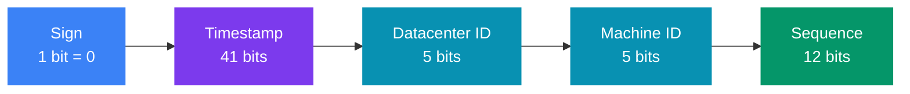
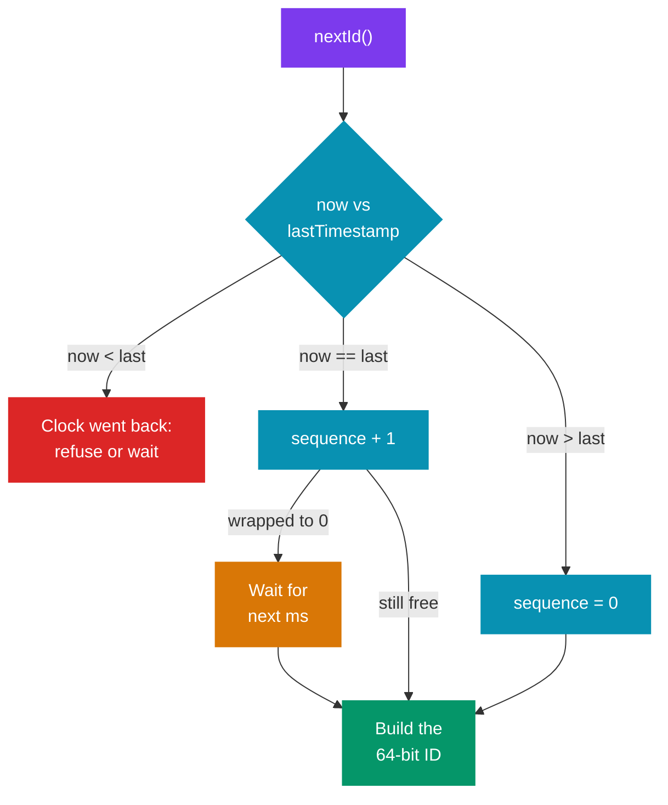
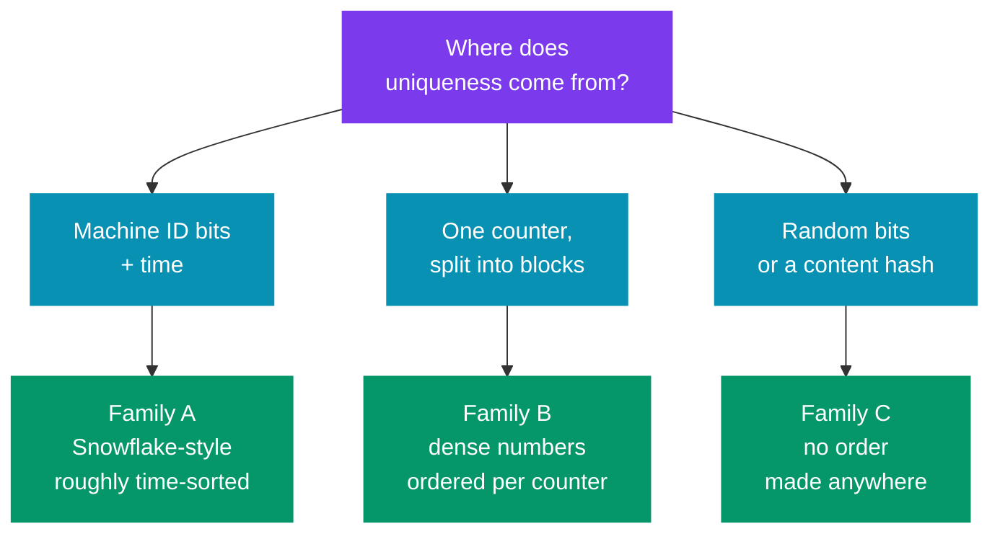

# Ch 7: Design a Unique ID Generator in Distributed Systems

> 📖 **Vol 1, Chapter 7** (book pages 110–118) &nbsp;·&nbsp; 🔥 High Priority &nbsp;·&nbsp; 💬 **22 Questions**  
> **Source:** Alex Xu, *System Design Interview Vol 1*, Ch 7. Page and figure numbers below are the book's. This PDF edition prints no page numbers in the footer. So pages are the PDF page numbers (the chapter starts on page 110).

---

📊 **Question Count**

| # | Section | Questions |
|---|---|---|
| 1 | [Requirements and Scope ⚡](#1--requirements-and-scope-p110111-) | 1 |
| 2 | [Multi-master Replication ⚡](#2--multi-master-replication-p112-) | 1 |
| 3 | [UUID 🔥](#3--uuid-p112113-) | 1 |
| 4 | [Ticket Server ⚡](#4--ticket-server-p113114-) | 2 |
| 5 | [Twitter Snowflake — the 64-bit Layout 🔥🔥](#5--twitter-snowflake--the-64-bit-layout-p114115-) | 3 |
| 6 | [Deep Dive — Timestamp and Sequence Number 🔥🔥](#6--deep-dive--timestamp-and-sequence-number-p115116-) | 8 |
| 7 | [Wrap-up — Clocks, Tuning and Availability 🔥](#7--wrap-up--clocks-tuning-and-availability-p117-) | 5 |
| 8 | [Similar Problems This Design Solves 📎 🔥](#8--similar-problems-this-design-solves--) | 1 |
| | **Total** | **22** |

> 🔥🔥 Very high priority — asked in almost every Tier-1 interview loop &nbsp;·&nbsp; 🔥 High priority — very frequent in Tier-1 interviews &nbsp;·&nbsp; ⚡ Medium priority — commonly asked &nbsp;·&nbsp; 💤 Low priority — good to know, rarely asked

---

## 🗒️ Cheat Sheet

<details>
<summary><strong>🗒️ Show cheat sheet</strong></summary>

### 🎯 Clarifying Questions — and the book's answers
| Question | Book's answer (p.111) |
|---|---|
| What are the characteristics of the IDs? | **Unique and sortable** |
| Does the ID go up by 1 for each new record? | **No.** It goes up **with time**, not always by 1. IDs made in the evening are larger than IDs made in the morning of the same day |
| Only numbers? | **Yes** |
| How long can an ID be? | **Fits into 64 bits** |
| What scale? | **10,000 IDs per second** |

**Requirements** (p.111): unique · numeric only · fits in 64 bits · ordered by date · over 10,000 IDs per second. Details in §1.

### 🏗️ Core Components (Figure 7-5)
The book's answer is not a set of servers. It is a **bit layout**. Each ID generator builds a 64-bit number from five parts:

- **Sign bit (1 bit)** — always 0. Reserved for future use.
- **Timestamp (41 bits)** — milliseconds since a custom epoch. It sits in the high bits, so IDs sort by time.
- **Datacenter ID (5 bits)** — up to 32 datacenters. Fixed at startup.
- **Machine ID (5 bits)** — up to 32 machines per datacenter. Fixed at startup.
- **Sequence number (12 bits)** — a counter inside one millisecond on one machine. Reset to 0 every millisecond.

```
| 0 |      timestamp (41)      | datacenter (5) | machine (5) | sequence (12) |
 63  62                     22   21          17   16       12   11          0
```

### 💡 Key Insights
1. `auto_increment` on one database does not work at this scale. One server is not large enough, and keeping many databases in step is slow (p.110).
2. **Divide and conquer** (p.114). Split the ID into sections. Each machine owns its own datacenter + machine ID, so machines **never need to talk** to make an ID.
3. The **timestamp in the top bits** makes IDs sortable by time. The **sequence** makes IDs unique inside one millisecond. The **datacenter + machine ID** make IDs unique across machines.
4. The weak point is the **clock**. The design assumes all generators have the same clock (p.117). 📎 Clock skew between machines only breaks the **order**. A clock that moves **backward** on one machine can make **duplicate** IDs.
5. 📎 Snowflake IDs are **roughly** sorted (k-sorted), not strictly sorted. Two machines in the same millisecond can produce IDs in any order. On one machine, IDs always go up.

### ⚖️ Trade-offs / Alternatives
| Option | Pro | Con | Book's verdict |
|---|---|---|---|
| Multi-master replication (Figure 7-2) | Uses the database's `auto_increment`; IDs scale with the number of servers | Hard with many datacenters; IDs do not go up with time across servers; adding or removing a server is hard | ❌️ Does not meet the requirements (p.112) |
| UUID (Figure 7-3) | Simple; no coordination; scales with the web servers | **128 bits** (need 64); not ordered by time; could be non-numeric | ❌️ (p.113) |
| Ticket server (Figure 7-4) | Numeric IDs; easy; fine for small and medium apps | **Single point of failure**; many ticket servers bring data sync problems | ❌️ (p.113–114) |
| **Twitter Snowflake** (Figure 7-5) | 64-bit, numeric, time-ordered, no coordination at run time | Needs synced clocks; datacenter and machine IDs must be assigned with care | ✅ **Chosen** — "supports all our use cases and is scalable" (p.117) |
| 📎 UUID v7 (RFC 9562, 2024) | Time-ordered; no machine IDs to assign | Still 128 bits | Not in the book. A good choice when 128 bits is allowed |

### 🔢 Numbers to Remember
| What | Value | Arithmetic |
|---|---|---|
| Total ID size | **64 bits** | 1 + 41 + 5 + 5 + 12 = 64 |
| Timestamp range | **~69 years** | 2^41 − 1 = 2,199,023,255,551 ms ÷ 1000 ÷ 3600 ÷ 24 ÷ 365 = **69.7 years** (p.116) |
| Twitter epoch | **1288834974657** | = Nov 04, 2010, 01:42:54 UTC (p.114) |
| 📎 When the Twitter epoch runs out | **~Jul 2080** | 1288834974657 + 2^41 − 1 ms → 10 Jul 2080 |
| 📎 If you used the Unix epoch (1970) | **runs out Sep 2039** | 0 + 2^41 − 1 ms → 7 Sep 2039 |
| Datacenters × machines | **32 × 32 = 1,024** | 2^5 = 32 each (p.114) |
| IDs per machine | **4,096 per ms** | 2^12 = 4,096 (p.116). 📎 × 1,000 = **4,096,000 per second** |
| 📎 IDs for the whole system | **~4.19 billion per second** | 1,024 machines × 4,096 per ms = 4,194,304 per ms |
| 📎 Headroom over the requirement | **~410×** for one machine | 4,096,000 ÷ 10,000 = 409.6 |
| Figure 7-7 decode | **Apr 09 2020 16:51:31 UTC** | 297616116568 + 1288834974657 = 1586451091225 ms |
| 📎 Bit shifts | **22 / 17 / 12** | timestamp `<< 22`, datacenter `<< 17`, machine `<< 12` |
| UUID size | **128 bits** | 📎 v4 has 122 random bits |
| UUID collision (Wikipedia, p.112) | **50% chance** after 1 billion UUIDs per second for ~100 years | 📎 Birthday maths: 1.18 × √(2^122) ≈ 2.7 × 10^18 UUIDs ≈ 86 years at 10^9 per second |
| 📎 JavaScript safe integer | **2^53 − 1 = 9,007,199,254,740,991** | Any Snowflake ID made more than ~25 days after the epoch is larger (2^31 ms ≈ 24.9 days) |

### ⏱️ 45-Minute Round Plan
| Minutes | Phase | What to say or draw | Trap to avoid |
|---|---|---|---|
| 0–5 | Clarify | Unique, sortable, numeric, 64-bit, 10,000/s | Assuming IDs must go up by exactly 1 |
| 5–15 | Options | Multi-master, UUID, ticket server — one line each, with the reason it fails | Spending 10 minutes on UUID internals |
| 15–25 | Snowflake | Draw the 64-bit layout. Explain each section and why the timestamp is on top | Forgetting the sign bit, or getting the bit widths wrong |
| 25–38 | **Deep dive** | Datacenter/machine IDs fixed at startup; 69 years; 4,096 per ms; what happens when the sequence runs out | Saying "it is globally sorted" without saying "only roughly" |
| 38–45 | Wrap-up | Clock sync (NTP), clock moving backward, section length tuning, high availability | Not knowing what to do when the clock goes back |

> 📎 The timings are a suggestion, not from the book. The book gives the steps; the minutes are ours.

---

</details>
<br/>

---

## 1. 📋 Requirements and Scope (p.110–111) ⚡

Your first idea may be a primary key with `auto_increment` in a normal database. The book says this does **not** work in a distributed system (p.110):

- One database server is **not large enough**.
- Making unique IDs across **many databases** with little delay is hard.

**Figure 7-1** shows example IDs in a `user_id` column. They are large 19-digit numbers like `1227238262110117894` and `1567981766075453440`. They are not 1, 2, 3.

**Step 1 — the clarifying questions** are in the Cheat Sheet table. The requirements that come out of them (p.111):

- IDs must be **unique**.
- IDs are **numerical values only**.
- IDs **fit into 64 bits**.
- IDs are **ordered by date**.
- The system can make **over 10,000 unique IDs per second**.

> 📎 **Why 64 bits matters to a Java engineer.** A 64-bit ID fits in a `long` (and a `BIGINT` column). It is half the size of a UUID in every index that stores it.

### ❓ Interview Questions

1. **Walk me through the requirements for a distributed unique ID generator. 🔥**

<!-- -->
<details>
<summary>💡 Show Answer</summary>

**Answer:**

From the book's clarifying questions (p.111), IDs must be:

- **unique**,
- **numeric only**,
- **64 bits** (so they fit in a `long` / `BIGINT`),
- **ordered by date** — not +1 each time, but an evening ID is larger than a morning ID,
- made at **over 10,000 per second**.

Why not plain `auto_increment`? One database server is not large enough. Keeping many databases in step is slow (p.110).

📎 High availability is not a Step 1 requirement in the book. It comes in the wrap-up (p.117). Mention it as a non-functional need anyway.

</details>

---

## 2. 🔀 Multi-master Replication (p.112) ⚡

**Step 2** looks at four options (p.112): multi-master replication, UUID, ticket server, and the Twitter Snowflake approach.

**How it works (Figure 7-2).** Use the database's `auto_increment`. But do not add 1. Add **k**, where k is the number of database servers.

- With 2 MySQL servers, k = 2.
- Server 1 makes **1, 3, 5, …**
- Server 2 makes **2, 4, 6, …**

So the next ID on a server = the previous ID on **that same server** + 2. IDs now scale with the number of database servers.

**Drawbacks** (p.112):

- Hard to scale with **multiple data centers**.
- IDs **do not go up with time** across servers.
- It does not scale well when a server is **added or removed**.

📎 In MySQL this is two settings: `auto_increment_increment = k` and `auto_increment_offset = 1…k`. Changing k means changing every server, and the old IDs no longer follow the new pattern.

### ❓ Interview Questions

1. **How does multi-master replication make unique IDs, and what are its problems? ⚡**

<!-- -->
<details>
<summary>💡 Show Answer</summary>

**Answer:**

Each database uses `auto_increment`, but adds **k** (the number of servers) instead of 1 (Figure 7-2). With 2 servers:

- server 1 makes 1, 3, 5, …
- server 2 makes 2, 4, 6, …

No two servers make the same ID.

**Problems** (p.112):

- Hard to scale with **multiple data centers**.
- IDs **do not go up with time** across servers.
- **Adding or removing a server** breaks the pattern. You must reconfigure every server.

</details>

---

## 3. 🆔 UUID (p.112–113) 🔥

A **UUID** is a 128-bit number used to identify information in computer systems. The chance of a collision is very low. The book quotes Wikipedia (p.112). Only *"after generating 1 billion UUIDs every second for approximately 100 years would the probability of creating a single duplicate reach 50%"*.

Example: `09c93e62-50b4-468d-bf8a-c07e1040bfb2`.

**Design (Figure 7-3):** each web server has its **own ID generator**. Each server makes its IDs on its own.

**Pros** (p.113):

- Simple. No coordination between servers, so no synchronization problems.
- Easy to scale. Each web server makes the IDs it uses, so the generator scales with the web servers.

**Cons** (p.113):

- IDs are **128 bits** long. The requirement is 64 bits.
- IDs **do not go up with time**.
- IDs could be **non-numeric**.

> 📎 **UUID versions.** The book talks about UUIDs in general. The "not ordered by time" con is true for **v4** (random). **UUID v7** (RFC 9562, May 2024) puts a 48-bit Unix-millisecond timestamp in the high bits, so it **does** sort by time. It still fails this chapter's requirements: it is 128 bits and not numeric.

> 📎 **Why random UUIDs hurt a MySQL primary key.** InnoDB stores rows in primary key order (a clustered index). A random v4 key goes to a random place in the B-tree. This causes page splits and extra writes. Every secondary index also stores the primary key, so a 16-byte key makes them all bigger. A time-ordered key (v7 or Snowflake) always goes to the right end of the tree.

### ❓ Interview Questions

1. **Why not just use UUIDs? 🔥🔥**

<!-- -->
<details>
<summary>💡 Show Answer</summary>

**Answer:**

**The book's reasons** (p.113):

- UUIDs are **128 bits**. The requirement is 64.
- They **do not go up with time**.
- They **could be non-numeric**.

The book also lists the pros: simple, no coordination, scales with the web servers. Collisions are very unlikely (50% only after 1 billion per second for ~100 years).

📎 **The 2026 point to add without being asked:** **UUID v7** (RFC 9562, May 2024) fixes the ordering problem.

- It puts a 48-bit Unix-millisecond timestamp in the high bits, so it sorts by creation time.
- It needs no machine IDs, which Snowflake does.
- It is still 128 bits. If index size matters most, Snowflake wins. If easy operation matters most, v7 wins.

Related formats: ULID (128-bit, millisecond timestamp) and KSUID (160-bit, seconds timestamp).

📎 **Why this matters in a Java/MySQL backend.** Take a random **v4** UUID as an InnoDB clustered primary key:

- It inserts at a random place in the B-tree. This causes page splits and extra writes.
- Every secondary index stores the primary key, so every index gets bigger.

A v7 UUID or a Snowflake ID is added at the right end of the tree. Interviewers often ask this when you say "UUID" in a Spring Data JPA answer.

</details>

---

## 4. 🎫 Ticket Server (p.113–114) ⚡

**Flickr** built ticket servers to make distributed primary keys (p.113). (The book spells it "Flicker".)

**How it works (Figure 7-4):** all web servers call **one central database** — the ticket server. It uses `auto_increment` to hand out the next ID.

**Pros** (p.113):

- Numeric IDs.
- Easy to build. Works for **small to medium** applications.

**Cons** (p.114):

- **Single point of failure.** If the ticket server goes down, every system that needs IDs has problems.
- You can run **many ticket servers** to avoid this. But that brings new problems, such as **data synchronization**.

📎 **How Flickr really did it.** The blog post the book cites uses MySQL `REPLACE INTO Tickets64 (stub) VALUES ('a');` then `SELECT LAST_INSERT_ID();`. Flickr ran **two** ticket servers, one making odd IDs and one making even IDs. That is the multi-master trick from §2. So Flickr removed the single point of failure. But IDs from the two servers no longer go up with time.

### ❓ Interview Questions

1. **What is a ticket server, and what is its main weakness? ⚡**

<!-- -->
<details>
<summary>💡 Show Answer</summary>

**Answer:**

A ticket server is **one central database** that uses `auto_increment` to hand out IDs (Figure 7-4). Flickr built it (p.113).

- **Pros:** numeric IDs; easy to build; fine for small and medium apps.
- **Weakness:** a **single point of failure**. If it goes down, every service that needs IDs has problems (p.114).

You can run many ticket servers. But the book says this brings **data synchronization** problems.

📎 Flickr's real fix: two ticket servers, one odd and one even (the multi-master trick). It removes the single point of failure, but IDs from the two servers are no longer ordered by time.

</details>

---

2. **How can a central database hand out IDs without one round trip per ID? 📎 🔥**

<!-- -->
<details>
<summary>💡 Show Answer</summary>

**Answer:**

Hand out IDs in **blocks**. This is called segment allocation (or range allocation, or Hi/Lo). It is the "segment" mode of open-source generators such as Meituan's Leaf.

- Each app server asks the database for a range, for example 1,000 IDs. In one transaction: `UPDATE id_alloc SET max_id = max_id + 1000 WHERE biz_tag = 'order'`, then read the new `max_id`.
- The server hands out those 1,000 IDs from memory. One database call now serves 1,000 IDs.
- Fetch the next block in the background before the current one runs out. Then a slow database does not block callers.
- If the database goes down, each server keeps working until its block is used up. So the ticket server's single point of failure hurts much less.

**What you give up:**

- A server that restarts loses the rest of its block. So there are **gaps**. Gaps are fine for IDs. They are not fine for numbers that must have no gaps, such as some invoice series.
- IDs are **not ordered by time** across servers. Server A can hand out 5,001 after server B handed out 6,200.

**What you gain over Snowflake:** no clock, so no clock-backward problem, and no machine IDs to assign. The IDs are still 64-bit numbers.

📎 **The same idea in Java and SQL.** Hibernate `@SequenceGenerator` has `allocationSize` (default **50**). It reserves 50 values per sequence call. PostgreSQL `CREATE SEQUENCE … CACHE n` reserves n values per session.

</details>

---

## 5. 🧩 Twitter Snowflake — the 64-bit Layout (p.114–115) 🔥🔥

None of the first three options meets the requirements (p.114). Twitter's ID system, called **Snowflake**, does.

**Divide and conquer.** Do not make the ID as one number. Split it into sections (Figure 7-5, shown again as Figure 7-6):

| Section | Bits | What it holds (p.114) |
|---|---|---|
| Sign bit | **1** | Always **0**. Reserved for future use. The book says it could be used to tell signed and unsigned numbers apart |
| Timestamp | **41** | Milliseconds since the epoch or a **custom epoch**. The book uses Twitter's default epoch **1288834974657** = Nov 04, 2010, 01:42:54 UTC |
| Datacenter ID | **5** | 2^5 = **32** datacenters |
| Machine ID | **5** | 2^5 = **32** machines per datacenter |
| Sequence number | **12** | Goes up by 1 for each ID made on that machine or process. **Reset to 0 every millisecond** |



**Why each section is needed:**

- **Timestamp** → IDs sort by time.
- **Datacenter + machine ID** → two machines never make the same ID, even in the same millisecond.
- **Sequence** → one machine can make many IDs in the same millisecond.

> 📎 **The real reason for the sign bit.** Java's `long` and SQL `BIGINT` are **signed**. If the top bit were 1, the ID would be negative. Keeping it at 0 means IDs are always positive and sort correctly as numbers.

### ❓ Interview Questions

1. **Compare the four options in the book. Why does Snowflake win? 🔥🔥**

<!-- -->
<details>
<summary>💡 Show Answer</summary>

**Answer:**

| Option | Why it fails or wins |
|---|---|
| Multi-master replication | IDs do not go up with time across servers. Hard with many datacenters. Adding or removing a server is hard |
| UUID | 128 bits, not 64. Not ordered by time. Could be non-numeric |
| Ticket server | Single point of failure. Many ticket servers bring data sync problems |
| **Snowflake** | 64-bit, numeric, sorted by time, no coordination at run time ✅ |

The book's verdict: Snowflake "supports all our use cases and is scalable in a distributed environment" (p.117).

</details>

---

2. **Explain the Snowflake ID structure bit by bit. 🔥🔥**

<!-- -->
<details>
<summary>💡 Show Answer</summary>

**Answer:**

64 bits in total (Figure 7-5, p.114):

- **1 sign bit** — always 0. Reserved for future use.
- **41 bits timestamp** — milliseconds since a custom epoch (Twitter: 1288834974657 = Nov 04, 2010). About **69 years** of range.
- **5 bits datacenter ID** — 32 datacenters.
- **5 bits machine ID** — 32 machines per datacenter → 1,024 machines.
- **12 bits sequence** — 4,096 IDs per millisecond per machine. Reset to 0 every millisecond.

The timestamp is in the **high bits**, so IDs sort by time.

📎 Build it with shifts: `(ts << 22) | (dc << 17) | (machine << 12) | seq`.

</details>

---

3. **Time-ordered IDs help a B-tree. What do they do to a range-sharded database? 📎 🔥**

<!-- -->
<details>
<summary>💡 Show Answer</summary>

**Answer:**

**In one B-tree** (MySQL InnoDB), a growing key is good. Every insert goes to the right end of the tree, so there are few page splits (see §3).

- Every new row has the largest key so far, so every new row lands in the **last range**.
- One node takes all the writes. This is a **hot shard**. Adding nodes does not help.

**Fixes:**

**The rule to say:** time order helps a single B-tree and hurts a range-sharded cluster. Ask which database stores the IDs before you praise Snowflake's sort order.

</details>

---

## 6. 🔬 Deep Dive — Timestamp and Sequence Number (p.115–116) 🔥🔥

**Step 3.** The book settles on Snowflake (p.115).

**Two kinds of fields:**

- **Datacenter ID and machine ID** are chosen at **startup**. They usually stay fixed while the system runs. Any change needs **careful review**, because an accidental change can cause **ID conflicts**.
- **Timestamp and sequence number** are made by the generator **while it runs**.

### Timestamp (p.115–116)

The **most important 41 bits** are the timestamp. Timestamps grow with time, so IDs are **sortable by time**.

**Figure 7-7 — turning an ID back into a time:**

| Step | Value |
|---|---|
| ID in binary | `0`-`00100010101001011010011011000101101011000`-`01010`-`01100`-`000000000000` |
| 41 timestamp bits to decimal | **297616116568** |
| + Twitter epoch 1288834974657 | **1586451091225** |
| Milliseconds to UTC | **Apr 09 2020 16:51:31 UTC** |

You can go the other way too (UTC → binary) with the same method.

📎 In the same figure, datacenter `01010` = **10**, machine `01100` = **12**, sequence = **0**. The full ID is `1248292468186988544`. In code: `timestamp = (id >> 22) + EPOCH`, `datacenter = (id >> 17) & 31`, `machine = (id >> 12) & 31`, `sequence = id & 4095`.

**How long it lasts** (p.116):

```
2^41 − 1 = 2,199,023,255,551 ms
2,199,023,255,551 / 1000 / 3600 / 24 / 365 ≈ 69.7 years
```

- The generator works for **69 years**.
- A **custom epoch close to today** delays the overflow.
- After 69 years, you need a **new epoch** or another way to **migrate IDs**.

📎 With the Twitter epoch (2010) the timestamp runs out in **Jul 2080**. With the Unix epoch (1970) it would have run out in **Sep 2039**. That is why a custom epoch matters.

### Sequence number (p.116)

- **12 bits** → 2^12 = **4,096** combinations.
- The field is **0** unless more than one ID is made in **the same millisecond on the same server**.
- In theory, one machine can make at most **4,096 new IDs per millisecond**.

📎 **What happens at ID 4,097 in one millisecond?** The book does not say. The usual answer: the sequence wraps to 0, and the generator **waits for the next millisecond**. It never reuses a number.

### 📎 The generator in Java

The book gives no code. This is the usual shape. The method is `synchronized`, because `lastTimestamp` and `sequence` are shared state.

```java
public final class SnowflakeIdGenerator {

    private static final long EPOCH = 1288834974657L;   // Twitter epoch (p.114)

    private static final long DATACENTER_BITS = 5L;
    private static final long MACHINE_BITS = 5L;
    private static final long SEQUENCE_BITS = 12L;

    private static final long MAX_DATACENTER = (1L << DATACENTER_BITS) - 1;  // 31
    private static final long MAX_MACHINE = (1L << MACHINE_BITS) - 1;        // 31
    private static final long SEQUENCE_MASK = (1L << SEQUENCE_BITS) - 1;     // 4095

    private static final long MACHINE_SHIFT = SEQUENCE_BITS;                        // 12
    private static final long DATACENTER_SHIFT = SEQUENCE_BITS + MACHINE_BITS;      // 17
    private static final long TIMESTAMP_SHIFT = DATACENTER_SHIFT + DATACENTER_BITS; // 22

    private final long datacenterId;
    private final long machineId;
    private long lastTimestamp = -1L;
    private long sequence = 0L;

    public SnowflakeIdGenerator(long datacenterId, long machineId) {
        if (datacenterId < 0 || datacenterId > MAX_DATACENTER) {
            throw new IllegalArgumentException("datacenterId must be 0-31");
        }
        if (machineId < 0 || machineId > MAX_MACHINE) {
            throw new IllegalArgumentException("machineId must be 0-31");
        }
        this.datacenterId = datacenterId;
        this.machineId = machineId;
    }

    public synchronized long nextId() {
        long now = System.currentTimeMillis();
        if (now < lastTimestamp) {
            // The clock moved backward. Making an ID now could repeat an old one.
            throw new IllegalStateException(
                    "Clock moved backwards by " + (lastTimestamp - now) + " ms");
        }
        if (now == lastTimestamp) {
            sequence = (sequence + 1) & SEQUENCE_MASK;
            if (sequence == 0) {
                // 4,096 IDs already used in this millisecond: wait for the next one.
                now = waitForNextMillis(lastTimestamp);
            }
        } else {
            sequence = 0L;
        }
        lastTimestamp = now;
        return ((now - EPOCH) << TIMESTAMP_SHIFT)
                | (datacenterId << DATACENTER_SHIFT)
                | (machineId << MACHINE_SHIFT)
                | sequence;
    }

    private long waitForNextMillis(long last) {
        long now = System.currentTimeMillis();
        while (now <= last) {
            Thread.onSpinWait();
            now = System.currentTimeMillis();
        }
        return now;
    }
}
```



### ❓ Interview Questions

1. **How are datacenter IDs and machine IDs assigned? 🔥**

<!-- -->
<details>
<summary>💡 Show Answer</summary>

**Answer:**

**The book** (p.115): they are chosen at **startup** and usually stay **fixed** while the system runs. Any change needs **careful review**, because an accidental change can cause **ID conflicts**.

📎 Common ways to give them out:

- **Static config** — environment variables or Kubernetes labels. For a StatefulSet, the pod number (`app-0`, `app-1`) is a stable machine ID.
- **A coordination service** — ZooKeeper or etcd. A worker takes a free ID at startup with an ephemeral node or a lease. No two live workers can hold the same ID.

The danger is two live workers with the **same** datacenter + machine ID. They will make duplicate IDs in the same millisecond.

</details>

---

2. **How long does the Snowflake timestamp last before it runs out? ⚡**

<!-- -->
<details>
<summary>💡 Show Answer</summary>

**Answer:**

`2^41 − 1 = 2,199,023,255,551 ms ≈ 69.7 years` (p.116).

- A custom epoch **close to today** delays the overflow.
- After 69 years you need a **new epoch** or another way to **migrate IDs** (p.116).

📎 With the Twitter epoch (2010), it runs out in **Jul 2080**.

📎 **Careful with "just pick a new epoch".** New IDs would start near zero again. They could clash with old IDs that had the same small timestamp. So the migration must also change the format (for example, more timestamp bits) or re-map the old IDs.

</details>

---

3. **Why use a custom epoch instead of the Unix epoch (Jan 1, 1970)? 💤**

<!-- -->
<details>
<summary>💡 Show Answer</summary>

**Answer:**

The book says a custom epoch **close to today delays the overflow time** (p.116).

📎 The numbers:

- From 1970, 41 bits run out on **7 Sep 2039**. Forty years are wasted before the system even starts.
- From Twitter's epoch (Nov 2010), they run out in **Jul 2080**.

The bit layout does not change. Only the start point moves.

</details>

---

4. **Can you decode a Snowflake ID to see when it was created? ⚡**

<!-- -->
<details>
<summary>💡 Show Answer</summary>

**Answer:**

Yes. The book shows it in **Figure 7-7** (p.115):

1. Take the 41 timestamp bits → `297616116568`.
2. Add the Twitter epoch `1288834974657` → `1586451091225` ms.
3. Convert to UTC → **Apr 09 2020 16:51:31 UTC**.

📎 In code: `(id >> 22) + EPOCH`. This helps debugging. But outside users who see the IDs learn two things:

- **When** each record was created.
- **How many** records you make. Compare two IDs a day apart, or read the sequence bits.

The IDs are also easy to guess, because they are close together. So never use a Snowflake ID as a secret, such as a reset token. Always check access on every read. A guessable ID must not be enough to read someone else's record.

</details>

---

5. **What happens when more than 4,096 IDs are needed in one millisecond? 🔥**

<!-- -->
<details>
<summary>💡 Show Answer</summary>

**Answer:**

**The book** (p.116): 12 bits give 4,096 combinations. So one machine can make **at most 4,096 new IDs per millisecond**. The sequence is 0 unless more than one ID is made in the same millisecond.

📎 **The usual handling.** The sequence wraps from 4,095 to 0. The generator then **waits** (spins) until the next millisecond. It never reuses a number. In practice this is rare: 4,096 per ms is over 4 million per second on one machine.

</details>

---

6. **What is the maximum throughput of a Snowflake system? 🔥**

<!-- -->
<details>
<summary>💡 Show Answer</summary>

**Answer:**

- **One machine:** 4,096 per ms (p.116) → 📎 **4,096,000 per second**.
- 📎 **All 1,024 machines** (32 datacenters × 32 machines): 4,194,304 per ms → **~4.19 billion per second**.

The requirement is 10,000 per second. One machine already gives about **410×** that.

📎 The real limit is usually the network call to the generator, not the bits. That is why many teams run the generator as a **library inside each service**, not as a separate service.

</details>

---

7. **Write a thread-safe Snowflake generator in Java. What are the key points? 📎 🔥**

<!-- -->
<details>
<summary>💡 Show Answer</summary>

**Answer:**

The full code is above (📎 The generator in Java). The points an interviewer checks:

- **Shifts:** timestamp `<< 22`, datacenter `<< 17`, machine `<< 12`, then OR the sequence.
- **Thread safety:** `lastTimestamp` and `sequence` are shared, so `nextId()` is `synchronized`. A lock-free version packs both into one `AtomicLong` and uses compare-and-set.
- **Same millisecond:** `sequence = (sequence + 1) & 4095`. If it wraps to 0, spin until the next millisecond.
- **New millisecond:** reset the sequence to 0.
- **Clock backward:** `now < lastTimestamp` → refuse (or wait a little). Never make an ID.
- **Validate** the datacenter and machine IDs (0–31) in the constructor.

</details>

---

8. **Why do Snowflake IDs break in a JavaScript front end? 📎 ⚡**

<!-- -->
<details>
<summary>💡 Show Answer</summary>

**Answer:**

A JavaScript `Number` is a 64-bit float. It is exact only up to **2^53 − 1 = 9,007,199,254,740,991**.

A Snowflake ID passes that about **25 days** after the epoch (2^53 ÷ 2^22 = 2^31 ms ≈ 24.9 days). Today's IDs are around 2 × 10^18. So `JSON.parse` silently rounds them, and the client sends back the **wrong ID**.

**Fix:** send the ID as a **string** in JSON. Twitter's API does this with `id_str`. In Spring, serialize `Long` IDs as strings with Jackson (`@JsonSerialize(using = ToStringSerializer.class)`).

</details>

---

## 7. 🕐 Wrap-up — Clocks, Tuning and Availability (p.117) 🔥

**Step 4.** The book chose Snowflake because it **supports all the use cases** and **scales in a distributed environment** (p.117). Extra talking points if there is time:

**Clock synchronization.**

- The design **assumes all ID servers have the same clock**.
- The book says this may not be true when a server runs on **multiple cores**. The same problem exists across **many machines**.
- 📎 On a modern server, all cores read one system clock. So the multi-core case is mostly a **thread-safety** problem: two threads must not use the same sequence number. The `synchronized` method in §6 handles it.
- Solutions are out of the book's scope. But you must know the problem exists.
- **Network Time Protocol (NTP)** is the most popular solution.

📎 **What a clock problem really breaks:**

| Problem | Effect | Usual fix |
|---|---|---|
| Machines' clocks differ a little (skew) | IDs from different machines are **out of order** by a few ms. They stay **unique** — the machine IDs differ | Accept it. Snowflake IDs are only roughly sorted |
| One machine's clock moves **backward** (an NTP step, a leap second, a manual clock change) | That machine may **repeat** a timestamp + sequence → **duplicate IDs** | Detect `now < lastTimestamp`. Wait if the gap is small; refuse and alert if it is large |

📎 Run NTP in **slew** mode, not **step** mode. Slew speeds up or slows down the clock a little. Step jumps the clock. Slew never moves time backward. Note that `ntpd` steps by default when the offset is over 128 ms, so you must configure it to slew.

**Section length tuning.** You can change the bit widths. The book's example (p.117): **fewer sequence bits and more timestamp bits**. This suits an app with **low concurrency** that must run for a **long time**.

📎 Each bit moved changes the numbers. 42 timestamp bits → ~139 years. 11 sequence bits → 2,048 IDs per ms per machine.

**High availability.** An ID generator is a **mission-critical** system. It must be **highly available** (p.117).

📎 Snowflake helps here. Each generator works alone, so losing one machine only removes its capacity. Other machines keep making IDs. Run at least two generators per datacenter. Never start a replacement with the **same machine ID** while the old one could still be alive.

### ❓ Interview Questions

1. **Snowflake depends on clocks. What can go wrong, and what do you do when the clock moves backward? 🔥🔥**

<!-- -->
<details>
<summary>💡 Show Answer</summary>

**Answer:**

**The book** (p.117): the design **assumes all ID servers have the same clock**. That may not be true on a server with **many cores**, or across **many machines**. **NTP** is the most popular solution. The fix itself is out of the book's scope.

📎 **Split the problem in two:**

- **Skew between machines** → IDs are **out of order** by a few ms. They are still **unique**, because the machine IDs differ.
- **One clock moves backward** → that machine could repeat an old timestamp + sequence → **duplicate IDs**.

📎 **The standard fix** for a backward clock:

1. Keep `lastTimestamp` in memory.
2. If `now < lastTimestamp`, do **not** make an ID.
3. If the gap is a few ms, wait until the clock catches up. If it is large, throw an error and alert.
4. Run NTP in **slew** mode, so it never steps the clock back.

📎 **The restart hole.** `lastTimestamp` lives in memory, so a restart loses it. If the clock moved back while the process was down, the check above cannot see it. Two fixes:

- At startup, wait longer than the largest clock step you expect before making the first ID.
- Or save the last timestamp now and then (to local disk or ZooKeeper). At startup, refuse to run while the clock is behind it.

</details>

---

2. **What is "section length tuning"? When would you change the bit widths? ⚡**

<!-- -->
<details>
<summary>💡 Show Answer</summary>

**Answer:**

The 41/5/5/12 split is not fixed. You can move bits between sections to fit the app (p.117).

**The book's example:** **fewer sequence bits and more timestamp bits** for an app with **low concurrency** that must run a **long time**.

📎 Other moves:

- Few datacenters but many machines → give datacenter bits to the machine ID. For example, 0 + 10 bits = 1,024 machines in one place.
- Very high rate on few machines → more sequence bits, fewer machine bits.
- Put a **shard ID** inside the ID. Instagram (2012) used 41 bits of time + 13 bits of logical shard ID + 10 bits of sequence. Each shard made its own IDs inside PostgreSQL. Any service can read the shard from the ID, with no lookup.

Each extra timestamp bit **doubles** the range: 42 bits ≈ 139 years.

</details>

---

3. **How do you make the ID generator highly available? What if one machine fails? ⚡**

<!-- -->
<details>
<summary>💡 Show Answer</summary>

**Answer:**

The book only says the generator is **mission-critical** and **must be highly available** (p.117).

📎 How Snowflake gets there:

- Each generator works **alone**. It needs no other node to make an ID.
- If one machine fails, the others keep making IDs with **their own** machine IDs. Nothing needs to be recovered.
- Run at least two generators per datacenter. Or embed the generator as a library in every service instance.
- To replace a failed machine, reuse its machine ID **only after** you are sure the old one is dead. Two live workers with the same ID make duplicates.

</details>

---

4. **Are Snowflake IDs strictly sorted across all machines? 📎 🔥**

<!-- -->
<details>
<summary>💡 Show Answer</summary>

**Answer:**

**No.** They are **roughly sorted** (k-sorted).

- **On one machine:** every new ID is larger than the one before.
- **Across machines in the same millisecond:** order depends on the datacenter and machine ID, not on which came first.
- **With clock skew:** a machine whose clock is a few ms behind makes slightly "older" IDs.

So "ordered by date" holds at the scale of milliseconds, not exactly. That is fine for pagination and feeds. It is not fine if you need a strict global order. Then you need a single sequencer, which brings back the single point of failure.

</details>

---

5. **What if you need IDs shorter than 64 bits, for example in URLs? 📎 ⚡**

<!-- -->
<details>
<summary>💡 Show Answer</summary>

**Answer:**

Fewer bits mean less timestamp range or less throughput. So do not cut bits off. That risks collisions.

Instead, **encode** the 64-bit ID in **Base62** (0–9, a–z, A–Z). It needs at most **11 characters**, because 62^10 ≈ 8.4 × 10^17 is less than 2^63 ≈ 9.2 × 10^18, and 62^11 is more. Encoding keeps every bit, so it cannot collide.

The URL shortener in the next chapter (Ch 8) uses the same Base62 idea.

</details>

---

## 8. 🧬 Similar Problems This Design Solves 📎 🔥

📎 The book does not list similar problems for this chapter. But the same core solves **at least 15 common interview problems**. Learn the core once, then change only a few parts for each one.

**The core that never changes:**
- **Many machines make IDs at the same time**, and no machine asks a central service for each ID.
- **Uniqueness comes from splitting the space** — machine ID bits, a block of numbers per server, or enough random bits.
- **Order, if needed, comes from where the time sits** — in the high bits, so a plain number sort is a time sort.
- **The size limit drives the format** — 64 bits for a `long`, 128 bits for a UUID, or a few characters for a person.
- **The weak point is shared state** — a clock that moves back, a machine ID used twice, or a block lost on restart.

**The tag on each problem** says how often it is asked as an HLD round on its own (same legend as the questions). 🔥🔥 = learn its "what is different" column well; 💤 = knowing the family is enough.

**The one choice that splits them into three families:** where does uniqueness come from?



### Family A — machine ID bits + time (like this chapter)

| # | Problem | What is different from this chapter |
|---|---|---|
| 1 | **Unique ID generator 🔥** (this chapter) | — |
| 2 | **Chat message IDs 🔥🔥** — [Ch 12](ch12_design_a_chat_system.md) | Order matters only **inside one channel**. So a local sequence per channel is enough (the book says so on p.189). A global Snowflake ID also works. The ID, not `created_at`, decides the order, because two messages can share a timestamp |
| 3 | **News feed pagination 🔥🔥** — [Ch 11](ch11_design_news_feed_system.md) | The time-sorted ID is the **cursor**: `WHERE id < :last_seen ORDER BY id DESC LIMIT 20`. No offset, so new posts do not shift the pages. Two posts a few ms out of order (k-sorted) do not matter in a feed |
| 4 | **IDs for a sharded database (Instagram) ⚡** | Swap the machine bits for **shard bits**: 41 bits of time + 13 bits of logical shard + 10 bits of sequence. Each shard makes its own IDs. Any service reads the shard from the ID, with no lookup table (§7 Q2) |
| 5 | **Default keys in a distributed SQL database 💤** | CockroachDB's `unique_rowid()` combines the insert time and the node ID — the same idea, built into the database. A growing key can make a hot range in a range-sharded database (§5 Q3) |

### Family B — one counter, handed out in blocks

| # | Problem | What is different from this chapter |
|---|---|---|
| 6 | **URL shortener codes 🔥🔥** — [Ch 8](ch08_design_url_shortener.md) | The code must be about 7 Base62 characters: 62^7 ≈ 3.5 × 10^12 values, about 42 bits. A 64-bit Snowflake ID needs 11 characters (§7 Q5). So use a dense counter handed out in ranges, not time bits |
| 8 | **Message queue offsets (Kafka) 🔥** — [Vol 2 Ch 4](../vol_2/ch04_distributed_message_queue.md) | Split the **counter**, not the ID bits. Each partition has one leader, so a plain counter per partition is enough. Order is strict inside a partition, with no order across partitions. `(topic, partition, offset)` is the unique ID |
| 9 | **Gap-free invoice numbers ⚡** | Gaps are **not** allowed, so no blocks and no caching. Take the next number from one counter row, in the **same transaction** as the invoice. This limits throughput, so keep one counter per series (per branch, per year) |
| 10 | **Fencing tokens for a distributed lock 🔥** — [distributed fundamentals §7](../../02_distributed_systems/01_distributed_fundamentals.md) | The number must **strictly** increase across the whole system, so the storage can reject an old lock holder. A clock-based ID cannot promise that. Take it from a consensus store (ZooKeeper `zxid`, etcd revision) |
| 11 | **Bank account and card numbers 💤** | Low volume, so a sequence per prefix is enough. The hard part is the format: fixed length, a branch or product prefix, and a check digit (card numbers use the Luhn check) |

### Family C — random bits or a content hash, no coordination at all

| # | Problem | What is different from this chapter |
|---|---|---|
| 12 | **Idempotency keys for payments 🔥🔥** — [Vol 2 Ch 11](../vol_2/ch11_payment_system.md) | The **caller** makes the key before the call, so a retry sends the same key. Often a random UUID. No order needed. A `UNIQUE` constraint at the receiver stops the second charge |
| 13 | **Trace and span IDs ⚡** | Every service makes them alone, millions per second. W3C Trace Context uses a random 128-bit trace ID and a random 64-bit span ID. A rare collision only mixes up two traces, so no machine IDs are needed |
| 14 | **Session tokens, API keys, reset links ⚡** | They must be **impossible to guess**. Use at least 128 random bits from a secure random source (`SecureRandom`). Never a Snowflake ID or UUID v7 — the time part is easy to guess (§6 Q4) |
| 15 | **File and block dedupe (Google Drive, Git) 🔥** — [Ch 15](ch15_design_google_drive.md) | The ID is a **hash of the content** (for example SHA-256). The same content gives the same ID, so a "collision" means a duplicate you can skip storing. The ID cannot be made before the content exists |

### How to use this in an interview — five questions

When you get any "give each thing a unique ID" problem, answer these five questions aloud. Each answer picks one part of the design:

| Ask | It decides |
|---|---|
| 1. What order do the IDs need — none, rough (by time), or strict? | **Family C**, **Family A**, or a **single counter** per partition (Family B) |
| 2. Are gaps allowed? | **Blocks and caching** (yes), or one counter updated **in the same transaction** (no) |
| 3. Who makes the ID — your servers, the caller, or the content? | Snowflake or blocks; a **caller-made** random key; or a **content hash** |
| 4. Must the ID be hard to guess? | **Secure random bits**. Never time bits or a counter |
| 5. How big can the ID be? | A 64-bit `long`, a 128-bit UUID, or a **short code** that needs a dense counter |

> **Where this does *not* transfer directly:**
>
> - **A strict total order across the whole system**, like the orders in a stock exchange. That needs one sequencer that stamps every event ([Vol 2 Ch 13](../vol_2/ch13_stock_exchange.md)). Snowflake IDs are only roughly sorted.
> - **Short codes that people type**, like coupons or booking codes. They need a small alphabet and a collision check ([Ch 8 §9](ch08_design_url_shortener.md)).
> - **Secrets.** A Snowflake ID shows its creation time and is easy to guess (§6 Q4).

### ❓ Interview Questions

1. **Where else can you use this ID generator design? Pick three problems and say what changes. 📎 🔥**

<!-- -->
<details>
<summary>💡 Show Answer</summary>

**Answer:**

The core stays the same. Many machines make IDs with no central call per ID. Uniqueness comes from splitting the space. Order, when needed, comes from time in the high bits. What changes is **what order is needed**, **whether gaps are allowed**, and **who makes the ID**.

| | Snowflake (this chapter) | URL shortener code | Idempotency key | Gap-free invoice number |
|---|---|---|---|---|
| Who makes it | Each server, alone | A server, from its block of a counter | The caller, before the call | One counter row in the database |
| Size | 64 bits | ~7 Base62 characters (~42 bits) | Often a 128-bit UUID | A short number per series |
| Order | Roughly by time | None needed | None needed | Strict inside one series |
| Gaps | Many — that is fine | Fine | Not relevant | **Not allowed** |
| Hard part | Clock moving back; machine IDs | Keeping it short | Same key on every retry | Throughput, because every invoice locks one row |

**Three families to name:**

- **Machine ID bits + time** (Snowflake, chat message IDs, feed cursors, sharded IDs): this chapter, with shard bits or a per-channel sequence.
- **One counter in blocks** (short codes, database sequences, Kafka offsets, invoice numbers, fencing tokens): dense numbers; order only per counter.
- **Random or content hash** (idempotency keys, trace IDs, tokens, file dedupe): no coordination and no order.

🧬 **The full list — 15 problems in three families, plus five questions that map any new one:** see the tables above.

</details>

---
