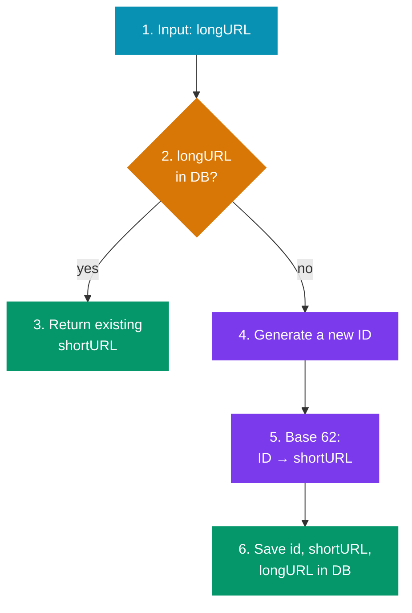
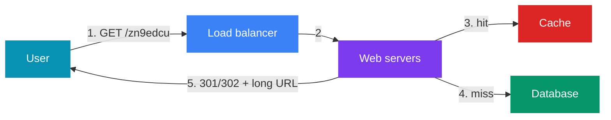
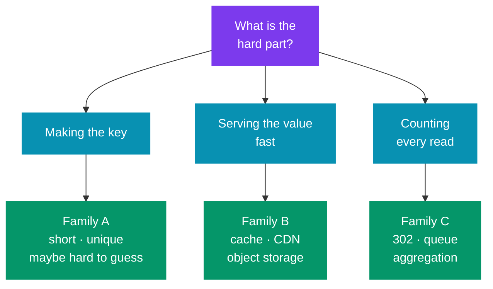

# Ch 8: Design a URL Shortener

> 📖 **Vol 1, Chapter 8** (book pages 119–131) &nbsp;·&nbsp; 🔥🔥 Very High Priority &nbsp;·&nbsp; 💬 **20 Questions**  
> **Source:** Alex Xu, *System Design Interview Vol 1*, Ch 8. Page and figure numbers below are the book's. This PDF edition prints no page numbers in the footer. So the pages are PDF page numbers (the chapter starts on page 119).

---

📊 **Question Count**

| # | Section | Questions |
|---|---|---|
| 1 | [Requirements and Estimation 🔥](#1--requirements-and-estimation-p120-) | 1 |
| 2 | [API Endpoints and the 301 vs 302 Redirect 🔥🔥](#2--api-endpoints-and-the-301-vs-302-redirect-p121122-) | 1 |
| 3 | [Data Model and Hash Value Length 🔥](#3--data-model-and-hash-value-length-p122125-) | 2 |
| 4 | [Hash + Collision Resolution 🔥](#4--hash--collision-resolution-p125126-) | 1 |
| 5 | [Base 62 Conversion and the Comparison 🔥🔥](#5--base-62-conversion-and-the-comparison-p126127-) | 3 |
| 6 | [URL Shortening Deep Dive 🔥](#6--url-shortening-deep-dive-p127129-) | 2 |
| 7 | [URL Redirecting Deep Dive 🔥](#7--url-redirecting-deep-dive-p129-) | 5 |
| 8 | [Wrap-up Talking Points ⚡](#8--wrap-up-talking-points-p130-) | 4 |
| 9 | [Similar Problems This Design Solves 📎 🔥](#9--similar-problems-this-design-solves--) | 1 |
| | **Total** | **20** |

> 🔥🔥 Very high priority — asked in almost every Tier-1 interview loop &nbsp;·&nbsp; 🔥 High priority — very frequent in Tier-1 interviews &nbsp;·&nbsp; ⚡ Medium priority — commonly asked &nbsp;·&nbsp; 💤 Low priority — good to know, rarely asked

---

## 🗒️ Cheat Sheet

<details>
<summary><strong>🗒️ Show cheat sheet</strong></summary>

### 🎯 Clarifying Questions — and the book's answers
| Question | Book's answer (p.120) |
|---|---|
| How does it work? | Long URL → short alias like `https://tinyurl.com/y7keocwj`. A click on the alias **redirects** to the long URL |
| Traffic volume? | **100 million** URLs generated **per day** |
| How short? | **As short as possible** |
| Which characters? | Numbers **0-9** and letters **a-z, A-Z** |
| Can short URLs be deleted or updated? | **No** — for simplicity, they cannot |

**Use cases** (p.120): URL shortening · URL redirecting · high availability, scalability and fault tolerance.

### 🏗️ Core Components (Figure 8-8)
- **Load balancer** — sends each request to a web server.
- **Web servers** — stateless. They run the shortening and redirecting logic.
- **Cache** — holds `<shortURL, longURL>` pairs. Reads are much more frequent than writes, so the redirect path checks here first.
- **Database** — a **relational** table with `id`, `shortURL`, `longURL` (Figure 8-4).
- **Unique ID generator** — gives each new long URL a unique ID. Base 62 turns that ID into the short URL. Details are in Ch 7.

### 🔌 API and Table (p.121, Figure 8-4)
```
POST api/v1/data/shorten
  request parameter: {longUrl: longURLString}
  returns: shortURL

GET api/v1/shortUrl
  returns: longURL for HTTP redirection (301 or 302)

url table
  id        PK, auto increment
  shortURL
  longURL
```

### 💡 Key Insights
1. The length comes from **the estimate**. You need 365 billion URLs. 62⁶ is only 56.8 billion, so 6 characters are not enough. 62⁷ is 3.5 trillion, so **7 characters** (p.124–125).
2. Base 62 of a unique ID **cannot collide**. Collision is impossible because the ID is unique (Table 8-3). The book picks it for its design (p.127).
3. The cost of **base 62**: it needs a unique ID generator, and the next short URL is easy to guess. The book calls that a security concern (Table 8-3).
4. 301 vs 302 is **a priority question**. 301 → less server load. 302 → better analytics (p.122). The book gives no single default.
5. The redirect path is **the hot path**. It is read-heavy, so the mapping goes into a cache in front of the database (Figure 8-8).

### ⚖️ Trade-offs / Alternatives
| Option | Pro | Con | Book's verdict |
|---|---|---|---|
| Keep everything in a hash table | Simple; fast | Memory is limited and expensive | ❌️ Only a starting point (p.124) |
| Relational database | Real storage for `<shortURL, longURL>` | Slower than memory | ✅ Chosen (Figure 8-4) |
| Hash + collision resolution | Fixed length; no ID generator; next URL cannot be guessed | Collisions; a DB check on every write | Shown, then not used (p.125–126) |
| Base 62 conversion | No collisions | Length grows with the ID; needs an ID generator; next URL is guessable | ✅ Used in the design (p.127) |
| 📎 Pre-generated keys (KGS) | Fixed length; no collisions on write; not guessable | One more service to run; a pool of unused keys to store | Not in the book — a common third option (§5) |
| 301 redirect | Only the first request reaches our servers | Repeat clicks are invisible | ✅ When the priority is **less server load** (p.122) |
| 302 redirect | Every click reaches our servers | More server load | ✅ When **analytics** matter (p.122) |
| Cache on the redirect path | Fast reads | One more component | ✅ Chosen (Figure 8-8) |

### 🔢 Numbers to Remember
| What | Value | Arithmetic |
|---|---|---|
| Write QPS | **~1,160 /s** | 100,000,000 ÷ 24 ÷ 3,600 = 1,157 → the book rounds to 1,160 |
| Read QPS | **~11,600 /s** | 1,160 × 10 (the book assumes **10:1** read to write) |
| Records over 10 years | **365 billion** | 100M × 365 × 10 = 365,000,000,000 |
| Storage over 10 years | **36.5 TB** (book prints 365 TB — a bug, §1) | 365 × 10⁹ records × 100 bytes = 3.65 × 10¹³ bytes = 36.5 TB |
| Characters in the alphabet | **62** | 10 + 26 + 26 |
| 6 characters | **56.8 billion** — too few | 62⁶ = 56,800,235,584 < 365 billion |
| 7 characters | **~3.5 trillion** — enough | 62⁷ = 3,521,614,606,208 ≥ 365 billion |
| Book's base 62 example | **11157 → `2TX`** | 2 × 62² + 55 × 62 + 59 = 7,688 + 3,410 + 59 = 11,157 |
| Book's ID example | **2009215674938 → `zn9edcu`** | 7 characters, because 2,009,215,674,938 < 62⁷ |
| Hash lengths (Table 8-2) | CRC32 **8** hex · MD5 **32** · SHA-1 **40** | 32, 128 and 160 bits ÷ 4 bits per hex character |
| 📎 How long 7 characters last | **~96 years** | 3.52 × 10¹² ÷ 10⁸ per day = 35,216 days ≈ 96 years |
| 📎 Peak read QPS | **~23,000 /s** | 11,600 × 2 (a common 2× peak factor) |
| 📎 Reads per day | **~1 billion** | 11,600 × 86,400 = 1,002,240,000 |
| 📎 Redirect cache size | **~40 GB** (upper bound) | 80/20 rule: 20% × 1 billion = 200M entries × ~200 bytes (100 B URL + key + Redis overhead) = 4 × 10¹⁰ bytes |
| 📎 Redirect availability | **99.99%** ≈ 53 min down a year | 525,600 min × 0.0001 = 52.6 min. Shorten can be 99.9% ≈ 8.8 h |

### ⏱️ 45-Minute Round Plan
| Minutes | Phase | What to say or draw | Trap to avoid |
|---|---|---|---|
| 0–5 | Clarify | Example, 100M/day, shortest length, 62 characters, no delete or update | Adding expiry, custom aliases and analytics before you are asked |
| 5–10 | Estimate | 1,160 writes/s, 11,600 reads/s, 365B records, 36.5 TB | Copying the book's 365 TB (it counts 10 years twice) |
| 10–18 | API + redirect | POST shorten, GET redirect; 301 vs 302 and when each wins | Saying one of them is always right |
| 18–30 | **Deep dive: hash function** | 62⁷ ≥ 365B → 7 characters; hash + collision vs base 62; pick base 62 | Forgetting that base 62 needs a unique ID generator |
| 30–38 | Shortening + redirecting flows | Figure 8-7 (check longURL, new ID, convert, save); Figure 8-8 (LB → web → cache → DB) | No cache on a read-heavy path |
| 38–45 | Wrap-up | Rate limiter, stateless web tier, sharding by `short_url` (§8 Q1), analytics, multi-region, availability | Ignoring guessable URLs (§5 Q3) |

> 📎 The timings are a suggestion, not from the book. The book gives the steps; the minutes are ours.

---

</details>
<br/>

---

## 1. 📋 Requirements and Estimation (p.120) 🔥

**Step 1** is to understand the problem. The question is open on purpose, so ask clarifying questions first (p.120). The book's dialogue is in the Cheat Sheet table.

**The example** (p.120). The long URL `https://www.systeminterview.com/q=chatsystem&c=loggedin&v=v3&l=long` becomes the alias `https://tinyurl.com/y7keocwj`. A click on the alias redirects you to the long URL.

**The basic use cases** (p.120):

- **URL shortening** — given a long URL, return a much shorter URL.
- **URL redirecting** — given a short URL, redirect to the original URL.
- **High availability, scalability and fault tolerance.**

### Back-of-the-envelope estimation (p.120)

| Step | Book's line | Check |
|---|---|---|
| Write volume | 100 million URLs per day | given |
| Write QPS | 100 million / 24 / 3600 = **1160** | 1,157.4 ✅ (rounded) |
| Read QPS | read:write = **10:1** → 1160 × 10 = **11,600** | ✅ |
| Records | Runs 10 years → 100 million × 365 × 10 = **365 billion** | ✅ |
| URL size | Average URL length **100** (bytes) | assumption |
| Storage | 365 billion × 100 bytes × 10 years = **365 TB** | ❌️ see below |

> ⚠️ **Book bug — storage counts the 10 years twice.** Page 120 writes `365 billion * 100 bytes * 10 years = 365 TB`. But 365 billion is **already** the 10-year record count (100M × 365 × 10). So the extra "× 10 years" is wrong. The fix: 365 × 10⁹ × 100 bytes = 3.65 × 10¹³ bytes = **36.5 TB** over 10 years. That is about 3.65 TB per year.

The book ends Step 1 with this advice (p.120). Walk through the assumptions and the maths **with** the interviewer, so you both agree.

📎 **About the 10:1 ratio.** Many write-ups use 100:1 for a URL shortener. Both are assumptions. Say which one you use. With 100:1, reads become 116,000 per second, and the cache matters even more.

📎 **About 100 bytes.** It covers the long URL only. With the short URL, the ID and a timestamp, a row is closer to 150–200 bytes. That gives roughly 55–73 TB over 10 years. It is still small enough for a sharded relational database.

### ❓ Interview Questions

1. **Estimate the QPS and the storage for 100 million new URLs a day. 🔥**

<!-- -->
<details>
<summary>💡 Show Answer</summary>

**Answer:**

The book's numbers (p.120):

- **Write QPS:** 100,000,000 ÷ 86,400 ≈ **1,160** per second.
- **Read QPS:** read:write = 10:1 → **11,600** per second.
- **Records over 10 years:** 100M × 365 × 10 = **365 billion**.
- **Storage:** average URL = 100 bytes → 365 × 10⁹ × 100 B = **36.5 TB**.

> The book prints **365 TB**, because it multiplies by 10 years a second time. 365 billion is already the 10-year count. See the Book bug in §1.

📎 A row with metadata is closer to 150–200 bytes, so plan for 55–73 TB. 📎 For peak load, double the average: about 23,000 reads per second. Tell the interviewer your assumptions, as the book advises.

</details>

---

## 2. 🔌 API Endpoints and the 301 vs 302 Redirect (p.121–122) 🔥🔥

**Step 2** covers the API, URL redirecting and URL shortening (p.121).

### API endpoints (p.121)

The APIs are REST-style. A URL shortener needs two endpoints:

| Endpoint | Request | Response |
|---|---|---|
| `POST api/v1/data/shorten` | one parameter: `{longUrl: longURLString}` | the short URL |
| `GET api/v1/shortUrl` | the short URL in the path | the long URL, for an HTTP redirect |

📎 In practice the redirect lives at the root path (`https://tinyurl.com/zn9edcu`), as the book's own examples show. The `api/v1` prefix is for the create API.

### URL redirecting (p.121–122, Figures 8-1, 8-2)

**Figure 8-1** shows a real tinyurl request in the browser tools. The server answers with **status 301** and a `location` header that holds the long URL.

**Figure 8-2** shows the flow:

1. The client visits the short URL on the tinyurl server.
2. The server answers `301` with `location: <long URL>`.
3. The client visits the long URL on the target server (Amazon in the figure).

### 301 vs 302 (p.122)

| | 301 redirect | 302 redirect |
|---|---|---|
| Meaning | The URL moved **permanently** | The URL moved **temporarily** |
| Browser | **Caches** the response. Later requests go straight to the long URL | Sends later requests to the shortener **first** |
| Server load | Lower — only the first request reaches us | Higher — every click reaches us |
| Analytics | Weak — repeat clicks are not seen | Strong — easier to track click rate and click source |
| **Book's verdict** | When the priority is to **reduce server load** | When **analytics** is important |

> 📎 **Look closely at Figure 8-1.** In the book's screenshot, the 301 response also carries `cache-control: max-age=0, no-cache, private`. That header tells the browser not to reuse the cached redirect without checking with the server. So tinyurl gets the "permanent" status code and still sees repeat clicks. In an interview, say "the book's screenshot shows…", not "tinyurl does…" — the real headers may have changed since. The point to make: "The status code and the cache headers are two separate controls."

**The first idea for redirecting** (p.122) is a hash table of `<shortURL, longURL>` pairs:

- Get the long URL: `longURL = hashTable.get(shortURL)`.
- Then perform the redirect.

### URL shortening (p.122–123, Figure 8-3)

The short URL looks like `www.tinyurl.com/{hashValue}`. We need a hash function `fx` that maps a long URL to the `hashValue` (Figure 8-3). It must meet two rules (p.123):

- Each long URL must be hashed to **one** hashValue.
- Each hashValue can be **mapped back** to the long URL.

The book designs this function in the deep dive (§3–§5).

### ❓ Interview Questions

1. **What is the difference between a 301 and a 302 redirect, and which would you choose? 🔥🔥**

<!-- -->
<details>
<summary>💡 Show Answer</summary>

**Answer:**

- **301 — moved permanently.** The browser **caches** the response. Later requests for the same short URL go straight to the long URL. Our servers see only the first one.
- **302 — moved temporarily.** Later requests come to the shortener **first**, then get redirected.

**The book's verdict** (p.122) depends on the priority:

- **Reduce server load** → **301**. Only the first request reaches us.
- **Analytics matter** → **302**. It is easier to track click rate and the source of each click.

📎 Most shorteners sell analytics, so 302 is a common pick. But note the book's screenshot (Figure 8-1): tinyurl sends a **301** with `cache-control: max-age=0, no-cache, private`. The browser must check with the server again, so tinyurl still sees repeat clicks. The status code and the cache headers are two separate controls.

</details>

---

## 3. 🗃 Data Model and Hash Value Length (p.122–125) 🔥

**Step 3** dives into the data model, the hash function, URL shortening and URL redirecting (p.124).

### Data model (p.124, Figure 8-4)

The high-level design keeps everything in a hash table. That is a good start, but it does not work in a real system: **memory is limited and expensive**. A better option is a **relational database** that stores the `<shortURL, longURL>` mapping.

Figure 8-4 shows the simplified `url` table:

| Column | Note |
|---|---|
| `id` | Primary key, **auto increment** |
| `shortURL` | The short code |
| `longURL` | The original URL |

📎 A Spring/JPA version of the same table. The book does not say which indexes it needs. The flows in §6 and §7 look up by **both** columns, so both need an index:

```sql
CREATE TABLE url (
    id        BIGINT        PRIMARY KEY,
    short_url VARCHAR(16)   NOT NULL,
    long_url  VARCHAR(2048) NOT NULL,
    url_hash  CHAR(64)      NOT NULL,   -- SHA-256 of long_url, for the dedup check
    CONSTRAINT uk_short_url UNIQUE (short_url),
    CONSTRAINT uk_url_hash  UNIQUE (url_hash)
);
```

📎 Why `url_hash`: a long URL can be thousands of characters. An index on a fixed 64-character hash is smaller. A `UNIQUE` constraint on it also stops two requests from saving the same long URL at the same time. ⚠️ That holds only while the table lives in one database — a sharded table needs the extra table in §8 Q1.

### Hash value length (p.124–125, Table 8-1)

The hashValue uses `[0-9, a-z, A-Z]`: **10 + 26 + 26 = 62** characters. Find the smallest `n` such that **62ⁿ ≥ 365 billion** (the 10-year record count from §1).

**Table 8-1:**

| n | Maximal number of URLs |
|---|---|
| 1 | 62¹ = 62 |
| 2 | 62² = 3,844 |
| 3 | 62³ = 238,328 |
| 4 | 62⁴ = 14,776,336 |
| 5 | 62⁵ = 916,132,832 |
| 6 | 62⁶ = 56,800,235,584 |
| 7 | 62⁷ = 3,521,614,606,208 = **~3.5 trillion** |

When n = 7, there are about 3.5 trillion values. That is more than enough for 365 billion URLs. So **the length of hashValue is 7** (p.125).

📎 At 100 million new URLs a day, 3.5 trillion codes last about **96 years**.

### 📎 How to find n in your head

You do not need the exact values in Table 8-1. You only need to know which side of 365 billion each power falls on.

**Method 1 — square first, then cube (the easiest).**

1. Remember one number: 62² = 3,844 ≈ **4,000** (4 × 10³).
2. 62⁶ = (62²)³ ≈ (4 × 10³)³ = 64 × 10⁹ ≈ **64 billion**. The real value is 56.8 billion. Either way it is below 365 billion, so 6 characters are not enough.
3. One more character multiplies by 62 ≈ 60: 62⁷ ≈ 60 billion × 60 ≈ **3.6 trillion**. The real value is 3.52 trillion. That is above 365 billion, so **7 characters**.

**Method 2 — powers of 2 (a cross-check).** 62 is almost 64 = 2⁶, so 62ⁿ ≈ 2⁶ⁿ.

- 1 billion ≈ 2³⁰, and 365 is between 2⁸ (256) and 2⁹ (512). So 365 billion is between 2³⁸ and 2³⁹.
- 6n ≥ 39 → n ≥ 6.5 → **7**.
- 64 is a little more than 62, so this method makes the space look slightly bigger. Use it as a check, not as the final answer at a boundary.

**The powers of 2 are approximations.** Each one is a little bigger than the round number, and the error grows:

| Power of 2 | Exact value | Round number | Off by |
|---|---|---|---|
| 2¹⁰ | 1,024 | 1 thousand | +2.4% |
| 2²⁰ | 1,048,576 | 1 million | +4.9% |
| 2³⁰ | 1,073,741,824 | 1 billion | +7.4% |
| 2⁴⁰ | 1,099,511,627,776 | 1 trillion | +10% |

This is fine for interview estimates — interviewers expect it. **One rule:** when two numbers are within about 10% of each other, stop and use the exact value. Only then can the rounding flip the answer.

- **Example where rounding is safe:** 365 billion sits clearly between 2³⁸ (≈ 275 billion) and 2³⁹ (≈ 550 billion).
- **Example where it is not:** at 10× the traffic, 10 years needs 3.65 trillion codes. That is only 4% above 62⁷ = 3.52 trillion, so you need the exact value. It shows 7 characters are **no longer enough**, and you move to 8 (62⁸ ≈ 218 trillion).

*What to say:* "62 squared is about 4,000. So 62 to the 6th is about 4,000 cubed, which is 64 billion. That's below 365 billion, so 6 is not enough. One more character multiplies by about 60, which gives about 3.5 trillion. That covers 365 billion, so 7 characters."

The book explores two kinds of hash function next: **hash + collision resolution** (§4) and **base 62 conversion** (§5).

### ❓ Interview Questions

1. **How long must the short URL be? Show the maths. 🔥🔥**

<!-- -->
<details>
<summary>💡 Show Answer</summary>

**Answer:**

The alphabet is `[0-9, a-z, A-Z]` = 10 + 26 + 26 = **62** characters. We need room for **365 billion** URLs (10 years). Find the smallest `n` with 62ⁿ ≥ 365 billion (p.124, Table 8-1):

- 62⁶ = 56,800,235,584 ≈ **56.8 billion** — too few.
- 62⁷ = 3,521,614,606,208 ≈ **3.5 trillion** — enough.

So the short URL is **7 characters** (p.125).

📎 At 100M a day, 3.5 trillion codes last about 96 years. 📎 This only works if the IDs are **dense** (they start small and count up). A 64-bit Snowflake ID needs 10–11 base 62 characters (see the note in §6).

</details>

---

2. **Why a relational database? Would a NoSQL store like DynamoDB work? 📎 🔥**

<!-- -->
<details>
<summary>💡 Show Answer</summary>

**Answer:**

The book uses a relational database (p.124), but both work. The access pattern is a pure **key-value lookup**: short URL → long URL.

- **DynamoDB / Cassandra** — strong for high-volume key-value reads and writes. They scale out on their own, which helps with tens of TB. Uniqueness needs a **conditional write** (DynamoDB `attribute_not_exists`).
- **MySQL / PostgreSQL** — simpler to run. Unique constraints for aliases and dedup come for free, but only **inside one shard**. You must shard by hand when the data grows. After that, each unique key needs to be the shard key, or it needs its own lookup table (§8 Q1).

For the book's scale (36.5 TB over 10 years, ~1,160 writes/s), a sharded relational database with a cache is enough. At much larger scale, a key-value store is the easier path.

</details>

---

## 4. 🔁 Hash + Collision Resolution (p.125–126) 🔥

The goal is to hash a long URL to a **7-character** string. A simple way is a well-known hash function: **CRC32**, **MD5** or **SHA-1**.

**Table 8-2** — hashes of `https://en.wikipedia.org/wiki/Systems_design`:

| Hash function | Hash value (hexadecimal) |
|---|---|
| CRC32 | `5cb54054` |
| MD5 | `5a62509a84df9ee03fe1230b9df8b84e` |
| SHA-1 | `0eeae7916c06853901d9ccbefbfcaf4de57ed85b` |

📎 These values are correct — re-computed with Python's `zlib.crc32` and `hashlib`.

Even the shortest one (CRC32, 8 characters) is too long. The first idea is to **keep the first 7 characters**. But that can cause **hash collisions** (p.125).

**Resolving collisions (Figure 8-5):**

1. Input: the long URL.
2. Run the hash function and take the short URL.
3. Does the short URL exist in the database?
   - **No** → save it to the database. Done.
   - **Yes (collision)** → append a **predefined string** to the long URL and go back to step 2. Repeat until there is no collision.

**The cost** (p.126): this removes collisions. But a database query on every request, to check whether the short URL exists, is **expensive**.

**The book's fix: a bloom filter** (p.126). A bloom filter is a **space-efficient probabilistic** technique to test whether an element is in a set.

📎 How a bloom filter helps here:

- It has **no false negatives**. "Not present" means the code is surely not in the database, so you can save it without a DB read.
- It can give **false positives**. "Present" may be wrong. Then you do a real DB check. That costs a read, but it is never incorrect.
- It needs only about **10 bits per element** for a ~1% false positive rate. For 365 billion codes that is about 456 GB. So you would shard it or keep it per time range.

> ⚠️ **Book inconsistency — 7 hex characters are too few.** Table 8-2 shows **hexadecimal** hashes, and the book says to take "the first 7 characters". Seven hex characters give only 16⁷ = **268 million** values. At 100 million URLs a day, that space is used up in under 3 days. Collisions would then happen on almost every write. The fix: take more bits of the hash (for example 42 bits) and **base 62 encode** them. Then 7 characters give the full 62⁷ = 3.5 trillion space, as §3 assumes.

📎 Even with the full 62⁷ space, collisions grow over time. After 365 billion codes, the space is about 10% full. So about 1 new code in 10 hits a collision on the first try.

### ❓ Interview Questions

1. **How does hash + collision resolution work, and how does a bloom filter help? ⚡**

<!-- -->
<details>
<summary>💡 Show Answer</summary>

**Answer:**

**The loop (Figure 8-5):** hash the long URL (CRC32, MD5 or SHA-1) and take the first 7 characters. If that short URL exists in the database, append a **predefined string** to the long URL and hash again. Repeat until there is no collision. Then save.

**The problem** (p.126): it queries the database for **every** request. That is expensive.

**The bloom filter** (p.126) is a space-efficient probabilistic set test.

- 📎 **No false negatives.** "Not present" means surely new. Save it without a DB read.
- 📎 **Some false positives.** "Present" may be wrong. Then do a real DB check. That costs one read, but it is never incorrect.

📎 Also take enough bits: 7 **hex** characters give only 16⁷ ≈ 268 million values. Base 62 encode the hash first, to get the full 62⁷ space (see the note in §4).

</details>

---

## 5. 🔢 Base 62 Conversion and the Comparison (p.126–127) 🔥🔥

**Base conversion** turns the same number into another number system. Base 62 fits because the hashValue has 62 possible characters (p.126).

**The mapping:** `0-0, …, 9-9, 10-a, 11-b, …, 35-z, 36-A, …, 61-Z`. So `a` stands for 10 and `Z` stands for 61.

**The book's example (Figure 8-6)** — convert 11157₁₀ to base 62. Divide by 62 again and again, and keep the remainders:

| Step | Number | ÷ 62 | Remainder | Base 62 character |
|---|---|---|---|---|
| 1 | 11157 | 179 | **59** | `X` |
| 2 | 179 | 2 | **55** | `T` |
| 3 | 2 | 0 | **2** | `2` |

Read the characters from the last step to the first: **`2TX`**. Check: 2 × 62² + 55 × 62¹ + 59 × 62⁰ = 7,688 + 3,410 + 59 = **11,157**. So the short URL is `https://tinyurl.com/2TX` (p.127).

📎 The same thing in Java:

```java
public final class Base62 {

    private static final String ALPHABET =
            "0123456789abcdefghijklmnopqrstuvwxyzABCDEFGHIJKLMNOPQRSTUVWXYZ";
    private static final int BASE = 62;

    public static String encode(long id) {
        if (id < 0) {
            throw new IllegalArgumentException("id must not be negative: " + id);
        }
        if (id == 0) {
            return "0";
        }
        StringBuilder sb = new StringBuilder();
        while (id > 0) {
            sb.append(ALPHABET.charAt((int) (id % BASE)));
            id = id / BASE;
        }
        return sb.reverse().toString();
    }

    public static long decode(String code) {
        long result = 0;
        for (char c : code.toCharArray()) {
            result = result * BASE + ALPHABET.indexOf(c);
        }
        return result;
    }
}
```

`encode(11157)` returns `"2TX"`. `encode(2009215674938L)` returns `"zn9edcu"`.

> 📎 **A trap to watch for:** write `(int) (id % BASE)`, not `(int) id % BASE`. The cast runs first. For an ID above 2³¹ − 1, `(int) id` cuts the number, and the remainder can be wrong or negative.

### Comparison of the two approaches (Table 8-3, p.127)

| Hash + collision resolution | Base 62 conversion |
|---|---|
| **Fixed** short URL length | Length is **not fixed**. It goes up with the ID |
| Does **not** need a unique ID generator | **Depends on** a unique ID generator |
| Collision is **possible** and must be resolved | Collision is **impossible**, because the ID is unique |
| **Impossible** to figure out the next short URL, because it does not depend on an ID | **Easy** to figure out the next short URL if the ID goes up by 1. **This can be a security concern** |

**Book's choice:** base 62 conversion is used in the design (p.127).

### 📎 A third option: pre-generated keys (KGS)

The book does not cover this, but interviewers often ask "why not generate the keys in advance?"

- A **key generation service (KGS)** creates random 7-character codes offline and stores them in a `keys` table.
- Each web server takes a **batch** of unused keys (for example 1,000) into memory. The KGS marks the whole batch as used when it hands it out, so two servers never get the same key.
- A new long URL takes the next key from memory. No collision check, no ID generator, and the codes are fixed-length and not guessable.
- **The costs:** the KGS is one more service, so it needs a replica. Keys in a server's memory are lost if the server crashes. That is fine — there are 3.5 trillion keys. You also store the pool of unused keys: 7 bytes each, so 1 billion spare keys is only ~7 GB.

Pick it when you want the good parts of both columns of Table 8-3: no collisions **and** codes that cannot be guessed.

### ❓ Interview Questions

1. **Hash + collision resolution or base 62 conversion — which would you use, and why? 🔥🔥**

<!-- -->
<details>
<summary>💡 Show Answer</summary>

**Answer:**

The book compares them in **Table 8-3** and uses **base 62** (p.127):

| | Hash + collision | Base 62 of an ID |
|---|---|---|
| Length | Fixed | Grows with the ID |
| ID generator | Not needed | Needed |
| Collisions | Possible — must be resolved | Impossible — the ID is unique |
| Next URL guessable? | No | Yes, if the ID goes up by 1 — **a security concern** |

**Why base 62:** no collisions, so no "check the database, then retry" loop on every write.

**Its two costs:** you need a distributed unique ID generator (Ch 7), and short URLs become guessable (see §5 Q3 for fixes).

📎 Choose hashing when you cannot run an ID generator, or when the URLs must not be guessable. Then use a bloom filter to make the collision check cheap (§4 Q1).

📎 **A third answer:** pre-generated keys (KGS, above). Fixed length, no collisions on write, and not guessable. The cost is one more service and a pool of unused keys.

</details>

---

2. **Convert 11157 to base 62. What is the mapping? ⚡**

<!-- -->
<details>
<summary>💡 Show Answer</summary>

**Answer:**

**Mapping** (p.126): `0–9 → '0'–'9'`, `10–35 → 'a'–'z'`, `36–61 → 'A'–'Z'`.

**Divide by 62 and keep the remainders** (Figure 8-6):

- 11157 ÷ 62 = 179, remainder **59** → `X`
- 179 ÷ 62 = 2, remainder **55** → `T`
- 2 ÷ 62 = 0, remainder **2** → `2`

Read from the bottom up: **`2TX`**. Check: 2 × 3,844 + 55 × 62 + 59 = 7,688 + 3,410 + 59 = 11,157.

The book's larger example: ID `2009215674938` → **`zn9edcu`** (p.128). The Java code is in §5.

</details>

---

3. **Sequential IDs make short URLs easy to guess. How do you fix that? 📎 🔥**

<!-- -->
<details>
<summary>💡 Show Answer</summary>

**Answer:**

The book names the problem (Table 8-3). If the ID goes up by 1, the next short URL is easy to figure out. Someone can then walk through every link, including private ones. Fixes:

- **Encrypt the ID before encoding.** Use a small **keyed block cipher** that maps 0…62⁷ − 1 onto itself — for example a Feistel network (this is called format-preserving encryption). It is one-to-one, so there are still no collisions. Without the key, IDs next to each other give codes that look random.
- ⚠️ **Not enough on its own: multiply by a secret number mod 62⁷.** It is one-to-one too, but it is **linear**: code(id + 1) − code(id) is always the secret number. An attacker makes two links in a row, decodes both codes, and subtracts. Now they know the step and can walk every link. It hides the pattern from casual users only.
- **Random codes.** Pick 7 random base 62 characters and insert them with a `UNIQUE` constraint. Retry on a collision. This is the hash approach without the hash.
- **Add a random suffix** of 1–2 characters to the base 62 ID. Simple, but the code gets longer.

Also rate limit lookups of **unknown** codes. That stops scanning, whatever the scheme.

</details>

---

## 6. 🧭 URL Shortening Deep Dive (p.127–129) 🔥

The book wants this flow to be logically simple and working. It uses base 62 conversion (p.127).

**The flow (Figure 8-7):**

1. The long URL is the input.
2. The system checks whether the long URL is **already in the database**.
3. If it is, the long URL was shortened before. Fetch the short URL from the database and return it.
4. If not, the long URL is new. The **unique ID generator** creates a new unique ID (the primary key).
5. Convert the ID to a short URL with base 62.
6. Create a new database row with the ID, short URL and long URL.



**The concrete example** (p.128, Table 8-4):

- Input long URL: `https://en.wikipedia.org/wiki/Systems_design`
- The unique ID generator returns: `2009215674938`
- Base 62 of that ID: `zn9edcu`
- The row saved:

| id | shortURL | longURL |
|---|---|---|
| 2009215674938 | zn9edcu | https://en.wikipedia.org/wiki/Systems_design |

📎 Checked: `2009215674938` encodes to `zn9edcu`, and `zn9edcu` decodes back to `2009215674938`.

**The distributed unique ID generator** (p.128–129). Its job is to make **globally unique** IDs for the short URLs. That is hard in a highly distributed system. The book points back to Chapter 7 for the options.

> ⚠️ **Book inconsistency — Chapter 7's main answer does not give 7 characters.** Chapter 7 ends with **Snowflake**, a 64-bit ID with the timestamp in the high bits. Such IDs are very large. A Snowflake ID one year after its epoch is already about 1.3 × 10¹⁷, which needs **10** base 62 characters. Later ones need **11** (62¹⁰ ≈ 8.4 × 10¹⁷). The 7-character goal needs IDs below 62⁷ ≈ 3.5 × 10¹². The fix: use a **dense** counter from Chapter 7 — a ticket server, or multi-master auto-increment (each server steps by k). Or give each web server a **range** of IDs (for example 1 million at a time) from one counter. Then IDs stay small and codes stay at 7 characters or less.

📎 **Two gaps in Figure 8-7 to name in a deep dive:**

- **Step 2 needs an index on the long URL.** The book's table has none. Use the `url_hash` column from §3.
- **Steps 2–6 have a race.** Two requests with the same new long URL can both miss in step 2, and both insert a row. A `UNIQUE` constraint on `url_hash` makes the second insert fail. The second request then reads and returns the first row. ⚠️ This works only while all rows live in one database. The sharded version is in §8 Q1.

### ❓ Interview Questions

1. **What happens if the same long URL is submitted twice? ⚡**

<!-- -->
<details>
<summary>💡 Show Answer</summary>

**Answer:**

**In the book's design, you get the same short URL back.** Step 2 of Figure 8-7 checks whether the long URL is already in the database. If it is, the system returns the existing short URL (p.128).

📎 **The other choice:** skip the check and always make a new code. Writes are faster, and two users can get separate click counts for the same URL. Storage grows a little. Many real shorteners give each user their own code.

</details>

---

2. **How would you support custom aliases (for example `short.ly/my-brand`)? 📎 ⚡**

<!-- -->
<details>
<summary>💡 Show Answer</summary>

**Answer:**

- Store the alias in the same `short_url` column as generated codes.
- Insert it with the `UNIQUE` constraint. If the insert fails, the alias is taken → return **409 Conflict**. Do not "check, then insert" — that has a race.
- Validate the length and the characters on the server.
- Make sure a custom alias can never equal a future generated code. For example, require a minimum length, or a character that generated codes never use.
- Rate limit alias creation, so nobody grabs many names to block others.

</details>

---

## 7. 🚀 URL Redirecting Deep Dive (p.129) 🔥

There are far more reads than writes. So the `<shortURL, longURL>` mapping is kept in a **cache** to improve performance (p.129).

**The flow (Figure 8-8):**

1. A user clicks a short URL: `https://tinyurl.com/zn9edcu`.
2. The **load balancer** forwards the request to the web servers.
3. If the short URL is **in the cache**, return the long URL directly.
4. If it is **not in the cache**, fetch the long URL from the **database**. If it is not in the database either, the user probably entered an invalid short URL.
5. The long URL is returned to the user.



📎 Details the book leaves out:

- **Fill the cache on a miss** (cache-aside). After step 4, write the pair into the cache, so the next click is a hit.
- **The mapping never changes** (the book says no update or delete, p.120). So a cached entry can never be stale. You need eviction (for example LRU) only to control memory, not for correctness.
- **Cache invalid codes too, for a short time.** Otherwise someone can send random codes and every one goes to the database. A small "not found" entry with a short TTL stops that.
- **Return 404** for a code that is not in the database.
- **Size the cache with the 80/20 rule.** Reads per day = 11,600 × 86,400 ≈ 1 billion. Cache 20% of them: 200 million entries × ~200 bytes (100-byte URL, the key, Redis overhead) ≈ **40 GB**. That fits in a small Redis cluster. It is an upper bound, because many reads repeat the same hot links.

📎 A Spring controller for the redirect. `UrlService.resolve` stands for "cache, then database":

```java
@RestController
public class RedirectController {

    private final UrlService urlService;

    public RedirectController(UrlService urlService) {
        this.urlService = urlService;
    }

    @GetMapping("/{shortUrl}")
    public ResponseEntity<Void> redirect(@PathVariable String shortUrl) {
        return urlService.resolve(shortUrl)
                .map(longUrl -> ResponseEntity.status(HttpStatus.FOUND)   // 302: every click reaches us
                        .location(URI.create(longUrl))
                        .<Void>build())
                .orElseGet(() -> ResponseEntity.notFound().build());
    }
}
```

Use `HttpStatus.MOVED_PERMANENTLY` instead of `FOUND` to get a 301.

### ❓ Interview Questions

1. **Walk me through the high-level design for a URL shortener. 🔥🔥**

<!-- -->
<details>
<summary>💡 Show Answer</summary>

**Answer:**

**Two APIs** (p.121): `POST api/v1/data/shorten` with `{longUrl}` returns the short URL. `GET /{shortUrl}` returns a 301 or 302 redirect.

**Write path (Figure 8-7):**

1. Check whether the long URL is already in the database. If yes, return its short URL.
2. If not, get a new ID from the **unique ID generator**.
3. Convert the ID to a short URL with **base 62**.
4. Save `id`, `shortURL`, `longURL` in a **relational database** (Figure 8-4).

**Read path (Figure 8-8):**

1. Load balancer → stateless web servers.
2. Look in the **cache** first.
3. On a miss, read the database. Not there → an invalid short URL.
4. Return the redirect.

The book assumes **10:1** reads to writes: about 11,600 reads per second against 1,160 writes (p.120). That is why the cache sits on the read path.

</details>

---

2. **How does the cache on the redirect path work? 🔥**

<!-- -->
<details>
<summary>💡 Show Answer</summary>

**Answer:**

**The book** (p.129, Figure 8-8): reads are much more frequent than writes, so the `<shortURL, longURL>` mapping is kept in a cache. The web server checks the cache first. On a miss, it reads the database. If the code is not there either, the short URL is invalid.

📎 What to add:

- **Cache-aside:** on a miss, write the pair into the cache before you return.
- **No staleness problem:** the book does not allow update or delete (p.120). An entry can never be wrong. So eviction is only for memory. Use **LRU**. In Redis, set `maxmemory-policy allkeys-lru` (the default is `noeviction`).
- **Hot links:** a small share of links gets most of the clicks. So a cache much smaller than 36.5 TB still gives a high hit rate. With the 80/20 rule: 20% of ~1 billion daily reads × ~200 bytes ≈ **40 GB** — a small Redis cluster.
- **Negative caching:** cache "not found" for a short time, so random codes do not all hit the database.

</details>

---

3. **What happens if the cache goes down? 📎 🔥**

<!-- -->
<details>
<summary>💡 Show Answer</summary>

**Answer:**

Redirects keep working, but slower. Every read now goes to the database. With the book's numbers, that is **11,600 reads per second** (about 23,000 at peak). With a 100:1 ratio, it would be 116,000.

To reduce the risk:

- Run the cache with **replicas** and automatic failover (for example Redis with replication).
- Size the **database read replicas** so they can take the full read load for a while.
- Put a **circuit breaker** and a short timeout on cache calls. Then a slow cache does not slow every request.
- 📎 Keep a small **in-process cache** (for example Caffeine) of the hottest links on each web server, as a first layer.

</details>

---

4. **How would you handle URL expiration? 📎 ⚡**

<!-- -->
<details>
<summary>💡 Show Answer</summary>

**Answer:**

The book assumes URLs are never deleted or updated (p.120). If the interviewer adds expiry:

- Add an `expires_at` column (nullable = never expires).
- On redirect, check it. If the URL is expired, return **410 Gone** (or 404).
- Set the cache TTL to no later than `expires_at`, so the cache does not serve an expired link.
- A background job deletes expired rows in batches and removes them from the cache.
- **Do not reuse expired codes** by default. Old copies of the link still exist in emails and pages, and they would now open someone else's URL.

</details>

---

5. **How would you build a link preview (show the destination before redirecting)? 📎 💤**

<!-- -->
<details>
<summary>💡 Show Answer</summary>

**Answer:**

- Add a preview page. For example, `short.ly/abc+` returns an HTML page with the destination URL and a "Continue" button, instead of a redirect.
- When the URL is shortened, fetch and store metadata (title, image) from the page's Open Graph tags. Do it in a background job.
- It adds a step for the user, but it makes links safer.
- Some shorteners offer this as an option that the user turns on.

</details>

---

## 8. 🏁 Wrap-up Talking Points (p.130) ⚡

**Step 4.** The chapter covered the API design, data model, hash function, URL shortening and URL redirecting. If time is left, the book lists five more talking points (p.130):

| Talking point | What the book says | 📎 What to add |
|---|---|---|
| **Rate limiter** | Malicious users may send a huge number of shortening requests. A rate limiter filters them by IP address or other rules. See Ch 4 | Limit by API key as well as IP. Check new URLs against a malware list |
| **Web server scaling** | The web tier is **stateless**, so add or remove servers easily | Put servers behind the load balancer with auto-scaling |
| **Database scaling** | **Replication** and **sharding** are common techniques | Shard by `short_url` — redirects and custom aliases look up by it. Dedup needs a second table, `url_hash → short_url`, sharded by `url_hash` (§8 Q1). Replicas take the cache misses |
| **Analytics** | Answer questions like *how many people click a link* and *when* | Needs 302 (or a short cache time). Send click events to a queue, off the redirect path |
| **Availability, consistency, reliability** | Core to any large system. See Chapter 1 | Cache down → the DB takes all reads. Plan the replica capacity for it. Target 99.99% for redirects (§8 Q4) |

### ❓ Interview Questions

1. **How do you scale this system to handle more traffic and data? 🔥**

<!-- -->
<details>
<summary>💡 Show Answer</summary>

**Answer:**

**The book's wrap-up** (p.130):

- **Web tier** — it is **stateless**, so add or remove servers behind the load balancer.
- **Database** — **replication** and **sharding**.
- **IDs** — a **distributed unique ID generator** (Ch 7), so many servers can create IDs without clashing.

📎 In more detail:

- Writes are only ~1,160 per second. One primary can handle that. Sharding is needed mainly for **data size** (tens of TB), not for write speed.
- **Shard by `short_url`** (a hash of it). The redirect — the hot path — looks up by it, so each click goes to one shard. Custom aliases have no `id`, so `short_url` is the only key that covers them too.
- **But the write path has a second key.** The dedup check in §6 looks up by `url_hash`. A `UNIQUE` constraint works only inside one shard. Two requests for the same long URL can land on different shards, and both inserts succeed.
- **Fix: a second table, `url_hash → short_url`, sharded by `url_hash`.** Insert into it first. Its unique constraint picks the winner. The loser reads the winner's `short_url` and returns it. Then write the `url` row. If that second write fails, retry it — until then the redirect just misses.
- **Or drop dedup at scale** (§6 Q1): always mint a new code, and the second table goes away.
- Read replicas serve the cache misses.
- 📎 To keep codes at 7 characters, hand each server a **range** of IDs from one counter. Each server then counts up inside its range with no network call.

</details>

---

2. **How do you prevent abuse, such as a flood of shortening requests or malicious links? ⚡**

<!-- -->
<details>
<summary>💡 Show Answer</summary>

**Answer:**

**The book** (p.130): malicious users may send a huge number of shortening requests. A **rate limiter** filters requests by IP address or other rules (Ch 4).

📎 More layers:

- Limit per **API key** as well as per IP. For example, a free tier gets 100 new URLs per hour.
- Check each long URL against a reputation service (such as Google Safe Browsing) before you shorten it.
- Block known bad domains.
- Add a **CAPTCHA** for anonymous users.
- Make short URLs hard to guess (§5 Q3), so nobody can walk through all of them.

</details>

---

3. **How would you add click analytics? 🔥**

<!-- -->
<details>
<summary>💡 Show Answer</summary>

**Answer:**

**The book** (p.130): analytics can answer questions like *how many people click a link* and *when they click it*. It also says a **302** makes click rate and click source easier to track (p.122).

📎 A design:

1. Use **302** (or a 301 with no-cache headers), so every click reaches us.
2. On each redirect, publish a click event (short URL, time, referrer, user agent, IP) to a **queue** such as Kafka. Do it **asynchronously**, so the redirect does not wait.
3. A separate analytics service consumes the events. It writes counts by link, time, country and device to an analytics store (for example ClickHouse).

This keeps the hot redirect path fast. Analytics can lag a few seconds, which is fine.

</details>

---

4. **Your users are all over the world. How do you keep redirects fast and available everywhere? 📎 🔥**

<!-- -->
<details>
<summary>💡 Show Answer</summary>

**Answer:**

The redirect is the latency users feel. The shorten call is rare (~1,160/s) and can be slower. So optimise the read path per region.

- **Serve reads in every region.** Put web servers and a cache in each region. GeoDNS or anycast sends each user to the nearest one.
- **Copy the mapping to every region, asynchronously.** The mapping never changes (p.120), so a regional copy can never return a wrong long URL. The only risk is a link made seconds ago in another region that has not arrived yet. On a regional miss, ask the home region before you return 404.
- **Create codes without a cross-region call.** Give each region its own block of IDs from the counter (the range idea from §6). Each region then mints codes locally.
- **Cache at the edge if you can.** A 301 with a `max-age` lets a CDN serve the redirect itself, so the click never reaches you. It is the same trade-off as 301 vs 302 (§2): you lose click analytics, unless the CDN logs clicks for you.
- **Set the availability target per path.** Redirects: **99.99%** (about 53 minutes down a year). Shorten: 99.9% (about 8.8 hours) is fine. A dead redirect breaks every link already printed and shared; a dead shorten call only delays new links.

*"Reads are local in every region; the mapping never changes, so async replication is safe; writes take IDs from a per-region range."*

</details>

---

## 9. 🧬 Similar Problems This Design Solves 📎 🔥

📎 The book does not list similar problems for this chapter. But the same core solves **at least 15 common interview problems**. Learn the core once, then change only a few parts for each one.

**The core that never changes:**
- **A short key** that maps to a value. The key is made once and used many times.
- **A way to make the key unique** — a counter with base 62, random codes with a collision check, pre-generated keys (KGS), or a hash.
- **A read path that is much busier than the write path.** So a cache sits in front of the database.
- **A choice about each read** — let a cache or CDN answer it, or make it reach your servers (301 vs 302).

**The tag on each problem** says how often it is asked as an HLD round on its own (same legend as the questions). 🔥🔥 = learn its "what is different" column well; 💤 = knowing the family is enough.

**The one choice that splits them into three families:** what is the hard part?



### Family A — the hard part is making the key (like this chapter's §3–§6)

| # | Problem | What is different from this chapter |
|---|---|---|
| 1 | **URL shortener 🔥🔥** (this chapter) | — |
| 2 | **Unique ID generator 🔥** — [Ch 7](ch07_design_unique_id_generator.md) | The ID itself is the product. There is no value to look up. Snowflake IDs are 64-bit and sorted by time, so they are too long for 7 characters (§6). A shortener needs a dense counter or ID ranges |
| 3 | **Coupon / voucher / gift-card codes ⚡** | A code is worth money, so it **must** be hard to guess. Never use a counter. Make random codes in bulk ahead of time, like KGS (§5). Rate limit failed redeem attempts. Redeem is a safe check-and-update on the use count |
| 4 | **Referral / invite codes ⚡** | One code per user, and people type it by hand. Use a smaller alphabet with no look-alike characters (`0`/`O`, `1`/`l`/`I`). A `UNIQUE` constraint catches collisions. Low write volume, so no KGS is needed |
| 5 | **Human-readable booking or order IDs (PNR) 💤** | A short code for people to read on the phone. The database keeps its own long internal ID. Uniqueness is needed only among live bookings, so a short code is enough. Check for a collision on insert |
| 6 | **Public resource IDs (video IDs, profile links) 💤** | Random codes, not a counter. A counter lets anyone list every video and count how many you have. Same fix as §5 Q3 |

### Family B — the hard part is serving the value fast (like this chapter's §7)

| # | Problem | What is different from this chapter |
|---|---|---|
| 7 | **Pastebin 🔥** | You return the content, not a redirect. The value is a text blob, much larger than a URL. Store it in object storage ([Vol 2 Ch 9](../vol_2/ch09_s3_like_object_storage.md)); the database keeps the key and metadata. Pastes often expire, and private pastes need hard-to-guess keys |
| 8 | **Key-value store 🔥🔥** — [Ch 6](ch06_design_a_key_value_store.md) | This is the storage layer under a shortener. The design moves down a level: partitioning with consistent hashing, replication and quorum reads. The key comes from the client, not from you |
| 9 | **Dynamic QR codes ⚡** | The QR code holds a short URL. The owner can **change** the target later, so the mapping is not fixed. Use 302 and short cache times. A browser that cached a 301 would keep the old target. Delete the cache entry on update |
| 10 | **File-share links with expiry (S3 pre-signed URLs) ⚡** | The key is a **signed token**, not a lookup key. The server checks an HMAC over the path and the expiry time, with no database read. The cost: you cannot cancel one link before it expires, unless you add a lookup again |
| 11 | **Image / static asset URLs on a CDN ⚡** | The key is a hash of the **content**. A "collision" is the same file, so it dedupes for free — unlike §4, where a collision is a bug. The content never changes, so a CDN can cache it for a very long time |
| 12 | **Deep links to a mobile app 💤** | The target depends on the device. App installed → open the app. Not installed → go to the app store. The server reads the user agent on every click, so use 302. A CDN cannot cache the answer by URL alone |

### Family C — the hard part is counting every read (like this chapter's §8 analytics)

| # | Problem | What is different from this chapter |
|---|---|---|
| 13 | **Link analytics (Bitly-style dashboards) 🔥** | The redirect is the easy part. Every click must reach you, so use 302. Send click events to a queue, off the redirect path (§8 Q3). The new work is aggregation by link, time, country and device |
| 14 | **Ad click tracking 🔥** — [Vol 2 Ch 6](../vol_2/ch06_ad_click_event_aggregation.md) | The click count is used for **billing**, so it must be accurate. Lost or double-counted events cost money. It needs stream aggregation in time windows, a way to recount from the raw log, and fraud filtering |
| 15 | **Email click and open tracking ⚡** | Each link in each email gets its own tracking code — one code per recipient per link. So a campaign makes millions of codes at once. Opens are counted with a tiny image that loads from your server |

### How to use this in an interview — five questions

When you get any "short code that points to something" problem, answer these five questions aloud. Each answer picks one part of the design:

| Ask | It decides |
|---|---|
| 1. What is the hard part — making the key, serving the value, or counting reads? | The **family**, and where to spend the deep dive |
| 2. Who sees the key, and what happens if someone guesses it? | A **counter + base 62** (guessable is fine), **random codes / KGS** (must not be guessed), or a **signed token** |
| 3. Can the target change or expire? | **301 vs 302**, the cache TTL, and whether an update must **delete the cache entry** |
| 4. How big is the value? | A **database row**, or **object storage + a CDN** with only metadata in the database |
| 5. Must every read be counted, and how exactly? | **302 + an async queue** for dashboards, or a **billing-grade** pipeline that can recount |

> **Where this does *not* transfer directly:**
>
> - **Session tokens and password-reset links.** They need long random tokens and a way to cancel them. A 7-character code can be guessed by brute force.
> - **Data that changes often or is edited together**, like a shared document. The shortener assumes a mapping that never changes ([Ch 15](ch15_design_google_drive.md)).
> - **Lookup by anything other than the key**, like searching by words. That needs an index or a trie ([Ch 13](ch13_design_search_autocomplete_system.md)).
> - **Large media streaming.** A short link can point to a video, but serving it is a CDN and encoding problem ([Ch 14](ch14_design_youtube.md)).

### ❓ Interview Questions

1. **Where else can you use this URL shortener design? Pick three problems and say what changes. 📎 🔥**

<!-- -->
<details>
<summary>💡 Show Answer</summary>

**Answer:**

The core stays the same. A short unique key maps to a value. Reads are much more frequent than writes, so a cache sits in front. What changes is **how the key is made**, **what happens if someone guesses it**, and **what a read returns**.

| | URL shortener (this chapter) | Pastebin | Coupon codes | Pre-signed file link |
|---|---|---|---|---|
| Key comes from | Base 62 of a unique ID, or KGS | Random code or KGS | Random codes, made in bulk ahead of time | An HMAC signature over the path and expiry |
| A guessed key costs | Little — the links are public (§5 Q3) | A leak, for private pastes | Money | Nothing — a forged signature fails the check |
| Value stored | A long URL in the database | A text blob in object storage | Discount rules and a use count | Nothing new — the file is already stored |
| A read returns | A 301 or 302 redirect | The content, often through a CDN | A redeem decision | The file |
| Change or expiry | None in the book | Often expires | Expires; the use count goes down | Expires by the time inside the link |
| Hard part | Read load → cache | Storage size | Brute-force guessing and double redeem | Cancelling a link before it expires |

**Three families to name:**

- **Making the key** (ID generator, coupons, invite codes, booking IDs): the §3–§6 deep dive, with a different rule for "hard to guess".
- **Serving the value** (Pastebin, key-value store, QR codes, signed links, CDN assets): the §7 read path. The value is bigger, or the target can change.
- **Counting reads** (link analytics, ad clicks, email tracking): 302 plus a queue, and the aggregation becomes the main design.

🧬 **The full list — 15 problems in three families, plus five questions that map any new one:** see the tables above.

</details>

---
