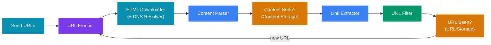
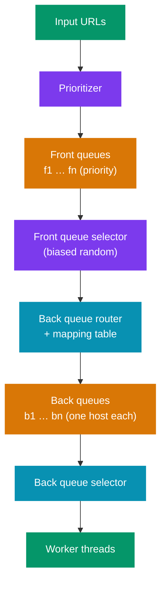
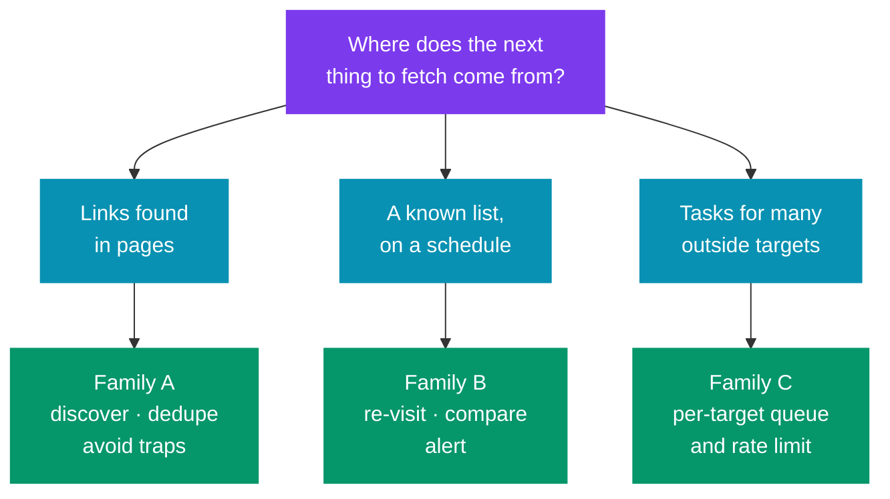

# Ch 9: Design a Web Crawler

> 📖 **Vol 1, Chapter 9** (book pages 132–150) &nbsp;·&nbsp; ⚡ Medium Priority &nbsp;·&nbsp; 💬 **22 Questions**  
> **Source:** Alex Xu, *System Design Interview Vol 1*, Ch 9. Page and figure numbers below are the book's. This PDF edition prints no page numbers in the footer, so pages are the PDF page numbers (the chapter starts on page 132).

---

📊 **Question Count**

| # | Section | Questions |
|---|---|---|
| 1 | [Requirements and Scope ⚡](#1--requirements-and-scope-p132134-) | 1 |
| 2 | [Back-of-the-envelope Estimation 🔥](#2--back-of-the-envelope-estimation-p134135-) | 1 |
| 3 | [High-level Design — the Components 🔥🔥](#3--high-level-design--the-components-p136138-) | 3 |
| 4 | [The Crawler Workflow 🔥🔥](#4--the-crawler-workflow-p138139-) | 1 |
| 5 | [DFS vs BFS and the URL Frontier 🔥🔥](#5--dfs-vs-bfs-and-the-url-frontier-p140145-) | 6 |
| 6 | [HTML Downloader — robots.txt and Performance 🔥](#6--html-downloader--robotstxt-and-performance-p145146-) | 6 |
| 7 | [Robustness, Extensibility and Problem Content ⚡](#7--robustness-extensibility-and-problem-content-p146148-) | 2 |
| 8 | [Wrap-up ⚡](#8--wrap-up-p149-) | 1 |
| 9 | [Similar Problems This Design Solves 📎 🔥](#9--similar-problems-this-design-solves--) | 1 |
| | **Total** | **22** |

> 🔥🔥 Very high priority — asked in almost every Tier-1 interview loop &nbsp;·&nbsp; 🔥 High priority — very frequent in Tier-1 interviews &nbsp;·&nbsp; ⚡ Medium priority — commonly asked &nbsp;·&nbsp; 💤 Low priority — good to know, rarely asked

> **How to read this note.** Sections 1–8 follow the book, step by step (Step 1 → Step 4). §9, at the end, maps this design to 13 similar problems. Anything the book does not say is marked **📎 Beyond the book**. Where the book is unclear, the note says so and gives the fix.  
> Related notes: consistent hashing (used to split work between downloaders) is in [Ch 5: Consistent Hashing](./ch05_design_consistent_hashing.md).

---

## 🗒️ Cheat Sheet

<details>
<summary><strong>🗒️ Show cheat sheet</strong></summary>

### 🎯 Clarifying Questions — and the book's answers
| Question | Book's answer (p.134) |
|---|---|
| What is the crawler for? | **Search engine indexing** |
| How many pages per month? | **1 billion** |
| Which content types? | **HTML only** |
| New or edited pages too? | **Yes** — handle newly added and edited pages |
| Store the crawled HTML? | **Yes, for up to 5 years** |
| Pages with duplicate content? | **Ignore them** |

**A good crawler is** (p.134) **scalable**, **robust**, **polite** and **extensible**. Details in §1.

### 🏗️ Core Components (Figure 9-2)
- **Seed URLs** — where the crawl starts. Split the URL space by country or by topic.
- **URL Frontier** — the URLs still **to be downloaded**. Think of it as a FIFO queue at first.
- **HTML Downloader** — downloads pages for URLs from the frontier.
- **DNS Resolver** — turns a URL's host into an IP address. Cache it.
- **Content Parser** — parses and validates pages. A **separate** component, so it does not slow the crawl.
- **Content Seen?** — compares **hash values** of pages to drop duplicate content. Backed by **Content Storage**.
- **Link (URL) Extractor** — pulls links out of the HTML. Turns relative paths into absolute URLs.
- **URL Filter** — drops some content types, file extensions, error links and "blacklisted" sites.
- **URL Seen?** — skips URLs already visited or already in the frontier. A **Bloom filter** or a **hash table**. Backed by **URL Storage**.

### 💡 Key Insights
1. The core loop is three lines: **download → extract URLs → add new URLs → repeat** (p.134). The hard part is doing it at scale, politely, and without falling into traps.
2. Plain **BFS** with one FIFO queue fails twice (p.140–141). It floods one host (most links point back to the same host). And it ignores priority.
3. The **URL frontier** fixes both. **Front queues** handle **priority**. **Back queues** handle **politeness** — one host per queue, one worker per queue, with a delay between downloads (Figure 9-8).
4. There are **two "seen" checks**. **Content Seen?** stops the same page stored twice (29% of pages are duplicates). **URL Seen?** stops the same URL crawled twice and stops infinite loops.
5. **DNS is a bottleneck** (10–200 ms per lookup, many DNS interfaces are synchronous). Keep your own DNS cache, refreshed by cron jobs (p.146).

### ⚖️ Trade-offs / Alternatives
| Option | Pro | Con | Book's verdict |
|---|---|---|---|
| DFS traversal | Goes deep on one site | The depth can be very deep | ❌️ "Usually not a good choice" (p.140) |
| BFS with one FIFO queue | Simple | Floods one host; ignores priority | ✅ Common, but needs the URL frontier on top (p.140–141) |
| Compare pages character by character | Exact | Slow at billions of pages | ❌️ Compare **hash values** instead (p.137) |
| Bloom filter for URL Seen? | Small memory | False positives — a few new URLs are skipped | Both are "common techniques"; the book does not pick one (p.138) |
| Hash table for URL Seen? | No false positives | Much more memory | (same as above) |
| Frontier fully in memory | Fast | Not durable, not scalable | ❌️ (p.145) |
| Frontier fully on disk | Durable, big | Disk is slow — a bottleneck | ❌️ (p.145) |
| Frontier on disk + memory buffers | Big and fast enough | More complex | ✅ The book's **hybrid** choice (p.145) |
| Parser inside the crawl server | One less component | Slows the crawl | ❌️ Make it a separate component (p.137) |

### 🔢 Numbers to Remember
| What | Value | Arithmetic |
|---|---|---|
| Pages per month | **1 billion** | Given (p.134) |
| QPS | **~400 pages/s** | 1,000,000,000 / (30 × 24 × 3,600) = 1,000,000,000 / 2,592,000 ≈ 386 → ~400 |
| Peak QPS | **800** | 2 × 400 |
| Average page size | **500 KB** | Assumed (the book writes "500k") |
| Storage per month | **500 TB** | 1,000,000,000 × 500 KB = 500,000,000,000 KB = 500 TB |
| Storage for 5 years | **30 PB** | 500 TB × 12 months × 5 years = 30,000 TB = 30 PB |
| Duplicate pages on the web | **29%** ("nearly 30%") | From online research the book cites (p.137, p.147) |
| DNS response time | **10–200 ms** | p.146 |
| URLs in a real frontier | **Hundreds of millions** | p.145 |
| 📎 Download bandwidth | **~200 MB/s avg, ~400 MB/s peak** | 400 × 500 KB = 200 MB/s (≈ 1.6 Gbit/s); 800 × 500 KB = 400 MB/s |
| 📎 Concurrent downloads | **~400 at average load** | Little's law: 400 pages/s × ~1 s per fetch ≈ 400 fetches in flight |
| 📎 Bloom filter for 1B URLs, 1% false positives | **~1.2 GB, 7 hash functions** | m = −n·ln p / (ln 2)² = 10⁹ × 4.6 / 0.48 ≈ 9.6 × 10⁹ bits ≈ 1.2 GB; k = (m/n)·ln 2 ≈ 9.6 × 0.69 ≈ 7 |
| 📎 Hash set of 1B raw URLs | **~100 GB+** | 10⁹ × ~100 bytes per URL = 100 GB, before hash-table overhead |

### ⏱️ 45-Minute Round Plan
| Minutes | Phase | What to say or draw | Trap to avoid |
|---|---|---|---|
| 0–5 | Clarify | Purpose, 1B pages/month, HTML only, new/edited pages, store 5 years, ignore duplicates | Designing a general crawler for "everything" |
| 5–10 | Estimate | 400 QPS, peak 800, 500 TB/month, 30 PB for 5 years | Forgetting peak QPS, or getting KB→TB wrong |
| 10–20 | High-level design | Figure 9-2: frontier → downloader (+DNS) → parser → Content Seen? → extractor → filter → URL Seen? → frontier | Leaving out one of the two "seen" checks |
| 20–35 | **Deep dive** | BFS problems → **front queues (priority) + back queues (politeness)**; freshness; frontier on disk + buffers | Saying "just use a priority queue" — it is not polite |
| 35–42 | Downloader and robustness | robots.txt cache, distributed crawl, DNS cache, locality, short timeout, consistent hashing, saved state | Ignoring DNS as a bottleneck |
| 42–45 | Wrap-up | Spider traps (max URL length), JS rendering, spam filter, sharding, stateless servers | Forgetting traps — the web is "full of traps" |

> 📎 The timings are a suggestion, not from the book. The book gives the steps; the minutes are ours.

---

</details>
<br/>

---

## 1. 📋 Requirements and Scope (p.132–134) ⚡

A web crawler is also called a **robot** or **spider**. Search engines use it to find new or updated content. Content can be a web page, an image, a video, a PDF file, and so on. The crawler starts with a few pages. Then it follows the links on them to find more (Figure 9-1, p.132).

**What crawlers are used for** (p.132–133):

| Use case | Book's example |
|---|---|
| **Search engine indexing** — the most common use | **Googlebot** builds the local index for Google search |
| **Web archiving** — keep web data for future use | National libraries: the **US Library of Congress**, the **EU web archive** |
| **Web mining** — find useful knowledge on the internet | Top financial firms download **shareholder meetings and annual reports** |
| **Web monitoring** — find copyright and trademark abuse | **Digimarc** finds pirated works and reports |

How hard the crawler is depends on the **scale**. A school project takes a few hours. A huge crawler needs a full engineering team that improves it all the time (p.133).

**The basic algorithm** (p.134):

1. Given a set of URLs, download all the pages for those URLs.
2. Extract URLs from these pages.
3. Add the new URLs to the list of URLs to download. Repeat.

It is not really that simple. A very large crawler is very complex. Nobody can design one fully in an interview, so ask questions first. The clarifying questions and the book's answers are in the Cheat Sheet table.

**Characteristics of a good crawler** (p.134):

- **Scalability** — the web has billions of pages. Crawl in **parallel** to be efficient.
- **Robustness** — the web is full of traps: bad HTML, servers that do not answer, crashes, harmful links. The crawler must handle all of these.
- **Politeness** — do not send too many requests to one website in a short time.
- **Extensibility** — new content types need only small changes. Example: to crawl images later, we should not redesign the whole system.

### ❓ Interview Questions

1. **What are web crawlers used for? Which use case does the book design for? ⚡**

<!-- -->
<details>
<summary>💡 Show Answer</summary>

**Answer:**

The book lists four uses (p.132–133):

- **Search engine indexing** — the most common. Googlebot builds Google's index.
- **Web archiving** — keep web data for the future. Example: the US Library of Congress, the EU web archive.
- **Web mining** — find knowledge on the web. Example: financial firms download annual reports.
- **Web monitoring** — find copyright and trademark abuse. Example: Digimarc.

The book designs for **search engine indexing**, 1 billion HTML pages a month.

📎 Each use changes the design. Search needs priority and freshness. Archiving needs completeness and old snapshots. A focused crawler (one topic or a few sites) needs a strong URL filter.

</details>

---

## 2. 🔢 Back-of-the-envelope Estimation (p.134–135) 🔥

The book's numbers rest on many assumptions. Agree on them with the interviewer.

| Item | Book's value | Check |
|---|---|---|
| Pages per month | 1 billion | Given |
| QPS | ~400 pages/s | 10⁹ / 2,592,000 s ≈ **386** ✅ |
| Peak QPS | 2 × QPS = **800** | ✅ |
| Average page size | 500 KB | Assumed |
| Storage per month | **500 TB** | 10⁹ × 500 KB = 5 × 10¹¹ KB = 5 × 10¹⁴ bytes = 500 TB ✅ |
| Storage for 5 years | **30 PB** | 500 TB × 60 months = 30,000 TB = 30 PB ✅ |

All the book's arithmetic is correct. (For the units, the book points back to the "Power of 2" section in Chapter 2.)

📎 **Numbers the book does not give, but you should be ready for:**

- **Bandwidth:** 400 pages/s × 500 KB = **200 MB/s** (about 1.6 Gbit/s). At peak, **400 MB/s**.
- **Concurrency:** say one fetch takes about 1 second (DNS + connect + download). Then you need about **400 downloads in flight**. This is Little's law: rate × time. So you need many threads on many machines, or async I/O.
- **The storage number is an upper bound.** The book also says to **ignore duplicate pages** (29%). Without them, a month is about 500 TB × 0.71 ≈ **355 TB**. Compression shrinks HTML further. Re-crawls of edited pages add some back. Say these points in the round. The interviewer wants to see that you question the number.
- **500 KB is high for HTML only.** The requirement is HTML only, with no images. The HTML of a page is usually tens of KB. So treat 500 TB/month as a safe upper bound, not a real need.

### ❓ Interview Questions

1. **Do the back-of-the-envelope estimate for the book's crawler. 🔥**

<!-- -->
<details>
<summary>💡 Show Answer</summary>

**Answer:**

From the book (p.134–135):

- **QPS:** 1,000,000,000 / 30 days / 24 h / 3,600 s ≈ **400 pages/s**. (Exactly 386.)
- **Peak QPS:** 2 × 400 = **800**.
- **Page size:** 500 KB (assumed).
- **Storage per month:** 1 billion × 500 KB = **500 TB**.
- **5 years:** 500 TB × 12 × 5 = **30 PB**.

📎 Add these to stand out:

- Bandwidth: 400 × 500 KB = **200 MB/s**, about 1.6 Gbit/s; **400 MB/s** at peak.
- About **400 downloads in flight** if each fetch takes ~1 s.
- Duplicates are ignored (29%), so real storage is lower, about 355 TB/month before compression.

</details>

---

## 3. 🧩 High-level Design — the Components (p.136–138) 🔥🔥

**Step 2.** The design is based on earlier work on crawlers (the Mercator paper and the Olston & Najork survey). Figure 9-2 shows it. The book first explains each part, then the workflow (§4).



### Seed URLs (p.136)
The start point of the crawl.

- To crawl one university's site, use the **university's domain name**.
- To crawl the whole web, pick seeds that reach as many links as possible. **Split the URL space** into smaller parts:
  - by **locality** — different countries have different popular websites;
  - by **topic** — shopping, sports, healthcare, and so on.

Seed selection is an **open question**. The book says you do not need a perfect answer. Just say your thinking as you go.

### URL Frontier (p.136)
Most modern crawlers split the crawl state into two: **to be downloaded** and **already downloaded**. The URL Frontier stores the URLs **to be downloaded**. For now, think of it as a **FIFO queue**. §5 shows the real design.

### HTML Downloader and DNS Resolver (p.137)
- The **HTML Downloader** downloads pages for the URLs that the frontier gives it.
- To download a page, the URL's host must become an IP address. The downloader calls the **DNS Resolver**. Example: `www.wikipedia.org` → `198.35.26.96` (as of 3/5/2019).

### Content Parser (p.137)
A downloaded page must be **parsed and validated**. Malformed pages can cause problems and waste storage. A parser inside the crawl server would slow the crawl. So the parser is a **separate component**.

### Content Seen? and Content Storage (p.137)
- Online research says **29%** of web pages are **duplicate content**. Without a check, the same content is stored many times.
- **Content Seen?** removes this waste and saves processing time. It detects content that is already stored.
- Comparing two pages **character by character** is slow at billions of pages. The fast way is to **compare the hash values** of the two pages.
- **Content Storage** holds the HTML. The choice depends on data type, data size, access frequency and life span. **Most content is on disk** (the data is too big for memory). **Popular content is kept in memory** to reduce latency.

### URL Extractor (p.137, Figure 9-3)
It parses the HTML and pulls out the links. **Relative paths become absolute URLs.** In Figure 9-3, `/wiki/Cong_Weixi` becomes `https://en.wikipedia.org/wiki/Cong_Weixi` by adding the `https://en.wikipedia.org` prefix.

> **Name note.** The text calls it the **URL Extractor** (p.137). Figures 9-2 and 9-4 and the workflow call it the **Link Extractor**. It is the same component.

### URL Filter (p.138)
Excludes some **content types**, **file extensions**, **error links**, and URLs on **"blacklisted" sites**.

### URL Seen? and URL Storage (p.138)
- **URL Seen?** tracks URLs that were **visited before** or are **already in the frontier**.
- Without it, the same URL is added many times. That increases server load and can cause **infinite loops**.
- **Bloom filter** and **hash table** are the common ways to build it. The book does not go into either.
- **URL Storage** stores the URLs already visited.

📎 **Bloom filter vs hash table in numbers** (1 billion URLs):

- A hash set of raw URLs: 10⁹ × ~100 bytes ≈ **100 GB**, plus hash-table overhead.
- A Bloom filter with a 1% false-positive rate: about **9.6 bits per URL** ≈ **1.2 GB**, with 7 hash functions.
- A Bloom filter can say "seen" for a URL it never saw (a **false positive**). Then that new URL is **skipped**. It never says "not seen" for a URL it did see (**no false negatives**). So it never crawls a URL twice.
- A skipped URL stays skipped until the filter is rebuilt. For a search crawler, losing about 1% of new URLs is usually acceptable.
- A middle option (used by Mercator): store an **8-byte fingerprint** of each URL instead of the URL. 10⁹ × 8 bytes = **8 GB**, sorted on disk, with a memory cache in front.

### ❓ Interview Questions

1. **How does "URL Seen?" work? Bloom filter or hash table? 🔥**

<!-- -->
<details>
<summary>💡 Show Answer</summary>

**Answer:**

**Book** (p.138): URL Seen? tracks URLs that were **visited** or are **already in the frontier**. It stops repeat downloads, extra server load and **infinite loops**. **Bloom filter** and **hash table** are the common ways to build it. The book does not choose one.

📎 **The trade-off in numbers (1 billion URLs):**

| | Memory | Errors |
|---|---|---|
| Hash set of URLs | ~100 GB + overhead | None |
| Bloom filter, 1% false positives | **~1.2 GB** (9.6 bits/URL, 7 hashes) | False positives: ~1% of **new** URLs are skipped. Never a false negative |
| 8-byte fingerprints on disk (Mercator) | 8 GB on disk + memory cache | Collisions are very rare |

For a search crawler, skipping ~1% of new URLs is usually acceptable. If **every** URL matters (for example an archive), use fingerprints or a hash table.

</details>

---

2. **How do you detect duplicate content, and why does it matter? ⚡**

<!-- -->
<details>
<summary>💡 Show Answer</summary>

**Answer:**

**Why** (p.137): **29%** of web pages are duplicate content. Without a check, we store the same content many times. The requirement also says: **ignore** pages with duplicate content.

**How** (p.137):

- Comparing two pages **character by character** is too slow at billions of pages.
- **Compare hash values** of the pages instead. If the hash is already in storage, the same content was processed at another URL. **Discard** the page (workflow step 6).

📎 An exact hash catches only byte-identical pages. The same article with a different ad or timestamp gets a new hash. For **near-duplicates**, use **SimHash** (or MinHash). Similar pages get fingerprints that differ in only a few bits.

📎 Common sources of duplicates: `www` vs no `www`, `http` vs `https`, a trailing slash, tracking parameters, and printer-friendly versions.

</details>

---

3. **Where do you store 30 PB of pages and the data about each URL? 📎 ⚡**

<!-- -->
<details>
<summary>💡 Show Answer</summary>

**Answer:**

The book only says "most content on disk, popular content in memory" (p.137). In the round, split the data in two, because the two parts have different access patterns.

| Data | Access pattern | Store |
|---|---|---|
| **Page content** (HTML) | Written once, large, read later in batch by the indexer | **Object storage** (S3, HDFS). Compress it. Pack many small pages into large files — web archives use the **WARC** format for this |
| **URL metadata** (last crawl time, content hash, HTTP status, `ETag` / `Last-Modified`, next crawl time, priority) | Billions of rows, read and updated by URL key, no joins | A **wide-column or key-value store** (Bigtable, HBase, Cassandra), sharded by key |

- **Row key = the URL with the hostname reversed**, for example `com.wikipedia.en/wiki/…`. The Bigtable paper's "Webtable" example uses this key. All pages of one site then sit next to each other, so a scan of one site is cheap.
- **Content Seen?** is one more table: content hash → URL. Put a Bloom filter in front of it to skip most lookups.
- **Why not one MySQL table?** Billions of rows and a high write rate need manual sharding. That is the book's "replication and sharding" wrap-up point (p.149).
- **Trade-off:** for a small crawl (one site, a few million pages), one Postgres table and a file store are enough. Do not build a 30 PB design for that.

</details>

---

## 4. 🔄 The Crawler Workflow (p.138–139) 🔥🔥

Figure 9-4 adds step numbers to the high-level design:

| Step | What happens |
|---|---|
| 1 | Add the **seed URLs** to the URL Frontier |
| 2 | The **HTML Downloader** fetches a list of URLs from the frontier |
| 3 | The downloader gets the **IP addresses** from the DNS Resolver and starts downloading |
| 4 | The **Content Parser** parses the HTML and checks whether the page is malformed |
| 5 | The parsed, valid content goes to **Content Seen?** |
| 6 | Content Seen? checks whether the page is **already in storage**. **Yes** → the same content at another URL was already processed, so **discard** the page. **No** → pass it to the Link Extractor |
| 7 | The **Link Extractor** extracts links from the page |
| 8 | The links go to the **URL Filter** |
| 9 | The filtered links go to **URL Seen?** |
| 10 | URL Seen? checks whether the URL is **already in storage**. **Yes** → it was processed before; do nothing |
| 11 | **No** → add the URL to the **URL Frontier** |

The loop then repeats from step 2.

<details>
<summary><strong>🤔 Doubt: Where does robots.txt get checked — in the URL Filter or in the downloader?</strong></summary>

In the book, robots.txt belongs to the **HTML Downloader** (p.145). Before it crawls a site, the crawler checks that site's robots.txt and follows its rules. The result is **cached**, so the file is not downloaded again and again.

The **URL Filter** (p.138) is about content types, file extensions, error links and blacklisted sites. The book does not put robots.txt there.

📎 In a real crawler, you can check robots.txt early (before a URL enters the frontier) **and** at download time. The early check saves queue space. The late check catches a robots.txt that changed after the URL was queued.

---

</details>
<br/>

### ❓ Interview Questions

1. **Walk me through the high-level design and the crawl workflow. 🔥🔥**

<!-- -->
<details>
<summary>💡 Show Answer</summary>

**Answer:**

Figure 9-4, step by step (p.139):

1. Add **seed URLs** to the **URL Frontier**.
2. The **HTML Downloader** takes a list of URLs from the frontier.
3. It gets IP addresses from the **DNS Resolver** (cached) and downloads the pages.
4. The **Content Parser** parses each page and checks whether it is malformed.
5. Valid content goes to **Content Seen?**.
6. Content Seen? compares the page's **hash** with stored content. Already stored → **discard**. New → pass it on.
7. The **Link Extractor** extracts links and makes relative paths absolute.
8. The **URL Filter** drops unwanted content types, file extensions, error links and blacklisted sites.
9. The links go to **URL Seen?**.
10. Already seen (visited or already in the frontier) → do nothing.
11. New → add to the **URL Frontier**. The loop repeats.

There are two storage systems: **Content Storage** (HTML, mostly on disk, popular pages in memory) and **URL Storage** (visited URLs).

</details>

---

## 5. 🧭 DFS vs BFS and the URL Frontier (p.140–145) 🔥🔥

**Step 3** covers six topics (p.140): DFS vs BFS, the URL frontier, the HTML Downloader, robustness, extensibility, and problem content.

### DFS vs BFS (p.140–141)

The web is a **directed graph**. Pages are nodes. Links (URLs) are edges. Crawling means walking this graph.

- **DFS** is usually **not a good choice**, because the depth can be very deep.
- **BFS** is what crawlers usually use. It is built with a **FIFO queue**: URLs leave the queue in the order they entered.

**Plain BFS has two problems:**

1. **It is impolite.** Most links on a page point back to the **same host**. In Figure 9-5, every link on `wikipedia.com` is internal. The crawler is then busy with one host. When it downloads in parallel, it **floods Wikipedia's servers** with requests.
2. **It ignores priority.** Not every page has the same quality and importance. We may want to rank URLs by **page rank, web traffic, update frequency**, and so on.

The **URL frontier** solves both. It also handles **freshness** (p.141).

### Politeness — the back queues (p.141–142, Figure 9-6)

Too many requests to one server in a short time is **"impolite"**. It can even look like a **denial-of-service (DoS) attack**. Without limits, a crawler could send thousands of requests per second to one site.

**The idea:** download **one page at a time from the same host**, with an optional **delay** between two downloads. Keep a **mapping from hostname to download (worker) thread**. Each thread has its **own FIFO queue** and downloads only from that queue.

| Part | Job |
|---|---|
| **Queue router** | Makes sure each queue (b1, b2, … bn) holds URLs from **only one host** |
| **Mapping table** (Table 9-1) | Maps each host to a queue: `wikipedia.com → b1`, `apple.com → b2`, …, `nike.com → bn` |
| **FIFO queues b1 … bn** | Each holds URLs from the same host |
| **Queue selector** | Each worker thread is mapped to one queue and downloads only from it. The selector does this mapping |
| **Worker threads 1 … N** | Download pages **one by one** from the same host, with an optional delay between downloads |

📎 **More hosts than queues.** There are millions of hosts but only n back queues. The book does not say how to handle this. The Mercator design (the book's reference [4]) does it like this:

- A back queue holds one host at a time.
- When the queue becomes empty, it gets a **new host** from the front queues.
- A **min-heap** keyed by "earliest time this host may be contacted again" tells a worker which queue is ready.
- Mercator used about **3 times as many back queues as worker threads**.

📎 **How long is the delay?** A common rule from the crawler literature: wait about **10 × the time the last download from that host took**. A slow answer usually means a busy server. So the crawler slows down for that host on its own.

📎 **Why you need thousands of back queues — in numbers.** Say each host gets at most one request every 2 seconds. To reach 400 pages/s, you need 400 × 2 = **800 hosts** in progress at the same time. At peak (800 pages/s) you need **1,600**. A few dozen queues cannot reach the target rate.

### Priority — the front queues (p.142–143, Figure 9-7)

A random forum post about Apple products matters much less than the **Apple home page**. Both contain the word "Apple". Still, crawl the home page first.

Rank URLs by **usefulness**: **PageRank**, **website traffic**, **update frequency**, and so on.

| Part | Job |
|---|---|
| **Prioritizer** | Takes URLs as input and **computes their priority** |
| **Queues f1 … fn** | Each queue has a **priority**. High-priority queues are picked **with higher probability** |
| **Queue selector** | Picks a queue **at random, with a bias toward higher priority** |

📎 Why random with a bias, and not "always the highest queue"? Strict priority would **starve** the low queues. Their URLs would never be crawled.

### The full URL frontier (p.143–144, Figure 9-8)

The frontier has two modules:

- **Front queues** manage **prioritization**.
- **Back queues** manage **politeness**.



**In one line:** the front queues decide **what is important**. The back queues decide **what is polite**.

📎 A minimal Java sketch of one back-queue worker. It downloads one host's URLs one at a time, with a delay:

```java
public class HostWorker implements Runnable {

    private final BlockingQueue<String> hostQueue;   // URLs of ONE host
    private final Downloader downloader;
    private final long delayMillis;

    public HostWorker(BlockingQueue<String> hostQueue, Downloader downloader, long delayMillis) {
        this.hostQueue = hostQueue;
        this.downloader = downloader;
        this.delayMillis = delayMillis;
    }

    @Override
    public void run() {
        try {
            while (!Thread.currentThread().isInterrupted()) {
                String url = hostQueue.take();        // FIFO, same host only
                try {
                    downloader.download(url);
                } catch (RuntimeException e) {
                    // one bad page must not stop this host's worker (§7 robustness)
                }
                Thread.sleep(delayMillis);            // politeness delay
            }
        } catch (InterruptedException e) {
            Thread.currentThread().interrupt();
        }
    }
}
```

Here `Downloader` is your own interface with one method, `void download(String url)`.

### Freshness (p.144–145)

Pages are added, deleted and edited all the time. A crawler must **re-crawl** downloaded pages to keep the data fresh. Re-crawling every URL takes too much time and too many resources. The book's two strategies:

- Re-crawl based on each page's **update history**.
- **Prioritize** URLs. Re-crawl **important pages first and more often**.

📎 Make a re-crawl cheap with a **conditional GET**. Send `If-Modified-Since` (from the old `Last-Modified`) or `If-None-Match` (from the old `ETag`). An unchanged page returns **304 Not Modified** with no body.

### Storage for the URL frontier (p.145)

A real search crawler can have **hundreds of millions** of URLs in the frontier.

- **All in memory** — not durable and not scalable. ❌️
- **All on disk** — disk is slow and becomes the bottleneck. ❌️
- **Hybrid** — ✅ the book's choice. Most URLs are **on disk**, so space is not a problem. **Memory buffers** handle enqueue and dequeue. The buffers are **written to disk periodically**.

📎 Rough size: 100 million URLs × ~100 bytes ≈ **10 GB**. So "hundreds of millions" means tens of GB. That is too much for one machine's heap, but easy for disk.

### ❓ Interview Questions

1. **Why do crawlers use BFS and not DFS? What is wrong with a plain BFS queue? 🔥**

<!-- -->
<details>
<summary>💡 Show Answer</summary>

**Answer:**

The web is a directed graph: pages are nodes, links are edges (p.140).

- **DFS** is usually not a good choice. The depth can be **very deep**.
- **BFS** with a **FIFO queue** is the common choice.

**But plain BFS has two problems** (p.140–141):

1. **Impolite.** Most links on a page point to the **same host**. In Figure 9-5, all links on wikipedia.com are internal. Parallel downloads then **flood one host**.
2. **No priority.** All URLs are treated the same. But a home page matters more than a random forum post.

The **URL frontier** fixes both: front queues for priority, back queues for politeness.

</details>

---

2. **How does the crawler stay polite to websites? 🔥🔥**

<!-- -->
<details>
<summary>💡 Show Answer</summary>

**Answer:**

**The book's design** (p.141–142, Figure 9-6):

- Download **one page at a time from one host**, with a **delay** between downloads.
- A **queue router** puts each URL in the back queue for its host. A **mapping table** stores host → queue (Table 9-1).
- Each **back queue (b1 … bn)** holds URLs of **one host**.
- A **queue selector** maps each **worker thread** to one queue. The worker downloads from that queue only, one page at a time.
- **robots.txt** — check it before you crawl a site and follow its rules. Cache it (p.145).

📎 Extra good practice:

- Send a clear **User-Agent** that names your crawler.
- Back off when a server returns **429 or 503**, or answers slowly.
- Make the delay **adaptive**: about 10 × the last download time from that host.
- Do the math. Say each host gets one request every 2 s. Then 400 pages/s needs about **800 hosts** in progress at once. So you need thousands of back queues, not a few.
- Partition work across machines **by hostname**. Then one machine controls the request rate for each host.

</details>

---

3. **How do you decide which URLs to crawl first? 🔥**

<!-- -->
<details>
<summary>💡 Show Answer</summary>

**Answer:**

Rank by **usefulness**: **PageRank**, **website traffic**, **update frequency** (p.142).

**The book's design** (Figure 9-7):

- A **Prioritizer** computes a priority for each incoming URL.
- It puts the URL in one of the **front queues f1 … fn**. Each queue has a priority.
- A **queue selector** picks a queue **at random, biased toward higher priority**.

Example from the book: the **Apple home page** comes before a random forum post about Apple products.

📎 The random bias matters. A strict "highest first" rule would **starve** the low-priority queues forever.

</details>

---

4. **What is the difference between the front queues and the back queues in the URL frontier? 🔥**

<!-- -->
<details>
<summary>💡 Show Answer</summary>

**Answer:**

Figure 9-8 (p.143–144):

- **Front queues — prioritization.** Prioritizer → queues f1 … fn → a **front queue selector** with a bias toward high priority.
- **Back queues — politeness.** **Back queue router** + **mapping table** → queues b1 … bn, **one host each** → a **back queue selector** → **worker threads**.

URLs flow **front → back**. So the front decides **"what is important"**, and the back decides **"what is polite"**.

📎 There are millions of hosts but only n back queues. In Mercator, a back queue gets a **new host** when it becomes empty. A min-heap of "next allowed contact time" tells workers which queue is ready.

</details>

---

5. **How do you keep the crawled data fresh? ⚡**

<!-- -->
<details>
<summary>💡 Show Answer</summary>

**Answer:**

Pages are added, deleted and edited all the time. Re-crawling everything takes too much time and resources (p.144).

The book's two strategies (p.145):

- Re-crawl based on each page's **update history**.
- **Prioritize** URLs. Re-crawl **important pages first and more often**.

📎 In practice:

- A page that changed on most past visits → re-crawl in **hours**. A page that never changes → **weeks or months**.
- Use a **conditional GET** (`If-Modified-Since` / `If-None-Match`). An unchanged page returns **304** with no body, so you save bandwidth.

</details>

---

6. **The frontier holds hundreds of millions of URLs. Where do you store it? ⚡**

<!-- -->
<details>
<summary>💡 Show Answer</summary>

**Answer:**

**Book** (p.145):

- **All in memory** — not durable and not scalable.
- **All on disk** — disk is slow and becomes the bottleneck.
- ✅ **Hybrid:** most URLs live **on disk**. **Memory buffers** handle enqueue and dequeue. The buffers are **written to disk periodically**.

📎 Size check: 100 million URLs × ~100 bytes ≈ 10 GB. So hundreds of millions is tens of GB — fine on disk, too big for one heap.

📎 A **Kafka** topic is sometimes suggested as a durable frontier. It is durable and partitioned, but it has **no priority** and **no per-host delay**. You still need the front and back queue logic in the workers.

</details>

---

## 6. 📥 HTML Downloader — robots.txt and Performance (p.145–146) 🔥

The HTML Downloader downloads pages over **HTTP**.

### Robots.txt (p.145)

**robots.txt** (the **Robots Exclusion Protocol**) is how a website tells crawlers which pages they may download.

- **Before crawling a site**, check its robots.txt and follow its rules.
- **Cache** the result, so the file is not downloaded again and again. Download it and save it to the cache **periodically**.

The book's example, from `https://www.amazon.com/robots.txt` — some directories, like `creatorhub`, are not allowed for Googlebot:

```
User-agent: Googlebot
Disallow: /creatorhub/*
Disallow: /rss/people/*/reviews
Disallow: /gp/pdp/rss/*/reviews
Disallow: /gp/cdp/member-reviews/
Disallow: /gp/aw/cr/
```

📎 robots.txt became a standard in 2022: **RFC 9309**. It says a crawler **should not use a cached copy for more than 24 hours**. The exception is when the file cannot be reached. `Crawl-delay` is **not** part of RFC 9309. Some crawlers follow it; Googlebot ignores it.

📎 What RFC 9309 says when robots.txt cannot be read:

| robots.txt result | What the crawler does |
|---|---|
| **4xx** (for example 404 — no file) | The file is "unavailable". The crawler **may crawl everything** |
| **5xx or network error** | The file is "unreachable". The crawler **must assume everything is disallowed** |
| Unreachable for **more than 30 days** | The crawler may treat it as unavailable, or keep using a cached copy |
| Redirects | Follow **at least 5** redirects |
| Very large file | Parse **at least the first 500 KiB** |

When an `Allow` and a `Disallow` rule both match a path, the **longest (most specific) rule wins**. If they are equally long, `Allow` wins.

### Performance optimization (p.145–146)

| # | Technique | What the book says |
|---|---|---|
| 1 | **Distributed crawl** (Figure 9-9) | Spread crawl jobs over **many servers**, each with **many threads**. **Partition the URL space**, so each downloader owns a subset of the URLs |
| 2 | **Cache the DNS Resolver** | DNS is a bottleneck. Many DNS interfaces are **synchronous**, and a response takes **10 ms to 200 ms**. While one crawler thread waits for DNS, **other threads are blocked**. Keep your **own DNS cache** (domain → IP), **updated periodically by cron jobs** |
| 3 | **Locality** | Put crawl servers in **different regions**. A server close to the website's host downloads faster. Locality applies to most parts: crawl servers, cache, queue, storage |
| 4 | **Short timeout** | Some servers answer slowly or never. Set a **maximum wait time**. If the host does not answer in time, stop that job and crawl other pages |

⚠️ **Book over-claim — "other threads are blocked".** One thread's DNS wait blocks the other threads only when the resolver handles one call at a time. The Mercator paper (the book's reference [4]) hit this problem and wrote its own multi-threaded resolver. With a thread-safe or async resolver, only the waiting thread stops. The fix is the same either way: cache DNS answers, and resolve many names in parallel.

📎 **Partition by host, not by URL.** If you hash the full URL, pages of one host land on many machines. Then no single machine can enforce "one request at a time to this host". Hash the **hostname** instead. Then one machine owns all of a host's URLs, and the per-host back queue works.

### ❓ Interview Questions

1. **How do you make the HTML Downloader fast? 🔥**

<!-- -->
<details>
<summary>💡 Show Answer</summary>

**Answer:**

The book's four techniques (p.145–146):

1. **Distributed crawl** (Figure 9-9) — many servers, many threads each. **Partition the URL space**, so each downloader owns a subset.
2. **Cache DNS** — DNS takes **10–200 ms**, and many DNS interfaces are **synchronous**. The book says that while one thread waits, others are blocked. That is true only when the resolver handles one call at a time (see the note above). Keep your own **domain → IP cache**, refreshed by **cron jobs**.
3. **Locality** — put crawl servers near the website hosts. This applies to servers, cache, queue and storage.
4. **Short timeout** — set a maximum wait. If a host does not answer in time, move on to other pages.

📎 Partition by **hostname hash**, not full-URL hash. Then one machine owns each host, which keeps politeness simple.

</details>

---

2. **How do you keep politeness when the crawl runs on many machines? 📎 🔥**

<!-- -->
<details>
<summary>💡 Show Answer</summary>

**Answer:**

The book's back queues work **inside one machine**. Across machines, two servers could hit the same host at the same time.

- **Assign each host to one machine.** Hash the **hostname** (not the full URL) with consistent hashing.
- A machine may extract a link for a host it does not own. Then it **sends the URL to the owner** machine.
- The owner's back queue then controls the request rate for that host.
- Bonus: the owner's DNS cache and robots.txt cache stay hot for its hosts.

</details>

---

3. **How does the crawler handle redirects (301/302)? 📎 💤**

<!-- -->
<details>
<summary>💡 Show Answer</summary>

**Answer:**

- Follow redirects up to a limit (for example **5 hops**). This stops redirect loops.
- **301 (permanent):** replace the old URL with the new one in URL Storage. Crawl the new URL from now on.
- **302 (temporary):** keep the old URL as the one to re-crawl. Fetch the target this time only.
- **Normalize** the final URL and store it as the **standard URL** for that page.
- If the chain ends at a URL already seen, **discard** it.
- Put each redirect target through **URL Seen?** too. Track the URLs in each chain to catch loops.
- Log redirect chains for debugging.

</details>

---

4. **How do you avoid hurting a server that is already under load? 📎 ⚡**

<!-- -->
<details>
<summary>💡 Show Answer</summary>

**Answer:**

- Use **adaptive rate limiting**. If a server answers slowly or returns **503 or 429**, back off exponentially. Lower the rate for that host.
- Honour a `Retry-After` header when the server sends one.
- Track response time and error rate **per host**.
- For sensitive sites, crawl in **off-peak hours**.
- If you follow `Crawl-delay`, treat it as a **minimum**, not a target.

</details>

---

5. **How would you handle content behind a login? 📎 💤**

<!-- -->
<details>
<summary>💡 Show Answer</summary>

**Answer:**

- A search crawler usually **does not crawl** behind a login. Respect robots.txt; sites often block private sections there too.
- Some special crawlers have **permission**, for example price monitoring for a partner. They can store **session cookies per domain**. They refresh the cookies when they expire.
- That means you must store and protect credentials. This adds a lot of operational work and security risk.

</details>

---

6. **How does the crawler use robots.txt? What if robots.txt returns 404 or 500? 📎 🔥**

<!-- -->
<details>
<summary>💡 Show Answer</summary>

**Answer:**

**Book** (p.145): before it crawls a site, the HTML Downloader checks that site's robots.txt and follows its rules. It caches the file and downloads it again periodically.

📎 **The standard is RFC 9309 (2022).** Its main rules:

- Rules are grouped by `User-agent`. The crawler uses the group that matches its own name, or the `*` group.
- If `Allow` and `Disallow` both match a path, the **longest rule wins**. If they are equally long, `Allow` wins.
- Do not use a cached copy for **more than 24 hours**, unless the file cannot be reached.

📎 **When the file cannot be read:**

- **4xx** (for example 404): there is no file, so the crawler **may crawl everything**.
- **5xx or a network error**: the crawler **must assume everything is disallowed**. A server that is failing should not get more load.
- Unreachable for **more than 30 days**: treat it as missing, or keep using the cached copy.

📎 **Where to check it:** at download time, which is the book's choice. You can also check before a URL enters the frontier, to save queue space (see the doubt in §4). `Crawl-delay` is not in the RFC. Googlebot ignores it.

</details>

---

## 7. 🧱 Robustness, Extensibility and Problem Content (p.146–148) ⚡

### Robustness (p.146–147)

- **Consistent hashing** — spreads load across downloaders. You can **add or remove** a downloader server easily. (The book points to Chapter 5.)
- **Save crawl states and data** — write them to a storage system. A crawl that stops can **restart** by loading the saved state.
- **Exception handling** — errors are normal at large scale. Handle them **without crashing** the system.
- **Data validation** — an important way to prevent system errors.

### Extensibility (p.147, Figure 9-10)

The crawler grows by **plugging in new modules** after Content Seen?:

- A **PNG Downloader** module downloads PNG files.
- A **Web Monitor** module watches the web for copyright and trademark abuse.

The Link Extractor sits in the same "extension module" area. So adding a content type does not change the rest of the pipeline.

📎 In Java, this is a list of `ContentProcessor` beans behind one interface. Each one says which content it supports. Spring injects all of them as a `List<ContentProcessor>`. A new type is a new bean, not a change to the pipeline.

### Detect and avoid problem content (p.147–148)

| Problem | What it is | The book's fix |
|---|---|---|
| **Redundant content** | Nearly **30%** of pages are duplicates | **Hashes or checksums** detect duplicates |
| **Spider traps** | A page that sends the crawler into an **infinite loop**, e.g. `www.spidertrapexample.com/foo/bar/foo/bar/foo/bar/…` | Set a **maximum URL length**. There is **no one-size-fits-all** fix. A trap site shows an **unusually large number of pages**. Automatic detection is hard. So a person can **check it by hand**. Then **exclude the site** or add **custom URL filters** |
| **Data noise** | Content with little or no value: **ads, code snippets, spam URLs** | Exclude it if possible |

📎 Other common trap defences:

- a **maximum depth** per site;
- a **page budget** per host per crawl cycle;
- **URL normalization** — lowercase the host, remove session IDs, sort query parameters;
- filters for **repeating path segments**.

📎 Exact hashes only catch **byte-identical** pages. A page that differs only in an ad or a timestamp gets a different hash. **Near-duplicate** detection (for example **SimHash**) catches those. The book's reference [7] (Rabin fingerprinting) is the classic paper for page fingerprints.

### ❓ Interview Questions

1. **What is a spider trap, and how do you avoid it? ⚡**

<!-- -->
<details>
<summary>💡 Show Answer</summary>

**Answer:**

**Book** (p.147–148): a page that sends the crawler into an **infinite loop**. Example: an endlessly deep folder path, `www.spidertrapexample.com/foo/bar/foo/bar/foo/bar/…`.

The book's defences:

- Set a **maximum URL length**.
- Watch for sites with an **unusually large number of pages**. That is the sign of a trap.
- Automatic detection is hard. A person can **check the site by hand**, then **exclude it** or add **custom URL filters**.

The book says there is **no one-size-fits-all** solution.

📎 More defences:

- a **maximum depth** per site;
- a **page budget** per host per crawl cycle;
- **URL normalization** — remove session IDs, sort query parameters;
- regex filters for **repeating path segments**.

A calendar with an endless "next month" link is the classic real example.

</details>

---

2. **How do you make the crawler robust and extensible? ⚡**

<!-- -->
<details>
<summary>💡 Show Answer</summary>

**Answer:**

**Robustness** (p.146–147):

- **Consistent hashing** spreads load across downloaders. You can add or remove a server easily.
- **Save crawl states and data** to storage. A stopped crawl restarts from the saved state.
- **Handle exceptions** without crashing the system.
- **Validate data** to prevent errors.

**Extensibility** (p.147, Figure 9-10): plug in **new modules**. A **PNG Downloader** adds PNG files. A **Web Monitor** watches for copyright and trademark abuse. The rest of the pipeline does not change.

📎 For horizontal scaling (p.149), keep the download servers **stateless**. The state lives in the frontier and the storage, not in the servers.

</details>

---

## 8. 🏁 Wrap-up (p.149) ⚡

**Step 4.** The book recaps the four traits of a good crawler: **scalability, politeness, extensibility, robustness**. The web is huge and full of traps, so this is not a simple task.

**Extra talking points if time is left:**

- **Server-side rendering.** Many sites build links at run time with **JavaScript, AJAX**, and so on. If you download and parse the page directly, you miss those links. The fix is to **render the page on the server first** (also called **dynamic rendering**), then parse it.

  ⚠️ **Book mix-up — the book's two names mean something else.** **Server-side rendering** means the *website* builds the full HTML on its own server. **Dynamic rendering** means the *website* sends pre-rendered HTML to bots only. Google now calls dynamic rendering a workaround, not a long-term fix. The crawler's own fix is different: the **crawler renders the page itself** in a headless browser, then parses the result.
- **Filter out unwanted pages.** Storage and crawl resources are limited. An **anti-spam** component removes low-quality and spam pages.
- **Database replication and sharding** — improve the data layer's availability, scalability and reliability.
- **Horizontal scaling.** A large crawl needs **hundreds or even thousands of servers** for downloads. **Keep the servers stateless.**
- **Availability, consistency and reliability** — the core of any large system (Chapter 1).
- **Analytics** — collect and analyse data to fine-tune the system.

📎 For dynamic rendering, a crawler uses a **headless browser** (for example Puppeteer or Playwright). It is much slower and uses much more memory than a plain HTTP fetch. So render only the pages that need it, in a separate pool of workers.

### ❓ Interview Questions

1. **How do you crawl pages whose links are built by JavaScript? 💤**

<!-- -->
<details>
<summary>💡 Show Answer</summary>

**Answer:**

**Book** (p.149): many sites build links at run time with JavaScript or AJAX. If you parse the downloaded HTML directly, you miss those links. **Render the page on the server first** (server-side or **dynamic rendering**), then parse it.

⚠️ Book mix-up: server-side rendering and dynamic rendering are both done by the *website*. In the round, say it plainly: "the **crawler renders the page itself** in a headless browser, then extracts the links."

📎 How:

- Use a **headless browser** (Puppeteer, Playwright) to run the JavaScript.
- It is much slower and uses much more memory than a plain HTTP fetch.
- So keep a **separate pool** of render workers. Send a page there only when needed — for example, when the plain HTML has almost no content or links.

</details>

---

## 9. 🧬 Similar Problems This Design Solves 📎 🔥

📎 The book does not list similar problems for this chapter. But the same core solves **at least 13 common interview problems**. Learn the core once, then change only a few parts for each one.

**The core that never changes:**
- **A frontier** of work still to do. **Front queues** set the order (priority). **Back queues** limit the load on each target (politeness).
- **Workers** that call slow, unreliable outside servers, with **short timeouts**, retries and back-off.
- **A "seen" check** (Bloom filter, hash set or fingerprints), so the same work is not done twice.
- **A re-visit schedule**, based on how often each target changes (freshness).

**The tag on each problem** says how often it is asked as an HLD round on its own (same legend as the questions). 🔥🔥 = learn its "what is different" column well; 💤 = knowing the family is enough.

**The one choice that splits them into three families:** where does the next thing to fetch come from?



### Family A — discover new URLs by following links (like this chapter)

| # | Problem | What is different from this chapter |
|---|---|---|
| 1 | **Web crawler 🔥🔥** (this chapter) | — |
| 2 | **Multithreaded web crawler (LeetCode 1242) 🔥** | A coding round, not an HLD round. Crawl only URLs on the start URL's hostname, in one process. URL Seen? is a concurrent set (`ConcurrentHashMap.newKeySet()`), and a thread pool does the fetches. No politeness, no storage. The trap is the stop rule: stop only when the queue is empty **and** no fetch is still running |
| 3 | **Focused crawler (job aggregator, price comparison) ⚡** | Only one topic or a list of sites. The Prioritizer scores **topic relevance**, and the URL Filter drops off-topic links early. The parser pulls out fields (title, price, salary), often from structured data in the page. Product and job pages need re-crawls in hours, not weeks |
| 4 | **Web archive (Wayback Machine) 💤** | Keep **every version**. Content Seen? no longer throws a page away — a changed page is a new capture with a timestamp. Pages go into WARC files. Completeness matters more than priority (§1 Q1) |
| 5 | **SEO site-audit crawler (one site) 💤** | One host, so politeness is one rate limit and one machine is enough. The output is a report, not stored pages: broken links (4xx, 5xx), redirect chains (§6 Q3), missing titles |

### Family B — re-visit a known list on a schedule

| # | Problem | What is different from this chapter |
|---|---|---|
| 6 | **News / RSS aggregator (Google News) ⚡** | No link discovery: the input is a known list of feeds. Poll each feed by how often it changes — minutes for news sites. Use conditional GET (§5 Q5). Group stories about the same event with near-duplicate detection (SimHash, §3 Q2) |
| 7 | **Price tracker / back-in-stock checker ⚡** | A known list of product URLs. The re-crawl rate follows each page's change history — the book's freshness rule. Compare the new price with the last one. A change triggers an alert through a [notification system (Ch 10)](ch10_design_notification_system.md) |
| 8 | **Website uptime monitor 🔥** — [Vol 2 Ch 5](../vol_2/ch05_metrics_monitoring_alerting.md) | A fixed list of URLs, fetched every 30–60 seconds from several regions. No parsing and no link extraction. Raise an alert only when several regions fail, so one bad network path does not page anyone. The data is a time series of status and latency |
| 9 | **Link preview / URL unfurler (chat apps) ⚡** | One fetch, **on demand**, while a user waits. So latency matters, not throughput: a short timeout, a size limit, and a cache by normalized URL. Read only the title and Open Graph tags. Block private and internal IP addresses, or a user can make your server fetch internal URLs (SSRF) |

### Family C — the same frontier, but the targets are not web pages

| # | Problem | What is different from this chapter |
|---|---|---|
| 10 | **Webhook delivery service 🔥** — [Ch 10](ch10_design_notification_system.md) | A back queue per **customer endpoint**, like one per host. One slow endpoint cannot block the others. There is no robots.txt — the limit is your own policy per endpoint. Retry with back-off for hours, then disable the endpoint |
| 11 | **Job scheduler with fair sharing between tenants 🔥** | Front queues = job priority. Back queues = **one per tenant**, so one noisy tenant cannot take every worker. The selector is biased random for the same reason as §5 Q3: a strict order would starve the low queues |
| 12 | **Bulk email sending ⚡** | Throttle **per receiving domain** (Gmail, Outlook), like per-host politeness. A temporary SMTP failure (4xx code) means "slow down and retry later". A permanent one (5xx) means drop the address |
| 13 | **Calls to rate-limited partner APIs (credit bureau, KYC) 💤** — [Ch 4](ch04_design_a_rate_limiter.md) | The partner gives a hard quota, for example N requests per second. One back queue per partner, drained by a token bucket. A 429 means back off, the same as §6 Q4 |

### How to use this in an interview — five questions

When you get any "fetch from many outside servers" problem, answer these five questions aloud. Each answer picks one part of the design:

| Ask | It decides |
|---|---|
| 1. Where does the next thing to fetch come from — links, a known list, or tasks? | The **family**, and whether you need link extraction, a URL Filter and trap defences |
| 2. Who owns the target, and how much load can it take? | The **politeness rule**: robots.txt and a per-host delay, a partner quota, or your own per-tenant limit |
| 3. How fresh must the data be? | The **re-visit schedule** (minutes or weeks), and whether conditional GET is worth it |
| 4. Keep every version, or only new content? | Whether **Content Seen?** throws duplicates away (search) or keeps every capture (archive) |
| 5. Is a user waiting for the fetch? | A **batch frontier** built for throughput, or an **on-demand fetch** with a short timeout and a cache |

> **Where this does *not* transfer directly:**
>
> - **Search ranking and the inverted index.** The crawler only feeds them. Building the index is a separate design.
> - **Pushing live events to users** (chat, live comments). Nothing is fetched; servers push over open connections ([Ch 12](ch12_design_a_chat_system.md)).
> - **Calls between your own internal services.** There is no politeness problem and no traps. Use normal load balancing and a circuit breaker ([load balancing](../../02_distributed_systems/02_load_balancing_strategies.md)).
> - **Content behind a login, at scale.** That is a legal and credential problem, not a queue problem (§6 Q5).

### ❓ Interview Questions

1. **Where else can you use this web crawler design? Pick three problems and say what changes. 📎 🔥**

<!-- -->
<details>
<summary>💡 Show Answer</summary>

**Answer:**

| | Web crawler (this chapter) | Price tracker | Link preview | Webhook delivery |
|---|---|---|---|---|
| Next fetch comes from | Links found in pages | A known list of product URLs | A user pastes a link | Events from your own system |
| Load limit | robots.txt + per-host back queue | Per-site delay, like the crawler | One fetch per link, then cache | Your own per-endpoint limit |
| Freshness | Re-crawl by update history | Re-check in hours on pages that change often | Cache for a while; no re-visit | None — each event is sent once |
| Who waits | Nobody — batch, built for throughput | Nobody | The user — under ~1 s | Nobody, but the receiver wants it soon |
| Main risk | Spider traps, duplicates | Missing a price change | SSRF, slow or huge pages | One slow endpoint blocking others |

**Three families to name:**

- **Follow links** (crawler, LeetCode 1242, focused crawler, archive, site audit): this chapter, with a different filter, priority or "keep every version" rule.
- **Re-visit a known list** (news feeds, price tracker, uptime monitor, link preview): no link extraction; the schedule and the compare step are the design.
- **Same frontier, other targets** (webhooks, tenant-fair job queues, bulk email, partner APIs): a back queue per target. Your own rate limit replaces robots.txt.

🧬 **The full list — 13 problems in three families, plus five questions that map any new one:** see the tables above.

</details>

---
