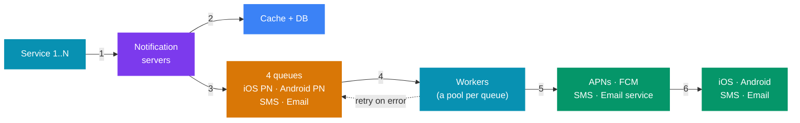
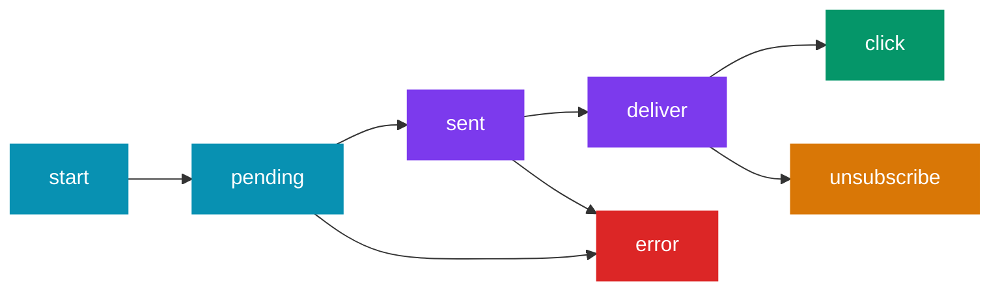
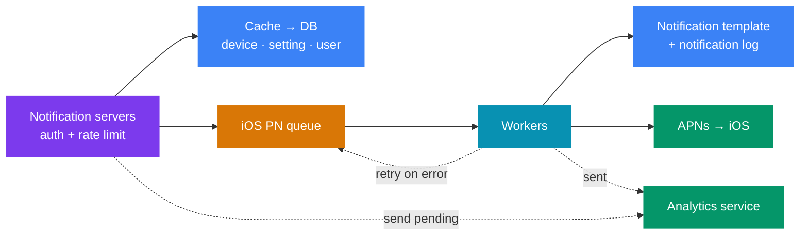
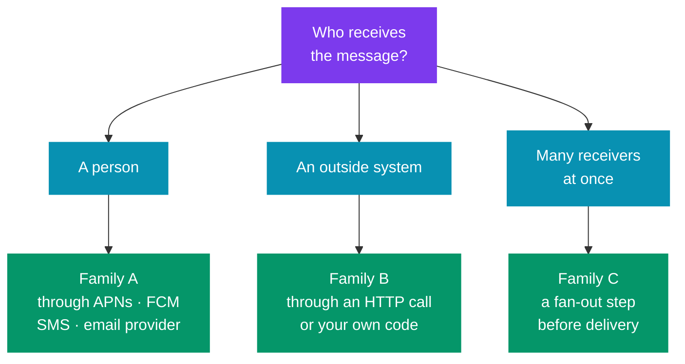

# Ch 10: Design a Notification System

> 📖 **Vol 1, Chapter 10** (book pages 151–165) &nbsp;·&nbsp; 🔥🔥 Very High Priority &nbsp;·&nbsp; 💬 **24 Questions**  
> **Source:** Alex Xu, *System Design Interview Vol 1*, Ch 10. Page and figure numbers below are the book's. This PDF edition prints no page numbers in the footer, so pages are the PDF page numbers (the chapter starts on page 151).

---

📊 **Question Count**

| # | Section | Questions |
|---|---|---|
| 1 | [Requirements and Scope ⚡](#1--requirements-and-scope-p151152-) | 1 |
| 2 | [Notification Types and Third-party Services 🔥](#2--notification-types-and-third-party-services-p153155-) | 1 |
| 3 | [Contact Info Gathering ⚡](#3--contact-info-gathering-p155156-) | 1 |
| 4 | [Initial High-level Design and Its Problems 🔥](#4--initial-high-level-design-and-its-problems-p156157-) | 1 |
| 5 | [Improved High-level Design 🔥🔥](#5--improved-high-level-design-p157159-) | 5 |
| 6 | [Reliability — No Data Loss, Dedupe 🔥🔥](#6--reliability--no-data-loss-dedupe-p160-) | 2 |
| 7 | [Additional Components 🔥](#7--additional-components-p160162-) | 8 |
| 8 | [Updated Design and Wrap-up 🔥](#8--updated-design-and-wrap-up-p162164-) | 4 |
| 9 | [Similar Problems This Design Solves 📎 🔥](#9--similar-problems-this-design-solves--) | 1 |
| | **Total** | **24** |

> 🔥🔥 Very high priority — asked in almost every Tier-1 interview loop &nbsp;·&nbsp; 🔥 High priority — very frequent in Tier-1 interviews &nbsp;·&nbsp; ⚡ Medium priority — commonly asked &nbsp;·&nbsp; 💤 Low priority — good to know, rarely asked

> **How to read this note.** Sections 1–8 follow the book, step by step (Step 1 → Step 4). §9, at the end, maps this design to 13 similar problems. Anything the book does not say is marked **📎 Beyond the book**. Where the book has a mistake, the note says so and gives the fix.  
> Related notes: per-user limits are built in [Ch 4, the rate limiter](ch04_design_a_rate_limiter.md). Unique event IDs come from [Ch 7, the unique ID generator](ch07_design_unique_id_generator.md). Kafka itself is in [the Kafka Q&A note](../../iq/04_Kafka_Interview_Questions.md).

---

## 🗒️ Cheat Sheet

<details>
<summary><strong>🗒️ Show cheat sheet</strong></summary>

### 🎯 Clarifying Questions — and the book's answers
| Question | Book's answer (p.152) |
|---|---|
| Which notification types? | **Push notification, SMS message, and email** |
| Is it a real-time system? | **Soft real-time.** Deliver as soon as possible. A slight delay under high load is fine |
| Which devices? | **iOS, Android, and laptop/desktop** |
| What triggers a notification? | **Client applications**, or a **schedule on the server side** |
| Can users opt out? | **Yes.** An opted-out user gets no more notifications |
| How many per day? | **10 million push, 1 million SMS, 5 million emails** |

### 🏗️ Core Components (Figure 10-10, p.158)
- **Service 1 to N** — any micro-service, cron job or distributed system that wants to send a notification.
- **Notification servers** — internal API, basic validation, read user and device data, put events on queues. Many of them, with automatic horizontal scaling.
- **Cache** — user info, device info and notification templates.
- **DB** — user, notification and settings data.
- **Message queues** — **one per notification type**: iOS PN, Android PN, SMS queue, Email queue.
- **Workers** — pull events from a queue and call the third-party service. On error, the event goes back on the queue.
- **Third-party services** — APNs (iOS), FCM (Android), an SMS service (Twilio, Nexmo), an email service (Sendgrid, Mailchimp).
- **Added in the updated design (Figure 10-14):** authentication and rate limiting on the servers, a notification template store, a notification log DB, and an analytics service.

### 🗃️ Book schema (Figure 10-8 and p.161)
```
user                         device                        notification setting
user_id      bigint (PK)     id                bigint (PK) user_id  bigInt
email        varchar         device_token      varchar     channel  varchar   # push, email or SMS
country_code integer         user_id           bigint (FK) opt_in   boolean   # opted in to receive
phone_number integer   ⚠️    last_logged_in_at timestamp
created_at   timestamp
```
One user has **many devices** (1 → *). A push goes to all of them (p.156). See the Book bug on `phone_number` in §3.

### 💡 Key Insights
1. **Queues are the heart of the design.** They decouple the servers from slow third-party services. They also act as a buffer at peak load (p.159).
2. **One queue per notification type.** An outage at one provider then does not affect the other types (p.159).
3. **Never lose a notification; a delay or a re-order is fine** (p.160). So persist it in a notification log and retry on failure.
4. **Exactly-once delivery is not possible.** The book dedupes on the **event ID** to make duplicates rare, not impossible (p.160).
5. **Check user settings and rate limits before you send.** Too many notifications make users turn them all off (p.161).

### ⚖️ Trade-offs / Alternatives
| Option | Pro | Con | Book's verdict |
|---|---|---|---|
| One notification server (Figure 10-9) | Simple | SPOF; hard to scale; a performance bottleneck | ❌️ Replaced (p.157) |
| DB and cache inside the server | Fewer moving parts | Cannot scale them on their own | ❌️ Move them out (p.157) |
| Servers call providers directly | Simple | A slow provider blocks the server | ❌️ Add message queues (p.157) |
| One queue for all types | Simpler | One provider outage blocks all types | ❌️ One queue per type (p.159) |
| Exactly-once delivery | No duplicates | Not possible in a distributed system | ❌️ Dedupe by event ID instead (p.160) |
| Own email servers | Full control | Worse delivery rate, no analytics | Many choose a **commercial** service (p.154) |
| One fixed provider per channel | Simple | A provider may be missing in a market (FCM in China) | ✅ Build for **extensibility** — plug providers in and out (p.157) |
| 📎 Kafka vs RabbitMQ | Kafka: replay, high throughput. RabbitMQ: per-message ack, built-in DLX (delayed delivery needs a plugin, or the TTL + DLX trick) | — | Book does not choose. It says "message queue" |

### 🔢 Numbers to Remember
| What | Value | Arithmetic |
|---|---|---|
| Daily volume (book) | **16M / day** | 10M push + 1M SMS + 5M email |
| 📎 Average rate | **~185 / s** | 16,000,000 ÷ 86,400 s ≈ 185 |
| 📎 Per channel | push **~116/s**, email **~58/s**, SMS **~12/s** | 10M ÷ 86,400; 5M ÷ 86,400; 1M ÷ 86,400 |
| 📎 Peak | **~1,000 / s** | Assume 5× the average: 185 × 5 ≈ 925 |
| 📎 Notification log size | **~16 GB/day, ~5.8 TB/year** | 16M × ~1 KB = 16 GB; × 365 = 5,840 GB |
| 📎 Dedupe keys in Redis | **~3.2 GB** | 48 h TTL → 2 × 16M = 32M keys × ~100 B |
| Book's queues / flow steps | **4 queues, 6 steps** | iOS PN, Android PN, SMS, Email (Figure 10-10) |
| 📎 APNs / FCM payload limit | **4 KB** each | 4,096 bytes |
| 📎 SMS segment | **160** chars (GSM-7) · **70** (Unicode) | Long SMS splits into 153 / 67-char parts, each billed |
| 📎 Dead-token errors | APNs **400 BadDeviceToken**, **410 Unregistered**; FCM **UNREGISTERED** (404) | Delete the token on these |
| 📎 Kafka default retention | **7 days** | `log.retention.hours=168` |

### ⏱️ 45-Minute Round Plan
| Minutes | Phase | What to say or draw | Trap to avoid |
|---|---|---|---|
| 0–5 | Clarify | Types, soft real-time, devices, triggers, opt-out, 16M/day | Designing only mobile push |
| 5–10 | Notification types | Provider → APNs / FCM / SMS / email service → device. Device token + payload | Saying "we send push ourselves" — you always go through APNs/FCM |
| 10–15 | Contact info | Collect on install / sign-up. `user` and `device` tables, 1 → many | Storing one token per user |
| 15–25 | High-level design | One server first → name its 3 problems → servers + cache/DB + **4 queues** + workers | Jumping to the final design with no reason |
| 25–38 | **Deep dive** | Notification log + retry; no exactly-once → dedupe by event ID; templates; settings; rate limit; security | Promising exactly-once |
| 38–45 | Wrap-up | Monitor queue depth; events tracking; Figure 10-14 | Forgetting what happens when a provider is down (§7 Q6) |

> 📎 The timings are a suggestion, not from the book. The book gives the steps; the minutes are ours.

---

</details>
<br/>

---

## 1. 📋 Requirements and Scope (p.151–152) ⚡

A notification alerts a user with important information, like breaking news, product updates, events or offers (p.151). It is more than a mobile push. The book uses **three formats** (Figure 10-1):

- **Mobile push notification**
- **SMS message**
- **Email**

**Step 1 — the clarifying questions** are in the Cheat Sheet table (p.152). The book calls the question "open-ended and ambiguous on purpose". Asking these questions is your job.

What the answers mean for the design:

- **Soft real-time** → a queue in the middle is fine. A short delay at peak is allowed.
- **Many device types** → one user can have many devices. Store a token for each.
- **Triggered by apps or by a server-side schedule** → the API must accept calls from many internal services and cron jobs.
- **Opt-out** → check a settings table before every send.
- **16M per day** → about 185 per second on average (see the numbers table). The load is not huge. The hard parts are **reliability** and **slow third parties**, not raw throughput.

### ❓ Interview Questions

1. **What do you clarify first, and what scale do you design for? ⚡**

<!-- -->
<details>
<summary>💡 Show Answer</summary>

**Answer:**

The book's questions (p.152):

- **Types:** push, SMS, email.
- **Real-time?** Soft real-time — fast, but a slight delay under load is fine.
- **Devices:** iOS, Android, laptop/desktop.
- **Triggers:** client apps, or a server-side schedule.
- **Opt-out:** yes.
- **Volume:** 10M push + 1M SMS + 5M email per day.

📎 The maths: 16M ÷ 86,400 ≈ **185/s** on average. At 5× peak, about **1,000/s**. That is small for the servers and queues. So the hard parts are **slow, failing third parties** and **not losing or repeating** notifications.

</details>

---

## 2. 📱 Notification Types and Third-party Services (p.153–155) 🔥

**Step 2** has three parts (p.153): the notification types, the contact info gathering flow, and the sending/receiving flow.

### iOS push notification (Figure 10-2)

Three components:

- **Provider** — builds and sends the notification request to **APNs** (Apple Push Notification service). It needs two things:
  - **Device token** — a unique ID used to send push notifications.
  - **Payload** — a JSON dictionary with the notification content.
- **APNs** — Apple's remote service. It sends push notifications to iOS devices.
- **iOS device** — the end client that receives the push.

The book's payload example (p.153):

```json
{
  "aps": {
    "alert": {
      "title": "Game Request",
      "body": "Bob wants to play chess",
      "action-loc-key": "PLAY"
    },
    "badge": 5
  }
}
```

### Android push notification (Figure 10-3)

The same flow. **Firebase Cloud Messaging (FCM)** takes the place of APNs.

### SMS message (Figure 10-4)

Use a third-party SMS service such as **Twilio** or **Nexmo**. Most of them are commercial (p.154).

### Email (Figure 10-5)

A company can run its own email servers. But many choose a commercial service. **Sendgrid** and **Mailchimp** are popular. They give a **better delivery rate** and **data analytics** (p.154).

**Figure 10-6** puts all four third-party services side by side: APNs → iOS, FCM → Android, SMS service → SMS, email service → email.

> 📎 **Why you cannot skip APNs or FCM.** The phone keeps one connection open to Apple or Google, not to every app server. So your server never talks to the phone directly for a push. It always goes through the platform service.

### ❓ Interview Questions

1. **How does a push notification reach an iPhone? What does the provider need to send? ⚡**

<!-- -->
<details>
<summary>💡 Show Answer</summary>

**Answer:**

**Provider → APNs → iOS device** (Figure 10-2). The provider (our worker) sends two things to APNs:

- **Device token** — the unique ID of the app on that device.
- **Payload** — a JSON dictionary. The book's example has `aps.alert.title`, `aps.alert.body` and `badge`.

Android is the same, with **FCM** instead of APNs (Figure 10-3).

SMS and email go through commercial providers: **Twilio** or **Nexmo** for SMS, **Sendgrid** or **Mailchimp** for email. They give a better delivery rate and analytics (p.154).

📎 The APNs and FCM payload limit is **4 KB**. So send a short message plus an ID. The app fetches the full content when the user opens it.

</details>

---

## 3. 📇 Contact Info Gathering (p.155–156) ⚡

To send anything, you need **device tokens, phone numbers or email addresses** (p.155).

**The flow (Figure 10-7):** the user installs the app or signs up → load balancer → **API servers** collect the contact info → store it in the **DB**.

**The tables (Figure 10-8):**

- **`user`** — `user_id`, `email`, `country_code`, `phone_number`, `created_at`. Email and phone live here.
- **`device`** — `id`, `device_token`, `user_id`, `last_logged_in_at`. Device tokens live here.
- One user → **many devices**. A push can go to all of the user's devices (p.156).

> ⚠️ **Book bug — `phone_number integer`.** Figure 10-8 stores the phone number as `integer`. A 32-bit integer holds at most 2,147,483,647. A 10-digit Indian number like 9,876,543,210 does not fit. An integer also drops leading zeros. The fix: store it as `varchar` in **E.164** form (`+919876543210`, at most 15 digits). Then `country_code` is part of the string.

📎 **Token lifecycle** (not in the book):

- The app gets a token from APNs/FCM on install, and sends it to our API.
- Tokens change. The app sends the new one on refresh, and on each login.
- On logout, delete the token for that device.
- After an uninstall, the next send fails. APNs returns `400 BadDeviceToken` or `410 Unregistered`. FCM returns `UNREGISTERED`. Delete the token then.
- `last_logged_in_at` lets you clean up devices that have not been used for months.

📎 A real `device` table also needs a **platform** column (`IOS` / `ANDROID`). The worker must know whether to call APNs or FCM. The book's table does not have one.

### ❓ Interview Questions

1. **How do you collect and manage device tokens and contact info? ⚡**

<!-- -->
<details>
<summary>💡 Show Answer</summary>

**Answer:**

**The book** (Figures 10-7 and 10-8):

- On app install or sign-up, the API servers collect the contact info and store it in the DB.
- Email and phone go in the **`user`** table.
- Device tokens go in the **`device`** table: `id`, `device_token`, `user_id`, `last_logged_in_at`.
- One user has **many devices**, so a push can go to all of them.

📎 **Token lifecycle:**

- The app sends a new token whenever it changes (refresh, reinstall, login).
- On logout, delete that device's token.
- When APNs returns `400 BadDeviceToken` or `410 Unregistered`, or FCM returns `UNREGISTERED`, delete the token.
- Add a `platform` column, so the worker knows to call APNs or FCM.
- Store the phone as `varchar` in E.164 form, not `integer` (see the Book bug in §3).

</details>

---

## 4. 🧱 Initial High-level Design and Its Problems (p.156–157) 🔥

The book starts simple, then improves it (p.156).

**Figure 10-9:**

- **Service 1 to N** — a micro-service, a cron job or a distributed system that triggers a notification. Examples: a billing service emails a payment reminder; a shopping site sends an SMS that a package arrives tomorrow.
- **Notification system** — at first, **one notification server**. It gives APIs to services 1 to N. It builds the payloads for the third-party services.
- **Third-party services** — deliver the notification. Design them for **extensibility**: it must be easy to plug a provider in or out. A provider may not exist in a new market. Example: **FCM is not available in China**, so services like **Jpush** or **PushY** are used there (p.157).
- **iOS, Android, SMS, Email** — the users' devices.

**Three problems with this design** (p.157):

| Problem | Why |
|---|---|
| **Single point of failure** | One notification server. If it dies, nothing is sent |
| **Hard to scale** | Everything is in one server. You cannot scale the DB, the cache and the processing parts on their own |
| **Performance bottleneck** | Building HTML pages and waiting for third-party replies takes time. At peak hours, one system gets overloaded |

> 📎 **Extensibility in Java terms:** one `NotificationSender` interface per channel, with one class per provider (`TwilioSmsSender`, `NexmoSmsSender`). Config picks the provider per market. This is the Strategy pattern.

### ❓ Interview Questions

1. **What is wrong with a design that has a single notification server? 🔥**

<!-- -->
<details>
<summary>💡 Show Answer</summary>

**Answer:**

The book names **three problems** (p.157):

- **Single point of failure** — one server down means no notifications.
- **Hard to scale** — the DB, cache and processing parts cannot scale on their own.
- **Performance bottleneck** — building HTML and waiting for third parties is slow. At peak, the one server is overloaded.

**The three fixes** (p.157):

- Move the **DB and cache out** of the server.
- Add **more servers** with **automatic horizontal scaling**.
- Add **message queues** between the servers and the senders.

</details>

---

## 5. 📬 Improved High-level Design (p.157–159) 🔥🔥

**Three changes** fix the three problems (p.157):

- Move the **database and cache out** of the notification server.
- Add **more notification servers** with **automatic horizontal scaling**.
- Add **message queues** to decouple the components.



### The components, left to right (Figure 10-10, p.158–159)

- **Service 1 to N** — send notifications through the notification servers' APIs.
- **Notification servers:**
  - Give APIs to send notifications. Only **internal** or **verified** clients can call them, to stop spam.
  - Do **basic validation** of emails, phone numbers, and so on.
  - Query the DB or cache for the data needed to **render** a notification.
  - Put notification data on **message queues** for parallel processing.
- **Cache** — user info, device info, notification templates.
- **DB** — user, notification, settings, and so on.
- **Message queues** — remove dependencies between components. They act as **buffers** when many notifications go out at once. **Each notification type has its own queue**, so an outage at one provider does not affect the other types.
- **Workers** — servers that pull events from the queues and send them to the matching third-party service.

### The book's API example (p.158–159)

```
POST https://api.example.com/v/sms/send
```
```json
{
  "to": [
    { "user_id": 123456 }
  ],
  "from": { "email": "from_address@example.com" },
  "subject": "Hello, World!",
  "content": [
    { "type": "text/plain", "value": "Hello, World!" }
  ]
}
```

> ⚠️ **Book bug — the email API has an SMS path.** Page 158 says "an example of the API to send an **email**". The body is an email (`from.email`, `subject`, `content`). But the URL is `/v/sms/send`. The fix: `POST /v1/email/send`. Note that the caller sends a `user_id`, not an address. The server looks up the email.

### The six-step flow (p.159)

1. A service calls the notification servers' API.
2. The notification servers fetch **metadata** — user info, device token, notification setting — from the cache or DB.
3. The servers put a notification event on the **matching queue**. An iOS push goes to the **iOS PN** queue.
4. Workers pull events from the queues.
5. Workers send the notifications to the third-party services.
6. The third-party services deliver to the user devices.

> 📎 **Why the server does the lookup, not the worker.** The caller only knows a `user_id`. The server turns that into tokens, an address and a phone number. It also drops opted-out channels. So the queue only holds work that must really be sent.

### ❓ Interview Questions

1. **Why use a separate message queue for each notification type? 🔥**

<!-- -->
<details>
<summary>💡 Show Answer</summary>

**Answer:**

**The book's reason** (p.159): **an outage at one third-party service does not affect the other types.** If the SMS provider is down, SMS events pile up in the SMS queue. iOS push keeps flowing.

📎 More reasons:

- Each channel has a different speed and cost. SMS is slow and costs money; push is fast and free.
- Each worker pool scales on its own, based on its own queue depth.
- With one shared queue, a slow channel blocks the fast ones. This is **head-of-line blocking**: one slow message at the front holds up all messages behind it.

The cost: more queues and worker pools to run.

</details>

---

2. **How is this different from calling the email provider directly inside the service? 📎 ⚡**

<!-- -->
<details>
<summary>💡 Show Answer</summary>

**Answer:**

With a direct call, the service depends on the provider. Say Sendgrid is slow and the timeout is 5 seconds. Then each request that sends an email can take up to 5 seconds longer. If Sendgrid is down, the request may fail.

With the notification system, the service makes one fast internal call (or publishes an event) and moves on. Then:

- Delivery happens in the background.
- Retry logic lives in one place.
- Provider failures stay inside the workers.

This is the book's own reason for queues: decoupling (p.164).

</details>

---

3. **How do you make an OTP go out before a marketing blast? 📎 🔥**

<!-- -->
<details>
<summary>💡 Show Answer</summary>

**Answer:**

Kafka has **no priority mechanism** of its own (no priority queues, no per-message priority). So **one topic per priority** is the real answer, not a second-best one:

- `notification-critical` — OTPs, fraud alerts.
- `notification-marketing` — promotions.

Give the critical topic its **own worker pool**, so a big campaign cannot delay it. Callers tag each event with a priority, and the notification servers route it to the right topic.

RabbitMQ does support per-message priority on a queue. Separate queues still give stronger isolation.

</details>

---

4. **How would you add a new channel, such as WhatsApp? 📎 ⚡**

<!-- -->
<details>
<summary>💡 Show Answer</summary>

**Answer:**

1. Add a new queue (for example `notification-whatsapp`).
2. Add a worker pool that reads it and calls the WhatsApp Business API.
3. Add `whatsapp` as a channel in the contact info and the notification setting table.
4. Teach the notification servers to route WhatsApp events to the new queue.

Calling services do not change. This is the book's **extensibility** point (p.157): plug a provider in or out without touching the rest.

</details>

---

5. **A calling service times out and retries the API call. How do you stop a double send? 📎 🔥**

<!-- -->
<details>
<summary>💡 Show Answer</summary>

**Answer:**

Event-ID dedupe (§6) does not help here. Each API call creates new events with **new** event IDs. So the two calls look like two different notifications.

The fix is an **idempotency key** from the caller:

- The caller sends an `Idempotency-Key` header, for example `payment-reminder:<loan_id>:<due_date>`. It sends the same key on every retry.
- The notification server saves the key, with a TTL of about 24 hours, before it creates any events.
- Key already there → return the first response (stored with the key). Create no new events.
- Save the key and the notification row in **one DB transaction** (a unique column on the key). Then a crash cannot leave a saved key with no notification, and two racing calls cannot both win.

Payment APIs use the same idea (Stripe's `Idempotency-Key` header). It works together with §6: the key stops a double **request**; the event ID stops a double **delivery**.

</details>

---

## 6. 🔒 Reliability — No Data Loss, Dedupe (p.160) 🔥🔥

**Step 3** — the deep dive — covers reliability, the additional components, and the updated design (p.160).

### How to prevent data loss?

A notification system **must not lose data**. A notification can be **delayed or re-ordered, but never lost** (p.160).

The book's answer:

- **Persist** notification data in a database — the **notification log** (Figure 10-11: iOS PN queue → workers → APNs, with workers writing to the notification log).
- **Retry** on failure.

### Will a recipient get a notification exactly once?

**No** (p.160). It is exactly once **most of the time**. But a distributed system can produce **duplicates**. To make them rare, the book adds a **dedupe** step and handles each failure case with care:

- When an event first arrives, check its **event ID**.
- Seen before → **discard** it.
- Not seen → **send** the notification.

The book points to "You Cannot Have Exactly-Once Delivery" (reference [5]) for why.

📎 **One event ID per delivery, not per notification.** The server fans one notification out to every device and channel. If all those events share one ID, dedupe sends the first one and **discards the rest**. So build the ID from `notification_id + channel + device_token` (the email address or phone number for email and SMS).

> ⚠️ **Book inconsistency — dedupe vs retry.** The book checks the event ID "when the event first arrives". It does not say when the ID is marked as seen. If you mark it on arrival, a retried event (put back on the queue, §7) has the same ID and gets **discarded**. That loses the notification, which breaks "never lost". The fix: mark the ID only **after a successful send**, in the notification log or in Redis.

📎 **A worker in Spring Kafka.** Dedupe after the send, and acknowledge last:

```java
@KafkaListener(topics = "ios-pn", groupId = "ios-workers")
public void onEvent(NotificationEvent event, Acknowledgment ack) {
    String key = "notif:sent:" + event.eventId();
    if (Boolean.TRUE.equals(redis.hasKey(key))) {
        ack.acknowledge();   // seen before → discard
        return;
    }
    String body = templates.render(event.templateId(), event.params());
    apnsClient.send(event.deviceToken(), body);   // throws → error handler retries (see below)
    redis.opsForValue().set(key, "1", Duration.ofHours(48));
    notificationLog.markSent(event.eventId());
    ack.acknowledge();
}
```

📎 **The retry is not free — configure it.** Spring Kafka's `DefaultErrorHandler` uses `FixedBackOff(0, 9)` by default. That is 10 tries with **no wait**, and then it **logs and skips** the record. So a provider outage longer than a moment loses the notification. Set an exponential backoff and a `DeadLetterPublishingRecoverer` (or use `@RetryableTopic`). Then a record that still fails goes to a dead letter topic, not to the log. The `Acknowledgment` parameter also needs `AckMode.MANUAL` on the listener container.

📎 **Why duplicates still happen.** The worker can crash **after** `send` and **before** it writes the key. The retry then sends again. You can shrink this window, but not close it. APNs gives no "already delivered" check. So: at-least-once delivery, plus dedupe to make duplicates rare.

📎 Use **one Redis key per event ID** with a TTL. A single big Redis set cannot expire one member at a time.

### ❓ Interview Questions

1. **How do you make sure no notification is lost? 🔥🔥**

<!-- -->
<details>
<summary>💡 Show Answer</summary>

**Answer:**

The book's rule: a notification can be **delayed or re-ordered, but never lost** (p.160). Two tools:

- **Persist it** — workers write to a **notification log** database (Figure 10-11).
- **Retry** — on failure, put the event back on the queue (p.161). After a fixed number of tries, alert the developers.

📎 Close the other gaps too:

- **Queue durability** — Kafka with replication factor 3, `min.insync.replicas=2` and `acks=all`. `acks=all` alone is not enough. The default `min.insync.replicas` is 1. If the other replicas fall behind, the leader alone counts as "all", and a leader crash loses the message. (Since Kafka 3.0, `acks=all` is already the producer default.)
- **Commit after send** — the worker commits the offset only after the provider accepts the message.
- **The caller's side** — if a service writes to its DB and then calls our API, a crash between the two loses the event. Use the **transactional outbox** pattern there.

</details>

---

2. **Can you guarantee exactly-once delivery? How do you prevent duplicate notifications? 🔥🔥**

<!-- -->
<details>
<summary>💡 Show Answer</summary>

**Answer:**

**No** (p.160). It is exactly once most of the time, but a distributed system can produce duplicates. The book makes them rare with a **dedupe** step:

- Each event has an **event ID**.
- When an event arrives, check whether the ID was seen before.
- Seen → discard. Not seen → send.

📎 How to build it:

- The ID is per **delivery**: `notification_id + channel + device_token`. If a user's 3 devices share one ID, dedupe drops 2 of the 3 pushes.
- Use **one Redis key per event ID** with a TTL of 24–48 hours. A big Redis set cannot expire single members.
- Mark the ID **after** a successful send. If you mark it on arrival, a retry is discarded and the notification is lost (see the Book inconsistency above).
- A worker can still crash after the send and before it marks the ID. The retry then sends again. So dedupe **reduces** duplicates; it cannot remove all of them.

</details>

---

## 7. 🧩 Additional Components (p.160–162) 🔥

A notification system is more than "send" (p.160). The book adds seven parts.

### Notification template (p.161)

Many notifications share a format. A **template** is a ready-made notification. You fill in parameters, styling and tracking links. The book's push example:

```
BODY:
You dreamed of it. We dared it. [ITEM NAME] is back — only until [DATE].
CTA:
Order Now. Or, Save My [ITEM NAME]
```

**Benefits:** a consistent format, fewer errors, and saved time.

### Notification setting (p.161)

Users get too many notifications and feel overwhelmed. So apps give **fine-grained control**. The book's **notification setting** table:

```
user_id  bigInt
channel  varchar   # push notification, email or SMS
opt_in   boolean   # opt-in to receive notification
```

Before **any** notification is sent, check that the user is opted in.

> ⚠️ **Book inconsistency — channel vs type.** The text says to check if the user opted in "to this **type** of notification". But the table has only `channel`. It cannot say "marketing push off, order-update push on". 📎 The fix: add a `notification_type` column (or category) to the key: `(user_id, channel, notification_type) → opt_in`.

### Rate limiting (p.161)

Limit how many notifications one user can get. If you send too often, users may **turn off notifications completely**. 📎 The algorithms are in [Ch 4](ch04_design_a_rate_limiter.md). A counter per `user_id + channel + window` in Redis works.

### Retry mechanism (p.161)

When a third-party service fails, the notification is **added back to the message queue** to retry. If the problem **persists**, an **alert** goes to developers.

📎 In practice: retry with **exponential backoff** (1 s, 2 s, 4 s …). Stop after a fixed number of tries (often 5–10). Then move the event to a **dead letter queue (DLQ)** and alert. In Kafka you can publish the message again to the same topic, but it goes to the **end**, with no delay. A consumer near the end reads it again almost at once, so it retries in a tight loop. So use a **retry topic** with a delay, or pause and seek back to the failed offset.

### Security in push notifications (p.161)

For iOS and Android apps, an **appKey** and **appSecret** secure the push notification APIs. Only **authenticated or verified clients** can send push notifications through our APIs. (Reference [6] is IBM's push notification docs.)

### Monitor queued notifications (p.161–162)

The key metric is the **total number of queued notifications**. A large number means workers are too slow. Add **more workers** to avoid delay. Figure 10-12 is a "queued messages" chart from RabbitMQ.

📎 In Kafka this metric is **consumer lag**. Scale the worker pool on lag. In a classic consumer group, more consumers than partitions do not help, so plan the partition count ahead. But a worker mostly waits on the network. So one consumer can send many requests at the same time. APNs and FCM use HTTP/2, which runs many requests over one connection. At ~1,000/s, the partition count is rarely the limit.

### Events tracking (p.162)

Open rate, click rate and engagement show how customers behave. An **analytics service** does events tracking. It must be integrated with the notification system. **Figure 10-13** shows the events:



> 📎 **"Delivered" is not always known.** APNs accepting a request does not mean the phone showed it. Email "delivered" means the receiving server accepted it. "Open" for email needs a tracking pixel. Clicks need a redirect link.

📎 **Provider callbacks fill part of the gap.** Twilio status callbacks and SendGrid or SES event webhooks report delivered, failed and bounced. Feed them into the notification log, so each row shows its real state.

### ❓ Interview Questions

1. **How do notification templates work? 💤**

<!-- -->
<details>
<summary>💡 Show Answer</summary>

**Answer:**

**The book** (p.161): a template is a ready-made notification. You fill in parameters, styling and tracking links. Example: "[ITEM NAME] is back — only until [DATE]". **Benefits:** a consistent format, fewer errors, saved time. Templates are **cached** (p.159), and workers read them (Figure 10-14).

📎 At scale:

- Version the templates (for example `order_confirmed_v3`).
- Use variables such as `{{user_name}}` and `{{order_id}}`.
- Changes go through a review step.
- Non-engineers can then change the text without a deploy, and you can A/B test versions.

</details>

---

2. **How do you handle user notification settings and opt-out? ⚡**

<!-- -->
<details>
<summary>💡 Show Answer</summary>

**Answer:**

**The book** (p.161): a **notification setting** table — `user_id`, `channel` (push, email or SMS), `opt_in` (boolean). Before any notification is sent, check that the user is opted in.

📎 Make it better:

- Add a **notification type** to the key (marketing vs order updates). The book's table has only the channel.
- Add **quiet hours** (for example 10 pm to 8 am) in the **user's own time zone**. Store the time zone on the user as an IANA name like `Asia/Kolkata`. A message that arrives in quiet hours is delayed, not dropped — except OTPs and alerts.
- Check settings in the **notification servers**, before the queue. Then filtered-out messages never reach a worker.
- Cache the settings (the book caches user and device info, p.159).

</details>

---

3. **How do you make sure a user is not spammed by notifications? ⚡**

<!-- -->
<details>
<summary>💡 Show Answer</summary>

**Answer:**

**The book** (p.161): **rate limit** the notifications per user. If you send too often, users turn off notifications completely. In Figure 10-14, rate limiting lives in the **notification servers**.

📎 How:

- A cap per user and channel. For example: at most 10 pushes per hour, at most 5 SMS per day.
- A counter in Redis keyed by `user_id + channel + window` ([Ch 4](ch04_design_a_rate_limiter.md)).
- Over the cap → drop it, or delay it to the next window.
- Never rate-limit critical messages like an OTP the user just asked for.
- For campaigns, dedupe per `campaign_id + user_id`. Then a user never gets the same campaign twice.

</details>

---

4. **What is the difference between transactional and marketing notifications? 📎 ⚡**

<!-- -->
<details>
<summary>💡 Show Answer</summary>

**Answer:**

- **Transactional** (OTP, payment confirmation, order update): triggered by an event, expected by the user, high priority. They must arrive fast and reliably.
- **Marketing** (promotions, win-back): sent in bulk, scheduled, low priority. They must follow user settings and the law. That means CAN-SPAM and GDPR. In India, the TRAI rules say commercial SMS needs registered (DLT) templates and sender IDs.

So the two use different queues, worker pools, rate limits and send windows. Marketing respects quiet hours; an OTP does not.

</details>

---

5. **How do you handle notification delivery failures? 🔥🔥**

<!-- -->
<details>
<summary>💡 Show Answer</summary>

**Answer:**

**The book** (p.161, p.163):

- When a third party fails, the notification goes **back on the message queue**.
- Workers retry a **predefined number of times**.
- If the problem persists, **alert** the developers.

📎 In practice:

- Retry with **exponential backoff** (1 s, 2 s, 4 s, 8 s …).
- After 5–10 tries, move the event to a **dead letter queue (DLQ)**. Alert on DLQ size.
- After the provider recovers, replay the DLQ.
- Do **not** retry errors that can never succeed. A `410 Unregistered` means "delete the token", not "try again".
- In Kafka, a message you publish again goes to the **end** of the topic, with no delay. So it is retried almost at once. Use a **retry topic** with a delay (Spring's `@RetryableTopic`), or pause the consumer and seek back to the failed offset.

</details>

---

6. **What happens when a third-party provider (for example APNs) is down, or is not available in a market? 🔥**

<!-- -->
<details>
<summary>💡 Show Answer</summary>

**Answer:**

**The book:**

- Each type has its **own queue**, so only that type is affected (p.159).
- Failed sends go back on the queue for retry; long failures raise an alert (p.161).
- Design for **extensibility** — plug providers in and out. **FCM is not available in China**, so apps use **Jpush** or **PushY** there (p.157).

📎 During the outage:

- Workers back off. Events wait in the queue. Kafka keeps messages for the retention period (7 days by default), so nothing is lost.
- The worker must stop at the failed message (pause, or seek back to it). A Kafka consumer reads an uncommitted message again only after a restart or a rebalance.
- Put a **circuit breaker** (for example Resilience4j) around each provider client. After many failures it stops calls for a short time. Workers then fail fast, instead of each one waiting for a timeout.
- **Throttle outbound calls** to each provider's own rate limit, with a token bucket in the worker pool. SMS providers set a rate limit per account and reject requests above it.
- For SMS and email, keep a **second provider** and fail over to it.
- For a very long outage, fall back to another channel (push down → send email), if the message allows it.

</details>

---

7. **How do you secure the notification APIs? ⚡**

<!-- -->
<details>
<summary>💡 Show Answer</summary>

**Answer:**

**The book:**

- The send APIs are only for **internal** or **verified** clients, to stop spam (p.158).
- For iOS and Android apps, an **appKey** and **appSecret** secure the push APIs. Only authenticated clients can send (p.161).
- In Figure 10-14, **authentication** sits in the notification servers.

📎 Also:

- Keep APNs and FCM credentials (APNs key, FCM service account) in a secret store, not in code.
- Use **service-to-service auth** (mTLS or signed tokens) for internal callers.
- Validate and escape template variables, so a user's name cannot inject HTML into an email.

</details>

---

8. **How do you monitor the system and track opens and clicks? ⚡**

<!-- -->
<details>
<summary>💡 Show Answer</summary>

**Answer:**

**Monitoring** (p.161): watch the **total number of queued notifications**. A large number means workers are too slow. Add more workers.

**Events tracking** (p.162): an **analytics service** tracks open rate, click rate and engagement. Figure 10-13 shows the event states: **start → pending → sent → deliver → click / unsubscribe**, with **error** from pending or sent. In Figure 10-14, the servers report "send pending", the workers report "sent", and the device reports **click tracking**.

📎 How:

- In Kafka, queue size is **consumer lag**. Alert on it and scale workers on it.
- Each notification carries a unique ID.
- Clicks go through a **redirect link**. Email opens use a **tracking pixel**.
- A batch or stream job (Spark, Flink) computes delivery rate, open rate and CTR.
- **Provider callbacks** (Twilio status callbacks, SendGrid or SES webhooks) report delivered, failed and bounced. They update the notification log.
- On a **hard bounce** (the address does not exist), put the address on a **suppression list** and stop sending to it. Many bounces hurt the sender reputation, and then good email lands in spam.
- Alert on consumer lag, error rate per provider, DLQ size, and a drop in delivery rate.

</details>

---

## 8. 📈 Updated Design and Wrap-up (p.162–164) 🔥

**Figure 10-14** puts everything together (shown for iOS):



In the figure, "Service N" calls the servers, and the iOS device sends **click tracking** to the analytics service.

**What is new compared with Figure 10-10** (p.163):

- The notification servers get **authentication** and **rate limiting**.
- A **retry mechanism**: failed notifications go back on the queue. Workers retry a **predefined number of times**.
- **Notification templates** give a consistent, efficient way to build notifications.
- **Monitoring and tracking** for health checks and future improvements.

### Step 4 — Wrap up (p.164)

The design supports push, SMS and email. It uses **message queues to decouple** the components. The deep-dive points:

- **Reliability** — a robust retry mechanism keeps the failure rate low.
- **Security** — an **appKey/appSecret** pair lets only verified clients send.
- **Tracking and monitoring** — at every stage of the flow.
- **Respect user settings** — check opt-out before sending.
- **Rate limiting** — users like a **frequency cap**.

### ❓ Interview Questions

1. **Walk me through the high-level architecture of a notification system. 🔥🔥**

<!-- -->
<details>
<summary>💡 Show Answer</summary>

**Answer:**

The book's improved design (Figure 10-10), in six steps:

1. A service (billing, shipping, a cron job) calls the **notification servers'** internal API.
2. The servers validate the request. They fetch user info, device tokens and settings from the **cache or DB**.
3. They put an event on the **queue for that type**: iOS PN, Android PN, SMS or Email.
4. **Workers** pull events from the queue.
5. Workers call the third-party service: **APNs, FCM, an SMS service or an email service**.
6. The third party delivers to the user's device.

The deep dive adds these parts (Figure 10-14):

- Auth and rate limiting on the servers.
- A **notification log** and **retry**, for reliability.
- **Dedupe** by event ID.
- **Templates** and **settings**.
- **Monitoring and analytics**.

The design is fully async. The calling service never waits for delivery.

</details>

---

2. **How do you scale this to the book's 16 million notifications a day? 🔥**

<!-- -->
<details>
<summary>💡 Show Answer</summary>

**Answer:**

📎 16M ÷ 86,400 ≈ **185/s** on average, about **1,000/s** at a 5× peak.

**The book's scaling tools** (p.157–159):

- **Stateless notification servers** with automatic horizontal scaling.
- **Cache** for user info, device info and templates. Fewer DB reads on each send.
- **Queues** as a buffer at peak.
- **Workers** added when the queue grows (p.161).

📎 More:

- Partition each queue. In a classic consumer group, the consumer count can grow only up to the partition count. Each consumer can still send many requests at the same time, because it mostly waits on the provider.
- APNs and FCM handle very high throughput. The usual bottleneck is the **SMS provider** (rate limits and cost). Use more than one SMS provider.
- The notification log grows ~16 GB a day (16M × ~1 KB). Partition it by date and archive old data.

</details>

---

3. **How do you send a scheduled campaign to 10 million users? 📎 🔥**

<!-- -->
<details>
<summary>💡 Show Answer</summary>

**Answer:**

The book says notifications can be **scheduled on the server side** (p.152), but not how.

- Store the campaign with its send time in a `campaign` table.
- A **scheduler** (one leader, or a lock such as ShedLock) picks up campaigns that are due.
- It reads the target users in **pages** (for example 10,000 at a time) and publishes events in batches. Never load 10M users into memory.
- Each event has an ID like `campaign_id + user_id`. Dedupe then stops a double send if the scheduler restarts halfway.
- Spread the sends over time, so the SMS provider limits and your own servers are not hit all at once.
- Settings, quiet hours and rate limits still apply to each user.
- "Send at 10 am" means 10 am **in each user's time zone**. So a global campaign goes out in waves, one time zone at a time.

</details>

---

4. **How would you add an in-app notification inbox (the bell icon)? 📎 ⚡**

<!-- -->
<details>
<summary>💡 Show Answer</summary>

**Answer:**

The inbox is one more channel. The difference: it is **stored**, not sent and forgotten.

- Add an `in_app` queue and a worker. The worker writes a row to an `inbox` table: `user_id`, `notification_id`, `title`, `body`, `created_at`, `read_at`.
- **Read path:** `GET /inbox?cursor=…` with **cursor paging**. Index on `(user_id, created_at DESC)`.
- **Unread count:** a counter per user in Redis. Add 1 on insert; set it to 0 on "mark all read". If Redis loses it, rebuild it from the table.
- **Live update:** if the app is open, send the new item over a WebSocket or SSE. If the app is closed, the normal push tells the user.
- **Size:** if every notification goes to the inbox, that is 16M rows a day. Keep about 90 days, then delete or archive.
- Shard by `user_id`, because every read is "my notifications".

</details>

---

## 9. 🧬 Similar Problems This Design Solves 📎 🔥

📎 The book does not list similar problems for this chapter. But the same core solves **at least 13 common interview problems**. Learn the core once, then change only a few parts for each one.

**The core that never changes:**
- **An internal API** that takes the request and returns at once. The caller never waits for delivery.
- **A queue per target type**, each with its own worker pool.
- **Workers** that call a slow, unreliable outside party, with **retry, backoff and a DLQ**.
- **An event ID** for dedupe, and a **log** that holds each delivery's state.
- **Settings and rate limits**, checked before the queue.

**The tag on each problem** says how often it is asked as an HLD round on its own (same legend as the questions). 🔥🔥 = learn its "what is different" column well; 💤 = knowing the family is enough.

**The one choice that splits them into three families:** who receives the message?



### Family A — send to a person through an outside provider (like this chapter)

| # | Problem | What is different from this chapter |
|---|---|---|
| 1 | **Notification system 🔥🔥** (this chapter) | — |
| 2 | **OTP / two-factor login code ⚡** | Its own priority lane (§5 Q3). The code expires (usually in 5–10 minutes), so a retry after that is useless — drop it. Rate limit per phone number, to stop SMS-pumping fraud. Fall back from SMS to a voice call or WhatsApp. No quiet hours |
| 3 | **Email marketing platform (Mailchimp) ⚡** | Bulk sends from a list (§8 Q3). Every email needs an unsubscribe link, by law. Hard bounces go on a suppression list (§7 Q8). Send in waves to protect the sender reputation |
| 4 | **Reminders (EMI due date, calendar event, abandoned cart) ⚡** | The hard part is the timer: millions of future send times. Store them in a table indexed by send time. A poller picks up what is due, one small time bucket at a time. If the event moves, cancel or move the reminder |
| 5 | **Price-drop / back-in-stock alert ("notify me") ⚡** | The trigger is a data change, not a service call. Keep an index from product to subscribers. One change fans out to many users. Send once, then remove the subscription |
| 6 | **Monitoring alerts and on-call paging 🔥** — [Vol 2 Ch 5](../vol_2/ch05_metrics_monitoring_alerting.md) | Escalation: if nobody acknowledges in N minutes, page the next person. Group duplicate alerts into one. It must work while your own system is down, so it needs a separate delivery path |

### Family B — call an outside system, not a person

| # | Problem | What is different from this chapter |
|---|---|---|
| 7 | **Webhook delivery service (Stripe, GitHub, Razorpay) 🔥** | The target is each customer's own URL. Give each endpoint its own queue or limit, so one slow customer cannot block the rest (head-of-line blocking, §5 Q1). Sign each payload (HMAC), so the receiver can trust it. Retry with backoff for hours or days, then disable the endpoint. The **receiver** dedupes by event ID — the same idea as §6 |
| 8 | **Distributed job scheduler / task queue 🔥** | The "provider" is your own code (make a PDF, send an invoice). Same queue, workers, retry and DLQ. Every job must be idempotent. Jobs that run at a set time need a time-indexed table and one leader or a lock (§8 Q3) |
| 9 | **Calls to slow partner APIs (credit bureau, KYC, bank) 💤** | Same worker pool, circuit breaker and throttle to the partner's rate limit (§7 Q6). The caller gets the result later, by a callback or by polling |

### Family C — fan out one event to many receivers

| # | Problem | What is different from this chapter |
|---|---|---|
| 10 | **News feed 🔥🔥** — [Ch 11](ch11_design_news_feed_system.md) | Fan-out on write: workers push the post ID into each follower's feed cache, not to a provider. For a celebrity with millions of followers, use fan-out on read instead |
| 11 | **Chat — push to offline users 🔥🔥** — [Ch 12](ch12_design_a_chat_system.md) | An online user gets the message over a WebSocket. Only an offline user goes through this design: the chat service calls the push notification system |
| 12 | **Live comments / reactions to many viewers ⚡** | The receivers are open connections, not phones. Pub/sub sends each comment to the gateway servers that hold the viewers' connections. No retry and no log — a missed comment is fine |
| 13 | **"X and 12 others liked your post" digest 💤** | Many events become one notification. Hold events per user for a window (for example 15 minutes), then merge them into one send. Like rate limiting (§7), but it merges instead of dropping |

### How to use this in an interview — five questions

When you get any "send something to someone" problem, answer these five questions aloud. Each answer picks one part of the design:

| Ask | It decides |
|---|---|
| 1. Who receives — a person, an outside system, or many receivers? | The **family**, and what the worker calls |
| 2. Does the message expire, and how fast must it arrive? | A **priority lane**, and whether a late retry is **dropped** |
| 3. One receiver, or many? | Whether you need a **fan-out step** (paging through users, or one write per follower) |
| 4. When is it sent — now, at a set time, or when data changes? | An **API call**, a **scheduler** with a time index, or a **change trigger** with a subscriber index |
| 5. What does a duplicate cost? | How strong the **dedupe** must be — an annoying second SMS, or a receiver that acts twice on "payment succeeded" |

> **Where this does *not* transfer directly:**
>
> - **Chat between online users.** It needs order per conversation, and presence ([Ch 12](ch12_design_a_chat_system.md)).
> - **Request-reply calls where the caller needs the answer now**, like a payment authorization ([Vol 2 Ch 11](../vol_2/ch11_payment_system.md)).
> - **Large media delivery.** That is a CDN's job ([Ch 14](ch14_design_youtube.md)).

### ❓ Interview Questions

1. **Where else can you use this notification design? Pick three problems and say what changes. 📎 🔥**

<!-- -->
<details>
<summary>💡 Show Answer</summary>

**Answer:**

The core stays the same. An internal API returns at once. Each target type has its own queue. Workers retry, then use a DLQ. Dedupe uses the event ID. What changes is **who receives**, **how fast it must arrive**, and **what a duplicate costs**.

| | Notification (this chapter) | OTP code | Webhook delivery | News feed fan-out |
|---|---|---|---|---|
| Receiver | A person, through APNs / FCM / SMS / email | A person, through SMS | A customer's HTTPS URL | Each follower's feed cache |
| How fast | Soft real-time | Seconds; expires in 5–10 min | Minutes are fine | Seconds |
| Retry | Backoff, then DLQ | Only until the code expires | Backoff for hours or days, then disable the endpoint | Retry the write; the cache can be rebuilt |
| A duplicate costs | An annoyed user | Money and a confused user | The receiver acts twice → it must dedupe by event ID | The same post twice → dedupe by post ID |
| Isolation | A queue per channel | Its own priority lane | A queue or limit per endpoint | Celebrities → fan-out on read |

**Three families to name:**

- **To a person** (notifications, OTP, reminders, alerts): this chapter, with a different priority, expiry or trigger.
- **To an outside system** (webhooks, job queues, partner APIs): the same workers, but the target is a URL or your own code.
- **To many receivers** (news feed, live comments, digests): add a fan-out step before delivery.

🧬 **The full list — 13 problems in three families, plus five questions that map any new one:** see the tables above.

</details>

---
