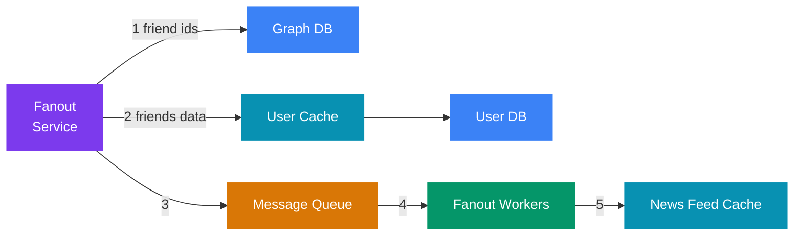
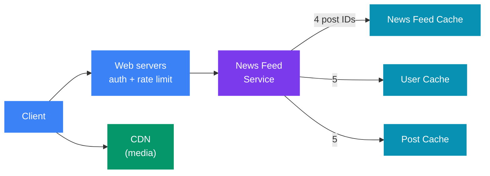
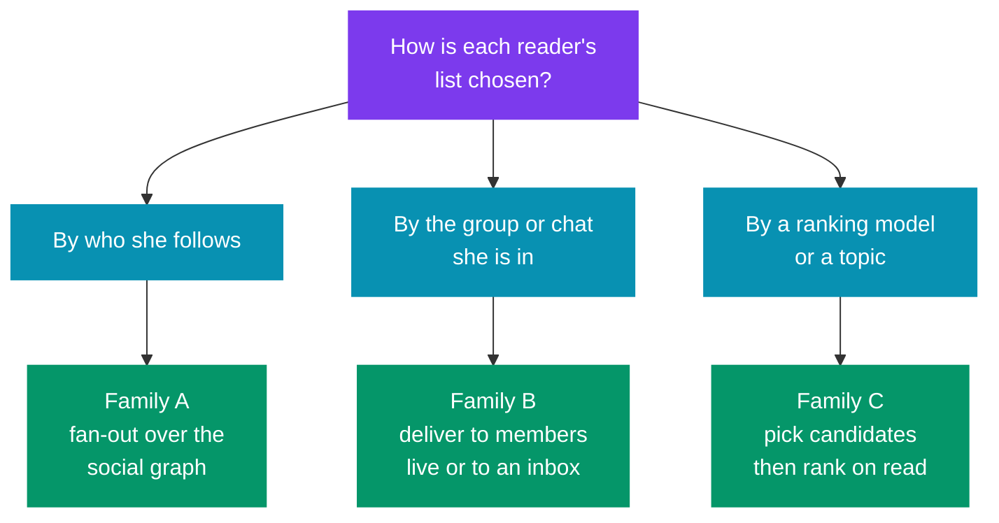

# Ch 11: Design a News Feed System

---

📊 **Question Count**

| # | Section | Questions |
|---|---|---|
| 1 | [Requirements and Scope ⚡](#1--requirements-and-scope-p166167-) | 1 |
| 2 | [APIs and the Two Flows 🔥](#2--apis-and-the-two-flows-p168170-) | 3 |
| 3 | [Feed Publishing — Web Servers and Fanout Models 🔥🔥](#3--feed-publishing--web-servers-and-fanout-models-p171172-) | 2 |
| 4 | [The Fanout Service Step by Step 🔥🔥](#4--the-fanout-service-step-by-step-p173174-) | 5 |
| 5 | [News Feed Retrieval 🔥](#5--news-feed-retrieval-p174175-) | 6 |
| 6 | [Cache Architecture — Five Layers 🔥](#6--cache-architecture--five-layers-p175-) | 3 |
| 7 | [Wrap Up — Scaling Talking Points ⚡](#7--wrap-up--scaling-talking-points-p176-) | 2 |
| 8 | [Similar Problems This Design Solves 🔥](#8--similar-problems-this-design-solves-) | 1 |
| | **Total** | **23** |

> 🔥🔥 Very high priority — asked in almost every Tier-1 interview loop &nbsp;·&nbsp; 🔥 High priority — very frequent in Tier-1 interviews &nbsp;·&nbsp; ⚡ Medium priority — commonly asked &nbsp;·&nbsp; 💤 Low priority — good to know, rarely asked

> **How to read this note.** Sections 1–7 follow the book, step by step (Step 1 → Step 4). §8, at the end, maps this design to 13 similar problems. Anything the book does not say is marked **📎 Beyond the book**. Where the book is unclear or inconsistent, the note says so and gives the fix.  
> Related notes: [Ch 4 — Rate Limiter](ch04_design_a_rate_limiter.md) (the web servers rate-limit posts), [Ch 5 — Consistent Hashing](ch05_design_consistent_hashing.md), [Ch 10 — Notification System](ch10_design_notification_system.md).

---

## 🗒️ Cheat Sheet

<details>
<summary><strong>🗒️ Show cheat sheet</strong></summary>

### 🎯 Clarifying Questions — and the book's answers
| Question | Book's answer (p.167) |
|---|---|
| Mobile app, web app, or both? | **Both** |
| What are the important features? | A user can **publish a post** and **see her friends' posts** on the news feed page |
| Sorted by reverse chronological order, or by a score (e.g. close friends first)? | **Reverse chronological** — to keep things simple |
| How many friends can a user have? | **5,000** |
| Traffic volume? | **10 million DAU** |
| Can the feed contain images and videos, or just text? | **Media files — both images and videos** |

### 🏗️ Core Components (Figures 11-4 and 11-7)
- **Load balancer** — spreads traffic across the web servers.
- **Web servers** — route traffic to internal services. They also do **authentication** and **rate limiting** (p.171–172).
- **Post service** — saves the post in the **post DB** and the **post cache**.
- **Fanout service** — delivers the post to friends' news feeds. It reads friend IDs from a **graph DB** and friend data from the **user cache**, then puts work on a **message queue**.
- **Fanout workers** — read the queue and write `<post_id, user_id>` into the **news feed cache**.
- **Notification service** — tells friends that new content is there and sends push notifications.
- **News feed service** — reads post IDs from the news feed cache, then hydrates them from the **user cache** and **post cache**.
- 📎 **Author timeline** — post IDs per author, newest first. The book does not draw it, but the pull path needs it (§3).
- **CDN** — stores and serves media (images, videos) (p.174).

### 🔌 APIs (p.168)
```
POST /v1/me/feed     params: content, auth_token     → publish a post
GET  /v1/me/feed     params: auth_token              → retrieve the news feed
```

### 💡 Key Insights
1. The design is **two flows**: **feed publishing** (write) and **news feed building** (read) (p.168). Draw them separately.
2. **Fanout on write (push)** makes reads fast. **Fanout on read (pull)** saves work for inactive users and avoids the hotkey problem (p.172).
3. The book picks a **hybrid**: push for most users, **pull for celebrities** and users with many friends or followers (p.172).
4. The news feed cache stores **only IDs** — `<post_id, user_id>` — with a **configurable limit**. Full objects come from the user and post caches at read time (p.173, p.175).
5. Cache is "extremely important" here. The book splits it into **5 layers**: news feed, content, social graph, action, counters (Figure 11-8, p.175).

### ⚖️ Trade-offs / Alternatives
| Option | Pro | Con | Book's verdict |
|---|---|---|---|
| Fanout on write (push) | Feed is made in real time; reads are fast because the feed is pre-computed | Many friends → slow fanout (the book's "hotkey problem"); wasted work for inactive users | ✅ For **most users** (p.172) |
| Fanout on read (pull) | No waste on inactive users; no hotkey problem | Reads are slow — the feed is not pre-computed | ✅ Only for **celebrities** and users with many friends/followers (p.172) |
| Hybrid | Fast reads for most feeds; no write storm from celebrities | Two code paths; you must decide who is a "celebrity" | ✅ **Chosen** (p.172) |
| Store full objects in the feed cache | One read per feed | Memory "can become very large" | ❌️ Store **only IDs** (p.173) |
| Graph DB for friendships | Good for friend relationships and friend recommendations | One more store to run | ✅ Used in Figure 11-5 (p.173) |
| Reverse chronological order | Simple | Less relevant feed | ✅ Chosen "to keep things simple" (p.167). 📎 Ranking is a common follow-up (§5 Q3) |

### 🔢 Numbers to Remember
| What | Value | Arithmetic |
|---|---|---|
| DAU (book) | **10 million** | Given by the interviewer (p.167) |
| Max friends (book) | **5,000** | So one post by a user with full friends = up to **5,000** feed-cache writes with pure push |
| Cache layers (book) | **5** | News feed · content · social graph · action · counters (Figure 11-8) |
| Fanout steps (book) | **5** | Graph DB → user cache + filter → queue → workers → feed cache (Figure 11-5) |
| Retrieval steps (book) | **6** | Request → LB → web → news feed service → feed cache → hydrate → JSON (Figure 11-7) |
| 📎 Feed reads per second | **~1,200 avg, ~2,400 peak** | Assume 10 feed loads/user/day: 10M × 10 / 86,400 ≈ 1,160/s; peak ≈ 2× |
| 📎 Posts per second | **~120 avg** | Assume 1 post/user/day: 10M / 86,400 ≈ 116/s |
| 📎 Feed-cache writes per second | **~35,000 avg** | 116 posts/s × 300 friends (assumed average) ≈ 34,800/s |
| 📎 Feed cache size (raw) | **~80 GB** | 10M users × 500 entries × 16 B (two 8-byte IDs) = 80 × 10⁹ B |
| 📎 Feed cache size in Redis | **~500 GB** | 10M × 500 = 5 × 10⁹ entries × ~100 B per sorted-set entry (with overhead) |
| 📎 Redis Cluster hash slots | **16,384** | Slot = CRC16(key) mod 16,384 |

### ⏱️ 45-Minute Round Plan
| Minutes | Phase | What to say or draw | Trap to avoid |
|---|---|---|---|
| 0–5 | Clarify | Web + mobile; publish + view friends' posts; reverse chronological; 5,000 friends; 10M DAU; images and videos | Jumping to ranking/ML before the interviewer asks for it |
| 5–10 | APIs + estimates | `POST /v1/me/feed`, `GET /v1/me/feed`; reads ~1.2K/s, cache writes ~35K/s | Skipping the read-vs-write numbers — they drive the fanout choice |
| 10–20 | High-level design | Two diagrams: publishing (Figure 11-2) and building (Figure 11-3) | One big diagram that mixes the read and write paths |
| 20–35 | **Deep dive** | Fanout on write vs read → **hybrid**. The 5 fanout steps with graph DB + queue + workers. Feed cache stores **IDs only**. Hydration from user + post caches. CDN for media | Storing full post objects in each friend's feed |
| 35–40 | Cache tiers | The 5 layers of Figure 11-8; hot cache for popular content | Treating "the cache" as one box |
| 40–45 | Wrap-up | DB scaling (replicas, sharding), stateless web tier, multi-DC, queues, monitor feed latency | Forgetting celebrities in the final summary |

> 📎 The timings are a suggestion, not from the book. The book gives the steps; the minutes are ours.

---

</details>
<br/>

---

## 1. 📋 Requirements and Scope (p.166–167) ⚡

**What is a news feed?** The book quotes the Facebook help page (p.166): "the constantly updating list of stories in the middle of your home page". It includes status updates, photos, videos, links, app activity and likes from people, pages and groups you follow (Figure 11-1).

This is a popular question. The book lists similar ones: **design Facebook news feed, Instagram feed, Twitter timeline**.

**Step 1 — the clarifying questions** are in the Cheat Sheet table (p.167). In short:

- Both mobile and web.
- Two features: **publish a post** and **see friends' posts**.
- **Reverse chronological** order.
- Up to **5,000 friends** per user.
- **10 million DAU**.
- Posts can hold **images and videos**.

> 📎 **Friends, not followers.** The book's model is "friends" with a cap of 5,000. So pure push costs at most 5,000 cache writes per post. Celebrities with millions of **followers** appear only later, in the hybrid (p.172). In an interview, ask early: "Is it a friend model (capped) or a follower model (no cap)?" The answer decides how much the celebrity problem matters.

### ❓ Interview Questions

1. **What do you ask first, and what numbers do you estimate? 📎 ⚡**

<!-- -->
<details>
<summary>💡 Show Answer</summary>

**Answer:**

**The book's clarifying questions** (p.167):

- Mobile, web, or both? → **Both**.
- Main features? → **Publish a post** and **see friends' posts**.
- Order? → **Reverse chronological**.
- Max friends? → **5,000**. Traffic? → **10 million DAU**.
- Media? → **Images and videos**.

📎 Add one question the book skips: "Friend model (two-way, capped) or follower model (one-way, no cap)?" It decides how big the celebrity problem is.

📎 **Estimates** (say each assumption aloud):

- Feed reads: 10 loads per user per day → 10M × 10 / 86,400 ≈ **1,160/s**, peak ≈ **2,400/s**.
- Posts: 1 per user per day → 10M / 86,400 ≈ **116/s**.
- Feed-cache writes with push: 116 posts/s × 300 friends (assumed average) ≈ **35,000/s**.

The point to say: feed reads are ~10× posts, so pre-computing feeds is worth it. But push turns 116 posts/s into ~35,000 cache writes/s. That write load is the cost the design must handle.

</details>

---

## 2. 🔌 APIs and the Two Flows (p.168–170) 🔥

**Step 2** splits the design into two flows (p.168):

- **Feed publishing** — a user publishes a post. The data is written to the cache and the database. The post is then added to her friends' news feeds.
- **News feed building** — for simplicity, the feed is built by putting friends' posts together in **reverse chronological** order.

### News feed APIs (p.168)

The APIs are HTTP-based. They let clients post a status, get the news feed, add friends, and so on. The book covers the two most important ones:

| API | Method + path | Params |
|---|---|---|
| Feed publishing | `POST /v1/me/feed` | `content` — the text of the post; `auth_token` — authenticates the request |
| News feed retrieval | `GET /v1/me/feed` | `auth_token` |

> 📎 **API hygiene.** Figure 11-2 shows the token in the query string (`?content=Hello&auth_token=...`). In a real system, send the token in the `Authorization` header and the content in the request body. Query strings end up in server logs and browser history. For retrieval, add a **cursor** and a **limit** for pagination (see §5 Q4).

### Feed publishing — high level (Figure 11-2, p.168–169)

- **User** — makes a post with content "Hello" through `/v1/me/feed?content=Hello&auth_token={auth_token}`.
- **Load balancer** — spreads traffic across the web servers.
- **Web servers** — send traffic to the internal services.
- **Post service** — saves the post in the **database and cache** (post cache → post DB).
- **Fanout service** — pushes new content to friends' news feeds. Feed data is stored in the **news feed cache** for fast retrieval.
- **Notification service** — tells friends that new content is there and sends push notifications.

### News feed building — high level (Figure 11-3, p.169–170)

- **User** — sends `GET /v1/me/feed`.
- **Load balancer** → **web servers** → **news feed service**.
- **News feed service** — gets the news feed from the cache.
- **News feed cache** — stores the **news feed IDs** needed to render the feed.

### ❓ Interview Questions

1. **Walk me through the high-level architecture of a news feed system. 🔥🔥**

<!-- -->
<details>
<summary>💡 Show Answer</summary>

**Answer:**

There are two flows: **feed publishing** and **news feed building** (p.168).

**Publishing (Figures 11-2, 11-4):**

- The client sends `POST /v1/me/feed` → load balancer → web servers.
- Web servers check **authentication** and apply **rate limiting**.
- Web servers then call three services:
  - **Post service** — saves the post in the post cache and post DB.
  - **Fanout service** — gets friend IDs (graph DB) and friend data (user cache), filters them, and puts the friend list + post ID on a **message queue**. **Fanout workers** write `<post_id, user_id>` into each friend's **news feed cache**.
  - **Notification service** — tells friends about the new post.

**Retrieval (Figures 11-3, 11-7):**

- `GET /v1/me/feed` → load balancer → web servers → **news feed service**.
- The service reads post IDs from the news feed cache.
- It hydrates them from the **user cache** and **post cache**, and returns JSON.
- Media comes from the **CDN**.

</details>

---

2. **How do push notifications fit into this design? 💤**

<!-- -->
<details>
<summary>💡 Show Answer</summary>

**Answer:**

**The book** (p.169): the **notification service** tells friends that new content is there and sends push notifications. In Figure 11-4, the **web servers** call it, next to the post service and fanout service.

📎 More detail:

- Notifications are **best effort**. They must not block publishing — call the service asynchronously.
- Offline users get a push via **APNs** (iOS) or **FCM** (Android).
- Online users can get a "new posts" hint over a WebSocket, or the app can poll.
- Full design: [Ch 10 — Notification System](ch10_design_notification_system.md).

</details>

---

3. **A post has a photo or a video. How does the upload work? 📎 ⚡**

<!-- -->
<details>
<summary>💡 Show Answer</summary>

**Answer:**

**The book** says only that media is stored in a **CDN** (p.174). Its publish API takes just `content`, the text. It does not show the upload.

📎 A common design:

1. The client asks the post service for an upload URL. The service returns a **pre-signed URL** for object storage (for example S3). It is valid for a short time, such as 15 minutes.
2. The client uploads the file **straight to object storage**. The large file never passes through the web servers.
3. The client calls `POST /v1/me/feed` with the text and the media ID.
4. A background job makes thumbnails, or transcodes a video into several sizes. The post stores the media URLs.
5. The CDN serves the files, with object storage as its origin. Until processing ends, the app shows a placeholder.

Why: the web servers stay small and stateless, and the CDN serves the reads. Video processing in depth: [Ch 14 — YouTube](ch14_design_youtube.md). Object storage: [Vol 2 Ch 9](../vol_2/ch09_s3_like_object_storage.md).

</details>

---

## 3. 📤 Feed Publishing — Web Servers and Fanout Models (p.171–172) 🔥🔥

**Step 3** goes deeper into both flows. For publishing (Figure 11-4), the book focuses on two parts: the **web servers** and the **fanout service** (p.171).

### Web servers (p.171–172)

Besides talking to clients, web servers enforce:

- **Authentication** — only users signed in with a valid `auth_token` can post.
- **Rate limiting** — the system limits how many posts a user can make in a time period. This is "vital to prevent spam and abusive content". (How to build it: [Ch 4](ch04_design_a_rate_limiter.md).)

### Fanout service (p.172)

**Fanout** is the process of delivering a post to all friends. There are two models.

**Fanout on write (push model).** The news feed is pre-computed at write time. A new post goes to friends' caches right after it is published.

| Pros | Cons |
|---|---|
| The feed is made in **real time** and pushed to friends at once | A user with **many friends** makes fanout slow — fetching the friend list and updating all their feeds takes time. The book calls this the **hotkey problem** |
| **Fetching the feed is fast** — it is already computed | Pre-computing feeds for **inactive users** (who rarely log in) **wastes computing resources** |

**Fanout on read (pull model).** The feed is made at read time, on demand. Recent posts are pulled when a user loads her home page.

| Pros | Cons |
|---|---|
| Works better for **inactive users** — no wasted work on them | **Fetching the feed is slow** — it is not pre-computed |
| Data is not pushed to friends, so **no hotkey problem** | |

### The book's choice — hybrid (p.172)

- Fast feed reads are crucial. So use the **push model for most users**.
- For **celebrities** or users with **many friends/followers**, let followers **pull** content on demand. This avoids system overload.
- The book adds: **consistent hashing** helps reduce the hotkey problem, because it spreads requests and data more evenly.

> ⚠️ **Book inconsistency — "hotkey" and consistent hashing (p.172).** The book uses "hotkey problem" for *slow fanout to many friends*. That is write amplification, not a hot key. Consistent hashing spreads **many keys** evenly across nodes. But it cannot split the load of **one** hot key, because one key always maps to one node. The fix: say "the **celebrity** problem is solved by the hybrid (pull for big accounts)". Use consistent hashing to spread the **feed cache** keys. For a truly hot key (one viral post), replicate it or cache it locally (§6 Q3).

📎 **How the hybrid reads a feed.** The news feed service reads the user's pre-computed feed IDs from the cache. It also fetches recent posts from the celebrities she follows. It merges both lists by time, in memory, before hydration. The celebrity list per user is small, so the merge is cheap.

> ⚠️ **A store the book does not draw — the author timeline.** "Fetch a celebrity's recent posts" needs a list of post IDs **per author**, newest first. The book's post cache is looked up by post ID. So it cannot answer "the last 20 posts by user X". Add an **author timeline**: for example a Redis sorted set `posts:{authorId}` (score = post time), written by the post service on every post. On a miss, read the post DB with an index on `(author_id, created_at)`. The pull path, the cold-start rebuild (§5 Q2) and the follow backfill (§4 Q5) all read it.

📎 **Who is a "celebrity"?** The book gives no threshold. Pick one and say it is a config value — for example, accounts with more than ~10,000 followers. Decide by follower count, not by fame.

### ❓ Interview Questions

1. **What is fanout on write vs fanout on read? What are the trade-offs? 🔥🔥**

<!-- -->
<details>
<summary>💡 Show Answer</summary>

**Answer:**

**Fanout on write (push)** — the feed is pre-computed when the post is written (p.172).

- ✅ Real-time; the post reaches friends at once.
- ✅ Reading the feed is fast.
- ❌️ A user with many friends makes fanout slow (the book's "hotkey problem").
- ❌️ Work is wasted on **inactive users** who rarely log in.

**Fanout on read (pull)** — the feed is built when the user opens it.

- ✅ No wasted work on inactive users.
- ✅ No hotkey problem, because nothing is pushed.
- ❌️ Reading the feed is slow.

📎 One line: push moves the cost to **write time** (N cache writes per post, N = friend count). Pull moves it to **read time** (one query per followed account). Feeds are read far more often than posts are written, so push wins for most users.

</details>

---

2. **How does the hybrid approach work? How do you handle celebrity posts? 🔥🔥**

<!-- -->
<details>
<summary>💡 Show Answer</summary>

**Answer:**

**The book** (p.172): fast reads are crucial, so use **push for most users**. For **celebrities** or users with many friends/followers, followers **pull** their content on demand. This avoids system overload.

📎 **How it works at read time:**

1. Read the user's pre-computed feed IDs from the news feed cache.
2. Get the list of celebrities she follows. Read each one's recent post IDs from the **author timeline** (`posts:{authorId}`, see the ⚠️ note above). The post cache is keyed by post ID, so it cannot list an author's posts.
3. Merge both lists by time, in memory, and take the top N.
4. Hydrate and return.

📎 **The threshold** is a config value, for example ~10,000 followers. The book gives no number. The merge adds little latency, because a user follows only a few celebrities.

📎 Note: with the book's **5,000-friend cap**, pure push costs at most 5,000 writes per post. The celebrity problem is real only in a **follower** model with no cap (pages, public figures).

</details>

---

## 4. 📨 The Fanout Service Step by Step (p.173–174) 🔥🔥

Figure 11-5 shows the fanout service. It works in five steps (p.173):

1. Fetch **friend IDs** from the **graph database**. Graph databases suit friend relationships and friend recommendations.
2. Get **friends' info** from the **user cache**. Then filter friends by user settings. Example: if you **mute** someone, her posts do not show in your feed, even though you are still friends. Also, a user can **share selectively** with some friends, or hide a post from others.
3. Send the **friend list** and the **new post ID** to the **message queue**.
4. The **fanout workers** read from the queue and store feed data in the **news feed cache**.
5. The workers store **`<post_id, user_id>`** in the news feed cache. Figure 11-6 shows the cache as a table of `post_id | user_id` rows.



### Why only IDs, and why a limit (p.173)

- You can think of the news feed cache as a `<post_id, user_id>` **mapping table**. Each new post is **appended** to it.
- Storing whole user and post objects would make memory use **very large**. So **only IDs** are stored.
- To keep memory small, there is a **configurable limit** on how many entries a feed keeps.
- A user rarely scrolls through thousands of posts. Most users want only the latest content. So the **cache miss rate is low**.

<details>
<summary><strong>🤔 Doubt: In `<post_id, user_id>`, whose user_id is it — the friend who receives the post, or the author?</strong></summary>

The book does not say directly. The most useful reading:

- The **feed itself is per receiving user**. Each friend has her own list. In a key-value cache the receiver is the **key** (for example `feed:{receiverId}`).
- Each **entry** in that list is `<post_id, user_id>`, where `user_id` is the **author**.

Why store the author? Retrieval step 5 (p.175) fetches **user objects** (name, profile picture) and **post objects**. With the author ID already in the entry, the news feed service can fetch both in parallel. It does not need to read the post first just to find its author.

---

</details>
<br/>

📎 **A Redis version.** The book does not name a cache product. A common choice is one Redis **sorted set** per receiver: member = `postId:authorId`, score = post time in milliseconds. Then "latest N" is one range read, and trimming to the limit is one command:

```java
private static final int FEED_LIMIT = 500;

public void onFanoutMessage(FanoutMessage msg) {
    ZSetOperations<String, String> zSetOps = redisTemplate.opsForZSet();
    String member = msg.postId() + ":" + msg.authorId();
    for (long friendId : msg.friendIds()) {
        String key = "feed:" + friendId;
        zSetOps.add(key, member, msg.createdAtMillis());
        // keep only the newest FEED_LIMIT entries (ranks are ascending by score)
        zSetOps.removeRange(key, 0, -FEED_LIMIT - 1);
    }
}
```

📎 Here `redisTemplate` is a `StringRedisTemplate`. In production, batch the writes with `executePipelined`, because one message may carry hundreds of friends. The limit of 500 is a common choice, not the book's number.

📎 **Time-sortable post IDs.** With Snowflake-style IDs ([Ch 7](ch07_design_unique_id_generator.md)), the high bits of the ID are a timestamp. So sorting by ID also sorts by time. But do not use the 64-bit ID as the sorted-set score. A Redis score is a double, which holds integers exactly only up to 2^53. Keep the time in milliseconds as the score. Members with the same score are ordered by the member string, so ties still have a fixed order.

📎 **Why a queue between the fanout service and the workers?** The post API can return as soon as the message is queued. Workers scale out on their own. A burst of posts waits in the queue instead of overloading the cache. And a failed write can be retried from the queue. Fanout writes are **idempotent** with a sorted set (adding the same member twice changes nothing), so a retry is safe.

### ❓ Interview Questions

1. **Walk me through the fanout service. Why a graph DB, and why a message queue? 🔥**

<!-- -->
<details>
<summary>💡 Show Answer</summary>

**Answer:**

The five steps of Figure 11-5 (p.173):

1. Get **friend IDs** from the **graph DB**.
2. Get **friend info** from the **user cache**. **Filter** by user settings — a friend who muted you, or a post shared only with some friends.
3. Put the **friend list + post ID** on the **message queue**.
4. **Fanout workers** read from the queue.
5. Workers store `<post_id, user_id>` in the **news feed cache**.

**Why a graph DB:** the book says graph databases suit friend relationships and **friend recommendations** (p.173). "Friends of friends" is a 2-hop query, which a graph DB does well.

📎 **Why a queue:**

- The post API returns as soon as the work is queued.
- Workers scale out on their own.
- A burst waits in the queue instead of overloading the cache.
- Failed writes can be retried. Adding the same ID twice to a sorted set changes nothing, so retries are safe.

</details>

---

2. **What exactly is stored in the news feed cache, and why? How would you build it in Redis? 🔥**

<!-- -->
<details>
<summary>💡 Show Answer</summary>

**Answer:**

**The book** (p.173): a `<post_id, user_id>` mapping. New posts are appended.

- **Only IDs** — storing full user and post objects would use too much memory.
- A **configurable limit** keeps each feed small.
- Users rarely scroll through thousands of posts, so the **cache miss rate is low**.
- Full objects come from the user and post caches at read time (p.175). 📎 This also means an edited post shows its new text everywhere, because the feed holds only its ID.

📎 **In Redis:** one **sorted set** per receiver, key `feed:{userId}`.

- Member = `postId:authorId`. Score = post time in milliseconds.
- "Latest 20" = one reverse range read (`ZREVRANGE feed:42 0 19`). Redis 6.2 marked `ZREVRANGE` as deprecated; `ZRANGE feed:42 0 19 REV` does the same. The old command still works.
- Trim after each add (`ZREMRANGEBYRANK`) to keep the newest ~500.
- Duplicates are removed automatically, so a retried fanout is safe.

</details>

---

3. **How would you scale the fanout service? 🔥**

<!-- -->
<details>
<summary>💡 Show Answer</summary>

**Answer:**

**From the book:** the fanout service puts work on a **message queue**, and **fanout workers** consume it (Figure 11-5). Celebrities are **not** pushed — followers pull them (p.172). Consistent hashing spreads the cache data evenly (p.172).

📎 More detail:

- Workers are **stateless**. Use a partitioned queue (e.g. Kafka) and add worker instances to scale out.
- For a big friend list, **split it into batches** (e.g. 1,000 friends per message). Batches then run in parallel.
- Use **back-pressure** — slow down consumers when the cache is overloaded during a burst of viral posts.
- **Skip inactive users.** The book says pushing to them wastes resources (p.172). A user who has not logged in for 30 days gets no push. Her feed is rebuilt by pull when she returns (§5 Q2).

</details>

---

4. **A user mutes a friend, or posts to only some friends. Where does the design handle that? ⚡**

<!-- -->
<details>
<summary>💡 Show Answer</summary>

**Answer:**

**The book** (p.173): in **fanout step 2**, after getting friend data from the user cache, the system **filters friends by user settings**.

- If you **mute** someone, her posts do not show in your feed, though you are still friends.
- A user can **share selectively** with some friends or hide a post from others.

📎 To build it:

- Add an `audience` field to each post (public, friends, a custom list).
- During fanout, filter the friend list by the audience rule and by mute settings **before** writing to feed caches.
- Keep custom lists in a fast store, e.g. a Redis set `closeFriends:{userId}`.
- For **pulled** celebrity posts, apply the same filter at read time, because there was no fanout step.

This adds a lookup per post during fanout. The read path does not change.

</details>

---

5. **A user follows or unfollows someone. What happens to her feed? 📎 ⚡**

<!-- -->
<details>
<summary>💡 Show Answer</summary>

**Answer:**

The book does not cover this. The feed cache holds only what fanout wrote in the past. So a change in the graph does not fix old entries by itself.

- **New friend or follow:** her feed has none of the new friend's older posts. One option is **backfill**: read the last N post IDs from his author timeline (§3) and add them to her sorted set. The time scores put them in the right place. The other option is to do nothing, and his new posts arrive from now on. Backfill is cheap: one bounded read and one `ZADD` with N members.
- **Unfriend or unfollow:** his old posts stay in her feed. Option A: scan her feed (at most ~500 entries) and remove the entries whose author ID matches. This is one reason the member keeps the author ID (`postId:authorId`). Option B: filter at read time against her current friend list. Many designs do A in the background, with B as a safety net.
- **Future posts:** the graph DB changes at once, so the next fanout reads the new friend list. A fanout message already in the queue may still deliver one post. The read-time filter catches it.
- **A celebrity under the hybrid:** nothing to backfill or remove. Only her list of followed celebrities changes, and the next pull reads the new list.

</details>

---

## 5. 📥 News Feed Retrieval (p.174–175) 🔥

Figure 11-7 shows the detailed read path. **Media content (images, videos) is stored in a CDN** for fast retrieval (p.174). The client reads media from the CDN directly.

The six steps (p.175):

1. A user sends `GET /v1/me/feed`.
2. The **load balancer** sends the request to the web servers.
3. **Web servers** call the **news feed service**.
4. The news feed service gets a **list of post IDs** from the **news feed cache**.
5. A feed is more than IDs. It has the username, profile picture, post content, post image, and so on. So the service fetches the full **user** and **post objects** from the **user cache** and **post cache**. This builds the **fully hydrated** news feed.
6. The hydrated feed goes back to the client as **JSON** for rendering.



📎 **Hydrate in batches.** Step 5 should be **two multi-gets** (all users, all posts) — not one call per post. For a page of 20 posts, that is 2 round trips instead of 40. On a cache miss, read the missing objects from the user DB or post DB and fill the cache.

### ❓ Interview Questions

1. **How does the news feed service build a fully hydrated feed? 🔥**

<!-- -->
<details>
<summary>💡 Show Answer</summary>

**Answer:**

The six steps of Figure 11-7 (p.175):

1. Client sends `GET /v1/me/feed`.
2. Load balancer → web servers (auth + rate limit).
3. Web servers call the **news feed service**.
4. The service gets **post IDs** from the **news feed cache**.
5. It fetches **user objects** (name, profile picture) from the **user cache** and **post objects** (content, image) from the **post cache**.
6. It returns the feed as **JSON**.

Images and videos are **not** in the JSON. The client loads them from the **CDN** (p.174).

📎 Do step 5 as **two batch reads** (multi-get users, multi-get posts), not one call per post. On a miss, read from the user DB or post DB and fill the cache.

</details>

---

2. **What happens when a user's feed is not in the cache (cold start)? ⚡**

<!-- -->
<details>
<summary>💡 Show Answer</summary>

**Answer:**

**The book** says the miss rate is low, because the cache keeps the latest posts and most users only read those (p.173). It does not describe the miss path.

📎 On a miss, fall back to **fanout on read**:

1. Get the user's friend IDs from the graph DB.
2. Read the recent post IDs of each friend from the **author timeline** (§3). On a miss there, query the post DB by `(author_id, created_at)`.
3. Merge and sort by time.
4. Write the result into the user's feed cache.
5. Return the page.

This is slow, but it happens once. Later reads hit the cache. It is also the right path for **inactive users** returning after a long time.

</details>

---

3. **The book sorts the feed by time. How would you add ranking? ⚡**

<!-- -->
<details>
<summary>💡 Show Answer</summary>

**Answer:**

**The book** (p.167): the candidate asks about "topic scores", such as close friends scoring higher. The interviewer chooses **reverse chronological** "to keep things simple".

📎 To add ranking:

1. Take the top N **candidate** post IDs from the feed cache (e.g. 200).
2. Score them in a ranking step. Signals: recency, engagement (likes/comments per hour), closeness to the author, and the user's interest in this content type.
3. Return the top 20 by score.

An **offline ML pipeline** can pre-score posts and store the scores. The online step then combines them with real-time signals. Cost: more latency and a harder system to debug.

</details>

---

4. **How do you paginate the news feed? What about the same user on several devices? 📎 🔥**

<!-- -->
<details>
<summary>💡 Show Answer</summary>

**Answer:**

Use **cursor-based** pagination, not offset.

- The cursor is the score (time) of the last item the client saw, plus its post ID.
- The next request sends the cursor. The server reads posts at or older than it, e.g. `ZREVRANGEBYSCORE feed:42 <cursor> -inf LIMIT 0 21`.
- Two posts can share the same millisecond. So the read is **inclusive**, and the server skips entries with the cursor's time whose post ID the client already has. Nothing is skipped or shown twice.
- Offset breaks for feeds. New posts arrive at the top and shift every offset, so the user sees duplicates or misses posts.

**Several devices:** the feed cache is **per user**, not per device. Every device reads the same `feed:{userId}`. Each device keeps its **own cursor**. A new device sends no cursor and gets the newest page.

</details>

---

5. **How do you handle a deleted post that is already in thousands of feeds? 📎 ⚡**

<!-- -->
<details>
<summary>💡 Show Answer</summary>

**Answer:**

Do **not** remove it from every feed cache. That would be a second fanout, as expensive as the first.

- **Soft-delete** the post in the post DB, and remove it from the post cache.
- At **hydration** time (retrieval step 5), the news feed service sees the deleted flag (or a missing post) and **skips** the ID.
- The stale ID drops out of each feed later, when the feed is trimmed to its limit.

This works because the feed cache stores **only IDs** (p.173). The content lives in one place.

</details>

---

6. **How do you track which posts a user has seen (the unread badge)? 📎 💤**

<!-- -->
<details>
<summary>💡 Show Answer</summary>

**Answer:**

- Keep a `lastSeenTimestamp` per user (or per user per device) in a small key-value store (Redis or DynamoDB).
- **Unread count** = the number of entries in the feed cache newer than that time. In Redis: `ZCOUNT feed:{userId} (lastSeen +inf`.
- Update `lastSeenTimestamp` when the user scrolls or opens the feed.

This is a best-effort counter. Exact precision does not matter for a badge.

</details>

---

## 6. 🧱 Cache Architecture — Five Layers (p.175) 🔥

"Cache is extremely important for a news feed system." The book splits the cache tier into **5 layers** (Figure 11-8):

| Layer | What it stores | Parts in Figure 11-8 |
|---|---|---|
| **News Feed** | IDs of news feeds | news feed |
| **Content** | Every post's data. **Popular content goes in a hot cache** | hot cache · normal |
| **Social Graph** | User relationship data | follower · following |
| **Action** | Whether a user liked a post, replied to it, or took another action on it | liked · replied · others |
| **Counters** | Counters for likes, replies, followers, following, and so on | like counter · reply counter · other counters |

📎 **Why split it.** Each layer has a different access pattern:

- **Feed IDs** — one list per user, written by fanout.
- **Content** — read by everyone. A few posts are very hot.
- **Social graph** — read by fanout, changes rarely.
- **Actions** — one small fact per (user, post) pair, for example "did I like this?".
- **Counters** — written very often.

So each layer can get its own size, eviction policy and scaling. For example, counters can be updated with atomic `INCR` and flushed to the database in batches.

### ❓ Interview Questions

1. **What are the five cache layers in the book's design? ⚡**

<!-- -->
<details>
<summary>💡 Show Answer</summary>

**Answer:**

Figure 11-8 (p.175):

- **News Feed** — IDs of news feeds.
- **Content** — every post's data; **popular content in a hot cache**, the rest in a normal cache.
- **Social Graph** — follower and following data.
- **Action** — whether a user liked, replied to, or did something else to a post.
- **Counters** — like, reply, follower and following counts.

📎 Each layer has its own access pattern, so each gets its own size, eviction policy and scaling. Counters are write-heavy; content has a few very hot keys; the social graph changes rarely.

</details>

---

2. **How much memory does the news feed cache need? 📎 🔥**

<!-- -->
<details>
<summary>💡 Show Answer</summary>

**Answer:**

Use the book's **10M DAU** and assume a limit of **500 entries** per feed.

- Raw data: each entry is `<post_id, user_id>` = 2 × 8 B = 16 B.
  10M × 500 × 16 B = **80 GB**.
- In Redis, a sorted-set entry costs roughly **~100 B** with overhead (skiplist + hash table).
  10M × 500 × 100 B = **500 GB**.
- Small sorted sets use a compact **listpack** encoding. The default limits are 128 entries and 64 bytes per member (`zset-max-listpack-entries`, `zset-max-listpack-value`). Before Redis 7 this encoding was called ziplist. A 500-entry feed is above that, so it uses the skiplist form — hence the ~100 B rough figure. A limit of 128 or less would use much less memory.
- That fits a **Redis Cluster** of a few dozen nodes. Redis Cluster does **not** use consistent hashing. It maps keys to **16,384 hash slots** (CRC16 of the key mod 16,384).

Inactive users: set an eviction policy such as `allkeys-lru`, so their feeds drop out. This is not automatic — the open-source Redis default is `noeviction`. A dropped feed is rebuilt by pull (§5 Q2).

</details>

---

3. **A celebrity post goes viral. How do you protect the system from a thundering herd? 📎 🔥**

<!-- -->
<details>
<summary>💡 Show Answer</summary>

**Answer:**

A viral post means millions of reads of **one key** in the post cache.

1. Keep it in the book's **hot cache** for popular content (Figure 11-8), with a long TTL.
2. **Replicate the hot key** — store copies under several keys, or keep a small local cache on each news feed service instance.
3. **Request coalescing** — many requests for the same missing key share **one** DB read.
4. **Load shedding** and **circuit breakers** — drop extra work in a controlled way, and stop calling a failing post DB so it can recover.

On the write side, the hybrid already helps: celebrity posts are **not** fanned out (§3 Q2). For large accounts just under the threshold, **rate-limit the fanout** so the writes spread over time.

</details>

---

## 7. 🏁 Wrap Up — Scaling Talking Points (p.176) ⚡

**Step 4.** The design has two flows: feed publishing and news feed retrieval. The book says there is no perfect design. Every company has its own constraints. Understanding the trade-offs of your choices is what matters. With minutes left, talk about scalability. The book lists only the talking points:

**Scaling the database:**

- Vertical scaling vs horizontal scaling
- SQL vs NoSQL
- Master-slave replication
- Read replicas
- Consistency models
- Database sharding

**Other talking points:**

- Keep the web tier **stateless**.
- **Cache data** as much as you can.
- Support **multiple data centers**.
- **Loosely couple** components with message queues. (The book prints "Lose couple".)
- **Monitor key metrics** — for example, **QPS during peak hours** and **latency while users refresh their news feed**.

> 📎 Where these are covered in depth: scaling basics in [Ch 1](ch01_scale_from_zero.md), consistency models in [Ch 6](ch06_design_a_key_value_store.md).

### ❓ Interview Questions

1. **Which databases would you use, and how do you scale them? ⚡**

<!-- -->
<details>
<summary>💡 Show Answer</summary>

**Answer:**

**The book's stores** (Figures 11-4, 11-7): a **post DB**, a **user DB** and a **graph DB** for friendships. Each has a cache in front. Media is in the **CDN** (p.174).

**The book's scaling points** (p.176): vertical vs horizontal scaling, SQL vs NoSQL, master-slave replication, read replicas, consistency models, sharding.

📎 A concrete answer:

- **Post DB** — MySQL for post metadata (post ID, author ID, text, time, media URLs). Media files live in S3 behind the CDN.
- Reads are mostly served by caches. Add **read replicas** for what misses.
- If writes become the bottleneck, **shard by user ID**. All posts of one author then live on one shard.
- A wide-column store (Cassandra) is an option for very high write volume with a simple schema.
- Note: a write-through cache does not reduce DB writes. Every write still reaches the DB.

</details>

---

2. **Should the feed be strongly or eventually consistent? 📎 🔥**

<!-- -->
<details>
<summary>💡 Show Answer</summary>

**Answer:**

**Eventually consistent** is fine. Users do not notice if a friend's post appears 1–2 seconds late.

Strong consistency would mean writing to every friend's feed **before** the post API returns. With up to 5,000 friends per post, that is slow and fragile.

The asynchronous fanout through the message queue gives the right balance:

- The publisher gets a fast response.
- Friends see the post within seconds.

One exception: the **author** should see her own post at once. Add it to her own feed directly in the post request (read-your-writes), not through the queue.

</details>

---

## 8. 🧬 Similar Problems This Design Solves 🔥

The book names three similar questions: **design Facebook news feed, Instagram feed, Twitter timeline** (p.166). 📎 The same core solves **at least 13 common interview problems**. Learn the core once, then change only a few parts for each one.

**The core that never changes:**
- **One list per reader**, newest first, that holds only **IDs** (§4). Full objects are added at read time (§5).
- **A fan-out step** that copies a new item's ID into each reader's list — or a pull at read time when there are too many readers (§3).
- **A queue and workers** between the write and the fan-out, so the writer never waits.
- **Caches split by access pattern** — lists, content, graph, actions, counters (§6).

**The tag on each problem** says how often it is asked as an HLD round on its own (same legend as the questions). 🔥🔥 = learn its "what is different" column well; 💤 = knowing the family is enough.

**The one choice that splits them into three families:** how is each reader's list chosen?



### Family A — the list comes from who you follow (like this chapter)

| # | Problem | What is different from this chapter |
|---|---|---|
| 1 | **News feed 🔥🔥** (this chapter) | — |
| 2 | **Twitter / X home timeline 🔥🔥** | A **follower** model: one-way and no cap. Some accounts have millions of followers, so the hybrid (§3) is required, not optional. A retweet brings the same tweet in again, so dedupe by tweet ID when the list is read |
| 3 | **Instagram feed 🔥** | Media first: the upload path (§2 Q3), many image sizes and a CDN carry most of the load. The feed is **ranked**, not by time, so it needs a candidate + ranking step (§5 Q3) |
| 4 | **LinkedIn feed ⚡** | The list holds **actions** too, not only posts: "a connection liked this" puts a stranger's post in your feed. Two-way connections plus one-way follows. Heavy ranking |
| 5 | **Activity feed in an app (GitHub, Strava) ⚡** | Items are **events** ("X starred a repo", "Y finished a run"). Similar events are grouped: "X and 4 others starred this". Volume is low, so plain fan-out on read is often enough |
| 6 | **Group or community feed (Reddit, Facebook groups) ⚡** | The list belongs to the **group**, not the reader. Write each post once to the group's timeline. A reader's home feed merges the timelines of her groups at read time — fan-out on read. Order is often by votes, not by time |
| 7 | **Stories (24-hour posts) 💤** | Each item expires after 24 hours, so a TTL removes it. You keep "seen" state per viewer, per story. The tray at the top orders **authors**, not posts |

### Family B — deliver to the members of a group or chat

| # | Problem | What is different from this chapter |
|---|---|---|
| 8 | **Group chat 🔥🔥** — [Ch 12](ch12_design_a_chat_system.md) | The book copies each message into **each member's inbox** — fan-out on write. It does this only for **small** groups (WeChat caps a group at 500). Messages need a strict **order per conversation**, which a feed does not. Online members get it over a WebSocket |
| 9 | **In-app notification inbox (the bell icon) 🔥** — [Ch 10](ch10_design_notification_system.md) | Usually one event goes to **one** user, so the fan-out is small. The same per-user list, newest first. The unread count works like §5 Q6. Items can be marked read one by one |
| 10 | **Nearby friends ⚡** — [Vol 2 Ch 2](../vol_2/ch02_nearby_friends.md) | Nothing is stored per reader. Each user publishes location updates to **her own pub/sub channel**, and her friends' connection handlers subscribe to it. A missed update is fine, because a new one comes soon |
| 11 | **Live comments on a video or stream ⚡** | The receivers are the open connections watching **one** video. Pub/sub sends each comment to the servers that hold those connections. No list per viewer and no retry — a lost comment is fine |

### Family C — the list is picked by ranking or by topic, not by follows

| # | Problem | What is different from this chapter |
|---|---|---|
| 12 | **TikTok "For You" / YouTube home feed 🔥** | There is no follow graph, so there is **no fan-out**. Offline models pick candidates; an online step ranks them on each request. The cache holds candidate lists and scores, not one fixed list per user |
| 13 | **Hashtag or trending timeline ⚡** | Items are picked by **topic**. Keep one list per hashtag, written when a post is indexed. "Trending" needs counts in time windows — like [Vol 2 Ch 6](../vol_2/ch06_ad_click_event_aggregation.md), but approximate counts are fine |

### How to use this in an interview — five questions

When you get any "show a user a list of new things" problem, answer these five questions aloud. Each answer picks one part of the design:

| Ask | It decides |
|---|---|
| 1. How is each reader's list chosen — by follows, by group, or by a model? | The **family**, and whether there is a fan-out step at all |
| 2. Is the graph two-way and capped, or one-way with no cap? | **Pure push**, or the **hybrid** with a celebrity threshold (§3) |
| 3. Must the reader see it live, or only when she opens the app? | **Push over a WebSocket / pub-sub**, or a **stored list** in the feed cache |
| 4. Is the order by time or by a score? | A **sorted set by time**, or **candidates + a ranking step** (§5 Q3) |
| 5. Can an item change or expire after it is posted? | **IDs only + a check at hydration** (§5 Q5), and a **TTL** for items like stories |

> **Where this does *not* transfer directly:**
>
> - **Chat between two people.** It needs order per conversation, delivery receipts and presence, not a feed ([Ch 12](ch12_design_a_chat_system.md)).
> - **Searching posts by words.** That needs an inverted index over all posts, not one list per reader.
> - **Counts that must be exact**, like ad clicks used for billing ([Vol 2 Ch 6](../vol_2/ch06_ad_click_event_aggregation.md)). Feed counters (§6) are best effort.
> - **Serving large video.** That is a CDN and transcoding problem ([Ch 14](ch14_design_youtube.md)).

### ❓ Interview Questions

1. **Where else can you use this news feed design? Pick three problems and say what changes. 📎 🔥**

<!-- -->
<details>
<summary>💡 Show Answer</summary>

**Answer:**

The core stays the same. Each reader has a list of IDs, newest first. A fan-out step fills it, through a queue and workers. Full objects are added when the list is read. What changes is **how the list is chosen**, **how many readers one item has**, and **how fast it must arrive**.

| | News feed (this chapter) | Twitter home timeline | Small group chat | TikTok "For You" |
|---|---|---|---|---|
| List chosen by | Friends (two-way, max 5,000) | Follows (one-way, no cap) | Members of the group | A ranking model |
| Fan-out | Push for most users; pull for celebrities | Hybrid is required — some accounts have millions of followers | Copy into each member's inbox (small groups only) | None — candidates are picked on read |
| Order | Reverse chronological | By time or ranked | Strict order per conversation | By score |
| How fast | Seconds are fine | Seconds are fine | Live, over a WebSocket | Per request |
| Hard part | Write load of push (~35,000 writes/s, §1 Q1) | Celebrity accounts | Order and offline delivery | Candidate generation and ranking |

**Three families to name:**

- **By who you follow** (news feed, Twitter, Instagram, LinkedIn, activity feeds, group feeds, stories): this chapter, with a different graph, item type or order.
- **By the group or chat you are in** (group chat, notification inbox, nearby friends, live comments): deliver to members, often live, often with no stored list.
- **By a model or a topic** (For You feed, hashtag timelines): no fan-out; pick candidates and rank them on read.

🧬 **The full list — 13 problems in three families, plus five questions that map any new one:** see the tables above.

</details>

---
