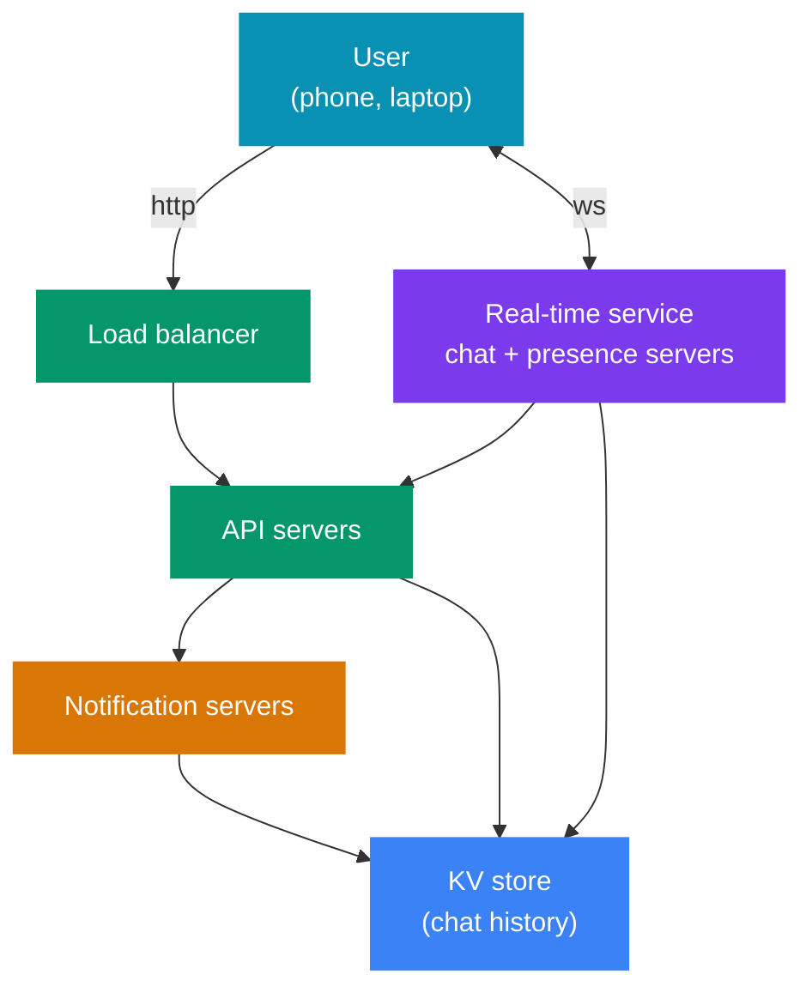
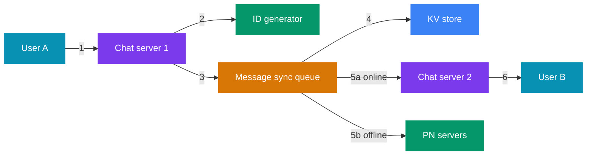
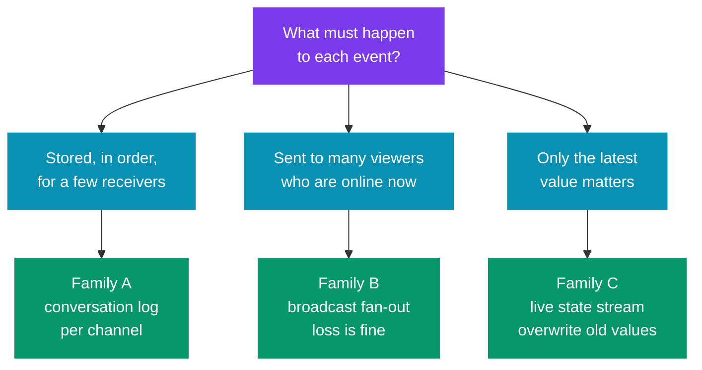

# Ch 12: Design a Chat System

> 📖 **Vol 1, Chapter 12** (book pages 178–199) &nbsp;·&nbsp; 🔥🔥 Very High Priority &nbsp;·&nbsp; 💬 **30 Questions**  
> **Source:** Alex Xu, *System Design Interview Vol 1*, Ch 12. Page and figure numbers below are the book's. This PDF edition prints no page numbers in the footer, so pages are the PDF page numbers (the chapter starts on page 178).

---

📊 **Question Count**

| # | Section | Questions |
|---|---|---|
| 1 | [Requirements and Scope ⚡](#1--requirements-and-scope-p178179-) | ref |
| 2 | [Polling, Long Polling and WebSocket 🔥🔥](#2--polling-long-polling-and-websocket-p180183-) | 1 |
| 3 | [High-level Design 🔥🔥](#3--high-level-design-p184186-) | 4 |
| 4 | [Storage and Data Models 🔥](#4--storage-and-data-models-p186188-) | 3 |
| 5 | [Message ID 🔥🔥](#5--message-id-p188189-) | 1 |
| 6 | [Service Discovery 🔥](#6--service-discovery-p190-) | 1 |
| 7 | [Message Flows — 1-on-1, Multi-device and Group 🔥🔥](#7--message-flows--1-on-1-multi-device-and-group-p190193-) | 9 |
| 8 | [Online Presence 🔥](#8--online-presence-p194197-) | 4 |
| 9 | [Wrap-up ⚡](#9--wrap-up-p198-) | 6 |
| 10 | [Similar Problems This Design Solves 📎 🔥](#10--similar-problems-this-design-solves--) | 1 |
| | **Total** | **30** |

> 🔥🔥 Very high priority — asked in almost every Tier-1 interview loop &nbsp;·&nbsp; 🔥 High priority — very frequent in Tier-1 interviews &nbsp;·&nbsp; ⚡ Medium priority — commonly asked &nbsp;·&nbsp; 💤 Low priority — good to know, rarely asked

---

## 🗒️ Cheat Sheet

<details>
<summary><strong>🗒️ Show cheat sheet</strong></summary>

### 🎯 Clarifying Questions — and the book's answers
| Question | Book's answer (p.179) |
|---|---|
| 1-on-1 or group chat? | **Both** |
| Mobile app, web app, or both? | **Both** |
| Scale? | **50 million DAU** |
| Group member limit? | **100 people** at most |
| Which features? Attachments? | 1-on-1 chat, group chat, **online indicator**. **Text only** |
| Message size limit? | Yes — text **under 100,000 characters** |
| End-to-end encryption? | **Not required for now.** Discuss it if time allows |
| How long to keep chat history? | **Forever** |

### 🏗️ Core Components (Figure 12-8)
- **Chat servers** — send and receive messages. Each client keeps a **WebSocket** connection to one chat server.
- **Presence servers** — manage online and offline status. They also talk to clients over WebSocket.
- **API servers** — everything else over HTTP: login, signup, profile changes. They sit behind a **load balancer**.
- **Notification servers** — send push notifications (third-party integration).
- **Key-value store** — keeps the chat history. An offline user sees all old messages when she comes back.
- **Service discovery (ZooKeeper)** — picks the best chat server for a client at login (§6).
- **ID generator** and **message sync queue** — appear in the message flow (Figure 12-12, §7).

### 🗃️ Data Model (Figures 12-9, 12-10)
```
message                         -- 1-on-1 chat
  message_id    bigint  PK      -- decides the message order
  message_from  bigint
  message_to    bigint
  content       text
  created_at    timestamp

group_message                   -- group chat
  channel_id    bigint  PK (partition key)
  message_id    bigint  PK      -- composite key (channel_id, message_id)
  user_id       bigint
  content       text
  created_at    timestamp
```

### 💡 Key Insights
1. **HTTP is client-initiated, so the server cannot easily push.** Polling and long polling only imitate a push. **WebSocket** is bidirectional and persistent, so the book uses it for both sending and receiving (p.183).
2. **Only the chat service is stateful.** Login, signup and profile stay on plain HTTP behind a load balancer (p.184–185). Do not put every feature on WebSocket.
3. **Order comes from `message_id`, not `created_at`.** Two messages can have the same `created_at` (p.187). The ID only needs to be ordered **within one channel**, so a local sequence works (p.189).
4. **Small groups copy the message into each member's inbox** (the message sync queue). Each client then reads only its own inbox. This stops working for very large groups (p.193).
5. **Presence uses a heartbeat, not the connection state.** A user who loses the network for a few seconds in a tunnel should not flicker offline (p.195).

### ⚖️ Trade-offs / Alternatives
| Option | Pro | Con | Book's verdict |
|---|---|---|---|
| Polling (Figure 12-3) | Very simple | Most answers are "no" — wastes server resources | ❌️ Could be costly (p.180) |
| Long polling (Figure 12-4) | Fewer empty answers | Sender and receiver may be on different servers; server cannot tell if a client left; still reconnects after timeouts | ❌️ Has drawbacks (p.182) |
| WebSocket (Figure 12-5) | Bidirectional, persistent; works through firewalls on ports 80/443 | Server must manage many long-lived connections | ✅ **Chosen** for send and receive (p.183) |
| HTTP for sending only | Keep-alive reuses the connection; Facebook did this at first | Two protocols to run | Fine, but WebSocket for both is simpler (p.183) |
| Relational DB for chat history | Fine for users, settings, friends | Handles the **long tail** badly; random access is costly when indexes grow large | ❌️ for chat history (p.187) |
| Key-value store for chat history | Easy horizontal scaling; very low latency; proven (Facebook → HBase, Discord → Cassandra) | No joins | ✅ **Chosen** (p.187) |
| `auto_increment` for `message_id` | Simple | NoSQL stores usually do not have it | ❌️ (p.189) |
| Global Snowflake ID | Unique, time-sortable, 64-bit | More work to build | ✅ Possible (p.189) |
| Local sequence per channel | Easier to build; ordering inside a channel is enough | IDs are not unique across channels | ✅ Possible, "easier" (p.189) |
| Copy per member inbox (group) | Each client checks only its own inbox | One copy per member — too costly for big groups | ✅ for **small** groups; WeChat caps at 500 (p.193) |
| Mark offline on every disconnect | Simple | Status flickers on short network drops | ❌️ "Major flaw" → heartbeat (p.195) |

### 🔢 Numbers to Remember
| What | Value | Arithmetic |
|---|---|---|
| Scale | **50M DAU** | — |
| Group size limit | **100** members | — |
| Max message length | **< 100,000 characters** | — |
| Memory for connections | **~10 GB** | 1M concurrent users × 10 KB per connection = 10,000,000 KB = **10 GB** (p.185) |
| Messages a day (Messenger + WhatsApp) | **60 billion** | 60,000,000,000 ÷ 86,400 s ≈ **694,000 messages/s** on average (p.187) |
| Read : write ratio (1-on-1 apps) | **1 : 1** | — (p.187) |
| Heartbeat interval | **5 s** | Figure 12-18 |
| Offline after no heartbeat for | **x = 30 s** | 30 ÷ 5 = about **6 missed heartbeats**. The book says 30 is "arbitrarily chosen" (p.195) |
| WeChat group cap | **500** members | (p.193, p.197) |
| Presence fan-out in a huge group | **100,000 events** | 1 status change × 100,000 members = 100,000 events (p.197) |
| WebSocket ports | **80 / 443** | Same as HTTP / HTTPS, so firewalls let it through (p.183) |
| 📎 Our own traffic estimate | **~11.6K messages/s** | 50M DAU × 20 messages = 1B a day; 1,000,000,000 ÷ 86,400 ≈ 11,574/s |
| 📎 Our own storage estimate | **~100 GB/day, ~36.5 TB/year** | 1B messages × 100 bytes = 100 GB; 100 GB × 365 = 36.5 TB (text only, before replication) |
| 📎 Snowflake ID layout | **64 bits** | 1 sign + 41 timestamp + 5 datacenter + 5 machine + 12 sequence (see Ch 7) |

### ⏱️ 45-Minute Round Plan
| Minutes | Phase | What to say or draw | Trap to avoid |
|---|---|---|---|
| 0–5 | Clarify | 1-on-1 + group (max 100), 50M DAU, text only, presence, multi-device, push, history forever | Designing group chat when the interviewer meant 1-on-1 |
| 5–12 | Protocol | Polling → long polling → WebSocket. Why WebSocket wins. HTTP is fine for the rest | Saying "WebSocket for everything" (login, profile) |
| 12–20 | High-level design | Stateless (LB + API servers + service discovery), stateful (chat servers), third party (push). Draw Figure 12-8 | A single-server design with no comment on the single point of failure |
| 20–27 | Storage | Two data types. Key-value store for history, RDB for users. Tables 12-9, 12-10. `message_id` options | Ordering by `created_at` |
| 27–40 | **Deep dive** | Service discovery → 1-on-1 flow → multi-device `cur_max_message_id` → group inbox → presence heartbeat + fan-out | Forgetting the offline path (push notification) |
| 40–45 | Wrap-up | Media files, E2EE, client cache, chat server failure, retries | No answer for "a chat server dies" |

> 📎 The timings are a suggestion, not from the book. The book gives the steps; the minutes are ours.

---

</details>
<br/>

---

## 1. 📋 Requirements and Scope (p.178–179) ⚡

A chat app does different things for different people. So it is very important to pin down the exact requirements first. You do not want to design group chat when the interviewer has 1-on-1 chat in mind (p.178).

**Kinds of chat apps** (p.179):

- **1-on-1 chat apps** — Facebook Messenger, WeChat, WhatsApp.
- **Office chat apps** that focus on group chat — Slack.
- **Game chat apps** that focus on large groups and low voice latency — Discord.

**Step 1 — the clarifying questions** and their answers are in the Cheat Sheet table. **What the book designs** — a chat app like **Facebook Messenger** (p.179):

- 1-on-1 chat with **low delivery latency**.
- **Small group chat** (max 100 people).
- **Online presence**.
- **Multiple device support.** One account can be logged in on several devices at the same time.
- **Push notifications**.

---

## 2. 🔌 Polling, Long Polling and WebSocket (p.180–183) 🔥🔥

**Step 2** starts with how clients and servers talk. Clients never talk to each other directly. Each client connects to a **chat service** (Figure 12-2). The chat service must (p.180):

- **Receive** messages from clients.
- **Find the right recipients** and **relay** the message to them.
- **Hold messages** for a recipient who is offline, until she comes online.

### The sender side — HTTP is fine (p.180)

Most client/server requests start at the client. The sender is no different. The client opens an HTTP connection and sends the message. The **keep-alive** header keeps the connection open, so there are fewer TCP handshakes. **Facebook** used HTTP to send messages at first.

### The receiver side — the hard part (p.180)

HTTP is client-initiated. So it is not easy for the **server** to send a message to the receiver. Three techniques imitate a server-initiated connection:

| Technique | How it works | Problems (book) |
|---|---|---|
| **Polling** (Figure 12-3) | The client asks "new messages?" at fixed intervals. The connection closes after each answer | Can be costly. Most answers are "no", but each one still uses server resources (p.180) |
| **Long polling** (Figure 12-4) | The client sends a request. The server **holds it open** until a message arrives or a timeout is reached. Then the client sends a new request at once | ① Sender and receiver may be on **different chat servers**. With round robin, the server that gets the message may not hold the receiver's poll. ② The server has **no good way to tell** if a client disconnected. ③ **Inefficient** — a quiet user still reconnects after every timeout (p.182) |
| **WebSocket** (Figure 12-5) | The client sends `GET /ws`. An HTTP **handshake** "upgrades" the connection. After that, messages flow **both ways** on one persistent connection | Persistent connections need careful **connection management** on the server (p.183) |

**Why WebSocket** (p.183): the client starts it, but then it is **bidirectional** and **persistent**, so the server can push at any time. It **usually works through firewalls**, because it uses ports **80 or 443**, like HTTP and HTTPS.

**WebSocket for sending too** (Figure 12-6). Since WebSocket is bidirectional, there is no strong technical reason not to use it for sending as well. One protocol for both sides **simplifies the design** on client and server.

> 📎 **What about SSE (server-sent events)?** The book does not mention it. SSE is a long-lived plain HTTP response that the server keeps writing events into. It is **one-way**: server → client only. So it solves the receiver side, and it is simpler than WebSocket (plain HTTP, automatic reconnect built into the browser). It loses here only because a chat client also **sends** a lot. With SSE you would run two channels: SSE to receive and HTTP POST to send. SSE fits one-way feeds, like a stock ticker or live scores (§10).

### ❓ Interview Questions

1. **Why use WebSocket over polling and long polling for a chat system? 🔥🔥**

<!-- -->
<details>
<summary>💡 Show Answer</summary>

**Answer:**

HTTP is started by the client. So the hard part is the **receiver** side: how does the server push a message? (p.180)

- **Polling** (Figure 12-3) — the client asks "new messages?" again and again. Most answers are "no", but each one costs server resources.
- **Long polling** (Figure 12-4) — the server holds the request until a message arrives or a timeout. The book lists three problems (p.182):
  1. Sender and receiver may be on **different servers**. With round robin, the server that gets the message may not hold the receiver's poll.
  2. The server has **no good way to tell** if the client disconnected.
  3. **Inefficient** — a quiet user still reconnects after every timeout.
- **WebSocket** (Figure 12-5) — the client starts it with an HTTP handshake, then it is **upgraded**. It is **bidirectional and persistent**, so the server can push at any time. It uses ports **80/443**, so it usually works through firewalls (p.183).

📎 On a thread-per-request server, each waiting long poll also holds a thread.

📎 **"Why not SSE?"** SSE is one-way (server → client) over plain HTTP. It would work for receiving. But a chat client also sends all the time, so you would need SSE plus HTTP POST. WebSocket does both on one connection.

---

</details>

---

## 3. 🧱 High-level Design (p.184–186) 🔥🔥

WebSocket is the main protocol for chat. But **everything else does not have to be WebSocket**. Signup, login and user profile can use normal HTTP request/response (p.184).

**Figure 12-7 splits the system into three groups:**

| Group | What is in it (book) | Notes |
|---|---|---|
| **Stateless services** | Service discovery, authentication service, group management, user profile — behind a **load balancer** that routes by request path | Can be a monolith or microservices. Many can be bought, not built. **Service discovery** gives the client a list of DNS host names of chat servers (p.184–185) |
| **Stateful service** | The **chat service** — the only stateful one | Each client keeps a persistent connection to one chat server. A client normally does not switch servers while that server is up. Service discovery works closely with the chat service to avoid overloading a server (p.185) |
| **Third-party integration** | **Push notification** — the most important one | Tells users about new messages even when the app is not running. See Ch 10 (p.185) |

### Scalability — why not one server? (p.185)

At small scale, everything fits on one server. Even at our scale, all connections could fit in **one** modern cloud server, in theory:

```
1M concurrent users × 10 KB memory per connection = 10 GB
```

(The book says 10 KB is a very rough figure. It depends a lot on the language.)

But proposing one server is a **big red flag**. The **single point of failure** is the biggest reason. It is fine to **start** with a single-server design. Just tell the interviewer it is only the starting point.

### The adjusted high-level design (Figure 12-8, p.186)



The roles of each box are in the Cheat Sheet (Core Components).

> 📎 Note what the load balancer does **not** do: it does not route the WebSocket. The client opens the WebSocket **directly** to the chat server that service discovery returned (§6). So you do not need sticky sessions on the load balancer.

### ❓ Interview Questions

1. **Do you use WebSocket for everything? What about the sender side, login and profile? ⚡**

<!-- -->
<details>
<summary>💡 Show Answer</summary>

**Answer:**

- **Sender side:** HTTP with **keep-alive** works fine. It keeps the connection open and saves TCP handshakes. Facebook used HTTP to send messages at first (p.180). But WebSocket is bidirectional, so there is no strong reason not to send on it too. One protocol for both sides **simplifies** the design (Figure 12-6, p.183).
- **Everything else:** signup, login, user profile and group management use normal **HTTP** request/response. They are **stateless** services behind a load balancer (p.184).

So: WebSocket for real-time chat and presence, HTTP for the rest.

---

</details>

---

2. **Walk me through the high-level design of a chat system. 🔥🔥**

<!-- -->
<details>
<summary>💡 Show Answer</summary>

**Answer:**

The book splits it into three groups (Figure 12-7, p.184–185):

- **Stateless services** behind a load balancer — authentication, user profile, group management, **service discovery**.
- **Stateful service** — the **chat service**. Each client keeps a persistent WebSocket to one chat server.
- **Third-party integration** — **push notifications** for users whose app is not running.

The adjusted design (Figure 12-8, p.186):

- **Chat servers** send and receive messages.
- **Presence servers** manage online status.
- **API servers** handle login, signup and profile.
- **Notification servers** send push notifications.
- A **key-value store** keeps the chat history.

**Why not one server?** 1M concurrent users × 10 KB = **10 GB** — it fits on one box in theory. But a single server is a **single point of failure**. Start with it only if you say it is a starting point (p.185).

---

</details>

---

3. **Estimate the server capacity for a chat system with 50M DAU. 🔥**

<!-- -->
<details>
<summary>💡 Show Answer</summary>

**Answer:**

**The book's number** (p.185): at **1M concurrent users**, with about **10 KB** of server memory per connection, all connections need about **10 GB**. Memory is not the limit. The number of **concurrent connections** one server can handle is the limit.

📎 **A fuller estimate (our own assumptions — say them out loud):**

| Item | Assumption | Result |
|---|---|---|
| Messages | 50M DAU × 20 messages/day | 1B/day ≈ **11.6K/s** average |
| Write bandwidth | 11.6K/s × 100 bytes | ≈ **1.16 MB/s** — small |
| Storage | 1B × 100 bytes | **100 GB/day** ≈ **36.5 TB/year** before replication |
| Concurrent connections | 20% of DAU online at peak | **10M** connections |
| Memory | 10M × 10 KB (book's figure) | **100 GB** across the fleet |
| Chat servers | ~100K connections per server | 10M ÷ 100K = **100** servers; plan 130–150 for spare capacity |

The book's 1M concurrent is 2% of DAU. Pick one number, say why, and move on.

📎 **Why 100K per server, when the book says one server may hold "hundreds of thousands" (p.198)?** A tuned server can hold more. But a smaller number per server means fewer users reconnect at once when one server dies or is redeployed (§9 Q1). Say this choice out loud.

---

</details>

---

4. **How do you authenticate a WebSocket connection? 📎 ⚡**

<!-- -->
<details>
<summary>💡 Show Answer</summary>

**Answer:**

The book does not cover it. The user logs in over HTTP first (Figure 12-11), so the WebSocket must prove it belongs to that logged-in user.

1. **Check the token in the handshake.** The client sends its access token (for example a JWT) when it opens the WebSocket. Browsers cannot set custom headers on a WebSocket, so the token often goes in a query parameter or a cookie. Better: the API server gives a **short-lived, one-time ticket** at login, and the client sends that. Then a long-lived token never shows up in URL logs.
2. **The chat server checks it once** and links the connection to the `user_id`. After that, every frame on this connection belongs to that user. The client never sends its own `user_id` in a message — the server takes it from the connection.
3. **Token expiry on a long-lived connection.** The connection can stay open for hours after the token expires. There are two fixes. The client can send a fresh token over the socket before expiry. Or the server closes the connection at expiry, and the client reconnects with a new token.
4. **Logout or a blocked account** must close the user's open connections. The presence or chat server finds them through the user → chat server map (§7 Q5).

---

</details>

---

## 4. 💾 Storage and Data Models (p.186–188) 🔥

The big choice is **relational or NoSQL**. Decide by looking at the data types and the read/write pattern (p.186–187).

**Two types of data** (p.187):

1. **Generic data** — user profile, settings, friends list. Store it in **relational databases**. Use **replication** and **sharding** for availability and scale.
2. **Chat history** — unique to chat systems. Its pattern:
   - The amount is **huge**. Messenger and WhatsApp process **60 billion messages a day**.
   - Only **recent** chats are read often. Users rarely look up old chats.
   - But users still need **random access** sometimes: search, view your mentions, jump to a message. The data layer must support these.
   - The **read : write ratio is about 1 : 1** for 1-on-1 chat apps.

**The book recommends key-value stores** (p.187):

- They **scale horizontally** easily.
- They give **very low latency** access.
- Relational databases handle the **long tail** of data badly. When indexes grow large, random access is expensive.
- Proven chat apps use them. **Facebook Messenger uses HBase. Discord uses Cassandra.**

> ⚠️ **Dated — true when the book's sources were written, not today.** Facebook moved Messenger storage from HBase to **MyRocks** (MySQL on the RocksDB engine) in 2018. Discord later moved from Cassandra to **ScyllaDB** (see the [Discord case study](../../03_case_studies/02_discord_cassandra_to_scylladb.md)). The lesson still holds: both picked an LSM-tree store built for huge, write-heavy data. Say "the book's examples" in a round, not "they use it today".

### Message table for 1-on-1 chat (Figure 12-9, p.187)

The primary key is **`message_id`**. It decides the message order. You **cannot** use `created_at` for order, because two messages can be created at the same time. Columns: `message_id`, `message_from`, `message_to`, `content`, `created_at` (schema in the Cheat Sheet).

### Message table for group chat (Figure 12-10, p.188)

The composite primary key is **`(channel_id, message_id)`**. "Channel" and "group" mean the same thing here. **`channel_id` is the partition key**, because every group-chat query works inside one channel. Columns: `channel_id`, `message_id`, `user_id`, `content`, `created_at`.

> 📎 **How this looks in Cassandra.** Use partition key `channel_id` and clustering key `message_id` in **descending** order. Then "the last 50 messages" is one fast read from the top of a partition. A busy channel grows forever, so also **bucket by time** — partition by `(channel_id, bucket)`. Cassandra works best with partitions under about **100 MB**. Discord does this with a time bucket (see the Discord case study).
> 📎 For 1-on-1 chat, the same trick works if you give each pair of users a `channel_id`. Then 1-on-1 and group chat share one table shape.

### ❓ Interview Questions

1. **Which database do you use for chat history, and why? 🔥**

<!-- -->
<details>
<summary>💡 Show Answer</summary>

**Answer:**

There are **two types of data** (p.187):

- **Generic data** (profile, settings, friends) → a **relational database**, with replication and sharding.
- **Chat history** → a **key-value store**.

**The chat-history pattern:**

- A huge volume. Messenger + WhatsApp = **60 billion messages a day**.
- Mostly **recent** chats are read.
- Some **random access**: search, mentions, jump to a message.
- Read : write is about **1 : 1** for 1-on-1 apps.

**Why a key-value store** (p.187):

- Easy **horizontal scaling**.
- **Very low latency**.
- Relational databases handle the **long tail** badly — when indexes grow large, random access is expensive.
- **Proven:** Facebook Messenger uses **HBase**, Discord uses **Cassandra**. (⚠️ Dated: Messenger moved to MyRocks in 2018, and Discord later moved to ScyllaDB.)

📎 Cassandra is eventually consistent by default (tunable per query). HBase is strongly consistent per row. Neither gives multi-row transactions or joins — and chat does not need them.

---

</details>

---

2. **Design the message tables for 1-on-1 and group chat. How would they look in Cassandra? 🔥**

<!-- -->
<details>
<summary>💡 Show Answer</summary>

**Answer:**

**The book's tables:**

- **1-on-1** (Figure 12-9): `message_id` (PK), `message_from`, `message_to`, `content`, `created_at`. The PK `message_id` decides the order. **Not `created_at`** — two messages can share a timestamp (p.187).
- **Group** (Figure 12-10): composite PK **`(channel_id, message_id)`**, plus `user_id`, `content`, `created_at`. **`channel_id` is the partition key**, because every group query works inside one channel (p.188).

📎 **In Cassandra:**

- Partition key `channel_id` (give each 1-on-1 pair a channel too). Clustering key `message_id` **descending**, so the newest messages come first.
- Add a **time bucket** to the partition key: `(channel_id, bucket)`. History is kept forever, and Cassandra works best with partitions under about **100 MB**. Discord does the same.
- 📎 **Loading older messages** (scroll up): page with a cursor on `message_id`, never with `OFFSET`. The query is `WHERE channel_id = ? AND bucket = ? AND message_id < :oldest_shown LIMIT 50`. When one bucket runs out, move to the previous bucket. Each page is one read inside one partition.

---

</details>

---

3. **How would you support message search? 📎 ⚡**

<!-- -->
<details>
<summary>💡 Show Answer</summary>

**Answer:**

The book only says search must be supported by the data layer (p.187). A key-value store cannot do full-text search.

- Send each new message to a search index, like **Elasticsearch**, **asynchronously** (for example a Kafka consumer).
- Scope every search to the user's own channels. Never search across all users.
- With **E2EE**, the server cannot index text. Search must run on the device, over the local decrypted messages.

---

</details>

---

## 5. 🔢 Message ID (p.188–189) 🔥🔥

`message_id` is what keeps messages in order. So it must meet **two requirements** (p.189):

- IDs must be **unique**.
- IDs should be **sortable by time** — new rows have higher IDs than old ones.

**Three ways to get it** (p.189):

| Approach | Book's comment |
|---|---|
| **`auto_increment`** in MySQL | NoSQL databases usually do not have this feature ❌️ |
| **Global 64-bit sequence generator like Snowflake** | Works. Covered in Ch 7 |
| **Local sequence number generator** | IDs are unique **only within a group** (channel). This works because order inside one 1-on-1 or group channel is enough. **Easier** to build than a global ID |

📎 A local sequence per channel is one atomic counter per channel. With Redis:

```java
public long nextMessageId(long channelId) {
    Long id = redisTemplate.opsForValue().increment("seq:channel:" + channelId);
    if (id == null) {
        throw new IllegalStateException("Redis returned no value for channel " + channelId);
    }
    return id;
}
```

`INCR` is atomic, so two chat servers can never get the same number for the same channel. The counter must never go back. If it does, IDs repeat.

> ⚠️ **Redis is not enough on its own.** By default Redis does **not** use AOF (`appendonly no`). It only takes RDB snapshots, so a crash can lose **minutes** of increments. If you turn AOF on, the default `appendfsync everysec` can still lose about 1 second of writes. A replica failover can also lose recent increments, because Redis replication is async. There are two fixes. Keep the counter in a database row. Or, after a Redis restart or failover, move each counter past the largest `message_id` already stored for that channel.

> ⚠️ **Book inconsistency — local IDs vs one `cur_max_message_id`.** Page 189 calls local (per-channel) IDs the easier choice. But two other parts of the chapter need IDs that are unique **across** channels. ① Figure 12-9 makes `message_id` **alone** the primary key of the 1-on-1 table. ② Multi-device sync (p.192) keeps **one** `cur_max_message_id` per device and asks for every message with a larger ID. With local IDs, message 42 exists in many channels, so both break. The fix: if you pick local IDs, key the table by `(channel_id, message_id)` and keep one `cur_max_message_id` **per channel** on each device. If you want one number per device, use a global Snowflake ID.

### ❓ Interview Questions

1. **How do you generate `message_id` and keep messages in order? 🔥🔥**

<!-- -->
<details>
<summary>💡 Show Answer</summary>

**Answer:**

`message_id` must be **unique** and **sortable by time** (p.189). Three options:

1. **`auto_increment`** — ❌️ NoSQL stores usually do not have it.
2. **Global 64-bit Snowflake ID** (Ch 7) — ✅ unique and time-sortable everywhere.
3. **Local sequence per channel** — ✅ unique only inside one channel. That is enough, because order only matters inside a channel. The book calls it **easier** to build.

📎 Notes:

- Never order by wall-clock time alone. Two messages in the same millisecond have no clear order.
- Snowflake is only **roughly** ordered across machines, because of clock skew. A per-channel counter (one atomic `INCR` per channel) is exact.
- **Trap:** if you choose local IDs, the 1-on-1 table and the multi-device rule need `channel_id` too (see the Book inconsistency above).

---

</details>

---

## 6. 🧭 Service Discovery (p.190) 🔥

**Step 3** dives into three parts: **service discovery**, **message flows**, and **online/offline indicators** (p.190).

The main job of service discovery is to **recommend the best chat server** for a client. It uses criteria like **geographical location** and **server capacity**. **Apache ZooKeeper** is a popular open-source choice. It registers all available chat servers and picks the best one by predefined criteria.

> ⚠️ **Book simplification.** ZooKeeper does not pick anything by itself. It is a coordination store: it holds the list of live chat servers (and can hold their load). Your own service-discovery code reads that list and applies the rules — nearest region, fewest connections. Say this if the interviewer asks "how does ZooKeeper choose?".

**Figure 12-11:**

1. User A tries to **log in**.
2. The **load balancer** sends the login request to the **API servers**.
3. After the backend **authenticates** the user, **service discovery** finds the best chat server. Here it picks **chat server 2** and returns its info to User A.
4. User A connects to **chat server 2** over **WebSocket**.

> 📎 With ZooKeeper, each chat server registers an **ephemeral node** when it starts. If the server dies, its session ends and the node disappears. So the list of live servers stays correct without extra work. But the node goes away only after the **session timeout** (a few seconds), not at once. In that window, service discovery can still hand out the dead server. So the client must retry another server if its connect fails.

### ❓ Interview Questions

1. **How does a client know which chat server to connect to? 🔥**

<!-- -->
<details>
<summary>💡 Show Answer</summary>

**Answer:**

**Service discovery** (Figure 12-11, p.190):

1. User A logs in.
2. The load balancer sends the login request to the API servers.
3. After authentication, **service discovery (ZooKeeper)** picks the **best chat server** — based on **geographic location**, **server capacity**, and so on. It returns that server (chat server 2) to User A.
4. User A opens a **WebSocket directly to chat server 2**.

ZooKeeper registers all available chat servers. It works closely with the chat service so no server is overloaded (p.185).

📎 If the connection drops, the client asks service discovery again. It may land on a different server. That is fine, because messages live in the KV store, not on the chat server.

---

</details>

---

## 7. 📨 Message Flows — 1-on-1, Multi-device and Group (p.190–193) 🔥🔥

### 1-on-1 chat flow (Figure 12-12, p.191)

User A sends a message to User B:

1. User A sends the message to **chat server 1**.
2. Chat server 1 gets a **message ID** from the **ID generator**.
3. Chat server 1 sends the message to the **message sync queue**.
4. The message is **stored in the key-value store**.
5. a. If User B is **online**, the message goes to **chat server 2**, where User B is connected.
   b. If User B is **offline**, the **push notification (PN) servers** send a push notification.
6. Chat server 2 sends the message to User B over their persistent WebSocket.



> 📎 **How does chat server 1 know where User B is?** The book does not say. A common answer: keep a **user → chat server** map (for example in Redis), written when a user connects. Or give each chat server its own queue topic, and publish to the topic of User B's server. Redis pub/sub or Kafka both work. (Vol 2 Ch 2, Nearby Friends, uses Redis pub/sub between WebSocket servers in the same way.)

> 📎 **Keep one chat's messages in order through the queue.** The book does not say how. If the message sync queue is **Kafka**, use **`channel_id` as the partition key**. Kafka keeps order only inside one partition, so all messages of one chat must go to the same partition. With a random key, two consumers can store or deliver messages of one chat in the wrong order. The client also **sorts by `message_id`** before it shows them. See §7 Q8.

### Message sync across multiple devices (Figure 12-13, p.192)

User A has a **phone** and a **laptop**. Both have a WebSocket connection to chat server 1.

Each device keeps a variable **`cur_max_message_id`** — the latest message ID on that device. A message is **new** for the device when:

- the **recipient ID** equals the logged-in user ID, **and**
- its **message ID** in the KV store is **larger** than `cur_max_message_id`.

Each device has its own `cur_max_message_id`, so each device can fetch its own new messages from the KV store. In the figure, the phone is at **653** and the laptop is at **842**.

> 📎 See the Book inconsistency in §5: this rule needs IDs that are unique across channels, or one `cur_max_message_id` per channel. Also, the two devices do not have to be on the same chat server. The rule still works, because each device reads from the shared KV store.

> ⚠️ **The book's rule misses two kinds of messages.**
> - **Messages you sent from your other device.** You type on the laptop. The phone must show it too. But in that message, the **recipient** is your friend, not you, so "recipient ID = logged-in user" skips it.
> - **Group messages.** The `group_message` table has no recipient column at all.
>
> **The fix:** check two things. Is the message in **a channel the user belongs to** (as sender or receiver)? Is its ID above that device's cursor? If both are true, it is new. Interviewers often ask "how does my phone show what I sent from my laptop?"

### Small group chat flow (Figures 12-14, 12-15, p.193)

Group chat is more complex. A group has 3 members: User A, User B and User C.

- User A's message is **copied into each member's message sync queue** — one for User B, one for User C (Figure 12-14).
- Think of the **message sync queue as an inbox** for one recipient.

**Why this is good for small groups:**

- It **simplifies sync**. Each client only checks **its own inbox** for new messages.
- When the group is small, storing **one copy per recipient** is not too expensive.

**WeChat** uses a similar approach and **limits a group to 500 members**. For groups with a lot of users, one copy per member is **not acceptable**.

**On the recipient side** (Figure 12-15), one inbox gets messages from **many senders**. User C's inbox holds messages from User A (via chat server 1) and User B (via chat server 2).

> 📎 **Large groups — fan-out on read.** The book only says one copy per member is "not acceptable" for big groups. The usual fix: store the message **once** under the `channel_id` (the `group_message` table already does this). Each member **pulls** from the channel and keeps its own read position. This is the same push-vs-pull choice as the news feed (Ch 11).

### ❓ Interview Questions

1. **Walk me through how a message goes from sender to receiver in a 1-on-1 chat. 🔥🔥**

<!-- -->
<details>
<summary>💡 Show Answer</summary>

**Answer:**

Figure 12-12 (p.191):

1. User A sends the message to **chat server 1** over WebSocket.
2. Chat server 1 gets a **message ID** from the **ID generator**.
3. Chat server 1 puts the message on the **message sync queue**.
4. The message is **stored in the KV store**.
5. a. User B is **online** → the message goes to **chat server 2**, which holds User B's connection.
   b. User B is **offline** → the **push notification servers** send a push.
6. Chat server 2 pushes the message to User B over WebSocket.

📎 The book does not say how step 5a finds chat server 2. Keep a **user → chat server** map, written on connect. Or publish to a per-server topic (Redis pub/sub or Kafka).

---

</details>

---

2. **How do you sync messages across a user's phone and laptop? 🔥**

<!-- -->
<details>
<summary>💡 Show Answer</summary>

**Answer:**

Figure 12-13 (p.192). Each device keeps its own **`cur_max_message_id`** — the latest message ID it has. A message is **new** for that device if:

- its **recipient ID** is the logged-in user, **and**
- its **message ID** in the KV store is **larger** than `cur_max_message_id`.

Each device fetches its own new messages from the KV store. In the figure, the phone is at 653 and the laptop at 842, so each gets a different set.

📎 This only works with IDs that are unique **across** channels (Snowflake). With per-channel IDs, keep one `cur_max_message_id` **per channel** on each device.

📎 **The rule has a hole.** "Recipient = me" misses messages **I sent from my other device** (there the recipient is my friend). It also does not fit group messages, which have no recipient column. Better rule: any message in **a channel I belong to**, with an ID above my device's cursor.

---

</details>

---

<!-- -->
<details>
<summary>💡 Show Answer</summary>

**Answer:**

Figures 12-14 and 12-15 (p.193):

- The sender's message is **copied into each member's message sync queue**. The queue is the member's **inbox**.
- Each recipient's inbox holds messages from **many senders**.

**Why this suits small groups:**

- Each client checks only **its own inbox** — simple sync.
- With few members, one copy per member is **cheap enough**.

The book's group limit is **100**. **WeChat** uses the same approach with a **500**-member cap. For big groups, one copy per member is **not acceptable**.

📎 **Big groups:** store the message once by `channel_id` and let members **pull** it (fan-out on read). Membership changes (join, leave) must update the list of inboxes to write to.

---

</details>

---

4. **How do you deliver messages to users who are offline? 🔥**

<!-- -->
<details>
<summary>💡 Show Answer</summary>

**Answer:**

From the book:

- Every message is **stored in the KV store** (step 4 of Figure 12-12), whether the receiver is online or not.
- If the receiver is offline, the **push notification servers** send a push (step 5b). This works even when the app is not running (p.185).
- When the user comes back online, she sees all her chat history from the KV store (p.186). Each device fetches messages with an ID above its `cur_max_message_id` (p.192).

📎 The push goes through **APNs** (iOS) or **FCM** (Android) with a short preview. See Ch 10.

---

</details>

---

5. **How do you scale WebSocket chat servers horizontally, and route messages between them? 🔥**

<!-- -->
<details>
<summary>💡 Show Answer</summary>

**Answer:**

**From the book:**

- The chat service is the **only stateful** service. Each client stays on one chat server while that server is up (p.185).
- Add chat servers to scale. **Service discovery** spreads clients across them by location and capacity, so no server is overloaded (p.185, p.190).
- The client connects **directly** to the chat server it was given. The load balancer only handles HTTP (Figure 12-8).
- Messages between servers go through the **message sync queue** (Figure 12-12).

📎 **Routing in practice:**

- Keep a **user → chat server** map, updated on connect and disconnect.
- Each chat server subscribes to its own channel (Redis pub/sub or a Kafka topic). To reach User B, publish to the channel of User B's server.
- So chat servers never call each other directly.

---

</details>

---

6. **How do you handle delivery receipts (sent / delivered / read)? 📎 ⚡**

<!-- -->
<details>
<summary>💡 Show Answer</summary>

**Answer:**

Use a state per message: `sent → delivered → read`.

- **Sent** — the server has stored the message. It sends an ack to the sender.
- **Delivered** — the receiver's device acks the message over WebSocket.
- **Read** — the receiver opens the chat. The client sends **one** read event for a batch of messages (for example, "read up to message 842"), not one per message.

Store the receipt state next to the message, or as a per-user read position per channel. Receipt events are low priority, so batch them to cut network traffic. In a group, store a read position per member, not a state per message per member.

---

</details>

---

7. **How do you show the unread count for each chat, and the total badge on the app icon? 📎 ⚡**

<!-- -->
<details>
<summary>💡 Show Answer</summary>

**Answer:**

The book does not cover it. Keep one **read position** per user per channel: `last_read_message_id`.

- When the user opens a chat, the client sends "read up to message 842". The server stores 842 for that (user, channel) pair.
- **With local IDs per channel** (§5), a subtraction gives a quick number: `latest_message_id − last_read_message_id`. But it is a **close estimate, not an exact count**. It is exact only if the IDs have no gaps, and gaps do happen:
  - a send takes an ID with `INCR` and then fails, or is dropped as a duplicate (§9 Q4);
  - the Redis failover fix in §5 jumps the counter forward on purpose;
  - your own messages in the chat would count as unread, unless sending also moves your read position.

  For a badge that says "3", the estimate is often fine. If the number must be exact, use the counter below.
- **With global Snowflake IDs**, the gap between two IDs means nothing. So keep an **unread counter** per (user, channel) in Redis or the KV store. This also works with local IDs, when the count must be exact. Add 1 when a message is fanned out to that user's inbox. Set it to 0 when she reads the chat.
- **The badge** (total unread) is the sum over her channels. Keep the total as a second counter. Update it together with the per-channel counters. Then you never add up hundreds of channels on each request.
- **Big groups** (fan-out on read): there is no per-user write per message. So count on read: the number of messages in the channel after her read position.

The same read position also gives "read" receipts (Q6 above) and tells a new device where to start.

---

</details>

---

8. **How do you keep the messages of one chat in the right order? 📎 🔥**

<!-- -->
<details>
<summary>💡 Show Answer</summary>

**Answer:**

The book gives the ID rule (§5) but not the queue rule. Order can break in three places:

1. **ID assignment.** Each message gets a `message_id` that grows inside its channel — a per-channel `INCR` or a Snowflake ID (§5). This is the order everyone agrees on.
2. **The message sync queue.** If it is **Kafka**, use **`channel_id` as the partition key**. Kafka keeps order only inside one partition. With a random key, messages of one chat go to different partitions, and two consumers can store or deliver them in the wrong order. Channel-keyed partitions keep one chat in one ordered line, and different chats still run in parallel.
3. **The client.** Messages can still arrive out of order — for example, a live push arrives before the fetch on reconnect. So the client **sorts by `message_id`** before it shows them, and ignores an ID it already has.

**A trap:** a per-channel order is all you need. Do not promise one global order across all chats. It is very costly and no user can see it.

**The cost of channel keys:** one very busy channel is a **hot partition** — one consumer handles all of it. For a chat app with groups of at most 100, this is fine.

---

</details>

---

9. **How do you let users edit or delete a message? 📎 ⚡**

<!-- -->
<details>
<summary>💡 Show Answer</summary>

**Answer:**

The book does not cover it. The hard part is not the database — it is making **every device** see the change, including devices that are offline now.

- **Edit:** store the new text with an `edited_at` time, and keep the same `message_id` so the message stays in its place.
- **Delete:** do **not** remove the row. Write a **tombstone** — mark the message as deleted and clear its text. If the row just disappears, an offline device never learns that it was deleted.
- **Tell the devices:** send the edit or delete as a small **event** in the same channel, with its own new ID. Online devices get it over WebSocket. Offline devices get it with the normal fetch above their cursor (§7 Q2). So one sync path carries messages and changes.
- **"Delete for everyone"** usually has a time limit. The server checks that the person asking is the sender, and that the limit has not passed.
- With **E2EE** (§9 Q2), the server cannot change the text. The edit is a new encrypted message that tells the receiver's app to replace the old one.

---

</details>

---

## 8. 🟢 Online Presence (p.194–197) 🔥

The green dot next to a user's name is the **online presence indicator**. **Presence servers** manage it and talk to clients over WebSocket (p.194). Several flows change the status.

### User login (Figure 12-16, p.194)

The login flow is the one in §6. After the WebSocket connection is set up, presence servers save User A's **status** and **`last_active_at`** timestamp in the **KV store**:

```
User A: { status: online, last_active_at: timestamp }
```

The indicator then shows the user as online.

### User logout (Figure 12-17, p.195)

User A → **API servers** (logout) → **presence servers** → **KV store**: `User A: { status: offline }`. The indicator shows the user as offline.

### User disconnection — the heartbeat (Figure 12-18, p.195)

**The naive way:** mark the user offline when the connection drops, and online when it comes back. This has a **major flaw**. Users often disconnect and reconnect many times in a short time — for example, in a **tunnel**. The indicator would change too often. That is a poor user experience.

**The fix — a heartbeat:**

- An online client sends a **heartbeat** event to the presence servers **periodically**.
- If a heartbeat arrives within **x seconds**, the user is **online**. Otherwise the user is **offline**.
- In Figure 12-18 the client sends a heartbeat **every 5 seconds**. After 3 heartbeats it disconnects and does not reconnect within **x = 30 seconds**. So the status changes to **offline**. (The book says 30 is **arbitrarily chosen**.)

> 📎 A neat way to build it: on each heartbeat, write `presence:{userId}` in Redis with a **30-second TTL**. If the heartbeats stop, the key **expires** and the user is offline. No sweeper job is needed to *mark* the user offline. Set `last_active_at` on every heartbeat, so "last seen" is ready when the key expires.

> ⚠️ **But expiry is not a reliable event.** Redis keyspace notifications (the `expired` event) are fire-and-forget. Redis also sends the event only when it really deletes the key, which can be later than the TTL. So if friends must be *told* that a user went offline, run a sweeper that checks old `last_active_at` values. Or let clients read the status when they open a chat (the book's fix below).

### Online status fan-out (Figure 12-19, p.196–197)

How do User A's friends learn about the change? Presence servers use **publish-subscribe**. **Each friend pair has a channel.** When User A's status changes, the event is published to three channels: **A-B, A-C and A-D**. User B, C and D each subscribe to their channel. Clients and servers talk over **WebSocket**.

This works for **small groups**. WeChat uses a similar approach, because its groups are **capped at 500**. For larger groups it is **expensive and slow**:

```
A group of 100,000 members → 1 status change = 100,000 events
```

**The book's fix:** fetch online status **only when a user enters a group** or **manually refreshes** the friend list (p.197).

### ❓ Interview Questions

1. **How does the presence service work? How do you handle a user who drops off the network? 🔥**

<!-- -->
<details>
<summary>💡 Show Answer</summary>

**Answer:**

**Presence servers** keep the status in the **KV store** (p.194–195):

- **Login** (Figure 12-16) — after the WebSocket is set up, save `{status: online, last_active_at: timestamp}`.
- **Logout** (Figure 12-17) — client → API servers → presence servers → KV store: `{status: offline}`.
- **Disconnection** (Figure 12-18) — do **not** go offline on every dropped connection. Users disconnect and reconnect often, for example in a tunnel. The dot would flicker. Use a **heartbeat** instead:
  - The client sends a heartbeat **every 5 seconds**.
  - No heartbeat for **x = 30 seconds** → **offline**. (The book picked 30 with no special reason.)

📎 In Redis: each heartbeat sets `presence:{userId}` with a 30 s TTL. The key expires on its own when the heartbeats stop. But the expiry event is not reliable, so do not use it to tell friends. Use a sweeper, or let friends read the status when they open the chat.

---

</details>

---

2. **How do a user's friends learn that her status changed? What about very large groups? ⚡**

<!-- -->
<details>
<summary>💡 Show Answer</summary>

**Answer:**

**Publish-subscribe** (Figure 12-19, p.196). **Each friend pair has a channel.** When User A's status changes, the event goes to channels **A-B, A-C, A-D**. Users B, C and D each subscribe to their channel. Updates reach them over WebSocket.

This works for **small** groups — WeChat caps groups at **500** (p.197). For a **100,000-member** group, **one status change = 100,000 events**. That is expensive and slow.

**The book's fix:** fetch online status **only when a user enters the group**, or **manually refreshes** the friend list (p.197).

📎 Also batch and rate-limit presence events. A user who flaps online/offline should not send a burst of events to every friend.

---

</details>

---

3. **How do you show "last seen" as well as "online"? 💤**

<!-- -->
<details>
<summary>💡 Show Answer</summary>

**Answer:**

The book already stores both fields in the KV store at login: **`status`** and **`last_active_at`** (Figure 12-16, p.194).

📎 How to use them:

- Update `last_active_at` on every heartbeat.
- When there is no heartbeat for 30 s, set `status` to offline. `last_active_at` keeps the time of the last heartbeat.
- The UI shows "Last seen 5 minutes ago" from `last_active_at`.
- If a user hides "last seen" in privacy settings, leave the field out of the API response for other users.

---

</details>

---

4. **How do you build the "User A is typing…" indicator? 📎 ⚡**

<!-- -->
<details>
<summary>💡 Show Answer</summary>

**Answer:**

The book does not cover it. A typing event is **ephemeral**: it is useful for a few seconds and then has no value.

- The client sends a small `typing` event over the **same WebSocket** that carries messages.
- The chat server sends it only to members of that chat who are **online now**. It is **not stored** in the KV store, **not acked**, and **never retried**. If it is lost, nothing breaks.
- **Throttle on the sender:** send `typing` at most once every few seconds while the user keeps typing, not on every key press.
- **Timeout on the receiver:** hide the indicator if no new `typing` event arrives for a few seconds, or when the message itself arrives. So no "stopped typing" event is needed.
- In a big group, show it only to members who have that chat open, or turn it off.

Same idea as presence (§8): soft state that ends on its own, kept off the message path.

---

</details>

---

## 9. 🏁 Wrap-up (p.198) ⚡

**Step 4.** The design supports 1-on-1 and small group chat. **WebSocket** carries real-time traffic between client and server. The parts are: **chat servers** (real-time messages), **presence servers** (online status), **push notification servers**, **key-value stores** (chat history), and **API servers** (everything else).

**Extra talking points if time is left** (p.198):

- **Media files** — photos and videos are much larger than text. Talk about **compression**, **cloud storage** and **thumbnails**.
- **End-to-end encryption** — WhatsApp supports it. Only the sender and the recipient can read messages.
- **Client-side caching** of messages — cuts data transfer between client and server.
- **Faster load time** — **Slack** built a geographically distributed network to cache users' data and channels (Flannel).
- **Error handling:**
  - **Chat server error.** One chat server may hold **hundreds of thousands** of connections. If it goes down, **service discovery (ZooKeeper)** gives clients a new chat server to connect to.
  - **Message resend.** **Retry** and **queueing** are the common techniques.

### ❓ Interview Questions

1. **What happens if a chat server crashes in the middle of a session? ⚡**

<!-- -->
<details>
<summary>💡 Show Answer</summary>

**Answer:**

**The book** (p.198): one chat server may hold **hundreds of thousands** of connections. If it goes offline, **service discovery (ZooKeeper)** gives the clients a **new chat server** to connect to. For lost sends, use **retry** and **queueing**.

📎 What makes this safe:

- Messages are stored in the KV store (step 4 of Figure 12-12) before the sender gets an ack. So the chat server holds **no data** that is not also in the store — only live connections.
- On reconnect, each device fetches messages above its `cur_max_message_id`. Nothing is lost.
- Clients should reconnect with **random back-off** (jitter). Otherwise hundreds of thousands of clients hit service discovery at the same moment.
- 📎 **Deploys happen far more often than crashes.** So drain a server before you stop it. Mark it "draining" in service discovery, so it gets no new clients. Then tell its clients to reconnect, a small batch at a time, spread over a few minutes. Stop the server when it has no connections left.

---

</details>

---

2. **How would you add end-to-end encryption? 💤**

<!-- -->
<details>
<summary>💡 Show Answer</summary>

**Answer:**

The book lists it as a wrap-up point. **WhatsApp** supports it, and only the sender and the recipient can read the messages (p.198). The interviewer said it is not required for now (p.179).

📎 How it works, simply:

1. Each device makes a public/private key pair. The **private key never leaves the device**.
2. The server stores only the **public** keys.
3. The sender's client uses the receiver's public key to set up a shared secret. Messages are encrypted with a symmetric key from that secret. (WhatsApp uses the **Signal Protocol**.)
4. The server stores and routes only **ciphertext**.

**The cost:** the server cannot read messages. So there is no server-side search and no server-side moderation. Search must run on the device. Transport encryption (TLS on the WebSocket) is still needed for metadata.

---

</details>

---

3. **How would you extend the chat app to support photos and videos? ⚡**

<!-- -->
<details>
<summary>💡 Show Answer</summary>

**Answer:**

The book (p.198): media files are **much larger** than text. Talk about **compression**, **cloud storage**, and **thumbnails**.

📎 A common flow:

1. The client asks the API servers for a **pre-signed upload URL** to object storage (for example S3).
2. The client uploads the file **directly** to storage. The chat servers never carry the bytes.
3. A worker makes a **thumbnail** and a compressed version.
4. The chat message carries only the **file URL** and the thumbnail URL — still small text.
5. A **CDN** serves the media to receivers.

---

</details>

---

4. **How do you stop duplicate messages when the client retries? 📎 🔥**

<!-- -->
<details>
<summary>💡 Show Answer</summary>

**Answer:**

The book says retries resend messages (p.198). Retries cause duplicates, so make sends **idempotent**:

1. The client creates a **UUID** for each message before it sends it.
2. The server **claims** this key in **one atomic step** — Redis `SET dedup:{uuid} <message_id> NX EX 86400` (set only if absent, 24 h TTL). Or put a **unique constraint** on `(sender_id, client_msg_id)` in the message table.
3. If the claim fails, the request is a retry. The server returns the **existing** `message_id` and does not store the message again.
4. The receiving client also ignores a `message_id` it has already shown.

**Trap:** do not "check, then store" in two steps. Two retries that arrive at the same moment both see "no key", and the message is stored twice. The check and the write must be one operation.

---

</details>

---

5. **How do you make sure no message is lost between the server and the device? 📎 🔥🔥**

<!-- -->
<details>
<summary>💡 Show Answer</summary>

**Answer:**

Use **acks** at each hop, and treat the KV store as the source of truth.

1. The sender keeps the message in a local "pending" list until the server acks it. No ack in time → retry (with the same UUID — Q4 above).
2. The server acks the sender only **after** the message is stored.
3. The server pushes to the receiver. The receiver acks. No ack → the message is still in the store.
4. On every reconnect, the device asks for all messages above its `cur_max_message_id`. Any message the push missed is fetched here.

So the live WebSocket push is a fast path. The fetch on reconnect is the safety net.

---

</details>

---

6. **Users are in India and the US. How do you run the chat system in several regions? 📎 💤**

<!-- -->
<details>
<summary>💡 Show Answer</summary>

**Answer:**

The book does not cover it. It only says service discovery picks a server by **location** (p.190).

- **Connections stay local.** Each user connects to a chat server in the nearest region. This keeps the WebSocket fast.
- **Each channel has one home region.** All writes for that channel (IDs, storage) happen there. This keeps one order per channel without cross-region locks. A 1-on-1 chat can live in the region where it started.
- **Cross-region delivery.** A user in the US sends to a user in India. The US chat server sends the message to the channel's home region. That region stores it and routes it to the India user's chat server. Replicate between regions with a queue (for example Kafka mirroring).
- **The cost:** one extra cross-region hop, about 100–250 ms between India and the US. For chat, that delay is fine.
- **If a region goes down,** another region takes over its channels from the replicated data. A few of the newest messages may be lost or delayed, because the replication is async.

---

</details>

---

## 10. 🧬 Similar Problems This Design Solves 📎 🔥

📎 The book does not list similar problems for this chapter. But the same core solves **at least 13 common interview problems**. Learn the core once, then change only a few parts for each one.

**The core that never changes:**
- **Persistent connections** (WebSocket) from clients to stateful gateway servers — chat servers here.
- **A user → server map** (or a pub/sub channel per server), so any server can reach any connected user (§7 Q5).
- **Service discovery** that gives each client a server at connect time (§6).
- **Push to online users, store-and-forward for offline ones** — a push notification wakes the app (§7 Q4).
- **Soft state with heartbeats and timeouts** for "who is online now" (§8).

**The tag on each problem** says how often it is asked as an HLD round on its own (same legend as the questions). 🔥🔥 = learn its "what is different" column well; 💤 = knowing the family is enough.

**The one choice that splits them into three families:** what must happen to each event?



### Family A — a stored, ordered conversation (like this chapter)

| # | Problem | What is different from this chapter |
|---|---|---|
| 1 | **Chat — WhatsApp / Messenger 🔥🔥** (this chapter) | — |
| 2 | **Slack / Microsoft Teams 🔥** | Channels can have thousands of members, so store each message once per channel and let members pull (fan-out on read, §7). Adds threads, workspaces (one tenant per company), and full-text search as a core feature (§4 Q3). Presence is fetched lazily, as in the book's fix (§8) |
| 3 | **Customer-support live chat ⚡** | The receiver is chosen by the system: a routing step puts the chat in a queue and gives it to a free agent. A chat has a start and an end. The transcript is kept for audit. An offline agent is replaced, not woken by a push |
| 4 | **Email service 🔥** — [Vol 2 Ch 8](../vol_2/ch08_distributed_email_service.md) | Delivery is not real-time, so the WebSocket only tells online clients about new mail. Messages are large (attachments go to object storage). Search, folders and read/unread filters are core. Mail from outside servers arrives over SMTP and must pass spam and virus checks |
| 5 | **Collaborative document editing (Google Docs) 🔥** | Many users edit the **same data** at the same time, so ordering alone is not enough. Concurrent edits are merged with OT or CRDTs. The server keeps one ordered log of operations per document, like one channel. Presence shows the cursors of other editors |

### Family B — broadcast to many viewers who are online now

| # | Problem | What is different from this chapter |
|---|---|---|
| 6 | **Live comments on a live stream (YouTube Live, Facebook Live) 🔥** | One stream can have millions of viewers, so the book's copy-per-inbox is impossible. Each gateway server subscribes to the stream's pub/sub channel once and sends to all its local viewers. No offline delivery and no retry — a missed comment is fine. At peak, sample or drop comments |
| 7 | **Large servers and broadcast channels (Discord, Telegram) ⚡** | Groups of 100,000+ members. Store each message once per channel; members pull when they open it (§7 note). Presence for the whole group is fetched only on open (§8). Push for every message must be limited (for example, mentions only), or one message wakes 100,000 phones |
| 8 | **Live reactions / audience counters ("12K watching") 💤** | Exact values do not matter. Count in each server, merge every second or so, and send one rounded number to everyone. Nothing is stored per event |

### Family C — stream the latest state; old values are worthless

| # | Problem | What is different from this chapter |
|---|---|---|
| 9 | **Nearby friends 🔥** — [Vol 2 Ch 2](../vol_2/ch02_nearby_friends.md) | Each user publishes her location to her own Redis pub/sub channel. Friends' WebSocket servers subscribe. The distance check runs on the receiving server. A newer location replaces the old one, so a lost update is fine |
| 10 | **Live order / rider tracking (Swiggy, Uber) 🔥** — [Food delivery design](../../05_designs/04_food_delivery_swiggy_zomato.md) | One rider sends a location every few seconds to a few watchers (customer, restaurant). Keep only the latest point in a fast store, and send history to cold storage. The connection lives only while the order is active |
| 11 | **Live stock ticker / sports score ⚡** | One-way: the server sends, the client never writes. So **SSE** (server-sent events) over plain HTTP is often enough. When updates come faster than a slow client can read, skip to the newest value and drop the old ones |
| 12 | **Online presence on its own ("who is viewing this page") ⚡** | Just §8 of this chapter. Heartbeat + TTL per (user, page). Many viewers per page, so send a count or the first few names, not every join and leave |
| 13 | **Multiplayer game state 💤** | Very low latency, often over UDP, not WebSocket. The server owns the true state and sends snapshots many times a second. Clients predict movement and correct when a snapshot arrives |

### How to use this in an interview — five questions

When you get any "push something to a connected user" problem, answer these five questions aloud. Each answer picks one part of the design:

| Ask | It decides |
|---|---|
| 1. Must every event be kept and shown in order, or only the latest value? | The **family**: a stored log per channel (A), a broadcast (B), or overwrite-in-place (C) |
| 2. How many receivers per event — a few, thousands, or millions? | **Copy per inbox** (small groups), **store once and pull** (big groups), or **one pub/sub channel per stream** that each gateway server subscribes to |
| 3. Does the client also send, or only receive? | **WebSocket** for two-way traffic; **SSE** or long polling is enough for one-way |
| 4. What happens to a user who is offline? | **Store and push a notification** (chat, email), or **drop it** (live comments, location, typing) |
| 5. Can two users change the same data at once? | Plain **ordering by ID** is enough, or you need **merging** (OT / CRDT, as in Google Docs) |

> **Where this does *not* transfer directly:**
>
> - **One-way bulk notifications to people who are not connected** — marketing pushes, OTPs. That is a queue-and-worker design with no persistent connection ([Ch 10](ch10_design_notification_system.md)).
> - **Video or voice calls.** Media goes peer-to-peer or through media servers (WebRTC). Only the call setup looks like chat.
> - **A feed built from many sources**, like a news feed. There is no conversation, and ranking matters more than order ([Ch 11](ch11_design_news_feed_system.md)).

### ❓ Interview Questions

1. **Where else can you use this chat design? Pick three problems and say what changes. 📎 🔥**

<!-- -->
<details>
<summary>💡 Show Answer</summary>

**Answer:**

The core stays the same. Clients hold a WebSocket to a stateful gateway server. A user → server map routes events between servers. Online users get a push; offline users get store-and-forward. Heartbeats keep soft state like presence. What changes is **what must happen to each event**, **how many receivers it has**, and **what an offline user gets**.

| | Chat (this chapter) | Live comments on a stream | Live rider tracking |
|---|---|---|---|
| Kept? | Yes, forever, in order per channel | No, or only briefly | Only the latest point (history to cold storage) |
| Receivers per event | 1 to 100 | Up to millions | A few (customer, restaurant) |
| Fan-out | Copy per inbox (small groups) | One pub/sub channel per stream; each gateway server sends to its own viewers | Pub/sub channel per order or rider |
| Offline user | Store + push notification | Nothing — missed is fine | Nothing — the next point replaces it |
| A lost event costs | A missing message — never allowed | Nothing | Nothing; the next update fixes it |

**Three families to name:**

- **Stored, ordered conversation** (chat, Slack, support chat, email, Google Docs): a log per channel, ordered by ID, with offline delivery.
- **Broadcast to many online viewers** (live comments, big Discord or Telegram channels, live counters): one copy per stream, fan out at the gateway, loss is fine.
- **Latest-state stream** (nearby friends, rider tracking, tickers, presence, game state): overwrite old values, never retry an old one.

🧬 **The full list — 13 problems in three families, plus five questions that map any new one:** see the tables above.

---

</details>

---
