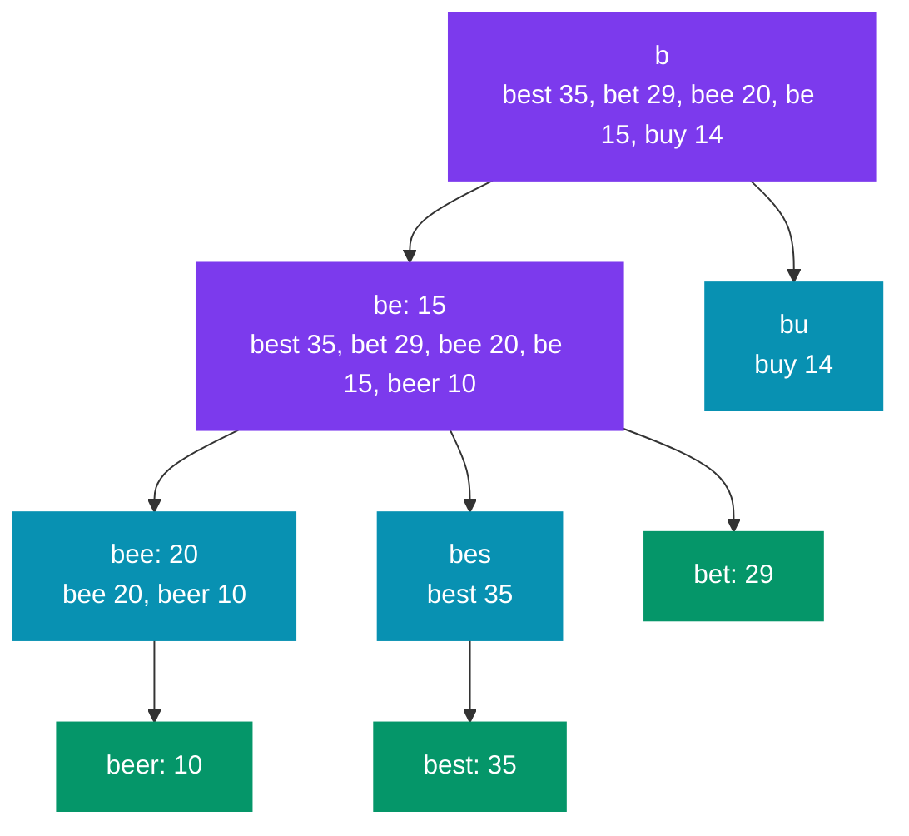
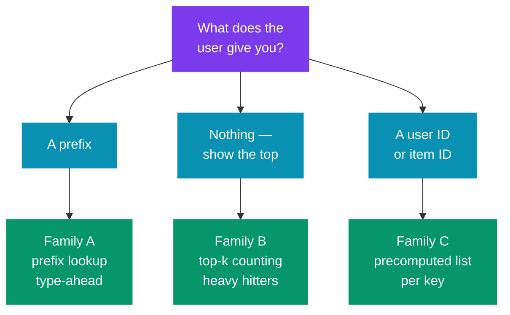

# Ch 13: Design a Search Autocomplete System

> 📖 **Vol 1, Chapter 13** (book pages 200–219) &nbsp;·&nbsp; 🔥 High Priority &nbsp;·&nbsp; 💬 **19 Questions**  
> **Source:** Alex Xu, *System Design Interview Vol 1*, Ch 13. Page and figure numbers below are the book's. This PDF edition prints no page numbers in the footer, so pages are the PDF page numbers (the chapter starts on page 200).

---

📊 **Question Count**

| # | Section | Questions |
|---|---|---|
| 1 | [Requirements and Estimation 🔥](#1--requirements-and-estimation-p200202-) | 1 |
| 2 | [High-level Design — Two Services and a SQL Table ⚡](#2--high-level-design--two-services-and-a-sql-table-p203205-) | 1 |
| 3 | [The Trie and Top-k Caching 🔥🔥](#3--the-trie-and-top-k-caching-p206210-) | 3 |
| 4 | [Data Gathering Service 🔥🔥](#4--data-gathering-service-p210212-) | 3 |
| 5 | [Query Service 🔥](#5--query-service-p213215-) | 3 |
| 6 | [Trie Operations — Create, Update, Delete 🔥](#6--trie-operations--create-update-delete-p215216-) | 2 |
| 7 | [Scale the Storage 🔥](#7--scale-the-storage-p216217-) | 1 |
| 8 | [Wrap Up — Languages, Countries, Trending ⚡](#8--wrap-up--languages-countries-trending-p218-) | 4 |
| 9 | [Similar Problems This Design Solves 📎 🔥](#9--similar-problems-this-design-solves--) | 1 |
| | **Total** | **19** |

> 🔥🔥 Very high priority — asked in almost every Tier-1 interview loop &nbsp;·&nbsp; 🔥 High priority — very frequent in Tier-1 interviews &nbsp;·&nbsp; ⚡ Medium priority — commonly asked &nbsp;·&nbsp; 💤 Low priority — good to know, rarely asked

---

## 🗒️ Cheat Sheet

<details>
<summary><strong>🗒️ Show cheat sheet</strong></summary>

### 🎯 Clarifying Questions — and the book's answers
| Question | Book's answer (p.201) |
|---|---|
| Match only at the start of the query, or in the middle too? | **Only at the beginning** |
| How many suggestions? | **5** |
| Which 5? | **By popularity** — the historical query frequency |
| Spell check or autocorrect? | **No** |
| Language? | **English.** Multi-language only if time allows at the end |
| Capital letters and special characters? | **No** — all queries are lowercase letters |
| How many users? | **10 million DAU** |

**Requirements** (p.201): fast (**within 100 ms**, from Facebook's typeahead article) · relevant · sorted by popularity · scalable · highly available. Details in §1.

### 🏗️ Core Components (Figures 13-9, 13-11, 13-14, 13-15)
- **Data gathering service** (Figure 13-9) — builds the trie offline:
  - **Analytics Logs** — raw search queries with a timestamp. Append-only, not indexed.
  - **Aggregators** — turn raw logs into counts per query per week.
  - **Aggregated Data** — rows of `query, time (week start), frequency`.
  - **Workers** — servers that run async jobs at regular intervals. They build the trie and store it in the Trie DB.
  - **Trie DB** — persistent store. A **document store** (serialized trie) or a **key-value store** (prefix → node data).
  - **Trie Cache** — a distributed cache that keeps the trie in memory. It takes a **weekly snapshot** of the Trie DB.
- **Query service** (Figure 13-11) — load balancer → API servers → Trie Cache (→ Trie DB on a miss).
- **Filter layer** (Figure 13-14) — sits between the Trie Cache and the API servers. It removes unwanted suggestions.
- **Shard map manager** (Figure 13-15) — a lookup database that says which shard holds which prefix.

### 💡 Key Insights
1. **Store the top k queries at every trie node** (p.209). Then a lookup is: walk to the prefix node, read its list. No subtree search. It costs a lot of space, but the book calls this trade "well worth it".
2. **Cap the prefix length** (say 50). Then "find the prefix" is O(1) too. So the whole lookup is **O(1)** (p.209–210).
3. **Do not update the trie on every search** (p.210). Build it **offline, weekly**, from logs. Real-time updates would slow the query service, and top suggestions do not change much.
4. **Every keystroke is a request** — 20 per search. So the read QPS is 20× the search rate. **Browser caching** (`max-age=3600`) cuts the number of requests. **AJAX** avoids a page reload on each one (p.214–215).
5. **Shard by first letter is uneven** ('c' has far more words than 'x'). Use historical data and a **shard map manager** (p.216–217).

### ⚖️ Trade-offs / Alternatives
| Option | Pro | Con | Book's verdict |
|---|---|---|---|
| SQL `LIKE 'prefix%' ORDER BY frequency LIMIT 5` (Figure 13-4) | Simple | The database becomes a bottleneck when the data is large | OK only for a small data set (p.205) |
| Trie, search the subtree on every request | Small nodes | Worst case walks the whole trie: O(p) + O(c) + O(c log c) | ❌️ Too slow (p.209) |
| Trie with top k cached at every node | O(1) lookup | A lot of extra space | ✅ Chosen — "well worth it" (p.209) |
| Update the trie on every query (real-time) | Fresh | Slows the query service; top results rarely change | ❌️ Not practical (p.210) |
| Rebuild the trie weekly and replace the old one | Simple, fast reads | Stale up to a week | ✅ Chosen (p.211, p.215) |
| Update one node and its ancestors | Fresh | Slow — every ancestor up to the root changes | Only if the trie is small (p.215) |
| Trie DB as a document store (MongoDB) | Fits a serialized weekly snapshot | Whole-trie blobs | ✅ Option 1 (p.212) |
| Trie DB as a key-value store | One key per prefix | More keys | ✅ Option 2 (Figure 13-10) |
| Shard by first letter | Simple; up to 26 servers, more with 2nd/3rd letter | Uneven: 'c' ≫ 'x' | ❌️ Naive (p.216) |
| Shard map manager over historical data | Even load | One more lookup | ✅ Chosen (Figure 13-15) |

### 🔢 Numbers to Remember
| What | Value | Arithmetic |
|---|---|---|
| Daily active users | **10 million** | Given (p.201) |
| Searches per day | **100 million** | 10M users × 10 searches |
| Bytes per query | **20 bytes** | 4 words × 5 chars × 1 byte (ASCII) |
| Requests per search | **20** | One request per typed character (20 chars) |
| Requests per day | **2 billion** | 100M searches × 20 requests |
| Average QPS | **~24,000** (book) | 2,000,000,000 / 86,400 s = **23,148** — the book rounds up to ~24K |
| Peak QPS | **~48,000** (book) | 2 × 24,000. From the exact value: 2 × 23,148 = **46,296** |
| New data per day | **0.4 GB** | 100M queries × 20 B × 20% new = 400,000,000 B = **0.4 GB** |
| 📎 New data per year | **~146 GB** | 0.4 GB × 365 |
| Latency target | **100 ms** | From Facebook's typeahead article (p.201) |
| Suggestions (k) | **5** | Book caches top 5 per node (p.209) |
| Max prefix length | **50** | Makes "find the prefix" O(1) (p.209) |
| Trie rebuild | **Weekly** | p.211 |
| Browser cache | **1 hour** | Google: `cache-control: private, max-age=3600` (Figure 13-12) |
| First-level shards | **up to 26** | One per letter; split 'a' into 4: aa–ag, ah–an, ao–au, av–az (p.216) |

### ⏱️ 45-Minute Round Plan
| Minutes | Phase | What to say or draw | Trap to avoid |
|---|---|---|---|
| 0–5 | Clarify | Prefix only, top 5 by frequency, lowercase English, no spell check, 10M DAU | Designing spell check or personalization nobody asked for |
| 5–10 | Estimate | 2B requests/day → ~24K QPS, ~48K peak, 0.4 GB new data/day | Forgetting that **each keystroke** is a request |
| 10–15 | High-level design | Two services: data gathering + query. Start with a frequency table and the SQL query | Staying on SQL — say why it does not scale |
| 15–27 | **Trie deep dive** | Trie → naive cost → cap prefix + top k per node → O(1). Draw Figure 13-8 | Running out of time on basic trie theory — the book calls it a data structure question |
| 27–35 | Data gathering | Logs → aggregators → aggregated data → workers → Trie DB → Trie Cache, weekly | Updating the trie on every search |
| 35–40 | Query service + ops | LB → API → Trie Cache; AJAX, browser cache, sampling; update and delete (filter layer) | No answer for "how do you remove a bad suggestion?" |
| 40–45 | Scale + wrap-up | Shard by letter → shard map manager; Unicode; per-country tries; trending | Claiming real-time trending is easy |

> 📎 The timings are a suggestion, not from the book. The book gives the steps; the minutes are ours.

---

</details>
<br/>

---

## 1. 📋 Requirements and Estimation (p.200–202) 🔥

Autocomplete shows matches while the user types. Other names: **typeahead**, **search-as-you-type**, **incremental search** (p.200). Figure 13-1 shows Google suggestions for "dinner". The interview question is also called **"design top k"** or "design top k most searched queries".

**Step 1 — the clarifying questions** are in the Cheat Sheet table. The requirements that come out of them (p.201):

| Requirement | What it means |
|---|---|
| **Fast response time** | Suggestions must show up fast. Facebook's system returns results **within 100 ms**. Slower than that, the UI stutters |
| **Relevant** | Suggestions match the search term |
| **Sorted** | By popularity or another ranking model |
| **Scalable** | Handles high traffic |
| **Highly available** | Still works when part of the system is offline, slow, or has network errors |

### Back-of-the-envelope estimation (p.201–202)

The book's assumptions:

- **10 million DAU.**
- A person does **10 searches per day**.
- **20 bytes per query string.** ASCII, so 1 character = 1 byte. A query has 4 words of 5 characters: 4 × 5 = 20 bytes.
- The client sends **one request per typed character**. So about **20 requests per search**. Typing "dinner" sends 6 requests:

```
search?q=d
search?q=di
search?q=din
search?q=dinn
search?q=dinne
search?q=dinner
```

**The maths:**

```
QPS      = 10,000,000 users × 10 queries/day × 20 characters / 24 hours / 3600 s
         = 2,000,000,000 / 86,400
         = 23,148          (the book writes ~24,000)
Peak QPS = QPS × 2 ≈ 48,000 (book)   — exact: 46,296
Storage  = 10,000,000 × 10 queries/day × 20 bytes × 20% new
         = 400,000,000 bytes = 0.4 GB of new data per day
```

> ⚠️ **Book inconsistency — QPS rounding.** The formula on p.202 gives **23,148**, not 24,000. The book rounds up, so peak becomes 48,000 instead of about 46,000. In an interview, say "about 23K, call it 24K". Both are fine for sizing.

### ❓ Interview Questions

1. **Estimate the QPS and storage for 10 million DAU. 🔥**

<!-- -->
<details>
<summary>💡 Show Answer</summary>

**Answer:**

The book's assumptions (p.201): 10 searches per user per day. A query is 4 words × 5 characters = **20 bytes** (ASCII). One request per typed character, so **20 requests per search**.

```
Requests/day = 10M × 10 × 20 = 2,000,000,000
QPS          = 2,000,000,000 / 86,400 = 23,148   → book: ~24,000
Peak         = 2 × QPS                           → book: ~48,000
New data/day = 10M × 10 × 20 B × 20% = 0.4 GB
```

The book rounds 23,148 up to 24,000 (see the inconsistency note above). Only **20% of queries are new**. Repeats only raise a counter, so they add no storage.

The key point: **every keystroke is a request**. That 20× factor is why browser caching matters (§5 Q1).

</details>

---

## 2. 🧭 High-level Design — Two Services and a SQL Table (p.203–205) ⚡

**Step 2** splits the system into two parts (p.203):

- **Data gathering service** — collects the queries users type and aggregates them **in real time**. The book says real-time processing is not practical for large data sets. It is only a starting point. §4 replaces it.
- **Query service** — given a prefix, returns the **5 most searched terms**.

### Data gathering — the frequency table (Figure 13-2)

A table stores `query` and `frequency`. It starts empty. Users type "twitch", "twitter", "twitter", "twillo", one after another. Each search adds 1 to its row (or adds a new row). The end state is **twitch: 1, twitter: 2, twillo: 1**.

### Query service — top 5 from SQL (Table 13-1, Figure 13-3)

| Query | Frequency |
|---|---|
| twitter | 35 |
| twitch | 29 |
| twilight | 25 |
| twin peak | 21 |
| twitch prime | 18 |
| twitter search | 14 |
| twillo | 10 |
| twin peak sf | 8 |

The user types "tw". The top 5 are: **twitter, twitch, twilight, twin peak, twitch prime** (Figure 13-3). The SQL (Figure 13-4, fixed — see below):

```sql
SELECT * FROM frequency_table
WHERE query LIKE 'prefix%'
ORDER BY frequency DESC
LIMIT 5;
```

This works for a **small** data set. When the data is large, **the database becomes a bottleneck** (p.205).

> ⚠️ **Book bug — SQL quotes.** Figure 13-4 writes ``LIKE `prefix%` `` with backticks. In MySQL, backticks quote a column name, not a string. The query would fail. Use single quotes: `LIKE 'prefix%'`.

📎 **Why SQL is slow here.** An index on `query` does help `LIKE 'prefix%'` find the rows. (In PostgreSQL, a normal B-tree index helps only with the `C` collation or a `text_pattern_ops` index.) But for a short prefix like "t", millions of rows match. The database must then sort all of them by `frequency` to get 5. That sort runs on every keystroke.

### ❓ Interview Questions

1. **Why not just use SQL? What is wrong with `LIKE 'prefix%'`? ⚡**

<!-- -->
<details>
<summary>💡 Show Answer</summary>

**Answer:**

The book's first design (Figure 13-4):

```sql
SELECT * FROM frequency_table
WHERE query LIKE 'prefix%'
ORDER BY frequency DESC
LIMIT 5;
```

It is fine for a small data set. When the data is large, **the database becomes a bottleneck** (p.205).

📎 Why: a short prefix like "t" matches millions of rows. The database must sort them all by frequency to return 5. And this runs ~24,000 times a second. The trie with cached top k does that sort **once, offline**.

(The book prints backticks around `prefix%`. That is a book bug — it must be single quotes.)

</details>

---

## 3. 🌳 The Trie and Top-k Caching (p.206–210) 🔥🔥

**Step 3** dives into five topics (p.206): the trie, data gathering, the query service, scaling storage, and trie operations.

### The basic trie (p.206–207)

A relational database is slow for top 5. So the book uses a **trie** (prefix tree). It says this is "more of a data structure question" — so it gives only an overview. The focus is how to make it fast.

- A trie is a tree. "Trie" is said like "try". The name comes from re**trie**val.
- The **root** is the empty string.
- Each node stores a **character** and has **26 children**, one per letter. Empty links are not drawn.
- Each node is **a word or a prefix**.

Figure 13-5 stores "tree", "try", "true", "toy", "wish", "win". To sort by popularity, add the **frequency** to each query node (Table 13-2, Figure 13-6):

| Query | tree | try | true | toy | wish | win |
|---|---|---|---|---|---|---|
| Frequency | 10 | 29 | 35 | 14 | 25 | 50 |

### The naive top-k algorithm (p.208–209)

Terms: **p** = prefix length, **n** = total nodes in the trie, **c** = number of children of a given node.

| Step | Work | Cost |
|---|---|---|
| 1 | Find the prefix node | O(p) |
| 2 | Walk the subtree under it and collect every valid query | O(c) |
| 3 | Sort them and take the top k | O(c log c) |

**Total: O(p) + O(c) + O(c log c).**

**The book's example** (k = 2, the user types "tr"): find node "tr" → collect [tree: 10], [true: 35], [try: 29] → top 2 = **[true: 35], [try: 29]**.

> ⚠️ **Book bug — text and figure use different examples.** Page 208 says the "tr" example is "shown in Figure 13-7". But Figure 13-7 (p.209) shows prefix **"be"**: it collects bee: 20, beer: 10, bet: 29, best: 35 and returns **[best: 35, bet: 29]**. The "tr" data is in Figure 13-6. Both examples give the right answer. Just read the text with Figure 13-6, and Figure 13-7 on its own.

> ⚠️ **Book inconsistency — what "c" means.** The book defines c as "the number of children of a given node". But step 2 visits the **whole subtree**, not just the direct children. The book itself says the worst case "traverses the entire trie" (p.209). So read **c as the number of nodes in the subtree**. In the worst case (prefix = one letter), that is close to n.

### Two optimizations (p.209–210)

The naive algorithm is too slow. The fixes:

**1. Limit the prefix length.** Users rarely type long queries. So cap p at a small number, **say 50**. Then "find the prefix" goes from O(p) to O(small constant) = **O(1)**.

**2. Cache the top k queries at each node.** Store the top k most searched queries **in every node**. 5 to 10 suggestions are enough, so k is small. Here, **k = 5**.

- This needs **a lot of space**.
- The book's verdict: trading space for time is **"well worth it"**, because fast response matters most.

Figure 13-8 shows the result. The node for **"be"** stores **[best: 35, bet: 29, bee: 20, be: 15, beer: 10]**. The node for **"b"** stores [best: 35, bet: 29, bee: 20, be: 15, buy: 14] — beer: 10 drops out because buy: 14 is higher.



**The new cost** (p.210):

1. Find the prefix node — **O(1)** (prefix is capped).
2. Return the top k — **O(1)** (it is cached).

So the whole lookup is **O(1)**.

> ⚠️ **Book inconsistency — the "w" branch in Figure 13-8.** Figures 13-6 and 13-7 have **win: 50** and **wish: 25**. Figure 13-8 shows **win: 11**, and "wish" is gone. The "b" branch is consistent, so learn the idea from that branch.

📎 **"O(1)" here is honest only because p is capped.** Without the cap, step 1 is still O(p). Say both in the interview: "O(p) to walk, and p ≤ 50, so O(1)."

📎 **A Java sketch** of the cached trie. The workers call `insert` once per query from the weekly aggregated data. The query service calls `suggest`.

```java
import java.util.*;

record QueryCount(String query, long count) {}

class TrieNode {
    final Map<Character, TrieNode> children = new HashMap<>();
    final List<QueryCount> topK = new ArrayList<>();
}

class AutocompleteTrie {
    private static final int K = 5;
    private static final int MAX_PREFIX = 50;
    private final TrieNode root = new TrieNode();

    // Build time (workers): add the query to the top-k list of every prefix node
    void insert(String query, long count) {
        QueryCount qc = new QueryCount(query, count);
        TrieNode node = root;
        int depth = Math.min(query.length(), MAX_PREFIX);
        for (int i = 0; i < depth; i++) {
            node = node.children.computeIfAbsent(query.charAt(i), c -> new TrieNode());
            addToTopK(node, qc);
        }
    }

    // Query time: walk at most 50 nodes, then read the cached list
    List<QueryCount> suggest(String prefix) {
        if (prefix.length() > MAX_PREFIX) {
            return List.of();
        }
        TrieNode node = root;
        for (char c : prefix.toCharArray()) {
            node = node.children.get(c);
            if (node == null) {
                return List.of();
            }
        }
        return List.copyOf(node.topK);
    }

    private void addToTopK(TrieNode node, QueryCount qc) {
        node.topK.add(qc);
        node.topK.sort(Comparator.comparingLong(QueryCount::count).reversed());
        if (node.topK.size() > K) {
            node.topK.remove(K);
        }
    }
}
```

`insert` assumes each query comes once, with its total count. That is what the aggregated data gives.

### ❓ Interview Questions

1. **Walk me through the trie and how it gives top-k suggestions fast. 🔥🔥**

<!-- -->
<details>
<summary>💡 Show Answer</summary>

**Answer:**

A trie (prefix tree) has one node per prefix. The root is the empty string. The path from the root spells the prefix (p.206).

**Naive lookup** (p.208): find the prefix node — O(p). Walk its subtree and collect all queries — O(c). Sort and take k — O(c log c). Too slow: in the worst case it walks the whole trie.

**The two fixes** (p.209):

- **Cap the prefix** at about 50 characters. Finding the node is then O(1).
- **Store the top k queries at every node.** The node for "be" holds [best: 35, bet: 29, bee: 20, be: 15, beer: 10] (Figure 13-8).

Now a lookup is: walk to the node, return its list. **O(1).** The cost is a lot of space. The book says this trade is **"well worth it"**, because speed matters most.

**Example** (Table 13-1, Figure 13-3): typing "tw" returns twitter, twitch, twilight, twin peak, twitch prime.

</details>

---

2. **How do you handle very long prefixes? ⚡**

<!-- -->
<details>
<summary>💡 Show Answer</summary>

**Answer:**

The book **caps the prefix length** at a small number, **say 50** (p.209). Users rarely type long queries.

- This makes "find the prefix" **O(1)** instead of O(p).
- 📎 If the prefix is longer than the cap, return an empty list. Autocomplete adds little value there — the user knows what they want.
- 📎 Build trie nodes only up to the cap. This limits the trie depth and its memory.

</details>

---

3. **What if the user wants matches in the middle of a query too? 📎 ⚡**

<!-- -->
<details>
<summary>💡 Show Answer</summary>

**Answer:**

The book scopes this out: match **only at the beginning** (p.201). A trie walks from the first character, so "york" does not find "new york pizza".

Ways to support it:

- **Index each word start.** Insert the query once per word: "new york pizza", "york pizza", "pizza". Each entry points to the full query and its count. The trie grows by about the number of words per query (4 in the book's estimate).
- **Use a search engine.** Elasticsearch has a `completion` suggester (fast, prefix only, kept in memory). For matches inside the text, use an `edge_ngram` analyzer or the `search_as_you_type` field. These index the start of every word.
- **Fuzzy matching** (typos) is a separate feature. It needs edit-distance search, which the book also scopes out ("no spell check").

**What to say:** "Prefix only is a scope choice. If we need word matches, I index every word start, or move to a search engine."

</details>

---

## 4. 📥 Data Gathering Service (p.210–212) 🔥🔥

The Step 2 design updates data **in real time** on every search. The book says this is not practical, for two reasons (p.210):

- Users may type **billions of queries per day**. Updating the trie on each one slows down the query service a lot.
- Top suggestions **do not change much** once the trie is built. So frequent updates are not needed.

How fresh the data must be depends on the product. **Twitter** needs up-to-date suggestions. Many **Google** keywords do not change much day to day. But the base is the same: the data comes from **analytics or logging services**.

### The redesigned pipeline (Figure 13-9)


**Analytics Logs** (Table 13-3). Raw data about searches. **Append-only, not indexed.**

| query | time |
|---|---|
| tree | 2019-10-01 22:01:01 |
| try | 2019-10-01 22:01:05 |
| tree | 2019-10-01 22:01:30 |
| toy | 2019-10-01 22:02:22 |
| tree | 2019-10-02 22:02:42 |
| try | 2019-10-03 22:03:03 |

**Aggregators.** Logs are very large and in the wrong format. Aggregators turn them into counts.

- **Real-time products** like Twitter aggregate over **short intervals**.
- For many products, **once a week** is enough.
- In the interview, **ask whether real-time results matter**. The book assumes the trie is **rebuilt weekly**.

**Aggregated Data** (Table 13-4). `time` is the **start of the week**. `frequency` is the total count for that week.

| query | time | frequency |
|---|---|---|
| tree | 2019-10-01 | 12000 |
| tree | 2019-10-08 | 15000 |
| tree | 2019-10-15 | 9000 |
| toy | 2019-10-01 | 8500 |
| toy | 2019-10-08 | 6256 |
| toy | 2019-10-15 | 8866 |

📎 **How to turn many weeks into one score.** The book keeps one row per query per week, but does not say how the workers combine them. A simple choice is a **time decay**: `score = Σ frequency(week) × d^age`, with `d` below 1 (for example 0.5) and `age` in weeks. Last week counts fully, older weeks count less. This is the book's "more weight to recent queries" idea (§8), applied in the weekly build.

**Workers.** A set of servers that run **async jobs at regular intervals**. They **build the trie** and store it in the Trie DB.

**Trie Cache.** A **distributed cache** that keeps the trie **in memory** for fast reads. It takes a **weekly snapshot** of the DB.

**Trie DB.** The persistent store. Two options (p.212):

1. **Document store.** A new trie is built weekly. Take a snapshot, **serialize** it, and store it. Document stores like **MongoDB** fit serialized data well.
2. **Key-value store.** Represent the trie as a hash table:
   - Every **prefix** → a **key**.
   - The **data on each node** → the **value**.

**Figure 13-10** — the trie as key-value pairs:

| Key | Value |
|---|---|
| b | [be: 15, bee: 20, beer: 10, best: 35] |
| be | [be: 15, bee: 20, beer: 10, best: 35] |
| bee | [bee: 20, beer: 10] |
| bes | [best: 35] |
| beer | [beer: 10] |
| best | [best: 35] |

### ❓ Interview Questions

1. **How does the data gathering service work? Why not update the trie on every search? 🔥🔥**

<!-- -->
<details>
<summary>💡 Show Answer</summary>

**Answer:**

**Why not real time** (p.210):

- Users type billions of queries per day. Updating the trie on each one slows the query service a lot.
- Top suggestions change little once the trie is built.

**The pipeline** (Figure 13-9):

1. **Analytics Logs** — raw `query, time` rows. Append-only, not indexed.
2. **Aggregators** — count each query per week (Table 13-4: `query, time = week start, frequency`).
3. **Workers** — async jobs at regular intervals. They build the trie and write it to the **Trie DB**, weekly.
4. **Trie Cache** — a distributed in-memory cache. It takes a **weekly snapshot** of the DB.

**How fresh?** It depends on the product. Twitter needs short intervals. For many Google keywords, weekly is enough. **Ask the interviewer.** The book assumes a weekly rebuild.

📎 A typical stack: Kafka for the logs, a Spark batch job for the counts. The book names no tools for this pipeline. It names Kafka, Spark Streaming, Storm and Hadoop only for trending (§8).

</details>

---

2. **How do you store the trie in the Trie DB? 🔥**

<!-- -->
<details>
<summary>💡 Show Answer</summary>

**Answer:**

Two options (p.212):

1. **Document store** (for example MongoDB). The trie is rebuilt weekly. Take a snapshot, **serialize** it, and store it as a document.
2. **Key-value store.** Map **every prefix to a key**, and **each node's data to the value** (Figure 13-10). For example, `be → [be: 15, bee: 20, beer: 10, best: 35]`.

The key-value form is a trie flattened into a hash table. A lookup is then one `get(prefix)`. See [Ch 6](ch06_design_a_key_value_store.md) for how a key-value store works.

📎 Figure 13-10 lists each value in insert order. A real store should keep each value **sorted by frequency** (as in Figure 13-8) and trimmed to k. Then the read needs no work at all.

</details>

---

3. **Can you use a hash map instead of a trie? What are the trade-offs? 📎 🔥**

<!-- -->
<details>
<summary>💡 Show Answer</summary>

**Answer:**

Yes. A map of `prefix → [top k suggestions]` gives O(1) lookup. In fact, the book's **key-value Trie DB** (Figure 13-10) is exactly this map.

The differences:

- Every prefix ("t", "tw", "twi", "twit") is a separate key. So the key strings repeat characters that a trie shares. The top-k lists cost the same in both designs, and they are most of the memory.
- A map has no parent-child links. So a single-node update (§6 Q1) must find every ancestor key by cutting the string, one character at a time. A trie just walks up.

**What to say:** "I think about it as a trie. I may **store** it as a prefix → list map in a key-value store."

</details>

---

## 5. 🔎 Query Service (p.213–215) 🔥

The Step 2 query service calls the database directly. That is slow. Figure 13-11 is the improved design (p.213–214):

1. A search query goes to the **load balancer**.
2. The load balancer sends it to the **API servers**.
3. The API servers get trie data from the **Trie Cache** and build the suggestions.
4. If the data is **not in the Trie Cache**, load it back from the **Trie DB** into the cache. Later requests for the same prefix then hit the cache. A miss happens when a cache server is **out of memory or offline**.


(The filter layer comes from Figure 13-14, §6. Data flows from the cache, through the filter, to the API servers.)

### Optimizations — the query service must be very fast (p.214–215)

- **AJAX requests.** Web browsers fetch suggestions with AJAX. The page does not reload on each request.
- **Browser caching.** Suggestions do not change much in a short time. So the browser can cache them. **Google** does this. Figure 13-12 shows the response header for "system design interview":
  - `cache-control: private, max-age=3600`
  - **`private`** — the result is for one user. A **shared cache** must not store it.
  - **`max-age=3600`** — valid for **3600 seconds = 1 hour**.
- **Data sampling.** Logging every search costs a lot of CPU and storage. So log only **1 out of every N** requests.

📎 **Why sampling is safe here.** The trie needs only the **ranking** of queries. A random 1-in-N sample keeps about the same order for popular queries. Rare queries may drop out, but they would never reach a top 5 anyway.

📎 **Debounce on the client.** Many clients wait a short time (for example 100–200 ms) after the last keystroke before sending a request. A fast typist then sends fewer than 20 requests per search. The book does not mention this.

📎 **Responses can come back out of order.** The user types "di", then "din". The "din" response may arrive first, then the older "di" response. If the client shows whatever arrives last, the list is wrong. So the client tags each request with its prefix (or a sequence number). It drops any response that is not for the current text, and cancels old requests where it can.

### ❓ Interview Questions

1. **Walk me through the query service. How do you make it fast? 🔥**

<!-- -->
<details>
<summary>💡 Show Answer</summary>

**Answer:**

**The flow** (Figure 13-11):

1. The request goes to the **load balancer**.
2. The load balancer sends it to the **API servers**.
3. The API servers read trie data from the **Trie Cache** and build the suggestions.
4. On a **cache miss**, load the data from the **Trie DB** back into the cache. A miss happens when a cache server is out of memory or offline.

**Optimizations** (p.214–215):

- **AJAX** — the browser fetches suggestions without reloading the page.
- **Browser caching** — Google sends `cache-control: private, max-age=3600`. The browser keeps results for **1 hour**. `private` means a shared cache must not store them.
- **Data sampling** — log only 1 in N requests. This saves CPU and storage.

📎 The API servers are **stateless**, so you add more behind the load balancer as QPS grows. The trie is read-only between rebuilds, so reads need no locks.

</details>

---

2. **What happens if the Trie Cache goes down? 📎 ⚡**

<!-- -->
<details>
<summary>💡 Show Answer</summary>

**Answer:**

The book only says a cache miss can happen when a cache server is out of memory or offline. Then the API servers load the data from the **Trie DB** back into the cache (p.214). That keeps it working, but slower.

To reduce the risk:

- **Replicate** the Trie Cache, with automatic failover.
- Let each API server keep a **local in-memory copy** of the hot part of the trie. Refresh it on each rebuild. If the shared cache fails, the server serves from its copy.
- Protect the Trie DB from a flood of misses: put a short timeout and a rate limit on the reload path.

You give up some freshness to get resilience. That is fine, because the data changes only weekly.

</details>

---

3. **Should suggestions be case-sensitive? 📎 💤**

<!-- -->
<details>
<summary>💡 Show Answer</summary>

**Answer:**

No, for web search. The book's scope already assumes **lowercase only** (p.201).

- Normalize every query to lowercase **before** counting and **before** lookup.
- This keeps the trie small: no upper-case copies.
- It matches what users expect: "Netflix" and "netflix" give the same list.

Use the **same** normalization in the data gathering pipeline and the query service. If they differ, lookups miss. For product search with brand names, you may keep the original case for **display** only.

</details>

---

## 6. 🔧 Trie Operations — Create, Update, Delete (p.215–216) 🔥

### Create

**Workers** build the trie from the **aggregated data**. The source is the Analytics Log/DB.

### Update — two options

- **Option 1 — rebuild weekly.** Build a new trie. Then the **new trie replaces the old one**.
- **Option 2 — update one node directly.** The book avoids this because it is **slow**. It is fine only **if the trie is small**. When a node changes, **all its ancestors up to the root** must change too, because ancestors store the top queries of their children.

**Figure 13-13** — "beer" goes from **10 to 30**:

| Node | Before | After |
|---|---|---|
| beer | beer: 10 | **beer: 30** |
| bee | [bee: 20, beer: 10] | [**beer: 30**, bee: 20] |
| be | [best: 35, bee: 20, be: 15, beer: 10] | [best: 35, **beer: 30**, bee: 20, be: 15] |
| b | [best: 35, bee: 20, be: 15, beer: 10] | [best: 35, **beer: 30**, bee: 20, be: 15] |

📎 **The swap in Option 1 is a pointer change.** Load the new trie fully, then switch the reference in one step (for example a Java `AtomicReference<Trie>` or a `volatile` field). Readers see the old trie or the new one, never a half-built one. This is a blue/green swap for data.

### Delete — the filter layer (Figure 13-14)

Some suggestions must go: **hateful, violent, sexually explicit or dangerous** ones.

- Add a **filter layer in front of the Trie Cache**. It removes unwanted suggestions before the API servers return them.
- A filter layer lets you remove results by **different filter rules**.
- **Also remove** the unwanted queries **physically from the database, asynchronously**. Then the next weekly build uses the clean data set.

So the filter gives an **instant** fix, and the DB cleanup gives a **lasting** fix.

### ❓ Interview Questions

1. **How do you update the trie? What does a single-node update cost? 🔥**

<!-- -->
<details>
<summary>💡 Show Answer</summary>

**Answer:**

Two options (p.215):

- **Option 1 — weekly rebuild.** Build a new trie. It **replaces** the old one. This is the book's main choice.
- **Option 2 — update one node.** **Slow**, so avoid it. It is OK only if the trie is small.

**Why Option 2 is slow:** every ancestor stores the top queries of its children. So a change must go **all the way up to the root**. In Figure 13-13, "beer" goes from 10 to 30. Then "bee", "be" and "b" all get `beer: 30` and re-sort their lists.

📎 **Make Option 1 safe for readers.** Build the new trie fully. Then swap one reference (for example an `AtomicReference`). Readers see the old trie or the new one, never half of each.

📎 **Urgent changes between rebuilds** (a harmful query going viral): do not wait for the weekly job. Add a rule to the **filter layer** (Q2 below). It takes effect at once.

</details>

---

2. **How do you remove harmful suggestions? 🔥**

<!-- -->
<details>
<summary>💡 Show Answer</summary>

**Answer:**

The book's answer (p.216, Figure 13-14):

- Add a **filter layer in front of the Trie Cache**. It removes **hateful, violent, sexually explicit or dangerous** suggestions before the API servers send them.
- The filter layer is **flexible**: you can remove results by **different filter rules**.
- Also **remove the bad queries physically from the database, asynchronously**. Then the next trie build uses clean data.

So you get two layers: the filter is **instant**, and the DB cleanup is **lasting**.

📎 A Trust and Safety team usually owns the block list. It can change at any time, separate from the weekly build.

📎 One more detail: if the filter drops 2 of the 5 cached results, only 3 are left. Cache a few more than k per node (say 10), so the filter still has 5 to return.

</details>

---

## 7. 📦 Scale the Storage (p.216–217) 🔥

The trie can grow **too large for one server**. How to shard it?

### Naive: shard by the first letter (p.216)

English only, so split on the first character:

- **2 servers:** 'a'–'m' on server 1, 'n'–'z' on server 2.
- **3 servers:** 'a'–'i', 'j'–'r', 's'–'z'.
- This **first-level sharding** goes up to **26 servers** (26 letters).
- For more than 26, shard on the **second or third letter**. For example, split 'a' into 4: **'aa'–'ag', 'ah'–'an', 'ao'–'au', 'av'–'az'**.

**The problem:** many more words start with **'c'** than with **'x'**. The load is **uneven**.

### Better: shard by historical data (Figure 13-15, p.217)

- Study the **historical distribution** of queries.
- A **shard map manager** keeps a **lookup database**. It says where each row is stored.
- **Example:** if 's' has about as many queries as 'u', 'v', 'w', 'x', 'y' and 'z' together, use **two shards**: one for 's', one for 'u'–'z'.

The flow: web servers ① ask the shard map manager "which shard?", then ② read the data from that shard.

📎 **Range sharding vs hash sharding.** It depends on what you store:

- **A trie (tree form):** shard by prefix range. A whole subtree stays on one shard, so a walk never crosses servers. Hashing each query (see [Ch 5](ch05_design_consistent_hashing.md)) would spread one subtree over all shards.
- **The key-value form** (prefix → top-k list, Figure 13-10): each read is one `get(prefix)`. So hash sharding on the prefix key also works, and it spreads load evenly with no shard map. The cost: "t", "tw" and "twi" land on different shards. The build job then writes to every shard.

The book shards by range. With the key-value form, hash sharding is a fair alternative — say both.

📎 **Will the data fit on one server?** A rough upper bound, with our own assumptions (not the book's):

```
Unique queries kept       = 10 million   (rare ones dropped)
Prefix nodes, worst case  = 10M × 20 chars = 200 million   (shared prefixes make it much smaller)
Top-5 list per node       = 5 × (8-byte query ID + 8-byte count) = 80 bytes
Lists, worst case         = 200M × 80 B = 16 GB
```

So **store query IDs in the lists, not the strings**. With 20-byte strings, each list is 5 × 28 = 140 bytes, not 80. Add the node and pointer overhead on top of the 16 GB. That is why the trie can outgrow one server — and more languages and countries multiply it.

### ❓ Interview Questions

1. **How would you shard the trie when it does not fit on one server? 🔥🔥**

<!-- -->
<details>
<summary>💡 Show Answer</summary>

**Answer:**

**Naive — by first letter** (p.216):

- 2 servers: 'a'–'m' and 'n'–'z'. 3 servers: 'a'–'i', 'j'–'r', 's'–'z'.
- Up to **26 servers** this way. Beyond that, split on the second or third letter: 'a' → 'aa'–'ag', 'ah'–'an', 'ao'–'au', 'av'–'az'.
- **Problem:** far more words start with 'c' than 'x'. The load is uneven.

**Better — use historical data** (Figure 13-15, p.217):

- A **shard map manager** keeps a lookup database of which prefix lives where.
- If 's' gets as many queries as 'u' to 'z' together, give 's' one shard and 'u'–'z' another.
- The web server first asks "which shard?", then reads from that shard.

📎 The web servers can cache the shard map in memory, so the lookup costs no extra call.

📎 If the Trie DB uses the key-value form (prefix → list), hashing the prefix key is also fine: each read is one `get`. It spreads load evenly with no shard map. Range sharding matters when you keep the trie as a tree, so a subtree stays on one server.

</details>

---

## 8. 🏁 Wrap Up — Languages, Countries, Trending (p.218) ⚡

**Step 4** — three follow-ups the book answers:

**Multiple languages?** Store **Unicode** characters in trie nodes. Unicode is "an encoding standard [that] covers all the characters for all the writing systems of the world, modern and ancient".

**Top queries differ by country?** Build **different tries for different countries**. To improve response time, **store tries in CDNs**.

📎 A CDN serves files and cached HTTP responses. It does not run trie walks. In practice, this means caching the **responses** for popular prefixes (`/search?q=tw` → JSON list) at the edge, per country. Rare prefixes still go to the query service.

**Trending (real-time) queries?** A news event breaks and a query suddenly becomes popular. The design above fails because:

- The offline workers are **not scheduled yet** — they run weekly.
- Even if scheduled, **building the trie takes too long**.

The book says real-time autocomplete is **complicated and beyond its scope**. It gives three ideas:

- **Reduce the working data set by sharding.**
- **Change the ranking model** — give **more weight to recent** queries.
- Data may come as **streams**, so you never have all of it at once. Stream processing needs other systems: **Hadoop MapReduce, Spark Streaming, Storm, Kafka**.

📎 A common concrete answer is in Q1 below.

### ❓ Interview Questions

1. **How would you support trending (real-time) queries? 🔥**

<!-- -->
<details>
<summary>💡 Show Answer</summary>

**Answer:**

**Why the design fails** (p.218): a news event makes a query popular now. But the workers run **weekly**. And even if they ran now, **building the trie takes too long**.

**The book's ideas** (it calls the topic "beyond the scope of this book"):

- **Reduce the working data set by sharding.**
- **Change the ranking model** — give **more weight to recent** queries.
- Treat the data as a **stream**. Use stream systems: Hadoop MapReduce, Spark Streaming, Storm, Kafka.

📎 **A concrete design.** Keep a small **trending overlay**: a separate map of `prefix → trending top k`.

- A stream job counts queries over a short rolling window (for example, the last 15 minutes).
- It refreshes the overlay every few minutes.
- The query service **merges** the weekly trie's list with the overlay, removes duplicates, and returns the top 5.

The weekly trie stays simple, and viral queries show up within minutes.

📎 **Two details a senior interviewer asks:**

- **Counting with little memory.** A window can hold millions of distinct queries. A **Count-Min Sketch** counts them in fixed memory. It can over-count, but never under-counts. Keep a **min-heap of size k** next to it for the current top k.
- **Merging two scales.** A 15-minute count and a weekly count are not comparable. Rank by a blended score (for example, a boost for trending items), not by raw count.

</details>

---

2. **How do you support many languages, and different countries? 💤**

<!-- -->
<details>
<summary>💡 Show Answer</summary>

**Answer:**

The book's answers (p.218):

- **Languages:** store **Unicode** characters in trie nodes.
- **Countries:** top queries differ by country. So build **a different trie per country**. Store the tries in **CDNs** to improve response time.

📎 Details:

- Mixing scripts in one trie is not wrong. Each code point is just another child. The reason to split is **relevance**, not correctness.
- The query service picks the trie from the user's locale: a user setting, the `Accept-Language` header, or the country from the IP. `Accept-Language` is the browser's preferred language, not the language of the typed text.
- For large character sets (Chinese, Japanese, Korean), the structure is the same. Each node just has many more children.

</details>

---

3. **How do you support personalized suggestions? 📎 ⚡**

<!-- -->
<details>
<summary>💡 Show Answer</summary>

**Answer:**

The global trie gives every user the same list. Add a **user history layer**:

- Keep each user's recent searches in a per-user store (for example a Redis list).
- Cap it (the last 50–100 queries) and set a TTL.
- At query time, fetch the user's past queries that match the prefix. Rank them above the global ones, merge, and remove duplicates.

The extra cost is one fast lookup per request. Keep the whole call inside the 100 ms budget.

</details>

---

4. **How do you measure the quality of suggestions? 📎 💤**

<!-- -->
<details>
<summary>💡 Show Answer</summary>

**Answer:**

Key metrics:

1. **Click-through rate (CTR)** — what share of shown suggestions are clicked.
2. **Zero-result rate** — how often a prefix returns no suggestions.
3. **Latency p50 / p99** — check the 100 ms target.
4. **Keystrokes saved** — how many characters the user did not need to type.

A/B test ranking changes against these metrics. Track the funnel: prefix typed → suggestion shown → suggestion clicked → search done.

</details>

---

## 9. 🧬 Similar Problems This Design Solves 📎 🔥

📎 The book does not list similar problems for this chapter. But the same core solves **at least 13 common interview problems**. Learn the core once, then change only a few parts for each one.

**The core that never changes:**
- **Count events from logs**, not on the request path. Sampling is fine when only the ranking matters.
- **Precompute the answer per key offline** — here, the top k for every prefix. A read does no ranking work.
- **Serve reads from memory** (a cache or an in-memory structure), with the persistent store behind it.
- **Swap in the new version in one step** when a rebuild finishes. Readers never see half of it.
- **A filter layer** for urgent removals between rebuilds.

**The tag on each problem** says how often it is asked as an HLD round on its own (same legend as the questions). 🔥🔥 = learn its "what is different" column well; 💤 = knowing the family is enough.

**The one choice that splits them into three families:** what does the user give you?



### Family A — the user types a prefix (like this chapter)

| # | Problem | What is different from this chapter |
|---|---|---|
| 1 | **Search autocomplete 🔥🔥** (this chapter) | — |
| 2 | **E-commerce search suggestions (Amazon, Flipkart) 🔥** | Rank by purchases or clicks, not only by search count. Suggest a category too ("shoes in Men"). The filter layer (§6) also hides blocked or out-of-stock items. Big sales days change the ranking within hours, so a weekly rebuild is too slow there |
| 3 | **Place / address autocomplete (Google Maps) ⚡** — [Vol 2 Ch 3](../vol_2/ch03_google_maps.md), [Vol 2 Ch 1](../vol_2/ch01_proximity_service.md) | Rank by **distance from the user** as well as popularity. So the list depends on where the user is. Shard by region (for example geohash), not by first letter (§7). The answer is a place ID, not a query string |
| 4 | **Contact / people search (friends, colleagues) ⚡** | The data is **per user** and small — your own contacts. So there is no global trie. Load the user's list into a per-user index, or send it to the client and match there. Rank by how often you talk to each person |
| 5 | **@mention and #hashtag suggestions ⚡** | @mentions come from a small set (people in this chat, or people you follow). Hashtags trend within minutes. So the trending overlay (§8 Q1) is the main path, and the weekly build is only the base |

### Family B — the user wants "the top", with no prefix

| # | Problem | What is different from this chapter |
|---|---|---|
| 6 | **Top-k heavy hitters / trending topics (Twitter trends) 🔥🔥** | No trie at all — one top-k list per time window (and per region). Fresh within minutes, so it is a stream job. Count with a Count-Min Sketch and a min-heap of size k (§8 Q1). Counts can be approximate |
| 7 | **Real-time gaming leaderboard 🔥** — [Vol 2 Ch 10](../vol_2/ch10_real_time_gaming_leaderboard.md) | Every score update must show at once, and each player's score must be **exact**. So no sampling and no weekly batch. A Redis sorted set keeps the order on every write. A player also asks "what is my rank?", which a top-k list cannot answer |
| 8 | **Ad click aggregation 🔥** — [Vol 2 Ch 6](../vol_2/ch06_ad_click_event_aggregation.md) | Counts are used for **billing**, so sampling (§5) is not allowed. It needs exact windowed counts, dedupe, and a way to recount from the raw log. Top-k ads is one query on top of that |
| 9 | **Bestsellers / most-viewed per category ⚡** | Closest to this chapter: a batch job counts sales per category and stores a top-k list per category. The key is a category ID, not a prefix. A daily rebuild is usually enough |

### Family C — the user gives an ID, and you return a list built ahead of time

| # | Problem | What is different from this chapter |
|---|---|---|
| 10 | **News feed 🔥🔥** — [Ch 11](ch11_design_news_feed_system.md) | The key is a user ID, and the list is that user's feed. It is updated on every new post (fan-out on write), not weekly. Celebrities with millions of followers use fan-out on read instead |
| 11 | **"Customers also bought" recommendations ⚡** | An offline job (for example daily) builds a top-k list of similar items per item ID. It writes the lists to a key-value store, like the key-value Trie DB (§4). The ranking comes from a model, not from a count |
| 12 | **Product catalog read path ⚡** — [Product catalog design](../../05_designs/01_product_catalog_platform.md) | The read model is a document per product, rebuilt from change events (CQRS). A price or stock change must show within seconds. So it updates per event, not in a weekly batch |
| 13 | **Pre-built dashboards and reports 💤** | A batch job computes the answer for each filter (day, branch, product) ahead of time. A read is a key lookup. Like the weekly trie, the data is stale until the next run, and the user must accept that |

### How to use this in an interview — five questions

When you get any "show the top results fast" problem, answer these five questions aloud. Each answer picks one part of the design:

| Ask | It decides |
|---|---|
| 1. What does the user give — a prefix, nothing, or an ID? | The **family**, and the key you precompute for (prefix, time window, or ID) |
| 2. How fresh must the ranking be — a week, a day, minutes, or at once? | A **batch rebuild**, a **stream overlay**, or an **update on every write** |
| 3. Can the counts be approximate? | Whether **sampling** and a **Count-Min Sketch** are allowed, or you need exact counts (billing, scores) |
| 4. Is the list the same for every user? | One **global** structure, or one per user, region or country |
| 5. What must never be shown? | A **filter layer** for instant removal, plus a cleanup in the source data for the next build |

> **Where this does *not* transfer directly:**
>
> - **Full-text search over documents.** It needs an inverted index and relevance scoring, not prefixes of whole queries (Elasticsearch, Lucene).
> - **Spell correction ("did you mean").** It needs edit-distance search. A prefix walk cannot find "pizza" from "piza" after the typo.
> - **Exact counts that cost money** — billing, payments, stock. Sampling and approximate counting are wrong there ([Vol 2 Ch 6](../vol_2/ch06_ad_click_event_aggregation.md)).
> - **"Show my own action at once"**, like a query I searched a second ago. That needs a per-user layer (§8 Q3), not the shared weekly build.

### ❓ Interview Questions

1. **Where else can you use this autocomplete design? Pick three problems and say what changes. 📎 🔥**

<!-- -->
<details>
<summary>💡 Show Answer</summary>

**Answer:**

The core stays the same. Count events from logs, off the request path. Precompute the answer per key. Serve reads from memory. Swap in a new version in one step. What changes is **the key**, **how fresh the ranking must be**, and **whether counts can be approximate**.

| | Autocomplete (this chapter) | Trending topics | Gaming leaderboard | Place autocomplete |
|---|---|---|---|---|
| The user gives | A prefix | Nothing | Nothing, or a player ID | A prefix and a location |
| Precomputed key | Every prefix → top 5 | Time window (and region) → top k | One sorted set of all players | Prefix within a region → top k |
| How fresh | Weekly rebuild | Minutes (stream job) | At once, on every write | Days are fine for most places |
| Counts | Sampled, approximate | Approximate (Count-Min Sketch) | Exact scores | From visits and searches |
| Ranking | Search count | Recent count | Score | Popularity and distance |
| Hard part | O(1) lookup, memory | Counting millions of items in a short window | Rank of any player, not only the top | The list depends on where the user is |

**Three families to name:**

- **Prefix lookup** (autocomplete, product suggestions, places, contacts, mentions): this chapter, with a different ranking or a per-user or per-region data set.
- **Top-k counting** (trending, leaderboards, ad clicks, bestsellers): no prefix. Freshness and exactness decide between batch, stream, and a sorted set.
- **Precomputed list per ID** (news feed, recommendations, catalog read model): the same "build ahead, serve by key" idea, with a user or item ID as the key.

🧬 **The full list — 13 problems in three families, plus five questions that map any new one:** see the tables above.

</details>

---
