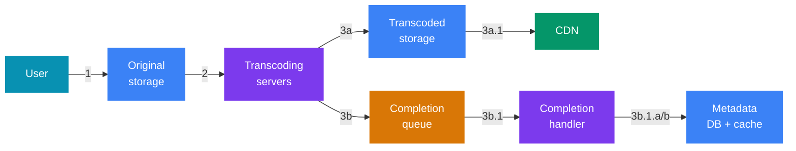
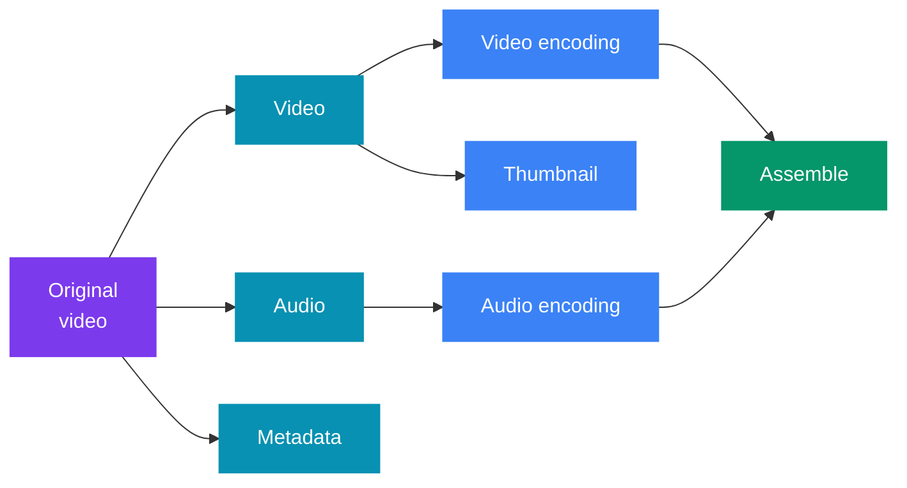
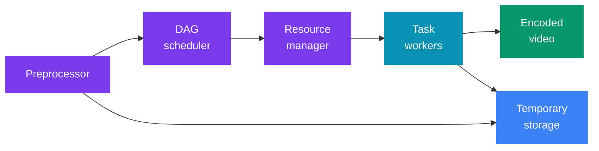
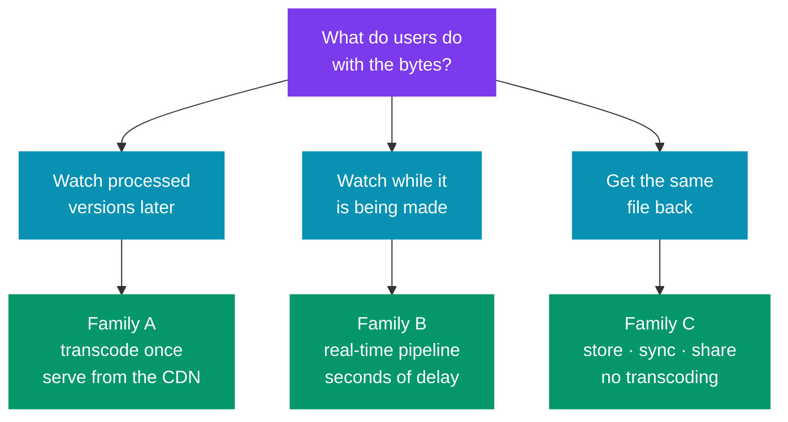

# Ch 14: Design YouTube

---

📊 **Question Count**

| # | Section | Questions |
|---|---|---|
| 1 | [Scope and Estimation 🔥🔥](#1--scope-and-estimation-p220222-) | 1 |
| 2 | [High-level Design and the Upload Flow 🔥🔥](#2--high-level-design-and-the-upload-flow-p223227-) | 4 |
| 3 | [Video Streaming Flow 🔥](#3--video-streaming-flow-p227228-) | 3 |
| 4 | [Video Transcoding and the DAG Model 🔥🔥](#4--video-transcoding-and-the-dag-model-p229230-) | 2 |
| 5 | [Video Transcoding Architecture 🔥](#5--video-transcoding-architecture-p231236-) | 2 |
| 6 | [System Optimizations — Speed, Safety, Cost 🔥🔥](#6--system-optimizations--speed-safety-cost-p236240-) | 6 |
| 7 | [Error Handling and Wrap-up 🔥](#7--error-handling-and-wrap-up-p240242-) | 4 |
| 8 | [Similar Problems This Design Solves 🔥](#8--similar-problems-this-design-solves-) | 1 |
| | **Total** | **23** |

> 🔥🔥 Very high priority — asked in almost every Tier-1 interview loop &nbsp;·&nbsp; 🔥 High priority — very frequent in Tier-1 interviews &nbsp;·&nbsp; ⚡ Medium priority — commonly asked &nbsp;·&nbsp; 💤 Low priority — good to know, rarely asked

> **How to read this note.** Sections 1–7 follow the book, step by step (Step 1 → Step 4). §8, at the end, maps this design to 16 similar problems. Anything the book does not say is marked **📎 Beyond the book**. Where the book has a mistake, the note says so and gives the fix.  
> Related note: a real video pipeline that moved from serverless back to one process is in [the Prime Video case study](../../03_case_studies/03_prime_video_monolith_vs_serverless.md).

---

## 🗒️ Cheat Sheet

<details>
<summary><strong>🗒️ Show cheat sheet</strong></summary>

### 🎯 Clarifying Questions — and the book's answers
| Question | Book's answer (p.221) |
|---|---|
| What features are important? | **Upload a video and watch a video** |
| Which clients? | **Mobile apps, web browsers, smart TV** |
| How many daily active users? | **5 million** |
| Average daily time on the product? | **30 minutes** |
| International users? | **Yes** — a large share of users |
| Supported video resolutions? | **Most resolutions and formats** are accepted |
| Is encryption required? | **Yes** |
| File size limit? | **Small and medium videos. Max 1 GB** |
| Can we use existing cloud services (Amazon, Google, Microsoft)? | **Yes — recommended.** Building everything from scratch is unrealistic |

**Features to design** (p.221): fast upload · smooth streaming · change video quality · low infrastructure cost · high availability, scalability and reliability · mobile, web and smart TV clients.

### 🏗️ Core Components (Figure 14-4)
- **Client** (computer, phone, smart TV) → **load balancer** → **API servers**. The API servers handle **everything except video streaming**: recommendations, the upload URL, metadata, sign-up (p.223).
- **Metadata DB** (**sharded and replicated**) + **metadata cache** (video metadata and user objects) (p.224).
- **Original storage** and **transcoded storage** — both **blob storage**.
- **Transcoding servers** — convert a video into other formats (MPEG, HLS, and so on) for different devices and bandwidths. ⚠️ Book imprecision: HLS is a streaming protocol (§3), and MPEG is a family of standards. The outputs are really codecs (H.264, VP9) in containers (`.mp4`), cut into HLS/DASH segments.
- **CDN** — caches the videos. When you press play, the video streams from the CDN.
- **Completion queue** ("transcoding complete" events) + **completion handler** (workers that update the metadata DB and cache).

### 💡 Key Insights
1. Do **not build** blob storage or a CDN. The interviewer says to use cloud services. Even Netflix uses AWS, and Facebook uses Akamai's CDN (p.223). Picking the right service matters more than explaining its insides.
2. Two paths, two systems. Video bytes go **client ↔ blob storage / CDN**. Everything else goes through the **API servers** (Figure 14-3). The API servers never carry video bytes.
3. Transcoding is a **DAG**, not one big job. Split the video into video, audio and metadata, then run tasks in parallel stages (p.229–233). This gives both **flexibility** (each creator can have different tasks) and **parallelism**.
4. The CDN is the biggest cost — **about $150,000 per day** at 5M DAU (p.222). Video views follow a **long tail**, so serve only popular videos from the CDN (p.239–240).
5. Metadata and bytes upload **in parallel** (Flow a and Flow b, p.225–227). A **pre-signed URL** lets the client upload straight to storage, safely (p.238–239).

### ⚖️ Trade-offs / Alternatives
| Option | Pro | Con | Book's verdict |
|---|---|---|---|
| Build your own blob storage and CDN | Full control | Extremely complex and costly | ❌️ Use cloud services (p.223) |
| Serve **all** videos from the CDN | Low latency for everyone | Very expensive — most videos are rarely watched | ❌️ Only the most popular videos (p.239) |
| Popular videos on the CDN, others on **your own video servers** (Figure 14-28) | Cuts CDN cost | A little more latency for rare videos | ✅ Chosen (p.240) |
| Store every encoded version of every video | Any quality is ready at once | Storage cost for videos nobody watches | Less popular: fewer versions; short videos **encoded on demand** (p.240) |
| Build your own CDN with ISPs (like Netflix) | Better viewing, lower bandwidth bills | A "giant project" | ✅ Only for **large** streaming companies (p.240) |
| Upload the whole file in one request | Simple | Slow; a failure restarts from zero | ❌️ Split by **GOP** for parallel, resumable upload (p.236) |
| Upload through the API servers | Easy auth | API servers carry the bytes | ❌️ Use a **pre-signed URL** (p.238) |
| Steps call each other directly (Figure 14-25) | Simple | Each step waits for the one before | ❌️ Put **message queues** between steps (Figure 14-26) |
| Protect videos: DRM / AES encryption / visual watermark | Stops theft of copyrighted videos | Licence servers, CPU, a visible logo | Pick **one of the three** (p.239) |

### 🔢 Numbers to Remember
| What | Value | Arithmetic |
|---|---|---|
| DAU | **5 million** | Book's assumption (p.221) |
| Videos watched | **5 per user per day** → **25M views/day** | 5M × 5 = 25M |
| Videos uploaded | **10% of users upload 1 video/day** → **500K uploads/day** | 5M × 10% = 500,000 |
| Average video size | **300 MB** | Book's assumption. Max is 1 GB |
| **Storage per day** | **150 TB** | 5M × 10% × 300 MB = 500,000 × 300 MB = 150,000,000 MB = **150 TB** ✓ |
| **CDN cost per day** | **$150,000** | 5M × 5 × 0.3 GB = 7.5M GB (7.5 PB) × $0.02 = **$150,000** ✓ |
| Why $0.02 per GB | The **"Over 5 PB"** US tier of Figure 14-2 | 7.5 PB/day × 30 = **225 PB/month**. Almost all of it is in the cheapest tier |
| 📎 CDN cost per year | **≈ $55M** | $150,000 × 365 = $54.75M |
| 📎 Storage per year | **≈ 55 PB** (originals only) | 150 TB × 365 = 54,750 TB |
| 📎 Average egress bandwidth | **≈ 87 GB/s ≈ 700 Gbps** | 7.5 PB ÷ 86,400 s = 86.8 GB/s; × 8 = 694 Gbps |
| 📎 Upload rate | **≈ 6 uploads/s** average | 500,000 ÷ 86,400 = 5.8 |
| 📎 Sanity check on bitrate | **≈ 6.7 Mbps** per viewer | 5 videos × 300 MB = 1.5 GB in 30 min (1,800 s) → 0.83 MB/s × 8 = 6.7 Mbps. That is a normal 1080p stream, so the assumptions agree |
| 📎 YouTube real upload volume | **~500 hours of video per minute** | 500 × 60 × 24 = 720,000 hours/day |

> 📎 **Two things the book's estimate leaves out.** The 150 TB/day counts **only the original files**. Transcoded versions and replicas add to it (see §6 Q5). And the CDN cost uses 0.3 GB per view, the size of the *original*. A viewer streams one transcoded version, which is often smaller. Both are fine for a rough estimate. Say both to the interviewer. It shows you know the limits of the estimate.

### ⏱️ 45-Minute Round Plan
| Minutes | Phase | What to say or draw | Trap to avoid |
|---|---|---|---|
| 0–5 | Clarify | Upload + watch only; 5M DAU; mobile, web, TV; max 1 GB; use cloud services | Trying to design comments, likes and search too |
| 5–10 | Estimate | 150 TB/day storage; $150K/day CDN — "the CDN is the cost to attack" | Skipping the cost number. It drives the deep dive |
| 10–20 | High-level design | Client → CDN for video, → API servers for the rest. Upload flow (Figure 14-5) + parallel metadata update | Sending video bytes through the API servers |
| 20–32 | **Deep dive: transcoding** | Why transcode; container vs codec; DAG (video / audio / metadata); preprocessor → DAG scheduler → resource manager → workers | Describing transcoding as one big job on one server |
| 32–40 | **Deep dive: optimizations** | GOP-split parallel upload; upload centers; message queues; pre-signed URL; DRM; CDN only for popular videos | Saying "just add a CDN" with no cost plan |
| 40–45 | Errors + wrap-up | Recoverable vs non-recoverable; the error playbook; live streaming; takedowns | Forgetting what happens when a transcode fails |

> 📎 The timings are a suggestion, not from the book. The book gives the steps; the minutes are ours.

---

</details>
<br/>

---

## 1. 📋 Scope and Estimation (p.220–222) 🔥🔥

YouTube looks simple: creators upload videos, viewers press play. Underneath, there is a lot of complex technology (p.220). The book's facts for 2020: **2 billion** monthly active users and **5 billion** videos watched per day. YouTube also has **50 million** creators and carries **37%** of all mobile internet traffic.

**Step 1 — narrow the scope.** You cannot design comments, likes, playlists and subscriptions in 45 minutes. So ask questions first (p.221). The answers are in the Cheat Sheet table. The key ones: **upload and watch only**, **5M DAU**, **max video size 1 GB**, and **use existing cloud services**.

### Back-of-the-envelope estimation (p.221–222)

The book's assumptions:

- **5 million DAU**.
- Each user watches **5 videos a day**.
- **10%** of users upload **1 video a day**.
- The average video is **300 MB**.

**Storage per day:**
```
5,000,000 × 10% × 300 MB = 150 TB per day
```

**CDN cost.** A cloud CDN charges for data transferred **out** of the CDN. The book uses Amazon CloudFront prices (Figure 14-2). It assumes all traffic is served in the United States, at an average of **$0.02 per GB**. It counts only video streaming:
```
5,000,000 users × 5 videos × 0.3 GB × $0.02 = $150,000 per day
```

**Figure 14-2 — CloudFront on-demand data transfer prices (per GB), US & Canada column:**

| Data per month | US & Canada | India |
|---|---|---|
| First 10 TB | $0.085 | $0.170 |
| Next 40 TB | $0.080 | $0.130 |
| Next 100 TB | $0.060 | $0.110 |
| Next 350 TB | $0.040 | $0.100 |
| Next 524 TB | $0.030 | $0.100 |
| Next 4 PB | $0.025 | $0.100 |
| Over 5 PB | **$0.020** | $0.100 |

Is $0.02 fair? Yes. 7.5 PB per day is about **225 PB per month**. Only the first ~5 PB are billed at the higher tiers. So the average is very close to $0.02.

📎 For an Indian interviewer, note the **India** column: **$0.100** per GB even above 5 PB. The same traffic served in India would cost **5×** more — about **$750,000 per day**. This is one reason ISP partnerships (§6) matter so much in India. ⚠️ These are the book's (2020) prices. AWS has changed its CloudFront prices since then, so check the current price page before you quote an exact India number.

The book's conclusion (p.222): serving video from the CDN **costs a lot of money**. Cloud providers give big customers large discounts, but the cost is still large. The deep dive (§6) shows how to cut it.

### ❓ Interview Questions

1. **Beyond storage and CDN cost, estimate the bandwidth and the request rate. What do the numbers tell you about the design? 📎 🔥**

<!-- -->
<details>
<summary>💡 Show Answer</summary>

**Answer:**

Use the book's inputs: 5M DAU, 25M views a day, 500,000 uploads a day, 300 MB per video.

| What | Arithmetic | Result |
|---|---|---|
| Upload bandwidth (ingress) | 150 TB ÷ 86,400 s = 1.74 GB/s; × 8 | **≈ 14 Gbps** average |
| Watch bandwidth (egress) | 7.5 PB ÷ 86,400 s = 86.8 GB/s; × 8 | **≈ 700 Gbps** average |
| Read-to-write ratio (bytes) | 7.5 PB out ÷ 150 TB in | **50 : 1** |
| Video starts per second | 25,000,000 ÷ 86,400 | **≈ 290/s** average |
| Uploads per second | 500,000 ÷ 86,400 | **≈ 6/s** average |

Peak traffic is higher than the average. Assume 2–3× for evening peaks, and say that it is an assumption.

**What the numbers tell you:**

- **The bytes are the problem, not the requests.** About 290 video starts per second is a small load for the API servers and the metadata DB. 700 Gbps of video is huge.
- **It is read-heavy, 50 to 1.** So spend the design effort on the watch path: the CDN, and what it costs.
- **Video must not pass through the API servers.** They would need to carry 700 Gbps. This is why the client streams from the CDN and uploads with a pre-signed URL (§6).

</details>

---

## 2. 🧱 High-level Design and the Upload Flow (p.223–227) 🔥🔥

**Step 2.** The interviewer recommended cloud services. So we use a **CDN** and **blob storage** from the cloud (p.223). Why not build them?

- An interview is about **choosing the right technology**, not about how it works inside. "Blob storage for the source videos" is enough. Designing blob storage itself is overkill.
- Scalable blob storage and CDNs are **extremely complex and costly**. Netflix uses Amazon's cloud. Facebook uses Akamai's CDN.

### Three components (Figure 14-3)

- **Client** — computer, mobile phone, smart TV.
- **CDN** — videos are stored in the CDN. When you press play, the video streams from the CDN.
- **API servers** — **everything else**: feed recommendation, generating the upload URL, updating the metadata DB and cache, user sign-up, and so on.

The interviewer wants two flows: **video uploading** and **video streaming**.

### Video uploading flow (Figure 14-4, p.223–225)

The components are listed in the Cheat Sheet. The upload runs as **two processes in parallel** (p.225):

- **Flow a** — upload the actual video.
- **Flow b** — update the video metadata (URL, size, resolution, format, user info, and so on).

### Flow a — upload the actual video (Figure 14-5, p.226–227)

1. The video is uploaded to the **original storage**.
2. The **transcoding servers** fetch the video from original storage and start transcoding.
3. When transcoding is done, two steps run **in parallel**:
   - **3a.** Transcoded videos go to **transcoded storage**.
   - **3b.** A "transcoding complete" event goes to the **completion queue**.
   - **3a.1.** Transcoded videos are distributed to the **CDN**.
   - **3b.1.** The **completion handler** workers keep pulling events from the queue.
   - **3b.1.a / 3b.1.b.** The completion handler updates the **metadata DB** and the **metadata cache**.
4. The **API servers** tell the client that the video is uploaded and **ready for streaming**.



### Flow b — update the metadata (Figure 14-6, p.227)

**While** the file uploads to original storage, the client sends a **second request in parallel**. It carries the video metadata: file name, size, format, and so on. The request goes through the load balancer to the API servers. The API servers update the **metadata cache and database**.

> 📎 **Why two parallel flows?** The metadata request is small and fast. The video upload is large and slow. Running them together means the title and description are saved even before the bytes finish. In practice, the API server first creates a video row in an `UPLOADING` state and returns a `videoId`. The completion handler later moves it to `READY`.

### ❓ Interview Questions

1. **Scope the problem, estimate storage and CDN cost, and name the high-level components. 🔥🔥**

<!-- -->
<details>
<summary>💡 Show Answer</summary>

**Answer:**

**Scope** (p.221): upload and watch only, on mobile, web and smart TV. 5M DAU, 30 minutes a day, many international users. Max video 1 GB. Encryption is needed. Use cloud services.

**Estimate** (p.221–222):

- Storage per day = 5M × 10% upload × 300 MB = **150 TB**.
- CDN cost per day = 5M × 5 videos × 0.3 GB × $0.02 = **$150,000**.

The $0.02 per GB is the CloudFront US price above 5 PB a month. At 7.5 PB a day (~225 PB a month), almost all traffic is in that tier.

**The conclusion:** the CDN is the biggest cost. Plan to reduce it in the deep dive.

📎 Say what the estimate leaves out: transcoded copies and replicas (storage), and that viewers stream a smaller transcoded version (cost).

**High level** (Figure 14-3): the **client**; the **CDN** for video; the **API servers** for everything else (recommendations, the upload URL, metadata, sign-up). Use cloud blob storage and a cloud CDN. Building them is extremely complex and costly. Even Netflix uses AWS, and Facebook uses Akamai's CDN (p.223).

</details>

---

2. **Walk me through the video upload flow end to end. 🔥🔥**

<!-- -->
<details>
<summary>💡 Show Answer</summary>

**Answer:**

Two flows run **in parallel** (p.225).

**Flow a — the video (Figure 14-5):**

1. The client gets a **pre-signed URL** from the API servers, then uploads the video **straight to original storage** (Figure 14-27).
2. The **transcoding servers** fetch it and transcode it.
3. In parallel:
   - Transcoded files go to **transcoded storage**, then to the **CDN**.
   - A "transcoding complete" event goes to the **completion queue**. **Completion handler** workers pull it and update the **metadata DB and cache**.
4. The **API servers** tell the client the video is ready for streaming.

**Flow b — the metadata (Figure 14-6):** while the bytes upload, the client sends the file name, size and format to the API servers. They update the metadata cache and DB.

📎 With S3, step 1 is a multipart upload for big files, and an S3 event can start the transcoding job.

</details>

---

3. **What would the metadata schema look like, and how do you handle view and like counts? 📎 ⚡**

<!-- -->
<details>
<summary>💡 Show Answer</summary>

**Answer:**

The book only says the metadata DB is **sharded and replicated**, with a cache in front (p.224). A relational DB (MySQL/PostgreSQL) fits: the data is structured and the write rate is moderate. 📎 Real example: YouTube built **Vitess** to shard MySQL, and later released it as open source.

Core tables:

- `video` (video_id, uploader_id, title, description, duration, status, created_at)
- `video_file` (video_id, resolution, codec, url) — one row per encoded version
- `user` (user_id, name, subscriber_count)

**Shard by `video_id`**, so one video's rows live on one shard.

**Counters** (views, likes) are hot rows: many writes hit one row. Count them in **Redis** (`INCR`), and flush to the DB every few seconds in batches. Search uses a separate index (Elasticsearch), filled in the background.

</details>

---

4. **How would you design video recommendations at a high level? 📎 💤**

<!-- -->
<details>
<summary>💡 Show Answer</summary>

**Answer:**

The book only says recommendations go through the **API servers** (p.223). A common two-stage design:

- **Candidate generation** — find a few hundred to a thousand videos related to the user's history. Use collaborative filtering ("users who watched X also watched Y") or content similarity (tags, title).
- **Ranking** — a model scores each candidate by watch time, click rate, freshness and the user's history. Return the top 10–20.

Embeddings for users and videos are computed **offline** in batch. At request time, a nearest-neighbour index (such as FAISS) returns candidates in milliseconds.

</details>

---

## 3. 📺 Video Streaming Flow (p.227–228) 🔥

**Downloading vs streaming** (p.227):

- **Downloading** — the whole video is copied to your device first.
- **Streaming** — your device receives the video **continuously**, a little at a time. You can start watching at once.

### Streaming protocols

A **streaming protocol** is a standard way to control data transfer for video streaming. Popular ones (p.227):

- **MPEG–DASH** — "Moving Picture Experts Group" + "Dynamic Adaptive Streaming over HTTP".
- **Apple HLS** — "HTTP Live Streaming".
- **Microsoft Smooth Streaming**.
- **Adobe HTTP Dynamic Streaming (HDS)**.

The book says you **do not need to remember these names** (p.228). They are low-level details. What matters: **different protocols support different video encodings and players**. So you must pick the right protocol for your use case.

**The flow (Figure 14-7):** videos stream **from the CDN directly**. The **edge server closest to you** delivers the video, so latency is very low.

> 📎 **What the book does not explain — adaptive bitrate streaming (ABR).** In DASH and HLS, each quality level (360p, 720p, 1080p) is cut into short **segments** of a few seconds. A **manifest** lists them (`.m3u8` for HLS, `.mpd` for DASH). The player picks the quality **segment by segment**, based on its bandwidth.  
> This is how the book's requirement "**ability to change video quality**" (p.221) works. It is also why transcoding into many resolutions (§4) is needed. HLS is defined in RFC 8216 (an informational RFC, controlled by Apple). DASH is an open standard, ISO/IEC 23009-1. Apple devices support HLS natively, not DASH.

### ❓ Interview Questions

1. **How does video streaming work, and what is a streaming protocol? 🔥**

<!-- -->
<details>
<summary>💡 Show Answer</summary>

**Answer:**

**Streaming vs downloading** (p.227): downloading copies the whole video first. Streaming sends the video **a little at a time**, so playback starts at once.

**Streaming protocol** — a standard way to control data transfer for video. The book names **MPEG-DASH**, **Apple HLS**, **Microsoft Smooth Streaming** and **Adobe HDS**. Different protocols support different encodings and players, so pick one that fits your clients (p.228).

**The flow** (Figure 14-7): the client streams **directly from the CDN**. The nearest edge server delivers it, so latency is low.

📎 DASH and HLS are **adaptive bitrate** protocols. The video is cut into short segments at several qualities. A manifest (`.mpd` / `.m3u8`) lists them. The player picks a quality per segment, based on its bandwidth. A slow connection gets 360p instead of a frozen screen. Details in Q2 below.

</details>

---

2. **How does the player decide when to switch quality levels? 📎 ⚡**

<!-- -->
<details>
<summary>💡 Show Answer</summary>

**Answer:**

The adaptive bitrate (ABR) logic in the player watches two signals:

1. **Throughput** — how long each segment took to download.
2. **Buffer level** — how many seconds of video are buffered ahead.

The rules:

- Buffer falling (for example under 10 s) → switch **down** at the next segment.
- Buffer full and throughput high → switch **up**.
- Switches happen only at **segment boundaries** (every few seconds), so playback does not stop.

ABR algorithms such as **BOLA** (buffer-based) and throughput-based rules differ in how fast and how often they switch.

</details>

---

3. **How does a CDN pick the edge server for a user, and how does it find the segment? 📎 🔥**

<!-- -->
<details>
<summary>💡 Show Answer</summary>

**Answer:**

Two common ways to pick the edge (PoP):

- **DNS-based routing (GeoDNS)** — the CDN's DNS returns the IP of a nearby PoP.
- **Anycast** — every PoP announces the same IP. Internet routing (BGP) sends the user to the closest one.

"Closest" means closest **in network terms** (latency, load), not always in distance.

The segment URL names the video, quality and segment, for example `.../video123/720p/seg003.ts`.

- **Cache hit** → the edge serves it.
- **Cache miss** → the edge fetches it from the origin (blob storage or your video servers), caches it, and serves it.

</details>

---

## 4. 🎬 Video Transcoding and the DAG Model (p.229–230) 🔥🔥

**Step 3** refines both flows with optimizations and error handling (p.229).

### Why transcode? (p.229)

A phone or camera saves the video in its own format. To play smoothly on other devices, the video must be encoded into **compatible bitrates and formats**. **Bitrate** is the rate at which bits are processed over time. A higher bitrate usually means higher quality, but it needs more processing power and a faster connection.

The book's four reasons:

- **Raw video is huge.** An hour of HD video at 60 frames per second can take **a few hundred GB**.
- **Compatibility.** Many devices and browsers support only some formats.
- **Quality for each user.** Send higher resolution to users with high bandwidth, lower resolution to users with low bandwidth.
- **Networks change**, especially on mobile. Switching quality automatically or manually keeps the video playing smoothly.

### Container vs codec (p.229)

| Part | What it is | Examples |
|---|---|---|
| **Container** | A "basket" that holds the video, the audio and the metadata. You can tell it from the file extension | `.avi`, `.mov`, `.mp4` |
| **Codec** | Compression and decompression algorithms. They make the video smaller and keep the quality | **H.264**, **VP9**, **HEVC** |

### The directed acyclic graph (DAG) model (p.229–230)

Transcoding is **expensive and slow**. Also, creators have **different needs**: some want a watermark, some upload their own thumbnail, some upload HD video and some do not.

So the book adds a layer of abstraction: **client programmers define which tasks to run**. Facebook's streaming video engine (SVE) uses a **DAG programming model**. It defines tasks in stages, so they run **one after another or in parallel**. The book uses a similar DAG for flexibility and parallelism.

**Figure 14-8:** the original video is split into **video**, **audio** and **metadata**. Then tasks run on each part, and the results are **assembled**.

Tasks you can apply to the video (p.230):

- **Inspection** — check the video has good quality and is not malformed.
- **Video encodings** — convert to different resolutions, codecs, bitrates. Figure 14-9 shows the output: `360p.mp4`, `480p.mp4`, `720p.mp4`, `1080p.mp4`, `4k.mp4`.
- **Thumbnail** — uploaded by the user, or generated by the system.
- **Watermark** — an image on top of the video with identifying information.

The audio part has its own task: **audio encoding**.



### ❓ Interview Questions

1. **Why do we transcode videos? What is the difference between a container and a codec? 🔥**

<!-- -->
<details>
<summary>💡 Show Answer</summary>

**Answer:**

**Four reasons** (p.229):

- **Size** — an hour of raw HD at 60 fps can be a few hundred GB.
- **Compatibility** — many devices and browsers play only some formats.
- **Quality per user** — high resolution for high bandwidth, low resolution for low bandwidth.
- **Changing networks** — switching quality keeps playback smooth, especially on mobile.

**Container vs codec:**

- **Container** — the "basket" for the video, audio and metadata. Known by the extension: `.avi`, `.mov`, `.mp4`.
- **Codec** — the compression algorithm that shrinks the video and keeps the quality: **H.264**, **VP9**, **HEVC**.

📎 One container can hold different codecs. For example, an `.mp4` file can hold H.264 or HEVC video.

</details>

---

2. **How does the DAG-based transcoding pipeline work, and why use a DAG? 🔥🔥**

<!-- -->
<details>
<summary>💡 Show Answer</summary>

**Answer:**

**Why a DAG** (p.229): transcoding is slow and expensive, and creators need different processing (watermark, own thumbnail, HD or not). A DAG lets **client programmers define the tasks** in config files. Tasks are grouped in stages, so they run **in order or in parallel**. Facebook's streaming video engine uses the same model.

**The DAG** (Figure 14-8, Figure 14-15):

- **Stage 1:** split the original video into **video**, **audio** and **metadata**.
- **Stage 2:** video → **video encoding** (360p … 4K) and **thumbnail**; audio → **audio encoding**.
- Other tasks: **inspection** (quality, not malformed) and **watermark**.
- **Thumbnail** — uploaded by the user, or generated by the system (p.230). 📎 Usually a worker takes frames at regular points, a quality model keeps the best few, and the creator picks one.
- Finally, **assemble** the encoded video and audio.

**What runs it:** the preprocessor builds the DAG; the DAG scheduler cuts it into stages; the resource manager hands tasks to workers (§5 Q1).

</details>

---

## 5. 🏭 Video Transcoding Architecture (p.231–236) 🔥

The architecture uses cloud services. It has **six main components** (Figure 14-10): **preprocessor**, **DAG scheduler**, **resource manager**, **task workers**, **temporary storage**, and **encoded video** (the output).



### Preprocessor (Figure 14-11, p.232) — 4 jobs

1. Video splitting — The video stream is split into smaller **Group of Pictures (GOP)** chunks. A GOP is a group of frames in a fixed order. Each chunk is an **independently playable unit**, usually a few seconds long.
2. Splitting for old clients — Some old mobile devices or browsers cannot split video. The preprocessor splits it by GOP for them.
3. DAG generation — It builds the DAG from **configuration files** that client programmers write. Figure 14-12 is a DAG with 2 nodes and 1 edge: `Download → Transcode`. It comes from two config files (Figure 14-13):

```groovy
task {
    name 'download-input'
    type 'Download'
    input {
        url config.url
    }
    output { it->
        context.inputVideo = it.file
    }
    next 'transcode'
}

task {
    name 'transcode'
    type 'Transcode'
    input {
        input context.inputVideo
        config config.transConfig
    }
    output { it->
        context.file = it.outputVideo
    }
}
```

   The `next 'transcode'` line is the edge. The first task's output (`context.inputVideo`) is the second task's input.

4. Cache data — The preprocessor is a cache for segmented videos. For reliability, it stores the **GOPs and metadata in temporary storage**. If encoding fails, the system **retries from this saved data**.

### DAG scheduler (Figure 14-14, Figure 14-15, p.233)

The DAG scheduler **splits the DAG into stages of tasks** and puts them into the **task queue** in the resource manager.

- **Stage 1:** the original video is split into **video**, **audio** and **metadata**.
- **Stage 2:** the video gets **video encoding** and **thumbnail**. The audio gets **audio encoding**.

> ⚠️ **Book bug — "three stages".** Page 233 says "the original video is split into **three stages**: Stage 1: video, audio, and metadata". Figure 14-15 shows only **two** stages, and the text then describes Stage 2. The fix: the original video is split into **three parts** (video, audio, metadata) **in Stage 1**. Stage 2 runs the encoding and thumbnail tasks.

### Resource manager (Figure 14-16, Figure 14-17, p.234)

It makes resource allocation efficient. It has **3 queues and a task scheduler**:

| Part | What it holds |
|---|---|
| **Task queue** | A **priority queue** of tasks to run |
| **Worker queue** | A **priority queue** of worker load info (how busy each worker is) |
| **Running queue** | The tasks running now, and which worker runs each one |
| **Task scheduler** | Picks the best task and worker, and tells the worker to run the job |

How it works:

### Task workers (Figure 14-18, Figure 14-19, p.235)

Task workers run the tasks defined in the DAG. **Different workers run different tasks**: watermark, encoder, thumbnail, merger, and so on.

### Temporary storage (Figure 14-20, p.235–236)

Several storage systems are used. The choice depends on **data type, size, access frequency and life span**.

- **Metadata** — read often by workers and small → cache it **in memory**.
- **Video and audio data** → **blob storage**.

Data in temporary storage is **freed once the video's processing is complete**.

### Encoded video (Figure 14-21, p.236)

The final output of the pipeline. Example: `funny_720p.mp4`.

### ❓ Interview Questions

1. **Describe the video transcoding architecture. What does each component do? 🔥**

<!-- -->
<details>
<summary>💡 Show Answer</summary>

**Answer:**

Six components (Figure 14-10):

- **Preprocessor** — four jobs. It splits the video into **GOP** chunks; each chunk plays on its own and lasts a few seconds. It splits for old clients that cannot. It **generates the DAG** from config files. It **caches** GOPs and metadata in temporary storage, so a failed encode can retry from them.
- **DAG scheduler** — splits the DAG into **stages** and puts the tasks in the task queue.
- **Resource manager** — task queue, worker queue, running queue, plus a task scheduler (Q2 below).
- **Task workers** — run the tasks: watermark, encoder, thumbnail, merger.
- **Temporary storage** — metadata in memory (small, read often); video and audio in blob storage. Freed when processing ends.
- **Encoded video** — the output, for example `funny_720p.mp4`.

</details>

---

2. **How does the resource manager decide which task runs on which worker? ⚡**

<!-- -->
<details>
<summary>💡 Show Answer</summary>

**Answer:**

It has **three queues and a task scheduler** (Figure 14-17):

- **Task queue** — a priority queue of tasks.
- **Worker queue** — a priority queue of worker load (how busy each worker is).
- **Running queue** — which task runs on which worker now.

The task scheduler:

📎 The running queue is what makes recovery possible. If a worker dies, its tasks are found there and retried on a new worker. This is the book's playbook entry "task worker down" (p.241).

</details>

---

## 6. 🚀 System Optimizations — Speed, Safety, Cost (p.236–240) 🔥🔥

### Speed: parallelize video uploading (Figure 14-22, Figure 14-23, p.236)

Uploading a video as **one unit is inefficient**. Split it into smaller chunks by **GOP alignment**. This allows:

- **Fast resumable uploads** — after a failure, upload only the missing chunks.
- **Faster upload** — the **client** can do the splitting and upload GOP 1, GOP 2, GOP 3 in parallel.

> 📎 **How this is usually built.** Splitting by GOP on the client needs the client to parse the video. Many systems instead split the file into **byte ranges**, for example with **S3 multipart upload**. Parts are 5 MB to 5 GB, with up to 10,000 parts. The server or the preprocessor then splits by GOP. Both give resumable, parallel upload. The book itself says old clients that cannot split send the whole file, and the server splits it (p.241).
>
> 📎 **Two details that make multipart resumable and cheap:**
> - **Resume.** The client keeps the `uploadId`. After a crash, it calls `ListParts` to see which parts S3 already has, and uploads only the rest.
> - **Clean up.** Parts of an upload that never finishes stay in the bucket, and you pay for them. Add a lifecycle rule with `AbortIncompleteMultipartUpload` (for example, after 7 days).

### Speed: place upload centers close to users (Figure 14-24, p.236–237)

Set up **upload centers around the world**. People in the US upload to the North America center. People in China upload to the Asian center. The book uses the **CDN as the upload centers**.

> 📎 AWS example: **S3 Transfer Acceleration** sends the upload to the nearest CloudFront edge location, then over the AWS network to the bucket.

### Speed: parallelism everywhere (Figure 14-25, Figure 14-26, p.237–238)

Low latency needs a **loosely coupled** system with **high parallelism**.

**Before (Figure 14-25):** original storage → download module → encoding module → upload module → encoded storage → CDN. Each step **depends on the output of the step before**. This makes parallelism hard.

**After (Figure 14-26):** put a **message queue between each pair of modules**.

- **Before the queue:** the encoding module must **wait** for the download module.
- **After the queue:** the encoding module does not wait. If there are events in the queue, it runs those jobs **in parallel**.

> 📎 **The other side of this trade-off.** Queues and storage hops between every step also cost money and add latency. Amazon Prime Video's video-quality monitoring tool had a step for each stage, with S3 between them. It moved to a single process and cut its cost by about 90%. See [the Prime Video case study](../../03_case_studies/03_prime_video_monolith_vs_serverless.md). Be exact about the scope: it was a monitoring tool, not Prime Video's streaming system. Split steps when they need to **scale or fail independently**, not by default.

### Safety: pre-signed upload URL (Figure 14-27, p.238–239)

Only **authorized users** should upload, and only **to the right location**. The upload flow becomes:

1. The client sends an HTTP request (`POST /upload`) to the API servers to get a **pre-signed URL**. The URL gives permission to the object it names.
2. The API servers return the pre-signed URL.
3. The client **uploads the video straight to storage** with that URL.

"Pre-signed URL" is the Amazon S3 name. Microsoft Azure Blob Storage has the same feature and calls it a **"Shared Access Signature"** (p.239).

📎 Creating one in Spring with the AWS SDK v2. The URL works only for this one object and expires in 15 minutes:

```java
public URL createUploadUrl(String videoId) {
    PutObjectRequest put = PutObjectRequest.builder()
            .bucket("original-videos")
            .key("raw/" + videoId)
            .contentType("video/mp4")
            .build();

    PutObjectPresignRequest presign = PutObjectPresignRequest.builder()
            .signatureDuration(Duration.ofMinutes(15))
            .putObjectRequest(put)
            .build();

    return s3Presigner.presignPutObject(presign).url();
}
```

Here `s3Presigner` is an `S3Presigner` bean. A single `PUT` can be up to 5 GB, so the book's 1 GB limit fits in one request. The `contentType` is part of the signature, so the client must send the same `Content-Type` header.

> 📎 **A pre-signed `PUT` does not cap the file size.** Anyone with the URL can upload a 5 GB file, not 1 GB. To enforce the book's 1 GB limit, use a **pre-signed `POST`** with a `content-length-range` condition in its policy. Or check the size in the S3 event, before you start transcoding, and reject large files.

### Safety: protect your videos (p.239)

Many creators fear their original videos will be stolen. Pick **one of three** options:

- **Digital rights management (DRM).** The three big systems: **Apple FairPlay**, **Google Widevine**, **Microsoft PlayReady**.
- **AES encryption.** Encrypt the video and set an **authorization policy**. The video is decrypted at playback, so only authorized users can watch it.
- **Visual watermarking.** An image on top of the video with identifying information, such as the company logo or name.

### Cost-saving optimization (Figure 14-28, p.239–240)

The CDN ensures fast delivery worldwide, but the estimate showed it is **expensive**. Research shows YouTube streams follow a **long-tail distribution**: a few popular videos are watched often; many others have few or no viewers. So:

1. Serve **only the most popular videos** from the CDN. Serve other videos from your own **high-capacity storage video servers** (Figure 14-28).
2. Less popular content: do not store many encoded versions. **Short videos can be encoded on demand.**
3. Regional videos: some videos are popular only in some regions. Do not distribute them to other regions.
4. Build **your own CDN**, like Netflix, and **partner with ISPs** (Comcast, AT&T, Verizon, and others). ISPs are all over the world and close to users. This improves viewing and **cuts bandwidth charges**. It is a giant project, but it can make sense for **large** streaming companies.

All these depend on **content popularity, user access patterns and video size**. **Analyze the historical viewing patterns before you optimize** (p.240).

> 📎 Netflix's version of option 4 is **Open Connect**: Netflix places its own cache appliances **inside ISP networks** and at internet exchanges. Almost all Netflix video is delivered this way.

### ❓ Interview Questions

1. **How do you make video upload fast? 🔥**

<!-- -->
<details>
<summary>💡 Show Answer</summary>

**Answer:**

The book's three speed optimizations (p.236–238):

1. **Parallel upload.** Split the video by **GOP** into chunks (Figure 14-22). The client uploads them in parallel (Figure 14-23). After a failure, it **resumes** with only the missing chunks.
2. **Upload centers close to users.** Use the **CDN as upload centers** around the world: North America, Europe, Asia, South America (Figure 14-24).
3. **Parallelism everywhere.** Put a **message queue between each module** — download, encoding, upload (Figure 14-26). The encoding module no longer waits for the download module. It processes any events in its queue in parallel.

📎 In practice, the client often splits by **byte range** (S3 multipart: 5 MB–5 GB parts, max 10,000 parts). The server then splits by GOP. The result is the same: parallel and resumable.

</details>

---

2. **How do you make sure only authorized users upload, and how do you protect videos from theft? 🔥**

<!-- -->
<details>
<summary>💡 Show Answer</summary>

**Answer:**

**Upload — pre-signed URL** (Figure 14-27):

1. The client calls `POST /upload` on the API servers.
2. The API servers return a **pre-signed URL**. It grants permission to **one object** only.
3. The client uploads straight to storage with it.

Azure calls the same feature a **Shared Access Signature** (p.239).

**Protect videos — one of three** (p.239):

- **DRM** — Apple FairPlay, Google Widevine, Microsoft PlayReady.
- **AES encryption** — encrypt the video, decrypt at playback for authorized users only.
- **Visual watermark** — a logo or name on top of the video.

📎 Keep the URL's expiry short (minutes), and tie it to one object key and content type. The video bytes then never pass through your API servers. A pre-signed `PUT` does not limit the file size. To enforce the 1 GB limit, use a pre-signed `POST` with a `content-length-range` condition.

📎 **Offline download** reuses DRM. The client downloads an **encrypted** version through a short-lived signed URL. Widevine (Android) or FairPlay (iOS) ties the licence to the device. The licence expires, for example after 30 days or when the subscription ends.

</details>

---

3. **The CDN costs $150,000 a day. How do you reduce it? 🔥🔥**

<!-- -->
<details>
<summary>💡 Show Answer</summary>

**Answer:**

YouTube views follow a **long tail**: a few videos get most views; most get few or none (p.239). The book's four ideas:

1. **CDN only for the most popular videos.** Others come from your own **high-capacity video servers** (Figure 14-28).
2. **Fewer encoded versions for unpopular videos.** Encode short videos **on demand**.
3. **Regional videos stay in their region.**
4. **Build your own CDN and partner with ISPs**, like Netflix. A giant project, but worth it for large companies.

First, **analyze historical viewing patterns** (p.240).

📎 Storage for the long tail: move old, rarely watched videos to cheaper classes. Use **S3 Infrequent Access** or **S3 Glacier Instant Retrieval** (reads still take milliseconds). Do not use Glacier Flexible Retrieval or Deep Archive for videos people can still play. A restore there takes minutes to hours (Deep Archive: up to 48 hours).

</details>

---

4. **A new video suddenly goes viral. What breaks, and how do you protect the system? 📎 ⚡**

<!-- -->
<details>
<summary>💡 Show Answer</summary>

**Answer:**

A new video is not yet cached at most edges. The first request at each edge misses and goes to the origin. Many edges miss at the same moment, so a flood of requests hits the origin (a **thundering herd**).

Fixes:

1. **Origin shield** — one middle cache layer. Edge misses go to it, not to storage.
2. **Long TTLs** on segments — they never change.
3. **Pre-warm** — when a video's views climb fast, push it to the CDN early. This is the book's popularity rule (above) applied in real time.
4. **Scale the API tier** for the metadata and counter traffic (stateless, so add servers).

</details>

---

5. **Estimate storage at real YouTube scale, and how would you tier it? 📎 🔥**

<!-- -->
<details>
<summary>💡 Show Answer</summary>

**Answer:**

- About **500 hours** uploaded per minute → 500 × 60 × 24 = **720,000 hours/day**.
- Assume **1 GB per hour** of source video → **720 TB/day** of originals.
- Transcoding into ~5 versions: assume **5×** as a safe upper bound (lower qualities are much smaller) → **3.6 PB/day**.
- One year: 3.6 PB × 365 ≈ **1.3 EB**.

📎 Tell the interviewer that 1 GB/hour is an assumption. It is about 2.2 Mbps, a low source bitrate. A 1080p source at about 8 Mbps is about 3.6 GB per hour. That gives about **2.6 PB/day** of originals (720,000 × 3.6 GB). Give the interviewer the range, not one number.

Compare with the book's 150 TB/day at 5M DAU: the method is the same; only the inputs change.

**Tiering** with lifecycle rules:

- **Hot** (new or popular) → S3 Standard, served by the CDN.
- **Warm** (30–90 days, few views) → S3 Infrequent Access.
- **Cold** (long tail) → S3 Glacier Instant Retrieval (millisecond reads).
- **Raw originals** you only keep for re-encoding later → Glacier Deep Archive.

</details>

---

6. **How do you stop people from sharing the link to a private or paid video? 📎 🔥**

<!-- -->
<details>
<summary>💡 Show Answer</summary>

**Answer:**

A pre-signed URL protects the **upload**. Playback needs its own protection, because the CDN serves the files.

1. **Keep the origin private.** The bucket is not public. Only the CDN can read it (on CloudFront, use **Origin Access Control**).
2. **Sign the playback request.** The API server checks that the user may watch the video. Then it gives the player a short-lived signature.
   - **Signed URL** — one URL, one file. Good for a single file, such as a download.
   - **Signed cookie** — one signature for many files. HLS and DASH play hundreds of segment files. So a signed cookie, or a token added to each segment URL, fits better. AWS suggests signed cookies for exactly this case.
3. **Keep the expiry short** (minutes to hours). A shared link then stops working soon.
4. **Need more than that?** A signed URL can still be copied while it is valid. For paid content, add **DRM** (above). The licence server checks the user, and the key is tied to the device.

</details>

---

## 7. 🚨 Error Handling and Wrap-up (p.240–242) 🔥

### Two types of errors (p.240)

| Type | Example | What to do |
|---|---|---|
| **Recoverable** | A video segment fails to transcode | **Retry** a few times. If it keeps failing and the system decides it cannot recover, return a proper error code to the client |
| **Non-recoverable** | A malformed video format | **Stop** the running tasks for this video and return a proper error code to the client |

### The error playbook (p.240–241)

| Component | Error | Action |
|---|---|---|
| Upload | Upload fails | Retry a few times |
| Split video | Old client cannot split by GOP | Send the whole video to the server. The server splits it |
| Transcoding | Transcode fails | Retry |
| Preprocessor | Preprocessor fails | **Regenerate the DAG** |
| DAG scheduler | Scheduler fails | **Reschedule** the task |
| Resource manager | A queue is down | Use a **replica** |
| Task worker | Worker is down | Retry the task on a **new worker** |
| API server | Server is down | API servers are **stateless**, so requests go to another server |
| Metadata cache | Cache server is down | Data is replicated several times. Read from other nodes. Bring up a new cache server |
| Metadata DB | **Master** is down | **Promote a slave** to be the new master |
| Metadata DB | **Slave** is down | Use another slave for reads. Bring up a new DB server |

> 📎 Two details that make "retry" safe:
> - **Retry from saved state.** The preprocessor keeps GOPs in temporary storage (§5). So a retry re-encodes **one segment**, not the whole video.
> - **Make tasks idempotent.** A task may run twice (the worker died after finishing, but before reporting). Write output to a key based on `videoId + task + segment`. A second run then overwrites the same object and does no harm.

### Step 4 — Wrap-up talking points (p.242)

- **Scale the API tier** — API servers are stateless, so scale horizontally.
- **Scale the database** — talk about replication and sharding.
- **Live streaming** — recording and broadcasting a video in real time. Live and non-live both need **upload, encoding and streaming**. The differences:
  - Live has a **stricter latency** requirement, so it may need a **different streaming protocol**.
  - Live needs **less parallelism**, because small chunks are already processed in real time.
  - Live needs **different error handling**. Any error handling that takes too long is not acceptable.
- **Video takedowns** — remove videos that break copyright, are pornographic, or are illegal. Some are found **during upload**, others through **user flagging**.

### ❓ Interview Questions

1. **How do you handle errors in the upload and transcoding pipeline? 🔥**

<!-- -->
<details>
<summary>💡 Show Answer</summary>

**Answer:**

**Two types** (p.240):

- **Recoverable** (a segment fails to transcode) → retry a few times. If it keeps failing, return an error code.
- **Non-recoverable** (malformed video) → stop the video's tasks and return an error code.

**The playbook** (p.240–241):

- Pipeline: upload or transcode error → **retry**. Old client cannot split → the **server splits**. Preprocessor error → **regenerate the DAG**. Scheduler error → **reschedule**. Queue down → **replica**. Worker down → retry on a **new worker**.
- Serving: API server down → it is **stateless**, so another server answers. Cache node down → read a **replica**. DB master down → **promote a slave**. Slave down → read from another slave.
- The full table is above.

📎 Retries are cheap because the preprocessor saved the GOPs. Only the failed segment is redone.

</details>

---

2. **How would live streaming differ from this design? 🔥**

<!-- -->
<details>
<summary>💡 Show Answer</summary>

**Answer:**

**The book's view** (p.242): live and on-demand both need **upload, encoding and streaming**. The differences:

- **Stricter latency** → it may need a **different streaming protocol**.
- **Less parallelism needed** → small chunks are processed in real time already.
- **Different error handling** → anything that takes too long is not acceptable.

📎 How it is usually built:

1. The streamer pushes **RTMP** or **SRT** (from software like OBS) to an **ingest server**.
2. The ingest server transcodes in real time into HLS/DASH segments and pushes each one to the CDN.
3. Latency is about **5–30 s** with normal segments, or **under 1 s** with WebRTC.
4. The live playlist changes with every segment, so it gets a **very short CDN TTL** (about 1–2 s). The segments never change, so they get a long TTL.
5. Rewind (DVR) keeps recent segments in a sliding window. After the stream ends, the segments are joined and re-transcoded for on-demand viewing.

</details>

---

3. **How do you handle video takedowns and content checks? ⚡**

<!-- -->
<details>
<summary>💡 Show Answer</summary>

**Answer:**

**The book** (p.242): remove videos that break copyright, are pornographic, or are illegal. Some are found by the system **during upload**. Others are found through **user flagging**. The DAG also has an **inspection** task that checks quality and malformed files (p.230).

📎 How to build it:

- Add a **moderation task** to the DAG, in parallel with encoding. An ML model scans frames and audio.
- Copyright uses a separate **fingerprint** system (YouTube calls its system Content ID).
- The video stays in a `PENDING_REVIEW` state. Safe → `PUBLISHED`. Unsure → a human review queue. Clearly bad → rejected automatically.
- A takedown later also needs a **CDN purge** of the video's files (Q4 below).

</details>

---

4. **How do you remove a deleted video from the CDN, and what TTLs do you set? 📎 ⚡**

<!-- -->
<details>
<summary>💡 Show Answer</summary>

**Answer:**

- **Deleted or taken-down video** → send a **purge (invalidation) request** through the CDN provider's API. It reaches all edges within seconds to minutes.
- **Video segments never change** → give them a **long TTL** (a day or more).
- **Thumbnails and metadata change** → shorter TTLs (minutes).
- **Version the URL** for files that may change (put a content hash in the name). A new version gets a new URL, so no purge is needed. Deleted videos still need a purge.

</details>

---

## 8. 🧬 Similar Problems This Design Solves 🔥

The book names two (p.220): **Netflix** and **Hulu** use the same solution. 📎 The same core solves **at least 16 common interview problems**. Learn the core once, then change only a few parts for each one.

**The core that never changes:**
- **Two paths.** Large bytes go between the client and blob storage or the CDN. The API servers handle only metadata, and never carry the bytes.
- **A safe, direct upload** — a pre-signed URL, split into chunks for large files so it can resume.
- **An async pipeline after upload** — queues and workers (a DAG) that turn one original into the versions people need.
- **A completion event** that moves the metadata from `UPLOADING` to `READY`.
- **A read path served from the CDN**, with a cost plan based on how popular each file is.

**The tag on each problem** says how often it is asked as an HLD round on its own (same legend as the questions). 🔥🔥 = learn its "what is different" column well; 💤 = knowing the family is enough.

**The one choice that splits them into three families:** what do users do with the bytes?



### Family A — upload once, process into versions, watch many times (like this chapter)

| # | Problem | What is different from this chapter |
|---|---|---|
| 1 | **YouTube 🔥🔥** (this chapter) | — |
| 2 | **Netflix / Hotstar on-demand 🔥🔥** | No user uploads. A small catalog comes from studios, so the upload path and moderation go away. There are few titles and most get many views, so encode each one very carefully, offline. Netflix pushes files to its own CDN (Open Connect, §6) **before** people ask, in quiet hours. DRM is required (§6 Q2) |
| 3 | **Short-video feed (TikTok, Reels, Shorts) 🔥🔥** | Videos are short, so one encode job is fast and GOP splitting matters less. The feed decides what plays next, so the hard part is recommendation. The app downloads the **next** few videos early, so the swipe feels instant |
| 4 | **Instagram / photo sharing 🔥** | Photos are a few MB, so one upload request is enough. Resizing into a few sizes takes seconds, not minutes. The hard part moves from the bytes to the feed ([Ch 11](ch11_design_news_feed_system.md)) |
| 5 | **Music streaming (Spotify) 🔥** | A song is a few MB, so there is no chunked upload and no DAG of stages. Only a few audio bitrates are needed. The catalog comes from labels, not users. Offline listening uses DRM, and the app caches songs on the device |
| 6 | **Online courses (Udemy, Coursera) ⚡** | All videos are paid, so playback needs signed cookies or DRM (§6 Q6). Each video gets far fewer views than a YouTube hit, so most of the catalog is the long tail. The new part is progress tracking per user |
| 7 | **Image hosting and resizing (product images, Imgur) ⚡** | Do not make every size in advance. An image service resizes **on demand** and the CDN caches the result, like the book's "encode short videos on demand" (§6). Put a content hash in the URL, so the file can be cached forever |
| 8 | **Podcast hosting 💤** | Audio only, a few bitrates at most. Apps find new episodes through an RSS feed. Many apps download the whole file instead of streaming it, so a plain CDN download is enough |

### Family B — watch while it is being made

| # | Problem | What is different from this chapter |
|---|---|---|
| 9 | **Live streaming (Twitch, IPL on Hotstar) 🔥🔥** | The streamer pushes RTMP or SRT to an ingest server. It transcodes in real time, with no offline DAG (§7 Q2). The live playlist changes every few seconds, so it gets a very short CDN TTL. Millions of viewers can join in one minute, so the CDN and origin shield carry the spike |
| 10 | **Video calls (Zoom, Google Meet) 🔥** | Two-way and under one second of delay, so there is no CDN and no transcoding pipeline. Clients send media over **WebRTC** to an SFU server, which forwards each stream to the others. With simulcast, each client sends a few qualities, and the SFU picks one for each receiver |

### Family C — store the file and give the same bytes back

| # | Problem | What is different from this chapter |
|---|---|---|
| 11 | **Google Drive / Dropbox 🔥🔥** — [Ch 15](ch15_design_google_drive.md) | The user gets back the **exact** file, so there is no transcoding. Files are split into blocks. Only changed blocks upload, and equal blocks are stored once. The new hard parts are sync across devices and edit conflicts |
| 12 | **S3-like object storage 🔥** — [Vol 2 Ch 9](../vol_2/ch09_s3_like_object_storage.md) | You **build** the blob storage that this chapter rents. The design moves down a level: separate data and metadata, replication or erasure coding, and durability |
| 13 | **Photos and videos in chat (WhatsApp) 🔥** — [Ch 12](ch12_design_a_chat_system.md) | Upload the file once to blob storage. The chat message carries only a link. With end-to-end encryption, the client encrypts the file before upload, so the server cannot transcode it. The client compresses it before sending |
| 14 | **Document upload (KYC, loan papers) ⚡** | Files are small. A **virus scan and validation** step replaces transcoding, like the book's "inspection" task (§4). Downloads use short-lived pre-signed `GET` URLs on a private bucket. Retention rules decide when a file may be deleted |
| 15 | **Pastebin / file-share links ⚡** — [Ch 8](ch08_design_url_shortener.md) | A short key points to one stored blob. No processing. Links often expire. Private links need keys that cannot be guessed |
| 16 | **Email attachments 💤** — [Vol 2 Ch 8](../vol_2/ch08_distributed_email_service.md) | The attachment goes to object storage, and the email keeps a reference. A size limit per email keeps uploads small, so a single request is enough |

### How to use this in an interview — five questions

When you get any "upload a large file and let people get it" problem, answer these five questions aloud. Each answer picks one part of the design:

| Ask | It decides |
|---|---|
| 1. Do users watch processed versions later, watch it live, or get the same file back? | The **family** — offline transcoding, a real-time pipeline, or plain storage and sync |
| 2. How big is one file? | **One upload request**, or **chunked, resumable** upload; one encode job, or a **GOP-split DAG** |
| 3. Who uploads — millions of users, or a few studios? | Whether you need **pre-signed URLs, moderation and takedowns**, or can **push files to the CDN in advance** |
| 4. How skewed are the views? | **CDN only for hits** and your own servers for the long tail (§6), or **pre-warm** everything |
| 5. Who may watch — anyone, signed-in users, or paying users? | A **public CDN URL**, **signed cookies** (§6 Q6), or **DRM** |

> **Where this does *not* transfer directly:**
>
> - **Small text data, like posts and chat messages.** There is no blob path. The hard part is fan-out ([Ch 11](ch11_design_news_feed_system.md)) or message order ([Ch 12](ch12_design_a_chat_system.md)).
> - **Files that many people edit at the same time**, like a shared document. That needs merge logic (OT or CRDT), not "upload once".
> - **Search inside videos or by title.** That needs a search index ([Ch 13](ch13_design_search_autocomplete_system.md) for autocomplete).
> - **Money-moving writes**, like a payment or a booking. Correctness and locks matter there, not bandwidth ([Vol 2 Ch 11](../vol_2/ch11_payment_system.md)).

### ❓ Interview Questions

1. **Where else can you use this YouTube design? Pick three problems and say what changes. 📎 🔥**

<!-- -->
<details>
<summary>💡 Show Answer</summary>

**Answer:**

The core stays the same. Bytes go straight between the client and blob storage or the CDN. The API servers handle only metadata. An async pipeline turns the upload into what people need. What changes is **what users do with the bytes**, **who uploads**, and **how fast it must reach viewers**.

| | YouTube (this chapter) | Netflix | Live streaming (Twitch) | Google Drive |
|---|---|---|---|---|
| Who uploads | Millions of users | A few studios | One streamer per channel | Every user |
| Processing | Offline DAG: many resolutions | Offline, very careful encoding per title | Real-time transcoding into segments | None — same bytes back |
| Delay to viewers | Minutes after upload is fine | Days before release is fine | A few seconds | Next sync |
| CDN plan | Hits on the CDN, long tail on own servers | Files pushed to own CDN (Open Connect) in advance | Short TTL on the playlist, long TTL on segments | Often no CDN; block storage + metadata DB |
| Hard part | Transcoding cost and CDN cost | Viewing quality and DRM | Latency and sudden crowds | Sync and edit conflicts |

**Three families to name:**

- **Watch processed versions later** (YouTube, Netflix, short video, photos, music, courses): this chapter, with a different file size or uploader.
- **Watch while it is being made** (live streaming, video calls): the same upload → transcode → deliver steps, but in real time.
- **Get the same file back** (Drive, object storage, chat media, documents): keep the direct upload, drop the transcoding.

🧬 **The full list — 16 problems in three families, plus five questions that map any new one:** see the tables above.

</details>

---

