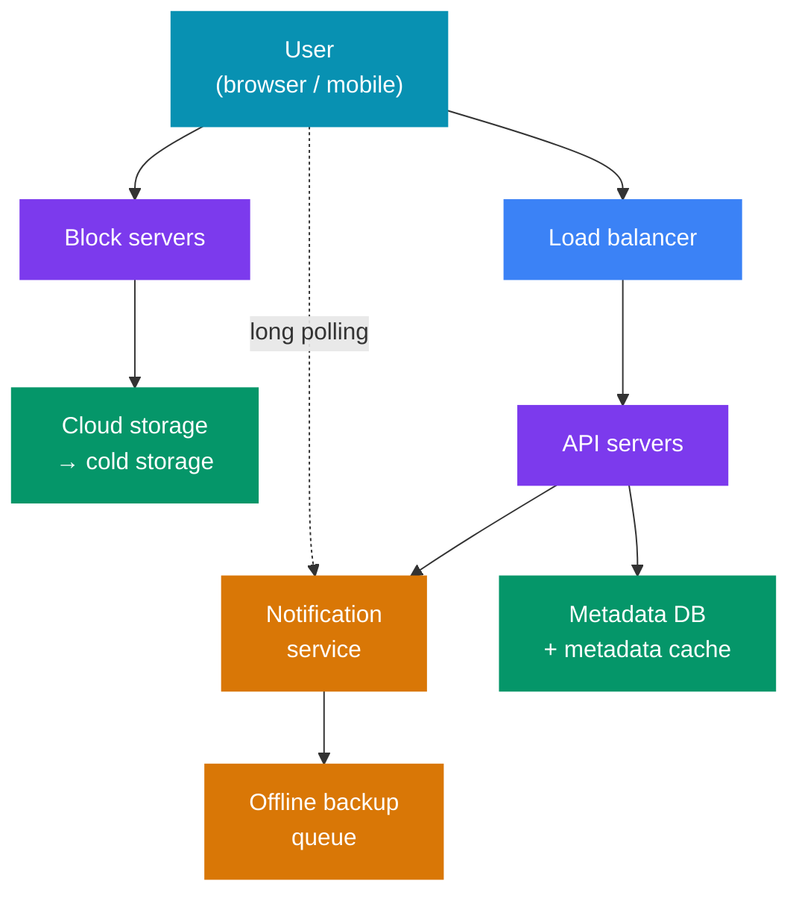
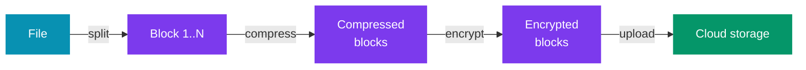
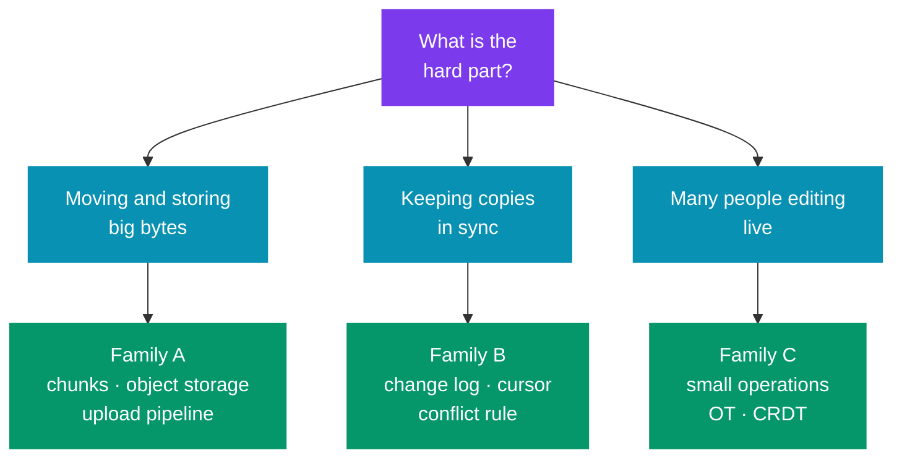

# Ch 15: Design Google Drive

> 📖 **Vol 1, Chapter 15** (book pages 244–263) &nbsp;·&nbsp; ⚡ Medium Priority &nbsp;·&nbsp; 💬 **20 Questions**  
> **Source:** Alex Xu, *System Design Interview Vol 1*, Ch 15. Page and figure numbers below are the book's. This PDF edition prints no page numbers in the footer, so pages are the PDF page numbers (the chapter starts on page 244).

---

📊 **Question Count**

| # | Section | Questions |
|---|---|---|
| 1 | [Requirements and Estimation 🔥](#1--requirements-and-estimation-p244247-) | 1 |
| 2 | [One Server, the APIs, and Scaling Out ⚡](#2--one-server-the-apis-and-scaling-out-p248251-) | 1 |
| 3 | [Sync Conflicts 🔥🔥](#3--sync-conflicts-p251252-) | 1 |
| 4 | [High-level Design 🔥🔥](#4--high-level-design-p252254-) | 1 |
| 5 | [Block Servers — Delta Sync and Compression 🔥🔥](#5--block-servers--delta-sync-and-compression-p255256-) | 1 |
| 6 | [Strong Consistency and the Metadata Database 🔥](#6--strong-consistency-and-the-metadata-database-p256257-) | 4 |
| 7 | [Upload and Download Flows 🔥🔥](#7--upload-and-download-flows-p257259-) | 4 |
| 8 | [Notification Service — Long Polling 🔥](#8--notification-service--long-polling-p259260-) | 1 |
| 9 | [Saving Storage Space 🔥](#9--saving-storage-space-p260-) | 1 |
| 10 | [Failure Handling and Wrap-up ⚡](#10--failure-handling-and-wrap-up-p260262-) | 4 |
| 11 | [Similar Problems This Design Solves 📎 🔥](#11--similar-problems-this-design-solves--) | 1 |
| | **Total** | **20** |

> 🔥🔥 Very high priority — asked in almost every Tier-1 interview loop &nbsp;·&nbsp; 🔥 High priority — very frequent in Tier-1 interviews &nbsp;·&nbsp; ⚡ Medium priority — commonly asked &nbsp;·&nbsp; 💤 Low priority — good to know, rarely asked

> **How to read this note.** Sections 1–10 follow the book, step by step (Step 1 → Step 4). §11, at the end, maps this design to 13 similar problems. Anything the book does not say is marked **📎 Beyond the book**. Where the book has a mistake, the note says so and gives the fix.  
> Related notes: long polling vs WebSocket is covered in more depth in [Ch 12, chat system](ch12_design_a_chat_system.md). How the storage layer itself works is in [Vol 2 Ch 9, S3-like object storage](../vol_2/ch09_s3_like_object_storage.md).

---

## 🗒️ Cheat Sheet

<details>
<summary><strong>🗒️ Show cheat sheet</strong></summary>

### 🎯 Clarifying Questions — and the book's answers
| Question | Book's answer (p.246) |
|---|---|
| Most important features? | **Upload and download files, file sync, and notifications** |
| Mobile app, web app, or both? | **Both** |
| Supported file formats? | **Any file type** |
| Must files be encrypted? | **Yes** — files in storage must be encrypted |
| File size limit? | **Yes — 10 GB or smaller** |
| How many users? | **10M DAU** |

**In scope** (p.246): add files (drag and drop), download files, sync across devices, see file revisions, share files, notify on edit / delete / share.
**Out of scope:** Google Docs editing and real-time collaboration.

**Non-functional requirements** (p.246): reliability (data loss is unacceptable) · fast sync · low bandwidth use · scalability · high availability.

### 🏗️ Core Components (Figure 15-10)
- **Block servers** — split a file into blocks, compress and encrypt each block, upload it to cloud storage. Max block size **4 MB** (Dropbox's number).
- **Cloud storage (S3)** — stores the blocks. Each block is an independent object.
- **Cold storage** — for inactive data (files not used for a long time). Example: S3 Glacier.
- **Load balancer** — spreads requests evenly across API servers.
- **API servers** — everything except the upload flow: auth, user profile, file metadata.
- **Metadata database** — users, files, blocks, versions. **Relational**, for ACID.
- **Metadata cache** — caches hot metadata for fast reads.
- **Notification service** — a pub/sub system. It tells clients when a file is added, edited or removed elsewhere. Clients connect with **long polling**.
- **Offline backup queue** — holds changes for a client that is offline, so it can sync when it comes back.

### 🧾 The metadata schema (Figure 15-13)
```
user          (user_id, user_name, created_at)
device        (device_id uuid, user_id, last_logged_in_at)
workspace     (id, owner_id, is_shared, created_at)            -- the user's root directory
file          (id, file_name, relative_path, is_directory,
               latest_version, checksum, workspace_id,
               created_at, last_modified)
file_version  (id, file_id, device_id, version_number, last_modified)   -- rows are read-only
block         (block_id, file_version_id, block_order)
```
A file version = its blocks joined in `block_order` (p.257). Details and a book inconsistency in §6.

### 🔌 The three APIs (p.248–249)
| API | Example | Params |
|---|---|---|
| Upload | `https://api.example.com/files/upload?uploadType=resumable` | `uploadType=resumable`, `data` (local file) |
| Download | `https://api.example.com/files/download` | `path`, e.g. `"/recipes/soup/best_soup.txt"` |
| List revisions | `https://api.example.com/files/list_revisions` | `path`, `limit` (e.g. 20) |

All APIs need user authentication and use HTTPS.

### 💡 Key Insights
1. Split files into blocks. Then you send only changed blocks (**delta sync**), and you **compress** each block. Both save bandwidth (p.255).
2. Two separate flows: file **metadata** goes through API servers to a relational DB; file **content** goes through block servers to cloud storage (p.262).
3. Strong consistency by default. No two clients may see a file differently at the same time. So: relational DB (ACID), and invalidate the cache on every DB write (p.256).
4. Sync conflicts: the first version processed wins. The later one gets a conflict. The user sees both copies and merges or overrides (p.251–252).
5. Long polling, not WebSocket, for notifications. Traffic is one-way (server → client) and infrequent (p.259–260).

### ⚖️ Trade-offs / Alternatives
| Option | Pro | Con | Book's verdict |
|---|---|---|---|
| One server, files in a `drive/` folder | Simple; up in hours | Disk fills up; one server = data loss risk | ❌️ Only a starting point (p.248–249) |
| Shard storage by `user_id` | More space | Still lose data if a storage server dies | Stop-gap (p.249–250) |
| Amazon S3 with replication | Durable; same-region and cross-region replication | Cost; a network hop | ✅ Chosen — replicate in two regions (p.250–251) |
| Relational DB for metadata | ACID built in | Harder to scale writes | ✅ Chosen (p.256) |
| NoSQL for metadata | Scales out easily | No ACID by default; you must code it into the sync logic | ❌️ (p.256) |
| Long polling | Simple; fits one-way, infrequent events; Dropbox uses it | One new request after each event or timeout | ✅ Chosen (p.259–260) |
| WebSocket | Persistent, two-way, low latency | Built for real-time two-way traffic (chat) | ❌️ Not needed here (p.259–260) |
| Upload via block servers | Chunk / compress / encrypt logic in one place | Each file travels twice (client → block server → storage) | ✅ Chosen (p.262) |
| Upload directly from client to cloud storage | Faster — the file travels once | Same logic on iOS, Android, Web; encryption on a client that can be hacked | ❌️ Discussed in wrap-up (p.262) |
| 📎 Pre-signed URLs + SSE-KMS | Bytes travel once; the server still checks auth and quota; S3 encrypts | Not end-to-end encryption; the client must split and hash | 📎 Not in the book — see §10 Q4 |
| First processed version wins | Nothing is lost silently; the user decides | The user must resolve conflicts by hand | ✅ Chosen (p.251) |

### 🔢 Numbers to Remember
| What | Value | Arithmetic |
|---|---|---|
| Signed-up users | **50 million** | Book's assumption (p.246) |
| DAU | **10 million** | Book's assumption |
| Free space per user | **10 GB** | — |
| Uploads | **2 files per user per day**, **500 KB** average | — |
| Read : write | **1 : 1** | — |
| Total space allocated | **500 PB** | 50,000,000 × 10 GB = 500,000,000 GB = **500 PB** |
| Upload QPS | **~240** | 10,000,000 × 2 / 86,400 s = 231.5 → the book rounds to **~240** |
| Peak upload QPS | **480** | 240 × 2 |
| Max file size | **10 GB** | Book's requirement (p.246) |
| Max block size | **4 MB** | Dropbox's number (p.253) |
| Notification connections | **> 1 million per machine** | Dropbox talk, 2012 (p.261) |
| Version churn | **> 1,000 saves** | A heavily edited file "in a short period" (p.260) |
| 📎 Upload volume per day | **~10 TB/day** | 20M files × 500 KB = 10,000,000,000 KB = **10 TB** |
| 📎 Upload volume per year | **~3.65 PB/year** | 10 TB × 365 |
| 📎 Download QPS | **~240** | Same as upload, because read : write is 1 : 1 |
| 📎 Blocks in a max-size file | **2,500** | 10 GB / 4 MB = 10,000 MB / 4 MB |
| 📎 Glacier vs S3 Standard | **~83–96% cheaper per GB** | us-east-1, depends on the Glacier class |

> 📎 **The 500 PB is allocated space, not used space.** The book multiplies every user by the full 10 GB free quota. Real usage is much lower. Upload volume (~10 TB/day) is the better number for storage growth.

### ⏱️ 45-Minute Round Plan
| Minutes | Phase | What to say or draw | Trap to avoid |
|---|---|---|---|
| 0–5 | Clarify | Features (upload, download, sync, notify), both web and mobile, any file, encrypted, ≤ 10 GB, 10M DAU | Taking Google Docs live editing in scope |
| 5–10 | Estimate | 500 PB allocated, ~240 upload QPS, peak 480 | Calling 500 PB "used" storage |
| 10–18 | Start simple, scale out | One server → shard → S3 with cross-region replication → LB + API servers + separate metadata DB (Figure 15-7) | Jumping to the final diagram with no reasons |
| 18–25 | High-level design | Figure 15-10: block servers, cloud + cold storage, API servers, metadata DB + cache, notification service, offline queue | Forgetting the offline backup queue |
| 25–40 | **Deep dive** | Blocks (delta sync, compression, encryption) · strong consistency · schema · upload flow (pending → uploaded) · download flow · long polling · sync conflicts | Proposing WebSocket without saying why one-way traffic does not need it |
| 40–45 | Wrap-up | Save space (dedup, version limits, cold storage) · failure handling · direct upload trade-off · presence service | Ignoring what happens when a notification server dies |

> 📎 The timings are a suggestion, not from the book. The book gives the steps; the minutes are ours.

---

</details>
<br/>

---

## 1. 📋 Requirements and Estimation (p.244–247) 🔥

Google Drive is a **file storage and sync service**. It stores documents, photos, videos and other files in the cloud. You can open them from any computer, phone or tablet, and share them with others (p.244). Dropbox, OneDrive and iCloud are the same kind of product.

**Step 1 — the clarifying questions** are in the Cheat Sheet table. The features in scope (p.246):

- **Add files.** The easiest way is to drag and drop a file into Google Drive.
- **Download files.**
- **Sync files across devices.** A file added on one device appears on the others automatically.
- **See file revisions.**
- **Share files** with friends, family and coworkers.
- **Send a notification** when a file is edited, deleted, or shared with you.

**Not in scope:** Google Docs editing and collaboration, where many people edit one document at the same time.

**Non-functional requirements** (p.246):

| Requirement | Why it matters (book) |
|---|---|
| **Reliability** | Data loss is unacceptable for a storage system |
| **Fast sync** | If sync is slow, users get impatient and leave |
| **Bandwidth use** | Wasted bandwidth hurts users on mobile data plans |
| **Scalability** | Must handle high traffic |
| **High availability** | Users can still work when some servers are down, slow, or have network errors |

### Back-of-the-envelope estimation (p.246–247)

Assumptions:

- 50 million signed-up users, 10 million DAU.
- Each user gets 10 GB free space.
- Each user uploads 2 files per day. Average file size is 500 KB.
- Read : write ratio is 1 : 1.

The book's results:

```
Total space allocated = 50 million × 10 GB          = 500 PB
Upload QPS            = 10 million × 2 / 24 h / 3600 s ≈ 240
Peak QPS              = QPS × 2                      = 480
```

Check: 20,000,000 / 86,400 = **231.5**. The book rounds up to ~240. That is fine for an estimate.

📎 **New data per day** = 20M files × 500 KB = **10 TB/day** (~3.65 PB/year). This is real growth, unlike the 500 PB quota. And a 500 KB average file fits in **one 4 MB block**, so delta sync helps mainly the large files.

### ❓ Interview Questions

1. **What are the requirements, and how do you estimate storage and QPS for Google Drive? 🔥**

<!-- -->
<details>
<summary>💡 Show Answer</summary>

**Answer:**

**Scope** (p.246): upload, download, sync across devices, file revisions, sharing, notifications. Web and mobile. Any file type. Encrypted at rest. Files ≤ **10 GB**. Google Docs live editing is out of scope.

**Non-functional:** reliability (no data loss), fast sync, low bandwidth, scalability, high availability.

**Estimation** (p.246–247):

- 50M signed-up users, 10M DAU, 10 GB free each.
- 2 uploads per user per day, 500 KB average, read : write = 1 : 1.
- **Space allocated** = 50M × 10 GB = **500 PB**.
- **Upload QPS** = 10M × 2 / 86,400 ≈ 231 → book says **~240**.
- **Peak** = 2 × 240 = **480**.

📎 Add two numbers:

- **New data** = 20M × 500 KB = **10 TB/day** (~3.65 PB/year). The 500 PB is the full quota, not real use.
- **Metadata size (latest versions only):** a user who fills 10 GB has 10 GB / 4 MB = 2,500 blocks. At ~100 bytes per block row, that is 250 KB per user. For 50M users that is **12.5 TB**. Old versions add more. That is too much for one MySQL node to handle well, so **shard by user**. Read replicas add read capacity, but each replica holds a full copy, so they do not split storage.

</details>

---

## 2. 🔌 One Server, the APIs, and Scaling Out (p.248–251) ⚡

**Step 2** does not start with the final diagram. The book starts with **everything on one server**, then scales it up step by step (p.248).

### The single-server setup (p.248)

- A **web server** (Apache) to upload and download files.
- A **database** (MySQL) for metadata: user data, login info, file info.
- A **storage system** with **1 TB** of space. The root folder is `drive/`.

Under `drive/` there is one directory per user, called a **namespace**. Each namespace holds all files of that user. The file name on the server is the same as the original. A file or folder is identified by **namespace + relative path** (Figure 15-3: `drive/user1/recipes/`, `drive/user1/chicken_soup.txt`, `drive/user2/football.mov`).

### The APIs (p.248–249)

The book needs three APIs: **upload**, **download**, and **get file revisions**. The URLs and params are in the Cheat Sheet table. Download takes a `path` like `"/recipes/soup/best_soup.txt"`. List revisions takes a `path` and a `limit` (the most revisions to return, e.g. 20).

**Upload has two types:**

- **Simple upload** — for small files.
- **Resumable upload** — for large files, when a network break is likely. It has 3 steps (p.249, from the Google Drive API docs):
  1. Send the first request to get the **resumable URL**.
  2. Upload the data and watch the upload state.
  3. If the upload breaks, **resume** it.

All APIs need **user authentication** and use **HTTPS**. SSL protects data between client and server (p.249).

### Moving away from one server (p.249–251)

1. Disk full (Figure 15-4): only 10 MB left. Users cannot upload. The first fix is to **shard the data by `user_id`** across many storage servers (Figure 15-5).
2. Data loss risk. A storage server outage can still lose files. So the book moves files to **Amazon S3**. S3 supports **same-region and cross-region replication** (Figure 15-6). Files are copied into many regions to guard against data loss.
3. More fixes (p.250–251):
   - **Load balancer** — spreads traffic evenly. If a web server dies, it sends traffic elsewhere.
   - **Web servers** — easy to add or remove behind the load balancer.
   - **Metadata database** — moved off the server, so it is not a single point of failure. Add **replication and sharding**.
   - **File storage** — S3, with files **replicated in two separate regions**.

The result is Figure 15-7: users → load balancer → API servers → metadata DB and file storage. 📎 Each step fixes one real problem: disk space, then durability, then single points of failure.

### ❓ Interview Questions

1. **How do you upload a large file, like a 2 GB video, on a bad network? 🔥**

<!-- -->
<details>
<summary>💡 Show Answer</summary>

**Answer:**

**The book's API** (p.248–249) has two upload types. **Simple upload** is for small files. **Resumable upload** is for large files on unreliable networks. Resumable upload is 3 steps:

1. Send the first request to get a **resumable URL**.
2. Upload the data and watch the upload state.
3. If the upload breaks, **resume** it.

📎 With blocks, resume is natural. 2 GB / 4 MB = about **500 blocks** (512 with binary units). Upload several in parallel. After a break, upload only the blocks the server has not confirmed. Then one metadata write marks the file "uploaded".

📎 Do **not** use S3 Multipart Upload for this. It joins all parts into **one** object, so blocks cannot be shared or deduplicated. Also, every part except the last must be at least **5 MiB**.

</details>

---

## 3. 🔀 Sync Conflicts (p.251–252) 🔥🔥

A conflict happens when **two users change the same file or folder at the same time** (p.251).

**The book's strategy: the first version that gets processed wins. The version processed later gets a conflict.**

**Figure 15-8:**

1. User 1 and user 2 update the same file at the same time.
2. The system processes user 1's file first. User 1's update goes through ("synced").
3. User 2 gets a **sync conflict**.

**How user 2 resolves it (Figure 15-9).** The system shows **both copies**: user 2's local copy and the latest server version. The file list shows `SystemDesignInterview` and `SystemDesignInterview_user 2_conflicted_copy_2019-05-01`. User 2 can **merge** both files, or **override** one with the other.

Keeping one document in sync while many users edit it is hard. The book only points to **Differential Synchronization** (Neil Fraser) for that.

📎 **How to detect "processed later".** Each client sends the version it started from (its **base version**). The server accepts the write only if the file's latest version still equals that base version. This is **optimistic locking**:

```sql
UPDATE file
SET    latest_version = :newVersion,
       last_modified  = NOW()
WHERE  id = :fileId
AND    latest_version = :baseVersion;   -- 0 rows updated = someone else won → conflict
```

📎 **Do not call this last-write-wins.** Last-write-wins keeps the *later* write and silently drops the earlier one. The book does the opposite: the *first* write wins, and the later write is **kept as a conflicted copy**. Nothing is lost.

📎 Google Docs avoids conflicts in a different way. It merges edits as people type, with **Operational Transformation (OT)**. That is the out-of-scope collaboration feature.

### ❓ Interview Questions

1. **Two users edit the same file at the same time. How do you handle the conflict? 🔥🔥**

<!-- -->
<details>
<summary>💡 Show Answer</summary>

**Answer:**

**The book's rule** (p.251): **the first version that gets processed wins**. The later version gets a **conflict**.

In Figure 15-8, user 1's update is processed first and synced. User 2 gets a sync conflict. The system then shows user 2 **both copies**: their local copy and the latest server version (Figure 15-9, e.g. `SystemDesignInterview_user 2_conflicted_copy_2019-05-01`). User 2 can **merge** them or **override** one with the other.

📎 **How to detect it:** each write carries the version it was based on. The server updates only if the current version still equals that base version (optimistic locking). Zero rows updated → conflict.

📎 **This is not last-write-wins.** Last-write-wins silently drops the earlier write. The book keeps the losing write as a conflicted copy, so nothing is lost.

📎 Live co-editing (Google Docs) merges edits as people type, with Operational Transformation. The book leaves it out of scope and points to Differential Synchronization.

</details>

---

## 4. 🌐 High-level Design (p.252–254) 🔥🔥

Figure 15-10 is the full design. Each component (p.253–254):

| Component | Role (book) |
|---|---|
| **User** | Uses the app in a browser or a mobile app |
| **Block servers** | Upload blocks to cloud storage. A file is split into blocks. Each block has a **unique hash value**, stored in the metadata DB. Each block is an independent object in S3. To rebuild a file, join its blocks in order. Max block size: **4 MB** (Dropbox) |
| **Cloud storage** | Stores the blocks |
| **Cold storage** | Stores inactive data — files not used for a long time |
| **Load balancer** | Spreads requests evenly among API servers |
| **API servers** | Almost everything except the upload flow: auth, user profile, file metadata |
| **Metadata database** | Metadata of users, files, blocks, versions. Files themselves live in the cloud |
| **Metadata cache** | Caches some metadata for fast reads |
| **Notification service** | Pub/sub. Tells clients when a file is added, edited or removed elsewhere, so they pull the latest changes |
| **Offline backup queue** | If a client is offline, the queue stores the changes. The client syncs when it is online again |



> ⚠️ **Book bug — "block storage" is the wrong term.** p.253 says block servers use "block storage, referred to as block-level storage". In the cloud, block storage means a disk volume, like Amazon EBS. This design does something else: it cuts a file into chunks and stores each chunk as an **object** in S3. So call them **chunks stored in object storage**. If you say "block storage" in an interview, the interviewer may think of EBS.

> 📎 In Figure 15-10, cloud storage also has an arrow to the load balancer. That is the **upload completion callback** from §7: storage tells the API servers when the upload is done.

### ❓ Interview Questions

1. **Walk me through the high-level design. 🔥🔥**

<!-- -->
<details>
<summary>💡 Show Answer</summary>

**Answer:**

The book builds it step by step (p.248–251). One server → shard by `user_id` → files in S3 with cross-region replication → load balancer + API servers + a separate metadata DB (Figure 15-7).

The final design (Figure 15-10):

- **Block servers** → **cloud storage** (S3) → **cold storage** for rarely used data.
- **Load balancer → API servers** → **metadata DB** (relational) + **metadata cache**.
- **Notification service** (long polling) + **offline backup queue** for offline clients.

The key idea: **metadata** and **file content** take separate paths. Metadata goes through API servers to the DB. Content goes through block servers to S3 (p.262).

</details>

---

## 5. 🧱 Block Servers — Delta Sync and Compression (p.255–256) 🔥🔥

**Step 3** starts here (p.255). Sending the whole file on every update wastes bandwidth, especially for large files that change often. The book uses **two optimizations** (p.255):

- **Delta sync.** When a file changes, sync **only the modified blocks**, not the whole file. The book points to the **rsync** algorithm.
- **Compression.** Compress each block. The algorithm depends on the file type: **gzip** and **bzip2** for text files; other algorithms for images and videos.

**Block servers do the heavy work** of uploading. For a new file (Figure 15-11):

1. Split the file into smaller blocks.
2. Compress each block.
3. Encrypt each block, for security, before it is sent to cloud storage.
4. Upload the blocks to cloud storage.



**Delta sync (Figure 15-12):** a file has blocks 1–10. Only **block 2** and **block 5** changed. So only those two blocks go to cloud storage.

> ⚠️ **Book bug — the split happens on the wrong side for delta sync.** In the book, the client sends the **whole file** to the block servers (upload step 2.1). The block servers split it. Figure 15-12 also shows the "changed only" arrow going from block servers to cloud storage. So the user's network still carries the whole file. Delta sync then saves only the internal hop to S3. It does not save the user's mobile data, and that is the requirement it should meet (p.246).
>
> **The fix:** the **client** splits the file and hashes each block. It sends the list of hashes first, and uploads only the blocks the server does not have. Block servers can still compress and encrypt. Hashing on the client is simple code. So the "same logic on every platform" problem from §10 comes back only in a small form.

📎 **How the client knows which blocks changed.** Hash each block (for example SHA-256). Compare the new hashes with the stored ones. A different hash = a changed block. The book says each block has a unique hash, but does not name the algorithm.

📎 **Who holds the keys.** The book says "encrypt each block" but not with which key. The usual answer is **envelope encryption**. Each file (or block) gets its own data key. A master key in a key service (for example AWS KMS) encrypts that data key. You store the encrypted data key next to the block metadata. To rotate the master key, you re-encrypt the small data keys, not the petabytes of blocks.

📎 **The fixed-block trap.** With fixed-size blocks, inserting one byte near the start shifts every later byte. Then every later block looks changed. rsync solves this with a **rolling checksum**: it finds matching blocks at any offset. **Content-defined chunking** solves it by cutting blocks at content-based boundaries, not fixed offsets.

### ❓ Interview Questions

1. **Why split files into blocks? What do block servers do? 🔥🔥**

<!-- -->
<details>
<summary>💡 Show Answer</summary>

**Answer:**

Sending the whole file on every edit wastes bandwidth (p.255). Blocks give two savings:

1. **Delta sync** — only the changed blocks are sent. In Figure 15-12, only blocks 2 and 5 of 10 are uploaded.
2. **Compression** — each block is compressed, with an algorithm chosen by file type (gzip / bzip2 for text).

**Block server pipeline (Figure 15-11):** split → compress → **encrypt** → upload to cloud storage. Max block size is **4 MB** (Dropbox). Each block has a unique hash in the metadata DB. To rebuild a file, join its blocks in order.

Blocks also allow **deduplication** (p.260): two blocks with the same hash are stored once.

📎 Example: a 100 MB file with a 1 KB in-place edit. Only one block (up to 4 MB) is re-sent, not 100 MB. But an *insert* shifts all later bytes. With fixed blocks, every later block then looks changed. rsync's rolling checksum or content-defined chunking avoids this. The cost of blocks: more metadata — a block list for every version.

</details>

---

## 6. 🧾 Strong Consistency and the Metadata Database (p.256–257) 🔥

### High consistency requirement (p.256)

The system needs **strong consistency by default**. A file must never look different to different clients at the same time. This applies to both the **metadata cache** and the **database**.

Memory caches are **eventually consistent** by default: different replicas may hold different data. For strong consistency, the book requires:

- Data in **cache replicas and the master** is consistent.
- **Invalidate the cache on every database write**, so cache and DB hold the same value.

**Relational or NoSQL?** A relational database keeps **ACID** (Atomicity, Consistency, Isolation, Durability), so strong consistency is easy. NoSQL databases do not support ACID by default. You would have to build it into the sync logic yourself. **The book picks a relational database**, because ACID is built in.

📎 **Watch the replicas.** §2 adds replication to the metadata DB. MySQL replication is **asynchronous** by default, so a replica can lag. For strong consistency, send reads that must see the latest write (for example, right after a save) to the **primary**. Other reads can go to replicas.

### Metadata database schema (Figure 15-13, p.256–257)

The book calls it "highly simplified": only the most important tables and fields.

| Table | Columns (Figure 15-13) | What it stores (text, p.257) |
|---|---|---|
| `user` | `user_id`, `user_name`, `created_at` | Basic user info: username, email, profile photo |
| `device` | `device_id` (uuid), `user_id`, `last_logged_in_at` | Device info. A user can have **many devices**. `push_id` is used for mobile push |
| `workspace` | `id`, `owner_id`, `is_shared`, `created_at` | "**Namespace**": the root directory of a user |
| `file` | `id`, `file_name`, `relative_path`, `is_directory`, `latest_version`, `checksum`, `workspace_id`, `created_at`, `last_modified` | Everything about the **latest** file |
| `file_version` | `id`, `file_id`, `device_id`, `version_number`, `last_modified` | Version history. **Existing rows are read-only**, to keep the history intact |
| `block` | `block_id`, `file_version_id`, `block_order` | Everything about a block. Any version = its blocks joined in the right order |

Relationships: one user → many devices and workspaces; one workspace → many files; one file → many versions; one version → many blocks. Each version also records the `device_id` that made it.

> ⚠️ **Book inconsistency — the schema does not match the text.** Three mismatches on p.253 and p.257:
> - The text names a **Namespace** table. Figure 15-13 calls it **`workspace`**.
> - The text says the `device` table has a **`push_id`**. The figure has no such column.
> - p.253 says each block's **hash is stored in the metadata DB**. The `block` table has no hash column. Without it, the system cannot deduplicate blocks (§9) or find changed blocks.
>
> The fix: in an interview, say "namespace (workspace)", add `push_id` to `device`, and add a `block_hash` column to `block`. (The figure also prints `lastest_version`; read it as `latest_version`.)

### ❓ Interview Questions

1. **Which database do you use for metadata, and what is the schema? 🔥**

<!-- -->
<details>
<summary>💡 Show Answer</summary>

**Answer:**

**A relational database** (p.256). It has ACID built in. NoSQL has no ACID by default, so you would have to code it into the sync logic.

**Schema (Figure 15-13, simplified):**

- `user` (user_id, user_name, created_at)
- `device` (device_id, user_id, last_logged_in_at) — one user, many devices
- `workspace` (id, owner_id, is_shared, created_at) — the user's root directory ("namespace")
- `file` (id, file_name, relative_path, is_directory, latest_version, checksum, workspace_id, created_at, last_modified) — the latest file
- `file_version` (id, file_id, device_id, version_number, last_modified) — **rows are read-only**
- `block` (block_id, file_version_id, block_order) — join blocks in `block_order` to rebuild any version

⚠️ The figure has no block hash column, and no `push_id` on `device`, though the text mentions both. Add them (see the book inconsistency note above).

📎 Cache hot metadata (Redis). Invalidate the cache entry on every DB write, as the book requires.

</details>

---

2. **How do you keep file metadata strongly consistent? 🔥**

<!-- -->
<details>
<summary>💡 Show Answer</summary>

**Answer:**

The book requires **strong consistency by default** (p.256). A file must never look different to two clients at the same time.

The book's rules:

- **Cache:** memory caches are eventually consistent by default. Keep cache replicas consistent with the master, and **invalidate the cache on every DB write**.
- **DB:** use a **relational database**, because ACID makes strong consistency easy.

📎 Two more points:

- **Replica lag.** MySQL replication is asynchronous by default. Lag is usually milliseconds but can reach seconds under load. Send reads that must see the user's latest save to the **primary**.
- **Lost updates.** Use a version number on the `file` row (optimistic locking). It catches two concurrent writes, which is also how conflicts are detected (§3 Q1).

</details>

---

3. **How do you design sharing and permissions? 📎 ⚡**

<!-- -->
<details>
<summary>💡 Show Answer</summary>

**Answer:**

The book lists sharing as a feature and has `workspace.is_shared`, but does not design it. Sharing is a metadata problem:

- Add a `permission` table: `(file_id, grantee_id, grantee_type = user | group, role = view | comment | edit)`.
- A shared link = a random token mapped to `(file_id, role)`.
- The API servers check permission **before** they return metadata or block locations.
- Cache permission checks (Redis), and invalidate on change, like the metadata cache.
- A new share fires a notification — the book's "notify when a file is shared with you".

</details>

---

4. **How do you stop a user from going over the 10 GB quota? 📎 💤**

<!-- -->
<details>
<summary>💡 Show Answer</summary>

**Answer:**

- Keep a **usage counter** per user in the metadata DB.
- Before committing a new version, check `current_usage + new_size <= quota`. If not, reject with an error (for example HTTP 403).
- Do the check and the update in **one statement**. Two uploads that read the counter first and write it later can both pass the check:

```sql
UPDATE user_quota
SET    used_bytes = used_bytes + :newSize
WHERE  user_id = :userId
AND    used_bytes + :newSize <= quota_bytes;   -- 0 rows updated = over quota → reject
```

- Run it in the **same transaction** as the version commit, so the counter and the versions never drift apart.
- With dedup, charge the **logical** file size (what the user sees), not the stored bytes. It is easy to explain.
- Decide whether old versions count toward the quota.

</details>

---

## 7. 🔄 Upload and Download Flows (p.257–259) 🔥🔥

### Upload flow (Figure 15-14, p.257–258)

Client 1 sends **two requests in parallel**: one adds the file metadata, one uploads the file content.

**Add file metadata:**

1. Client 1 sends a request to add the metadata of the new file.
2. Store the metadata in the metadata DB. Set the file upload status to **"pending"**.
3. Tell the notification service that a new file is being added.
4. The notification service tells the relevant clients (client 2) that a file is **being uploaded**.

**Upload the file to cloud storage:**

- 2.1 Client 1 uploads the file content to the **block servers**.
- 2.2 Block servers split the file into blocks, compress and encrypt them, and upload them to cloud storage.
- 2.3 When the upload is done, cloud storage fires an **upload completion callback**. The request goes to the API servers.
- 2.4 The file status changes to **"uploaded"** in the metadata DB.
- 2.5 Tell the notification service that the status is now "uploaded".
- 2.6 The notification service tells the relevant clients (client 2) that the file is **fully uploaded**.

Editing a file follows a similar flow (p.258).

> 📎 **Why "pending" first?** Other devices learn about the file at once, before the slow upload ends. The status field also tells clients not to download a file that is still incomplete.

### Download flow (Figure 15-15, p.258–259)

A download starts when a file is **added or edited elsewhere**. How does a client know? Two cases:

- **Client is online** → the notification service tells it to pull the latest data.
- **Client is offline** → the changes are saved. When the client comes back online, it pulls the latest changes.

The flow:

1. The notification service tells client 2 that a file changed somewhere else.
2. Client 2 sends a request to fetch the metadata.
3. API servers ask the metadata DB for the metadata of the changes.
4. The metadata DB returns it to the API servers.
5. Client 2 gets the metadata.
6. Client 2 asks the **block servers** to download blocks.
7. Block servers download the blocks from cloud storage.
8. Cloud storage returns the blocks to the block servers.
9. Client 2 downloads **all the new blocks** and rebuilds the file.

> ⚠️ **Book inconsistency — where offline changes wait.** p.259 says changes for an offline client "will be saved to the **cache**". But the high-level design (p.253–254) has a dedicated **offline backup queue** for exactly this. Use the queue in an interview: it matches Figure 15-10, and the failure section (p.261) also treats it as a replicated queue.

📎 **A change log with a cursor scales better than a queue per device.** A phone may stay offline for weeks. A queue per device then grows without limit. Real APIs keep one **change log per workspace** instead. Each device stores a **cursor**: the last change it has seen. When it comes back, it asks "what changed after my cursor?". Google Drive's API does this with `changes.list` and a page token. Dropbox's API does it with `list_folder/continue` and a cursor.

📎 Step 9 is delta sync on the way down. The client compares the block list from step 5 with the blocks it already has. It downloads only the missing ones.

### ❓ Interview Questions

1. **Walk me through the upload flow. 🔥🔥**

<!-- -->
<details>
<summary>💡 Show Answer</summary>

**Answer:**

The client sends **two requests in parallel** (Figure 15-14, p.258).

**Metadata path:**

1. Client 1 sends the new file's metadata to the API servers.
2. The metadata DB stores it with status **"pending"**.
3. The notification service is told a new file is being added.
4. It tells client 2 that a file is **being uploaded**.

**Content path:**

- 2.1 Client 1 uploads the content to the **block servers**.
- 2.2 Block servers split, compress, encrypt, and upload the blocks to cloud storage.
- 2.3 Cloud storage fires an **upload completion callback** to the API servers.
- 2.4 The status becomes **"uploaded"**.
- 2.5–2.6 The notification service tells client 2 that the file is **fully uploaded**.

An edit follows a similar flow.

📎 **Skipping blocks the server already has.** Before sending content, the client can send the list of block hashes. The server answers with the hashes it does not have. Only those are uploaded. This is dedup on the upload path.

</details>

---

2. **Some blocks reach S3, but the metadata commit fails. What happens? 📎 🔥**

<!-- -->
<details>
<summary>💡 Show Answer</summary>

**Answer:**

Treat it as two phases:

1. **Upload blocks.** This is idempotent. A block is keyed by its hash, so re-uploading the same block changes nothing.
2. **Commit the version metadata** in one atomic DB write.

If step 2 fails, the uploaded blocks stay in S3 with no version pointing to them. They are **orphans**.

- A nightly job deletes blocks that no `block` row references. It deletes a block only if it was last used more than a grace period ago (for example 24 hours).
- An upload that reuses a block updates its last-used time. The commit checks that every listed block still exists.

So the job never deletes a block that an upload in progress still needs. In the book's flow, the file simply stays in **"pending"** status until the completion callback arrives.

</details>

---

3. **A file changes on my laptop. How does my phone get the update? 🔥🔥**

<!-- -->
<details>
<summary>💡 Show Answer</summary>

**Answer:**

**How the phone learns about it** (p.258–259):

- **Online** → the notification service tells it (long polling).
- **Offline** → the change waits in the **offline backup queue**. The phone pulls it when it comes back online. (p.259 says "cache" here; the high-level design uses the queue.)

**The download flow (Figure 15-15):**

1. The notification service tells the phone a file changed.
2. The phone gets the **metadata** of the changes from the API servers (which read the metadata DB).
3. The phone gets the **blocks** from the block servers (which read cloud storage), and rebuilds the file.

📎 The phone downloads only the blocks it does not already have — delta sync on the way down.

</details>

---

4. **A user edits files offline for a day. How do the edits sync later? 📎 ⚡**

<!-- -->
<details>
<summary>💡 Show Answer</summary>

**Answer:**

- The client queues each change locally (for example in SQLite) and marks it "pending sync".
- Each queued change records the file's **last-known version** (its base version).
- When the network returns, the client uploads the queued changes in order.
- If the server version still equals the base version, the upload succeeds.
- If not, someone else changed the file. The book's conflict rule applies: the server version wins, and the user gets a **conflicted copy** (§3 Q1).
- The other way round, the client pulls the changes it missed from the **offline backup queue**.
- 📎 Better: the client keeps a **cursor** into the workspace's change log and asks for every change after it. Nothing has to be stored per device while the device is away (see the note in the body above).

</details>

---

## 8. 🔔 Notification Service — Long Polling (p.259–260) 🔥

Any change made on one device must reach the other clients, **to reduce conflicts**. The notification service sends data to clients as events happen (p.259).

**Two options:**

- **Long polling.** Dropbox uses it.
- **WebSocket.** A persistent, **two-way** connection between client and server.

Both work. **The book picks long polling**, for two reasons:

1. Notification traffic is **not two-way**. The server tells the client about file changes, but not the other way round.
2. WebSocket suits **real-time two-way** traffic, like a chat app. Drive notifications are **infrequent**, with no bursts of data.

**How long polling works here (p.260):**

1. Each client opens a long-poll connection to the notification service.
2. When a file change is detected, the connection closes.
3. The client then connects to the **metadata server** to download the latest changes.
4. After a response arrives, or the connection times out, the client **at once sends a new request** to keep the connection open.

📎 The notification only says "something changed". The client fetches the details from the API servers (§7, step 2). So the message stays small.

📎 **Long polling in Spring** — `DeferredResult` holds the request open without blocking a thread:

```java
@GetMapping("/notifications/poll")
public DeferredResult<ResponseEntity<ChangeEvent>> poll(@RequestParam String userId) {
    DeferredResult<ResponseEntity<ChangeEvent>> result =
            new DeferredResult<>(60_000L, ResponseEntity.noContent().build());
    waiters.register(userId, result);   // completed when a change event for userId arrives
    result.onCompletion(() -> waiters.remove(userId, result));   // also runs after a timeout
    return result;
}
```

On a change, the service calls `result.setResult(ResponseEntity.ok(event))` for each waiting request of that user. On timeout, the client gets `204 No Content` and polls again.

### ❓ Interview Questions

1. **How does the notification service work? Why long polling and not WebSocket? 🔥**

<!-- -->
<details>
<summary>💡 Show Answer</summary>

**Answer:**

The notification service tells clients about changes made elsewhere, to reduce conflicts (p.259).

**Long polling** (p.260): each client keeps a long-poll connection open. When a change happens, the connection closes, and the client fetches the latest changes from the metadata server. After a response or a timeout, the client opens a new request at once.

**Why not WebSocket** (p.259–260):

1. Traffic is **one-way**: the server tells the client about changes, not the reverse.
2. WebSocket is for **real-time two-way** traffic, like chat. Drive notifications are **infrequent**, with no bursts.

Dropbox uses long polling.

📎 The message is small — "this file changed". The client gets details from the API servers. In Spring, `DeferredResult` holds the request open without tying up a thread (see the code above).

</details>

---

## 9. 💾 Saving Storage Space (p.260) 🔥

To support version history and reliability, the system stores **many versions of each file across many data centers**. Frequent backups of every revision fill storage fast. The book gives **three techniques**:

1. De-duplicate data blocks. Remove redundant blocks **at the account level**. Two blocks are identical if they have the **same hash value**.
2. Use a smart backup strategy. Two ways:
   - **Set a limit** on the number of versions. When the limit is reached, the **oldest version is replaced** by the new one.
   - **Keep valuable versions only.** A heavily edited document could be saved **over 1,000 times** in a short period. Limit the saved versions, and give **more weight to recent versions**. Experiments help find the best number to keep.
3. Move rarely used data to cold storage. Cold data has not been used for **months or years**. Cold storage like **Amazon S3 Glacier** is much cheaper than S3.

📎 **Account level vs global dedup.** The book dedups inside one account. Dedup across all users saves more, but has two problems:

- The book **encrypts each block**. With a different key per user, the same file gives different encrypted blocks, so they cannot be shared.
- Global dedup leaks information. If an upload finishes instantly, a user learns that *someone* already stored that exact file.

📎 **Deleting a deduplicated block** needs care. Many versions may point to it. Delete it only when no `block` row references its hash any more (a reference count, or a background sweep).

### ❓ Interview Questions

1. **Storing every version of every file is expensive. How do you save space? 🔥**

<!-- -->
<details>
<summary>💡 Show Answer</summary>

**Answer:**

The book's three techniques (p.260):

1. **Deduplicate blocks** at the account level. Same hash = same block = store it once.
2. **Smart backup strategy:**
   - **Limit the number of versions.** At the limit, the oldest version is replaced.
   - **Keep only valuable versions.** A busy document can be saved over 1,000 times in a short time. Keep fewer, and weight recent versions more.
3. **Cold storage** for data unused for months or years. S3 Glacier is much cheaper than S3.

The `file_version` rows are **read-only** (p.257), so history stays intact.

📎 **One way to build it:** a nightly job marks old versions. It moves their blocks to Glacier, but **only blocks that no newer version still uses**. How fast a restore is depends on the class. Glacier Instant Retrieval reads in milliseconds. Glacier Flexible Retrieval takes minutes to hours (expedited 1–5 minutes, standard 3–5 hours). Glacier Deep Archive takes 12–48 hours.

</details>

---

## 10. 🩹 Failure Handling and Wrap-up (p.260–262) ⚡

### Failure handling (p.260–261)

| Failure | The book's answer |
|---|---|
| **Load balancer** | A secondary becomes active and takes the traffic. Load balancers watch each other with a **heartbeat**. One that misses heartbeats for a while is treated as failed |
| **Block server** | Other block servers pick up the unfinished or pending jobs |
| **Cloud storage** | S3 buckets are replicated in different regions. If a region fails, fetch the file from another region |
| **API server** | Stateless. The load balancer sends traffic to other API servers |
| **Metadata cache** | Cache servers are replicated. Read from another node, and bring up a new server to replace the failed one |
| **Metadata DB — master down** | Promote a slave to be the new master. Bring up a new slave |
| **Metadata DB — slave down** | Use another slave for reads. Bring up a new server to replace it |
| **Notification service** | Each server holds many long-poll connections — **over 1 million per machine** (Dropbox, 2012). If one dies, all its clients must reconnect to other servers. One server cannot take all of them back at once, so **reconnecting is slow** |
| **Offline backup queue** | Queues are replicated. If one fails, its consumers may need to **re-subscribe to the backup queue** |

### Step 4 — Wrap-up (p.262)

The design is interesting because it combines **strong consistency, low bandwidth, and fast sync**. It has **two flows**: managing file metadata, and file sync. The notification service uses long polling to keep clients up to date.

**A different design choice — upload straight to cloud storage**, not through block servers:

- ✅ **Faster upload.** The file travels once (client → storage), not twice (client → block server → storage).
- ❌️ **Same logic on every platform.** Chunking, compression and encryption must be built for iOS, Android and Web. That is error-prone and costs a lot of engineering work. With block servers, the logic lives in one place.
- ❌️ **Client-side encryption is risky.** A client can be hacked or changed.

**Another change — a presence service.** Move the online/offline logic out of the notification servers into a separate **presence service**. Then other services can use online/offline status too.

### ❓ Interview Questions

1. **How does the system handle failures of each component? ⚡**

<!-- -->
<details>
<summary>💡 Show Answer</summary>

**Answer:**

The book's list (p.260–261):

- **Load balancer** — a secondary takes over (heartbeats). **API server** — stateless; the LB routes around it.
- **Block server** — others pick up its unfinished jobs. **Cloud storage** — read from another region.
- **Metadata cache** — replicated; use another node. **Metadata DB** — master down: promote a slave; slave down: read from another slave.
- **Notification service** — over **1 million** long-poll connections per machine (Dropbox, 2012). If one dies, all its clients must reconnect elsewhere. That is **slow**, because a server cannot accept them all at once.
- **Offline backup queue** — replicated. Consumers may need to re-subscribe to the backup queue.

📎 For the notification case, clients should reconnect with random back-off (jitter). Otherwise a million reconnects arrive in the same second.

</details>

---

2. **How do you make sure uploaded files are never lost? 📎 💤**

<!-- -->
<details>
<summary>💡 Show Answer</summary>

**Answer:**

The book's answer is **S3 replicated in two regions** (p.251, p.260). More detail:

- S3 is designed for **11 nines** of durability (99.999999999%). S3 Standard stores data in at least three Availability Zones in a region (One Zone classes use only one).
- **Cross-Region Replication (CRR)** copies objects to a second region for disaster recovery.
- The metadata DB needs the same care: a synchronous standby (for example RDS Multi-AZ) plus backups. A lost metadata row makes its blocks unreachable, even though they still exist.
- A background job can re-hash stored blocks and compare them with the stored hash. This finds silent corruption.

</details>

---

3. **Why upload through block servers? Why not upload straight from the client to cloud storage? 🔥**

<!-- -->
<details>
<summary>💡 Show Answer</summary>

**Answer:**

The book discusses this in the wrap-up (p.262).

**Direct upload — the advantage:** it is **faster**. The file goes to cloud storage once. Through block servers, it travels twice.

**Direct upload — the drawbacks:**

1. Chunking, compression and encryption must be written for **every platform** (iOS, Android, Web). That is error-prone and needs a lot of engineering work. Block servers keep this logic in **one place**.
2. A client **can be hacked or changed**, so encryption on the client is not ideal.

**The book keeps block servers.**

📎 The book's other wrap-up idea: move online/offline status into a separate **presence service**. Then other services can use it too.

</details>

---

4. **Can you get the speed of direct upload and still keep control on the server? 📎 🔥**

<!-- -->
<details>
<summary>💡 Show Answer</summary>

**Answer:**

Yes. Use **pre-signed URLs**. The server decides; the bytes go straight to S3.

1. The client splits the file and hashes each block (see the book bug note in §5).
2. It sends the list of hashes to the API servers. They check auth, quota and which blocks already exist.
3. For each missing block, the API servers return a **pre-signed PUT URL**. It is signed with the server's AWS credentials, works for one object key, and expires after a short time you choose.
4. The client uploads each block straight to S3. The bytes travel once.
5. S3 sends an **event notification** (`s3:ObjectCreated`) to a queue. A worker marks the blocks as stored. This is the book's "upload completion callback".
6. The client commits the new version with one metadata write.

How this answers the book's two drawbacks (p.262):

- **Encryption on a client that can be hacked** → do not encrypt on the client. Use **server-side encryption with KMS keys (SSE-KMS)**. S3 encrypts every object at rest.
- **Same logic on every platform** → the client only splits and hashes. Compression is optional.

The cost: S3 or KMS can decrypt your data, so this is not end-to-end encryption. Downloads work the same way, with **pre-signed GET URLs** (or CDN signed URLs), so block servers leave the read path too.

</details>

---

## 11. 🧬 Similar Problems This Design Solves 📎 🔥

📎 The book names other products of the same kind — Dropbox, Microsoft OneDrive and Apple iCloud (p.244). It does not map the design to other problems. But the same core solves **at least 13 common interview problems**. Learn the core once, then change only a few parts for each one.

**The core that never changes:**
- **Content is cut into chunks**, and each chunk is named by its **hash**. Same hash = same chunk, so it is stored once.
- **A version is an ordered list of chunk hashes.** That list lives in a strongly consistent metadata DB. The bytes live in object storage.
- **Sync = compare hash lists**, then send only the chunks the other side does not have.
- **Old versions never change.** A write names the version it started from, so a conflict is easy to detect.
- **Other devices are told "something changed"**, and then pull the details.

**The tag on each problem** says how often it is asked as an HLD round on its own (same legend as the questions). 🔥🔥 = learn its "what is different" column well; 💤 = knowing the family is enough.

**The one choice that splits them into three families:** what is the hard part?



### Family A — the hard part is moving and storing big bytes (like this chapter's §5, §7 and §9)

| # | Problem | What is different from this chapter |
|---|---|---|
| 1 | **Google Drive / Dropbox 🔥** (this chapter) | — |
| 2 | **S3-like object storage 🔥** — [Vol 2 Ch 9](../vol_2/ch09_s3_like_object_storage.md) | This is the layer **under** this chapter. No devices, no sync, no notifications. An object is written whole, so there is no delta sync. The work is durability: copies or erasure coding across failure domains. A metadata store maps bucket + key to where the data sits |
| 3 | **YouTube — video upload 🔥🔥** — [Ch 14](ch14_design_youtube.md) | The upload is the same idea: resumable, with a pre-signed URL straight to storage. A video is never edited, so there is no delta sync and no conflict. The new work comes after the upload: transcoding into many formats, and serving through a CDN |
| 4 | **Photo backup (Google Photos, iCloud Photos) ⚡** | A photo never changes after it is taken. So whole-file dedup by hash replaces block delta sync. The phone uploads in the background, often only on Wi-Fi. The new work is thumbnails at upload, and search by date, place or face, which needs its own index |
| 5 | **Backup service (Backblaze, Time Machine) 💤** | One machine writes, so there are no conflicts and no notifications. The core is a daily incremental backup with content-defined chunking and dedup (§5). Restores are rare, so most data goes to cold storage. A retention rule (for example, keep dailies for 30 days) replaces the version limit of §9 |
| 6 | **Container image registry (Docker Hub, Amazon ECR) 💤** | An image is a list of layers, each named by its SHA-256 digest — the same "version = list of hashes" idea. A push sends only the layers the registry does not have. Public layers can be deduplicated across all users, because they hold no private data (compare §9) |

### Family B — the hard part is keeping copies in sync (like this chapter's §3, §7 and §8)

| # | Problem | What is different from this chapter |
|---|---|---|
| 7 | **Chat — sync across devices 🔥🔥** — [Ch 12](ch12_design_a_chat_system.md) | Messages are small and only appended, never edited in place. Order inside a conversation matters, so each message gets an increasing ID. Each device remembers the last message ID it has, like the cursor in §7. Traffic is two-way and frequent, so chat uses **WebSocket** — the opposite of §8's choice |
| 8 | **Distributed email service ⚡** — [Vol 2 Ch 8](../vol_2/ch08_distributed_email_service.md) | Many devices read one mailbox. Flags like read / unread change on one device and must reach the others. Attachments go to object storage, like blocks here. But the metadata is a huge number of small rows, so the book uses a NoSQL store, not a relational DB |
| 9 | **Offline-first mobile app (field forms, notes) ⚡** | The data is records, not files. Edits are per field, so two edits to different fields can merge. No conflicted copy is needed. The phone keeps a local DB and an outbox of changes. The server keeps a change log, and the phone reads it with a cursor |
| 10 | **Git hosting (GitHub) ⚡** | Git already names every file, folder and commit by its hash, so dedup and delta are built in. Conflicts are normal. The user fixes them with a three-way merge against the common ancestor — a richer version of the conflicted copy (§3). The server work is repo storage, replication and pull-request metadata |
| 11 | **Password manager / bookmark sync 💤** | The data is tiny, so there are no blocks. Sync whole items. Data is encrypted on the client with a key the server never sees (end-to-end encryption). That is the opposite of the book's choice, and it rules out server-side dedup and search |

### Family C — the hard part is many people editing live (out of scope in this chapter, p.246)

| # | Problem | What is different from this chapter |
|---|---|---|
| 12 | **Google Docs — collaborative editor 🔥🔥** | An edit is a small operation, like "insert 'a' at position 40", not a new file version. Operations travel over WebSocket. **Operational Transformation (OT)** or a **CRDT** merges them, so nobody gets a conflicted copy. The server orders operations per document. A snapshot plus an operation log replaces block versions |
| 13 | **Collaborative whiteboard or design tool (Figma, Miro) ⚡** | Like Docs, but the data is shapes on a canvas, not text. Two edits conflict only on the same property of the same shape. Then the last write can win, because a lost colour change is cheap. Other users' cursors are sent many times a second and never stored — that is presence, not data |

### How to use this in an interview — five questions

When you get any "store files or keep data in sync" problem, answer these five questions aloud. Each answer picks one part of the design:

| Ask | It decides |
|---|---|
| 1. What is the unit of change — a big file, a small record, or a keystroke? | The **family**: chunks, records with a change log, or operations with OT / CRDT |
| 2. Does content change after it is written? | **Delta sync** with blocks, or only **whole-file dedup** by hash |
| 3. How many people write the same item, and at the same time? | The **conflict rule**: none, a conflicted copy, a merge per field, or OT / CRDT |
| 4. How fast must other devices see a change? | **Long polling** (rare, one-way), **WebSocket** (frequent, two-way), or a pull when the app opens |
| 5. Who may read the bytes — your servers, or only the user? | **Server-side encryption** with dedup and search, or **end-to-end encryption** with neither |

> **Where this does *not* transfer directly:**
>
> - **Live co-editing at keystroke level.** The unit of change becomes an operation, and the core changes to OT or a CRDT (Family C).
> - **Serving popular media to millions of viewers.** That is a CDN and encoding problem ([Ch 14](ch14_design_youtube.md)).
> - **Money moving between accounts.** A version history is not a ledger. Payments need double-entry records and exactly-once handling ([Vol 2 Ch 11](../vol_2/ch11_payment_system.md), [Vol 2 Ch 12](../vol_2/ch12_digital_wallet.md)).
> - **Search inside file contents.** That needs a separate text-extraction and full-text index pipeline. Nothing in this design indexes the bytes.

### ❓ Interview Questions

1. **Where else can you use this Google Drive design? Pick three problems and say what changes. 📎 🔥**

<!-- -->
<details>
<summary>💡 Show Answer</summary>

**Answer:**

The core stays the same. Content is cut into chunks named by their hash. A version is a list of hashes in a consistent metadata DB, and the bytes sit in object storage. Sync sends only missing chunks, and other devices are told to pull. What changes is **the unit of change**, **how many people write at once**, and **how fast others must see it**.

| | Google Drive (this chapter) | YouTube upload | Chat sync | Google Docs |
|---|---|---|---|---|
| Unit of change | A file, cut into 4 MB blocks | A whole video, never edited | One small message, appended | One small operation (insert / delete) |
| Delta sync | Yes — changed blocks only | No — upload once, resumable | No — send new messages after the last ID | Yes — only the operations |
| Conflicts | First write wins; the loser gets a conflicted copy | None — one uploader | None — messages are ordered by ID | OT / CRDT merges them; no copies |
| Tell other devices | Long polling — rare, one-way | Not needed | WebSocket — frequent, two-way | WebSocket — many times a second |
| Hard part | Bandwidth and strong metadata consistency | Transcoding and CDN cost | Order and delivery to online / offline devices | Merging live edits correctly |

**Three families to name:**

- **Moving and storing big bytes** (object storage, video upload, photo backup, backup service, image registry): this chapter's blocks and upload flow. The edit and dedup rules change.
- **Keeping copies in sync** (chat, email, offline-first apps, Git, password managers): a change log with a cursor and a conflict rule. Files become records or messages.
- **Many people editing live** (Google Docs, Figma): the unit becomes an operation, and OT or a CRDT replaces the conflicted copy.

🧬 **The full list — 13 problems in three families, plus five questions that map any new one:** see the tables above.

</details>

---
