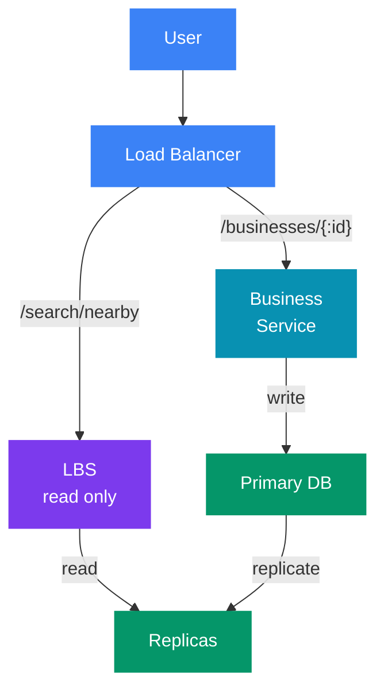
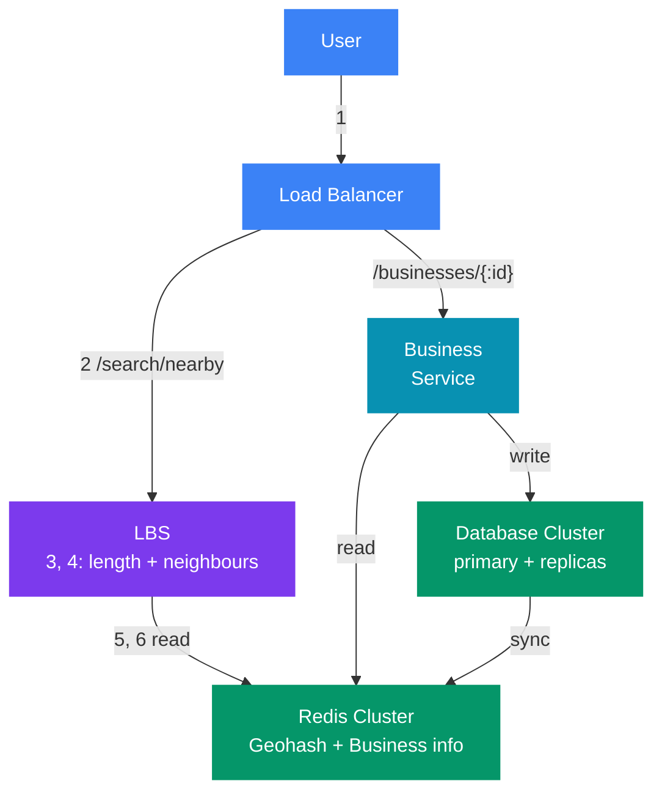
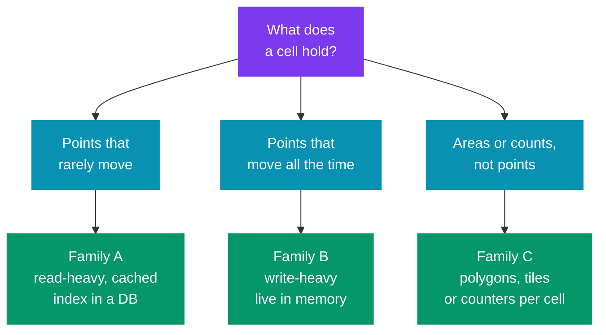

# Ch 1: Proximity Service

> 📖 **Vol 2, Chapter 1** (book pages 1–34) &nbsp;·&nbsp; 🔥 High Priority &nbsp;·&nbsp; 💬 **21 Questions**  
> **Source:** Alex Xu & Sahn Lam, *System Design Interview Vol 2*, Ch 1. Page and figure numbers below are the book's printed ones.

---

📊 **Question Count**

| # | Section | Questions |
|---|---|---|
| 1 | [Requirements and Estimation ⚡](#1--requirements-and-estimation-p13-) | 1 |
| 2 | [API and Data Model ⚡](#2--api-and-data-model-p35-) | ref |
| 3 | [High-level Design 🔥](#3--high-level-design-p57-) | 1 |
| 4 | [Indexing Options — 2D Search and Even Grid 🔥](#4--indexing-options--2d-search-and-even-grid-p710-) | 1 |
| 5 | [Geohash 🔥🔥](#5--geohash-p1015-) | 5 |
| 6 | [Quadtree, Google S2 and the Choice 🔥](#6--quadtree-google-s2-and-the-choice-p1624-) | 5 |
| 7 | [Deep Dive — Scale the Database and Caching 🔥🔥](#7--deep-dive--scale-the-database-and-caching-p2428-) | 5 |
| 8 | [Regions, Filters and Final Design 🔥](#8--regions-filters-and-final-design-p2831-) | 2 |
| 9 | [Similar Problems This Design Solves 📎 🔥](#9--similar-problems-this-design-solves--) | 1 |
| | **Total** | **21** |

> 🔥🔥 Very high priority — asked in almost every Tier-1 interview loop &nbsp;·&nbsp; 🔥 High priority — very frequent in Tier-1 interviews &nbsp;·&nbsp; ⚡ Medium priority — commonly asked &nbsp;·&nbsp; 💤 Low priority — good to know, rarely asked

---

## 🗒️ Cheat Sheet

<details>
<summary><strong>🗒️ Show cheat sheet</strong></summary>

### 🎯 Clarifying Questions — and the book's answers
| Question | Book's answer (p.1–2) |
|---|---|
| Can the user set the search radius? If too few results, do we expand it? | Return only businesses **inside the radius**. Expanding is a bonus topic, if time allows |
| What is the maximum radius? | **20 km** (12.5 miles) |
| Can the user change the radius in the UI? | **Yes:** 0.5 km, 1 km, 2 km, 5 km and 20 km |
| How are businesses added, deleted or updated? Real time? | Owners can change them. Changes take effect **the next day** (a business agreement) |
| The user moves. Must we refresh results all the time? | **No.** Assume the user moves slowly |
| Scale? | **100 million DAU** and **200 million businesses** (p.3) |

**Functional** (p.2):
- Return all businesses near a location (lat/lng) inside a radius.
- Owners add, delete or update a business (not real time).
- Customers view a business's details.

**Non-functional** (p.2): low latency · data privacy (GDPR, CCPA) · high availability and scalability for peak hours in dense areas.

### 🏗️ Core Components (Figures 1.2 and 1.21)
- **Load balancer** — one DNS entry point. It routes by URL path: `/search/nearby` → LBS, `/businesses/{:id}` → business service.
- **LBS (location-based service)** — finds nearby businesses. Read-only, high QPS, **stateless**.
- **Business service** — owner writes (low QPS) and customer detail views (high QPS at peak).
- **Database cluster** — one primary for writes, many replicas for reads.
- **Redis cluster** — two caches: **"Geohash"** (geohash → business IDs) and **"Business info"** (business ID → business object).

### Key Schema (Tables 1.3 and 1.10)
```
business(business_id PK, address, city, state, country, latitude, longitude)
geospatial_index(geohash, business_id)   -- compound key (geohash, business_id); one row per business
-- the book prints "longtitude" in Table 1.3; it means longitude
```

### 💡 Key Insights
1. **A normal DB index works in one dimension only.** Indexes on latitude and longitude still return two huge sets to intersect (p.8). So map 2D to 1D first.
2. **All geospatial indexes do one thing:** divide the map into small areas and index them (p.9). Hash family: even grid, geohash. Tree family: quadtree, S2.
3. **A shared geohash prefix means "close". The reverse is not true.** Always search the cell **plus its 8 neighbours** (p.14–15).
4. **The index is small** (~1.71 GB for a quadtree, similar for geohash). So scale reads with **replicas**, not sharding (p.26).
5. **A geohash is a good cache key.** Raw lat/lng is not: GPS jitter makes every key different (p.26–27).

### ⚖️ Trade-offs / Alternatives
| Option | Pro | Con | Book's verdict |
|---|---|---|---|
| 2D search: `BETWEEN` on lat and lng | Simple SQL | Full scan, or two big index results to intersect | ❌️ Not efficient (p.8) |
| Evenly divided grid | Simple | Uneven data: New York is full, oceans are empty. Hard to find neighbours | ❌️ (p.10) |
| **Geohash** | Easy. No tree. Easy index updates (delete one row) | Fixed cell size per precision; boundary issues | ✅ The chapter's example (p.25, p.31) |
| **Quadtree** | Cell size follows density; good for **k-nearest** | Build at start-up (minutes); hard updates with many threads | ✅ Also fine in an interview (p.22–23) |
| Google S2 | Geofencing; Region Cover with flexible cell sizes | Hard to explain | Use geohash or quadtree in an interview (p.22) |
| Index table: JSON array of IDs per geohash | One row per cell | Scan the array to update; must lock the row | ❌️ (p.25) |
| Index table: one row per (geohash, business_id) | Add/remove is one row; no locks | More rows | ✅ Recommended (p.25) |
| Shard the geospatial index | Spreads load | Complex; sharding logic in the app | ❌️ Data fits one server (p.26) |
| Read replicas for the index | Simple to build and run | Replication lag | ✅ Recommended (p.26) |
| Business table sharded by `business_id` | Even load; easy to run | — | ✅ (p.24) |
| Cache key = user lat/lng | Obvious | Phone locations jitter; tiny moves change the key | ❌️ (p.26) |
| Cache key = geohash | All users in one cell share a key | Must cache 3 precisions | ✅ (p.27) |
| 📎 Uber **H3** (hexagons) | All 6 neighbours at the same distance; 16 resolutions; good for heatmaps and surge pricing | Exactly 12 pentagons per resolution; extra library | Not in the book |
| 📎 **Redis GEO** (`GEOADD`, `GEOSEARCH` from Redis 6.2) | A sorted set whose score is a 52-bit geohash. No new infrastructure | In memory; no polygons | Book only lists Redis as a geohash user (Table 1.8) |
| 📎 **PostGIS** | Full spatial SQL, polygons | Heavy; use `ST_DWithin` (uses the index), never `ST_Distance < x` | Book names it only (p.7) |

> 📎 For a delivery or ride company in India, name **Uber H3** — see §6 Q5.

### 🔢 Numbers to Remember
| What | Value | Arithmetic |
|---|---|---|
| Search QPS | **5,000** | 100M DAU × 5 searches ÷ 10⁵ s (p.3). 📎 With 86,400 s it is ~5,800 |
| Scale | **100M DAU, 200M businesses** | (p.3) |
| Radius options | **0.5, 1, 2, 5, 20 km**; default 5,000 m | (p.2–3) |
| Useful geohash lengths | **4 to 6** | Longer than 6 = cells too small; shorter than 4 = too big (p.12) |
| Geohash length 4 / 5 / 6 | **39.1 × 19.5 km / 4.9 × 4.9 km / 1.2 km × 609.4 m** | Table 1.4 (p.13) |
| Cells per search | **9** | The cell + 8 neighbours (p.15, p.30) |
| Quadtree leaf limit | **100 businesses** | (p.16) |
| Quadtree leaves / internal nodes | **2M / 0.67M** | 200M ÷ 100; internal ≈ leaves ÷ 3 (p.18) |
| Quadtree memory | **~1.71 GB** | 2M × 832 B + 0.67M × 64 B = 1.664 GB + 0.043 GB (p.18) |
| Leaf / internal node size | **832 B / 64 B** | 32 B corners + 8 B × 100 IDs / 32 B corners + 4 × 8 B pointers (Tables 1.6–1.7) |
| Quadtree build time | **A few minutes** | O((n/100) log(n/100)) (p.18) |
| Redis "Geohash" cache | **~5 GB** | 8 B × 200M × 3 precisions = 4.8 GB (p.27) |
| Cross-region latency (Figure 1.20) | **10 ms local vs 140 ms** cross-continent | US West users; Europe users 15 ms (p.29) |
| 📎 Peak QPS | ~**10,000–25,000** | 2–5 × 5,000 |

### ⏱️ 45-Minute Round Plan
| Minutes | Phase | What to say or draw | Trap to avoid |
|---|---|---|---|
| 0–5 | Clarify | Radius options (max 20 km), next-day updates, slow-moving user, 100M DAU, 200M businesses | Designing Nearby Friends (moving users) by mistake |
| 5–8 | Estimate | 100M × 5 ÷ 10⁵ = **5,000 QPS**; read-heavy | Long storage maths — the index is small |
| 8–15 | API + data | `GET /v1/search/nearby`, business CRUD, `business` table, `geospatial_index` table | Putting a geospatial query on the `business` table only |
| 15–22 | High-level | Figure 1.2: LB → LBS (read) and business service (write) → primary + replicas | Making the LBS stateful |
| 22–35 | **Deep dive: the index** | 2D search fails → geohash (bits, base32, Table 1.5) → boundary + 8 neighbours → quadtree vs geohash | Saying "use PostGIS" and stopping. The book wants you to explain how the index works (p.7) |
| 35–42 | Scale | Index fits one server → replicas, not shards. Cache by geohash (3 precisions, ~5 GB). Business info cache | Sharding the index "because scale" |
| 42–45 | Wrap up | Regions and AZs, privacy laws, filter by open hours / type, final flow (Figure 1.21) | Forgetting pagination of results |

> 📎 The timings are a suggestion, not from the book. The book gives the steps; the minutes are ours.

---

</details>
<br/>

---

## 1. 📋 Requirements and Estimation (p.1–3) ⚡

A proximity service finds nearby places: restaurants, hotels, theaters, museums (p.1). It powers features like "best restaurants nearby" on Yelp, or "k-nearest gas stations" on Google Maps (Figure 1.1).

Yelp has too many features for one interview. So narrow the scope with questions. The answers are in the Cheat Sheet table.

**Estimation** (p.3):

- Seconds in a day = 24 × 60 × 60 = 86,400. The book rounds it up to **10⁵** in every chapter.
- Each user makes **5 searches** per day.
- Search QPS = 100 million × 5 ÷ 10⁵ = **5,000**.

> 📎 The book does not estimate peak QPS. A common rule is 2–5 × the average, so 10,000–25,000 QPS. The book does say traffic peaks at busy hours in dense areas (p.2).

### ❓ Interview Questions

1. **Design a proximity service like Yelp. What do you clarify, and how much traffic is there? 🔥**

<!-- -->
<details>
<summary>💡 Show Answer</summary>

**Answer:**

**Clarify** (p.1–2):

- Radius: user picks 0.5, 1, 2, 5 or 20 km. Max **20 km**. Return only businesses inside the radius.
- Business changes take effect the **next day**.
- The user moves slowly, so no constant refresh.

**Requirements:** search by location and radius; owners add, update and delete businesses; customers view details. Non-functional: **low latency**, **data privacy** (GDPR, CCPA), **high availability** at peak in dense areas.

**Estimate** (p.3): 100M DAU × 5 searches ÷ 10⁵ s = **5,000 search QPS**. Reads are high; writes are rare.

</details>

---

## 2. 🔌 API and Data Model (p.3–5) ⚡

### Search API (Table 1.1, p.3)

**`GET /v1/search/nearby`** — returns businesses that match the search.

| Field | Description | Type |
|---|---|---|
| `latitude` | Latitude of a given location | decimal |
| `longitude` | Longitude of a given location | decimal |
| `radius` | Optional. Default is 5000 meters (about 3 miles) | int |

Response:

```json
{
  "total": 10,
  "businesses": [{business object}]
}
```

- Real search results are usually **paginated**. It is not the focus of the chapter, but mention it in the interview (p.3).
- The business object has enough to render the result list. The **detail page** needs more (pictures, reviews, star rating). So it is a separate call (p.3–4).

### Business APIs (Table 1.2, p.4)

| API | Detail |
|---|---|
| `GET /v1/businesses/:id` | Return detailed information about a business |
| `POST /v1/businesses` | Add a business |
| `PUT /v1/businesses/:id` | Update details of a business |
| `DELETE /v1/businesses/:id` | Delete a business |

Real examples: the Google Places API and Yelp's business endpoints (p.4).

### Read/write ratio (p.4)

- **Reads are high.** Two features are used all the time: search nearby, and view a business.
- **Writes are low.** Adding, removing and editing businesses happen rarely.
- For a read-heavy system, a **relational database such as MySQL** can be a good fit.

### Data schema (p.4–5)

Two key tables:

- **`business`** (Table 1.3) — the details of a business. Primary key `business_id`. Columns: `address`, `city`, `state`, `country`, `latitude`, `longitude`.
- **Geo index table** — for fast spatial queries. It needs geohash knowledge, so the book explains it in the deep dive (§7).

---

## 3. 🧱 High-level Design (p.5–7) 🔥

The system has two parts: the **location-based service (LBS)** and the **business service** (Figure 1.2).



- **Load balancer** (p.6) — spreads traffic across services. A company usually has **one DNS entry point**. The LB routes each API call by its **URL path**.
- **LBS** (p.6) — the core. It finds businesses for a radius and a location. It is **read-heavy with no writes**. QPS is high at peak hours in dense areas. It is **stateless**, so it scales out easily.
- **Business service** (p.6) — two kinds of request. Owners create, update or delete businesses: writes, low QPS. Customers view details: high QPS at peak.
- **Database cluster** (p.7) — primary-secondary. The primary takes all writes. Replicas serve reads. Replication lag can make the LBS read slightly old data. That is fine, because business changes do not need to show in real time.
- **Scaling** (p.7) — both services are stateless. Add servers at peak traffic (mealtime). Remove them off-peak (night). On the cloud, use several **regions and availability zones**.

### ❓ Interview Questions

1. **Walk me through the high-level design. 🔥🔥**

<!-- -->
<details>
<summary>💡 Show Answer</summary>

**Answer:**

(Figure 1.2, p.5–7)

- A **load balancer** routes by URL path.
- `/search/nearby` → **LBS**: read-only, high QPS, **stateless**, scales out.
- `/businesses/{:id}` → **business service**: owner writes (low QPS) and detail views (high QPS).
- **DB cluster**: primary for writes, replicas for reads. Replication lag is fine — changes are next-day anyway.

APIs: `GET /v1/search/nearby` (lat, lng, optional radius, default 5,000 m; paginate the results) and CRUD on `/v1/businesses/:id`. Tables: `business` and a geospatial index table.

</details>

---

## 4. 🧭 Indexing Options — 2D Search and Even Grid (p.7–10) 🔥

Real companies often use a ready-made geospatial database: **Geohash in Redis**, or **Postgres with PostGIS** (p.7). You do not need to know their internals. But **explain how the index works** — do not just name a database. That shows problem-solving skill.

### Option 1: Two-dimensional search (Figures 1.3–1.4, p.7–8)

Draw a circle with the radius. Find all businesses inside it:

```sql
SELECT business_id, latitude, longitude
FROM business
WHERE (latitude BETWEEN {:my_lat} - radius AND {:my_lat} + radius)
  AND (longitude BETWEEN {:my_long} - radius AND {:my_long} + radius)
```

- Without indexes, this **scans the whole table**.
- Indexes on latitude and longitude help **only a little**. Each index returns a big set: a whole band of the world (Figure 1.4). Then the DB must **intersect** the two sets. That is slow, because each set holds a lot of data.
- The real problem: a DB index speeds up **one dimension** only. So, can we map 2D data to one dimension? **Yes.**

> 📎 In the SQL, `radius` is in degrees, not km. One degree of latitude is ~111 km. One degree of longitude is ~111 km × cos(latitude). The book keeps it as pseudo-SQL.

### Types of geospatial index (Figure 1.5, p.9)

- **Hash:** even grid, geohash, cartesian tiers.
- **Tree:** quadtree, Google S2, R-tree.

They all share one idea: **divide the map into smaller areas and build indexes for fast search.** Geohash, quadtree and S2 are the most widely used.

> **Book's reminder** (p.9): you usually do not need the implementation details in an interview. But know **why** we need a geospatial index, how it works at a high level, and its **limits**.

### Option 2: Evenly divided grid (Figure 1.6, p.9–10)

Divide the world into equal small grids. Each business belongs to one grid.

- **The main problem:** businesses are not spread evenly. Downtown New York has many. Deserts and oceans have none. So the data is very uneven.
- We want **small grids in dense areas** and **large grids in sparse areas**.
- It is also hard to find the neighbouring grids of a grid.

### ❓ Interview Questions

1. **Why not just index latitude and longitude and run a `BETWEEN` query? 🔥🔥**

<!-- -->
<details>
<summary>💡 Show Answer</summary>

**Answer:**

(p.7–8, Figure 1.4)

- With no index, the query **scans the whole table**.
- With an index on each column, each index returns a **huge band** of the world. The DB must then **intersect** the two big sets. That is slow.
- A normal index helps **one dimension** only. So map 2D to **1D** first: geohash, quadtree or S2.

📎 A compound B-tree index `(lat, lng)` does not fix it either. It can use only the first range well; the second becomes a filter. A geohash turns the search into **one prefix scan**, and it also makes a good **cache key**. A raw bounding box cannot, because every user's box is different.

</details>

---

## 5. 🔤 Geohash (p.10–15) 🔥🔥

Geohash is better than the even grid. It turns 2D latitude and longitude into a **1D string** of letters and digits. It divides the world into smaller and smaller grids, **one bit at a time** (p.10).

### How it works (Figures 1.7–1.8, p.10–12)

1. Divide the planet into **four quadrants**, along the prime meridian and the equator.
   - Latitude [-90, 0] → 0. Latitude [0, 90] → 1.
   - Longitude [-180, 0] → 0. Longitude [0, 180] → 1.
2. Divide each grid into four smaller grids. Each grid gets bits that **alternate: longitude bit, then latitude bit**.
3. Repeat until the grid is as small as you need.
4. Write the bits in **base32** (5 bits per character).

Book examples (p.12), both of length 6:

| Place | Bits (5 per char) | Geohash |
|---|---|---|
| Google HQ | 01001 10110 01001 10000 11011 11010 | **9q9hvu** |
| Facebook HQ | 01001 10110 01001 10001 10000 10111 | **9q9jhr** |

> 📎 The book prints the first group as `1001`. The leading zero is missing — `9` is `01001` in base32. Also, the map inside Figure 1.7 is mirrored: Europe and Asia sit in quadrant `01` (west), but they are east of the prime meridian. The bit labels themselves are right.

📎 Check: encoding the book's sample point (37.776720, −122.416730, p.30) at length 6 gives `9q8yym`.

### Precision → grid size (Table 1.4, p.13)

Geohash has **12 precisions** (also called levels). We only use lengths **4 to 6**. Longer than 6 gives grids that are too small. Shorter than 4 gives grids that are too large.

| Geohash length | Grid width × height |
|---|---|
| 1 | 5,009.4 km × 4,992.6 km |
| 2 | 1,252.3 km × 624.1 km |
| 3 | 156.5 km × 156 km |
| **4** | **39.1 km × 19.5 km** |
| **5** | **4.9 km × 4.9 km** |
| **6** | **1.2 km × 609.4 m** |
| 7 | 152.9 m × 152.4 m |
| 8 | 38.2 m × 19 m |
| 9 | 4.8 m × 4.8 m |
| 10 | 1.2 m × 59.5 cm |
| 11 | 14.9 cm × 14.9 cm |
| 12 | 3.7 cm × 1.9 cm |

> ⚠️ **Book bug — length 1 is not "the size of the planet".** Table 1.4 labels the 5,009.4 km × 4,992.6 km cell as "(the size of the planet)". A length-1 geohash has 5 bits: 3 longitude bits and 2 latitude bits. So the world splits into 8 × 4 = **32 cells** of 45° × 45°. 45° at the equator ≈ 5,009 km. The planet is ~40,075 km around. Read it as "1/32 of the planet".

📎 Why the sizes alternate: length *n* has 5*n* bits. Longitude gets the extra bit when 5*n* is odd. So odd lengths give square-ish cells, and even lengths give cells twice as wide as they are tall. Widths are measured at the **equator**. Away from it, a cell gets narrower by cos(latitude).

### Choosing the precision (Table 1.5, p.13)

Find the geohash length whose cell is just big enough to cover the circle.

| Radius | Geohash length | 📎 Cell (Table 1.4) |
|---|---|---|
| 0.5 km (0.31 mile) | 6 | 1.2 km × 609.4 m |
| 1 km (0.62 mile) | 5 | 4.9 km × 4.9 km |
| 2 km (1.24 mile) | 5 | 4.9 km × 4.9 km |
| 5 km (3.1 mile) | 4 | 39.1 km × 19.5 km |
| 20 km (12.42 mile) | 4 | 39.1 km × 19.5 km |

📎 The rule behind the table: we search the cell **and its 8 neighbours**. That 3 × 3 block covers the whole circle if **each side of a cell is at least the radius**. So pick the longest geohash whose smaller side is ≥ the radius.

📎 The book (p.13) says "the **minimal** geohash length that covers the whole circle". Read it as the smallest **cell** that still covers it, which is the **longest** geohash. A shorter geohash always covers the circle, but it returns far more businesses.

📎 **Latitude matters.** Table 1.4 gives widths at the equator. A cell gets narrower by cos(latitude). At 60° a length-5 cell is ~2.45 km wide (4.9 × 0.5). At 70° it is ~1.68 km, which is less than a 2 km radius. Near the poles, compute the real cell width, or drop one more character.

> ⚠️ **Book inconsistency — 20 km maps to length 4, but a length-4 cell is only 19.5 km tall.** By the rule above, 20 km needs length 3 (156 km cells), or a radius of 19.5 km. The gap is small (0.5 km at the very edge of the circle). In an interview, say "length 4 is almost enough; a business 19.6–20 km away north or south may be missed".

### Boundary issues (Figures 1.9–1.11, p.13–15)

Geohash **guarantees**: the longer the shared prefix, the closer the two cells. In Figure 1.9 all cells share the prefix `9q8zn`.

**Boundary issue 1 — close but no shared prefix** (p.14). The reverse is **not** true. Two places on either side of the **equator or prime meridian** are in different "halves" of the world. Example: La Roche-Chalais (`u000`) is only **30 km** from Pomerol (`ezzz`) in France. They share no prefix at all (Figure 1.10). So this simple query misses nearby businesses:

```sql
SELECT * FROM geohash_index WHERE geohash LIKE '9q8zn%'
```

**Boundary issue 2 — long shared prefix, different cells** (p.15). Two points can be very close and share a long prefix, but sit in different cells (Figure 1.11).

**The fix** (p.15): fetch businesses from the current grid **and its neighbours**. Neighbour geohashes are computed in **constant time**.

📎 Why the jumps happen: geohash is a **Z-order (Morton) curve**. It interleaves the bits of longitude and latitude. Points close in 2D are *mostly* close on the 1D curve. But the curve jumps at quadrant edges. That is why the 8-neighbour search is required, not just a nice extra.

### Not enough businesses (Figure 1.12, p.15)

What if the cell and its neighbours return too few businesses?

- **Option 1:** return only businesses in the radius. Easy, but the user may get too few results.
- **Option 2:** **remove the last digit** of the geohash and search the bigger cell. Repeat until there are enough results.

### ❓ Interview Questions

1. **How does geohash work? 🔥🔥**

<!-- -->
<details>
<summary>💡 Show Answer</summary>

**Answer:**

(p.10–12, Figures 1.7–1.8)

1. Split the world into 4 quadrants at the equator and prime meridian. Longitude [-180, 0] → 0, [0, 180] → 1. Latitude [-90, 0] → 0, [0, 90] → 1.
2. Split each quadrant into 4 again. The bits **alternate**: longitude, latitude, longitude …
3. Repeat until the cell is small enough.
4. Encode every 5 bits as one **base32** character. Google HQ = `9q9hvu` (length 6).

Each extra character makes the cell smaller. Geohash has **12 precisions**; we use **4 to 6** (p.12).

📎 It is a **Z-order (Morton) curve**: interleaved bits keep most nearby points close in 1D. So a proximity search becomes a **string-prefix scan** that a B-tree index can serve. (In PostgreSQL there is one catch — see §7 Q3.)

</details>

---

2. **How do you choose the geohash length for a radius? 🔥**

<!-- -->
<details>
<summary>💡 Show Answer</summary>

**Answer:**

(Tables 1.4–1.5, p.13)

| Radius | Length | Cell |
|---|---|---|
| 0.5 km | 6 | 1.2 km × 609.4 m |
| 1 km, 2 km | 5 | 4.9 km × 4.9 km |
| 5 km, 20 km | 4 | 39.1 km × 19.5 km |

📎 The rule: we search the cell plus 8 neighbours. That covers the circle if **each side of the cell ≥ the radius**. So pick the longest geohash that still meets this. Note: 20 km at length 4 is slightly short (19.5 km tall) — see above.

Trap: p.27 of the book prints this mapping **reversed** (4, 5, 5, 6). Table 1.5 is right: a smaller radius needs a **longer** geohash.

</details>

---

3. **What are geohash's boundary problems, and how do you fix them? 🔥🔥**

<!-- -->
<details>
<summary>💡 Show Answer</summary>

**Answer:**

(p.13–15)

- **The guarantee:** a longer shared prefix means closer cells.
- **Issue 1 — the reverse is false.** Two places across the equator or prime meridian share **no prefix**. La Roche-Chalais (`u000`) is 30 km from Pomerol (`ezzz`). So `LIKE '9q8zn%'` alone misses businesses.
- **Issue 2 — a long shared prefix, different cells.** A user near a cell edge is close to businesses in the next cell (Figure 1.11).
- **Fix:** search the current cell **and its 8 neighbours**. Neighbour geohashes are computed in **constant time**. That is up to 9 lookups, run in parallel.

</details>

---

4. **The cell and its neighbours return too few businesses. What do you do? ⚡**

<!-- -->
<details>
<summary>💡 Show Answer</summary>

**Answer:**

(p.15, Figure 1.12)

- **Option 1:** return only what is in the radius. Easy, but may not satisfy the user.
- **Option 2:** **drop the last character** of the geohash. The cell gets bigger. Repeat until there are enough results.

📎 Each dropped character makes the cell ~32 times bigger in area. So the search area grows fast. Cap the number of steps.

</details>

---

5. **A user sets a 500 km radius. What happens? 📎 💤**

<!-- -->
<details>
<summary>💡 Show Answer</summary>

**Answer:**

At length 4, a 500 km circle covers about **1,000 cells** (π × 500² ≈ 785,000 km² ÷ ~763 km² per cell). Length 2 keeps it to 9 cells, but those cells hold millions of businesses to filter and rank. Either way the query is too big. Options:

1. **Cap the radius** in the API. The book already caps it at 20 km. This is the cleanest answer — it is a product decision.
2. For a large radius, use a DB bounding-box query with a spatial index.
3. Use PostGIS or S2 for polygon-aware queries.

</details>

---

## 6. 🌳 Quadtree, Google S2 and the Choice (p.16–24) 🔥

### Option 4: Quadtree (Figures 1.13–1.14, p.16–17)

A quadtree splits 2D space into **four quadrants**, again and again, until each grid meets a rule. Here the rule is: **no more than 100 businesses** per grid. (100 is a business choice.)

- It is an **in-memory data structure**, not a database solution.
- It runs on **each LBS server**. Each server builds it at **start-up**.

Figure 1.13: the world has 200m businesses. It splits into NW 40m, NE 30m, SW 70m, SE 60m. A busy quadrant (NE, 30m) splits again: 12m, 4m, 5m, 9m. This goes on until no leaf has more than 100.

```java
public void buildQuadtree(TreeNode node) {
    if (countNumberOfBusinessesInCurrentGrid(node) > 100) {
        node.subdivide();
        for (TreeNode child : node.getChildren()) {
            buildQuadtree(child);
        }
    }
}
```

*(The book's pseudocode, p.17.)*

### Quadtree memory (Tables 1.6–1.7, p.17–18)

- **Leaf node** (Table 1.6): top-left and bottom-right coordinates, 32 bytes (8 × 4) + up to 100 business IDs, 8 bytes × 100. Total **832 bytes**.
- **Internal node** (Table 1.7): the same 32 bytes of coordinates + 4 child pointers, 32 bytes. Total **64 bytes**.
- The business count is **not stored** in a node. It can be found from the database.
- Leaf nodes ≈ 200 million ÷ 100 = **2 million**.
- Internal nodes = 2 million × 1/3 ≈ **0.67 million**.
- Memory = 2M × 832 B + 0.67M × 64 B ≈ **1.71 GB**.

The key point: the index **fits on one server**. But one server may not have enough **CPU or network bandwidth** for all reads. Then spread reads over several quadtree servers.

📎 Why one third: in a tree where every internal node has 4 children, internal = (leaves − 1) ÷ 3.

### Build time and search (p.18)

- Build time is **O((n/100) log(n/100))**, where *n* is the number of businesses. For 200 million it may take **a few minutes**.
- **To search:** start at the root. Go down to the leaf that holds the search point. If the leaf has 100 businesses, return it. If not, add businesses from **neighbour** nodes until there are enough.

### Operational problems (p.19)

- **Slow start-up.** A server cannot serve traffic while it builds the tree. So roll out a release to a **small set of servers at a time**. If you take many servers down at once, you get a **brownout**. Blue/green deployment works too, but a whole new cluster loading 200 million businesses at once puts heavy load on the DB.
- **Updates.** The easiest way is to **rebuild the tree a few servers at a time**. Some servers return old data for a short time. That is acceptable here. The **next-day** business agreement helps: a **nightly job** can do the update. The risk: many cache keys get invalidated at once, which loads the cache servers.
- **Live updates are possible**, but harder. Many threads may read the tree, so you need **locking**. That makes the code much more complex.

Figure 1.15 (Yext, near Denver): small grids in the dense city, big grids outside it.

### Option 5: Google S2 (Figures 1.16–1.17, p.20–22)

- Like the quadtree, an **in-memory** solution. It maps a sphere to a 1D index with a **Hilbert curve** (a space-filling curve).
- Google and Tinder use it. You need not explain its internals.
- **Geofencing** (Figure 1.17): S2 can cover any area with cells of different levels. A geofence is a virtual border around a real area — a radius around a point, or fixed borders like a school zone. You can notify users who leave the area.
- **Region Cover:** set a min level, a max level and a max cell count. The cells are more flexible than geohash's fixed precision.

> ⚠️ **Book bug — the Hilbert property is stated in a circle.** p.20 says "two points that are close to each other on the Hilbert curve are close in 1D space". The curve **is** the 1D space, so that says nothing. The real property: points close on the curve (in 1D) are **close in 2D**. 📎 And unlike geohash's Z-curve, the Hilbert curve has no long jumps. It is just harder to compute.

### Who uses what (Table 1.8, p.22)

- **Geohash:** Bing Maps, Redis, MongoDB, Lyft.
- **Quadtree:** Yext. **Both geohash and quadtree:** Elasticsearch.
- **S2:** Google Maps, Tinder.

**Book's recommendation** (p.22): in an interview, choose **geohash or quadtree**. S2 is harder to explain clearly.

### Geohash vs quadtree (p.22–24)

| | Geohash | Quadtree |
|---|---|---|
| Build | Easy. **No tree** | Slightly harder: must build the tree |
| Query type | Businesses **within a radius** | **k-nearest** businesses (e.g. the nearest gas stations, however far) |
| Grid size | **Fixed** for a precision. Cannot follow density without more logic | **Changes with density** (Figure 1.15) |
| Remove a business | Delete one row with that `geohash` and `business_id` (Figure 1.18) | Walk from root to leaf, O(log n) (Figure 1.19). Needs **locks** with many threads. **Rebalancing** may be needed when a leaf is full — over-allocate ranges to avoid it |

> ⚠️ **Book bug — the quadtree is not split "based on the number k".** p.23 says the quadtree suits k-nearest "because its subdividing process is based on the number k". The tree is split by the **100-per-leaf** rule, and k comes from each query. 📎 The real reason: you start at the user's leaf and visit the nearest nodes next (a best-first walk with a priority queue). You stop when you hold k businesses and no unvisited node can be closer. The search area grows only as far as it must.

### ❓ Interview Questions

1. **How does a quadtree work, and how much memory does it need? 🔥**

<!-- -->
<details>
<summary>💡 Show Answer</summary>

**Answer:**

(p.16–18)

- Split the world into 4 quadrants, recursively, until **no leaf has more than 100 businesses**.
- It is an **in-memory** structure on **each LBS server**, built at **start-up**.
- **Memory:** leaf = 32 B coordinates + 100 × 8 B IDs = **832 B**. Internal = 32 B coordinates + 4 × 8 B pointers = **64 B**. 200M ÷ 100 = **2M leaves**; internal ≈ 2M ÷ 3 = **0.67M**. Total = 2M × 832 + 0.67M × 64 ≈ **1.71 GB**. It fits on one server.
- **Build time:** O((n/100) log(n/100)) — **a few minutes** for 200M businesses.
- **Search:** go from the root to the leaf with the search point. If it has 100 businesses, return them. Otherwise, add businesses from neighbours.

Even though it fits in memory, one server may lack CPU or bandwidth. Then use several quadtree servers.

</details>

---

2. **What operational problems does a quadtree bring? 🔥**

<!-- -->
<details>
<summary>💡 Show Answer</summary>

**Answer:**

(p.19)

- **Slow start-up:** the server cannot serve while it builds (minutes). Deploy to a **few servers at a time**, or you cause a brownout. Blue/green works, but a whole new cluster loading 200M businesses at once loads the DB heavily.
- **Updates:** simplest is an **incremental rebuild**, a few servers at a time. Some servers serve old data for a while. The next-day agreement allows a **nightly job** — but it invalidates many cache keys at once.
- **Live updates:** possible, but many threads read the tree. You need **locking**, which makes the code much harder. Removing a business means a root-to-leaf walk, O(log n), and maybe **rebalancing** (p.23).

</details>

---

3. **Geohash or quadtree? And when is Google S2 worth it? 🔥🔥**

<!-- -->
<details>
<summary>💡 Show Answer</summary>

**Answer:**

(p.22–24)

| | Geohash | Quadtree |
|---|---|---|
| Build | Easy, no tree | Must build a tree |
| Best query | **Within a radius** | **k-nearest** (nearest gas stations, any distance) |
| Grid size | Fixed per precision | Follows density |
| Update | Delete one `(geohash, business_id)` row | Root-to-leaf walk, locks, rebalancing |

**Book's advice:** in an interview, pick **geohash or quadtree**. The book uses **geohash** for the rest of the chapter, because it is simple.

**S2** (p.20–22): in memory, based on the **Hilbert curve**. Great for **geofencing** and **Region Cover** (min level, max level, max cells). Google Maps and Tinder use it. It is hard to explain in an interview.

📎 Geohash is just a string column. It works in any DB index or Redis key, with nothing to rebuild on restart. That is why it is the usual default.

</details>

---

4. **Would you use Elasticsearch instead of Redis + DB? 📎 ⚡**

<!-- -->
<details>
<summary>💡 Show Answer</summary>

**Answer:**

Elasticsearch has a native `geo_point` type. Radius queries use a **BKD tree** (Lucene points, since Elasticsearch 5.0). It is a good fit when you filter by **category, rating, hours and distance together**, or need full-text search plus geo.

The cost: heavier to run, more memory, harder to learn. For a plain "distance + few filters" search, Redis + geohash is simpler and faster.

</details>

---

5. **Would you use Redis GEO commands or Uber's H3 instead of your own geohash? 📎 🔥**

<!-- -->
<details>
<summary>💡 Show Answer</summary>

**Answer:**

- **Redis GEO:** `GEOADD` stores points in a sorted set whose score is a **52-bit geohash**. `GEOSEARCH ... BYRADIUS` (Redis 6.2+; older versions use `GEORADIUS`) does the 9-cell search for you. Good when Redis is already there. Limits: in memory only, no polygons.
- **H3:** hexagon cells with **16 resolutions**. All 6 neighbours are at the **same distance**. Square cells are not: diagonals are √2 times further. Best for aggregation — surge pricing, supply/demand heatmaps. Each resolution has exactly **12 pentagons**, because hexagons cannot fully tile a sphere.

For a delivery or ride company in India, name H3. For a Yelp-style search, geohash is enough.

</details>

---

## 7. 📈 Deep Dive — Scale the Database and Caching (p.24–28) 🔥🔥

### Business table (p.24)

It may not fit on one server, so **shard it**. The easiest way: shard by **`business_id`**. Load is even, and it is easy to run.

### Geospatial index table (Tables 1.9–1.11, p.25)

Two ways to build it:

- **Option 1:** one row per geohash, with a **JSON array** `list_of_business_ids`.
- **Option 2:** one row per business: `(geohash, business_id)`.

Sample rows for option 2 (Table 1.11): `(32feac, 343)`, `(32feac, 347)`, `(f31cad, 112)`, `(f31cad, 113)`.

**Book's verdict: option 2.**

- Option 1: to update a business, fetch the array and scan it. To insert, scan it for duplicates. Lock the row against concurrent updates. Many edge cases.
- Option 2: with a **compound key `(geohash, business_id)`**, add and remove are simple. **No locks** at all.

### Scale the geospatial index (p.25–26)

- A common mistake: jump to sharding without checking the data size.
- The whole index is **small** (quadtree ≈ 1.71 GB; geohash is similar). It fits in the **working set** of a modern DB server.
- One server may still lack CPU or bandwidth for all reads. Two ways to spread reads: **read replicas** or **sharding**.
- Sharding is complicated: the logic moves to the app. Here, nothing forces it.
- **Book's verdict:** use a series of **read replicas**. Much simpler to build and run.

📎 A quick check of "similar": 200M rows × (6-byte geohash + 8-byte ID) ≈ 2.8 GB before index overhead.

### Do we even need a cache? (p.26)

It is **not obvious**:

- The workload is read-heavy and the dataset is small. It fits in the DB's working set. So queries are **not I/O bound**. They run almost as fast as a cache.
- If reads are the bottleneck, add **read replicas**.

Talk about cost and benchmarks before adding a cache. If it fits the business needs, go on.

### Cache key (p.26–27)

- **User lat/lng is a bad key.** Phone locations are only best guesses. Even when you stand still, each reading differs a little. A user also moves a little, which does not matter to the results.
- So small moves should map to the **same key**. A **geohash** (or quadtree cell) does this: all businesses in a grid share one geohash.

### What to cache (Table 1.12, p.27–28)

| Key | Value | Name in Figure 1.21 |
|---|---|---|
| `geohash` | List of business IDs in the grid | "Geohash" |
| `business_id` | Business object (name, address, image URLs …) | "Business info" |

The book's cache-aside code (p.27), cleaned up:

```java
public List<Long> getNearbyBusinessIds(String geohash) {
    String cacheKey = "geohash:" + geohash;
    List<Long> ids = redis.get(cacheKey);
    if (ids == null) {
        // SELECT business_id FROM geohash_index WHERE geohash LIKE '{:geohash}%'
        ids = geoIndexRepository.findIdsByGeohashPrefix(geohash);
        redis.set(cacheKey, ids, Duration.ofDays(1));   // the book uses "1d"
    }
    return ids;
}
```

- On add, edit or delete, update the DB and **invalidate the cache**. Writes are rare, and geohash needs no locks, so this is easy.
- Cache **three precisions**: `geohash_4`, `geohash_5`, `geohash_6`. Each radius maps to one of them.
- **Memory:** 8 bytes × 200 million × 3 precisions = 4.8 GB ≈ **5 GB**. Keys are small enough to ignore.
- One Redis server is enough for the memory. But for **high availability** and lower **cross-continent latency**, deploy the Redis cluster **across the globe**, with the same data everywhere.

> ⚠️ **Book bug — the radius-to-length mapping is reversed on p.27.** It says the radii 500 m, 1 km, 2 km and 5 km map to lengths "4, 5, 5, and 6". Table 1.5 (p.13) says the opposite: 0.5 km → **6**, 1 km → 5, 2 km → 5, 5 km → **4**. A small radius needs a small cell, which is a **longer** geohash. p.27 also lists only 4 radii; p.2 offers 20 km too (also length 4). The three cached precisions (4, 5, 6) are still right.

> 📎 Note the TTL: the book uses **1 day**, not minutes, plus invalidation on writes and a nightly job (p.27, p.31). That fits the next-day agreement.

### ❓ Interview Questions

1. **How do you design and scale the geospatial index table? 🔥🔥**

<!-- -->
<details>
<summary>💡 Show Answer</summary>

**Answer:**

(p.24–26)

**Design** — one row per business, compound key **`(geohash, business_id)`** (Table 1.10). Not a JSON array per geohash: that needs a scan to update, a scan to avoid duplicates, and a **row lock**. With one row per business, add and remove are single rows, with **no locks**.

**Scale:**

- The index is **small** (~1.71 GB for a quadtree; geohash is similar). It fits in a DB server's working set.
- Do not jump to sharding. It puts complex logic in the app, and nothing here needs it.
- **Book's verdict:** add **read replicas** for read load.

**Business table:** too big for one server, so **shard by `business_id`**. Load is even and it is easy to run.

📎 Do not shard by geohash prefix: dense cities become **hot shards**, and the 8 neighbour cells may sit on other shards.

</details>

---

2. **Do you need a cache? If yes, what is the key and what do you cache? 🔥🔥**

<!-- -->
<details>
<summary>💡 Show Answer</summary>

**Answer:**

(p.26–28)

**Maybe not.** The data is small and fits in the DB's working set, so queries are not I/O bound. Read replicas may be enough. Discuss benchmarks and cost first.

**Key:** not the user's **lat/lng** — phone locations jitter, and small moves change the key. Use the **geohash**: all users in one cell share it.

**Two caches** (Table 1.12):

- **"Geohash":** geohash → list of business IDs. Cache precisions **4, 5 and 6**. Memory = 8 B × 200M × 3 = 4.8 GB ≈ **5 GB**. Fits one Redis server, but deploy it **globally** for availability and latency.
- **"Business info":** business_id → business object.

**Freshness:** invalidate on writes (rare, no locks with geohash). The book's code sets a **1-day** TTL. A **nightly job** refreshes business info, because changes are next-day.

📎 To avoid many keys expiring at the same moment, add a small random **jitter** to the TTL.

</details>

---

3. **Which database for business data — why not MongoDB or DynamoDB? 📎 ⚡**

<!-- -->
<details>
<summary>💡 Show Answer</summary>

**Answer:**

The book says a **relational DB such as MySQL** fits a read-heavy system (p.4). Reasons to agree:

- Business data has a clear schema and relations (hours, categories).
- Updates need ACID.
- A geohash prefix query is a plain **B-tree range scan**.

In PostgreSQL, `LIKE 'dp3wj%'` uses a B-tree only with the `C` collation or a `text_pattern_ops` index.

MongoDB or DynamoDB could work. But they give no real advantage for simple prefix lookups, and they add more to run.

</details>

---

4. **How do you keep the geohash cache correct when a business moves? 📎 🔥**

<!-- -->
<details>
<summary>💡 Show Answer</summary>

**Answer:**

A move changes the business's geohash. So two cells change.

1. The business service writes the DB: delete the old `(geohash, business_id)` row and insert the new one.
2. Delete the cache keys for the **old** and **new** cells, at **all three precisions** (4, 5, 6). Also delete the business's **"Business info"** key, because its lat/lng changed. Otherwise the distance is computed from the old location.
3. The next read reloads them (cache-aside).

A TTL is a safety net for missed invalidations. Moves are rare, so this does not cause a thundering herd (many requests hitting the DB at once after a miss).

</details>

---

5. **One geohash cell in a dense city holds tens of thousands of businesses. What do you do? 📎 🔥**

<!-- -->
<details>
<summary>💡 Show Answer</summary>

**Answer:**

This is geohash's weak point: the cell size is **fixed**. A length-4 cell is 39.1 km × 19.5 km, which covers a whole city. So a 5 km search in a dense city loads a huge ID list from 9 cells, then hydrates and ranks all of it.

Options, from cheapest:

1. **Precompute a top-N list per cell.** Business data changes only once a day. So the nightly job can store, per cell, the best N IDs by rating or popularity. The search reads only those.
2. **Search a smaller area first, then widen.** If the user needs only the top results, not every business in 5 km, start at length 5 or 6. Drop a character only if there are too few results (the book's Option 2, §5).
3. **Page the results.** Return 20, with a cursor. Never hydrate the whole list.
4. **Use a quadtree** in dense areas. Its cells shrink with density, so no leaf holds more than 100 businesses (§6).

Also watch the cache: one huge Redis value is a **hot key** and a slow read. Split it, or store a sorted set and read only a range.

</details>

---

## 8. 🌍 Regions, Filters and Final Design (p.28–31) 🔥

### Regions and availability zones (Figure 1.20, p.28–29)

Deploy the LBS in **several regions and AZs**:

- **Users are closer.** US West users reach a US West data center (10 ms, not 140 ms). Europe users reach Europe (15 ms).
- **Spread the load.** Dense places like Japan and Korea can get their own region, or several AZs.
- **Privacy laws.** Some countries require user data to stay in the country. Set up a region there and use **DNS routing** to keep that country's requests in it.

### Follow-up: filter by time or business type (p.29)

"Return only businesses open now" or "only restaurants"?

- A geohash or quadtree cell holds **few businesses**.
- So get the business IDs first, **hydrate** the business objects, then **filter** by opening time or type.
- This assumes opening hours and type are stored in the business table.

### Final design (Figure 1.21, p.30)



**Get nearby businesses** (p.30):

1. You look for restaurants within **500 m** on Yelp. The client sends the location (lat 37.776720, lng −122.416730) and the radius to the load balancer.
2. The load balancer sends the request to the LBS.
3. The LBS picks the geohash length for the radius. Table 1.5: 500 m → length **6**.
4. The LBS computes the **8 neighbours**: `list_of_geohashes = [my_geohash, neighbor1_geohash, …, neighbor8_geohash]`.
5. For each geohash, the LBS calls the **"Geohash"** Redis server for business IDs. These calls run **in parallel** to cut latency.
6. The LBS fetches full business data from **"Business info"** Redis. It computes the **distance** to each business, **ranks** them, and returns the result.

**View, update, add or delete a business** (p.31):

- Business APIs are separate from the LBS.
- To view a business, the business service checks the "Business info" cache first. On a miss, it reads the DB cluster and stores the result in Redis.
- Changes take effect the **next day**, so a **nightly job** updates the cached business data.

### 📎 Distance, filtering and ranking (beyond the book)

Step 6 says "compute the distance, rank, return". The book does not say how. Three points to add:

- **The 9 cells cover much more than the circle.** For 500 m (length 6) the 3 × 3 block is about 3.6 km × 1.83 km ≈ 6.6 km². The circle is π × 0.5² ≈ 0.79 km². So about 8 of every 9 businesses returned are **outside** the radius. Drop them by exact distance.
- **Distance formula.** Use **haversine** (great-circle distance, Earth radius 6,371 km):
  `d = 2R · asin(√(sin²(Δφ/2) + cos φ₁ · cos φ₂ · sin²(Δλ/2)))`, with φ = latitude and λ = longitude in radians. For a radius of 20 km or less, a flat approximation is also fine: `x = Δλ · cos(φ_mid)`, `y = Δφ`, `d = R · √(x² + y²)`.
- **Ranking and paging.** Sort by distance (or a score that mixes distance, rating and "open now"). Return one page, with a cursor for the next page. The book only says to mention pagination (p.3).

### Wrap up (p.31)

- The system is a typical LBS that uses **geospatial indexing**.
- Options covered: two-dimensional search, even grid, geohash, quadtree, Google S2.
- The chapter uses **geohash** as the worked example.
- The deep dive covered caching, scaling the DB with **replication and sharding**, and **regions and AZs** for availability, latency and privacy laws.

### ❓ Interview Questions

1. **Walk me through the final search flow, then filters and regions. 🔥**

<!-- -->
<details>
<summary>💡 Show Answer</summary>

**Answer:**

**Search** (Figure 1.21, p.30; full steps above):

1. LB → LBS. The LBS picks the length (500 m → **6**).
2. It computes my geohash + **8 neighbours**.
3. It reads the "Geohash" Redis for all 9 cells **in parallel**.
4. It gets the business objects from "Business info" Redis.
5. It **computes distances, ranks** them, and returns the result.

**Filters** (p.29): "open now" or "restaurants only". A cell holds few businesses. So get IDs, hydrate the objects, then filter by hours or type.

**Regions and AZs** (p.28–29):

- Users are closer: 10 ms vs 140 ms in Figure 1.20.
- Dense places like Japan and Korea get their own region.
- **Privacy laws:** keep a country's data in that country with **DNS routing**.

📎 For a traffic spike: scale the stateless LBS out behind the LB, with auto-scaling on CPU. Partition Redis by key. Rate-limit per user. Serve images from a CDN.

</details>

---

2. **How does the design change if businesses move in real time, like food trucks? 📎 🔥**

<!-- -->
<details>
<summary>💡 Show Answer</summary>

**Answer:**

The next-day agreement breaks. You would:

- cut the cache TTL to seconds, or skip caching for moving businesses;
- keep live positions in a store that takes many writes (e.g. Redis GEO);
- push updates to active clients over **WebSocket** or **SSE**.

This is close to [Ch 2: Nearby Friends](./ch02_nearby_friends.md): a pub/sub model where each mover publishes location updates.

</details>

---

## 9. 🧬 Similar Problems This Design Solves 📎 🔥

📎 The book does not list similar problems for this chapter. But the same core solves **at least 14 common interview problems**. Learn the core once, then change only a few parts for each one.

**The core that never changes:**
- **Map 2D to 1D.** Cut the map into cells (geohash, quadtree, S2 or H3). Each cell gets a key.
- **Search the cell plus its neighbours**, never one cell alone (§5).
- **Filter by exact distance, then rank.** The cells always return more than the circle (§8).
- **Use the cell key for everything else too** — the cache key, the shard key or the aggregation bucket.

**The tag on each problem** says how often it is asked as an HLD round on its own (same legend as the questions). 🔥🔥 = learn its "what is different" column well; 💤 = knowing the family is enough.

**The one choice that splits them into three families:** what does a cell hold?



### Family A — static points, read-heavy (like this chapter)

The places change rarely. The index lives in a DB with replicas, and the cell lists are cached.

| # | Problem | What is different from this chapter |
|---|---|---|
| 1 | **Proximity service (Yelp) 🔥🔥** (this chapter) | — |
| 2 | **Nearest gas stations / ATMs, "k nearest" ⚡** | No radius: return the k nearest, however far. Use a quadtree best-first walk, or widen geohash rings until you hold k (§6) |
| 3 | **Map search for hotels or homes (Airbnb, Booking) 🔥** | The search area is the **visible map rectangle**, not a circle. Each result also needs a date-availability check, which comes from a booking system ([Vol 2 Ch 7](ch07_hotel_reservation_system.md)). Often built on a search engine with a geo field plus filters (§6 Q4) |
| 4 | **Store, branch or ATM locator for one company 💤** | Only thousands of points. One table with a spatial index, or even a list in memory, is enough. No cache, no replicas |
| 5 | **Local search with text ("pizza near me") ⚡** | Text match, distance and rating are ranked together. A search engine (Elasticsearch) does all three in one query. The plain geohash design does only the distance part |

### Family B — moving points, write-heavy

The points send a new location every few seconds. Keep the latest location **in memory** (Redis GEO or an H3-cell map), not in a DB index. There is no next-day agreement and no long cache TTL.

| # | Problem | What is different from this chapter |
|---|---|---|
| 6 | **Ride hailing — find nearby drivers (Uber, Ola) 🔥🔥** | Drivers send their location every few seconds, so writes are far higher than reads. Search only drivers who are free. After the search, **lock one driver** so two riders cannot get the same one. Rank by road time (ETA), not straight-line distance |
| 7 | **Food delivery — assign a rider (Swiggy, Zomato) 🔥🔥** — [full design](../../05_designs/04_food_delivery_swiggy_zomato.md) | Riders in Redis GEO, one key per city. Search near the **restaurant**, not the user. Riders about to finish a drop also count. Orders are often matched in small batches, not one by one |
| 8 | **Nearby friends 🔥** — [Ch 2](ch02_nearby_friends.md) | You search **your friends**, not an area. Each user publishes updates (every 30 s in the book) to a pub/sub channel. The distance check runs on the receiving server. Geohash is used only for the "random nearby person" extra |
| 9 | **Dating discovery (Tinder) ⚡** | Users move, but slowly; update the location when the app opens. Filter by age and preference, and drop people already swiped. The book says Tinder uses S2 (Table 1.8) |
| 10 | **Live vehicle tracking (fleet, bus, parcel) ⚡** | Most reads are "where is vehicle X?" — a lookup by ID, not by area. Store the history as a time series. Push updates to watchers over WebSocket |

### Family C — the cell holds areas or counts, not points

The cell is used as a **bucket**: for polygons, for map data, or for counters.

| # | Problem | What is different from this chapter |
|---|---|---|
| 11 | **Geofencing — "do we deliver here?", "alert when I enter a zone" ⚡** | The query is reversed: find which **polygons** contain a point. Cover each polygon with S2 cells. Index cell → polygon IDs, then do an exact point-in-polygon check |
| 12 | **Surge pricing / demand heatmap 🔥** | Count ride requests and free drivers **per H3 cell** over a short time window, in a stream processor. H3 fits because all 6 neighbours are the same distance away (§6 Q5) |
| 13 | **Google Maps — tiles and routing 🔥** — [Ch 3](ch03_google_maps.md) | The cell holds a **map image tile** or a **piece of the road graph** (routing tile), not businesses. Distance is along roads, so routing runs a shortest-path search over the tiles |
| 14 | **Location-based ads or local news ⚡** | Map each user to a cell, then serve the content targeted at that cell or its parent cells. A cache per cell works well, because content changes slowly |

### How to use this in an interview — five questions

When you get any "near me" problem, answer these five questions aloud. Each answer picks one part of the design:

| Ask | It decides |
|---|---|
| 1. Do the points move? How often? | **Family A or B** — a cached DB index, or live locations in memory |
| 2. A radius, a map rectangle, k nearest, or "which zone am I in"? | **Geohash** (radius, rectangle), **quadtree** (k nearest) or **S2 cell cover** (zones) |
| 3. Straight-line distance or road distance? | Rank by **haversine**, or call a **routing service** for ETA |
| 4. Is the result only read, or also claimed? | A claimed result (a driver, a rider) needs a **lock or a conditional update** after the search |
| 5. How dense is the busiest area? | A **fixed cell size** (geohash) works, or you need **adaptive cells** (quadtree) or a top-N list per cell (§7 Q5) |

> **Where this does *not* transfer directly:**
>
> - **Turn-by-turn routing and ETA.** That is a graph problem on the road network ([Ch 3](ch03_google_maps.md)), not a nearby search.
> - **Search by text or category only**, with no location. That is a search-engine problem (inverted index), not a geospatial one.
> - **Very large areas**, such as a whole country. A cell index does not help there (§5 Q5); use a bounding-box query or a search engine.

### ❓ Interview Questions

1. **Where else can you use the proximity design? Pick three problems and say what changes. 📎 🔥**

<!-- -->
<details>
<summary>💡 Show Answer</summary>

**Answer:**

The core stays the same. Cut the map into cells. Search the cell plus its neighbours. Filter by exact distance, then rank. What changes is **whether the points move**, **what you search for**, and **whether the result is claimed**.

| | Yelp (this chapter) | Ride hailing (Uber) | Surge pricing heatmap |
|---|---|---|---|
| What a cell holds | Business IDs (static) | Live driver locations | A count of requests and free drivers |
| Writes | Rare; next-day | Every few seconds per driver | A stream of events |
| Where the index lives | DB + replicas, cached in Redis | In memory (Redis GEO or H3 map) | A stream processor, per time window |
| The query | Radius search, 9 cells | Nearby **free** drivers, ranked by ETA | Counts per H3 cell and its neighbours |
| After the query | Return a list | **Lock one driver** for the rider | Set a price multiplier per cell |
| Cell type | Geohash | Geohash or H3 | H3 (equal-distance neighbours) |

**Three families to name:**

- **Static points** (Yelp, k-nearest gas stations, Airbnb map search, store locator): this chapter almost as it is.
- **Moving points** (ride hailing, food delivery, nearby friends, Tinder, vehicle tracking): live locations in memory, high write rate, and often a claim step.
- **Areas or counts per cell** (geofencing, surge pricing, map tiles and routing, local ads): the cell is a bucket, not a list of places.

🧬 **The full list — 14 problems in three families, plus five questions that map any new one:** see the tables above.

</details>

---
