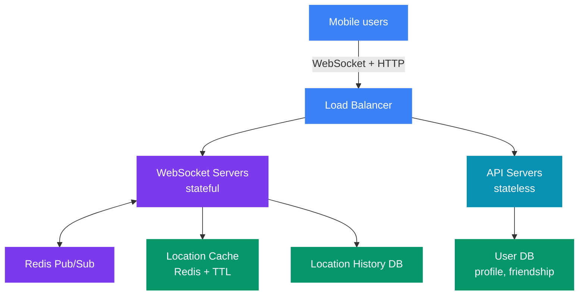
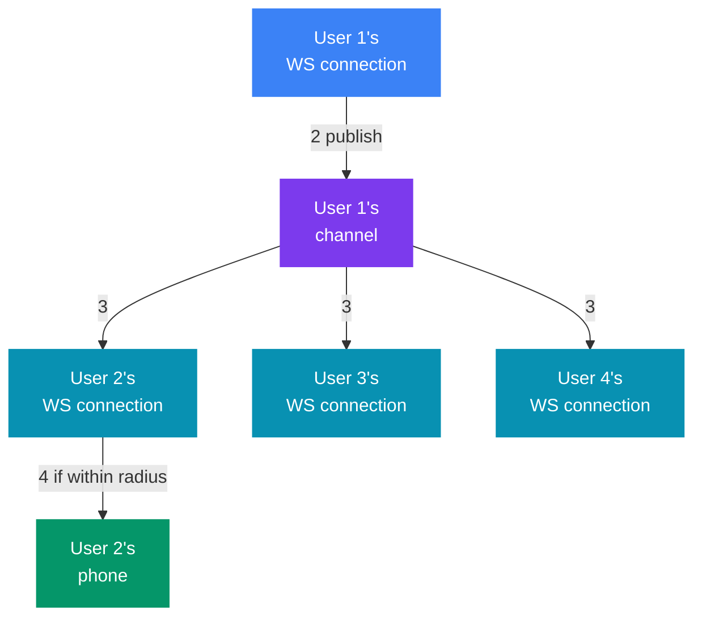
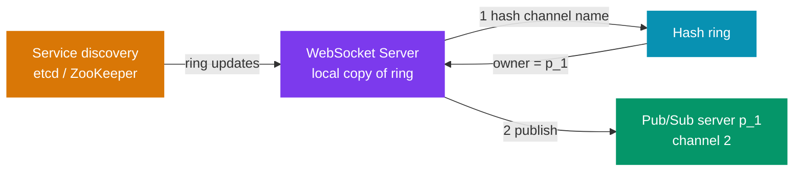
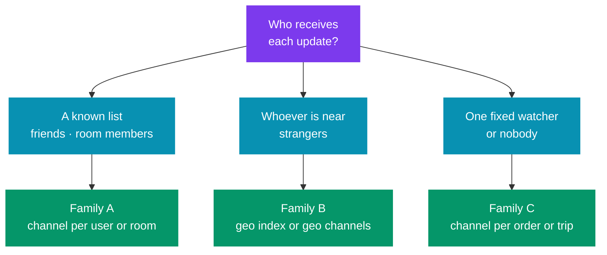

# Ch 2: Nearby Friends

> 📖 **Vol 2, Chapter 2** (book pages 35–58) &nbsp;·&nbsp; 🔥 High Priority &nbsp;·&nbsp; 💬 **22 Questions**  
> **Source:** Alex Xu & Sahn Lam, *System Design Interview Vol 2*, Ch 2. Page and figure numbers below are the book's printed ones.

---

📊 **Question Count**

| # | Section | Questions |
|---|---|---|
| 1 | [Requirements and Estimation ⚡](#1--requirements-and-estimation-p3637-) | 2 |
| 2 | [High-level Design 🔥🔥](#2--high-level-design-p3741-) | 2 |
| 3 | [Periodic Location Update 🔥🔥](#3--periodic-location-update-p4144-) | 3 |
| 4 | [API Design and Data Model 🔥](#4--api-design-and-data-model-p4445-) | 3 |
| 5 | [Scaling Each Component 🔥](#5--scaling-each-component-p4547-) | 3 |
| 6 | [Redis Pub/Sub at Scale 🔥🔥](#6--redis-pubsub-at-scale-p4752-) | 4 |
| 7 | [Adding Friends, Many Friends, Random Person 🔥](#7--adding-friends-many-friends-random-person-p5255-) | 3 |
| 8 | [Alternative to Redis Pub/Sub and Wrap Up ⚡](#8--alternative-to-redis-pubsub-and-wrap-up-p5557-) | 1 |
| 9 | [Similar Problems This Design Solves 📎 🔥](#9--similar-problems-this-design-solves--) | 1 |
| | **Total** | **22** |

> 🔥🔥 Very high priority — asked in almost every Tier-1 interview loop &nbsp;·&nbsp; 🔥 High priority — very frequent in Tier-1 interviews &nbsp;·&nbsp; ⚡ Medium priority — commonly asked &nbsp;·&nbsp; 💤 Low priority — good to know, rarely asked

> **How to read this note.** Sections 1–8 follow the book, step by step. Anything the book does not say is marked **📎 Beyond the book**. Where the book has a mistake, the note says so and gives the fix.  
> The previous chapter, [Ch 1: Proximity Service](./ch01_proximity_service.md), covers geohash. This chapter uses geohash only for the "nearby random person" extra.  
> §9, at the end, maps this design to 14 similar problems.

---

## 🗒️ Cheat Sheet

<details>
<summary><strong>🗒️ Show cheat sheet</strong></summary>

### 🎯 Clarifying Questions — and the book's answers
| Question | Book's answer (p.36) |
|---|---|
| How close is "nearby"? | **5 miles** (about 8 km). It should be configurable |
| Straight-line distance, or travel distance? | **Straight line.** A river between two users does not matter |
| How many users? | **1 billion** users. **10%** of them use nearby friends |
| Store location history? | **Yes.** It is useful for things like machine learning |
| What about a friend who is inactive? | Inactive for **more than 10 minutes** → the friend disappears from the list |
| Privacy laws (GDPR, CCPA)? | **Ignore them for now**, to keep it simple |

**Functional** (p.36): users see nearby friends on the app. Each entry has a **distance** and a **timestamp** of the last update. The list updates **every few seconds**.
**Non-functional** (p.36): **low latency**; **reliable** overall, but losing a data point sometimes is fine; **eventual consistency** — a few seconds of delay between replicas is fine.

### 🏗️ Core Components (Figure 2.4)
- **Load balancer** — sits in front of the API servers and the WebSocket servers.
- **RESTful API servers** — stateless. They handle friends, profiles, auth.
- **WebSocket servers** — stateful. One long-lived connection per client. They push friend locations and seed the list when the client starts.
- **Redis location cache** — the latest location of each **active** user, with a **TTL**.
- **User database** — profiles and friendships. Relational or NoSQL.
- **Location history database** — past locations. Not on the "nearby friends" path.
- **Redis Pub/Sub** — a light message bus. **One channel per user.**

### Key Data (Table 2.1, p.45)
```
Location cache (Redis):   key = user_id   value = {latitude, longitude, timestamp}   + TTL
Location history (Cassandra, or sharded RDBMS):  user_id | latitude | longitude | timestamp
```

### 💡 Key Insights
1. **This is a message-routing problem, not a search problem.** Locations change all the time (p.35). The book calls for "efficient message passing" and pushes each update to friends (p.37). 📎 No geo index is needed: the friend list (about 400 people) is already the full set of candidates.
2. **Each user publishes to their own channel. Each friend's WebSocket handler subscribes to it** (p.41). The sender does not need to know where friends are connected.
3. **The distance check runs on the receiving WebSocket server**, after Redis delivered the message (p.42–43). Redis knows nothing about distance.
4. **Subscribe to all friends, online or not** (p.47). An idle channel uses a little memory and no CPU. This makes the design simpler.
5. **Redis Pub/Sub is limited by CPU, not memory** — about **140** servers for CPU, only **2** for memory (p.48).

### ⚖️ Trade-offs / Alternatives
| Option | Pro | Con | Book's verdict |
|---|---|---|---|
| Peer-to-peer connections between friends | No backend needed for routing | Flaky mobile networks, tight battery budget | ❌️ Not practical (p.38) |
| Shared backend + **WebSocket** | Server can push; one connection does both directions | Stateful servers — scaling and deploys need care | ✅ Chosen (p.39–40) |
| Plain HTTP request/response | Simple, stateless | The server cannot push to friends | ❌️ Not straightforward here (p.37) |
| Redis for current location | Very fast reads and writes, built-in TTL | Not durable | ✅ Only the current location matters (p.45) |
| Durable DB for current location | Survives a crash | Slower; durability is not needed | ❌️ Not needed (p.45) |
| Location history: **Cassandra** | Handles heavy writes, scales out | — | ✅ "A good candidate" (p.45) |
| Location history: relational DB | Familiar | Data does not fit one instance; must shard by `user_id` | Possible (p.45) |
| Subscribe to **all** friends | Simple: no subscribe/unsubscribe when friends go online/offline | More memory | ✅ Memory is not the bottleneck (p.47) |
| **Redis Pub/Sub** as the routing layer | Channels are cheap; idle channels use no CPU | Stateful cluster; no message persistence | ✅ Chosen (p.41, p.47) |
| **Erlang/OTP** as the routing layer | Very cheap processes; built-in subscription | Niche; hard to hire for | "A better solution" — if the team knows Erlang (p.55) |

### 🔢 Numbers to Remember
| What | Value | Arithmetic |
|---|---|---|
| Nearby radius | **5 miles** | ≈ 8 km (p.36) |
| Location refresh interval | **30 s** | Walking speed 3–4 mph: 3.5 mph × 30/3600 h ≈ 0.03 mile ≈ 47 m. Too small to matter (p.37) |
| DAU of the feature | **100 million** | 1 billion × 10% |
| Concurrent users | **10 million** | 10% × 100 million (p.37) |
| Location update QPS | **~334,000** | 10 million ÷ 30 s = 333,333; the book rounds to 334K (p.37) |
| Friends per user | **400** | All of them use the feature (p.37) |
| Forwards per update | **~40** | 400 × 10% online (p.44) |
| Total pushes per second | **~14 million** | 334K × 400 × 10% = 13.4 million; the book rounds to 14M (p.38) |
| Location cache memory | **~1 GB** | 10 million users × ≤ 100 bytes. One Redis server holds it (p.47) |
| Location cache writes | **334K/s** | Too high for one server → shard by `user_id` (p.47) |
| Pub/Sub memory | **~200 GB → 2 servers** | 100 million channels × 100 friends × 20 bytes = 2 × 10¹¹ B; ÷ 100 GB per server (p.48) — see the ⚠️ in §6 |
| Pub/Sub CPU | **~140 servers** | 14 million pushes/s ÷ 100,000 pushes/s per server (p.48) |
| Friend cap | **5,000** | Facebook's cap. Friendship is two-way (p.53) |
| Inactivity timeout | **10 minutes** | The location cache TTL matches it (p.36, p.46) |
| Erlang process | **~300 bytes** | Millions of processes fit on one server (p.55) |

### ⏱️ 45-Minute Round Plan
| Minutes | Phase | What to say or draw | Trap to avoid |
|---|---|---|---|
| 0–5 | Clarify | 5 miles, straight line, 1B users, 10% use it, store history, hide friends inactive for 10 min | Treating it as Proximity Service. Say "locations move, so I will push, not query" |
| 5–8 | Estimate | 100M DAU → 10M concurrent → **334K updates/s** → × 40 = **14M pushes/s** | Stopping at 334K. The fan-out number drives the design |
| 8–20 | High-level | Figure 2.4: LB, API servers, WebSocket servers, location cache, history DB, user DB, Redis Pub/Sub. Then the update flow (Figure 2.8) | Drawing the API first. The book says the protocol decides the API, so the design comes first |
| 20–25 | API + data | 5 WebSocket messages; Table 2.1; history schema | Storing the current location in a durable DB |
| 25–40 | **Deep dive** | Client init (7 steps) → Pub/Sub sizing (CPU, not memory) → hash ring in etcd/ZooKeeper → resize vs replace | Saying "one Redis Pub/Sub is enough" |
| 40–45 | Wrap up | Many friends (cap 5,000), nearby random person (geohash channels), Erlang alternative | Designing a celebrity follower model. The book rules it out |

> 📎 The timings are a suggestion, not from the book. The book gives the steps; the minutes are ours.

---

</details>
<br/>

---

## 1. 📋 Requirements and Estimation (p.36–37) ⚡

The feature: an **opt-in** user who grants location access sees a list of friends who are close by (p.35). Figure 2.1 shows Facebook's version.

**Why a separate chapter from Proximity Service?** In Proximity Service, business addresses are **static**. In Nearby Friends, user locations **change often** (p.35). So the data is much more dynamic.

The clarifying questions and requirements are in the Cheat Sheet.

### Back-of-the-envelope estimation (p.37)

Assumptions:

- Nearby = within a **5-mile** radius.
- Location refresh every **30 seconds**. People walk slowly (3–4 mph), so 30 seconds of walking does not change the result much.
- **100 million** users use the feature every day.
- Concurrent users = 10% of DAU = **10 million**.
- A user has **400 friends** on average, and all of them use the feature.
- The app shows **20** nearby friends per page and loads more on request.

**Location update QPS** = 10 million ÷ 30 = **~334,000**.

### ❓ Interview Questions

1. **How is Nearby Friends different from the Proximity Service in Ch 1? ⚡**

<!-- -->
<details>
<summary>💡 Show Answer</summary>

**Answer:**

- **Proximity Service:** business locations are **static** (p.35). It is read-heavy. A geo index (geohash, quadtree) plus a cache answers search requests. Request/response is enough.
- **Nearby Friends:** user locations **change all the time** (p.35). The list must refresh every few seconds (p.36).
- 📎 **Why no geo index?** You do not search the whole map. The candidates are only the user's friends — about 400 people. So the check is "which of my friends are close?", not "who is close?".
- 📎 A geo index could take 334K writes/s if sharded. But then 10 million clients would have to poll it every few seconds. Pushing each update only to friends costs less.
- So Nearby Friends **pushes** updates instead: WebSocket connections plus a Pub/Sub routing layer. The distance check runs per message, on the receiving server.
- The geo index comes back only for the "nearby random person" extra (§7), where the candidates are strangers.

</details>

---

2. **How would you protect user privacy? 📎 ⚡**

<!-- -->
<details>
<summary>💡 Show Answer</summary>

**Answer:**

The book puts GDPR and CCPA out of scope (p.36). If asked:

- The feature is **opt-in** (p.35). When a user turns it off, stop sending updates, delete the cache key, and fire the opt-out callback so friends unsubscribe (p.53).
- Share only with **mutual** friends — the book's model is already two-way.
- Offer a **coarse location** mode, for example rounded to a few hundred metres.
- Limit **history retention**, and let users delete their history.
- Use **TLS** for the WebSocket connection (`wss://`) and encrypt history at rest.

</details>

---

## 2. 🔄 High-level Design (p.37–41) 🔥🔥

**Why design before the API?** In most chapters the API comes first. Here, the server must **push** location data to friends. Plain HTTP request/response does not do that well. Without the high-level design, it is hard to know what the API looks like (p.37).

### From peer-to-peer to a shared backend (Figures 2.2–2.3, p.38)

- **Peer-to-peer** (Figure 2.2): each user keeps a connection to every active friend nearby. Not practical on mobile: connections are flaky and the battery budget is tight. But it shows the direction.
- **Shared backend** (Figure 2.3): the user sends to the backend, and the backend forwards to friends.

The backend has three jobs:

- Receive location updates from all active users.
- For each update, find the active friends who should get it, and forward it to their devices.
- If two users are farther apart than the threshold, do **not** forward it.

**Why it is hard:** 10 million active users × one update per 30 s = 334K updates/s. Each user has 400 friends, about 10% online and nearby. So the backend forwards 334K × 400 × 10% ≈ **14 million updates per second** (p.38).

### Proposed design (Figure 2.4, p.39)

The book first designs for a **lower scale**, then scales it up in the deep dive.



*(The WebSocket servers also read the user DB, for the friend list.)*

- **Load balancer** — spreads traffic over the RESTful API servers and the stateful, two-way WebSocket servers.
- **RESTful API servers** — a cluster of stateless HTTP servers. They do side tasks: add/remove friends, update profiles. Figure 2.5 shows this request flow. The book does not go deeper.
- **WebSocket servers** — a cluster of **stateful** servers. Each client keeps **one** persistent connection to one of them. When a friend within the radius moves, the update goes down this connection. They also **seed** the client with nearby online friends when it starts. ("WebSocket connection" and "WebSocket connection handler" mean the same thing in this chapter.)
- **Redis location cache** — the most recent location of each active user. Each entry has a **TTL**. When it expires, the user is no longer active and the data is removed. Every update refreshes the TTL. Any KV store with TTL would also work.
- **User database** — user data and friendships. Relational or NoSQL.
- **Location history database** — past locations. Not directly part of the "nearby friends" feature.
- **Redis Pub/Sub server** — a very light message bus. Channels are very cheap to create. A server with GBs of memory can hold **millions of channels** (p.41).

### How Redis Pub/Sub is used (Figure 2.6, p.41)

- A location update that reaches a WebSocket server is **published to the user's own channel**.
- A WebSocket connection handler **for each active friend** subscribes to that channel.
- When an update arrives, the handler runs. It recomputes the distance for its friend. If the new distance is within the radius, it sends the location and timestamp to the friend's client.
- Other message buses with light channels could also work.

### ❓ Interview Questions

1. **Why WebSocket? Why does the book design the system before the API? 🔥🔥**

<!-- -->
<details>
<summary>💡 Show Answer</summary>

**Answer:**

- The server must **push** friends' locations to the client. Plain HTTP request/response is not a good fit for that. So the protocol is not obvious, and the API depends on the design (p.37).
- **WebSocket** gives one persistent, two-way connection. The client sends its own location and receives friends' locations on it (p.40).
- 📎 **Long polling** works, but each message needs a new HTTP request with headers. Messages wait for the next poll.
- 📎 **SSE** (Server-Sent Events) is server → client only. The client would need a separate REST call for uploads.

</details>

---

2. **How does Redis Pub/Sub connect the WebSocket servers? 🔥**

<!-- -->
<details>
<summary>💡 Show Answer</summary>

**Answer:**

(Figure 2.6, p.41; Figure 2.8, p.43)

- Each user has **one channel**. A user's WebSocket server publishes the user's updates to that channel **once**.
- The connection handler of **each friend** subscribes to the channel. The friend can be on any WebSocket server.
- Redis delivers each message to all subscribers. The publisher never needs to know which server a friend is on.
- Channels are **very cheap**. A message to a channel with no subscribers is just dropped. An idle channel uses no CPU (p.47).

</details>

---

## 3. 📍 Periodic Location Update (p.41–44) 🔥🔥

The client sends updates over its persistent WebSocket connection (Figure 2.7, p.42):

1. The mobile client sends a location update to the load balancer.
2. The load balancer forwards it to the client's persistent connection on a WebSocket server.
3. The WebSocket server saves it to the **location history database**.
4. It updates the **location cache**, which refreshes the TTL. It also keeps the new location **in a variable of the connection handler**, for later distance checks.
5. It **publishes** the new location to the user's channel in Redis Pub/Sub. **Steps 3–5 can run in parallel.**
6. Redis Pub/Sub broadcasts the update to **all subscribers** of the channel. The subscribers are the WebSocket connection handlers of the user's online friends.
7. On each receiving WebSocket server, the handler computes the distance between the sender and its own user. The sender's location is in the message. Its own user's location is in the handler's variable.
8. If the distance is within the radius, it sends the new location and timestamp to the friend's client. Otherwise it **drops** the update. (Step 8 is not drawn in the figure.)

### A concrete example (Figure 2.8, p.43–44)

User 1's friends are users 2, 3 and 4. User 5's friends are users 4 and 6.



1. User 1 moves. The update goes to the WebSocket server that holds user 1's connection.
2. It is published to user 1's channel.
3. Redis broadcasts it to all subscribers: the handlers of users 2, 3 and 4.
4. If user 1 is within the radius of user 2, the new location goes to user 2's client.

User 4 is a friend of both user 1 and user 5, so user 4's handler subscribes to **both** channels.

This runs for every subscriber. With 400 friends and 10% online and nearby, each update means about **40 forwards** (p.44).

### 📎 The receiving handler in Java

The book gives no code. A sketch of steps 7–8:

```java
public class FriendUpdateHandler {

    private static final double EARTH_RADIUS_MILES = 3958.8;

    private final double radiusMiles;
    private final ClientSession session;
    private volatile Location myLocation;   // set on each of my own updates (step 4)

    public FriendUpdateHandler(double radiusMiles, ClientSession session) {
        this.radiusMiles = radiusMiles;
        this.session = session;
    }

    public void onMyLocation(Location location) {
        this.myLocation = location;
    }

    // Called when Redis delivers a message from a friend's channel
    public void onFriendUpdate(String friendId, Location friend) {
        Location me = myLocation;
        if (me == null) {
            return;
        }
        if (distanceMiles(me, friend) <= radiusMiles) {
            session.send(friendId, friend);   // location + timestamp
        }
        // else: drop the update (step 8)
    }

    static double distanceMiles(Location a, Location b) {
        double dLat = Math.toRadians(b.lat() - a.lat());
        double dLng = Math.toRadians(b.lng() - a.lng());
        double h = Math.pow(Math.sin(dLat / 2), 2)
                + Math.cos(Math.toRadians(a.lat())) * Math.cos(Math.toRadians(b.lat()))
                * Math.pow(Math.sin(dLng / 2), 2);
        return 2 * EARTH_RADIUS_MILES * Math.asin(Math.sqrt(h));
    }
}

record Location(double lat, double lng, long timestamp) { }

interface ClientSession {
    void send(String friendId, Location location);
}
```

The formula is the **haversine** distance. It gives the straight-line distance the interviewer agreed to.

### 📎 When a friend leaves the radius or goes offline

The book only says what happens to updates **inside** the radius. An update outside the radius is dropped (step 8). So the client is never told that a friend **left**. Its list would show the friend at the old place.

Two simple fixes, and you can use both:

- **Send a "remove" message.** The handler remembers which friends it last showed as nearby. When a friend's new distance is outside the radius, it sends one "remove friend X" message instead of nothing.
- **Expire on the client.** Each entry has a timestamp (p.36). The client hides an entry with no update for 10 minutes — the same inactivity timeout as the cache TTL.

An offline friend publishes nothing, so only the client timer can catch that case.

### ❓ Interview Questions

1. **Walk me through what happens when a user moves and their friends see the update. 🔥🔥**

<!-- -->
<details>
<summary>💡 Show Answer</summary>

**Answer:**

(Figure 2.7, p.42–43)

1. The client sends the new location over its WebSocket connection, through the load balancer.
2. The WebSocket server does three things in parallel:
   - saves it to the **location history DB**;
   - updates the **location cache** (this refreshes the TTL) and the handler's own variable;
   - **publishes** it to the user's own Redis Pub/Sub channel.
3. Redis delivers it to **every subscriber** — the connection handlers of the user's online friends.
4. Each handler computes the distance between the sender and its own user.
5. Within the radius → send the location and timestamp to the friend's client. Outside → drop it.

With 400 friends and 10% online, that is about **40 forwards per update** (p.44).

</details>

---

2. **How do you reduce battery drain on the phone? 📎 💤**

<!-- -->
<details>
<summary>💡 Show Answer</summary>

**Answer:**

- **Adaptive rate.** Send less often when the phone is not moving (the accelerometer shows this).
- **Movement threshold.** Skip an update if the user moved less than, say, 50–100 m.
- **OS low-power APIs.** On iOS, the significant-location-change service. On Android, the fused location provider with low-power priority or batched updates.
- One WebSocket connection is cheaper than repeated HTTP requests, but keep heartbeats infrequent.

</details>

---

3. **A friend walks out of the 5-mile radius, or closes the app. How does the user's list change? 📎 🔥**

<!-- -->
<details>
<summary>💡 Show Answer</summary>

**Answer:**

- In the book's flow, an update **outside** the radius is simply dropped (step 8, p.43). So the client is never told that the friend left. This is a gap in the book's design.
- **Fix 1 — a "remove" message.** The receiving handler keeps the set of friends it last showed as nearby. When a friend's new distance is outside the radius and the friend is in that set, send "remove friend X" once. Then drop later far-away updates as before.
- **Fix 2 — a client timer.** Every entry carries a timestamp (p.36). The client hides an entry with no update for **10 minutes**, the same inactivity timeout as the cache TTL (p.46).
- A friend who closes the app publishes nothing. So no server message comes, and only the client timer removes them.
- Use both: the "remove" message makes "moved away" instant, and the timer covers "went offline".
- The cost of Fix 1 is small: one set per handler, at most a few hundred friend IDs.

</details>

---

## 4. 🔌 API Design and Data Model (p.44–45) 🔥

### WebSocket APIs (p.44)

| # | API | Request | Response |
|---|---|---|---|
| 1 | Periodic location update | Client sends latitude, longitude, timestamp | Nothing |
| 2 | Client receives location updates | — | Server sends friend location data and timestamp |
| 3 | WebSocket initialization | Client sends latitude, longitude, timestamp | Client receives friends' location data |
| 4 | Subscribe to a new friend | WebSocket server sends friend ID | Friend's latest latitude, longitude, timestamp |
| 5 | Unsubscribe a friend | WebSocket server sends friend ID | Nothing |

**HTTP requests:** the API servers handle adding/removing friends, updating profiles, and similar tasks. They are common, so the book skips them.

### Location cache (Table 2.1, p.44–45)

It stores the latest location of every active user who turned the feature on. It is Redis.

| key | value |
|---|---|
| `user_id` | `{latitude, longitude, timestamp}` |

**Why not a database for the current location?** (p.45)

- The feature only cares about the **current** location. So we store **one** location per user.
- Redis has very fast reads and writes. It supports **TTL**, which removes inactive users for us.
- The current location does not need to be durable. If Redis goes down, replace it with an **empty** instance. New updates fill it again.
- Active users may miss friend updates for **one or two update cycles** while the new cache warms up. The book accepts this.

### Location history database (p.45)

| user_id | latitude | longitude | timestamp |
|---|---|---|---|

- The workload is **heavy writes**, and it must scale out.
- **Cassandra** is a good candidate.
- A **relational** DB also works. But the data will not fit one instance, so shard it. The simplest way is to **shard by user ID**: the load is even and it is easy to run.

> 📎 In Cassandra, use `user_id` as the partition key and `timestamp` as the clustering key. One user's history then sits together, sorted by time. A time-range query for one user reads one partition.

### ❓ Interview Questions

1. **Why keep the current location in Redis and not in a database? What if Redis goes down? 🔥**

<!-- -->
<details>
<summary>💡 Show Answer</summary>

**Answer:**

(p.45, p.47)

- The feature needs only the **current** location — one row per user: `user_id → {latitude, longitude, timestamp}`.
- Redis has very fast reads and writes, and a **TTL**. The TTL removes inactive users for free. It matches the inactivity timeout (10 minutes).
- It does not need to be durable. If Redis dies, start an **empty** one. Updates fill it again within one or two 30-second cycles. Friends may miss an update or two. The book accepts this.
- **Sizing:** 10 million users × ≤ 100 bytes ≈ **1 GB** — memory is fine. But **334K writes/s** is too much for one server. So **shard by user ID**, and give each shard a **standby** replica for fast failover.

</details>

---

2. **Which database for location history, and why? 🔥**

<!-- -->
<details>
<summary>💡 Show Answer</summary>

**Answer:**

(p.45)

- Schema: `user_id | latitude | longitude | timestamp`.
- The workload is **heavy writes** — every update is saved, so up to **334K writes/s** at peak — and it must scale out.
- **Cassandra** is a good candidate.
- A **relational** DB also works, but the data will not fit one instance. **Shard by user ID**: the load is even, and it is easy to run.
- 📎 In Cassandra: partition key `user_id`, clustering key `timestamp`. One user's history is stored together, in time order.

</details>

---

3. **How do you keep the history write from slowing down the real-time path? 📎 ⚡**

<!-- -->
<details>
<summary>💡 Show Answer</summary>

**Answer:**

- The book already says steps 3–5 (history write, cache update, publish) **can run in parallel** (p.42).
- Make the history write **asynchronous**. Put it on a bounded queue served by a background thread pool. Or put it on a Kafka topic in front of Cassandra.
- Batch the writes to Cassandra.
- If the queue is full, drop or sample history points. The book allows losing some data points (p.36). Never block the publish.

</details>

---

## 5. 📈 Scaling Each Component (p.45–47) 🔥

The high-level design works in most cases. At our scale it will probably break. The deep dive finds the bottlenecks one by one (p.45).

### API servers (p.45)

Stateless. Auto-scale on CPU, load or I/O. Well understood, so the book skips them.

### WebSocket servers (p.45–46)

- Auto-scaling them on usage is not hard. But they are **stateful**, so take care when you **remove** a node.
- Before removal, let existing connections **drain**. Mark the node as **"draining"** at the load balancer, so no new connections go to it.
- When all existing connections close (or after a long enough wait), remove the server.
- **Releasing new software** on a WebSocket server needs the same care.
- Good auto-scaling of stateful servers is **the load balancer's job**. Most cloud load balancers do it well.

> 📎 The book does not size this tier. For a rough number: if one server holds ~100K idle connections, 10 million connections ÷ 100K = **~100 servers**. Measure the real number with a load test.

### Client initialization (p.46)

On startup, the client opens a persistent WebSocket connection to one server. Most modern languages can keep many long-running connections with little memory.

When the connection starts, the client sends its location. The connection handler then:

1. Updates the user's location in the **location cache**.
2. Saves the location in a **variable of the handler**, for later distance checks.
3. Loads **all the user's friends** from the user database.
4. Makes a **batched** request to the location cache for all friends' locations. The TTL matches the **inactivity timeout**, so an inactive friend is simply not in the cache.
5. For each location returned, computes the distance. If it is within the radius, sends the friend's profile, location and last-updated timestamp to the client.
6. **Subscribes to every friend's channel**, active or inactive. Inactive friends use a little memory on the Pub/Sub server. They use no CPU or I/O, because they publish nothing until they come online.
7. Sends the user's current location to the user's own channel.

### User database (p.46–47)

- It has two data sets: **user profiles** (user ID, username, profile URL…) and **friendships**.
- At this scale they will not fit one relational instance. They scale out well by **sharding on user ID**.
- At this scale, a **dedicated team** probably owns this data behind an **internal API**. The WebSocket servers call that API instead of the DB. For function or performance, it makes little difference.

### Location cache (p.47)

- The TTL is renewed on every update. This puts a **cap on memory**.
- 10 million active users × ≤ 100 bytes = **~1 GB**. One modern Redis server holds it easily.
- But **334K updates per second** is probably too high, even for a high-end server.
- Each user's data is independent, so **shard by user ID** over several Redis servers.
- For availability, replicate each shard to a **standby** node. If the primary fails, promote the standby fast.

### ❓ Interview Questions

1. **WebSocket servers are stateful. How do you scale them and deploy new code? 🔥🔥**

<!-- -->
<details>
<summary>💡 Show Answer</summary>

**Answer:**

(p.45–46)

- **Adding** servers is easy — auto-scale on usage.
- **Removing** a server needs care. Mark it **"draining"** at the load balancer, so no new connections go to it. Wait until existing connections close (or a long enough time passes). Then remove it.
- A **software release** needs the same draining.
- Auto-scaling stateful servers is **the load balancer's job**. Most cloud load balancers do it well.
- 📎 When a connection drops, the client reconnects to any server. That server runs **client initialization** again (Q2 below). So the state that matters lives in Redis and the user DB, not only in one server.
- 📎 **Watch the reconnect storm.** If one server with ~100K connections dies, all those clients reconnect at once. Each one runs client initialization: a batched read of ~400 friend locations and ~400 subscribes. Make clients reconnect with **random jitter and backoff**, so the load spreads over a minute or so.

</details>

---

2. **What does the server do when a client opens its WebSocket connection? 🔥**

<!-- -->
<details>
<summary>💡 Show Answer</summary>

**Answer:**

(p.46) The client sends its location. The connection handler then:

1. Updates the **location cache**.
2. Stores the location in a **handler variable**, for later distance checks.
3. Loads **all friends** from the user DB (or its internal API).
4. Fetches their locations from the cache in **one batched** request. Inactive friends have expired from the cache.
5. Computes each distance. Sends friends within the radius to the client: profile, location, last-updated time.
6. **Subscribes to every friend's channel** — active and inactive. Inactive channels cost a little memory and no CPU.
7. Publishes the user's own location to the user's channel.

</details>

---

3. **The user has poor connectivity. Updates arrive late or in a burst. What do you do? 📎 ⚡**

<!-- -->
<details>
<summary>💡 Show Answer</summary>

**Answer:**

- The client can buffer points while offline and send them when it reconnects.
- For **real-time** fan-out, only the **latest** point matters. Publish that one and skip older points. Use the timestamp: ignore an update older than the one already in the cache.
- All points can still go to the **history** DB.
- On reconnect, the client opens a new WebSocket and the server runs **client initialization** again (Q2 above). That fills the gap with friends' current locations.

</details>

---

## 6. 📡 Redis Pub/Sub at Scale (p.47–52) 🔥🔥

### Why Redis Pub/Sub fits (p.47)

The Pub/Sub server is the **routing layer**. It sends each location update from one user to all their online friends.

- A channel is created when someone **subscribes** to it.
- A message to a channel with **no subscribers** is dropped. This costs the server very little.
- A new channel takes a little memory: a **hash table** and a **linked list** to track subscribers.
- A channel with no updates (its user is offline) uses **no CPU**.

The book uses this in two ways:

- **Every user of the feature gets a unique channel.** On app start, a user subscribes to **every friend's channel, online or not**. The backend then never has to subscribe when a friend comes online, or unsubscribe when a friend goes offline.
- **The cost is more memory.** Memory is not the bottleneck (see below), so a simpler design is worth it.

### How many Pub/Sub servers? (p.48)

**Memory:**

- One channel per user of the feature: 1 billion × 10% = **100 million channels**.
- Assume **100 active friends** per user, and ~**20 bytes** of pointers per subscriber.
- 100 million × 20 bytes × 100 = 2 × 10¹¹ bytes = **200 GB**.
- With 100 GB per server → **about 2 servers**.

**CPU:**

- The Pub/Sub layer pushes about **14 million** updates per second.
- It is hard to know a real number without a benchmark. Take a **conservative** guess: one server with a gigabit network handles **100,000 pushes per second**. The messages are small, so this guess is likely low.
- 14 million ÷ 100,000 = **140 Redis servers**. The real number could be much lower.

**Conclusion:** the bottleneck is **CPU, not memory**. We need a **distributed** Redis Pub/Sub cluster.

> ⚠️ **Book inconsistency — 100 friends in the memory maths, 400 everywhere else.** The estimation (p.37) says 400 friends, all using the feature. The design subscribes to **every** friend (p.47). But the memory maths uses 100 (p.48). With 400: 100 million × 400 × 20 bytes = **800 GB → 8 servers**. 📎 A tighter count: subscriptions exist only while the subscriber is connected. That is 10 million concurrent users × 400 × 20 bytes = **80 GB**. Either way, memory needs at most 8 servers, while CPU needs 140. The book's conclusion still holds.

> ⚠️ **Book inconsistency — Redis pushes to every online friend, not only the nearby ones.** The 14M figure uses "10% online **and nearby**" (p.38). But Redis does not know distance. It delivers to every subscribed, online friend. The WebSocket server drops the far ones afterwards (step 8, p.43). So Redis CPU depends on **online** friends. The 14M number is right only if 10% means "online".

### Distributed Redis Pub/Sub cluster (Figures 2.9–2.10, p.48–50)

The channels are **independent** of each other. So we can spread them over many servers by **sharding on the publisher's user ID**. With hundreds of servers, some will go down. So the book adds **service discovery** (**etcd** or **ZooKeeper**). It needs only two features:

- Keep a **list of servers**, with a simple UI or API to update it. It is a small key-value store for configuration. For example:
  `Key: /config/pub_sub_ring` → `Value: ["p_1", "p_2", "p_3", "p_4"]`
- Let clients (the WebSocket servers) **subscribe to changes** of that value.

The value is a **hash ring** of all active Pub/Sub servers (see Vol 1's consistent hashing chapter). Publishers and subscribers use it to find the server for each channel. In Figure 2.9, channel 2 lives on server `p_1`.



*(Figure 2.10, p.50)*

1. The WebSocket server checks the hash ring to find the right Pub/Sub server. The truth is in service discovery. For speed, each WebSocket server **caches a copy** of the ring and subscribes to ring updates to keep it fresh.
2. It publishes the update to the user's channel on that server.

**Subscribing** to a channel uses the same lookup.

### Scaling the Pub/Sub cluster (p.50–51)

Should we scale it up and down every day, like stateless servers? Look at its properties:

- **Messages are stateless.** They are not stored in memory or on disk. They go to all subscribers and are removed at once. With no subscribers, they are dropped.
- **But the servers hold state:** the **subscriber list** of each channel. If a channel moves (a server is replaced, added or removed), every subscriber must unsubscribe from the old server and resubscribe on the new one.

So treat it like a **stateful cluster**, like a storage cluster. Resizing has overhead and risk, so plan it. **Over-provision** the cluster to handle the daily peak with headroom.

When you must resize:

- Many channels move to other servers. Every WebSocket server gets the ring update, which causes **a flood of resubscription requests**.
- Some location updates may be **missed** during this. Occasional misses are fine, but keep them rare.
- Resize when usage is **lowest** in the day.

How to resize (p.51):

- Decide the new ring size. If scaling up, provision the new servers.
- Update the hash ring key, e.g. `["p_1", "p_2", "p_3", "p_4"]` → `["p_1", "p_2", "p_3", "p_4", "p_5", "p_6"]`.
- Watch the dashboard. Expect a **CPU spike** on the WebSocket cluster.

### Replacing a dead Pub/Sub server (Figure 2.11, p.52)

The risk here is **much lower** than resizing. Only the channels on the replaced server move. This matters, because servers fail often.

1. Monitoring alerts the on-call operator. (How it detects the failure is out of scope.)
2. The operator updates the ring key in service discovery: `["p_1", …]` → `["p_1_new", "p_2", "p_3", "p_4"]`.
3. Every WebSocket server gets the update and tells its connection handlers.
4. Each handler keeps a list of its subscribed channels. It checks each one against the new ring and **resubscribes** the moved ones on the new server.

> 📎 **Redis Cluster is not the book's design.** In Redis Cluster, classic `PUBLISH` goes to **every node** in the cluster. So adding nodes does not spread pub/sub load. Redis 7.0 added **sharded pub/sub** (`SSUBSCRIBE` / `SPUBLISH`), which routes a channel to one shard by hash slot. The book avoids this by running independent Redis servers and its own hash ring.

### ❓ Interview Questions

1. **How many Redis Pub/Sub servers do you need? What is the bottleneck? 🔥🔥**

<!-- -->
<details>
<summary>💡 Show Answer</summary>

**Answer:**

(p.48)

**Memory:** 100 million channels × 100 friends × 20 bytes = **200 GB** → **2 servers** of 100 GB.

**CPU:** 334K updates/s × 40 online friends ≈ **14 million pushes/s**. Assume one server does **100,000** pushes/s (a conservative guess for a gigabit server). 14M ÷ 100K = **140 servers**.

So the bottleneck is **CPU**, not memory. We need a **distributed** Pub/Sub cluster.

Note the book uses 100 friends for memory but 400 elsewhere. With 400, memory is 800 GB → 8 servers. That is still far below 140, so the conclusion holds (see the ⚠️ above).

</details>

---

2. **How do you spread channels over many Pub/Sub servers, and how do you resize or replace one? 🔥**

<!-- -->
<details>
<summary>💡 Show Answer</summary>

**Answer:**

(p.48–52)

- **Shard channels** by the publisher's user ID, with **consistent hashing**.
- Keep the **hash ring** in **service discovery** (etcd or ZooKeeper), e.g. key `/config/pub_sub_ring`, value `["p_1", "p_2", "p_3", "p_4"]`.
- Each WebSocket server **caches** the ring and subscribes to changes. To publish or subscribe, it hashes the channel name to find the server.
- **The cluster is stateful** — each server holds the subscriber lists. So **over-provision** for the daily peak. Do not scale it up and down every day.
- **Resizing:** many channels move, so there is a flood of resubscriptions and some missed updates. Do it at the **lowest-traffic** time and watch for a CPU spike on the WebSocket servers.
- **Replacing a dead server** is much safer. Only its channels move. The operator swaps `p_1` for `p_1_new` in the ring. Each handler checks its channels against the new ring and resubscribes the moved ones.

</details>

---

3. **Why not use Kafka instead of Redis Pub/Sub for the fan-out? 📎 🔥**

<!-- -->
<details>
<summary>💡 Show Answer</summary>

**Answer:**

- Kafka **stores** messages and lets consumers replay them. We do not need that. A location older than a few seconds has no value.
- Redis Pub/Sub is **fire-and-forget** with very low latency. It needs no retention settings.
- Kafka topics and partitions are heavy. **100 million** per-user channels do not map to Kafka topics. You would have to group users into partitions and filter on the consumer side.
- The cost of Redis Pub/Sub: a subscriber that is down **loses** messages. That is fine here. The next update comes within 30 seconds.
- Kafka still fits the **location history** path: a buffer in front of Cassandra that absorbs write spikes.

</details>

---

4. **How do you monitor the WebSocket and Pub/Sub tiers? 📎 ⚡**

<!-- -->
<details>
<summary>💡 Show Answer</summary>

**Answer:**

- **Connections per WebSocket server.** A sudden drop means many clients disconnected at once.
- **End-to-end delay:** from a user's update to the friend's push (p99).
- **Pub/Sub CPU** — the known bottleneck (p.48).
- **Redis output buffer** per subscriber connection (`omem` in `CLIENT LIST`). A slow subscriber is cut off at `client-output-buffer-limit pubsub` — default **32 MB**, or **8 MB for 60 s**.
- **Resubscription rate** after a ring change, and messages missed.
- **Heartbeats:** ping the client every few seconds. Close a connection that misses several, to free resources.

</details>

---

## 7. 👥 Adding Friends, Many Friends, Random Person (p.52–55) 🔥

### Adding / removing friends (p.52–53)

- The feature lives inside a larger app. So it can register a **callback** on the client for "friend added".
- The callback sends a message to the WebSocket server, which **subscribes** to the new friend's channel. The server also returns the friend's **latest location and timestamp**, if the friend is active.
- A "friend removed" callback makes the server **unsubscribe** from that channel.
- The same callbacks work when a friend **opts in or out** of location sharing.

### Users with many friends (p.53)

- Assume a **hard cap** on friends. Facebook's cap is **5,000**.
- Friendship is **two-way**. This is **not** a follower model where a celebrity has millions of followers.
- With thousands of friends, the subscribers are **spread over many WebSocket servers**. So no single WebSocket server becomes a hotspot.
- The user adds some load to the **one Pub/Sub server** that holds their channel. There are **over 100** Pub/Sub servers, so these "whale" users are spread out too. No single server is overloaded.

### Nearby random person (Figures 2.12–2.14, p.53–55)

This is **extra credit**. It is not in the original requirements. The interviewer asks: show random people who opted in to location sharing.

- Add a pool of Pub/Sub channels **by geohash** (see [Ch 1](./ch01_proximity_service.md)). Each geohash grid gets one channel.
- Everyone in a grid **subscribes to the same channel**.
- When user 2 updates, the handler computes user 2's **geohash** and publishes to that grid's channel.
- Everyone nearby who subscribes gets the update (the sender is excluded).
- **Border problem:** a person near the edge of a grid may be close to someone in the next grid. So each client subscribes to **its own grid plus the 8 grids around it** — 9 in total (Figure 2.14).

### ❓ Interview Questions

1. **A user has 5,000 friends. Is that a hotspot? 🔥**

<!-- -->
<details>
<summary>💡 Show Answer</summary>

**Answer:**

(p.53)

- The book assumes a **hard cap** on friends (Facebook: 5,000). Friendship is two-way. A celebrity **follower** model is out of scope.
- The 5,000 subscribers are **spread over many WebSocket servers**, so no WebSocket server is a hotspot.
- The user's channel adds a bit more load to **one** Pub/Sub server. But there are **over 100** Pub/Sub servers, so these "whale" users are spread out. No single server is overloaded.
- 📎 To cut load further: publish only when the user moved more than a set distance. For a real follower model (millions), you would need a different design — for example, read on demand instead of push.

</details>

---

2. **How does the system handle friends who go inactive, and friends added or removed? 🔥**

<!-- -->
<details>
<summary>💡 Show Answer</summary>

**Answer:**

**Inactive friends** (p.36, p.40, p.46):

- The rule: a friend inactive for **more than 10 minutes** is hidden.
- The location cache TTL matches this timeout. Every update renews it. When the user stops sending, the key **expires**.
- At client start, an expired friend is not in the cache, so it is not shown.
- An inactive friend publishes nothing, so no updates flow. Its channel costs only a little memory.

**Friend added or removed** (p.52–53):

- A client **callback** tells the WebSocket server. The server **subscribes** to the new friend's channel and returns the friend's latest location if active.
- On removal, it **unsubscribes**. The same callback handles a friend who opts in or out of sharing.

</details>

---

3. **The interviewer asks you to also show random nearby people. How? ⚡**

<!-- -->
<details>
<summary>💡 Show Answer</summary>

**Answer:**

(p.53–55, Figures 2.12–2.14)

- Create Pub/Sub channels **by geohash grid** (Ch 1 explains geohash).
- Each user subscribes to the channel of **their grid**.
- On an update, the handler computes the user's geohash and publishes to that grid's channel. Everyone subscribed gets it, except the sender.
- **Border problem:** subscribe to the user's grid **plus the 8 grids around it** — 9 channels.
- 📎 When the user moves to a new grid, the handler must unsubscribe from the old grids and subscribe to the new ones.

</details>

---

## 8. 🔀 Alternative to Redis Pub/Sub and Wrap Up (p.55–57) ⚡

### Erlang (p.55–56)

The book says **Erlang** is a great option, and even **better** than Redis Pub/Sub. But Erlang is niche, and good Erlang engineers are hard to hire. Use it if your team already knows it.

"Erlang" here means the whole ecosystem: the language (**Erlang** or **Elixir**), the VM (**BEAM**) and the libraries (**OTP**).

- **Lightweight processes.** An Erlang process runs on the BEAM VM. It is many orders of magnitude cheaper to create than a Linux process. A minimal one takes about **300 bytes**, so one server can run **millions**.
- An idle process uses **no CPU**. So each of the 10 million active users can be one Erlang process.
- Erlang is easy to **distribute** over many servers. It has low operational overhead and strong tools for debugging live systems and for deployment.

**How to use it:** build the WebSocket service in Erlang, and replace the whole Redis Pub/Sub cluster with a distributed Erlang application.

- Each user is an Erlang **process**.
- It receives the user's updates from the WebSocket server.
- It **subscribes** to the processes of the user's friends. Subscription is native in Erlang/OTP.
- Together these form a **mesh** that routes each update from one user to many friends.

> 📎 For a Java team, the closest idea is the **actor model**. Examples: Akka (Business Source Licence since 2022) or Apache Pekko, its open-source fork. Mention it only as a parallel; the book names only Erlang.

### Wrap up (p.56)

The goal: pass location updates from one user to their friends, efficiently. The core parts:

- **WebSocket** — real-time communication between clients and the server.
- **Redis** — fast reads and writes of location data.
- **Redis Pub/Sub** — the routing layer from one user to all online friends.

The book designed for a lower scale first, then scaled each part, then covered many friends and the random-person extra. The Chapter Summary mind map (p.57) follows the same order.

### ❓ Interview Questions

1. **Is there an alternative to Redis Pub/Sub for the routing layer? 💤**

<!-- -->
<details>
<summary>💡 Show Answer</summary>

**Answer:**

(p.55–56) **Erlang** — the book even calls it better than Redis Pub/Sub.

- Erlang processes run on the BEAM VM. A minimal one is about **300 bytes**, so a server runs millions. An idle process uses no CPU.
- Model each of the 10 million active users as one **process**. It gets the user's updates and **subscribes** to its friends' processes. Subscription is native in Erlang/OTP.
- Build the WebSocket service in Erlang too, and drop the Redis Pub/Sub cluster.
- The catch: Erlang is **niche**, and good engineers are hard to hire. Use it only if the team already knows it.

</details>

---

## 9. 🧬 Similar Problems This Design Solves 📎 🔥

📎 The book does not list similar problems for this chapter. But the same core solves **at least 14 common interview problems**. Learn the core once, then change only a few parts for each one.

**The core that never changes:**
- **One long-lived connection per client** (WebSocket), so the server can push.
- **A channel per publisher or per room** in a light pub/sub layer. The sender never needs to know where the receivers are connected.
- **Only the latest value matters.** Keep it in a cache with a **TTL**, and let the TTL decide who is "active".
- **Filter on the receiving side** (the distance check), not in the pub/sub layer.
- **Losing one update is fine**, because a newer one comes in a few seconds.

**The tag on each problem** says how often it is asked as an HLD round on its own (same legend as the questions). 🔥🔥 = learn its "what is different" column well; 💤 = knowing the family is enough.

**The one choice that splits them into three families:** who should receive each update?



### Family A — receivers come from a list (like this chapter)

| # | Problem | What is different from this chapter |
|---|---|---|
| 1 | **Nearby friends 🔥** (this chapter) | — |
| 2 | **Online presence / "last seen" 🔥** — [Ch 12](../vol_1/ch12_design_a_chat_system.md) | The same channel to friends, but no distance check. The client sends a heartbeat (5 s in the book), and the user goes offline after 30 s of silence. Publish only when the status **changes**, not every few seconds |
| 3 | **Chat — delivery to online users 🔥🔥** — [Ch 12](../vol_1/ch12_design_a_chat_system.md) | A message must **never be lost** and must keep its **order**. So store it first, with a message ID, then push it. Fire-and-forget pub/sub alone is not enough. An offline user gets a push notification |
| 4 | **Live comments and reactions on a live stream ⚡** | One channel per stream can have **millions** of viewers — one very hot channel. Fan out in two levels: pub/sub to the gateway servers, then each gateway pushes to its own viewers. Sample or count reactions instead of sending each one |
| 5 | **Stock ticker / live scores ⚡** — [Vol 2 Ch 13](ch13_stock_exchange.md) | The opposite shape: **few channels** (one per symbol or match) with **huge** subscriber lists. Send only the latest price to a slow client and skip the old ones |
| 6 | **Multiplayer game state / shared cursors in a doc 💤** | One channel per match or document, with only a few receivers. Updates come **many times a second**. For a game, the server owns the true state and checks every move |

### Family B — receivers come from location

| # | Problem | What is different from this chapter |
|---|---|---|
| 7 | **Nearby random people / dating discovery ⚡** | The receivers are strangers, so there is no friend list. Use geohash channels for a live view (§7). A dating feed is often a **query** with filters (age, interests), not a live push |
| 8 | **Proximity service (Yelp) 🔥🔥** — [Vol 2 Ch 1](ch01_proximity_service.md) | Places do **not move**. It is read-heavy: a geo index (geohash, quadtree) plus a cache answers searches. No WebSocket and no pub/sub |
| 9 | **Ride-hailing — driver tracking and matching (Uber) 🔥🔥** | Drivers send their location every few seconds into a **geo index**, because a rider searches among strangers. The goal is to **match one driver**, not to fan out to many. A trip lock stops two riders getting the same driver |
| 10 | **Geofence alerts ("tell me when X enters this area") ⚡** | The fences are fixed. Index them by geohash cell and check each location update only against fences near the point. Keep the last inside/outside state, and fire an event only on **enter or exit** |

### Family C — one moving object, one watcher or none

| # | Problem | What is different from this chapter |
|---|---|---|
| 11 | **Live order or cab tracking 🔥** — [Food delivery §6](../../05_designs/04_food_delivery_swiggy_zomato.md) | One publisher (the rider), one or two watchers (customer, restaurant). The channel is per **order**, and it ends when the order ends. Add an **ETA** to each update |
| 12 | **Family location sharing (Find My, Life360) ⚡** | The closest problem to this chapter. The circle is small (a few people, not 400). Updates are rarer, to save battery. It usually shows the **last known** place instead of hiding the person, and history matters more |
| 13 | **Fleet or field-agent dashboard ⚡** | One dispatcher watches hundreds of vehicles. Subscribe by **region or team**, not by person. History and audit ("where was the agent at 3 pm?") matter more than the live push |
| 14 | **Location stream for navigation (Google Maps) 🔥** — [Vol 2 Ch 3](ch03_google_maps.md) | Nobody watches it live. The client **batches** points and sends every 15 s. The readers are the traffic and routing-tile services, through Kafka. The history goes to Cassandra |

### How to use this in an interview — five questions

When you get any "live location" or "real-time push" problem, answer these five questions aloud. Each answer picks one part of the design:

| Ask | It decides |
|---|---|
| 1. Who receives — a known list, whoever is near, or one watcher? | The **family**, and the **channel key** (user, geohash cell, order) |
| 2. How many receivers per update, and how many channels? | Many small channels (this chapter), or a few **hot** channels that need two-level fan-out |
| 3. Can an update be lost? | **Fire-and-forget** pub/sub, or **store first, then push** (chat) |
| 4. Does the receiver need every value, or only the latest? | A **latest-only cache with TTL**, or a **log** and a history store |
| 5. Does anyone search by location, or only watch? | A **geo index** (search among strangers), or **push only** (watch a known set) |

> **Where this does *not* transfer directly:**
>
> - **A follower model with celebrities.** Millions of followers per user need the news feed's fan-out choices ([Ch 11](../vol_1/ch11_design_news_feed_system.md)). The book rules this out for friends (p.53).
> - **Route planning on a road graph.** That is a graph problem ([Vol 2 Ch 3](ch03_google_maps.md)). Only its location-ingest part fits family C.
> - **Anything that must not lose a message**, like payments or bookings. The "a newer update comes soon" idea does not hold there.

### ❓ Interview Questions

1. **Where else can you use the Nearby Friends design? Pick three problems and say what changes. 📎 🔥**

<!-- -->
<details>
<summary>💡 Show Answer</summary>

**Answer:**

The core stays the same. Each client keeps one WebSocket. Updates go through a light pub/sub layer. Only the latest value is kept, in a cache with a TTL. A lost update is fine. What changes is **who receives**, **how many receive**, and **whether anyone searches by location**.

| | Nearby friends (this chapter) | Uber driver tracking | Live order tracking | Live comments on a stream |
|---|---|---|---|---|
| Who receives | Online friends, then a distance filter | Riders who search nearby | The customer (and restaurant) | Every viewer of the stream |
| Channel key | Per user | None — drivers go into a geo index | Per order | Per stream |
| Receivers per update | ~40 | Read on search, not pushed to many | 1–2 | Up to millions |
| Search by location? | No — the friend list is the set | **Yes** — the main job | No | No |
| Hard part | 14M pushes/s over many small channels | Matching one driver, without double booking | ETA, and ending the channel with the order | One hot channel → two-level fan-out |

**Three families to name:**

- **Receivers from a list** (friends, presence, chat, live comments, tickers): a channel per user or room — this chapter.
- **Receivers from location** (random people, Yelp, Uber, geofences): a geo index or geohash channels.
- **One object, one watcher or none** (order tracking, family sharing, fleets, navigation): a channel per order or trip, or just a stream into storage.

🧬 **The full list — 14 problems in three families, plus five questions that map any new one:** see the tables above.

</details>

---
