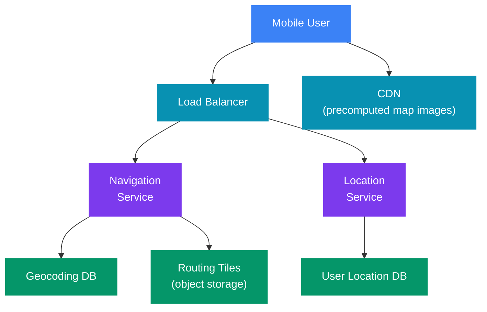
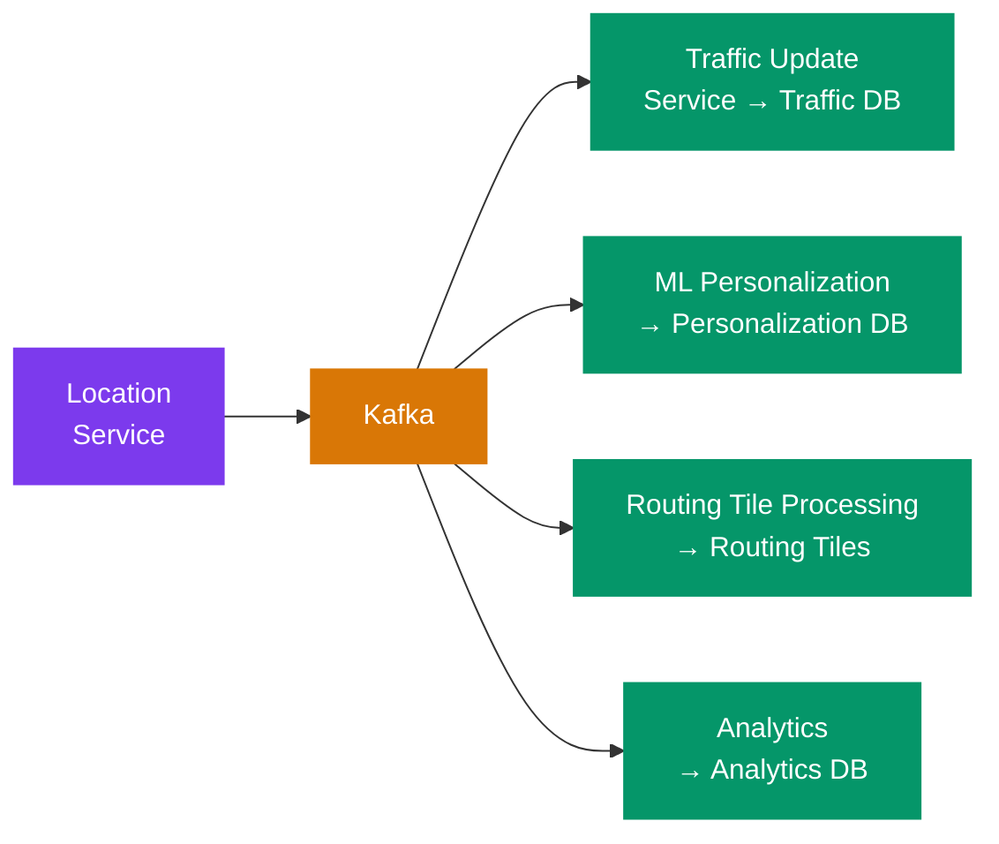
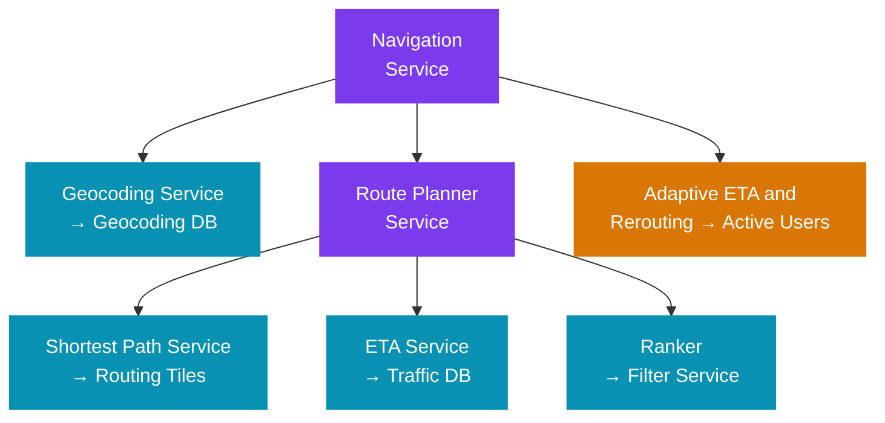
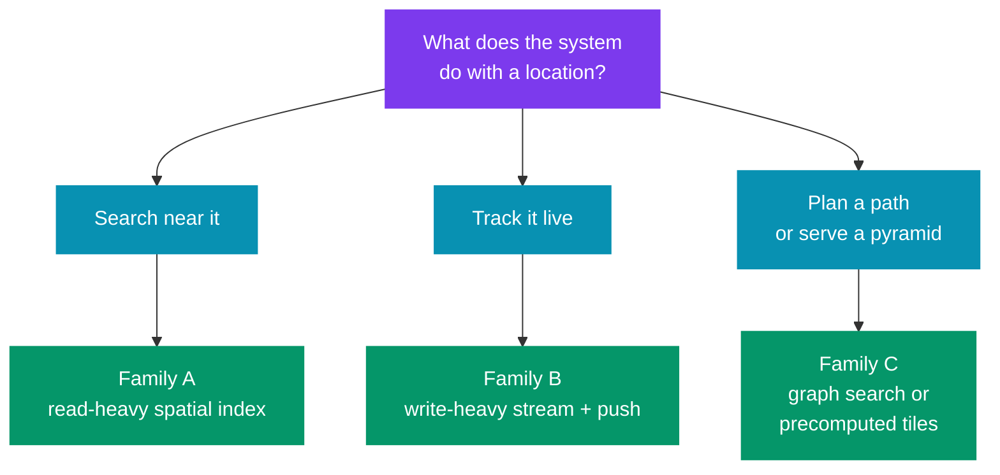

# Ch 3: Google Maps

> 📖 **Vol 2, Chapter 3** (book pages 59–90) &nbsp;·&nbsp; ⚡ Medium Priority &nbsp;·&nbsp; 💬 **22 Questions**  
> **Source:** Alex Xu & Sahn Lam, *System Design Interview Vol 2*, Ch 3. Page and figure numbers below are the book's printed ones.

---

📊 **Question Count**

| # | Section | Questions |
|---|---|---|
| 1 | [Requirements and Scope ⚡](#1--requirements-and-scope-p5960-) | 1 |
| 2 | [Map 101 — Projection, Geocoding, Geohashing, Tiles 🔥](#2--map-101--projection-geocoding-geohashing-tiles-p6064-) | 1 |
| 3 | [Routing Tiles and Hierarchical Routing Tiles 🔥🔥](#3--routing-tiles-and-hierarchical-routing-tiles-p6466-) | 2 |
| 4 | [Back-of-the-envelope Estimation 🔥](#4--back-of-the-envelope-estimation-p6668-) | 3 |
| 5 | [High-level Design 🔥🔥](#5--high-level-design-p6876-) | 3 |
| 6 | [Data Model 🔥](#6--data-model-p7678-) | 2 |
| 7 | [Location Service Deep Dive 🔥](#7--location-service-deep-dive-p7880-) | 1 |
| 8 | [Rendering Map — Precomputed Tiles and Vectors ⚡](#8--rendering-map--precomputed-tiles-and-vectors-p8082-) | 2 |
| 9 | [Navigation Service, Adaptive ETA and Rerouting 🔥🔥](#9--navigation-service-adaptive-eta-and-rerouting-p8288-) | 6 |
| 10 | [Similar Problems This Design Solves 📎 🔥](#10--similar-problems-this-design-solves--) | 1 |
| | **Total** | **22** |

> 🔥🔥 Very high priority — asked in almost every Tier-1 interview loop &nbsp;·&nbsp; 🔥 High priority — very frequent in Tier-1 interviews &nbsp;·&nbsp; ⚡ Medium priority — commonly asked &nbsp;·&nbsp; 💤 Low priority — good to know, rarely asked

> **How to read this note.** Sections 1–9 follow the book, step by step. §10, at the end, maps this design to 14 similar problems. Anything the book does not say is marked **📎 Beyond the book**. Where the book has a mistake, the note says so and gives the fix.  
> Book pages 82–83 are missing from our scan. Figure 3.17 and the first part of the navigation service are on those pages. §9 uses the final design (Figure 3.21, p.88) and the chapter mind map (p.89) to fill the gap.

---

## 🗒️ Cheat Sheet

<details>
<summary><strong>🗒️ Show cheat sheet</strong></summary>

### 🎯 Clarifying Questions — and the book's answers
| Question | Book's answer (p.59–60) |
|---|---|
| How many daily active users? | **1 billion DAU** |
| Which features? | **Location update, navigation, ETA and map rendering** |
| How large is the road data? Do we have it? | Yes, we got it from different sources. It is **terabytes (TBs)** of raw data |
| Do we consider traffic? | **Yes.** Traffic is very important for an accurate ETA |
| Different travel modes (driving, walking, bus)? | **Yes**, support them |
| Multi-stop directions? | Good to have, but **do not focus on it** |
| Business places and photos? | **Out of scope** |
| Which devices? | **Mobile phones** |

**Functional:** user location update · navigation service, including the ETA service · map rendering.
**Non-functional:** accuracy (never give wrong directions) · smooth map rendering · low data and battery use · availability and scalability.

### 🏗️ Core Components (Figure 3.7, final design Figure 3.21)
- **Location service** — records the user's location updates in the **user location DB** (Cassandra). It also sends them to **Kafka**.
- **Navigation service** — finds a reasonably fast route from A to B. Inside it: geocoding service, route planner, shortest-path service, ETA service, ranker, and the adaptive ETA and rerouting service.
- **Geocoding DB** — place name or address → lat/lng. A key-value store such as **Redis**.
- **Routing tiles** — the road graph, cut into grid cells. Binary files in **object storage (S3)**.
- **Precomputed map images** — PNG tiles for each zoom level, served by a **CDN**.
- **Updater services** — read the Kafka stream. The traffic update service fills the **traffic DB**. The routing tile processing service updates the **routing tiles**.

### Key APIs and Schema (p.71, p.79)
```
POST /v1/locations
     locs: JSON array of (latitude, longitude, timestamp) tuples      -- one batch every 15 s

GET  /v1/nav?origin=1355+market+street,SF&destination=Disneyland     -- returns distance, duration,
                                                                      -- polyline, instructions, travel_mode

user location table (Cassandra): partition key user_id, clustering key timestamp
  key (user_id) | timestamp | lat | long | user_mode | navigation_mode       -- Table 3.3

map tile URL: https://cdn.map-provider.com/tiles/9q9hvu.png                   -- one geohash per tile
```

### 💡 Key Insights
1. **Map tiles are precomputed and static.** A CDN serves them. The server never draws a tile on request (p.72–73).
2. **The road graph is cut into routing tiles.** The algorithm loads only the tiles it needs. Three levels of detail let a long trip use the highway tiles (p.64–66).
3. **The client batches GPS points.** It records one point each second but sends a batch every 15 seconds. That cuts write QPS by 15× (p.68, p.70).
4. **Location data is written once and read by many.** Kafka feeds traffic, routing tiles, personalization and analytics from one stream (p.80).
5. **Adaptive ETA needs a fast way to find affected users.** Store each user's tile and its parent tiles, up to the tile that holds the destination (p.85–87).

### ⚖️ Trade-offs / Alternatives
| Option | Pro | Con | Book's verdict |
|---|---|---|---|
| Build map tiles per request (Option 1) | Always fresh | Huge server load; hard to cache | ❌️ Rejected (p.72) |
| Precomputed tiles + CDN (Option 2) | Static, very cacheable; served from the nearest POP | Large storage (~100 PB) | ✅ Chosen (p.72–74) |
| Client computes the tile URL (geohash) | No server call; very fast | The algorithm is hardcoded in every app. Changing it means shipping new apps | Works, but risky to change later (p.75) |
| Map tile service builds the URLs | Easy to change the encoding later | One more service and one more call | "The added operational flexibility might be worth it" (p.75) |
| Vector tiles instead of raster PNG (drawn with WebGL) | Much better compression; smooth zoom | Client must draw them | ✅ Suggested optimization (p.81) |
| Routing tiles in a database | Familiar | Expensive; we need no DB features | ❌️ Rejected (p.77) |
| Routing tiles in object storage (S3) + local cache | Cheap; fast lookup by geohash | — | ✅ Chosen (p.77) |
| User location in Cassandra (AP) | Fast writes; scales out; high availability | Eventual consistency | ✅ Chosen — the latest location replaces the old one anyway (p.79) |
| Mobile push / long polling / SSE / WebSocket | — | Push: 4,096-byte payload on iOS, best-effort delivery. Long polling: heavier on servers | ✅ **WebSocket** (p.87–88) |

### 🔢 Numbers to Remember
| What | Value | Arithmetic |
|---|---|---|
| DAU | **1 billion** | Given (p.59) |
| Tile size | **256 × 256 px PNG, ~100 KB** | Assumed (p.67) |
| Tiles at zoom 21 | **≈ 4.4 trillion** | 4²¹ = 4,398,046,511,104 (Table 3.1) |
| Raw storage at zoom 21 | **440 PB** | 4.4 × 10¹² tiles × 100 KB = 4.4 × 10¹⁷ bytes |
| After compression of empty areas | **44–88 PB → pick 50 PB** | ~90% of the world is ocean, desert, lakes, mountains. Cut 80–90%: 440 × 0.1 = 44, 440 × 0.2 = 88 |
| All zoom levels | **~67 PB → say ~100 PB** | 50 + 50/4 + 50/16 + … = 50 × 4/3 ≈ 67 PB (p.68) |
| Navigation time | **35 min/week per user → 5 billion min/day** | 1B × 35 = 35B min/week ÷ 7 = 5B min/day |
| Location updates, one per second | **3 million QPS** | 5B min × 60 = 300B/day ÷ 10⁵ s = 3M |
| Batched every 15 s | **200,000 QPS** | 3M ÷ 15 |
| Peak location updates | **1 million QPS** | 200,000 × 5 |
| Client data while navigating | **1.25 MB/min (75 MB/hour)** | 1 km² = 25 tiles of 200 m × 200 m = 2.5 MB. At 30 km/h: 30 × 2.5 MB = 75 MB/h (p.74) |
| CDN traffic | **62,500 MB/s** | 5B min × 1.25 MB = 6.25B MB/day ÷ 10⁵ s |
| Per POP (200 POPs) | **~300 MB/s** | 62,500 ÷ 200 = 312.5 MB/s (p.75) |
| CDN latency (Figure 3.11) | **300 ms → 10 ms** | Origin server vs nearest POP |
| Tile URLs per request | **9** | The tile to draw + 8 around it (p.76) |
| Routing tile levels | **3** | Local roads / arterial roads / highways (p.65) |
| 📎 Route (navigation) requests | **~7,000 QPS average, ~35,000 peak** | Our assumption: 5 trips a week of ~7 min. 1B × 5 ÷ 7 ≈ 0.7B trips/day ÷ 10⁵ ≈ 7,000. × 5 for peak |

### ⏱️ 45-Minute Round Plan
| Minutes | Phase | What to say or draw | Trap to avoid |
|---|---|---|---|
| 0–5 | Clarify | 1B DAU, mobile, location update + navigation + ETA + map rendering, traffic matters, no places or photos | Trying to design all of Google Maps |
| 5–10 | Map 101 | Geohash grid, map tiles per zoom level, road graph → routing tiles, 3 levels | Skipping routing tiles. They are the core idea of the chapter |
| 10–15 | Estimate | ~100 PB of tiles; 200k QPS location updates, 1M peak | Long maths. Show the series 50 × 4/3 and move on |
| 15–25 | High-level | Figure 3.7: LB → location service + navigation service; CDN for tiles; the two APIs | Building tiles per request |
| 25–40 | **Deep dive** | Cassandra key (user_id, timestamp) + Kafka fan-out → route planner, shortest path on routing tiles, ETA, ranker → adaptive ETA and WebSocket | Running one search over the whole world graph |
| 40–45 | Wrap up | Vector tiles; client URL vs map tile service; multi-stop routing for delivery apps | Forgetting data and battery use on mobile |

> 📎 The timings are a suggestion, not from the book. The book gives the steps; the minutes are ours.

---

</details>
<br/>

---

## 1. 📋 Requirements and Scope (p.59–60) ⚡

Google started Project Google Maps in 2005. As of March 2021, it had **1 billion daily active users** and **99% coverage of the world**. It got **25 million updates a day** of location information (p.59). The product is huge, so the first job is to agree on a small scope.

The book's scope (p.60):

- **User location update.**
- **Navigation service, including the ETA service.**
- **Map rendering.**
- The main devices are **mobile phones**.

Non-functional requirements: **accuracy** (never give wrong directions) and **smooth** map rendering. Also **low data and battery use**, which is very important on mobile. And the usual **availability and scalability**.

### ❓ Interview Questions

1. **What do you clarify first, and what scope does the book agree on? 📎 ⚡**

<!-- -->
<details>
<summary>💡 Show Answer</summary>

**Answer:**

(p.59–60)

Ask about scale, features, data and devices. The book's answers:

- **Scale:** 1 billion DAU.
- **Features:** location update, navigation with ETA, and map rendering.
- **Road data:** we already have it, from different sources. It is TBs of raw data.
- **Traffic:** yes. It matters for an accurate ETA.
- **Travel modes:** driving, walking, bus. Support them.
- **Multi-stop:** good to have, but do not focus on it.
- **Places and photos:** out of scope.
- **Devices:** mobile phones.

Non-functional: **accuracy** (never wrong directions), **smooth** map rendering, **low data and battery use**, and the usual availability and scalability.

📎 Say why the battery point matters. It is the reason for batching GPS points on the client (§4) and for vector tiles (§8).

</details>

---

## 2. 🌍 Map 101 — Projection, Geocoding, Geohashing, Tiles (p.60–64) 🔥

### Positioning system and projection (Figures 3.1–3.2)

- **Latitude (lat)** — how far north or south we are. **Longitude (long)** — how far east or west.
- **Map projection** — the process that turns points on a 3D globe into points on a 2D plane. Almost every projection distorts the real shapes. Figure 3.2 shows Mercator, Peirce quincuncial, Gall–Peters and Winkel tripel.
- Google Maps uses a modified Mercator projection called **Web Mercator** (p.62).

### Geocoding (p.62)

- **Geocoding** turns an address into coordinates. Example: "1600 Amphitheatre Parkway, Mountain View, CA" → (37.423021, −122.083739).
- **Reverse geocoding** goes the other way: lat/lng → a human-readable address.
- One way to geocode is **interpolation**. It uses data from sources such as **GIS** (geographic information systems), where the street network is mapped to coordinates.

### Geohashing (Figure 3.3, p.62–63)

**Geohashing** encodes a geographic area into a short string of letters and digits. The book shows the idea as a recursive grid:

- Assume the flat world is **20,000 km × 10,000 km**.
- Split it into 4 grids of 10,000 km × 5,000 km, named **00, 01, 10, 11**.
- Split each one into 4 again (5,000 km × 2,500 km). Repeat until a grid reaches a size threshold.

The design uses geohashing **for map tiling**. Chapter 1 (Proximity Service) explains geohash in depth: [Vol 2 Ch 1](./ch01_proximity_service.md).

> ⚠️ **Book inconsistency — two different "geohash" schemes.** Figure 3.3 builds keys from the digits 0–3 (a quadtree). But the tile URL on p.75 uses `9q9hvu`, a real base-32 geohash, whose cells are not square tiles. 📎 Real map tile systems use the quadtree form: the slippy-map key `/{zoom}/{x}/{y}` (OpenStreetMap, Google) or a base-4 **quadkey** (Bing). In an interview say "a tile key per grid cell", and name z/x/y as the common format.

### Map rendering and tiling (p.63–64)

- The world is not one big image. It is cut into small **tiles**. The client downloads only the tiles for its area and joins them like a mosaic.
- There is a separate set of tiles for **each zoom level**. The client picks the set that matches its zoom.
- Zoomed out to the whole world, the client downloads **one tile**: a single 256 × 256 pixel image. It does not download thousands of detailed tiles.

### Road data as a graph (Figure 3.4, p.64)

- Most routing algorithms are variations of **Dijkstra's** or **A\*** pathfinding. The book does not go deeper into the choice.
- They all work on a **graph**: intersections are **nodes**, roads are **edges**.
- Their speed depends heavily on the **size of the graph**. One graph for the whole world needs too much memory and is too slow. So the graph must be broken into smaller units (§3).

### ❓ Interview Questions

1. **How does the client turn a lat/lng and a zoom level into a tile key? 📎 ⚡**

<!-- -->
<details>
<summary>💡 Show Answer</summary>

**Answer:**

📎 Beyond the book. The book says "geohash" (p.72, p.75). Real map tiles use the Web Mercator **slippy-map** scheme `/{z}/{x}/{y}`.

- At zoom `z` the world is a square of `n = 2^z` × `2^z` tiles.
- `x = floor((lng + 180) / 360 × n)`. This is a straight cut by longitude.
- `y = floor((1 − ln(tan(lat) + 1 / cos(lat)) / π) / 2 × n)`, with `lat` in radians. This is the Mercator stretch, so tiles near the poles cover less ground.
- Web Mercator cuts the map at about **±85.05°** latitude. That makes the world exactly square.

Why this key is useful:

- **Parent tile:** `(z − 1, x / 2, y / 2)`. This is the same "super(tile)" step the adaptive ETA filter uses (§9).
- **Neighbours:** `x ± 1`, `y ± 1`. These are the **9 tiles** the map tile service returns (§5).
- **Quadkey** (Bing): interleave the bits of `x` and `y` into base-4 digits. Its length equals the zoom, and a prefix is the parent tile. This is the 0–3 grid of the book's Figure 3.3.

So the client can compute the URL with no server call. The risk is the one in §5: the scheme is then fixed in every app.

</details>

---

## 3. 🧭 Routing Tiles and Hierarchical Routing Tiles (p.64–66) 🔥🔥

### Routing tiles (Figure 3.5)

The book cuts the road network the same way it cuts the map: with a geohash-like grid (p.64).

- For each grid cell, convert its roads into a **small graph**: the nodes (intersections) and edges (roads) inside that area.
- Each routing tile holds **references to the tiles it connects to**. So the algorithm can join tiles into a bigger graph as it moves across them.
- Tiles are **loaded on demand**. This cuts memory use and makes pathfinding faster.

> **Reminder (p.65):** routing tiles are like map tiles — both are grids over an area. But **map tiles are PNG images**, and **routing tiles are binary files of road data**.

### Hierarchical routing tiles (Figure 3.6, p.65–66)

Routing across a country on street-level tiles would be slow. The joined graph would be too big. So there are usually **three sets** of routing tiles:

| Level | Tile size | Contains |
|---|---|---|
| Most detailed | Small | **Local roads** only |
| Middle | Bigger | **Arterial roads** that connect districts |
| Least detailed | Large areas | **Major highways** that connect cities and states |

- Edges can connect tiles at **different levels**. Example: a freeway entrance from local street A to freeway F. The small tile has a reference from node A to node F in the big tile.
- This is how a long trip "enters" the highway tiles and leaves the small tiles behind.

> 📎 This idea is called **hierarchical routing**. Production routers add more speed-ups on top, such as **Contraction Hierarchies** (shortcut edges built offline). The book does not name them. See Q2 below.

### ❓ Interview Questions

1. **What are routing tiles, and why are there three levels of them? 🔥🔥**

<!-- -->
<details>
<summary>💡 Show Answer</summary>

**Answer:**

(p.64–66, Figures 3.5–3.6)

- Pathfinding speed depends on **graph size**. The whole world as one graph needs too much memory and is too slow.
- So cut the road network with a geohash-like grid. Each cell becomes a **routing tile**: a small graph of the intersections (nodes) and roads (edges) inside it. It also has **references to the tiles it connects to**.
- The algorithm **loads tiles on demand**, as its search grows.
- Routing tiles are **binary files of road data**. Map tiles are **PNG images**.

**Three levels** (hierarchical routing tiles):

| Level | Contains |
|---|---|
| Small tiles | Local roads |
| Bigger tiles | Arterial roads between districts |
| Large tiles | Major highways between cities and states |

A long trip on street-level tiles would build a huge graph. Edges link levels (local street A → freeway F). So the search moves up to highway tiles for the long middle part.

</details>

---

2. **Why not run plain Dijkstra on the whole road graph? What do real routers use? 📎 🔥**

<!-- -->
<details>
<summary>💡 Show Answer</summary>

**Answer:**

- **Dijkstra** is correct but explores nodes in all directions. It costs O((V + E) log V). On a continent-sized graph (hundreds of millions of nodes), one long query explores millions of nodes. That is too slow for an online service.
- **A\*** adds a guess of the remaining distance (for example, straight-line distance ÷ top speed). It explores fewer nodes. But on travel-time weights the guess is weak, so the gain is small at continental scale.
- **Hierarchy** — the book's answer. Routing tiles at three levels let a long trip use highway tiles.
- **Contraction Hierarchies (CH)** — an offline step ranks nodes by importance and adds **shortcut edges**. A query then searches only "upward" from both ends. It settles a few hundred nodes and answers in about **0.1–1 ms** on a continental graph.
- **Customizable Route Planning (CRP)** / Customizable CH — split preprocessing into a slow **structure** step and a fast **weight** step (seconds). This lets live traffic change edge weights without a full rebuild.

</details>

---

## 4. 🔢 Back-of-the-envelope Estimation (p.66–68) 🔥

The focus is mobile, so **data usage and battery** matter (p.66). The book gives three conversions: 1 foot = 0.3048 m, 1 km = 0.6214 miles, 1 km = 1,000 m.

### Storage (p.66–68)

There are three types of data:

- the **map of the world** — the big one, below;
- tile **metadata** — small enough to ignore;
- **road info** — TBs of raw data. It becomes routing tiles, which are probably also TBs.

**Map tiles, step by step:**

1. Start with the **largest** zoom level. At zoom 21 there are 4²¹ ≈ **4.4 trillion** tiles (Table 3.1).
2. Each tile is a 256 × 256 compressed PNG of about **100 KB**. So: 4.4 trillion × 100 KB = **440 PB**.
3. About **90%** of the world is natural and mostly empty: oceans, deserts, lakes, mountains. These images compress very well. Cut the estimate by 80–90% → **44–88 PB**. Round to **50 PB**.
4. Each lower zoom level halves the tiles north-south **and** east-west. So it has **4× fewer** tiles and needs 4× less storage.
5. Total = 50 + 50/4 + 50/16 + … = 50 × 4/3 ≈ **67 PB** (📎 checked: the book's sum is right). Say **about 100 PB** for all zoom levels.

| Zoom | Tiles (Table 3.1) | Storage after compression |
|---|---|---|
| 21 | 4,398,046,511,104 | 50 PB |
| 20 | 1,099,511,627,776 | 12.5 PB |
| 19 | 274,877,906,944 | ~3.1 PB |
| 18 | 68,719,476,736 | ~0.8 PB |
| 0–17 | the rest | < 0.3 PB together |
| **All** | | **≈ 67 PB → ~100 PB** |

> ⚠️ **Book inconsistency — how many zoom levels.** p.80 says "Google Maps uses 21 zoom levels", but Table 3.1 runs from zoom 0 to zoom 21. That is **22** sets of tiles. p.67 also says "about 4.3 trillion" tiles at zoom 21, then uses 4.4 trillion. The table value is 4,398,046,511,104 ≈ **4.4 trillion**. Use 4.4 trillion and "zoom 0 to 21".

### Server throughput (p.68)

There are two request types: **navigation requests** (start a session) and **location update requests** (sent while the user moves).

1. 1 billion DAU, each navigating **35 minutes per week** → 35 billion minutes/week → **5 billion minutes/day**.
2. One GPS point every second → 5B × 60 = **300 billion requests/day** → 300B ÷ 10⁵ s = **3 million QPS**.
3. The client batches points and sends them **every 15 seconds** → 3M ÷ 15 = **200,000 QPS**. It can send less often when the user is stuck in traffic.
4. Peak = 5 × average → **1 million QPS**.

> ⚠️ **Book inconsistency — the "navigation" throughput is really location updates.** p.68 says "let's analyze the server throughput for navigation requests". But every number that follows (3M → 200k → 1M QPS) counts **location update** requests. The book never estimates route requests. 📎 Our estimate: about 5 trips a week of ~7 minutes each. 1B × 5 ÷ 7 ≈ 0.7B trips/day ÷ 10⁵ ≈ **7,000 QPS** average, ~**35,000 QPS** peak, plus reroutes. So location writes are about **30× bigger** than route requests. They are the load to design for.

> 📎 **Requests vs rows.** 200,000 QPS is batch **requests**. Each batch holds 15 points. If the database stores every point as a row, it writes 200,000 × 15 = **3 million rows/s** on average. That is the number to size Cassandra for.

### ❓ Interview Questions

1. **Estimate the storage for all the map tiles. 🔥🔥**

<!-- -->
<details>
<summary>💡 Show Answer</summary>

**Answer:**

(p.67–68, Table 3.1)

- Start at the **largest zoom level, 21**: 4²¹ ≈ **4.4 trillion** tiles.
- Each tile is a 256 × 256 PNG of ~**100 KB** → 4.4 trillion × 100 KB = **440 PB**.
- About **90%** of the world is ocean, desert, lakes or mountains, and compresses very well. Cut by 80–90% → 44–88 PB. Round to **50 PB**.
- Each lower level has **4× fewer** tiles. Total = 50 × (1 + 1/4 + 1/16 + …) = 50 × 4/3 ≈ **67 PB**.
- Say **about 100 PB**. So the client must fetch tiles on demand, from a CDN.

</details>

---

2. **Estimate the location update QPS. How does batching change it? 🔥🔥**

<!-- -->
<details>
<summary>💡 Show Answer</summary>

**Answer:**

(p.68)

- 1B DAU × **35 min of navigation per week** = 35B min/week = **5B min/day**.
- One GPS point per second: 5B × 60 = 300B requests/day ÷ 10⁵ s = **3M QPS**.
- **Batch every 15 s** on the client: 3M ÷ 15 = **200,000 QPS**.
- Peak = 5 × average = **1M QPS**.

The client records a point **every second** but sends them **together** (Figure 3.9). It can send even less often when the user is stuck in traffic. 📎 Each batch has 15 points, so the database still writes about 3M rows/s on average if it stores every point.

</details>

---

3. **Estimate the route request QPS. How does it compare with location updates? 📎 ⚡**

<!-- -->
<details>
<summary>💡 Show Answer</summary>

**Answer:**

The book does not estimate it (see above). Our assumption:

- 35 min/week of navigation per user, in about **5 trips of ~7 min**.
- 1B users × 5 trips ÷ 7 days ≈ **0.7B trips/day**.
- 0.7B ÷ 10⁵ s ≈ **7,000 QPS** average. × 5 → **~35,000 QPS** at peak. Reroutes add some more.

Location updates peak at **1M QPS**, about **30× more**. So the **write path** (location service, Cassandra, Kafka) is the scaling problem. The route path is **CPU-heavy per request** but low in volume. It scales with stateless routing servers, a warm tile cache, and region-based sharding.

</details>

---

## 5. 🧩 High-level Design (p.68–76) 🔥🔥

The design supports three features: the location service, the navigation service, and map rendering (Figure 3.7, p.69).



### Location service (Figures 3.8–3.9, p.69–71)

The client sends location updates every **t** seconds (t is configurable). The updates help in two ways:

- **Over time:** monitor live traffic, find new or closed roads, and study user behaviour for personalization.
- **Near real time:** give more accurate ETAs, and reroute around traffic.

**Batching (Figure 3.9).** The client records a location **every second** but sends them in a **batch every 15 seconds**. This greatly cuts the total update traffic.

Even with batching, the write volume is very high. So the book uses:

- A database built for high write volume that scales well, such as **Cassandra**.
- A stream processing engine such as **Kafka** to log the data for further processing (§7).

**Protocol:** HTTP with **keep-alive**. It is efficient because the connection stays open between batches.

```
POST /v1/locations
Parameters
  locs: JSON encoded array of (latitude, longitude, timestamp) tuples.
```

### Navigation service (p.71)

It finds a **reasonably fast** route from A to B. Some latency is fine. The route does not have to be the fastest, but it **must be accurate**.

```
GET /v1/nav?origin=1355+market+street,SF&destination=Disneyland
```

The response (p.71) has `distance`, `duration`, `end_location`, `start_location`, `html_instructions`, a `polyline` (the encoded route shape), `geocoded_waypoints`, and `travel_mode: DRIVING`. It is modelled on Google's Directions API.

Rerouting and traffic changes are left for the **adaptive ETA service** in the deep dive (§9).

> ⚠️ **Book typo (p.71).** It says the route request goes through the load balancer "as shown in Figure 3.8". Figure 3.8 is the location service. The navigation path is in Figure 3.7.

### Map rendering (p.72–76)

The full tile set is about **100 PB**. A phone cannot hold it. So the client fetches tiles **on demand**, based on its location and zoom level. It needs new tiles when:

- the user **zooms or pans** the map, or
- during navigation, the user **moves out of the current tile** into a nearby one.

**Two options for serving tiles (p.72):**

| | How | Result |
|---|---|---|
| **Option 1** | Build each tile per request, from location + zoom | ❌️ Huge server load. Location and zoom have endless combinations, so caching is hard |
| **Option 2** | Pre-generate a fixed set of tiles per zoom level. Each tile is one geohash grid cell | ✅ Static images, served by a **CDN** (Figure 3.10) |

**How the CDN works (Figures 3.10–3.11).** The first request for a tile misses the CDN. The CDN gets it from the origin, caches it, and returns it. Later requests — even from other users — come from the cache. Tiles come from the **nearest POP** (point of presence): about **10 ms** instead of **300 ms** from the origin.

**Data usage (p.74).** A user moves at **30 km/h**. Each tile covers **200 m × 200 m** (a 256 × 256 px image of ~100 KB). One km² needs **25 tiles = 2.5 MB**. So the user needs **75 MB per hour**, or **1.25 MB per minute**. This ignores client-side caching. Daily routes are often the same, so real usage is much lower.

**Traffic through the CDN (p.75).** 5 billion minutes × 1.25 MB = 6.25 billion MB/day ÷ 10⁵ s = **62,500 MB/s**. Across **200 POPs**, each POP serves only **a few hundred MB/s** (62,500 ÷ 200 ≈ 312).

> 📎 The 1 km² per km of travel is a rough upper bound. A user who drives 1 km along a road does not need a full new km² of tiles. The book keeps it simple on purpose.

### How does the client get the tile URL? (p.75–76)

**Way 1 — compute it on the client.** Lat/lng + zoom → geohash → URL. It is cheap and fast, for example `https://cdn.map-provider.com/tiles/9q9hvu.png`. The problem: the algorithm is **hardcoded in every client** on every platform. Shipping app changes is slow and risky. We must be sure we will never change the encoding.

**Way 2 — a map tile service (Figure 3.12).** A very simple service builds the URLs. The extra operational flexibility "might be worth it". The book calls this an interesting trade-off to discuss.

1. The mobile user asks the map tile service for tile URLs. The request goes to the load balancer.
2. The load balancer forwards it to the map tile service.
3. The service takes the client's location and zoom level. It returns **9 URLs**: the tile to draw and the **8 tiles around it**.
4. The client downloads the tiles from the **CDN**.

### ❓ Interview Questions

1. **Draw the high-level design and explain each part. 🔥🔥**

<!-- -->
<details>
<summary>💡 Show Answer</summary>

**Answer:**

(Figure 3.7, p.69)

- **Mobile user → CDN → precomputed map images.** Map tiles never go through our servers.
- **Mobile user → load balancer**, then:
  - **Location service → user location DB.** Takes batched GPS points (`POST /v1/locations`).
  - **Navigation service → geocoding DB + routing tiles (object storage).** Answers `GET /v1/nav?origin=…&destination=…`.

In the deep dive, the location service also writes to **Kafka**. The navigation service grows into geocoding, route planner, shortest path, ETA, ranker, and adaptive ETA (Figure 3.21).

</details>

---

2. **How do you serve map tiles? Why not draw them on the server per request? 🔥🔥**

<!-- -->
<details>
<summary>💡 Show Answer</summary>

**Answer:**

(p.72–75)

- **Option 1 — draw per request:** location × zoom has endless combinations. It puts a **huge load** on servers and is **hard to cache**. ❌️
- **Option 2 — pre-generate** a fixed set of tiles per zoom level, one per grid cell, and serve them from a **CDN**. ✅
  - First request: the CDN misses, fetches from the origin, and caches. Later requests, from any user, are cache hits.
  - Tiles come from the **nearest POP**: ~10 ms instead of ~300 ms (Figure 3.11).

**Data cost:** tiles of 200 m × 200 m are 100 KB each. One km² = 25 tiles = 2.5 MB. At 30 km/h that is **1.25 MB/min**.

All users: 5B min × 1.25 MB ÷ 10⁵ s = **62,500 MB/s**. With 200 POPs, that is about **300 MB/s per POP**.

</details>

---

3. **Should the client compute the tile URL, or should a server give it? ⚡**

<!-- -->
<details>
<summary>💡 Show Answer</summary>

**Answer:**

(p.75–76, Figure 3.12)

- **Client computes geohash → URL:** no extra call. But the algorithm is **hardcoded in every app**. Changing it means new app releases, which are slow and risky.
- **Map tile service:** one extra call. But the encoding can change in one simple service.

The book calls it a good trade-off to discuss, and says the flexibility "might be worth it". The map tile service takes location + zoom and returns **9 URLs**: the tile to draw and its **8 neighbours**. The client then downloads them from the **CDN**.

</details>

---

## 6. 💾 Data Model (p.76–78) 🔥

There are four types of data: routing tiles, user location data, geocoding data, and precomputed map tiles.

### Routing tiles (p.76–77)

- The raw road dataset comes from different sources and authorities. It is **TBs** in size. It gets better over time from the location data users send.
- The raw data (roads, names, county, lat/lng) is **not a graph**. Most routing algorithms cannot use it.
- A periodic offline pipeline, the **routing tile processing service**, turns it into routing tiles. It runs again and again to pick up road changes.
- Output: **three sets** of tiles at different resolutions. Each tile has graph nodes and edges, plus references to the tiles its roads connect to.

**Where to store them?**

- Graphs are usually **adjacency lists** in memory. But there are **too many tiles** to keep all of them in memory.
- Rows in a database would work, but we only need storage. A database is an expensive way to store bits, and we need none of its features.
- ✅ Store them in **object storage like S3**. **Cache them aggressively** on the routing service. Serialize the adjacency lists to a **binary file**. Organize the tiles **by geohash**, so a lat/lng finds its tile fast.

### User location data (Table 3.2, p.77)

User location data is valuable. It updates road data and routing tiles. It builds a database of live and historical traffic. Many stream processing services read it.

We need a database that handles a **write-heavy** load and **scales horizontally**: **Cassandra** is a good candidate.

| user_id | timestamp | user_mode | driving_mode | location |
|---|---|---|---|---|
| 101 | 1635740977 | active | driving | (20.0, 30.5) |

### Geocoding database (p.77)

- Stores **places** and their **lat/lng**.
- Reads are frequent and writes are rare. So use a **key-value store such as Redis** for fast reads.
- It turns the origin and destination into lat/lng **before** the route planner runs.

> 📎 **A key-value store only finds exact keys.** Users type "disnyland" or "1355 market st". So real geocoding needs a **search index** in front. It cleans up the text, then does prefix and fuzzy matching. Examples: Elasticsearch, or a trie for autocomplete ([Vol 1 Ch 13](../vol_1/ch13_design_search_autocomplete_system.md)). The index returns a place ID. Then the key-value store gives its lat/lng fast. Reverse geocoding (lat/lng → address) is a spatial lookup: find the nearest road or building in the point's grid cell.

### Precomputed images of the world map (Figure 3.13, p.77–78)

### ❓ Interview Questions

1. **Where do you store the routing tiles, and why not in a database? 🔥**

<!-- -->
<details>
<summary>💡 Show Answer</summary>

**Answer:**

(p.76–77)

- An offline, periodic **routing tile processing service** builds the tiles from the raw road data (TBs). It runs again to pick up road changes.
- Graphs are usually **adjacency lists in memory**, but there are **too many tiles** to keep all in memory.
- A database would only be used as storage. That is expensive, and we need no database features.
- ✅ Serialize each tile's adjacency list to a **binary file** in **object storage (S3)**. Key the tiles **by geohash**, so a lat/lng finds its tile fast. **Cache tiles aggressively** on the routing servers.

</details>

---

2. **How does a change in road data reach the map tiles and routing tiles? 📎 💤**

<!-- -->
<details>
<summary>💡 Show Answer</summary>

**Answer:**

An offline batch pipeline, run often:

1. Ingest and clean the new road data (external sources + changes found from user locations).
2. Validate it: no broken links between roads, correct one-way and turn rules.
3. Rebuild only the **routing tiles** of the changed areas, at all three levels.
4. Redraw only the **map tiles** of the changed areas, at each zoom level. Use one data snapshot for all tiles, so roads line up across tile edges.
5. Upload to object storage and **purge the CDN** for the changed tile URLs. Or use **versioned URLs**, so no purge is needed.

</details>

---

## 7. 📍 Location Service Deep Dive (p.78–80) 🔥

### The user location database (Figure 3.14, Table 3.3, p.79)

- There are **1 million location updates per second** (the peak). We need a database with **fast writes**. A **NoSQL key-value** or **column-oriented** database is a good choice.
- A location goes stale as soon as a new one arrives. So we choose **availability over consistency**.
- The **CAP theorem**: we can have two of consistency, availability and partition tolerance. The book picks **AP**.
- **Cassandra** fits: it handles this scale with a strong availability guarantee.

> ⚠️ **Book simplification — CAP is not "pick any two".** Network partitions will happen in a distributed database, so P is not optional. The real choice is what to do *during* a partition. Refuse requests (C), or answer with data that may be stale (A). 📎 Cassandra lets you choose per query. Consistency level `ONE` favours availability. `QUORUM` writes plus `QUORUM` reads give strong reads. For location writes, `ONE` is enough, because the next batch replaces this point within 15 s.

**The key** is `(user_id, timestamp)`; the value is a lat/lng pair.

- `user_id` is the **partition key**. All rows of one user sit together, so reading a user's **latest position** is fast.
- `timestamp` is the **clustering key**. Rows are sorted by time, so reading a user's locations **in a time range** is efficient.

| key (user_id) | timestamp | lat | long | user_mode | navigation_mode |
|---|---|---|---|---|---|
| 51 | 132053000 | 21.9 | 89.8 | active | driving |

> 📎 The book says "user_id is the primary key". In Cassandra terms, the **primary key** is `((user_id), timestamp)`: `user_id` is the partition key and `timestamp` is the clustering column. As CQL:

```sql
CREATE TABLE user_location (
    user_id         bigint,
    ts              timestamp,
    lat             double,
    lng             double,
    user_mode       text,
    navigation_mode text,
    PRIMARY KEY ((user_id), ts)
) WITH CLUSTERING ORDER BY (ts DESC);   -- latest point first
```

### How is the location data used? (Figure 3.15, p.79–80)

The data finds **new and recently closed roads**, improves **map accuracy** over time, and feeds **live traffic**. So, besides the database, the location service logs every update to **Kafka** — "a unified low-latency, high-throughput data streaming platform".



- The **live traffic service** reads the stream and updates the **live traffic database**.
- The **routing tile processing service** finds new or closed roads and updates the affected routing tiles in object storage.
- Other services can read the same stream for their own purposes.

### ❓ Interview Questions

1. **Which database stores user locations, what is the key, and who else reads the data? 🔥**

<!-- -->
<details>
<summary>💡 Show Answer</summary>

**Answer:**

(p.79, Table 3.3)

- **1M location updates/s** at peak → we need **fast writes**: a NoSQL key-value or column-oriented store.
- A location is stale as soon as a new one arrives. So pick **availability over consistency** (AP in CAP). 📎 In Cassandra terms: write with consistency level `ONE`.
- ✅ **Cassandra.** It handles this scale with strong availability.

**Key:** `(user_id, timestamp)` → value is lat/lng.

- `user_id` = **partition key** → the latest position of a user is a fast read.
- `timestamp` = **clustering key** → rows are sorted by time, so a time-range query for one user is efficient.

📎 Add a time bucket to the partition key and a TTL, so one user's partition does not grow forever.

**Other readers** (Figure 3.15): the location service also writes every update to **Kafka**. The traffic update service, routing tile processing service, ML personalization and analytics all read that one stream.

</details>

---

## 8. 🎨 Rendering Map — Precomputed Tiles and Vectors (p.80–82) ⚡

### Precomputed tiles (Figure 3.16, p.80–81)

- There is one set of tiles per zoom level. The client picks the set from its **viewport size** and **zoom level**.
- **Level 0** is the most zoomed out. The whole map is **one 256 × 256 tile**.
- Each step up **doubles** the tiles north-south **and** east-west. Every tile stays 256 × 256 px.
  - Zoom 1: 2 × 2 tiles = 512 × 512 px in total.
  - Zoom 2: 4 × 4 tiles = 1024 × 1024 px in total.
- So each level has **4× the pixels** of the level before. The client gets the right detail for its zoom, without downloading too much.

### Optimization: use vectors (p.81–82)

**WebGL** makes a better design possible. Send **vector information** (paths and polygons) instead of images. The client draws the paths and polygons itself.

- **Obvious benefit:** vector data **compresses much better** than images. The bandwidth saving is large.
- **Less obvious benefit:** a **much better zooming experience**. With raster images, everything gets stretched and blurry as the client zooms between levels. Vectors can be redrawn sharply at any zoom.

> 📎 Vectors also allow styling on the device: night mode, labels in the user's language, and turning layers on or off. The trade-off is more work and more battery on the client.

### ❓ Interview Questions

1. **Raster tiles or vector tiles? What does the book suggest? ⚡**

<!-- -->
<details>
<summary>💡 Show Answer</summary>

**Answer:**

(p.81–82)

- **Raster (PNG):** pre-drawn images. Simple for the client. But they are larger, and they get stretched and blurry when zooming between levels.
- **Vector:** paths and polygons. With **WebGL**, the client draws them itself.
  - **Compresses much better** than images → large bandwidth saving.
  - **Much smoother zooming.**

The book suggests vectors as the optimization. It fits the **data and battery** requirement. 📎 The cost is more drawing work on the client. Vectors also allow on-device styling (night mode, label language).

</details>

---

2. **The user has a weak or no network. How do you keep the map working? 📎 💤**

<!-- -->
<details>
<summary>💡 Show Answer</summary>

**Answer:**

- **Client cache:** keep recently used tiles. The book notes daily routes are often the same (p.74).
- **Prefetch:** download tiles ahead of the user along the route, while the network is good.
- **Offline maps:** let users download a region in advance — vector tiles, a local routing graph, and a small geocoding index.
- **Lower zoom first:** show a coarse tile at once, then add detail when it arrives.
- **Vector tiles** need much less data, which helps on weak networks.

</details>

---

## 9. 🚗 Navigation Service, Adaptive ETA and Rerouting (p.82–88) 🔥🔥

This service finds fast routes (p.82). Its parts are shown in the final design (Figure 3.21, p.88) and the mind map (p.89).



### Geocoding service and route planner (p.82–83, missing from our scan)

- The **geocoding service** turns the origin and destination (addresses or place names) into lat/lng, using the geocoding DB (p.77).
- The **route planner service** gets a route optimized for travel time under current traffic and road conditions. It calls the shortest-path service, the ETA service and the ranker (Figure 3.21).

### Shortest-path service (Figure 3.18, p.84)

- Input: origin and destination as lat/lng. Output: the **top-k shortest paths**, **without** traffic or current conditions.
- The result depends only on the road structure. The graph rarely changes, so **caching routes** helps here.
- It runs a **variation of A\*** against the routing tiles in object storage:
  - Convert the lat/lng pairs to **geohashes**. Load the start and end routing tiles.
  - Start from the origin tile. Walk the graph. **Hydrate** (load) neighbouring tiles from object storage — or from the local cache if loaded before — as the search grows.
  - Tiles at one level connect to tiles at another level over the **same area**. This is how the search "enters" the big highway tiles.
  - Keep loading neighbouring tiles (or tiles at other resolutions) until a set of best routes is found.

> 📎 **Scaling the route servers.** A route search is CPU-heavy and wants its tiles in memory. So send each request to the servers whose cache already holds that region's tiles (shard **by region**). The highway-level tiles are far fewer, so every server can cache them for long trips. Apart from this cache the servers are stateless. Add more of them as route QPS grows (~35,000 at peak, §4 Q3).

### ETA service (p.84–85)

- The route planner calls the ETA service **for each possible route**.
- It uses **machine learning** to predict the ETA from **current traffic** and **historical data**.
- The hard part: we need today's traffic **and** a prediction of traffic **10 or 20 minutes from now**. The book leaves this to the algorithm level. It points to DeepMind's work on ETAs with **graph neural networks (GNNs)** [15] and Google's blog [16].

### Ranker service (p.85)

- It applies the user's **filters**, such as "avoid toll roads" or "avoid freeways".
- It ranks the routes from **fastest to slowest** and returns the **top-k** to the navigation service.

### Updater services (p.85)

They read the **Kafka location stream** and update key databases asynchronously:

- **Routing tile processing service** — adds new roads and road closures to the routing tiles. The shortest-path service becomes more accurate.
- **Traffic update service** — extracts traffic conditions from active users' locations and writes the **live traffic database**. The ETA service becomes more accurate.

### Improvement: adaptive ETA and rerouting (Figures 3.19–3.20, p.85–87)

The design so far cannot update the ETA or reroute. The server must **track every actively navigating user** and update them when traffic changes. Two questions:

- How do we track actively navigating users?
- How do we store the data so we can find the users hit by a traffic change, among millions of routes?

**Naive way (Figure 3.19).** Store each user's route as a list of routing tiles:

```
user_1: r_1, r_2, r_3, ..., r_k
user_2: r_4, r_6, r_9, ..., r_n
user_3: r_2, r_8, r_9, ..., r_m
```

A traffic incident happens in `r_2`. Scan every row and check if `r_2` is in it. With **n** rows and average route length **m**, this is **O(n × m)**.

**Better way (Figure 3.20).** For each active user, store the **current routing tile** and its parent tile at the next level. Then store that tile's parent, and so on. Stop at the first tile that also contains the **destination**:

```
user_1, r_1, super(r_1), super(super(r_1)), ...
```

- To check a user, ask one question: is the incident's tile **inside the last tile of the row**?
- If not, the user is **not affected**. This quickly filters out many users.

**What if the traffic clears?** The book admits this method does not say what to do then. One idea: keep **all possible routes** for each navigating user and **recalculate their ETAs regularly**. Tell the user when a route with a shorter ETA appears.

> 📎 The last-tile check is a **coarse filter**. The last tile covers both origin and destination, so it also matches many users whose route never touches the incident. Users who pass the filter still need an exact check against their route tiles. 📎 A common fix is an **inverted index**: `tile_id → set of active users` (for example, Redis sets). Then one lookup returns the users who cross that tile.

### Delivery protocols (p.87–88)

The server must **push** route changes to the client. The options:

| Option | Book's view |
|---|---|
| Mobile push notification | ❌️ Payload is very small (**4,096 bytes on iOS**) and it does not support web apps |
| Long polling | ❌️ WebSocket is better — it has a very light footprint on servers |
| Server-Sent Events (SSE) | Could work |
| **WebSocket** | ✅ **Chosen.** It is **bi-directional**, which features like last-mile delivery may need |

> ⚠️ **Book over-claim — "no web support" is out of date.** Browsers now have the Web Push API. Safari on iOS added it in version 16.4 (2023). Push is still the wrong tool here: delivery is best-effort, it can be delayed, and it is not a live stream. Use it only to wake an app that is not running.

> For pushing live locations to friends over WebSocket, see [Vol 2 Ch 2: Nearby Friends](./ch02_nearby_friends.md).

### Step 4 — Wrap up (p.88)

The design covers location update, ETAs, route planning and map rendering. One extension: **multi-stop navigation** for enterprise customers. Given a set of stops, find the **best order to visit them all** under live traffic. Delivery services like **DoorDash, Uber and Lyft** would use it.

> 📎 Multi-stop ordering is the **travelling salesman problem**. It is NP-hard, so real systems use simple rules (for example, nearest neighbour plus local improvements). They find a good order, not the best one.

### ❓ Interview Questions

1. **Walk through a route request inside the navigation service. 🔥🔥**

<!-- -->
<details>
<summary>💡 Show Answer</summary>

**Answer:**

(p.84–85, Figure 3.21)

1. **Geocoding service** — origin and destination → lat/lng (geocoding DB, Redis).
2. **Route planner** — controls the flow below.
3. **Shortest-path service** — returns the **top-k shortest paths**, ignoring traffic. It runs a **variation of A\*** on routing tiles. It geohashes the endpoints and loads their tiles. Then it **hydrates** (loads) neighbouring tiles from S3 or a local cache as the search grows. Links between levels let it use highway tiles. The road graph rarely changes, so routes can be **cached**.
4. **ETA service** — called **for each route**. ML on **current traffic + historical data**. It must also predict traffic 10–20 min ahead.
5. **Ranker** — applies filters (avoid tolls, avoid freeways), sorts **fastest to slowest**, and returns the **top-k**.

**Updater services** keep the data fresh from Kafka: routing tile processing (new or closed roads) and traffic update (live traffic DB).

</details>

---

2. **Traffic changes. How do you find the navigating users it affects? 🔥🔥**

<!-- -->
<details>
<summary>💡 Show Answer</summary>

**Answer:**

(p.85–87, Figures 3.19–3.20)

- **Naive:** store each user's route as a list of routing tiles. On an incident in `r_2`, scan every row. Cost: **O(n × m)** for n users and routes of length m.
- **Better:** for each active user, store the current tile and its **parent tiles** at each higher level. Stop at the first tile that also holds the **destination**: `user_1, r_1, super(r_1), super(super(r_1)), …`. If the incident's tile is **not inside the last tile** of the row, the user is not affected. This **filters out many users fast**.
- **Traffic clears:** the book's idea is to keep **all possible routes** per user and **recalculate ETAs regularly**. Notify the user when a faster route appears.

📎 The last-tile test is coarse. Users who pass it still need an exact check. An inverted index (`tile_id → active users`) is a common alternative.

</details>

---

3. **How does the server push a new route or ETA to the phone? 🔥**

<!-- -->
<details>
<summary>💡 Show Answer</summary>

**Answer:**

(p.87–88)

| Option | Verdict |
|---|---|
| Mobile push notification | ❌️ Payload limit (**4,096 bytes on iOS**); best-effort, not a live stream. (The book's "no web support" is out of date — browsers have Web Push) |
| Long polling | ❌️ Heavier on servers than WebSocket |
| SSE | Could work |
| **WebSocket** | ✅ Light on servers and **bi-directional** — useful for features like last-mile delivery |

The two directions use different protocols. **Location updates go up over HTTP keep-alive** (batched every 15 s). **Route changes come down over WebSocket**.

</details>

---

4. **A road is closed right now. How do you handle it in near real time? 📎 ⚡**

<!-- -->
<details>
<summary>💡 Show Answer</summary>

**Answer:**

- **Detect it:** the routing tile processing service sees no traffic on a road that normally has it (from the Kafka stream). Add user reports and official feeds.
- **Store it** as an incident with the road segment ID, type, severity and an expiry time.
- **Use it in routing:** treat it as a live overlay. Remove the edge or give it a very high cost at query time. 📎 With CH, a closed road can hide inside a shortcut edge, so a simple filter is not enough. A customizable method (CRP or Customizable CH) re-runs only the fast weight step.
- **Tell active users:** find the affected users (the book's tile filter, Q2 above), recalculate their ETAs, and push a new route over **WebSocket**.
- **Later:** update the routing tiles in object storage, as the book's updater service does.

</details>

---

5. **How do you know the user left the planned route? 📎 ⚡**

<!-- -->
<details>
<summary>💡 Show Answer</summary>

**Answer:**

- Raw GPS is noisy (often 5–20 m off). So first **snap** each point to the most likely road segment. This is **map matching**, usually done with a **Hidden Markov Model** over the recent points.
- Compare the matched segment with the planned route. Say the user is on a road that is **not** on the route, for a few points in a row. Then they left it.
- Then reroute from the **current position** to the destination, and push the new route.
- Do the first check **on the phone**. It already has the route and its own GPS points, so it reacts at once without a server round trip.

</details>

---

6. **How does the traffic update service turn raw GPS points into live traffic? 📎 🔥**

<!-- -->
<details>
<summary>💡 Show Answer</summary>

**Answer:**

📎 The book only says the service "extracts traffic conditions" from the Kafka stream (p.85). One common way:

1. **Keep order per user.** Partition the Kafka topic by `user_id`, so one user's points arrive in order.
2. **Map matching.** Snap each point to a road segment (the HMM step in Q5 above).
3. **Speed per segment.** Two matched points on one segment give a speed: distance ÷ time.
4. **Aggregate per segment.** A stream job (Kafka Streams or Flink) re-keys by `segment_id`. It keeps a short window, for example the last few minutes. Use the **median** speed, not the mean, so one parked car or one bad point does not skew it.
5. **Too few cars?** Fall back to the **historical** speed for that segment, day of week and time of day.
6. **Write** `segment_id → current speed` to the **traffic DB**, a key-value store. The ETA service reads it.
7. **Detect incidents.** A segment much slower than its normal speed raises an event. That starts the adaptive ETA flow (Q2 above).

**Privacy:** traffic needs speeds per segment, not who drove. Drop or hash the `user_id` after map matching, and keep raw points only for a limited time (a TTL).

</details>

---

## 10. 🧬 Similar Problems This Design Solves 📎 🔥

📎 The book does not list similar problems for this chapter. Its wrap-up only names multi-stop routing for delivery apps (p.88). But the same core solves **at least 14 common interview problems**. Learn the core once, then change only a few parts for each one.

**The core that never changes:**
- **A grid over the map** (geohash, quadtree or z/x/y tiles), so a lat/lng maps to a cell key in O(1).
- **Location updates batched on the client**, sent over HTTP, written to a store built for writes.
- **One Kafka stream of locations**, read by many consumers (traffic, maps, analytics).
- **Precomputed, static content on a CDN**, so reads never hit your servers.
- **Server push over WebSocket** for anything that changes while the user watches.

**The tag on each problem** says how often it is asked as an HLD round on its own (same legend as the questions). 🔥🔥 = learn its "what is different" column well; 💤 = knowing the family is enough.

**The one choice that splits them into three families:** what does the system mainly do with a location?



### Family A — search near a point (read-heavy spatial index)

| # | Problem | What is different from this chapter |
|---|---|---|
| 1 | **Proximity service / Yelp 🔥🔥** — [Vol 2 Ch 1](./ch01_proximity_service.md) | The things are **businesses**, and they rarely move. Reads are far more than writes. Index them by geohash or quadtree, search the user's cell and its 8 neighbours. No location stream, no routing |
| 2 | **Uber — find nearby drivers 🔥🔥** | Drivers move and send their location every few seconds. Keep **only the latest** point, in memory (for example Redis GEO or a cell → drivers map), not a history table. Then match a rider to one driver, and lock that driver so two riders cannot get the same one |
| 3 | **Nearby friends ⚡** — [Vol 2 Ch 2](./ch02_nearby_friends.md) | Both sides move, and only friends count. A location cache with a TTL holds the latest point. Redis pub/sub sends each update to the user's friends over WebSocket |
| 4 | **Geofencing alerts ("tell me when I reach the office") ⚡** | The query is turned around: given a point, **which fences contain it?** Index the fences (polygons) by grid cell. Check point-in-polygon only for the fences in the point's cell |
| 5 | **Store / ATM locator 💤** | Small, static data. One database with a spatial index (for example PostGIS) is enough. No special design |

### Family B — track moving things live (write-heavy stream + push)

| # | Problem | What is different from this chapter |
|---|---|---|
| 6 | **Ride tracking — the rider watches the car 🔥** | One driver's location goes to **one** rider, only for the trip. Keep the latest point in a cache and push it over WebSocket. Smooth the car's movement on the phone between updates |
| 7 | **Food delivery live tracking and ETA 🔥🔥** — [full design](../../05_designs/04_food_delivery_swiggy_zomato.md) | ETA = food preparation time + time to the restaurant + travel time. Rider locations also drive **dispatch**: which rider gets which order |
| 8 | **Fleet / truck tracking (logistics) ⚡** | Devices often lose network, so they **store points and send them later** in a batch. History is kept for months for audit and billing, in a time-series store |
| 9 | **Find my phone / family location sharing ⚡** | Updates are rare, to save battery; the server keeps the **last known** location. Consent and privacy (who may see whom) are the main design work |
| 10 | **Fitness tracking (Strava) 💤** | The whole track is uploaded **at the end** of the run, not live. Store one track per activity; match tracks to popular road segments for leaderboards |

### Family C — plan a path, or serve a precomputed pyramid

| # | Problem | What is different from this chapter |
|---|---|---|
| 11 | **Multi-stop delivery route planning ⚡** (the book's wrap-up, p.88) | Find the best **order** of many stops: a vehicle routing problem (NP-hard). Use simple rules and local search, with time windows and vehicle capacity. Runs in seconds as a batch job, not in milliseconds per request |
| 12 | **Train / flight journey planner ⚡** | The graph is a **timetable**: an edge exists only at a set time. Plain Dijkstra on roads does not fit; transit planners use timetable algorithms such as RAPTOR or Connection Scan. Transfers and their minimum times matter |
| 13 | **Ride ETA and surge pricing ⚡** | ETA reads the same live traffic data. Pricing counts riders and drivers **per grid cell** (Uber uses hexagons, H3). It raises the price where demand is higher than supply |
| 14 | **Zoomable large images (satellite view, deep-zoom photo viewer) 💤** | The same **tile pyramid** per zoom level on a CDN, but there is no road graph and no location stream. Only the tile-building job and the CDN are left |

### How to use this in an interview — five questions

When you get any "map or location" problem, answer these five questions aloud. Each answer picks one part of the design:

| Ask | It decides |
|---|---|
| 1. Do the things move? How often do they send a location? | A static **spatial index** (Family A), or a **stream** with batching and a write-heavy store (Family B) |
| 2. Do you need the history, or only the latest point? | A **time-series** table like Cassandra `(user_id, ts)`, or an **in-memory latest-location** cache |
| 3. Who must see an update, and how fast? | **WebSocket push** to a few watchers, pub/sub to many, or nothing live |
| 4. Is there a path to compute? | A **graph search** on routing tiles (roads), a **timetable** search (transit), or an ordering problem (multi-stop) |
| 5. Is there heavy content the same for every user? | **Precompute** it once and serve it from a **CDN** (map tiles, image pyramids) |

> **Where this does *not* transfer directly:**
>
> - **Indoor positioning** (malls, airports). GPS does not work well indoors. It uses Wi-Fi or beacons, and a floor plan instead of a road graph.
> - **Ride matching itself** (which driver for which rider). It is an assignment problem with fairness and price, not a path search.
> - **Exact search over shapes**, like "all parcels of land that cross this river". That needs a real spatial database with polygon operations, not a tile grid.

### ❓ Interview Questions

1. **Where else can you use this Google Maps design? Pick three problems and say what changes. 📎 🔥**

<!-- -->
<details>
<summary>💡 Show Answer</summary>

**Answer:**

The core stays the same. A grid turns a lat/lng into a cell key. The client batches location updates. One Kafka stream feeds many consumers. Static content goes on a CDN. Live changes are pushed over WebSocket. What changes is **whether things move**, **whether you keep history**, and **whether there is a path to compute**.

| | Google Maps (this chapter) | Yelp / proximity | Uber — nearby drivers | Food delivery tracking |
|---|---|---|---|---|
| What moves | The user | Nothing — businesses are static | Drivers, every few seconds | Riders |
| Main query | A route from A to B, plus tiles | "Businesses within 5 km" | "Free drivers near this rider" | "Where is my order, and when will it come?" |
| Store | Cassandra `(user_id, ts)` history + routing tiles in S3 | Business table + geohash or quadtree index | Latest point only, in memory | Latest rider point + order state |
| Write load | Very high (200k QPS batched) | Low | High, but only the latest point | Medium |
| Push | New route / ETA over WebSocket | None | Driver position to the rider | Rider position and ETA to the customer |
| Hard part | Graph search on tiles; adaptive ETA | Searching cell + neighbours | Matching and locking one driver | ETA = preparation + pickup + travel |

**Three families to name:**

- **Search near a point** (Yelp, nearby drivers, nearby friends, geofences): a read-heavy spatial index.
- **Track moving things live** (ride tracking, delivery, fleets): a write-heavy stream with push.
- **Plan a path or serve a pyramid** (multi-stop routing, journey planners, image tiles): graph search or precomputed tiles.

🧬 **The full list — 14 problems in three families, plus five questions that map any new one:** see the tables above.

</details>

---
