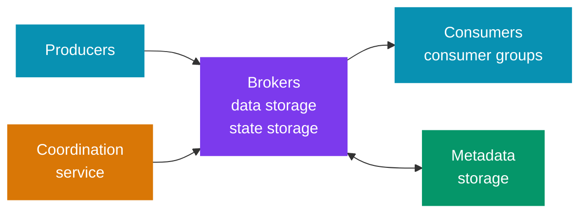
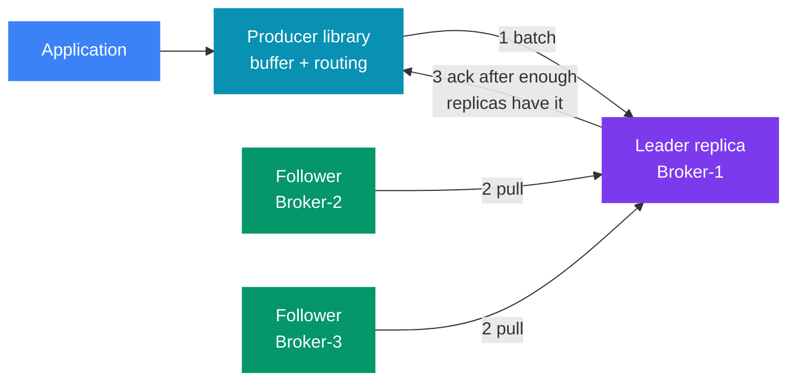
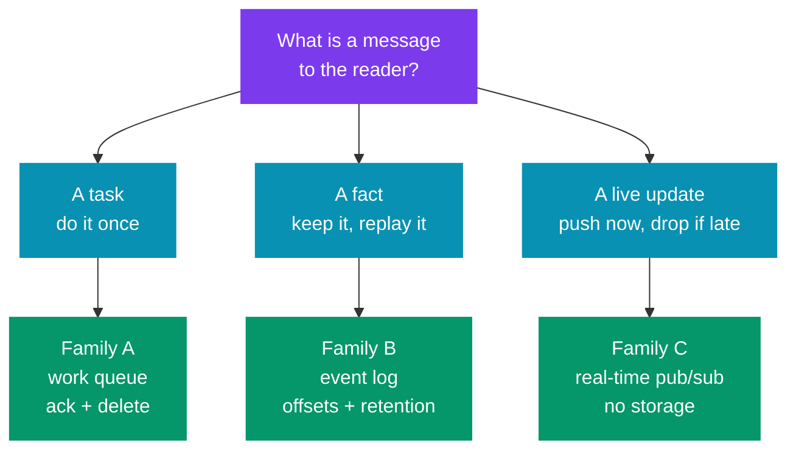

# Ch 4: Distributed Message Queue

> 📖 **Vol 2, Chapter 4** (book pages 91–129) &nbsp;·&nbsp; 🔥🔥 Very High Priority &nbsp;·&nbsp; 💬 **22 Questions**  
> **Source:** Alex Xu & Sahn Lam, *System Design Interview Vol 2*, Ch 4. Page and figure numbers below are the book's printed ones.

---

📊 **Question Count**

| # | Section | Questions |
|---|---|---|
| 1 | [Requirements and Scope ⚡](#1--requirements-and-scope-p9193-) | 1 |
| 2 | [Messaging Models, Topics, Partitions and Consumer Groups 🔥🔥](#2--messaging-models-topics-partitions-and-consumer-groups-p9397-) | 1 |
| 3 | [High-level Architecture 🔥](#3--high-level-architecture-p9798-) | ref |
| 4 | [Data Storage, Message Structure and Batching 🔥🔥](#4--data-storage-message-structure-and-batching-p98102-) | 5 |
| 5 | [Producer Flow and Consumer Flow — Push vs Pull 🔥](#5--producer-flow-and-consumer-flow--push-vs-pull-p102105-) | 2 |
| 6 | [Consumer Rebalancing, State and Metadata Storage 🔥🔥](#6--consumer-rebalancing-state-and-metadata-storage-p106112-) | 2 |
| 7 | [Replication and In-sync Replicas 🔥🔥](#7--replication-and-in-sync-replicas-p112117-) | 2 |
| 8 | [Scalability — Brokers and Partitions 🔥](#8--scalability--brokers-and-partitions-p117122-) | 3 |
| 9 | [Delivery Semantics, Advanced Features and Wrap Up 🔥🔥](#9--delivery-semantics-advanced-features-and-wrap-up-p122126-) | 5 |
| 10 | [Similar Problems This Design Solves 📎 🔥](#10--similar-problems-this-design-solves--) | 1 |
| | **Total** | **22** |

> 🔥🔥 Very high priority — asked in almost every Tier-1 interview loop &nbsp;·&nbsp; 🔥 High priority — very frequent in Tier-1 interviews &nbsp;·&nbsp; ⚡ Medium priority — commonly asked &nbsp;·&nbsp; 💤 Low priority — good to know, rarely asked

> **How to read this note.** Sections 1–9 follow the book, step by step (Step 1 → Step 4). §10, at the end, maps this design to 14 similar problems. Anything the book does not say is marked **📎 Beyond the book**. Where the book has a mistake, the note says so and gives the fix.  
> The book designs a Kafka-like system without naming Kafka settings. For real Kafka internals (configs, Spring Kafka, transactions), see the deep note: [Kafka Interview Questions](../../iq/04_Kafka_Interview_Questions.md). This note does not repeat it.

---

## 🗒️ Cheat Sheet

<details>
<summary><strong>🗒️ Show cheat sheet</strong></summary>

### 🎯 Clarifying Questions — and the book's answers
| Question | Book's answer (p.92–93) |
|---|---|
| Format and size of messages? | **Text only.** Size is in the **kilobyte** range |
| Can a message be consumed many times? | **Yes**, by different consumers. This is an added feature — a traditional queue deletes it after delivery |
| Same order as produced? | **Yes.** Also an added feature — traditional queues do not usually guarantee order |
| Persist data? How long? | **Yes. Two weeks** of retention. Also an added feature |
| How many producers and consumers? | **"The more the better"** |
| Which delivery semantic? | **At-least-once** for sure. Ideally all three, **configurable** |
| Throughput and latency target? | **High throughput** for log aggregation. **Low latency** for classic queue use cases |

**Functional** (p.93): producers send, consumers consume; messages can be consumed **repeatedly or only once**; old data can be **truncated**; KB-size messages; **ordered** delivery; **configurable** delivery semantics.
**Non-functional** (p.93): high throughput **or** low latency (configurable); scalable, handles sudden surges; **persistent and durable** (on disk, replicated).

### 🏗️ Core Components (Figure 4.8)
- **Producer** — pushes messages to a topic. Routing and a buffer live **inside the producer client library** (Figure 4.12).
- **Consumer group** — subscribes to topics. Each partition goes to **one** consumer in the group.
- **Broker** — holds many partitions. A partition holds a subset of a topic's messages.
- **Data storage** — messages, as **WAL segment files** per partition (Figure 4.10).
- **State storage** — partition-to-consumer mapping + **last consumed offset** per group per partition.
- **Metadata storage** — topic config: partition count, retention, replica distribution.
- **Coordination service** — service discovery (which brokers are alive) + **controller election**. ZooKeeper or etcd (p.98).

### Message schema (Table 4.1, p.100)
```
key        byte[]    -- picks the partition: hash(key) % numPartitions. Optional, not unique
value      byte[]    -- the payload: plain text or a compressed binary block
topic      string
partition  integer
offset     long      -- (topic, partition, offset) finds one message
timestamp  long      -- when the message was stored
size       integer
crc        integer   -- checks the integrity of the raw data
```

### 💡 Key Insights
1. **Three design choices give the throughput** (p.98). First, an on-disk structure that uses **sequential** disk access and the **OS disk cache**. Second, a message format that is **never changed** from producer to consumer (no copying). Third, **batching everywhere**.
2. **A partition is the unit of order and of parallelism.** Order holds only inside one partition. One partition goes to only one consumer in a group (p.97).
3. **Disks are slow only for random access** (p.100). Sequential access on RAID gives several hundred MB/s.
4. **Pull beats push** for this design. The consumer controls its rate, and pull suits batching (p.105).
5. **ISR is the knob between speed and safety** (p.114). `ACK=all` waits for every ISR; `ACK=1` waits for the leader; `ACK=0` waits for no one.

### ⚖️ Trade-offs / Alternatives
| Option | Pro | Con | Book's verdict |
|---|---|---|---|
| Store messages in a database (SQL or NoSQL) | Familiar, handles the volume | Hard to serve write-heavy **and** read-heavy at scale; may become the bottleneck | ❌️ Not the best choice (p.99) |
| **Write-ahead log** files on disk | Pure sequential access; cheap, large disks | Need segments and retention clean-up | ✅ Recommended (p.99) |
| Routing + buffer **in the producer library** (vs a separate routing layer) | Fewer hops, custom partition logic, batching | Fatter client | ✅ Improved design (p.103) |
| Push model | Low latency | Can overwhelm slow consumers; broker sets the rate | ❌️ |
| **Pull model** | Consumer sets the rate; good for batching | Empty pulls waste resources → use **long polling** | ✅ "Most message queues choose the pull model" (p.105) |
| Read from the leader replica | Simple; few connections per partition | Slow for a consumer in another data center | ✅ Default; closest ISR only for cross-DC consumers (p.116) |
| ZooKeeper for state + metadata | Strong consistency, fast KV reads/writes | An extra system to run | ✅ "A great choice" (p.111) |
| One topic per message subtype | Simple | Wastes storage; couples producer to consumers | ❌️ (p.123) |
| **Tags + broker-side filter** | Consumers get only what they need | Broker must not read the payload | ✅ (p.124) |

### 🔢 Numbers to Remember
| What | Value | Arithmetic |
|---|---|---|
| Retention | **2 weeks** (p.92) | 14 × 86,400 s = 1,209,600 s ≈ **1.2 × 10⁶ s** |
| Message size | **KB range** (p.92) | |
| Replicas per partition | **3** (Figure 4.23) | 1 leader + 2 followers, each on a different broker |
| Sequential disk, RAID | **Several hundred MB/s** read and write (p.100) | |
| 📎 Linear vs random writes (Kafka docs, 6 × 7200 rpm SATA, RAID-5) | **~600 MB/s vs ~100 KB/s** | 600,000 KB ÷ 100 KB ≈ **6,000×** |
| 📎 Storage for 100k msg/s × 1 KB, 2 weeks, 3 replicas | **≈ 363 TB** | 100 MB/s × 1.21 × 10⁶ s ≈ 121 TB; × 3 ≈ 363 TB |
| Delayed-message example | Close an unpaid order after **30 minutes** (p.124) | |
| RocketMQ delay levels | **1s … 2h**, fixed levels (p.125) | 📎 18 levels by default (see §9) |

> 📎 For Kafka's real defaults (`retention.ms` 7 days, `session.timeout.ms` 45 s, `max.poll.interval.ms` 5 min, `replica.lag.time.max.ms` 30 s), see the [Kafka note](../../iq/04_Kafka_Interview_Questions.md).

### ⏱️ 45-Minute Round Plan
| Minutes | Phase | What to say or draw | Trap to avoid |
|---|---|---|---|
| 0–5 | Clarify | Text, KB size, repeated consumption, ordering, **2-week retention**, at-least-once + configurable, throughput vs latency | Not asking "classic queue or event streaming?" — it changes the whole design |
| 5–8 | Scope | Say which features are event-streaming extras (retention, replay, order). 📎 Rough storage: ~363 TB | Spending long on maths — the book does none |
| 8–15 | High-level | Point-to-point vs pub-sub; topics → partitions → brokers; consumer groups; Figure 4.8 | Forgetting the "one partition → one consumer per group" rule |
| 15–35 | **Deep dive** | WAL + segments → message schema + batching → producer library → pull + offsets → rebalancing → replication + ISR + ACK | Using a database for message storage |
| 35–42 | Scale + semantics | Broker failure, add broker, add/remove partitions; at-most / at-least / exactly once | Saying "exactly once is free" |
| 42–45 | Wrap up | Filtering by tags, delayed messages, protocol, retry topic, archive to HDFS | Skipping failure handling |

> 📎 The timings are a suggestion, not from the book. The book gives the steps; the minutes are ours.

---

</details>
<br/>

---

## 1. 📋 Requirements and Scope (p.91–93) ⚡

**Why message queues** (p.91):

- **Decoupling** — components can be updated on their own.
- **Better scalability** — scale producers and consumers separately. Add consumers at peak hours.
- **Higher availability** — if one part goes offline, the others still talk to the queue.
- **Better performance** — async: producers do not wait for consumers.
- Popular products (Figure 4.1): Kafka, RocketMQ, RabbitMQ, Pulsar, ActiveMQ, ZeroMQ.

**Message queue vs event streaming platform** (p.92). Strictly, Kafka and Pulsar are **event streaming platforms**, not message queues. But the line is blurring:

- RabbitMQ added an optional **streams** feature: repeated consumption, long retention, an append-only log.
- Pulsar is mainly a Kafka competitor, but it can also work as a classic queue.

This chapter designs a queue **with** event-streaming features: long retention and repeated consumption. These make the design harder. The book marks where a classic queue would be simpler.

**Adjustments for a traditional queue** (p.93). RabbitMQ-style queues keep messages **in memory** only until they are consumed. Their on-disk overflow space is orders of magnitude smaller. They do not usually keep message order. So a classic-queue interview can skip retention, segments and ordering.

### ❓ Interview Questions

1. **How is this design different from a traditional queue like RabbitMQ? When would you pick each? 🔥**

<!-- -->
<details>
<summary>💡 Show Answer</summary>

**Answer:**

| | Traditional queue (RabbitMQ) | This design / event streaming (Kafka) |
|---|---|---|
| Retention | In memory until consumed; small disk overflow (p.93) | On disk, **2 weeks** |
| Re-read | No — removed after the ack | Yes — any group, any offset |
| Order | Not usually guaranteed (p.93). 📎 RabbitMQ keeps FIFO inside one queue; competing consumers and requeues break it | Per partition |
| Model | Point-to-point (p.94). 📎 RabbitMQ also does pub-sub: a fanout exchange copies a message to one queue per subscriber | Pub-sub with topics; point-to-point via one group |

The line is blurring: RabbitMQ added **streams** (long retention, re-reads, an append-only log). Pulsar works as both (p.92).

📎 **Pick Kafka** for event streams, audit logs, high-throughput pipelines and replay. **Pick RabbitMQ** for task queues with **flexible routing** (exchanges, binding keys) and per-message acks.

📎 **On AWS** the same split exists as managed services:

- **SQS** is the classic queue. A message is deleted after the consumer processes it, so there is no replay. Standard queues give at-least-once delivery and best-effort order. **FIFO** queues keep order per message group and drop duplicates inside a 5-minute window.
- **Kinesis Data Streams** is the Kafka-like log. A **shard** plays the role of a partition. Retention is 24 hours by default and can go up to 365 days.

For a classic-queue interview, drop retention, segments and ordering (p.93).

</details>

---

## 2. 📨 Messaging Models, Topics, Partitions and Consumer Groups (p.93–97) 🔥🔥

**Basic parts** (Figure 4.2, p.94). The producer sends messages to the queue. The consumer subscribes and consumes. The queue sits in the middle and decouples them. Producer and consumer are **clients**; the queue is the **server**.

### Two messaging models

- **Point-to-point** (Figure 4.3) — each message is consumed by **one and only one** consumer. After the ack, it is **removed**. No retention.
- **Publish-subscribe** (Figure 4.4) — a message goes to a **topic**. **Every** subscriber of the topic gets it. A topic name is unique across the whole service.

The design supports both. **Topics** give pub-sub. **Consumer groups** simulate point-to-point (p.95).

### Topics, partitions and brokers (Figure 4.5, p.95)

A topic can be too big for one server. So split it into **partitions** (sharding). Partitions are spread evenly over the servers, called **brokers**. To scale a topic, add partitions.

- Each partition is a **FIFO queue**. Order holds **inside** a partition.
- A message's position in the partition is its **offset**.
- A message has an optional **key** (for example, a user ID). All messages with the same key go to the **same partition**. With no key, the partition is chosen **at random**.

### Consumer groups (Figure 4.7, p.96–97)

- Group 1 subscribes to topic A. Group 2 subscribes to topics A and B. Topic A's messages reach **both** groups — that is pub-sub.
- **The problem:** if two consumers in one group read the same partition, order is lost.
- **The fix — a constraint:** a partition is consumed by **only one consumer in a group**. If a group has more consumers than partitions, some consumers get nothing.
- Put all consumers in **one** group, and each message is consumed once — that is point-to-point.

A partition is the smallest storage unit. So **allocate enough partitions in advance**. Then, to scale, just add consumers (p.97).

### ❓ Interview Questions

1. **How do you guarantee message ordering, and what are its limits? 🔥🔥**

<!-- -->
<details>
<summary>💡 Show Answer</summary>

**Answer:**

- Order holds **only inside one partition** — it is a FIFO queue (p.95).
- To keep order for one entity (a user ID), use it as the **message key**. All its messages go to the same partition (p.95).
- Only **one consumer per group** reads a partition. If two read it, order is lost (p.97).

**Limits:**

- **No order across partitions.** Global order needs one partition, which removes all parallelism.
- 📎 **A hot key makes a hot partition.** All messages of one key go to one partition. So one busy key (a big merchant, a viral user) can overload one broker and one consumer. Adding partitions does not help, because the key still maps to one place. Fixes: split the key with a suffix (`merchantId#0…#9`) and give up order across the parts, or move that key to its own topic.
- **Adding partitions moves keys** under `hash(key) % N` (see the book inconsistency in §8).
- 📎 **Producer retries can reorder** when many requests are in flight. Kafka's **idempotent producer** keeps order with up to 5 in-flight requests. It is on by default from Kafka 3.0 (a bug kept it off in 3.0.0 and 3.1.0; fixed in 3.0.1, 3.1.1 and 3.2.0).
- 📎 Kafka hashes with **murmur2**, modulo the partition count. It is **not** consistent hashing.

</details>

---

## 3. 🧱 High-level Architecture (p.97–98) 🔥



*(Figure 4.8)*

- **Clients:** the producer pushes to topics; the consumer group subscribes and consumes.
- **Broker** holds many partitions, with **data storage** (messages) and **state storage** (consumer state). **Metadata storage** keeps topic config.
- **Coordination service:**
  - **Service discovery** — which brokers are alive.
  - **Leader election** — one broker is the **active controller**. There is only one. It assigns partitions.
  - ZooKeeper or etcd is commonly used to elect the controller.

---

## 4. 💾 Data Storage, Message Structure and Batching (p.98–102) 🔥🔥

### The traffic pattern (p.98)

- Write-heavy **and** read-heavy.
- **No update or delete.** (A classic queue deletes when it catches up. Here we talk about a streaming platform.)
- Mostly **sequential** reads and writes.

### Option 1: a database (p.98–99)

A relational table per topic, or a NoSQL collection per topic. It can hold the data. But it is hard to build a database that serves write-heavy and read-heavy traffic at large scale. It may become the bottleneck. **Not the best choice.**

### Option 2: write-ahead log — the book's choice (p.99)

A **WAL** is a plain file. New entries are only appended. MySQL's redo log and ZooKeeper use one. A WAL has **pure sequential** access, and sequential disk access is very fast. Rotational disks are also big and cheap.

- A new message goes to the **tail** of the partition, with an offset that only goes up (Figure 4.9). The simplest offset is the **line number** in the log file.
- A file cannot grow forever, so split it into **segments**. Only the **active** segment takes writes. When it reaches a size limit, a new active segment starts. Old segments serve **reads only**.
- Old segments are **truncated** when they pass the retention or capacity limit.
- Segment files of one partition live in a folder named `Partition-{:partition_id}` (Figure 4.10).

### A note on disk performance (p.100)

"Disks are slow" is true only for **random** access. With a sequential design, modern disks in **RAID** reach **several hundred MB/s** for reads and writes. That is more than enough, and cheap.

The OS also caches disk data in memory **very aggressively** — it uses all free memory. The WAL benefits from this cache too.

> 📎 Kafka's design docs give the classic numbers. The test used 6 × 7200 rpm SATA disks in RAID-5. **Linear writes ≈ 600 MB/s**, but **random writes ≈ 100 KB/s** — about 6,000× slower. The book's reference [5] (ACM Queue, "The Pathologies of Big Data") shows sequential disk reads can even beat **random memory** reads.

### Message data structure (p.100–101)

The message format is a **contract** between producers, queue and consumers. If all parts agree on it, messages pass through **with no changes**, so there is **no copying**. If one part disagrees, messages must be changed, which means expensive copying. The schema is in the Cheat Sheet (Table 4.1).

- **Key:** decides the partition. No key → random partition. Otherwise `hash(key) % numPartitions`. A producer may plug in its **own mapping**. The key is **not** the partition number; the partition number is internal and should not be shown to clients. With a good mapping, messages stay even when the partition count changes.
- **Value:** the payload — plain text or a compressed binary block.
- **Reminder** (p.101): this key/value is **not** a KV-store pair. Keys need not be unique, and you never look up a value by key.
- **Other fields:** topic, partition, offset, timestamp (when stored), size, CRC (integrity).
- **Optional fields** can be added, for example **tags** for filtering (§9).

> 📎 **Zero-copy.** The book's point is "no copying because the format never changes". Kafka goes further: it sends log bytes to the network with the `sendfile` system call. The data goes from the page cache to the socket and never enters user space. This does not work with TLS, because the broker must encrypt in user space.

### Batching (p.101–102)

Batching is everywhere: in the producer, the consumer and the queue. It matters because:

- The OS groups messages into one network request. This spreads the cost of round trips.
- The broker writes to the log in **large chunks**. This gives longer sequential writes and bigger blocks of disk cache.

**Trade-off:** throughput vs latency. For a low-latency (classic queue) setup, use a **smaller batch**; disk performance drops a little. If tuned for throughput, you may need **more partitions per topic** to make up for slower sequential writes.

### ❓ Interview Questions

1. **Why store messages in a write-ahead log on disk, not in a database? How is the log organized? 🔥🔥**

<!-- -->
<details>
<summary>💡 Show Answer</summary>

**Answer:**

**The traffic** (p.98): write-heavy **and** read-heavy, **no updates or deletes**, mostly **sequential**.

- **A database** (SQL table or NoSQL collection per topic) can hold the data. But one that serves both heavy writes and heavy reads at scale is hard to build. It may become the bottleneck (p.99).
- **A WAL** is an append-only file: pure sequential access. Disks are slow only for random access; sequential on RAID gives **several hundred MB/s**. The OS **page cache** also serves many reads from memory (p.100).

**Layout** (Figures 4.9–4.10):

- Each partition is a folder `Partition-{:partition_id}`, split into **segments**. Only the **active** segment takes writes; full ones become read-only.
- Old segments are **truncated** after retention (2 weeks) or a capacity limit. The offset only goes up (simplest: the line number).

📎 Quote the Kafka docs number: ~600 MB/s linear vs ~100 KB/s random writes on the same disks — about 6,000×.

</details>

---

2. **How does batching help, and what does it cost? 🔥**

<!-- -->
<details>
<summary>💡 Show Answer</summary>

**Answer:**

Batching is in the **producer** (the library's buffer, Figure 4.12), the **broker** and the **consumer** (pull up to a max size) (p.101).

- **Network:** many messages share one request, so the round-trip cost is spread out.
- **Disk:** the broker writes in **large chunks**. This gives long sequential writes and big blocks of OS disk cache.

**Cost — latency** (Figure 4.13): a big batch waits longer to fill. For a low-latency queue, use a small batch; disk speed drops a little. When tuned for throughput, you may need **more partitions** to make up for it (p.102).

📎 Example: 100 messages per batch turns 100k messages/s into ~1k requests/s. In Kafka the knobs are `batch.size` and `linger.ms` (default 5 ms from Kafka 4.0, 0 ms before).

</details>

---

3. **Why is the message format fixed from producer to consumer? What is zero-copy? 🔥**

<!-- -->
<details>
<summary>💡 Show Answer</summary>

**Answer:**

The message structure is a **contract** between producers, queue and consumers (p.100). If they all agree, the message passes through **unchanged**. No part needs to decode and re-encode it, so there is **no copying**. Copying is very expensive at high volume (p.98).

The schema (Table 4.1): key, value, topic, partition, offset, timestamp, size, CRC. Filter data goes in optional fields such as **tags**, so the broker never opens the payload.

📎 **Zero-copy** builds on this. Without it, sending a message takes four copies: disk → page cache → user-space buffer → socket buffer → network card. With `sendfile`, the data goes from the **page cache straight to the socket**. It never enters user space. This removes the copy into user space and two of the four context switches. If the network card supports gather DMA, no CPU copy is left at all. It does **not** work with TLS, because the broker must encrypt the bytes in user space.

</details>

---

4. **What is log compaction, and what is a tombstone? 📎 🔥**

<!-- -->
<details>
<summary>💡 Show Answer</summary>

**Answer:**

**Log compaction** keeps the **latest message per key** instead of deleting by time or size. Older values of the same key are removed.

- **Use it** for changelog topics that need the **current state**: user profiles, CDC streams, `__consumer_offsets`.
- **Tombstone:** a message with a **null value**. It tells compaction to delete the key. It is kept for `delete.retention.ms` (default **24 hours**), so slow consumers still see the delete. Without it, stale data could stay downstream.
- **Cost:** background CPU and disk I/O. Offsets stay in order, but there are **gaps** after compaction.

The book's design only has **time- or size-based truncation** (p.99), not compaction.

</details>

---

5. **How would you handle very large messages (for example 10 MB)? 📎 ⚡**

<!-- -->
<details>
<summary>💡 Show Answer</summary>

**Answer:**

The book's messages are in the **KB range** (p.92). For large payloads:

- **Raise the limits** — `message.max.bytes` on the broker (default ~1 MB), `max.request.size` on the producer, and the fetch size. This hurts throughput and memory.
- **Claim-check pattern (better)** — store the payload in **S3 / object storage**; send only a reference (URL + metadata). The queue stays small and fast.

</details>

---

## 5. 🚚 Producer Flow and Consumer Flow — Push vs Pull (p.102–105) 🔥

### Producer flow (p.102–104)

**First try — a routing layer** (Figure 4.11):

1. The producer sends messages to the routing layer.
2. The routing layer reads the **replica distribution plan** from metadata storage and caches it. It sends the message to the **leader replica** of the partition (here, Broker-1).
3. The leader receives the message. Followers **pull** data from the leader.
4. When **"enough"** replicas have the message, the leader **commits** it (persisted on disk). Now it can be consumed. Then the leader replies to the producer.

**Two drawbacks:** an extra network hop adds latency, and there is **no batching**.

**Improved design** (Figure 4.12): wrap the routing layer **into the producer** and add a **buffer**. Both are part of the **producer client library**.

- Fewer network hops → lower latency.
- The producer can use its own logic to choose the partition.
- The buffer collects messages and sends **larger batches** in one request → higher throughput.

**Batch size** (Figure 4.13): a large batch gives more throughput but more latency (you wait to fill it). A small batch gives low latency but less throughput. Tune it per use case.



### Consumer flow (Figure 4.14, p.104)

The consumer gives an **offset** in a partition and gets back a chunk of events starting there. In Figure 4.14, consumer 1 has consumed up to offset 6, and consumer 2 up to 13.

### Push vs pull (p.104–105)

| | Push | Pull |
|---|---|---|
| Pros | **Low latency** — the broker sends at once | Consumer **controls the rate**; real-time and batch consumers can co-exist; a slow consumer can scale out or catch up later; good for **aggressive batching** |
| Cons | A slow consumer can be **overwhelmed**; hard to serve consumers of different power, because the broker sets the rate | With no new data, the consumer still polls and **wastes resources** |

- The fix for empty polls: **long polling** — a pull waits a set time for new messages (p.105).
- With push, the broker does not know if the consumer can keep up. Messages pile up in the consumer's buffer. Pull takes all messages after the current offset (or up to a max size).
- **Book's verdict:** "most message queues choose the pull model" (p.105). 📎 Not all do: RabbitMQ and ActiveMQ **push** by default (with a prefetch limit). Kafka and RocketMQ pull (RocketMQ with long polling).

### ❓ Interview Questions

1. **Walk me through how a message flows from producer to consumer in your design. 🔥🔥**

<!-- -->
<details>
<summary>💡 Show Answer</summary>

**Answer:**

(Figures 4.12, 4.14, 4.21)

1. The **producer library** picks the partition (`hash(key) % numPartitions`, or random with no key). The message waits in the **buffer** for a batch.
2. The library knows the **leader replica** from the cached replica distribution plan, and sends the batch there.
3. The leader **appends** the batch to the active **WAL segment** of the partition.
4. Followers **pull** from the leader. When enough ISRs have it (per the ACK setting), the leader **commits** and acks the producer.
5. The consumer that owns the partition in its group **pulls** a chunk from its last offset. After processing, it **commits the offset** to state storage.

📎 Kafka's default partitioner with no key is **sticky** (it fills one partition's batch, then switches), not purely random.

</details>

---

2. **Push or pull for consumers? 🔥🔥**

<!-- -->
<details>
<summary>💡 Show Answer</summary>

**Answer:**

**Push** (p.104–105): low latency. But a slow consumer can be **overwhelmed**, and the broker sets the rate, so consumers of different power are hard to serve.

**Pull:** the consumer **controls its rate** (one group real-time, another batch). If it falls behind, scale out or catch up later. It suits **batching**: pull everything after the offset, up to a max size. **Con:** empty polls waste resources. Fix: **long polling** — the pull waits a set time for new data.

**Book's verdict:** pull. "Most message queues choose the pull model" (p.105). 📎 RabbitMQ pushes by default, with a **prefetch** limit, so say "Kafka-style systems pull".

</details>

---

## 6. 🔄 Consumer Rebalancing, State and Metadata Storage (p.106–112) 🔥🔥

> **Note on the source.** Printed pages 106–107 are **missing from the local PDF scan**. They hold the pull workflow (Figure 4.15) and the start of "Consumer rebalancing" (Figures 4.16–4.17). This section uses the full flows on p.108–110, which show the same protocol step by step.

### Consumer rebalancing (p.106–110)

Rebalancing decides **which consumer owns which partitions**. It runs when a consumer **joins**, **leaves**, or **crashes**, or when partitions change. One broker acts as the group's **coordinator**. Consumers send it **heartbeats**. One consumer in the group is elected the **leader**; it makes the **partition dispatch plan**.

**A new consumer joins** (Figure 4.18, p.108):

1. At first only Consumer A is in the group. It consumes all partitions and sends heartbeats to the coordinator.
2. Consumer B sends a **JoinGroup** request.
3. The coordinator knows it must rebalance. It tells the others **passively**: when A's next heartbeat arrives, the reply says "rejoin".
4. When all consumers have rejoined, the coordinator **picks a leader** and tells everyone the result.
5. The **leader** makes the partition dispatch plan and sends it to the coordinator (**SyncGroup**). Followers ask the coordinator for the plan.
6. Consumers start consuming their new partitions. In the figure, A gets partitions 1 and 3; B gets 2 and 4.

**A consumer leaves** (Figure 4.19, p.109): A sends **LeaveGroup**. On B's next heartbeat, the coordinator asks B to rejoin. The rest is the same. B ends up with partitions 1–4.

**A consumer crashes** (Figure 4.20, p.110): A sends no heartbeat. After a set time with no heartbeat, the coordinator **marks A as dead** and starts a rebalance. The rest is the same.

> 📎 In Kafka, a consumer finds its coordinator by hashing the group ID to a partition of the internal `__consumer_offsets` topic. That partition's leader broker is the coordinator. The flow above is Kafka's classic **eager** rebalance: every consumer stops during it. Kafka 2.4 added **cooperative** rebalance (only moved partitions stop). Kafka 4.0 made the broker-driven protocol (KIP-848) GA. Details: [Kafka note](../../iq/04_Kafka_Interview_Questions.md).

### State storage (p.110–111)

It stores:

- The **mapping** between partitions and consumers.
- The **last consumed offset** of each consumer group for each partition (Figure 4.21: group-1 at 6, group-2 at 13).

A consumer in group-1 commits offset 6. That means all messages **up to and including** 6 are done. If it crashes, a new consumer in the group reads offset 6 from state storage and **resumes** from there.

Access pattern of consumer state:

- Frequent reads and writes, but **small volume**.
- Updated often, **rarely deleted**.
- **Random** reads and writes.
- **Consistency** matters.

A KV store like **ZooKeeper** is "a great choice". The book notes that **Kafka moved offset storage from ZooKeeper to the brokers** (p.111).

### Metadata storage (p.111)

It stores topic config: number of partitions, retention period, replica distribution. Metadata **changes rarely** and is **small**, but needs **strong consistency**. ZooKeeper fits.

### ZooKeeper (Figure 4.22, p.111–112)

ZooKeeper is a hierarchical key-value store. It gives distributed configuration, synchronization and a naming registry. With it, the design changes:

- **Metadata and state storage move to ZooKeeper.**
- The broker keeps only the **message data**.
- ZooKeeper helps **elect the leader** (controller) of the broker cluster.

> 📎 **Kafka today.** Kafka 4.0 (March 2025) **removed ZooKeeper**. Metadata now lives in **KRaft** — a Raft quorum of controller nodes inside Kafka. Consumer offsets live in the `__consumer_offsets` topic. So in a 2026 interview, draw ZooKeeper as the book does, but say "Kafka now uses KRaft for this".

### ❓ Interview Questions

1. **How does consumer group rebalancing work? 🔥🔥**

<!-- -->
<details>
<summary>💡 Show Answer</summary>

**Answer:**

**When:** a consumer joins, leaves or crashes, or partitions change. **Who:** a broker acting as the group **coordinator**, plus a **leader consumer** (Figures 4.18–4.20).

**Join** (Figure 4.18):

1. Consumer B sends **JoinGroup**. The coordinator tells A to rejoin **in the reply to A's next heartbeat**.
2. All consumers rejoin. The coordinator elects a **leader consumer**.
3. The leader makes the **partition dispatch plan** and sends it with **SyncGroup**. Followers get their part from the coordinator. A reads partitions 1, 3; B reads 2, 4.

**Leave** (Figure 4.19): **LeaveGroup**, then the same steps. **Crash** (Figure 4.20): no heartbeat for a set time → the coordinator marks the consumer dead → same steps.

📎 **The problem:** this is an **eager** rebalance — every consumer stops until it ends. Kafka 2.4 added **cooperative** rebalance (only moved partitions stop). Kafka 4.0 made the new **broker-driven** protocol (KIP-848) GA. Also, a slow handler that passes `max.poll.interval.ms` (5 min) triggers a rebalance even while heartbeats still flow.

</details>

---

2. **Where do consumer offsets and topic metadata live? ZooKeeper or something else? ⚡**

<!-- -->
<details>
<summary>💡 Show Answer</summary>

**Answer:**

**State storage** (p.110–111) keeps the partition-to-consumer map and the **last consumed offset** per group per partition. Access: small but frequent, updated often, random, needs consistency. A KV store like **ZooKeeper** is "a great choice". The book adds that **Kafka moved offsets to the brokers**.

**Metadata storage** (p.111) keeps partition count, retention and the replica plan. Small, rarely changed, needs strong consistency → ZooKeeper.

**With ZooKeeper** (Figure 4.22): metadata and state move to ZooKeeper. Brokers keep only message data. ZooKeeper also elects the **controller**.

📎 **Kafka today:** offsets live in the internal `__consumer_offsets` topic. Metadata lives in **KRaft**, a Raft quorum of controller nodes (GA in 3.3). ZooKeeper was **removed in 4.0** (March 2025). KRaft gives faster startup and failover and scales to more partitions. To migrate, move to KRaft on the 3.9 bridge release first, then upgrade to 4.0.

</details>

---

## 7. 🪞 Replication and In-sync Replicas (p.112–117) 🔥🔥

### Replication (Figure 4.23, p.112–113)

Disks fail and data is lost. **Replication** is the classic fix. Each partition has **3 replicas** on different brokers. One is the **leader**; the others are **followers**.

- Producers send only to the **leader**.
- Followers **pull** new messages from the leader.
- When "enough" replicas have the message, the leader **acks** the producer.

The **replica distribution plan** for Figure 4.23:

- Topic-A Partition-1: leader on Broker-1, followers on Broker-2 and 3.
- Topic-A Partition-2: leader on Broker-2, followers on Broker-3 and 4.
- Topic-B Partition-1: leader on Broker-3, followers on Broker-4 and 1.

**Who makes the plan?** With the coordination service, one broker is elected **leader** (the controller). It makes the plan and saves it in **metadata storage**. All brokers follow the plan (p.113).

### In-sync replicas (Figure 4.24, p.113–114)

**ISR** = the replicas that are "in sync" with the leader. "In sync" depends on topic config. The **leader is always in the ISR**.

In Figure 4.24:

- The leader's **committed offset is 13**. Two newer messages (14, 15) are written but **not committed**.
- **Committed** means every message up to that offset is on **all** ISR replicas.
- Replica-2 and replica-3 caught up → in the ISR.
- Replica-4 (at offset 11) did **not** catch up within the configured lag time → **not** in the ISR. It rejoins once it catches up.

> ⚠️ **Book bug — off by one, and an old setting.** The book says: if `replica.lag.max.messages` is **4**, a follower stays in the ISR while it is "no more than **3**" messages behind (p.113). Kafka defined it as: a follower is removed when it is **more than** N messages behind. So with 4, a follower **4** behind still stays. Also, Kafka **removed** this setting in 0.9.0. It uses **time** now: `replica.lag.time.max.ms` (default 30 s since Kafka 2.5). The book's own Figure 4.24 text already uses "lag time". Quote the time-based rule.

**Why ISR?** It is the trade-off between **performance and durability** (p.114). The safest way to never lose a message is to wait for all replicas before the ack. But then **one slow replica** makes the whole partition slow or unavailable. ISR drops the slow one.

### ACK settings (p.114–116)

The producer chooses how many ISRs (k) must have the message before it gets the ack.

| Setting | Producer gets the ack when… | Latency | Durability | Use case |
|---|---|---|---|---|
| **ACK=all** (Figure 4.25) | **All ISRs** have the message | Highest — waits for the slowest ISR | **Strongest** | Must not lose data |
| **ACK=1** (Figure 4.26) | The **leader** persists it | Lower | Lost if the leader dies **before** followers copy it | Low latency, rare loss OK |
| **ACK=0** (Figure 4.27) | Never — no ack, **no retry** | Lowest | Can lose messages | Metrics, logging: high volume, loss OK |

"Configurable ACK allows us to trade durability for performance" (p.116).

> 📎 **"Persisted" does not mean "on the platter".** The book says the leader commits once the data is "persisted on disk" (p.103). Kafka writes to the OS page cache and does **not** fsync each message by default. Durability comes from **replication**, not from fsync. So `ACK=1` can lose a message even when no disk fails. The leader dies before a follower copies the message. A follower becomes the new leader. The old leader drops the message when it rejoins.

> 📎 In Kafka, `acks=all` only means "all **current** ISR members". If the ISR shrinks to just the leader, `acks=all` acts like `acks=1`. So pair it with **`min.insync.replicas=2`** (on RF = 3). Then a write fails rather than sit on one copy. The book hints at this on p.119: "the minimum number of ISRs".

### Where do consumers read? (p.116–117)

The simplest setup: consumers read from the **leader**. Will the leader be overloaded? No:

- It keeps the design and operations simple.
- One partition goes to only **one consumer per group**, so connections per leader are few.
- Connections stay low unless a topic is **very hot**. Then add partitions and consumers.

**Exception:** a consumer in **another data center** reads slowly from a far leader. Then let it read from the **closest ISR** (reference: Kafka KIP-392).

**How is ISR tracked?** The leader of each partition computes each replica's **lag** from itself, and keeps the ISR list (p.117).

### ❓ Interview Questions

1. **Explain in-sync replicas and the ACK settings. 🔥🔥**

<!-- -->
<details>
<summary>💡 Show Answer</summary>

**Answer:**

**ISR** = replicas in sync with the leader; the leader is always one (p.113). A follower that does not catch up within the **configured lag time** leaves the ISR. It rejoins when it catches up. The leader tracks each replica's lag (p.117).

- **Committed offset** = every message up to it is on **all** ISRs. Consumers see only committed messages (Figure 4.24: committed = 13).
- **Why ISR:** waiting for **every** replica is safest, but one slow replica would stall the partition. ISR drops it (p.114).

**ACK settings** (p.114–116): `all` waits for all ISRs (slowest, safest). `1` waits for the leader (lost if it dies before followers copy). `0` waits for nothing and never retries (fastest; fine for metrics and logs).

📎 Kafka uses time, not message count: `replica.lag.time.max.ms`, default **30 s** since 2.5. Pair `acks=all` with `min.insync.replicas=2` on RF = 3. Otherwise a shrunken ISR of just the leader makes `acks=all` no safer than `acks=1`.

</details>

---

2. **Can ordering survive a leader failover? 📎 🔥**

<!-- -->
<details>
<summary>💡 Show Answer</summary>

**Answer:**

- **Yes, inside the ISR.** A new leader from the ISR has every **committed** message, in order.
- **No, with unclean election.** If `unclean.leader.election.enable=true`, an out-of-sync replica can become leader. It may miss committed messages, so consumers see **gaps**. The default is `false` — keep it.
- Keep the **idempotent producer** on, so retries after a failover do not duplicate or reorder (§2 Q1).

</details>

---

## 8. 📈 Scalability — Brokers and Partitions (p.117–122) 🔥

**Producers and consumers** (p.117).
- **Producer:** simpler than the consumer — no group coordination. Add or remove instances. **Consumer:** groups are isolated, so adding a group is easy; **inside** a group, rebalancing handles adds, removals and crashes.

### Broker failure recovery (Figure 4.28, p.118–119)

1. Four brokers. The plan: A-P1 on Broker-1 (leader), 2, 3. A-P2 on Broker-2 (leader), 3, 4. B-P1 on Broker-3 (leader), 4, 1.
2. **Broker-3 crashes.** Its replicas are lost. A-P1 is now on 1 (leader), 2. A-P2 on 2 (leader), 4. B-P1 on 4, 1 — it lost its leader.
3. The **broker controller** sees Broker-3 is down. It makes a new plan: A-P1 on 1 (leader), 2, **4 (new)**. A-P2 on 2 (leader), 4, **1 (new)**. B-P1 on **4 (leader)**, 1, **2 (new)**.
4. The new replicas start as **followers** and catch up with the leader.

**More fault-tolerance rules** (p.119):

- **Minimum ISR:** how many replicas must have a message before it counts as committed. Higher is safer but slower.
- **Never put replicas of one partition on the same node.** One node failure would lose all of them, and it wastes resources.
- If **all** replicas of a partition crash, its data is **lost forever**. Spreading replicas across **data centers** is safer, but costs more latency and money. **Data mirroring** can copy data across data centers (out of scope).

### Adding a broker (Figure 4.29, p.119–120)

Simplest way: redistribute replicas when brokers are added or removed. **Better way:** the controller **temporarily allows more replicas** than the config says.

1. Start: 3 brokers, 2 partitions, 3 replicas each.
2. Broker-4 is added. The controller moves Partition-2 to brokers **(2, 3, 4)**. The new replica on Broker-4 copies from leader Broker-2. For now Partition-2 has **more than 3** replicas.
3. When Broker-4 catches up, the **extra replica on Broker-1 is removed**. No data is lost. The same process removes brokers safely.

### Changing the number of partitions (p.120–122)

Reasons: scale a topic, tune throughput, balance availability and throughput. The producer learns of the change on its next contact with any broker. Consumers **rebalance**. So both sides are safe.

**Increase** (Figure 4.30): old messages **stay** in the old partitions — **no data migration**. New messages go to all 3 partitions. Easy.

> ⚠️ **Book inconsistency — "safe" ignores key order.** The book routes by `hash(key) % numPartitions` (p.101). Add a partition and most keys move to a **different** partition. A key's old messages sit in one partition and its new ones in another, so **per-key order can break** during the change. If key order matters, pick enough partitions up front (as p.97 advises), or drain and pause producers for that topic before the change.

**Decrease** (Figure 4.31) is harder:

- Partition-3 is **decommissioned**. New messages go only to partitions 1 and 2.
- Partition-3 **cannot be deleted at once**. Consumers may still read it. Its data is removed only after the **retention period**. So reducing partitions does **not** free space quickly.
- During this time, producers write to 2 partitions but consumers read all 3. After retention expires, consumer groups **rebalance**.

> 📎 Kafka itself **cannot reduce** a topic's partition count. You create a new topic and migrate. The book's decrease flow is a design idea, not a Kafka feature.

### ❓ Interview Questions

1. **A broker crashes. What happens to its partitions? 🔥**

<!-- -->
<details>
<summary>💡 Show Answer</summary>

**Answer:**

(Figure 4.28, p.118–119)

1. The **controller** sees the broker is down. Partitions that had their **leader** there get a **new leader** from the remaining replicas. In the book, Topic-B Partition-1's leader moves from Broker-3 to **Broker-4**.
2. The controller makes a **new plan** with 3 replicas per partition again. **New followers** on other brokers catch up from the leader.
3. Producers and consumers refresh metadata and talk to the new leader. Consumers resume from their **committed offset**.

**What can be lost:** messages acked with **ACK=1** but not yet copied. With ACK=all, committed messages are on every ISR, so they survive. 📎 This holds only if the ISR still had more than one member. Set `min.insync.replicas=2` (see §7).

📎 If **no ISR** is left, Kafka must choose: wait (consistency) or elect an out-of-sync replica (`unclean.leader.election.enable=true`, availability, may lose data). Default is `false`.

</details>

---

2. **How do you add a broker, and how do you pick or change the number of partitions? 🔥**

<!-- -->
<details>
<summary>💡 Show Answer</summary>

**Answer:**

**Add a broker** (Figure 4.29): the controller **temporarily allows extra replicas**. Partition-2 moves to brokers (2, 3, 4). Broker-4 copies from the leader. When it catches up, the **extra replica on Broker-1 is removed**. No data loss. Removing a broker works the same way.

**Increase partitions** (Figure 4.30): old data **stays**; new messages spread over all partitions. No migration. Producers learn on the next contact; consumers **rebalance**. ⚠️ Keys move to new partitions, so per-key order can break.

**Decrease partitions** (Figure 4.31): stop writing to the removed partition, keep it readable until **retention** expires, then rebalance. It does not free space fast. 📎 Kafka cannot do this at all — make a new topic.

**How many?** The book says to **allocate enough in advance** (p.97). 📎 A simple guide: `partitions ≥ max(target throughput ÷ per-partition throughput, max consumers in one group)`. More partitions cost file handles, replication work and slower failover.

</details>

---

3. **A consumer group cannot keep up. How do you detect and fix it? 📎 🔥**

<!-- -->
<details>
<summary>💡 Show Answer</summary>

**Answer:**

**Detect — consumer lag** = latest offset in the partition − the group's committed offset. A lag that keeps growing means the group is too slow. Read it with `kafka-consumer-groups.sh --describe`, export it to Prometheus/Grafana, and alert on a threshold (for example > 10k messages, or > 5 minutes behind).

**Fix:**

- **Scale out** — add consumers, up to the **partition count** (extra ones sit idle, p.97). If that is not enough, **add partitions** — but keys move (§2 Q1).
- **Speed up processing** — batch DB writes, or use a thread pool. Commit offsets only after the work is done.
- **Isolate** a slow use case in its **own consumer group**. Pull already gives **back-pressure** (p.105).

</details>

---

## 9. 🎯 Delivery Semantics, Advanced Features and Wrap Up (p.122–126) 🔥🔥

### Data delivery semantics (p.122–123)

| Semantic | Producer | Consumer | Risk | Use case |
|---|---|---|---|---|
| **At-most once** (Figure 4.32) | Sends async, **ACK=0**, **no retry** | **Commits the offset before** processing | Lost messages; never redelivered | Monitoring metrics |
| **At-least once** (Figure 4.33) | Sync, or async with a callback; **ACK=1 or ACK=all**; **retries** on failure or timeout | **Commits after** processing succeeds | **Duplicates** — processed, but the commit failed, so it is re-read after restart | Most cases, when duplicates are OK or can be removed |
| **Exactly once** (Figure 4.34) | Guaranteed once | Guaranteed once | High cost in performance and complexity | **Financial** — payment, trading, accounting |

- At-least once is "usually good enough" when duplicates are not a big issue, or the consumer can **dedup**. Example: a **unique key** per message, so a duplicate is rejected on the database write (p.123).
- Exactly once matters most when duplicates are not OK **and** the downstream service or third party **does not support idempotency** (p.123).
- The book does **not** say how to build exactly once. See Q1 below for Kafka's way.

### Message filtering (Figure 4.35, p.123–124)

Example: the ordering system sends all order events to one topic. Payments only want **checkout** and **refund** events.

- **A topic per subtype?** Simple, but: every new consumer need means a new topic; the same messages are stored twice; the producer is **tightly coupled** to consumers.
- **Filter in the consumer?** Flexible, but it moves needless traffic.
- **Filter in the broker** — better. But the broker must **not** read the payload: decryption or deserialization would slow it down, and sensitive data should not be readable in the queue.
- So put filter data in the **metadata**: attach **tags**. The broker filters by tag. Many tags → filter on many dimensions. A tag list covers most needs. Complex rules (formulas) would need a parser or script engine — too heavy for a queue.
- A consumer **subscribes with tags** (the book cites RocketMQ).

### Delayed and scheduled messages (Figure 4.36, p.124–125)

Example: close an order if it is **not paid within 30 minutes**. Send a "check payment" message now, but deliver it **30 minutes later**. If the order is unpaid, close it. Otherwise ignore the message.

- Delayed messages go to **temporary storage** on the broker, not to the topic. When time is up, they move to the topic.
- **Temporary storage** = one or more special topics.
- **Timing function** (out of scope) — two popular ways:
  - **Delay queues with fixed levels.** RocketMQ does not allow any delay you like, only set levels.
  - **Hierarchical time wheel.**
- A **scheduled** message (delivered at a set time) uses almost the same design.

> ⚠️ **Book bug — the RocketMQ level list is missing two entries.** The book lists 16 levels: "1s, 5s, 10s, 30s, 1m, 2m, 3m, 4m, 6m, 8m, 9m, 10m, 20m, 30m, 1h, and 2h" (p.125). RocketMQ's default `messageDelayLevel` has **18**. It also has **5m** and **7m**: 1s 5s 10s 30s 1m 2m 3m 4m 5m 6m 7m 8m 9m 10m 20m 30m 1h 2h. 📎 RocketMQ 5.x also supports any delay, using a timing wheel.

### Step 4 — Wrap up (p.125–126)

- **Protocol** — rules, syntax and APIs between nodes. It must cover all actions (produce, consume, heartbeat), move large data well, and check data integrity. Examples: **AMQP** and the **Kafka protocol**.
- **Retry consumption** — a message that fails must be retried, but without blocking new ones. Send failed messages to a **dedicated retry topic** and consume them later.
- **Historical data archive** — after time- or size-based truncation, a consumer may still want old data. Store history in **HDFS** or **object storage**.

> 📎 **Kafka builds this in now: tiered storage** (KIP-405, production-ready in Kafka 3.9). Closed log segments move to object storage such as S3. Only recent segments stay on the broker's local disk. Consumers read old offsets the same way, just a bit slower. This makes long retention cheap, and a new broker has less data to copy.

### ❓ Interview Questions

1. **Explain the three delivery semantics. How would you get exactly once? 🔥🔥**

<!-- -->
<details>
<summary>💡 Show Answer</summary>

**Answer:**

(p.122–123)

- **At-most once:** ACK=0, no retry; consumer **commits before** processing. A crash after the commit skips the message. For metrics.
- **At-least once:** ACK=1 or all, **retry**; consumer **commits after** processing. A crash after processing but before the commit gives a **duplicate**. Fix duplicates with a **unique key** on the DB write.
- **Exactly once:** for payments, trading, accounting — when duplicates are not OK and the downstream **cannot be idempotent**. High cost.

📎 **Kafka's way** (the book does not explain it):

- **Idempotent producer** (`enable.idempotence=true`): the broker drops retried duplicates by producer ID + sequence number.
- **Transactions:** write to many partitions **and** commit offsets (`sendOffsetsToTransaction`) atomically; consumers use `isolation.level=read_committed`.
- **Limit:** only Kafka → Kafka. Writes to an external DB still need an **idempotent consumer** (Q3 below).

</details>

---

2. **How would you support message filtering and delayed messages? ⚡**

<!-- -->
<details>
<summary>💡 Show Answer</summary>

**Answer:**

**Filtering** (p.123–124):

- A topic per subtype wastes storage and couples producer to consumers.
- Filtering in the consumer wastes network traffic.
- Filter in the **broker**, but **never on the payload** (decryption cost, sensitive data). Put **tags** in the message metadata. The consumer subscribes with tags; the broker filters by them (Figure 4.35).

**Delayed messages** (p.124–125), for example "close the order if unpaid after 30 minutes": the broker puts the message in **temporary storage** (special topics). A **timing function** moves it to the real topic when time is up. Two ways: **fixed delay levels** (RocketMQ: 1s … 2h) or a **hierarchical time wheel**. **Scheduled** messages use nearly the same design.

</details>

---

3. **How do you stop duplicate processing in an at-least-once consumer? 📎 🔥🔥**

<!-- -->
<details>
<summary>💡 Show Answer</summary>

**Answer:**

Make the consumer **idempotent**: processing a message twice has the same effect as once. The book's hint is a **unique key** that rejects the duplicate write (p.123).

- Put a **business key** (event ID, order ID) in the message. Insert it into a `processed_message` table with a **unique constraint**, in the **same DB transaction** as the business write.
- Or use an **upsert** keyed by the business key, so a repeat does nothing.
- Or a **Redis `SET key NX EX ttl`** cache. It is faster, but not atomic with the DB write — use it only when a rare duplicate is OK.

```java
@KafkaListener(topics = "orders")
@Transactional
public void onMessage(OrderEvent event) {
    int inserted = jdbc.update(
        "INSERT INTO processed_message (event_id) VALUES (?) ON CONFLICT DO NOTHING",
        event.eventId());   // PostgreSQL syntax
    if (inserted == 0) {
        return; // seen before: skip
    }
    orderService.apply(event); // same transaction as the insert
}
```

Do not catch a duplicate-key exception and carry on in the same transaction. In PostgreSQL, a failed statement aborts the whole transaction. If the insert went through a Spring Data repository, Spring also marks the transaction rollback-only. Either way, the commit fails. `ON CONFLICT DO NOTHING` avoids the exception. Use a business ID, not the offset: a message re-sent by the producer gets a new offset.

</details>

---

4. **A message keeps failing. How do you retry it without blocking the partition? 📎 🔥**

<!-- -->
<details>
<summary>💡 Show Answer</summary>

**Answer:**

The book's idea (p.126): send failed messages to a **dedicated retry topic** and consume them later. Expand it:

- **Retry topics with delays** (`orders-retry-1m`, `orders-retry-10m`). The main partition keeps moving. After N attempts, send it to a **dead letter topic** (DLT) for an engineer to inspect and replay.
- **Do not retry** permanent errors (bad format, validation failure) — send them straight to the DLT.
- **Trade-off:** a retried message is **out of order** with later messages of the same key. If key order matters, retry in place (blocking) instead.
- In Spring Kafka: `@RetryableTopic` for non-blocking retries, or `DefaultErrorHandler` with a `DeadLetterPublishingRecoverer` for blocking ones.

</details>

---

5. **Your service saves an order in the database and must publish an event. How do you make sure the event is never lost? 📎 🔥🔥**

<!-- -->
<details>
<summary>💡 Show Answer</summary>

**Answer:**

**The problem — the dual write.** The service writes to the database, then sends to Kafka. These are two systems with no shared transaction.

- Crash after the DB commit but before the send → the order exists, but no event goes out.
- Send first, then the DB transaction rolls back → an event for an order that does not exist.

**The fix — the transactional outbox:**

1. In the **same DB transaction** as the business row, insert the event into an `outbox` table.
2. A separate **relay** reads new outbox rows and publishes them to Kafka. Then it marks them as sent.
3. The relay is either a **poller** (`SELECT … WHERE sent = false ORDER BY id … FOR UPDATE SKIP LOCKED`) or **CDC** (change data capture), for example Debezium reading the database log.

```sql
BEGIN;
INSERT INTO orders (id, status) VALUES (42, 'CREATED');
INSERT INTO outbox (aggregate_id, type, payload) VALUES (42, 'OrderCreated', '{...}');
COMMIT;   -- both rows or neither
```

**What it costs:**

- It is **at-least-once**. The relay can publish and then crash before it marks the row. So consumers must be idempotent (Q3).
- Use the aggregate ID (order ID) as the Kafka key, and publish in outbox order. Then events of one order stay in order.
- An extra table to clean up, and a small delay (the poll interval).

Kafka transactions do **not** solve this. They cover Kafka → Kafka only (Q1).

</details>

---

## 10. 🧬 Similar Problems This Design Solves 📎 🔥

📎 The book does not list similar problems for this chapter. But the same core shows up in **at least 14 common interview problems**. In most of them, the queue is one box in a bigger design. Learn the core once, then change only a few parts for each one.

**The core that never changes:**
- **An append-only log, split into partitions.** Writes and reads are sequential and batched.
- **A key that picks the partition**, so messages of one entity stay in order.
- **Consumer groups with their own offsets.** One partition goes to one consumer in a group.
- **A leader and followers per partition**, with an ACK setting that trades speed for safety.
- **A delivery semantic** chosen per use case: at-most, at-least or exactly once.

**The tag on each problem** says how often it is asked as an HLD round on its own (same legend as the questions). 🔥🔥 = learn its "what is different" column well; 💤 = knowing the family is enough.

**The one choice that splits them into three families:** what is a message to the reader?



### Family A — a message is a task (work queue)

The message is deleted, or simply forgotten, once a worker finishes it. Order rarely matters. **Retry, backoff and a DLQ** matter most.

| # | Problem | What is different from this chapter |
|---|---|---|
| 1 | **Distributed task queue / job runner 🔥** | Competing workers take tasks from one queue. Each task is acked on its own, and an unacked task comes back after a timeout (SQS calls it the visibility timeout). No offsets and no long retention. Every task must be idempotent, because it can run twice |
| 2 | **Delayed and scheduled jobs ("cancel the order if unpaid in 30 min") ⚡** | This chapter's delayed messages (§9). The hard part is the timer: millions of future times. Use fixed delay levels, a timing wheel, or a table indexed by run time with a poller. The job must also handle "already paid" and do nothing |
| 3 | **Notification system 🔥🔥** — [Vol 1 Ch 10](../vol_1/ch10_design_notification_system.md) | One queue per channel (push, SMS, email). Workers call outside providers that are slow and fail often. Dedupe by event ID, retry with backoff, then a DLQ |
| 4 | **Webhook delivery ⚡** — [Vol 1 Ch 10 §9](../vol_1/ch10_design_notification_system.md) | The target is each customer's URL. Give each endpoint its own queue or limit, so one slow customer cannot block the rest. Retry for hours or days, and sign each payload |
| 5 | **News feed fan-out 🔥🔥** — [Vol 1 Ch 11](../vol_1/ch11_design_news_feed_system.md) | One "new post" message becomes one write per follower. Fan-out workers read the queue and write post IDs into each follower's feed cache. A celebrity's post is not fanned out; it is read at view time |

### Family B — a message is a fact (event log, like this chapter)

The log is kept. Many groups read it at their own pace, and they can **replay** it. Order per key and the delivery semantic matter most.

| # | Problem | What is different from this chapter |
|---|---|---|
| 6 | **Distributed message queue / Kafka 🔥🔥** (this chapter) | — |
| 7 | **Log aggregation pipeline (ELK) ⚡** | The book's own high-throughput use case (p.93). Very high volume, and losing a few lines is OK. So use big batches, compression and `ACK=1` or `ACK=0`. Consumers write to a search index and to cheap object storage |
| 8 | **Metrics ingestion 🔥** — [Vol 2 Ch 5](ch05_metrics_monitoring_alerting.md) | Kafka sits between the collectors and the time-series database, as a buffer. Partition by **metric name**, so one consumer can aggregate a metric. A few lost points are fine |
| 9 | **Ad click aggregation 🔥🔥** — [Vol 2 Ch 6](ch06_ad_click_event_aggregation.md) | Clicks are money, so it needs **exactly-once**. The aggregator commits its offset and its result in one atomic step. It also adds event-time windows and watermarks |
| 10 | **CDC / database-to-search sync ⚡** | A tool such as Debezium reads the database log and writes one message per row change. The key is the primary key, so changes to one row stay in order. A **compacted** topic keeps only the latest value per row (§4 Q4) |
| 11 | **Digital wallet with event sourcing 🔥** — [Vol 2 Ch 12](ch12_digital_wallet.md) | The log **is** the source of truth. It is never truncated by time. The balance is rebuilt by replaying events, with snapshots to make replay fast. Order per account must be strict |
| 12 | **Stock exchange sequencer ⚡** — [Vol 2 Ch 13](ch13_stock_exchange.md) | One strict, gap-free sequence of orders. Latency is microseconds, so there is no network broker on the hot path. The book uses an mmap event store on one machine. Same idea as a one-partition log, but in memory |

### Family C — a message is a live update (real-time pub/sub)

The message matters only for a few seconds. **No storage, no replay.** A late message is dropped, because a newer one is coming.

| # | Problem | What is different from this chapter |
|---|---|---|
| 13 | **Chat system 🔥🔥** — [Vol 1 Ch 12](../vol_1/ch12_design_a_chat_system.md) | Messages are pushed over WebSockets to online users. Order per conversation matters. Unlike live updates, chat messages are stored, so offline users get them later |
| 14 | **Nearby friends (location updates) 🔥** — [Vol 2 Ch 2](ch02_nearby_friends.md) | The book uses **Redis Pub/Sub**, one channel per user. There is no persistence: a lost update is fine, because the next one comes in seconds |
| 15 | **Live comments / reactions ⚡** | Pub/sub sends each comment to the gateway servers that hold the viewers' connections. No retry and no log. Under load, drop or sample comments |

### How to use this in an interview — five questions

When a problem needs "a queue", answer these five questions aloud. Each answer picks one part of the design:

| Ask | It decides |
|---|---|
| 1. Is a message a task, a fact, or a live update? | The **family**: work queue, event log, or pub/sub |
| 2. Must order hold, and for what? | The **partition key** (user, account, row) — or no key at all |
| 3. Do readers need to replay old messages? | **Retention** and offsets, or delete after ack |
| 4. What does a lost message cost? What does a duplicate cost? | The **ACK setting** and the **delivery semantic** — and whether consumers dedupe |
| 5. What is the throughput, and is one key much hotter than the rest? | The **partition count**, batching, and a plan for a **hot partition** |

> **Where this does *not* transfer directly:**
>
> - **Request-reply calls where the caller needs the answer now**, such as a payment authorization ([Vol 2 Ch 11](ch11_payment_system.md)). A queue adds delay and gives no reply.
> - **Large files and media.** Put the file in object storage and send only a reference ([Vol 2 Ch 9](ch09_s3_like_object_storage.md)).
> - **Queries over the data** ("all orders of user X"). A log is read by offset, not by field. Load it into a database or search index first.

### ❓ Interview Questions

1. **Where else does this message queue design show up? Pick three problems and say what changes. 📎 🔥**

<!-- -->
<details>
<summary>💡 Show Answer</summary>

**Answer:**

The core stays the same: a partitioned append-only log, a key for order, consumer groups with offsets, and replication with an ACK setting. What changes is **what a message means to the reader**: a task to finish, a fact to keep, or a live update to push.

| | This chapter (Kafka-like) | Task queue | Ad click aggregation | Nearby friends |
|---|---|---|---|---|
| A message is | A fact, kept for 2 weeks | A task to run once | A click, which is money | A location, useful for seconds |
| After it is read | Stays; other groups read it too | Acked and deleted | Stays; the offset moves on | Gone — never stored |
| Order | Per partition, by key | Usually not needed | Per ad, inside a time window | Not needed; a newer update wins |
| Delivery | Configurable | At-least-once + idempotent tasks | **Exactly-once** (offset and result in one atomic commit) | At-most-once is fine |
| Failure handling | Replicas + ISR + ACK | Retry, backoff, DLQ | Replay from the offset, then reconcile | Drop it; the next update comes soon |

**Three families to name:**

- **Work queue** (task queues, delayed jobs, notifications, webhooks, feed fan-out): ack and delete; retries and a DLQ matter most.
- **Event log** (this chapter, metrics, ad clicks, CDC, event sourcing): keep and replay; order per key and the delivery semantic matter most.
- **Real-time pub/sub** (chat delivery, nearby friends, live comments): push now; no storage, and a late message is dropped.

🧬 **The full list — 14 problems in three families, plus five questions that map any new one:** see the tables above.

</details>

---
