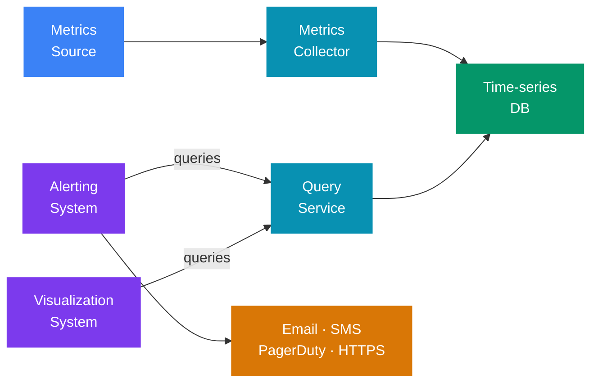
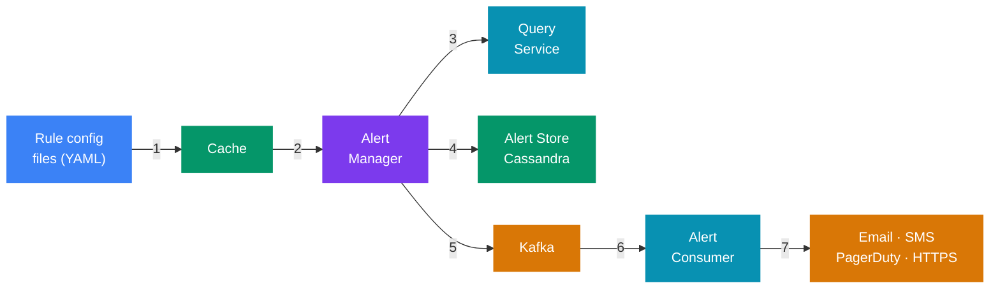
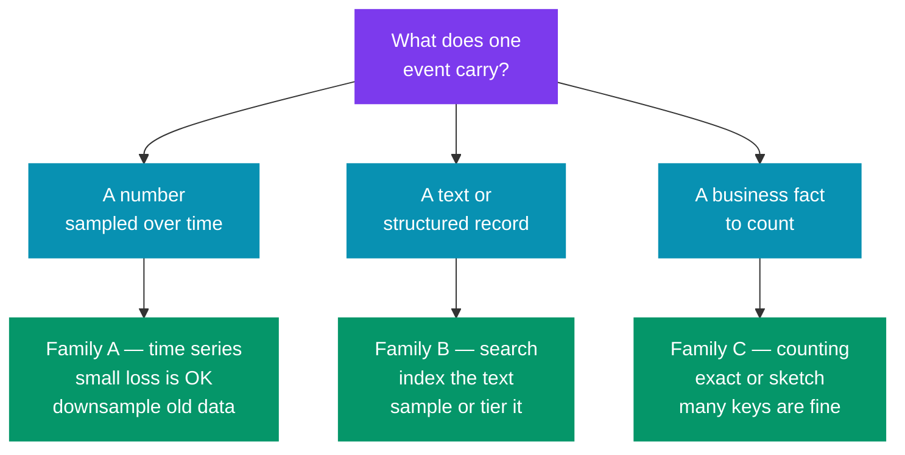

# Ch 5: Metrics Monitoring and Alerting System

> 📖 **Vol 2, Chapter 5** (book pages 131–157) &nbsp;·&nbsp; 🔥 High Priority &nbsp;·&nbsp; 💬 **23 Questions**  
> **Source:** Alex Xu & Sahn Lam, *System Design Interview Vol 2*, Ch 5. Page and figure numbers below are the book's printed ones.

---

📊 **Question Count**

| # | Section | Questions |
|---|---|---|
| 1 | [Requirements and Scope 🔥](#1--requirements-and-scope-p131133-) | 2 |
| 2 | [Fundamentals and Data Model 🔥](#2--fundamentals-and-data-model-p133138-) | 4 |
| 3 | [High-level Design 🔥🔥](#3--high-level-design-p138-) | ref |
| 4 | [Metrics Collection — Pull vs Push 🔥🔥](#4--metrics-collection--pull-vs-push-p139145-) | 3 |
| 5 | [Scaling the Pipeline — Kafka and Aggregation 🔥](#5--scaling-the-pipeline--kafka-and-aggregation-p145147-) | 3 |
| 6 | [Query Service, Cache and Query Language ⚡](#6--query-service-cache-and-query-language-p148149-) | 1 |
| 7 | [Storage Layer — Encoding, Downsampling, Cold Storage 🔥🔥](#7--storage-layer--encoding-downsampling-cold-storage-p149151-) | 3 |
| 8 | [Alerting and Visualization 🔥🔥](#8--alerting-and-visualization-p151153-) | 4 |
| 9 | [Wrap Up — Final Design ⚡](#9--wrap-up--final-design-p153155-) | 2 |
| 10 | [Similar Problems This Design Solves 📎 🔥](#10--similar-problems-this-design-solves--) | 1 |
| | **Total** | **23** |

> 🔥🔥 Very high priority — asked in almost every Tier-1 interview loop &nbsp;·&nbsp; 🔥 High priority — very frequent in Tier-1 interviews &nbsp;·&nbsp; ⚡ Medium priority — commonly asked &nbsp;·&nbsp; 💤 Low priority — good to know, rarely asked

> **How to read this note.** Sections 1–9 follow the book, step by step. §10, at the end, maps this design to 12 similar problems. Anything the book does not say is marked **📎 Beyond the book**. Where the book has a mistake, the note says so and gives the fix.  
> The pipeline uses Kafka partitions and consistent hashing. For depth on those, see [Vol 2 Ch 4: Distributed Message Queue](./ch04_distributed_message_queue.md) and [Vol 1 Ch 5: Consistent Hashing](../vol_1/ch05_design_consistent_hashing.md).

---

## 🗒️ Cheat Sheet

<details>
<summary><strong>🗒️ Show cheat sheet</strong></summary>

### 🎯 Clarifying Questions — and the book's answers
| Question | Book's answer (p.132) |
|---|---|
| Who is it for? In-house, or a SaaS like Datadog / Splunk? | **Internal use only**, for a large company |
| Which metrics? | **Operational** system metrics: CPU load, memory, disk use, requests per second, running server count. **No business metrics** |
| What scale? | **100 million DAU**, **1,000 server pools**, **100 machines per pool** |
| How long do we keep data? | **1 year** |
| May we lower the resolution of old data? | Yes. **Raw for 7 days**, then **1-minute** resolution for **30 days**, then **1-hour** resolution for **1 year** |
| Alert channels? | **Email, phone, PagerDuty, webhooks** (HTTP endpoints) |
| Collect logs (error / access logs)? | **No** |
| Distributed tracing? | **No** |

**Functional** (p.132–133): collect many kinds of metrics (CPU, request count, memory, queue message count), alert, and visualize.
**Non-functional** (p.133): **scalability**, **low query latency** for dashboards and alerts, **reliability** (never miss a critical alert), **flexibility** (easy to add new technology later).
**Out of scope** (p.133): log monitoring (the ELK stack does that) and distributed tracing.

### 🏗️ Core Components (Figure 5.6, Figure 5.22)
- **Metrics source** — app servers, SQL databases, message queues, and so on.
- **Metrics collector** — gathers metrics and writes them on. Pull or push (§4).
- **Kafka + consumers** — a buffer between the collector and the database. Consumers (Storm, Flink, Spark) write to the TSDB (§5).
- **Time-series database (TSDB)** — stores metrics as time series. It keeps **indexes on labels** for fast lookup. The book names **InfluxDB** and **Prometheus**.
- **Query service + cache** — a thin layer over the TSDB for the alerting and visualization systems.
- **Alerting system** — sends alerts to email, text message, PagerDuty and HTTPS endpoints.
- **Visualization system** — graphs and charts. The book suggests **Grafana**.

### Data model (Table 5.2, p.135)
```
time series = metric_name (String) + labels (<key:value> pairs) + array of <value, timestamp>
example:      CPU.load host=webserver01,region=us-west 1613707265 50
```

### 💡 Key Insights
1. **Constant heavy writes, spiky reads** (p.136). Dashboards and alerts send bursts of queries.
2. **Use a time-series database**, not MySQL and not a general NoSQL store (p.136–137).
3. **Labels must have low cardinality** — a small set of possible values (p.137–138).
4. **Kafka decouples collection from storage.** If the TSDB is down, data waits in Kafka (p.146).
5. **Most queries read recent data.** At Facebook, at least 85% of queries were for the last 26 hours (p.149). So old data can be downsampled and moved to cold storage.

### ⚖️ Trade-offs / Alternatives
| Option | Pro | Con | Book's verdict |
|---|---|---|---|
| MySQL (general relational DB) | Familiar | Needs expert tuning; hard SQL for rolling windows; an index per tag; weak under constant heavy writes | ❌️ Not recommended (p.136) |
| Cassandra / Bigtable | Can store time series | Needs deep knowledge to design a scalable schema | ❌️ "Not appealing" when real TSDBs exist (p.137) |
| **Time-series DB** (InfluxDB, Prometheus) | Far fewer servers for the same data; easy query language; built-in retention and aggregation | Another special system | ✅ Chosen (p.137) |
| **Pull** model | Easy debugging; easy health check; data is authentic | Needs service discovery; every endpoint must be reachable | No winner — a large company probably needs **both** (p.145) |
| **Push** model | Good for short-lived jobs; works across firewalls with a load balancer | Hard to tell a dead server from a network problem; anyone can push | No winner (same) |
| Kafka between collector and TSDB | Reliable; decouples services; no data loss if the DB is down | Running Kafka at scale is hard work | ✅ Used in the final design (p.146–147) |
| No queue (e.g. Facebook **Gorilla**) | Simpler | The TSDB must stay writable during partial network failure | A valid alternative (p.147) |
| Aggregate at agent / pipeline / query time | Less data sent or written | Pipeline loses raw data; query time is slower | All three are options (p.147, §5) |
| Build our own alerting / visualization | Full control | Hard to build well | ❌️ Buy. "Tough call to justify" building (p.152–153) |

### 🔢 Numbers to Remember
| What | Value | Arithmetic |
|---|---|---|
| Metrics (time series) | **~10 million** | 1,000 pools × 100 machines × 100 metrics per machine = 10⁷ (p.132) |
| Retention | raw **7 d** → 1 min **30 d** → 1 h **1 y** | (p.132, p.150) |
| 📎 Write rate | **~1 million points/s** | 10⁷ series ÷ one point every 10 s (the book's Table 5.4 interval) |
| 📎 Points per day | **~86 billion** | 10⁶ per s × 86,400 s = 8.64 × 10¹⁰ |
| 📎 Raw size per day | **~1.4 TB** uncompressed, **~118 GB** compressed | 8.64 × 10¹⁰ × 16 bytes (8 timestamp + 8 value); × 1.37 bytes with Gorilla encoding |
| Downsampling ratio | **6×** (10 s → 1 min), **360×** (10 s → 1 h) | 8,640 points per day ÷ 1,440; 8,640 ÷ 24 |
| 📎 1 year, no downsampling | **~505 TB** | 10⁷ × 8,640 × 365 × 16 bytes |
| 📎 1 year, with the book's tiers | **~16 TB** (about 30× less) | raw 7 d = 9.7 TB; 1 min for days 8–30 = 5.3 TB; 1 h for days 31–365 = 1.3 TB (one value per point) |
| Delta encoding | **4 bits** instead of **32 bits** | A 10-second delta is `1010` in binary (p.150) |
| InfluxDB, 8+ cores, 32+ GB RAM | **> 250,000 writes/s**, > 1 million unique series | Figure 5.5 (p.137) |
| Recent-data queries (Facebook) | **≥ 85%** of queries hit the last **26 hours** | Gorilla paper (p.149) |
| Example alert rule | `up == 0` **for 5m** | (p.151) |
| 📎 Prometheus defaults | scrape **1 m** (15 s in the sample config); retention **15 d**; rule evaluation **1 m** | Prometheus docs |

### ⏱️ 45-Minute Round Plan
| Minutes | Phase | What to say or draw | Trap to avoid |
|---|---|---|---|
| 0–5 | Clarify | Internal, operational metrics only, 1,000 × 100 machines, 1-year retention with rollups, alert channels, no logs, no tracing | Designing a log system (ELK) when the interviewer wants metrics |
| 5–8 | Estimate | 10M series → ~1M points/s → ~86B points/day. Write-heavy, reads are bursty | Using "10M writes per day" — see the book bug in §2 |
| 8–15 | Data model + storage choice | Time series = name + labels + (value, timestamp). Pick a TSDB, explain why not MySQL | High-cardinality labels such as `user_id` |
| 15–20 | High-level | Figure 5.6: source → collector → TSDB ← query service ← alerting / visualization | Leaving out the query service |
| 20–38 | **Deep dive** | Pull vs push (Table 5.3), consistent hashing of collectors, Kafka + partitions, where to aggregate, encoding + downsampling + cold storage | Declaring one model "the winner" — the book says know both |
| 38–45 | Alerting + wrap up | Figure 5.19 flow: rules → alert manager → alert store → Kafka → consumers → channels; build vs buy | Building your own Grafana |

> 📎 The timings are a suggestion, not from the book. The book gives the steps; the minutes are ours.

---

</details>
<br/>

---

## 1. 📋 Requirements and Scope (p.131–133) 🔥

A metrics system means different things to different companies (p.131). Do not design a log system if the interviewer only wants **infrastructure metrics**. So pin the scope first. Figure 5.1 lists popular products: Datadog, InfluxDB, New Relic, Nagios, Prometheus, Munin, Grafana and Graphite.

The book designs an **internal** system for a large company. The scale (p.132):

- 100 million daily active users.
- 1,000 server pools × 100 machines per pool × 100 metrics per machine ⇒ **~10 million metrics**.
- 1 year of data. Raw form for 7 days, 1-minute resolution for 30 days, 1-hour resolution for 1 year.

> 📎 The 100M DAU number does not drive any part of the design. The load comes from **machines × metrics × sample rate**, not from users.

Non-functional requirements (p.133): **scalability**, **low query latency**, **reliability** (never miss a critical alert) and **flexibility**.

**Out of scope:** log monitoring (Elasticsearch, Logstash, Kibana — the ELK stack) and distributed tracing (tracking one request across services, e.g. Dapper, Zipkin).

### ❓ Interview Questions

1. **What scale does the book design for? How much data is that? 🔥**

<!-- -->
<details>
<summary>💡 Show Answer</summary>

**Answer:**

**Book's numbers** (p.132): 1,000 server pools × 100 machines × 100 metrics per machine = **~10 million metrics** (series). Keep 1 year: raw for 7 days, 1-minute for 30 days, 1-hour for 1 year.

📎 **The maths the book leaves out** (assume one point every 10 s, as in Table 5.4):

- Writes: 10⁷ ÷ 10 s = **~1 million points per second**.
- Per day: 10⁶ × 86,400 ≈ **86 billion points**.
- Raw size: × 16 bytes ≈ **1.4 TB/day**. With Gorilla-style compression (~1.37 B/point) ≈ **118 GB/day**.
- 1 year with the book's tiers ≈ **16 TB** uncompressed, against **~505 TB** without downsampling.
- ⚠️ p.136's "10 million metrics written per day" is a book bug (§2). It is 10M **series**.

</details>

---

2. **What is the difference between monitoring and observability? 📎 🔥**

<!-- -->
<details>
<summary>💡 Show Answer</summary>

**Answer:**

- **Monitoring** tells you **what** is broken. It answers questions you set up in advance: metrics, alerts, dashboards.
- **Observability** helps you find **why**. You explore problems you did not expect, using three signals:
  - metrics (numbers over time),
  - logs (event records),
  - traces (one request's path across services).

In an observable system, you can debug a new kind of failure without adding new code. You slice the existing data in new ways. Note that this book's design is monitoring only — logs and tracing are out of scope (p.133).

</details>

---

## 2. 🧱 Fundamentals and Data Model (p.133–138) 🔥

### Five components (Figure 5.2, p.133)

1. Data collection — collect metric data from many sources.
2. Data transmission — move data from the sources to the monitoring system.
3. Data storage — organize and store the incoming data.
4. Alerting — analyse the data, detect anomalies, send alerts to many channels.
5. Visualization — graphs and charts. Engineers spot patterns faster in pictures.

### Data model (p.134–135)

A metric is a **time series**: a set of values with timestamps. A metric **name** and, optionally, a set of **labels** identify the series.

**Example 1** — "What is the CPU load on server `i631` at 20:00?" (Figure 5.3, Table 5.1):

| Field | Value |
|---|---|
| `metric_name` | `cpu.load` |
| `labels` | `host:i631,env:prod` |
| `timestamp` | `1613707265` |
| `value` | `0.29` |

**Example 2** — "What is the average CPU load across all web servers in `us-west` for the last 10 minutes?" Read all matching lines and average the last field:

```
CPU.load host=webserver01,region=us-west 1613707265 50
CPU.load host=webserver01,region=us-west 1613707265 62
CPU.load host=webserver02,region=us-west 1613707265 43
CPU.load host=webserver02,region=us-west 1613707265 53
...
CPU.load host=webserver01,region=us-west 1613707265 76
CPU.load host=webserver01,region=us-west 1613707265 83
```

This format is the **line protocol**. Many tools accept it; the book names **Prometheus** and **OpenTSDB** (p.135).

Every time series has three parts (Table 5.2):

| Name | Type |
|---|---|
| A metric name | String |
| A set of tags/labels | List of `<key:value>` pairs |
| An array of values and their timestamps | An array of `<value, timestamp>` pairs |

### Data access pattern (Figure 5.4, p.135–136)

- **Writes are heavy and constant.** Many series get new points at the same moment.
- **Reads are spiky.** Dashboards and alerts send queries in bursts.

Figure 5.4 shows a typical read: "errors on `servicepool=s1` and `method=GET` across all machines, between t4 and t7". It selects **many series by label** and a **time range**.

> ⚠️ **Book bug — "10 million metrics written per day".** p.136 says "about 10 million operational metrics are written per day". But p.132 defines 10 million as the number of **metrics** (series), and the same p.136 sentence says they are "collected at high frequency". 10M per day would be only ~116 writes per second. The fix: 10M **series**, each sampled every 10 s, is **~1 million points per second**, or ~86 billion points per day.

### Choosing the storage system (p.136–138)

The storage system is **the heart of the design**. The book rejects two options:

- **MySQL / a general relational DB.** It needs expert tuning at this scale. A rolling-window average needs complicated SQL (see §6). Labels need an index per tag. It does not perform well under constant heavy writes.
- **General NoSQL (Cassandra, Bigtable).** They can store time series, but you need deep knowledge to design a scalable schema. With real TSDBs available, this is "not appealing".

**A time-series database** needs far fewer servers for the same data. It has an easy query language and built-in retention and aggregation. Examples (p.137):

- **OpenTSDB** — distributed, but runs on Hadoop/HBase, which adds complexity.
- **Twitter MetricsDB** and **Amazon Timestream**.
- **InfluxDB** and **Prometheus** — the two most popular on DB-Engines. Both use an in-memory cache plus on-disk storage.

InfluxDB benchmark (Figure 5.5):

| vCPU | RAM | IOPS | Writes per second | Queries per second | Unique series |
|---|---|---|---|---|---|
| 2–4 cores | 2–4 GB | 500 | < 5,000 | < 5 | < 100,000 |
| 4–6 cores | 8–32 GB | 500–1000 | < 250,000 | < 25 | < 1,000,000 |
| 8+ cores | 32+ GB | 1000+ | > 250,000 | > 25 | > 1,000,000 |

- You do not need to know TSDB internals in the interview, unless your resume says so (p.137).
- **Labels matter.** InfluxDB builds indexes on labels. Keep each label **low cardinality** — a small set of possible values (p.137–138).

### ❓ Interview Questions

1. **What is a time series? Why use a time-series DB instead of MySQL or Cassandra? 🔥🔥**

<!-- -->
<details>
<summary>💡 Show Answer</summary>

**Answer:**

**A time series** (Table 5.2) = a **metric name** + a set of **labels** (`key:value`) + an array of **(value, timestamp)** pairs. Example: `cpu.load {host:i631, env:prod}` = 0.29 at `1613707265`.

**Access pattern** (p.136): **constant heavy writes**, and **spiky reads** from dashboards and alerts.

**Why not MySQL** (p.136): it needs expert tuning at this scale. Rolling-window SQL is complicated. Each label needs an index. It is weak under constant heavy writes.

**Why not Cassandra / Bigtable** (p.137): they can do it, but you need deep knowledge to design the schema.

**A TSDB** (InfluxDB, Prometheus) needs far fewer servers for the same data. It has an easy query language (PromQL, Flux) and built-in retention and aggregation. InfluxDB with 8 cores and 32 GB handles **> 250,000 writes/s** (Figure 5.5).

📎 Internally, a TSDB stores each series' points together in time-ordered blocks. It compresses them (delta-of-delta, XOR) and drops whole old blocks when retention ends.

</details>

---

2. **What is label cardinality, and why can it kill a TSDB? 🔥🔥**

<!-- -->
<details>
<summary>💡 Show Answer</summary>

**Answer:**

The book (p.137–138): a TSDB builds **indexes on labels** for fast lookup. The key rule is to keep each label **low cardinality** — a small set of possible values.

📎 Why: each unique set of label values is a **separate time series**. Example: `http_requests_total{method, endpoint, user_id}` with 5 methods × 50 endpoints × 100,000 users = **25 million series**, from one metric. Memory and index size grow very fast.

📎 Design rules:

1. Never use unbounded values as labels: user IDs, request IDs, UUIDs, raw URLs.
2. Bucket them: `status_class = 2xx/4xx/5xx` instead of every code.
3. Aggregate per-user data in the app, or send it to logs or an analytics store.
4. Set series limits in the TSDB to reject a sudden jump.
5. Watch the series count. In Prometheus: `prometheus_tsdb_head_series`.

</details>

---

3. **What are the main metric types, and when do you use each? 📎 🔥🔥**

<!-- -->
<details>
<summary>💡 Show Answer</summary>

**Answer:**

- **Counter** — only goes up; resets to 0 on restart. Request count, error count. Read it with `rate()`.
- **Gauge** — goes up and down. Memory use, active connections, queue depth. Read it directly.
- **Histogram** — counts observations in fixed buckets (e.g. < 10 ms, < 50 ms, < 100 ms). The server can compute p50/p95/p99. Use it for latency SLOs.
- **Summary** — computes quantiles **in the client**. You cannot combine them across instances.

In Spring Boot, Micrometer gives the same types:

```java
@Component
public class OrderMetrics {

    private final Counter ordersPlaced;
    private final Timer checkoutTimer;

    public OrderMetrics(MeterRegistry registry, OrderQueue queue) {
        this.ordersPlaced = Counter.builder("orders_placed_total")
                .tag("channel", "web")              // low-cardinality label only
                .register(registry);
        this.checkoutTimer = Timer.builder("checkout_duration")
                .publishPercentileHistogram()       // export buckets, not client quantiles
                .register(registry);
        Gauge.builder("order_queue_depth", queue, OrderQueue::size)
                .register(registry);
    }

    public void recordOrder(Runnable checkout) {
        ordersPlaced.increment();
        checkoutTimer.record(checkout);
    }
}
```

Actuator then exposes them at `/actuator/prometheus` for a pull collector.

</details>

---

4. **How does a TSDB find all series with `service=s1` and `method=GET` quickly? 📎 🔥**

<!-- -->
<details>
<summary>💡 Show Answer</summary>

**Answer:**

The book only says the TSDB keeps "indexes on labels" (p.138). The usual design is an **inverted index**, like a search engine.

- Each series gets a numeric **series ID**.
- For every label pair (`method=GET`), the index keeps a **sorted list of series IDs** that have it. This list is called a **postings list**.
- A query such as `{service="s1", method="GET"}` **intersects** the two sorted lists. Because both are sorted, this is one linear merge.
- Then the TSDB reads only those series' chunks, and only for the asked time range (Figure 5.4's t4 to t7).
- Prometheus keeps postings in the index file of each block. InfluxDB has its own index, called TSI (Time Series Index).

Why this links to cardinality (Q2 above): every new series adds entries to these lists and to the in-memory index. A regex matcher such as `path=~"/api/.*"` must first check every value of that label. So a label with millions of values makes both writes and queries slow.

</details>

---

## 3. 🧩 High-level Design (p.138) 🔥🔥



*(Figure 5.6)*

Each box is described in the Cheat Sheet's **Core Components**. Two points from p.138:

- The TSDB keeps **indexes on labels** for fast lookup by label.
- With a good TSDB, the **query service** is a very thin wrapper. The TSDB's own query interface could replace it.

---

## 4. 📥 Metrics Collection — Pull vs Push (p.139–145) 🔥🔥

For counters or CPU usage, **losing a little data is acceptable**. Clients can "fire and forget" (p.139). The collection part is the source + collector (Figure 5.7). There are two ways to collect. "It is a routine debate … and there is no clear answer."

### Pull model (Figures 5.8–5.10, p.139–141)

Dedicated collectors pull values from running apps over HTTP, at a fixed interval.

- The collector must know **every endpoint**. A file of DNS/IP entries is simple but hard to maintain when servers come and go.
- The better answer is **service discovery** (etcd, ZooKeeper). Services register there. The collector gets a notice when the endpoint list changes.
- Service discovery also holds the rules: **when and where** to collect (Figure 5.9, e.g. `region: us-east, type: mysql, host: 10.10.11.1`).

The pull flow (Figure 5.10):

1. The collector fetches **config metadata** from service discovery: pull interval, IP addresses, timeout and retry settings.
2. The collector pulls from a known HTTP endpoint, e.g. `/metrics`. A **client library** in the service exposes it.
3. Optionally, the collector registers for **change events**, or it polls for endpoint changes.

**Many collectors, no duplicates (Figure 5.11, p.141–142).** One collector cannot handle thousands of servers. With a pool of collectors, two may pull the same server and create duplicate data. The fix: put the collectors on a **consistent hash ring**. Map each server by its unique name onto the ring. Then **one server belongs to exactly one collector**. In Figure 5.11, Collector 2 owns Server 1 and Server 5.

### Push model (Figures 5.12–5.13, p.142–143)

Sources send metrics to the collector themselves.

- A **collection agent** runs on every server. It collects metrics from local services and pushes them at a fixed interval.
- The agent can **aggregate locally** (for example, a simple counter) to send less data.
- If the collector rejects a push, the agent can keep a **small local buffer** (maybe on disk) and resend later. But in an auto-scaling group, servers come and go. A buffer on a removed server is lost.
- To stop the collector from falling behind, put it in an **auto-scaling cluster behind a load balancer**. Scale on the collectors' CPU load (Figure 5.13).

### Pull or push? (Table 5.3, p.143–145)

Examples: **Prometheus** pulls. **Amazon CloudWatch** and **Graphite** push.

| | Pull | Push |
|---|---|---|
| Easy debugging | The `/metrics` endpoint shows metrics at any time, even on a laptop. **Pull wins** | — |
| Health check | No answer to a pull ⇒ the server is down. **Pull wins** | No data may just mean a network problem |
| Short-lived jobs | — | Batch jobs may end before a pull. **Push wins**. Pull can fix this with a **push gateway** |
| Firewall / complex network | Every endpoint must be reachable. Hard across data centers | A collector behind a load balancer and auto-scaling group gets data from anywhere. **Push wins** |
| Performance | Pull typically uses **TCP** | Push typically uses **UDP**: lower latency. Counter-point: a TCP connection costs little next to the payload |
| Data authenticity | Servers are listed in config, so the data is authentic | Any client can push. Fix with an allow-list or authentication |

**The book's verdict:** no clear winner. **Knowing the pros and cons matters more than picking a winner.** A large company probably needs **both**, especially with **serverless**, where you may not be able to install an agent (p.145).

> 📎 "Push typically uses UDP" is true for StatsD. Many push systems use TCP: CloudWatch and OTLP (OpenTelemetry) push over HTTPS or gRPC.

### ❓ Interview Questions

1. **Pull or push — which would you choose? 🔥🔥**

<!-- -->
<details>
<summary>💡 Show Answer</summary>

**Answer:**

The book gives **no winner** (p.143–145). Knowing the pros and cons matters more.

- **Pull wins:** easy debugging (`/metrics` is readable any time), health check (no answer ⇒ server down), data authenticity (targets come from config).
- **Push wins:** short-lived jobs (pull fixes it with a **push gateway**), firewalls and complex networks (a collector behind a load balancer gets data from anywhere).
- **Performance:** pull uses TCP, push typically UDP. The TCP cost is small next to the payload.

Examples: **Prometheus** pulls; **CloudWatch** and **Graphite** push. A large company probably needs **both**, especially for serverless, where you may not be able to install an agent.

📎 My default for Kubernetes is **pull**. Service discovery through the Kubernetes API finds new pods without config changes. Then add push for short jobs and for edge nodes behind firewalls.

</details>

---

2. **With many pull collectors, how do you stop two of them scraping the same server? 🔥**

<!-- -->
<details>
<summary>💡 Show Answer</summary>

**Answer:**

(Figure 5.11, p.141–142)

- One collector cannot handle thousands of servers. So we run a **pool** of collectors.
- Without coordination, two collectors may pull the same server and create **duplicate data**.
- Put each collector on a range of a **consistent hash ring**. Map every server onto the ring by its **unique name**.
- Each server now belongs to **exactly one** collector. In Figure 5.11, Collector 2 owns Server 1 and Server 5.
- When a collector is added or removed, only the servers in its range move.

The collector finds servers through **service discovery** (etcd, ZooKeeper). Discovery gives the endpoints, pull interval, timeout and retry settings, and notifies the collector on change (Figure 5.10).

📎 Prometheus does the same with `hashmod` relabeling: each server keeps the targets where `hash(address) mod N` equals its shard number.

</details>

---

3. **How do you collect metrics from short-lived jobs, like batch jobs, Lambda functions or containers? ⚡**

<!-- -->
<details>
<summary>💡 Show Answer</summary>

**Answer:**

The book (Table 5.3, p.144–145): a short-lived job may end before the next pull, so **push wins**. A pull system fixes this with a **push gateway**. With serverless you may not be able to install an agent, so a large company needs both models.

📎 In practice:

- **Service-level batch jobs** → push to the Prometheus **Pushgateway**. It never deletes pushed series by itself. So do not push one series per Lambda instance — they would stay forever.
- **Lambda** → CloudWatch **Embedded Metric Format** (structured JSON logs that CloudWatch turns into metrics), or a Lambda extension that pushes to a collector.
- **Containers** → a sidecar, or a node-level **DaemonSet** agent that collects from all containers on the host.

</details>

---

## 5. 📨 Scaling the Pipeline — Kafka and Aggregation (p.145–147) 🔥

Pull or push, the collector is a **cluster set up for auto-scaling** (p.146). But if the TSDB is down, data can be lost. So the book adds a **queue** (Figure 5.15): collector → **Kafka** → **consumers** (Storm, Flink, Spark) → TSDB.

Why Kafka (p.146):

- It is a highly reliable and scalable messaging platform.
- It **decouples** data collection from data processing.
- It **prevents data loss** when the database is down: the data stays in Kafka.

### Scale through Kafka (Figure 5.16, p.146–147)

- Set the **number of partitions** from the throughput you need.
- **Partition by metric name**, so consumers can aggregate by metric name.
- Partition further by **tags/labels**.
- **Categorize and prioritize** metrics, so important ones are processed first.

### Alternative to Kafka (p.147)

Running Kafka at production scale is a lot of work. The interviewer may push back. Some large systems use no queue. Facebook's **Gorilla** in-memory TSDB stays **highly available for writes** even during a partial network failure. You can argue that this is as reliable as a queue.

### Where aggregations can happen (p.147)

| Where | How | Cost |
|---|---|---|
| **Collection agent** (client side) | Simple logic only, e.g. sum a counter every minute before sending | Very limited |
| **Ingestion pipeline** (before storage) | A stream engine such as **Flink** writes only the result. Far fewer writes | Late events are hard. You lose precision and flexibility — no raw data |
| **Query side** (after storage) | Aggregate raw data at query time | No data loss, but slower queries over the whole dataset |

### ❓ Interview Questions

1. **Why put Kafka between the collector and the TSDB? How do you partition it, and what if the interviewer says "no Kafka"? 🔥🔥**

<!-- -->
<details>
<summary>💡 Show Answer</summary>

**Answer:**

**Why** (p.146): if the TSDB is down, the collector would lose data. Kafka:

- is reliable and scalable,
- **decouples** collection from processing,
- **keeps the data** while the DB is down.

**Partitioning** (p.146–147):

- Set the partition count from the throughput you need.
- **Partition by metric name**, so consumers can aggregate per metric.
- Partition further by **labels**.
- **Prioritize** important metrics so they are processed first.

**"No Kafka"** (p.147): running Kafka at scale is hard work. Facebook's **Gorilla** is an in-memory TSDB that stays **writable during partial network failure**. You can argue that is as reliable as a queue.

📎 Partitioning by metric name alone can create a hot partition for a very busy metric (e.g. `http_requests`). Adding a label such as host to the key spreads it.

📎 Kafka gives **at-least-once** delivery. After a consumer restart, the same point may be written twice. That is safe when a write is keyed by **(series, timestamp)**. InfluxDB, for example, overwrites a point that has the same series and timestamp.

</details>

---

2. **Where can metrics be aggregated? What does each place cost? 🔥**

<!-- -->
<details>
<summary>💡 Show Answer</summary>

**Answer:**

(p.147)

- **Collection agent** — sends less data, but only simple logic (e.g. one counter per minute).
- **Ingestion pipeline** (Flink, before storage) — far fewer writes. But late events are hard, and without raw data you lose precision and flexibility.
- **Query time** (after storage) — no data loss, but slower: it scans the raw data.

📎 A common mix: keep raw data for a short time, aggregate at query time for recent data, and use downsampled rollups for old data.

</details>

---

3. **How do you stop the metrics pipeline from dropping data under heavy load? 📎 ⚡**

<!-- -->
<details>
<summary>💡 Show Answer</summary>

**Answer:**

1. **Buffer before storage.** The book's Kafka does this (p.146). Prometheus keeps recent samples in an in-memory head block and writes each one to an on-disk **WAL**. After a crash it replays the WAL.
2. **Bounded queues with back-pressure.** Prometheus `remote_write` has a queue. If the remote DB is slow, samples wait. A max size stops an out-of-memory crash.
3. **Shard collection** by service or host across many collectors (the book's consistent hashing, §4).
4. **Agent buffers** for push (p.143) — but they are lost if an auto-scaled server is removed.
5. **Drop low-priority metrics first.** The book's "prioritize metrics" idea (p.146) applies here.

</details>

---

## 6. 🔍 Query Service, Cache and Query Language (p.148–149) ⚡

**Query service** — a cluster of query servers between the TSDB and its clients (visualization and alerting). It **decouples** them. You can change the TSDB, or the visualization or alerting system, when needed.

**Cache layer** (Figure 5.17) — cache servers store query results. This cuts load on the TSDB and makes queries faster.

**The case against a query service** (p.148). Most industrial visualization and alerting systems already have plugins for well-known TSDBs. With a well-chosen TSDB, you do not need your own cache either.

### Time-series query language (p.148–149)

Prometheus and InfluxDB do **not** use SQL. Time-series queries are hard to write in SQL. The book's SQL example (from the InfluxDB Flux blog):

```sql
-- shortened: "..." hides the columns the book repeats (p.149)
select id, temp,
       avg(temp) over (partition by group_nr order by time_read) as rolling_avg
from (
    select ..., id - row_number() over (partition by interval_group order by time_read) as group_nr
    from (
        select ..., <time_read rounded down to a 900-second bucket> as interval_group
        from readings
    ) t1
) t2
order by time_read;
```

The same idea in **Flux**, InfluxDB's language:

```
from(db:"telegraf")
    |> range(start:-1h)
    |> filter(fn: (r) => r._measurement == "foo")
    |> exponentialMovingAverage(size:-10s)
```

> ⚠️ **Book inconsistency — the SQL is not an exponential moving average.** p.148 says the SQL computes "an exponential moving average". It uses `avg(...) over (...)`, which is a plain running average over groups of rows, with no exponential weights. The point still holds: SQL for time series is long and hard to read.

> 📎 The Flux snippet comes from an old blog post. In current Flux, `from()` takes a `bucket`, and `exponentialMovingAverage()` takes a point count `n` (for example `n: 5`), not a time window.

> 📎 **Recording rules — a second answer to "do we need a cache?".** A busy dashboard runs the same heavy query again and again. Prometheus can compute it ahead of time. A recording rule runs the expression at every evaluation interval and saves the result as a new, small series. Dashboards and alerts then read that series.

### ❓ Interview Questions

1. **How do you get p99 latency across many service instances? 📎 🔥**

<!-- -->
<details>
<summary>💡 Show Answer</summary>

**Answer:**

Use **histograms**, not summaries.

- Histogram buckets have the same fixed edges on every instance, so you can **sum** them:
  `histogram_quantile(0.99, sum(rate(http_request_duration_seconds_bucket[5m])) by (le))`
- A summary's p99 comes from one instance's data. You **cannot** average or sum p99 values and get the fleet's p99.
- The result is an estimate. Its accuracy depends on the bucket edges, so put edges near your SLO (e.g. 200 ms).

</details>

---

## 7. 💾 Storage Layer — Encoding, Downsampling, Cold Storage (p.149–151) 🔥🔥

### Choose a time-series database carefully (p.149)

A Facebook paper (Gorilla) found that **at least 85%** of queries to the operational data store were for data from the **past 26 hours**. A TSDB that uses this fact can perform much better. For storage-engine design, the book points to the InfluxDB storage engine docs.

### Data encoding and compression (Figure 5.18, p.149–150)

Good TSDBs build this in. Timestamps close together differ by a small number:

```
timestamps: 1610087371  1610087381  1610087391  1610087400  1610087411
deltas:                 10          10          9           11
stored:     1610087371, 10, 10, 9, 11
```

`1610087371` and `1610087381` differ by **10 seconds**. 10 needs only **4 bits**, not a full **32-bit** timestamp. So store **one base value plus the deltas**.

> ⚠️ **Book inconsistency — Figure 5.18 is labelled "Double-delta Encoding", but it shows plain delta encoding.** The stored values are the first differences (10, 10, 9, 11). 📎 **Delta-of-delta** stores the change of the delta: 10, 0, −1, 2. For a regular scrape interval these are mostly 0, so they need even fewer bits. Facebook's Gorilla uses delta-of-delta for timestamps and XOR for values, about **1.37 bytes per point** instead of 16.

### Downsampling (p.150–151)

Downsampling turns high-resolution data into low-resolution data to save disk. Retention is 1 year, so old data can be downsampled. Engineers and data scientists can set rules per metric. Example: **7 days** with no sampling, **30 days** at **1-minute** resolution, **1 year** at **1-hour** resolution.

Worked example — 10-second data (Table 5.4) to 30-second data (Table 5.5):

| metric | timestamp | hostname | metric_value |
|---|---|---|---|
| cpu | 2021-10-24T19:00:00Z | host-a | 10 |
| cpu | 2021-10-24T19:00:10Z | host-a | 16 |
| cpu | 2021-10-24T19:00:20Z | host-a | 20 |
| cpu | 2021-10-24T19:00:30Z | host-a | 30 |
| cpu | 2021-10-24T19:00:40Z | host-a | 20 |
| cpu | 2021-10-24T19:00:50Z | host-a | 30 |

| metric | timestamp | hostname | metric_value (avg) — book | correct avg |
|---|---|---|---|---|
| cpu | 2021-10-24T19:00:00Z | host-a | 19 | **15.3** |
| cpu | 2021-10-24T19:00:30Z | host-a | 25 | **26.7** |

> ⚠️ **Book bug — the averages in Table 5.5 are wrong.** (10 + 16 + 20) ÷ 3 = 46 ÷ 3 = **15.3**, not 19. (30 + 20 + 30) ÷ 3 = 80 ÷ 3 = **26.7**, not 25. The idea (3 points → 1 point) is right; only the arithmetic is wrong.

📎 **How much downsampling saves** (assume 10M series, one point every 10 s, 16 bytes per point, one value per rollup point):

| Tier | Points per series per day | Storage |
|---|---|---|
| Raw, days 1–7 | 8,640 | 10⁷ × 8,640 × 7 × 16 B ≈ **9.7 TB** |
| 1 min, days 8–30 | 1,440 | 10⁷ × 1,440 × 23 × 16 B ≈ **5.3 TB** |
| 1 h, days 31–365 | 24 | 10⁷ × 24 × 335 × 16 B ≈ **1.3 TB** |
| **Total** | | **≈ 16 TB**, against **≈ 505 TB** with no downsampling |

Real rollups often keep min, max, sum and count per point, so the rollup tiers can be 3–4× bigger. Compression (~1.37 B per point) shrinks all of it by about 10×.

### Cold storage (p.151)

Cold storage holds **inactive, rarely used** data. It costs much less.

The book then sums up: we should probably use **third-party visualization and alerting systems**, not build our own.

### ❓ Interview Questions

1. **The data is huge. How do you cut storage? 🔥🔥**

<!-- -->
<details>
<summary>💡 Show Answer</summary>

**Answer:**

Three tools (p.149–151):

1. **Encoding and compression.** Store a base timestamp plus small deltas: `1610087371, 10, 10, 9, 11`. A delta of 10 needs **4 bits**, not 32 (Figure 5.18).
2. **Downsampling.** Raw for **7 days**, **1-minute** for **30 days**, **1-hour** for **1 year**. Engineers can set rules per metric.
3. **Cold storage.** Move inactive data to cheap storage.

Why it works: at Facebook, **≥ 85%** of queries hit the **last 26 hours** (p.149). Old data is rarely read.

📎 Numbers (10M series, 10-s points, 16 B per point): 10 s → 1 min is **6×** fewer points; 10 s → 1 h is **360×**. One year shrinks from **~505 TB** to **~16 TB**. Gorilla compression (delta-of-delta timestamps, XOR values, ~1.37 B/point) cuts about 10× more.

</details>

---

2. **How do you handle clock skew and late samples? 📎 💤**

<!-- -->
<details>
<summary>💡 Show Answer</summary>

**Answer:**

- Store all timestamps in **UTC**. Keep host clocks in sync with **NTP**.
- In a pull setup, Prometheus usually stamps a sample at scrape time, on its own clock. This removes client clock skew. But if the target sends its own timestamps, Prometheus uses them by default (`honor_timestamps: true`).
- Prometheus rejects samples that are too far out of order. The setting is `out_of_order_time_window` in the `storage.tsdb` block of `prometheus.yml`. It is 0 by default, so out-of-order samples are rejected.
- In a stream pipeline (the book's Flink option), late events need a **watermark** and an allowed-lateness window. The book names late events as a challenge (p.147).

</details>

---

3. **When you downsample, should you keep the average, the max, or the sum? 📎 💤**

<!-- -->
<details>
<summary>💡 Show Answer</summary>

**Answer:**

It depends on the metric type. The book's example keeps only the **average** (Table 5.5).

- **Counters** — keep the **sum of increments** (or the last value), so `rate()` still works.
- **Gauges** — keep **min, max and average**. The average shows the trend. Min and max keep spikes: a 10-second spike to 100% CPU disappears in a 1-hour average.
- **Histograms** — **sum the bucket counts**, then compute quantiles again from the summed buckets. Never average p99 values.

Also keep the **count** of raw points, so you can compute a correct average of averages later.

</details>

---

## 8. 🚨 Alerting and Visualization (p.151–153) 🔥🔥

### The alert flow (Figure 5.19, p.151–152)



1. Load rule config files into **cache servers**. Rules are files on disk, often **YAML**:

   ```yaml
   - name: instance_down
     rules:

     # Alert for any instance that is unreachable for >5 minutes.
     - alert: instance_down
       expr: up == 0
       for: 5m
       labels:
         severity: page
   ```

   > 📎 A real Prometheus rule file wraps this in a top-level `groups:` list (`groups:` → `- name:` → `rules:` → `- alert:`). The book's snippet leaves `groups:` out.

2. The **alert manager** fetches the alert configs from the cache.
3. It calls the **query service** at a set interval. If a value breaks the threshold, it creates an **alert event**. The alert manager also does:
   - **Filter, merge and dedupe.** Three `disk_usage > 90%` events on Instance 1 in a short time become **one alert on Instance 1** (Figure 5.20).
   - **Access control.** Only authorized people may run some alert-management operations. This avoids human error.
   - **Retry.** It checks alert states and makes sure a notification is sent **at least once**.
4. The **alert store** is a key-value DB such as **Cassandra**. It keeps the state of every alert: **inactive, pending, firing, resolved**. It helps send each notification at least once.
5. Alerts that pass these checks go into **Kafka**.
6. Alert consumers pull alert events from **Kafka**.
7. Consumers send notifications to email, text message, PagerDuty or HTTP endpoints.

> 📎 The `for: 5m` field means the condition must stay true for 5 minutes before the alert fires. A short spike does not page anyone. In Prometheus, a rule waiting out its `for` time is in the **pending** state — the same state name the book stores.

### Build vs buy (p.152)

Many industrial alerting systems exist. Most integrate tightly with popular TSDBs and with channels such as email and PagerDuty. In the real world it is **a tough call to justify building your own**. For a senior role, be ready to justify the choice.

### Visualization (Figure 5.21, p.153)

Visualization sits on top of the data layer. A **metrics dashboard** shows metrics over many time scales. An **alerts dashboard** shows alerts. Figure 5.21 (Grafana) shows server requests, memory/CPU, page load time, traffic and logins.

A high-quality visualization system is hard to build. **The case for buying is very strong.** Grafana works with many popular TSDBs.

### ❓ Interview Questions

1. **How does the alerting system work, and how do you avoid noisy alerts? 🔥🔥**

<!-- -->
<details>
<summary>💡 Show Answer</summary>

**Answer:**

**The flow** (Figure 5.19, p.151–152):

- YAML rules → cache → **alert manager**. At a set interval it calls the **query service**. A broken threshold → an alert event.
- The **alert store** (Cassandra) keeps each alert's state: **inactive, pending, firing, resolved**.
- Alerts that pass the checks → **Kafka** → **alert consumers** → email, SMS, PagerDuty, webhooks.

The alert manager also does three more jobs:

- **Filter / merge / dedupe.** Three `disk_usage > 90%` events on one instance → **one alert** (Figure 5.20).
- **Access control.**
- **Retry.** Send **at least once**.

**Less noise:**

- The book's rule uses `for: 5m`. The condition must hold for 5 minutes, so a short spike does not fire.
- Merge and dedupe events from the same instance.
- 📎 Alert on **symptoms** (error rate, latency) more than causes (CPU spike).
- 📎 **Group** alerts, so a cluster-wide problem sends one page, not one per host.
- 📎 Set **severity**: critical pages on-call, warning goes to Slack, info is only logged.
- 📎 Use **inhibition**: while a data-center network alert fires, mute the service alerts it causes.
- 📎 Stop **flapping** — a value near the threshold fires and resolves again and again. Wait before resolving (Prometheus `keep_firing_for`), or fire at 90% and clear only below 80%.

</details>

---

2. **Do you need your own query service and cache? Would you build the alerting and dashboards? ⚡**

<!-- -->
<details>
<summary>💡 Show Answer</summary>

**Answer:**

**Query service — for** (p.148): it decouples the TSDB from its clients. You can swap the TSDB, or the alerting and visualization tools, later. A **cache** stores query results, so the TSDB has less load.

**Against** (p.148): most industrial visualization and alerting tools already have plugins for the well-known TSDBs. With a good TSDB you do not need your own cache either.

**Build vs buy** (p.151–153):

- Alerting: many off-the-shelf systems exist. Building your own is "a tough call to justify". For a senior role, be ready to defend your choice.
- Visualization: hard to build well. "The argument for using an off-the-shelf system is very strong." **Grafana** works with many TSDBs.

</details>

---

3. **How would you design SLO-based dashboards and alerts? 📎 🔥**

<!-- -->
<details>
<summary>💡 Show Answer</summary>

**Answer:**

- **Define the SLO first.** Example: 99.9% of requests succeed, over 30 days.
- **Get the SLI from metrics.** Availability:
  `sum(rate(http_requests_total{status!~"5.."}[5m])) / sum(rate(http_requests_total[5m]))`
- **Error budget** — the failure you may have. 0.1% × 30 days = 0.001 × 43,200 min = **43.2 minutes**.

Dashboard layers:

1. SLO **burn rate** — how fast the budget is being used.
2. Per service: rate, errors, duration (the **RED** method).
3. Per host: CPU, memory, disk.

Alert on burn rate. The Google SRE Workbook pages when the burn rate is **14.4×** over 1 hour. At that speed, 2% of a 30-day budget is gone in one hour.

</details>

---

4. **How do you scale alert evaluation to millions of rules, and avoid duplicate pages? 📎 🔥**

<!-- -->
<details>
<summary>💡 Show Answer</summary>

**Answer:**

The book shows one alert manager that calls the query service at a set interval (Figure 5.19). With millions of rules, one node cannot keep up.

**Scale the evaluation:**

- **Shard the rules.** Put alert-manager workers on a consistent hash ring and hash each rule ID onto it. Each rule has exactly one owner. This is the same trick as the collectors in §4.
- **Detect dead workers.** Each worker holds a lease in ZooKeeper or etcd. When a lease ends, its rules move to another worker. For a short time, two workers may check the same rule — the dedupe below covers that.
- **Spread the load.** Add jitter to each rule's start time, so all rules do not hit the query service in the same second.

**Avoid duplicate pages:**

- Retry and Kafka give **at-least-once** sending. So give each notification a **dedupe key**: rule ID + label set + the time the alert started firing.
- The consumer checks the alert store before it sends. If that key was already sent, it skips it.
- **Group** related alerts into one message. Prometheus Alertmanager does this with `group_by`, `group_wait` and `group_interval`.

📎 In the Prometheus world, Thanos Ruler and the Cortex / Mimir ruler run rule evaluation outside the Prometheus servers. The Cortex / Mimir ruler shards rule groups across replicas.

</details>

---

## 9. 🏁 Wrap Up — Final Design (p.153–155) ⚡

The book covers data collection, the TSDB, alerts and visualization. Then it goes deep into (p.153–154):

- Push vs pull for collecting metrics.
- Kafka to scale the system.
- Choosing the right time-series database.
- Downsampling to reduce data size.
- Build vs buy for alerting and visualization.

The final design (Figure 5.22) is Figure 5.6 plus Kafka and a cache:

```
Metrics Source → Metrics Collector → Kafka → Consumers → Time-series DB
                                                              ↑
              Alerting System ──queries──→ Query Service (+ Cache) ←──queries── Visualization System
              ↓
Email · Text message · PagerDuty · HTTPS endpoints
```

The chapter summary mind map (p.155) lists the same tree:

- Step 1: requirements.
- Step 2: five components, the data model (write heavy, read bursty) and the TSDB.
- Step 3: the deep dives above.
- Step 4: wrap up.

### ❓ Interview Questions

1. **Walk me through the end-to-end flow, from a metric on a server to an alert on a phone. 🔥🔥**

<!-- -->
<details>
<summary>💡 Show Answer</summary>

**Answer:**

(Figure 5.22 and Figure 5.19)

1. A **metrics source** (app server, DB, queue) exposes or sends metrics.
2. The **metrics collector** pulls them (from `/metrics`) or receives them from an agent's push.
3. The collector writes to **Kafka**. **Consumers** (Flink, Spark, Storm) read and write to the **time-series DB**.
4. The **alert manager** loads YAML rules from a cache. At a set interval it calls the **query service**.
5. A value breaks a threshold → an **alert event**. The manager merges and dedupes, and saves the state in the **alert store** (Cassandra).
6. Alerts that pass these checks go into **Kafka**. **Alert consumers** send them to email, SMS, PagerDuty or a webhook.

📎 Prometheus maps onto this. The Prometheus server is the collector, the TSDB and the rule evaluator. **Alertmanager** only dedupes, groups and routes. It does **not** evaluate rules.

</details>

---

2. **How do you make the monitoring system itself highly available? 📎 🔥**

<!-- -->
<details>
<summary>💡 Show Answer</summary>

**Answer:**

The monitoring system must not be a single point of failure.

1. **Prometheus HA pairs** — two identical servers scrape the same targets. The Alertmanager cluster dedupes alerts from both.
2. **Thanos / Cortex** — horizontal scale, one global query view, long-term data in S3.
3. **Multi-region** — copy alert rules and dashboards to a second region. Fail over the Grafana UI with DNS (e.g. Route 53) or a load balancer.
4. A Prometheus TSDB is not replicated. The Thanos sidecar uploads each block to S3 when it is finished (every 2 hours). So one lost node can lose up to its last ~3 hours (the in-memory head block). The other server in the pair still has that data.
5. **Watch the watcher** — a "dead man's switch" alert that always fires. If the outside service stops getting it, monitoring is down.

</details>

---

## 10. 🧬 Similar Problems This Design Solves 📎 🔥

📎 The book does not list similar design problems for this chapter. But the same core solves **at least 12 common interview problems**. Learn the core once, then change only a few parts for each one.

**The core that never changes:**
- **Many sources send small events all the time.** Writes are heavy and constant; reads come in bursts (§2).
- **A collector tier and a buffer** (Kafka) between the sources and storage (§4, §5).
- **A store organized by key and time**, so a query reads one key over one time range.
- **Aggregation into time buckets** — at the source, in the stream, or at query time (§5).
- **Retention tiers** — recent data in full, old data rolled up or moved to cold storage (§7).
- **Rules that watch the data and notify people** (§8).

**The tag on each problem** says how often it is asked as an HLD round on its own (same legend as the questions). 🔥🔥 = learn its "what is different" column well; 💤 = knowing the family is enough.

**The one choice that splits them into three families:** what does one event carry?



### Family A — numbers over time (like this chapter)

Each event is a number with a timestamp and a few labels. Losing a few points is fine. Old data can be averaged away.

| # | Problem | Key | What is different from this chapter |
|---|---|---|---|
| 1 | **Metrics monitoring and alerting 🔥🔥** (this chapter) | metric name + labels | — |
| 2 | **IoT sensor telemetry ⚡** | device ID + sensor | Devices sit behind NAT or a mobile network, so the collector cannot reach them: **push only**, often over MQTT. A device that was offline uploads hours of old points at once, so the store must accept **late, out-of-order** data (§7 Q2) |
| 3 | **Uptime / health-check monitor (Pingdom-style) ⚡** | URL + probe region | The collector is outside: probes in several regions call public URLs (**pull**, black-box). Alert only when **two or more regions** fail, so one bad network path does not page anyone. The status page must run on separate infrastructure |
| 4 | **Stock price charts (candlesticks) 💤** — [Vol 2 Ch 13](ch13_stock_exchange.md) | symbol + interval | Downsampling keeps **open, high, low, close and volume** per interval, not an average. Trade data is a record of money, so **no loss is allowed** |

### Family B — text records you search

Each event is a log line, a span or an error. You cannot average text, so downsampling does not apply. You index it and sample it instead. The book puts this out of scope (p.133).

| # | Problem | Key | What is different from this chapter |
|---|---|---|---|
| 5 | **Log aggregation (ELK / Splunk-style) 🔥** | service + time, plus every word | A **full-text inverted index** (Elasticsearch), not a TSDB. Volume is much bigger than metrics. Cut cost by dropping debug logs, sampling, and hot → warm → cold tiers. You can also count error lines and turn them into a metric |
| 6 | **Distributed tracing (Dapper / Zipkin / Jaeger) ⚡** | trace ID | Spans from many services join on a **trace ID**. Storage is keyed by trace ID, not by time series. **Sampling** decides the cost: head-based (decide at the first span) or tail-based (keep slow and failed traces after they finish) |
| 7 | **Error tracking (Sentry-style) 💤** | stack-trace fingerprint | Group exceptions by a **fingerprint** of the stack trace into one issue with a count. Alert on a **new** issue or a spike. This is the book's merge-and-dedupe step (Figure 5.20) applied to errors |
| 8 | **Audit log 💤** | entity + time | **No event may be lost or changed.** Use append-only, tamper-evident storage (a hash chain, or write-once storage such as S3 Object Lock). Retention is set by law. No downsampling and no sampling |

### Family C — business facts you count

Each event is a click, a view or an API call that someone pays for or ranks by. The key is often a user, an ad or a customer — millions of values. That breaks the TSDB label rule (§2 Q2), so the counts go to a key-value or OLAP store instead.

| # | Problem | Key | What is different from this chapter |
|---|---|---|---|
| 9 | **Ad click event aggregation 🔥** — [Vol 2 Ch 6](ch06_ad_click_event_aggregation.md) | ad ID + minute | The counts are used for billing, so they must be **exact**. Use exactly-once processing and dedupe by event ID. A batch job then reconciles the stream results |
| 10 | **Top-K / trending (heavy hitters) 🔥🔥** — [Vol 1 Ch 13](../vol_1/ch13_design_search_autocomplete_system.md) | item ID + window | You need only the top K, not every count. A **count-min sketch + a heap** gives an approximate answer in small memory. Windows slide (last hour), not fixed buckets |
| 11 | **Usage metering and billing (per API call) ⚡** — [Vol 1 Ch 4](../vol_1/ch04_design_a_rate_limiter.md) | customer ID + API + month | Every call must be counted **once** — an idempotency key per event. The counts become an invoice, so they are kept in full, not rolled up and dropped. The counting per key looks like a rate limiter's counter |
| 12 | **Web analytics (page views, unique visitors) ⚡** | page + country + device + time | Many dimensions to slice by → an **OLAP store** (Druid, ClickHouse, Pinot), not a TSDB. Unique visitors use **HyperLogLog**: a small, fixed memory with a small error |

### How to use this in an interview — five questions

When you get any "collect events and show or alert on them" problem, answer these five questions aloud. Each answer picks one part of the design:

| Ask | It decides |
|---|---|
| 1. What does one event carry — a number, a text record, or a business fact? | **Family A, B or C**, and so the store: TSDB, search index, or KV / OLAP store |
| 2. May we lose some events, or give an approximate answer? | Fire-and-forget and downsampling, or exactly-once and reconciliation |
| 3. How many distinct values does the key have? | TSDB labels (low cardinality) or a store that handles millions of keys |
| 4. Can the collector reach the source? | **Pull** (servers in your network) or **push** (devices, short jobs, other networks) |
| 5. How fresh must the answer be, and for how long do we keep it? | Stream aggregation, query-time aggregation, retention tiers and cold storage |

> **Where this does *not* transfer directly:**
> - **Leaderboards** ([Vol 2 Ch 10](ch10_real_time_gaming_leaderboard.md)) — they rank the current score per user in a sorted set. There are no time buckets and no retention tiers.
> - **Business dashboards over sales or orders** — they need joins across business tables, so they belong in a data warehouse. The book rules out business metrics (p.132).
> - **Sending the notification itself** — the channel side (retries per provider, opt-outs, templates) is its own design: [Vol 1 Ch 10](../vol_1/ch10_design_notification_system.md).
> - **Job schedulers** — there, time triggers an action. Here, time is only a field on the data.

### ❓ Interview Questions

1. **How would this design change for log aggregation, ad-click counting and IoT telemetry? 📎 🔥**

<!-- -->
<details>
<summary>💡 Show Answer</summary>

**Answer:**

The core stays the same: collectors, a Kafka buffer, a store keyed by time, aggregation into buckets, retention tiers and alert rules. What changes is **what one event carries**, **whether you may lose data**, and **how many distinct keys there are**.

| | Metrics (this chapter) | Log aggregation | Ad-click counting | IoT telemetry |
|---|---|---|---|---|
| Family | A — numbers over time | B — text you search | C — facts you count | A — numbers over time |
| One event | A number + labels | A text line | One click, with ad ID and user | A sensor number + device ID |
| Store | TSDB | Full-text search index (Elasticsearch) | KV or OLAP store of counts per ad per minute | TSDB that accepts late writes |
| Data loss | A little is OK | Some is OK; debug logs are often dropped or sampled | **Not OK** — it is billed money | A little is OK |
| Old data | Downsample (averages) | Move to cheaper tiers; cannot average text | Keep the counts; raw events go to cold storage | Downsample |
| Collection | Pull or push | Agent push (an agent ships log files) | Push from the ad servers | **Push only**, often MQTT |
| Hard part | Label cardinality | Index size and cost | Exactly-once counting and reconciliation | Late, out-of-order data from offline devices |

**Three families to name:**

- **Family A — numbers over time** (metrics, IoT, uptime checks): a TSDB, low-cardinality labels, downsampling.
- **Family B — text records you search** (logs, traces, errors): an index on the text or trace ID, plus sampling and tiers.
- **Family C — business facts you count** (ad clicks, top-K, usage billing): many keys, exact or sketch counting, often money.

🧬 **The full list — 12 problems in three families, plus five questions that map any new one:** see the tables above.

📚 **Worked in full:** ad-click counting is [Vol 2 Ch 6](ch06_ad_click_event_aggregation.md).

</details>

---
