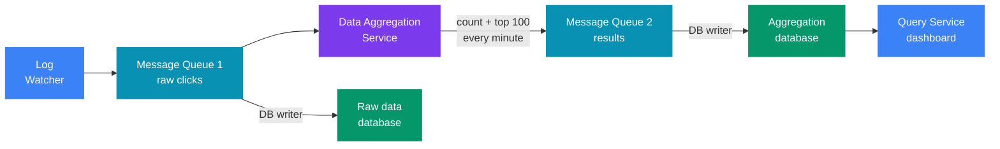
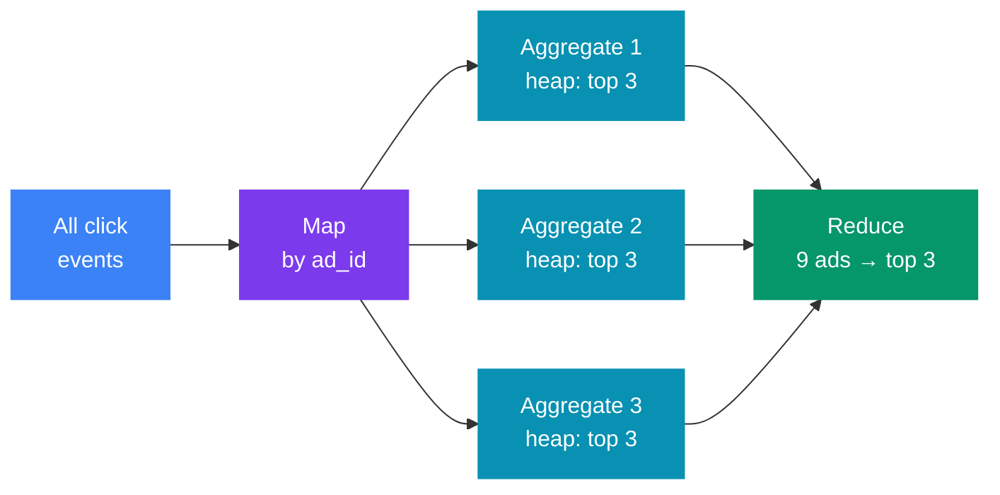
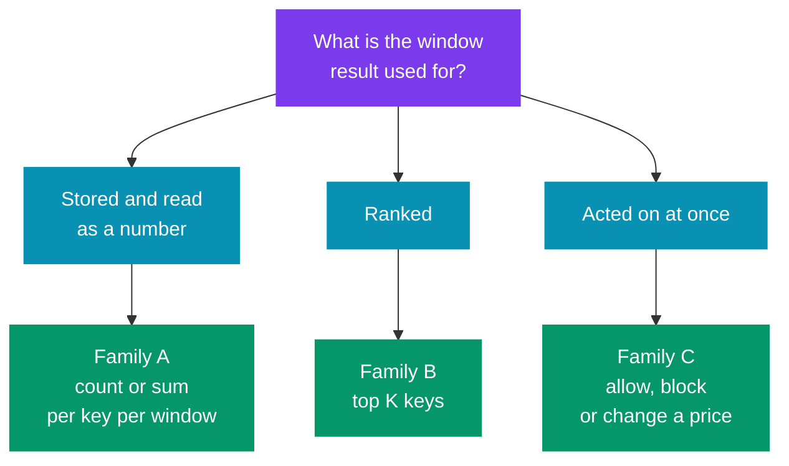

# Ch 6: Ad Click Event Aggregation

> 📖 **Vol 2, Chapter 6** (book pages 159–193) &nbsp;·&nbsp; 🔥 High Priority &nbsp;·&nbsp; 💬 **20 Questions**  
> **Source:** Alex Xu & Sahn Lam, *System Design Interview Vol 2*, Ch 6. Page and figure numbers below are the book's printed ones.

---

📊 **Question Count**

| # | Section | Questions |
|---|---|---|
| 1 | [Requirements and Estimation 🔥](#1--requirements-and-estimation-p159161-) | 1 |
| 2 | [Query API and Data Model 🔥](#2--query-api-and-data-model-p161165-) | 2 |
| 3 | [High-level Design — Two Queues 🔥🔥](#3--high-level-design--two-queues-p165167-) | 2 |
| 4 | [Aggregation Service — MapReduce 🔥🔥](#4--aggregation-service--mapreduce-p167172-) | 3 |
| 5 | [Streaming vs Batching and Recalculation 🔥](#5--streaming-vs-batching-and-recalculation-p172175-) | 1 |
| 6 | [Time, Watermark and Windows 🔥🔥](#6--time-watermark-and-windows-p175178-) | 2 |
| 7 | [Delivery Guarantees and Deduplication 🔥🔥](#7--delivery-guarantees-and-deduplication-p178182-) | 3 |
| 8 | [Scale the System and Hotspots 🔥](#8--scale-the-system-and-hotspots-p182187-) | 2 |
| 9 | [Fault Tolerance, Monitoring and Wrap Up ⚡](#9--fault-tolerance-monitoring-and-wrap-up-p187191-) | 3 |
| 10 | [Similar Problems This Design Solves 📎 🔥](#10--similar-problems-this-design-solves--) | 1 |
| | **Total** | **20** |

> 🔥🔥 Very high priority — asked in almost every Tier-1 interview loop &nbsp;·&nbsp; 🔥 High priority — very frequent in Tier-1 interviews &nbsp;·&nbsp; ⚡ Medium priority — commonly asked &nbsp;·&nbsp; 💤 Low priority — good to know, rarely asked

---

## 🗒️ Cheat Sheet

<details>
<summary><strong>🗒️ Show cheat sheet</strong></summary>

### 🎯 Clarifying Questions — and the book's answers
| Question | Book's answer (p.160) |
|---|---|
| What is the input data? | A **log file** on many servers. New click events are appended to the end. Fields: `ad_id`, `click_timestamp`, `user_id`, `ip`, `country` |
| How much data? | **1 billion clicks per day**, **2 million ads** in total. Clicks grow **30% a year** |
| Which queries? | (1) Clicks for one ad in the last **M** minutes. (2) **Top 100** most clicked ads in the past 1 minute — both numbers configurable, aggregation every minute. (3) Filter both by `ip`, `user_id` or `country` |
| Edge cases? | **Late** events, **duplicate** events, and parts of the system going down (recovery). The interviewer agrees with all three |
| Latency? | **A few minutes** end to end. RTB needs < 1 second, but aggregation is for billing and reports, so minutes are fine |

**Functional (p.160):**
- Count clicks of an `ad_id` in the last M minutes.
- Return the top 100 `ad_id`s every minute.
- Filter by different attributes. Facebook or Google scale.

**Non-functional (p.160–161):**
- Correct results — they are used for RTB and billing.
- Handle late and duplicate events. Be robust to partial failures.
- End-to-end latency of a few minutes at most.

### 🏗️ Core Components (Figure 6.3, Figure 6.28)
- **Log watcher** — reads the click logs on the app servers and pushes events into the first queue.
- **Message queue 1 (Kafka)** — holds raw click events. It decouples producers from consumers.
- **Data aggregation service** — a MapReduce-style DAG (Map → Aggregate → Reduce). It counts clicks per ad every minute and finds the top N.
- **Message queue 2 (Kafka)** — holds the aggregated results. It is needed for **end-to-end exactly-once** (p.167).
- **Database writers** — poll a queue, change the data into the DB format, and write it.
- **Raw data DB** and **aggregation DB** — Cassandra in the book's example.
- **Query service** — the dashboard reads aggregated results from here.
- **Recalculation service** and **reconciliation** — fix results after a bug, and check results in a daily batch job.

### Key Schema (Tables 6.7–6.11, 6.14–6.15)
```
raw click:        ad_id | click_timestamp | user_id | ip | country
aggregated:       ad_id | click_minute | count                 -- every minute
with filters:     ad_id | click_minute | filter_id | count     -- star schema
top N:            window_size | update_time_minute | most_clicked_ads (JSON array)
```

### 💡 Key Insights
1. **Correctness is the hard part, not speed.** The results drive ad billing. A few percent wrong can mean millions of dollars (p.178).
2. **Keep both raw and aggregated data.** Raw data is the backup and the source for recalculation. Aggregated data serves the queries (p.164).
3. **Use event time plus a watermark.** Event time is more accurate. The watermark lets slightly late events still count (p.176).
4. **Exactly-once comes from the offset, not from the count.** Duplicates appear when the aggregator crashes between "send result" and "commit offset". The book's fix is one distributed transaction around those steps (p.179–182).
5. **The book picks Kappa.** Recalculation replays raw data through the same aggregation service. There is only one processing code path (p.174).

### ⚖️ Trade-offs / Alternatives
| Option | Pro | Con | Book's verdict |
|---|---|---|---|
| Store raw **and** aggregated data | Raw = backup and recalculation source; aggregated = fast queries | Two stores | ✅ "Our recommendation is to store both" (p.164) |
| Cassandra / InfluxDB (vs relational) | Built for writes and time-range queries | Weak at joins and ad-hoc `GROUP BY` | ✅ Cassandra. A relational DB struggles to scale writes (p.165) |
| S3 + ORC / Parquet / AVRO files | Cheap columnar storage | Less familiar setup | Valid option, not used (p.165) |
| Kafka between stages (vs synchronous) | Each side scales on its own; spikes do not crash consumers | More parts | ✅ (p.166) |
| Event time (vs processing time) | More accurate | Client clock can be wrong or faked | ✅ Recommended (p.176) |
| Kappa (vs Lambda) | One code path, not two | Replay must be fast enough | ✅ "Our high-level design uses Kappa" (p.174) |
| Exactly-once (vs at-least-once) | Correct bills | Needs a distributed transaction | ✅ Recommended (p.178) |
| YARN processes (vs threads) | Scale by adding compute | Needs a resource provider | ✅ "More widely used" (p.185) |

### 🔢 Numbers to Remember
| What | Value | Arithmetic |
|---|---|---|
| Daily active users | **1 billion** | Given (p.161) |
| Clicks per day | **1 billion** | 1B users × 1 click each |
| Average QPS | **10,000** | 10⁹ ÷ 10⁵ seconds (1 day = 86,400 s ≈ 10⁵). 📎 Exact: 10⁹ ÷ 86,400 ≈ 11,574 |
| Peak QPS | **50,000** | 5 × 10,000 (the book assumes peak = 5× average) |
| Size of one click event | **0.1 KB** | Assumed (p.161) |
| Raw storage per day | **100 GB** | 0.1 KB × 10⁹ = 10⁸ KB = 100 GB |
| Raw storage per month | **about 3 TB** | 100 GB × 30 days |
| Total ads | **2 million** | Given (p.160) |
| Growth | **30% a year** — "doubles every 3 years" | 1.3³ ≈ 2.2, so a bit more than double (p.182) |
| Watermark example | **15 seconds** | Extra time added to each window (p.176) |
| Sliding window example | **3 minutes**, run every minute | Figure 6.16 |
| Hotspot example | **300 events**, a node holds **100** | 300 ÷ 100 = 3 nodes (Figure 6.25) |
| 📎 Ingest bandwidth | **1 MB/s** average, **5 MB/s** peak | 10,000 × 100 bytes; 50,000 × 100 bytes |
| 📎 Raw storage per year | **about 36.5 TB** | 100 GB × 365, before replication |
| 📎 Aggregated rows per minute | **at most about 694,000** | One row per (ad, minute) that has a click. Clicks per minute = 10⁹ ÷ 1,440 ≈ 694,000, and 2M ads is a second upper bound |

### ⏱️ 45-Minute Round Plan
| Minutes | Phase | What to say or draw | Trap to avoid |
|---|---|---|---|
| 0–5 | Clarify | Log input, 1B clicks/day, 2M ads, 3 queries, late + duplicate events, minutes of latency | Designing RTB itself. Ask "what latency?" — RTB is < 1 s, this is minutes |
| 5–8 | Estimate | 10K QPS average, 50K peak, 100 GB/day | Long maths. Say: "write-heavy, 50K peak" |
| 8–15 | API + data | 2 GET APIs; raw vs aggregated table; store both; Cassandra | Storing only aggregates — no way to recalculate |
| 15–25 | High-level | Figure 6.3: log watcher → queue → aggregation → queue → DB; Map/Aggregate/Reduce with a heap for top N | Writing results straight to the DB with no second queue |
| 25–40 | **Deep dive** | Event time + watermark → tumbling vs sliding → exactly-once (offset after ack, distributed transaction) → hotspot | Saying "Kafka gives exactly-once" with no detail on offsets |
| 40–45 | Wrap up | Snapshots for failover, monitoring (lag, latency), end-of-day reconciliation, Kappa recalculation | Forgetting reconciliation — the result is used for billing |

> 📎 The timings are a suggestion, not from the book. The book gives the steps; the minutes are ours.

---

</details>
<br/>

---

## 1. 📋 Requirements and Estimation (p.159–161) 🔥

### Why this matters (p.159)

Online ads are bought and sold through **Real-Time Bidding (RTB)** (Figure 6.1). The advertiser uses a **DSP** (Demand Side Platform). The publisher uses an **SSP** (Supply Side Platform). They meet at the **ad exchange**. RTB usually takes less than one second.

Ad click aggregation decides how much advertisers pay. Campaign managers use it to change budgets and targeting. Metrics like **CTR** (click-through rate) and **CVR** (conversion rate) depend on it.

The clarifying questions and the requirements are in the Cheat Sheet.

### Back-of-the-envelope estimation (p.161)

- 1 billion DAU. Each user clicks 1 ad per day → **1 billion clicks per day**.
- Ad click QPS = 10⁹ ÷ 10⁵ seconds = **10,000**.
- Peak = 5 × average = **50,000 QPS**.
- One click event = 0.1 KB → 0.1 KB × 1 billion = **100 GB per day**. About **3 TB per month**.

> 📎 All four numbers check out. 10⁵ seconds is a rounding of 86,400, so the true average is about 11,600 QPS. The rounding is standard in interviews.

### ❓ Interview Questions

1. **Do the estimation. What do the numbers tell you about the design? 📎 🔥**

<!-- -->
<details>
<summary>💡 Show Answer</summary>

**Answer:**

**The numbers** (p.161, plus 📎 extras):

| What | Value | Arithmetic |
|---|---|---|
| Clicks per day | 1 billion | 1B DAU × 1 click |
| Average QPS | ~10,000 | 10⁹ ÷ 10⁵ s. Exact: 10⁹ ÷ 86,400 ≈ 11,574 |
| Peak QPS | 50,000 | 5 × average |
| Bandwidth | 1 MB/s average, 5 MB/s peak | 10,000 × 100 bytes; 50,000 × 100 bytes |
| Raw storage | 100 GB/day, ~3 TB/month, ~36.5 TB/year | 0.1 KB × 10⁹; × 30; × 365 (before replication) |
| Aggregated rows | at most ~694,000 per minute | 10⁹ ÷ 1,440 clicks per minute; 2M ads is a second upper bound |

**What they tell you:**

- **Write-heavy.** Raw data is written 50K times a second at peak and rarely read. So pick a write-optimized store such as Cassandra (§2).
- **Bandwidth is small.** 5 MB/s is not hard to move. The hard part is **correctness** — duplicates, late events and crashes. So spend the deep dive on §6 and §7.
- **Raw data grows fast.** About 36.5 TB a year, and 3× that with replication factor 3. So move old raw data to cold storage (§2).
- **Aggregates are much smaller than raw data.** Dashboards query the aggregates, never the raw rows.
- **Partition count is not set by bytes.** It is set by how many consumers must run in parallel and by hot ads (§8).

</details>

---

## 2. 🔌 Query API and Data Model (p.161–165) 🔥

### Query API (Tables 6.1–6.6)

The client here is a **dashboard user** (data scientist, product manager, advertiser), not an end user. Three use cases need only **two APIs**. Filtering is a query parameter on both.

| API | Request fields | Response |
|---|---|---|
| **API 1** `GET /v1/ads/{:ad_id}/aggregated_count` — click count for one ad | `from` (start minute, default now − 1 min), `to` (end minute, default now), `filter` (ID of a filtering strategy, e.g. `001` = drop non-US clicks) — all `long` | `ad_id` (string), `count` (long) |
| **API 2** `GET /v1/ads/popular_ads` — top N ads in the last M minutes | `count` (N, integer), `window` (M minutes, integer), `filter` (long) | `ad_ids` (array) |

### Raw data (Table 6.7)

A raw log line looks like this:

```
[AdClickEvent] ad001, 2021-01-01 00:00:01, user 1, 207.148.22.22, USA
```

Table 6.7 shows the same fields as columns. The data is spread across many application servers.

### Aggregated data (Tables 6.8–6.11)

Clicks are aggregated **every minute**:

| ad_id | click_minute | count |
|---|---|---|
| ad001 | 202101010000 | 5 |
| ad001 | 202101010001 | 7 |

To support filters, add a `filter_id` column. Rows with the same `ad_id` and `click_minute` are split by `filter_id` (Table 6.9):

| ad_id | click_minute | filter_id | count |
|---|---|---|---|
| ad001 | 202101010000 | 0012 | 2 |
| ad001 | 202101010000 | 0023 | 3 |
| ad001 | 202101010001 | 0012 | 1 |
| ad001 | 202101010001 | 0023 | 6 |

A separate filter table (Table 6.10) defines each `filter_id` by `region`, `ip` and `user_id` (`*` = any).

> ⚠️ **Book bug — the filter table does not match Table 6.9.** Table 6.10 lists filter IDs `0012` and `0013`, but Table 6.9 uses `0012` and `0023`. Its columns are also mixed up. The `ip` column holds `0012` / `0023`, which look like filter IDs. The `user_id` column holds `123.1.2.3`, which is an IP address. The fix: the filter table should hold `0012` and `0023`, each with a real region, IP and user ID value (or `*`).

For the top N query, the book stores `window_size`, `update_time_minute` and `most_clicked_ads` (a JSON array of ad IDs) — Table 6.11.

### Raw vs aggregated — store both (Table 6.12, p.164)

| | Raw data only | Aggregated data only |
|---|---|---|
| **Pros** | Full data set; supports data filter and recalculation | Smaller data set; fast query |
| **Cons** | Huge data storage; slow query | Data loss — it is derived data (10 entries may become 1) |

The book's answer is **store both**:

- **Raw data = backup data.** Use it to debug, and to recalculate after a bug is fixed. Move old raw data to **cold storage** to save cost.
- **Aggregated data = active data.** Querying huge raw data is too slow, so queries run on the aggregates.

### Choose the right database (p.164–165)

Ask: is the data relational, a document or a blob? Is the workload read-heavy, write-heavy or both? Do we need transactions? Do queries need **OLAP** functions such as `SUM` and `COUNT`?

**Raw data:** 10,000 QPS average and 50,000 at peak → **write-heavy**. Reads are rare: raw data is only a backup and a recalculation source. A relational DB can work, but scaling writes is hard. **Cassandra** or **InfluxDB** fit better — they are built for writes and time-range queries.

- Another option: **Amazon S3** with a columnar format such as **ORC**, **Parquet** or **AVRO**. Cap each file (say 10 GB). The stream processor rotates the file when it reaches the cap.
- The book uses **Cassandra** because the S3 setup is less familiar to many people.

**Aggregated data:** time-series, and **both read- and write-heavy**:

- Read-heavy: dashboards query each ad every minute, and there are 2M ads.
- Write-heavy: the aggregation service writes new results every minute.

The same type of database can store both raw and aggregated data.

### ❓ Interview Questions

1. **Do you store raw data or aggregated data, and in which database? 🔥🔥**

<!-- -->
<details>
<summary>💡 Show Answer</summary>

**Answer:**

**Store both** (Table 6.12, p.164):

- **Raw data = backup.** Use it to debug, and to recalculate after a bug is fixed. Move old raw data to cold storage.
- **Aggregated data = active data.** Raw data is too big to query directly, so queries run on the aggregates.

**Database** — first ask: what shape is the data, read- or write-heavy, transactions, OLAP functions like `SUM` / `COUNT`? (p.164)

- **Raw data** is write-heavy (10K average, 50K peak QPS) and rarely read. A relational DB struggles to scale writes. **Cassandra** or **InfluxDB** fit better. S3 with Parquet / ORC / AVRO files is another option.
- **Aggregated data** is time-series and both read- and write-heavy. Dashboards read every minute for 2M ads; the service writes every minute.
- The book uses **Cassandra** for both (p.165).

📎 Why Cassandra fits: a write goes to an append-only **commit log** on disk and to an in-memory **memtable**. Later the memtable is flushed to disk as an immutable **SSTable**. There is no read before the write, so writes are fast. With `ad_id` as the partition key, a time-range read is one partition scan. It scales by adding nodes. The cost: no joins and weak ad-hoc `GROUP BY`. Use an OLAP store like ClickHouse for that (Figure 6.29).

</details>

---

2. **Design the Cassandra table for the aggregated counts. 📎 ⚡**

<!-- -->
<details>
<summary>💡 Show Answer</summary>

**Answer:**

```sql
CREATE TABLE ad_clicks_by_minute (
    ad_id        text,
    window_start timestamp,
    click_count  bigint,
    PRIMARY KEY ((ad_id), window_start)
) WITH CLUSTERING ORDER BY (window_start DESC);
```

- **Partition key `ad_id`** — all minutes of one ad on one node.
- **Clustering key `window_start DESC`** — newest first, which fits "last M minutes".
- Query: `SELECT click_count FROM ad_clicks_by_minute WHERE ad_id = ? AND window_start >= ?`. Sum the rows in the service.
- **Rollups** (hourly, daily) go to separate tables, with TTLs such as 7 days for minute rows, 90 days for hourly, 3 years for daily.
- Without a TTL, one partition per ad grows forever. Filter dimensions multiply its rows too. For a very active ad, add a time bucket: `((ad_id, day), window_start)`.
- Use **TimeWindowCompactionStrategy (TWCS)** for these TTL'd time-series tables. It groups SSTables by time window, so a whole expired SSTable is dropped at once. Size-tiered compaction mixes old and new rows in one SSTable, so expired data stays on disk until a big compaction.

</details>

---

## 3. 🧭 High-level Design — Two Queues (p.165–167) 🔥🔥

### The first idea — synchronous (Figure 6.2)

Data flows in as an **unbounded stream**. The first picture is: log watcher → push data → data aggregation service → database → query service. The aggregation service makes two outputs every minute: the **ad count** and the **top 100 most clicked ads**.

This design is **synchronous**, and that is a problem (p.165–166). Producers and consumers do not always have the same capacity. In a traffic spike, consumers may run **out of memory** or shut down. If one part is down, the **whole system stops**.

### Add message queues (Figure 6.3)

The fix is a message queue (**Kafka**). It decouples producers from consumers, so each side scales on its own.



Two queues decouple the log watcher, the aggregation service and the database. A **database writer** polls a queue, changes the data into the DB format, and writes it.

- **Queue 1** holds raw click events (Table 6.13): `ad_id | click_timestamp | user_id | ip | country`.
- **Queue 2** holds two kinds of data:
  - Click counts per minute (Table 6.14): `ad_id | click_minute | count`.
  - Top N per minute (Table 6.15): `update_time_minute | most_clicked_ads`.

### Why not write results to the database directly? (Figure 6.4, p.167)

The book's short answer: the second queue is needed for **end-to-end exactly-once** semantics (an **atomic commit**). In Figure 6.4, one atomic commit covers: read from queue 1 → aggregate → write to queue 2.

> 📎 This is how Flink does it (the book's reference [9]). The Kafka source offsets are saved in Flink's checkpoint. The Kafka sink writes inside a **Kafka transaction**. The transaction commits only when the checkpoint completes (two-phase commit). Readers of queue 2 must use `isolation.level=read_committed`, or they also see uncommitted data.

### ❓ Interview Questions

1. **Walk me through the high-level design of an ad click aggregation system. 🔥🔥**

<!-- -->
<details>
<summary>💡 Show Answer</summary>

**Answer:**

(Figure 6.3 and Figure 6.28)

1. A **log watcher** reads click logs on the app servers. It pushes events into **message queue 1** (Kafka).
2. A **database writer** copies raw events into the **raw data DB** (Cassandra). This is the backup and the source for recalculation.
3. The **data aggregation service** (Map → Aggregate → Reduce) counts clicks per ad every minute. It also finds the top 100.
4. It sends both results to **message queue 2**. A second database writer stores them in the **aggregation DB**.
5. The **query service** serves the dashboard from the aggregation DB.
6. A **recalculation service** replays raw data after a bug. An end-of-day **reconciliation** job checks the results.

</details>

---

2. **Why put a message queue between the stages? And why a second queue after aggregation? 🔥🔥**

<!-- -->
<details>
<summary>💡 Show Answer</summary>

**Answer:**

**First queue** (p.165–166). In a synchronous chain, a traffic spike can cause out-of-memory errors, and one part going down stops the whole system. Kafka **decouples** the stages. Each side scales on its own, and the queue absorbs spikes.

**Second queue** (p.167): it is needed for **end-to-end exactly-once** — an atomic commit across "read queue 1 → aggregate → write queue 2" (Figure 6.4).

📎 In Flink, the input offsets are in the checkpoint, and the Kafka sink commits its transaction only when the checkpoint completes. Readers use `read_committed`. A direct DB write cannot join that commit unless the write is idempotent (see §7 Q2).

</details>

---

## 4. 🧮 Aggregation Service — MapReduce (p.167–172) 🔥🔥

### The DAG model (Figure 6.5)

**MapReduce** is a good fit. Model it as a **DAG** (directed acyclic graph) of small computing units: **Map**, **Aggregate** and **Reduce** nodes. Each node does one task and sends its result to the next node.

Intermediate data can stay **in memory**. Nodes talk over **TCP** (different processes) or **shared memory** (different threads).

### The three node types (p.168–170)

- **Map node** — reads from a data source, then filters and transforms the data. Example (Figure 6.6): ads with `ad_id % 2 = 0` go to node 1; the others go to node 2.
- **Aggregate node** — counts clicks by `ad_id` **in memory every minute**. In MapReduce terms it is part of Reduce, so "map-aggregate-reduce" is really **map-reduce-reduce**.
- **Reduce node** — reduces the results of all Aggregate nodes to the final result. In Figure 6.7, three Aggregate nodes each send their top 3. The Reduce node picks the overall top 3.

**Why have a Map node at all?** Why not let Aggregate nodes read Kafka partitions directly? (p.169)

1. Input data may need **cleaning or normalizing**. The Map node does that.
2. We may not control how data is produced. Events with the same `ad_id` might land in **different Kafka partitions**. The Map node routes them to the right Aggregate node.

### Use case 1 — count clicks (Figure 6.8)

Map nodes partition events by `ad_id` (`ad_id % 3`). Each Aggregate node counts its ads. Example output: "ad3 was clicked 4 times in the past 1 minute".

### Use case 2 — top N most clicked ads (Figure 6.9)



- Map nodes route events by `ad_id`.
- Each Aggregate node keeps a **heap** to find its local top 3 fast.
- The Reduce node merges 9 ads (3 from each node) into the **top 3, every minute**.
- In Figure 6.9 the answer is ad3 (12), ad1 (9) and ad2 (8).

This works because each ad lives on **one** Aggregate node. So a local count is the full count for that ad. That means the global top 3 must be inside the union of the local top 3s.

### Use case 3 — data filtering (Table 6.16, p.171–172)

To answer "clicks for ad001 in the USA only", **pre-define** the filters and aggregate by them:

| ad_id | click_minute | country | count |
|---|---|---|---|
| ad001 | 202101010001 | USA | 100 |
| ad001 | 202101010001 | GPB | 200 |
| ad001 | 202101010001 | others | 3000 |

This is the **star schema**, common in data warehouses. The filter fields are called **dimensions**.

- ✅ Simple to understand and build.
- ✅ The same aggregation service creates more dimensions. No new component.
- ✅ Filtered queries are fast — the results are pre-calculated.
- ❌️ It creates many more buckets and records when there are many filters.

### ❓ Interview Questions

1. **How does the aggregation service work? How do you find the top N most clicked ads? 🔥🔥**

<!-- -->
<details>
<summary>💡 Show Answer</summary>

**Answer:**

A **DAG** of Map, Aggregate and Reduce nodes (Figures 6.5–6.9).

- **Map** — cleans the input and routes each event by `ad_id` (e.g. `ad_id % 3`).
- **Aggregate** — counts clicks per `ad_id` in memory every minute. Each node keeps a **heap** of its local top N.
- **Reduce** — merges the local top Ns into the global top N, every minute.

This is correct because each ad lives on exactly one Aggregate node. Its local count is its full count. So the global top N is inside the union of the local top Ns.

**Why a Map node instead of reading Kafka partitions directly?** Input may need cleaning, and we may not control how events are partitioned. The same `ad_id` might land in different partitions (p.169).

📎 Local top N with a min-heap of size N:

```java
public List<String> topN(Map<String, Long> countsByAd, int n) {
    PriorityQueue<Map.Entry<String, Long>> heap =
        new PriorityQueue<>(Map.Entry.comparingByValue());
    for (Map.Entry<String, Long> e : countsByAd.entrySet()) {
        heap.offer(e);
        if (heap.size() > n) {
            heap.poll();   // drop the smallest; the heap keeps the n largest
        }
    }
    List<String> result = new ArrayList<>();
    while (!heap.isEmpty()) {
        result.add(heap.poll().getKey());
    }
    Collections.reverse(result);   // biggest first
    return result;
}
```

Cost: O(A log N) for A ads on the node. The Reduce node runs the same code on the merged `(ad_id, count)` pairs. So each Aggregate node must send the counts too, not only the ad IDs this method returns.

</details>

---

2. **How do you support filters like "clicks for ad001 in the USA only"? ⚡**

<!-- -->
<details>
<summary>💡 Show Answer</summary>

**Answer:**

**Pre-define** the filters and aggregate by them. This is the **star schema**; the filter fields are **dimensions** (Table 6.16, p.171–172).

- Rows become `ad_id | click_minute | country | count`, or `ad_id | click_minute | filter_id | count`.
- ✅ Simple. The same aggregation service builds the extra dimensions. Queries are fast — results are pre-calculated.
- ❌️ Many filters → many more buckets and records.

</details>

---

3. **Advertisers want totals per campaign, not per ad. How do you add that? 📎 ⚡**

<!-- -->
<details>
<summary>💡 Show Answer</summary>

**Answer:**

- Keep the **per-ad** job for billing.
- Add a second job (or consumer group) for **campaign / advertiser** totals. It joins each click with the ad → campaign mapping, loaded as **broadcast state** in Flink.
- Store campaign totals in a separate table, or in **ClickHouse**. A columnar OLAP store runs `SUM(...) GROUP BY advertiser_id, day` very fast across all ads. This matches the book's alternative design (Figure 6.29).

</details>

---

## 5. 🌊 Streaming vs Batching and Recalculation (p.172–175) 🔥

### Three types of systems (Table 6.17)

| | Services (online) | Batch system (offline) | Streaming system (near real-time) |
|---|---|---|---|
| Responsiveness | Respond to the client quickly | No response to the client needed | No response to the client needed |
| Input | User requests | Bounded input, finite size, a lot of data | No boundary (infinite streams) |
| Output | Responses to clients | Materialized views, aggregated metrics | Materialized views, aggregated metrics |
| Performance measure | Availability, latency | Throughput | Throughput, latency |
| Example | Online shopping | MapReduce | Flink |

The design in Figure 6.3 is a **stream processing** system. The book uses streaming for near real-time results and batch processing for historical data backup.

### Lambda vs Kappa (Figure 6.10)

**Book's verdict:** "Our high-level design uses Kappa architecture" (p.174). Reprocessing of historical data also goes through the real-time aggregation service.

> 📎 The design still has a batch job — the end-of-day reconciliation in §9. That job only *checks* results. It is not a second code path that *produces* them. So the design is still Kappa.

### Data recalculation (Figure 6.11, p.174–175)

Sometimes we must recalculate aggregated data. This is also called **historical data replay**. Example: we find a major bug in the aggregation service. We must recalculate from the point where the bug started.

1. The **recalculation service** reads data from the raw data storage. This is a batched job.
2. It sends the data to a **dedicated** aggregation service, so historical replay does not slow down real-time processing.
3. The results go to the **second message queue**, and then to the aggregation database.

The recalculation reuses the same aggregation service code. Only the data source is different (raw data).

### ❓ Interview Questions

1. **Lambda or Kappa architecture? How do you recalculate data after a bug? 🔥**

<!-- -->
<details>
<summary>💡 Show Answer</summary>

**Answer:**

**Recalculation** (Figure 6.11):

1. The recalculation service reads raw data from the raw data DB (a batched job).
2. It sends the data to a **dedicated** aggregation service, so real-time processing is not slowed down.
3. Results go to queue 2, then to the aggregation DB.

It reuses the aggregation service code. Only the data source changes.

📎 Kappa needs raw data kept long enough to replay. Here the raw data DB keeps it, not Kafka, so Kafka retention can stay short.

</details>

---

## 6. 🕒 Time, Watermark and Windows (p.175–178) 🔥🔥

### Event time vs processing time (Table 6.18)

**Event time** is when the ad click happens. **Processing time** is the clock of the aggregation server that processes the click. Network delays and queues can make the gap large. In Figure 6.12, event 1 reaches the aggregation service **5 hours late**.

| | Pros | Cons |
|---|---|---|
| **Event time** | More accurate. The client knows exactly when the ad was clicked | Depends on the client timestamp. The clock can be wrong, or a malicious user can fake it |
| **Processing time** | The server timestamp is more reliable | Not accurate if the event reaches the system much later |

**Book's verdict:** data accuracy is very important, so use **event time** (p.176).

### Watermark (Figures 6.13–6.14, p.176–177)

In Figure 6.13, clicks go into **one-minute tumbling windows** by event time. Window 1 misses event 2, and window 3 misses event 5. Both arrive a little after their window ends.

The book's fix is a **watermark**. It treats the watermark as an **extension of the window**. Adding **15 seconds** (adjustable) lets window 1 include event 2 and window 3 include event 5.

- A **long** watermark catches very late events but adds latency.
- A **short** watermark adds less latency but is less accurate.
- The right value depends on the business requirement.

A watermark does **not** handle events with long delays. A complex design for rare events is not worth the cost. Fix the small error with **end-of-day reconciliation** (§9).

> 📎 In Flink the watermark is a timestamp, not a window size. With bounded out-of-orderness W, watermark = (largest event time seen) − W. A window fires when the watermark passes the window end. So "extend each window by 15 s" and "W = 15 s" give the same result. Flink can also keep a window open longer with **allowed lateness**, or send late events to a **side output**.

### Aggregation window (Figures 6.15–6.16, p.177–178)

Martin Kleppmann's *Designing Data-Intensive Applications* lists **four** window types: **tumbling** (also called fixed), **hopping**, **sliding** and **session**. The book uses two:

- **Tumbling window** — time is split into same-length chunks that do **not overlap**. Good for "clicks every minute" (use case 1).
- **Sliding window** — events are grouped in a window that slides across the stream at a set interval. Windows **can overlap**. Good for "top N in the last M minutes" (use case 2). Figure 6.16 shows a **3-minute window that runs every minute**.

> 📎 Naming differs between sources. DDIA calls a fixed-size window that moves by a fixed step a **hopping** window. Flink calls the same thing a **sliding** window (`SlidingEventTimeWindows.of(size, slide)`). Figure 6.16 uses the Flink meaning. With size 3 and step 1, each event lands in 3 windows.

### ❓ Interview Questions

1. **Event time or processing time? What is a watermark? 🔥🔥**

<!-- -->
<details>
<summary>💡 Show Answer</summary>

**Answer:**

**Event time** = when the click happened. **Processing time** = the aggregation server's clock (Table 6.18).

- Event time is more accurate, but the client clock can be wrong or faked.
- Processing time is reliable, but wrong for late events. In Figure 6.12 one event arrives 5 hours late.
- **Book's verdict: event time**, because accuracy matters most (p.176).

**Watermark** (Figure 6.14): an **extension of the window** for slightly late events. With 15 extra seconds, window 1 catches event 2 and window 3 catches event 5.

- Long watermark → more accurate, more latency.
- Short watermark → less accurate, less latency.
- Very late events are not worth a complex design. Fix them with end-of-day reconciliation.

📎 Flink's view: watermark = largest event time seen − W. A window fires when the watermark passes its end. Later events can be dropped, sent to a **side output**, or added with **allowed lateness**.

</details>

---

2. **Tumbling window vs sliding window — which one for which query? 🔥🔥**

<!-- -->
<details>
<summary>💡 Show Answer</summary>

**Answer:**

DDIA lists four window types: tumbling, hopping, sliding and session (p.177).

- **Tumbling** — same length, **no overlap**. Each event is in exactly one window. Use it for **clicks per minute** (use case 1, Figure 6.15).
- **Sliding** — windows overlap and move at a set interval. Use it for **top N in the last M minutes** (use case 2). Figure 6.16: a 3-minute window, run every minute.

📎 With size 3 and step 1, each event is in 3 windows, so the state is about 3× larger. A cheaper way for counts: keep 1-minute tumbling counts and **sum the last M of them**. Figure 6.26's snapshot does exactly that. DDIA calls Figure 6.16's window **hopping**; Flink calls it **sliding**.

</details>

---

## 7. 🎯 Delivery Guarantees and Deduplication (p.178–182) 🔥🔥

### Which delivery guarantee? (p.178)

The results are used for billing. So the system must answer two questions: how do we avoid processing duplicates, and how do we make sure all events are processed?

Kafka usually offers three delivery semantics: **at-most once**, **at-least once** and **exactly once**. At-least once is usually enough. **Not here:** a few percent of difference can mean **millions of dollars**. So the book recommends **exactly-once**. It points to Yelp's real ad aggregation system as an example.

### Where duplicates come from (p.178)

- **Client side** — a client resends the same event. If it is malicious, the **ad fraud / risk control** component should handle it.
- **Server outage** — an aggregation node fails in the middle. The upstream has not received an ack, so it sends the same events again.

### The offset problem, step by step (Figures 6.17–6.20)

The **aggregator** stores its consumption progress as an **offset** in the upstream Kafka.

| Figure | Design | What goes wrong |
|---|---|---|
| 6.17 | Consume from offset 100 → aggregate 100–110 → send result → get ack → **ack upstream with offset 110** | Crash at the last step: the result is already sent, but offset 110 is not saved. A new aggregator reads from 100 again → **duplicates** |
| 6.18 | Save the offset in **HDFS or S3**. Process 100–110 only if the stored offset is 100. **Save offset 110 before** sending the result | Crash after saving the offset but before sending: events 100–110 are **never processed** → **data loss** |
| 6.19 | **Save the offset after** the downstream ack | Crash before saving: events 100–110 are sent downstream **again** → duplicates |
| 6.20 | Put "send result → save offset → ack" in **one distributed transaction** | ✅ If any step fails, the whole transaction rolls back |

A **distributed transaction** works across several nodes. If any operation fails, all of it rolls back.

The book admits this is hard: "How to achieve exactly-once processing is an advanced topic" (p.182). It points to Flink's end-to-end exactly-once design.

> 📎 In Flink, the "distributed transaction" of Figure 6.20 is the **checkpoint plus a two-phase-commit sink**. The source offsets and the window state are saved in the same checkpoint. On a crash, Flink restores both and replays from the saved offset. §7 Q2 below covers the common mistake here.

### ❓ Interview Questions

1. **Why exactly-once here? Where do duplicates come from, and how can the aggregator lose data? 🔥🔥**

<!-- -->
<details>
<summary>💡 Show Answer</summary>

**Answer:**

**Why** (p.178): the result is used for billing. A few percent of error can mean millions of dollars. At-least-once is fine for most systems, but not this one.

**Sources of duplicates** (p.178):

- **Client side** — a client resends an event. Malicious duplicates (click fraud) go to **ad fraud / risk control** components.
- **Server outage** — an aggregator fails before the upstream gets its ack, so the same events are processed again.

**The offset trap** (Figures 6.17–6.20):

| Order | Crash point | Result |
|---|---|---|
| Send result → ack upstream with offset | Before the offset is saved | Re-read from the old offset → **duplicates** |
| Save offset (HDFS/S3) → send result | After saving, before sending | Events skipped → **data loss** |
| Send result → get ack → save offset | Before saving | Sent again → **duplicates** |

**Book's fix:** put "send result → save offset → ack" in **one distributed transaction**. If any step fails, all of it rolls back (Figure 6.20). The book calls this "an advanced topic". See §7 Q2 below for how Flink does it.

</details>

---

2. **You use Flink and write counts to Cassandra. How do you get exactly-once? 📎 🔥🔥**

<!-- -->
<details>
<summary>💡 Show Answer</summary>

**Answer:**

Three parts:

1. **Checkpointing** — Flink saves the Kafka offsets and the window state in the **same** checkpoint. On a crash it restores both and replays from the saved offset.
2. **An idempotent sink** — write the **absolute total** keyed by `(ad_id, window)`. Replay recomputes the same total and overwrites the same row. No two-phase commit is needed.
3. **Or a transactional sink** — the Kafka sink with transactions (two-phase commit). This is the book's queue 2. Readers must use `read_committed`. They see results only when the transaction commits at the next checkpoint. So the checkpoint interval adds to end-to-end latency. That is fine here, because a few minutes are allowed.

```sql
-- ✅ idempotent: replay writes the same value again
INSERT INTO ad_clicks_by_minute (ad_id, window_start, click_count) VALUES (?, ?, ?);
```

> ⚠️ **The trap — do not use a counter increment.** `UPDATE ... SET count = count + delta` is **not idempotent**. Flink replays every record after the last checkpoint. Each replay adds its delta again, so the count goes too high — a wrong bill. There is also no "transactional Cassandra sink". Cassandra (5.0 and earlier) has no general multi-partition transactions. LWT is single-partition Paxos.

</details>

---

3. **How do you avoid losing clicks, or counting client retries twice, at ingest? 📎 🔥**

<!-- -->
<details>
<summary>💡 Show Answer</summary>

**Answer:**

**Do not lose clicks — Kafka durability:**

- `replication.factor=3`, `min.insync.replicas=2`, producer `acks=all`. An acknowledged write is on at least 2 brokers, so losing one broker loses nothing.
- Producer `enable.idempotence=true` (the default since Kafka 3.0) — producer retries do not write duplicate messages. It only covers retries of one producer session to one partition. A client that sends the same click twice still makes two messages.

**Do not count retries twice — dedup:**

- The client adds a unique `click_id` (UUID). The ingest side runs `SET click:<id> 1 NX EX <ttl>` in Redis. If the key exists, drop the click. Set the TTL a little longer than the watermark plus the retry window.
- **Bots** — rate limits per IP at the gateway, plus rules or ML. Run this as a separate job: flagged events go to `clicks-flagged`, clean ones to `clicks-verified`, which feeds billing.

| Dedup option | Pro | Con |
|---|---|---|
| Redis key per `click_id` | Exact — no false positives | Memory grows with unique clicks; needs TTL |
| Bloom filter | Small memory | False positives: may drop a valid click. Never misses a real duplicate |

For billing, prefer exact dedup. A false positive is a lost, unbilled click.

</details>

---

## 8. 📈 Scale the System and Hotspots (p.182–187) 🔥

The business grows **30% per year**. The book says this "doubles traffic every 3 years" (1.3³ ≈ 2.2). The three parts — message queue, aggregation service, database — are decoupled, so each scales on its own.

### Scale the message queue (p.182–183)

The Distributed Message Queue chapter covers this in depth ([Ch 4](./ch04_distributed_message_queue.md)). Key points:

- **Producers** — no limit on instances, so they scale easily.
- **Consumers** — rebalancing adds or removes consumers in a group. In Figure 6.21, 2 consumers for 4 partitions become 4 consumers. With **hundreds** of consumers a rebalance can take **minutes**, so add them in **off-peak hours**.

**Brokers:**

- **Hashing key** — use `ad_id` as the partition key. All events of one ad go to one partition, so one aggregation service can read them all from that partition.
- **Number of partitions** — if it changes, events of the same `ad_id` may map to a different partition. So **pre-allocate enough partitions** in advance. Avoid increasing them in production.
- **Topic physical sharding** — one topic is usually not enough. Split by geography (`topic_north_america`, `topic_europe`, `topic_asia`) or by business type (`topic_web_ads`, `topic_mobile_ads`).
  Pro: more throughput and faster rebalances. Con: more complexity and maintenance cost.

### Scale the aggregation service (Figures 6.22–6.23, p.183–185)

The aggregation service is a map/reduce job across servers (Figure 6.22). It scales horizontally by adding or removing nodes. To increase throughput there are two options:

- **Option 1 — multi-threading.** Give events with different `ad_id`s to different threads (Figure 6.23).
- **Option 2 — multi-processing.** Deploy aggregation nodes on a resource provider such as **Apache Hadoop YARN**.

**Book's verdict:** option 1 is easier and needs no resource provider. But **option 2 is more widely used**, because we can scale by adding more computing resources.

### Scale the database (Figure 6.24, p.185–186)

**Cassandra** scales horizontally, in a way similar to **consistent hashing** with **virtual nodes**.

Data is spread evenly, with a proper replication factor. A new node makes the cluster **rebalance virtual nodes automatically** — no manual resharding. See [Vol 1 Ch 5 — consistent hashing](../vol_1/ch05_design_consistent_hashing.md).

### Hotspot issue (Figure 6.25, p.186–187)

A **hotspot** is a shard or service that gets much more data than the others. Big companies spend millions on ads, so their ads get many more clicks. Events are partitioned by `ad_id`, so some aggregation nodes get far more events.

The book's fix is to **give popular ads more aggregation nodes**. Assume each node can handle only 100 events:

1. An Aggregate node has 300 events for ad1 — more than it can handle. It asks the **resource manager** for extra resources.
2. The resource manager adds, for example, **two more aggregation nodes**.
3. The original node splits the events into **3 groups**. Each node handles 100 events.
4. The results are written back to the original Aggregate node.

More advanced ways: **Global-Local Aggregation** and **Split Distinct Aggregation** (from Flink's performance tuning docs).

> 📎 Flink's docs call the first one **Local-Global aggregation**: each task pre-aggregates its share locally, then a global step merges the partial counts. A **count** can be split and merged like this. A **distinct count** cannot be merged by simple addition. That is why it needs its own trick (split distinct aggregation).

> 📎 **Unique users per ad** ("how many different users clicked?") is a distinct count. At this scale use a **HyperLogLog** sketch, not a set of user IDs. In Redis one HyperLogLog key uses at most 12 KB, with a standard error of 0.81%. Two sketches merge by taking the larger value of each register. So keep one sketch per ad per minute, and merge the last M sketches for "unique users in the last M minutes". It is an estimate, so use it for reports, not for billing.

### ❓ Interview Questions

1. **How do you scale the message queue, the aggregation service and the database? 🔥**

<!-- -->
<details>
<summary>💡 Show Answer</summary>

**Answer:**

**Message queue** (p.182–183):

- Producers: no limit on instances. Consumers: add them to the group and let it rebalance (Figure 6.21). With hundreds of consumers a rebalance can take minutes, so do it **off-peak**.
- **Partition key = `ad_id`**. **Pre-allocate enough partitions** — adding partitions later moves some `ad_id`s to another partition.
- **Topic physical sharding** by region or business type. More throughput and faster rebalances, but more maintenance.

**Aggregation service** (p.183–185): add nodes. Inside a node, use **threads** per `ad_id` (easier), or run **processes on Hadoop YARN** (more widely used — scale by adding compute).

**Database** (p.185–186): **Cassandra** scales like **consistent hashing** with **virtual nodes**. A new node rebalances automatically. No manual resharding.

📎 Peak is only 5 MB/s, which a few partitions can carry. Use many more (e.g. 100+) for **consumer parallelism** — a group uses at most one consumer per partition.

</details>

---

2. **One advertiser's ad gets far more clicks than others. How do you handle the hotspot? 🔥**

<!-- -->
<details>
<summary>💡 Show Answer</summary>

**Answer:**

Events are partitioned by `ad_id`, so a very popular ad overloads its aggregation node (p.186).

**Book's fix — more aggregation nodes for the popular ad** (Figure 6.25). Each node can handle 100 events:

1. The node has 300 events for ad1. It asks the **resource manager** for more resources.
2. The resource manager adds two more aggregation nodes.
3. The node splits the events into 3 groups of 100.
4. The partial results come back to the original node.

More advanced: **Global-Local Aggregation** and **Split Distinct Aggregation** (Flink tuning docs).

📎 The same problem hits **Kafka**: one hot `ad_id` = one hot partition. Add a random suffix to the key (`ad_id#0..7`), then sum the partial counts in a second step — the same two-step idea. Never count clicks in the browser; client counts can be faked.

</details>

---

## 9. 🩺 Fault Tolerance, Monitoring and Wrap Up (p.187–191) ⚡

### Fault tolerance (Figures 6.26–6.27, p.187–188)

Aggregation happens **in memory**. When a node goes down, its partial results are lost. We can rebuild them by replaying events from Kafka. But replaying from the **start** of Kafka is slow.

The good practice is a **snapshot** of the "system status":

- The upstream **offset**.
- Plus data such as the **top N most clicked ads in the past M minutes**. Figure 6.26 shows a snapshot that keeps per-minute counts for the last 5 minutes (ad1: 1, 3, 2, 3, 3 = 12).

**Failover** (Figure 6.27): the primary node saves **incremental snapshots** to snapshot storage. If it fails, a new node starts and **recovers from the latest snapshot**. Events that arrived after that snapshot are replayed from Kafka.

> 📎 Flink's checkpoints do exactly this. They save the Kafka offsets and the window state together, to durable storage such as S3 or HDFS.

### Continuous monitoring (p.188–189)

Results feed RTB and billing, so monitor health and correctness:

- **Latency** — record timestamps as events move through each stage. Expose the differences as latency metrics.
- **Message queue size** — a sudden jump means we may need more aggregation nodes. Kafka is a distributed commit log, so watch the **records-lag** metric instead.
- **System resources** on aggregation nodes — CPU, disk, JVM.

### Reconciliation (p.189)

Reconciliation compares different sets of data to check data integrity. Banks compare their records with another bank's records. Ad click aggregation has **no third-party result** to compare with.

- At the **end of the day**, a **batch job** sorts the click events by event time in every partition. It compares the result with the real-time result.
- For higher accuracy, use a smaller window, for example **one hour**.
- The two results may still **not match exactly**, because some events arrive late.

**The final design** (Figure 6.28) is Figure 6.3 plus the recalculation service (§5) and reconciliation, which reads both the raw data DB and the aggregation DB.

### Alternative design (Figure 6.29, p.189–190)

In a generalist interview you do not need to know the internals of big-data tools. Your thinking and the trade-offs matter more, so the book shows a generic design. Here is another option:

- log watcher → queue → **risk control engine** → **Hive**, with **Elasticsearch** for data scientists.
- An **OLAP database** such as **ClickHouse** or **Druid** for merchant-facing analytics.

The book points to Uber's Flink + Kafka + Pinot ad pipeline for details.

### Step 4 — Wrap Up (p.190)

The chapter covered the data model and APIs, and MapReduce aggregation. It then covered scaling the queue, the aggregation service and the DB. Last came the hotspot issue, monitoring, reconciliation and fault tolerance.

It is a typical big data processing system. Knowing Apache **Kafka**, **Flink** or **Spark** makes it easier to design.

### ❓ Interview Questions

1. **An aggregation node crashes. How do you recover without replaying all of Kafka? 🔥**

<!-- -->
<details>
<summary>💡 Show Answer</summary>

**Answer:**

Aggregation is in memory, so a crash loses partial results. Replaying Kafka from the start is slow (p.187).

- Save a **snapshot** of the system status: the upstream **offset**, plus state like the **top N in the past M minutes** (Figure 6.26).
- **Failover** (Figure 6.27): the primary writes **incremental snapshots**. A new node loads the latest one, then replays only the newer events from Kafka.

📎 Flink checkpoints are this snapshot (asynchronous barrier snapshots, a variant of Chandy-Lamport). Recovery time = load the state + catch up on Kafka lag. Shorter checkpoint intervals mean less replay but more checkpoint work.

</details>

---

2. **How do you monitor the pipeline and check that the numbers are correct? 🔥**

<!-- -->
<details>
<summary>💡 Show Answer</summary>

**Answer:**

**Monitoring** (p.188–189):

- **Latency** — timestamps at each stage; expose the differences.
- **Queue size** — for Kafka, watch **records-lag**. A jump means more aggregation nodes may be needed.
- **System resources** — CPU, disk, JVM on aggregation nodes.

**Reconciliation** (p.189): there is no third party to compare with. So an **end-of-day batch job** sorts events by event time in each partition and compares with the real-time result. For higher accuracy, use a smaller window such as one hour. Late events mean the two may not match exactly.

📎 What to do with a mismatch:

1. Above a threshold (e.g. > 0.1% per ad per window), overwrite the stored result with the batch value, and log every correction for billing disputes.
2. If the gap comes from a bug, fix it and run the **recalculation service** (§5 Q1). Also alert on long checkpoints and spikes in late events (clock skew).

</details>

---

3. **When would you use an OLAP store such as Druid, Pinot or ClickHouse instead of Flink + Cassandra? 📎 ⚡**

<!-- -->
<details>
<summary>💡 Show Answer</summary>

**Answer:**

The book shows both. The main design is Flink-style aggregation + Cassandra. The alternative (Figure 6.29) uses an OLAP database such as ClickHouse or Druid.

| | Flink + Cassandra (main design) | OLAP store (Druid / Pinot / ClickHouse) |
|---|---|---|
| Queries | Fixed, read by key (`ad_id`, minute) | Ad-hoc `GROUP BY` on any column |
| New dimension | Change the job, then recompute old data | Often only a new query |
| Ingest | The stream job writes results | Reads events from Kafka. Druid can roll up rows at ingest; ClickHouse has a Kafka table engine with materialized views |
| Dedup | Exact, inside the stream job | Depends on the store. ClickHouse `ReplacingMergeTree` removes duplicates only at background merge time, so a read can see them unless it uses `FINAL` |
| Cost | Cheap reads per key | More CPU per query |

**When to pick which:**

- **OLAP** — advertisers want to slice by country × device × hour. With the star schema in §4, each new filter multiplies the buckets.
- **Flink + key-value store** — the queries are fixed and the result feeds billing. You want exact dedup and exactly-once under your control.
- **Both** — common in practice. The stream job cleans and dedups the events, then an OLAP store serves the dashboards. The book points to Uber's Flink + Kafka + Pinot pipeline.

</details>

---

## 10. 🧬 Similar Problems This Design Solves 📎 🔥

📎 The book does not list similar problems for this chapter. It only calls this "a typical big data processing system" (p.190). But the same core solves **at least 13 common interview problems**. Learn the core once, then change only a few parts for each one.

**The core that never changes:**
- **An append-only event stream** (Kafka), partitioned by the key you count.
- **A stream job** that aggregates per key per time window, by event time, with a watermark (§6).
- **Raw events kept** as the source of truth, for replay and for reconciliation (§2, §5).
- **Pre-computed results** in a store that is read by key and time range (§2).
- **Exactly-once or idempotent writes**, so a replay never counts an event twice (§7).

**The tag on each problem** says how often it is asked as an HLD round on its own (same legend as the questions). 🔥🔥 = learn its "what is different" column well; 💤 = knowing the family is enough.

**The one choice that splits them into three families:** what is the window result used for?



### Family A — count or sum per key per window (like this chapter)

| # | Problem | What is different from this chapter |
|---|---|---|
| 1 | **Ad click aggregation 🔥🔥** (this chapter) | — |
| 2 | **API usage metering and billing (pay per call) 🔥** | Billing-grade, like ads: exactly-once (§7) and reconciliation (§9) still apply. The key is the customer or API key. Windows are hourly, and they add up to a monthly invoice. Late events count until the invoice is closed; after that they go to the next invoice as an adjustment |
| 3 | **Metrics monitoring and alerting 🔥** — [Vol 2 Ch 5](ch05_metrics_monitoring_alerting.md) | Input is numbers from servers (CPU, latency), not user events. A lost point is fine, so at-least-once is enough. A time-series DB stores it, and old data is **downsampled** (10 s → 1 min → 1 h). Alert rules run on top |
| 4 | **Website / app analytics (page views, unique visitors) ⚡** | Many dimensions (page, country, device, referrer), and users slice them freely. So use an OLAP store, not a fixed star schema (§9 Q3). Unique visitors need a **HyperLogLog** sketch (§8) |
| 5 | **Video view counter (YouTube) ⚡** — [Vol 1 Ch 14](../vol_1/ch14_design_youtube.md) | The count is shown to every viewer, so reads are far more than writes → cache the count. It may lag and be approximate for a while. Bots and replays must be filtered before a view counts, like the risk control step in §9 |
| 6 | **Payment volume dashboard (fintech) ⚡** — [Vol 2 Ch 11](ch11_payment_system.md) | It sums **money**, not counts — store amounts as integers in the smallest unit (paise), never as floats. The events come from the payment database through **CDC** (change data capture, e.g. Debezium), not from log files. Reconcile against the ledger, which is the source of truth |

### Family B — rank keys: top K

The output is a ranked list, not a number. The hard part is memory when there are very many keys.

| # | Problem | What is different from this chapter |
|---|---|---|
| 7 | **Top K trending hashtags / videos (Twitter trends) 🔥** | The key space is huge and open (every hashtag), not 2M known ads. So keep a **count-min sketch** plus a small heap per node. A count-min sketch may overcount, never undercount. "Trending" means fast growth against a normal baseline, not the biggest raw count |
| 8 | **Search autocomplete — top queries 🔥** — [Vol 1 Ch 13](../vol_1/ch13_design_search_autocomplete_system.md) | The aggregation is a **weekly batch job**, not a stream. The result is a trie with the top K cached at each node. Reads must be very fast, so the trie is served from memory |
| 9 | **Real-time gaming leaderboard ⚡** — [Vol 2 Ch 10](ch10_real_time_gaming_leaderboard.md) | No sliding window — scores add up for a whole month. Each user needs their **exact rank**, not only the top K. So use a **Redis sorted set**: update and rank are O(log n) |
| 10 | **Best-seller list (top products per category) 💤** | The same as top K, but one ranking per category, and hourly is fresh enough. A batch job over the order data is often enough |

### Family C — act on the window result at once

The count is not stored for a dashboard. It decides something, often while a request waits.

| # | Problem | What is different from this chapter |
|---|---|---|
| 11 | **Rate limiter 🔥🔥** — [Vol 1 Ch 4](../vol_1/ch04_design_a_rate_limiter.md) | A counter per key per window, but **inside the request path**. It must decide in about a millisecond, so it uses Redis with an atomic Lua script, not Kafka + Flink. An approximate count is fine. The result is allow or reject, and nothing is stored for later |
| 12 | **Real-time fraud detection (card or click velocity) 🔥** | Rules run over windows per card, IP or device ("more than 5 payments in 1 minute"). If the check must block a payment, it runs in the request path. A stream job keeps the window counts ready for it to read. A wrong block costs a real customer, so tune rules carefully |
| 13 | **Surge pricing (Uber) ⚡** | The key is a **map cell** (geohash or H3 hexagon). Count ride requests and free drivers per cell, in windows of a minute or two. The result changes the price multiplier, so data that is seconds old matters more than an exact count |

### How to use this in an interview — five questions

When you get any "count, rank or watch events" problem, answer these five questions aloud. Each answer picks one part of the design:

| Ask | It decides |
|---|---|
| 1. Is the result stored, ranked, or acted on at once? | The **family** |
| 2. Is it used for money (billing, payouts)? | **Exactly-once** + **reconciliation**, or at-least-once and "close enough" |
| 3. How many keys — known and bounded, or open and huge? | **Exact counts per key**, or **sketches** (count-min, HyperLogLog) |
| 4. How fresh must it be — milliseconds, minutes, or a day? | **Request path** (Redis), **stream** (Flink), or **batch** (Spark, a nightly job) |
| 5. Are the queries fixed, or does the user slice freely? | **Pre-computed rows by key** (Cassandra), or an **OLAP store** (Druid, Pinot, ClickHouse) |

> **Where this does *not* transfer directly:**
>
> - **Exact values a user changes directly**, like a wallet balance or a stock count. Each change is a write to one row, not a window over a stream. The balance must be correct on every read ([Vol 2 Ch 12](ch12_digital_wallet.md)).
> - **Search over raw events** ("show me every click from this IP"). That needs an index such as Elasticsearch, not pre-computed counts.
> - **Joins of two streams over long times**, like matching a click to a purchase days later (conversion tracking). The state is much larger, and the window is days, not minutes.

### ❓ Interview Questions

1. **Where else can you use this ad click design? Pick three problems and say what changes. 📎 🔥**

<!-- -->
<details>
<summary>💡 Show Answer</summary>

**Answer:**

The core stays the same. There is an event stream partitioned by key, and a windowed aggregation by event time. Raw data is kept for replay, and writes never double count. What changes is **what the result is used for**, **how many keys there are**, and **how fresh it must be**.

| | Ad clicks (this chapter) | API usage billing | Top K trending hashtags | Rate limiter |
|---|---|---|---|---|
| Key | `ad_id` (2M, known) | Customer / API key | Hashtag (huge, open) | User, IP or API key |
| Window | 1 min tumbling; M-min sliding | Hourly, summed to a monthly invoice | Sliding, minutes to hours | Seconds to minutes |
| Result | Count per ad, top 100 | Calls per customer → invoice | Top K list | Allow or reject |
| Exact? | Yes — billing | Yes — billing | No — a sketch is fine | No — approximate is fine |
| Where it runs | Kafka + stream job + Cassandra | Same as ads | Stream job + count-min sketch + heap | In the request path, in Redis |
| Late events | Watermark, then daily reconciliation | Count until the invoice closes | Usually dropped | Not an issue — it uses arrival time |

**Three families to name:**

- **Store a number** (ad clicks, API billing, metrics, analytics): this chapter, with a different key and window. Money → exactly-once and reconciliation.
- **Rank keys** (trending, autocomplete, leaderboard): add a heap per node. With a huge key space, add a count-min sketch.
- **Act at once** (rate limiter, fraud checks, surge pricing): the same counting, but in the request path or feeding a decision, often in Redis.

🧬 **The full list — 13 problems in three families, plus five questions that map any new one:** see the tables above.

</details>

---
