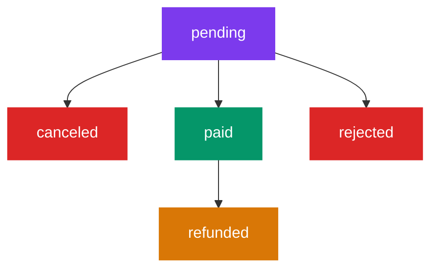
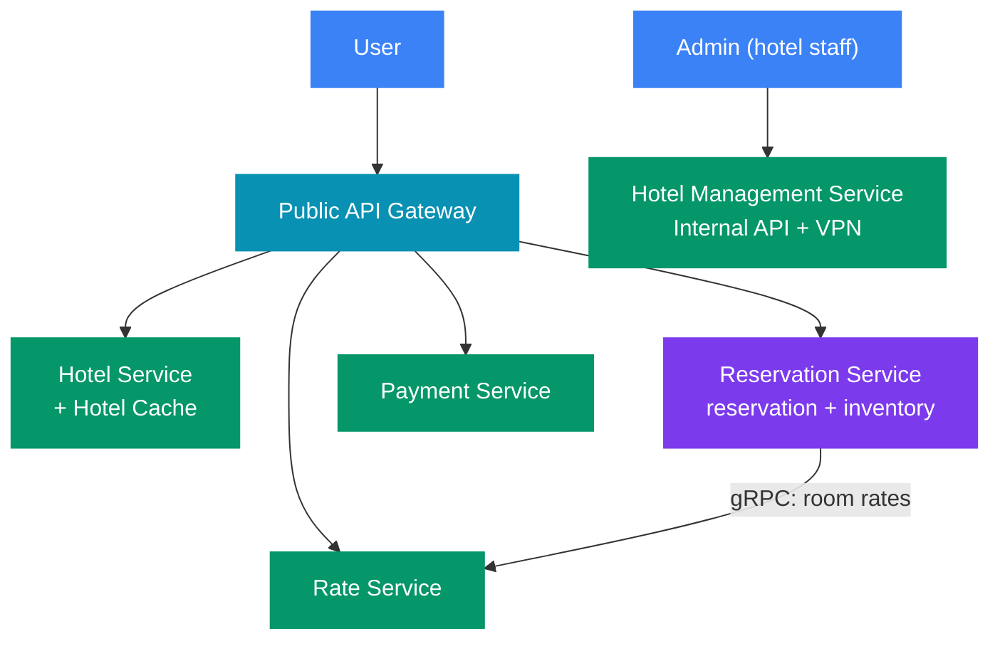
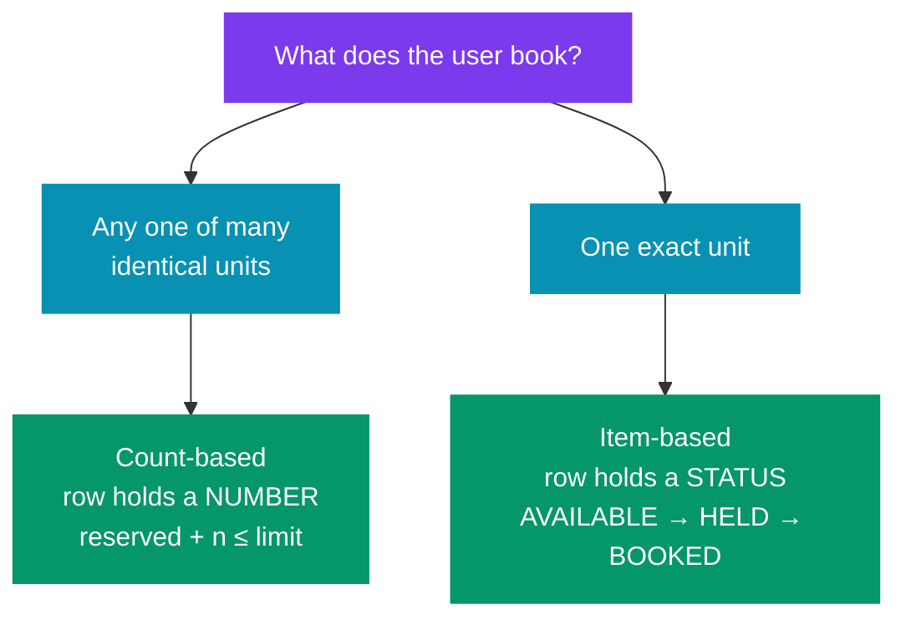

# Ch 7: Hotel Reservation System

> 📖 **Vol 2, Chapter 7** (book pages 195–223) &nbsp;·&nbsp; 🔥🔥 Very High Priority &nbsp;·&nbsp; 💬 **24 Questions**  
> **Source:** Alex Xu & Sahn Lam, *System Design Interview Vol 2*, Ch 7. Page and figure numbers below are the book's printed ones.  
> **Same pattern as:** Airbnb, flight booking, movie tickets (BookMyShow) — the book says so on page 195.

---

📊 **Question Count**

| # | Section | Questions |
|---|---|---|
| 1 | [Requirements and Estimation ⚡](#1--requirements-and-estimation-) | 1 |
| 2 | [API Design and Data Model 🔥](#2--api-design-and-data-model-) | 1 |
| 3 | [High-level Design 🔥](#3--high-level-design-) | ref |
| 4 | [Improved Data Model 🔥🔥](#4--improved-data-model-p203205-) | 4 |
| 5 | [Concurrency — Same User Clicks Twice 🔥🔥](#5--concurrency--same-user-clicks-twice-p206209-) | 1 |
| 6 | [Concurrency — Many Users, Last Room 🔥🔥](#6--concurrency--many-users-last-room-p209216-) | 7 |
| 7 | [Scalability — Sharding and Cache 🔥](#7--scalability--sharding-and-cache-p216219-) | 5 |
| 8 | [Data Consistency Among Services 🔥🔥](#8--data-consistency-among-services-p219221-) | 4 |
| 9 | [Similar Problems This Design Solves 🔥](#9--similar-problems-this-design-solves-) | 1 |
| | **Total** | **24** |

> 🔥🔥 Very high priority — asked in almost every Tier-1 interview loop &nbsp;·&nbsp; 🔥 High priority — very frequent in Tier-1 interviews &nbsp;·&nbsp; ⚡ Medium priority — commonly asked &nbsp;·&nbsp; 💤 Low priority — good to know, rarely asked

> **How to read this note.** Sections 1–8 follow the book, step by step. §9, at the end, maps this design to
> 16 similar problems. Each section ends with its own interview questions. Anything the book does not say is marked **📎 Beyond the book**. Where the book has a mistake, the note says so and gives the fix.

---

## 🗒️ Cheat Sheet

<details>
<summary><strong>🗒️ Show cheat sheet</strong></summary>

### 🎯 Clarifying Questions — and the book's answers
| Question | Book's answer (p.195–196) |
|---|---|
| Scale? | Hotel chain (like Marriott): **5,000 hotels, 1 million rooms** |
| When does the guest pay? | **In full, at booking time** |
| Booking channels? | Hotel website or app only (no phone bookings) |
| Can guests cancel? | Yes |
| Overbooking? | **Yes, 10%** — the hotel sells more rooms than it has, because some guests cancel |
| Search? | **Out of scope** |
| Pricing? | **Dynamic** — the price can be different each day |

### 🏗️ Core Components (Figure 7.4)
- **Public API Gateway** — rate limiting, authentication, routes each endpoint to its service
- **Hotel Service** — hotel and room details. Mostly static data, so it is cached
- **Rate Service** — room price for each future date
- **Reservation Service** — takes bookings **and tracks room inventory**. It owns both tables
- **Payment Service** — charges the guest. Sets the reservation to `paid` or `rejected`
- **Hotel Management Service** — staff only, behind an Internal API + VPN
- **CDN** — static assets only (JS, images, HTML)

### Key DB Schema (Figure 7.6, the improved model)
```
hotel(hotel_id PK, name, address, location)
room(room_id PK, room_type_id, floor, number, hotel_id, name, is_available)
room_type_rate(hotel_id, room_type_id, date, rate)         -- PK (hotel_id, room_type_id, date) ⚠️ book omits room_type_id
guest(guest_id PK, first_name, last_name, email)
reservation(reservation_id PK, hotel_id, room_type_id, start_date, end_date, status, guest_id)
room_type_inventory(hotel_id, room_type_id, date, total_inventory, total_reserved)
                                                            -- PK (hotel_id, room_type_id, date)
```

### 💡 Key Insights
1. **Guests book a room *type*, not a room.** The hotel gives the room number at check-in. So inventory is one row per `(hotel, room type, date)`.
2. **`reservation_id` is the idempotency key.** The server makes it before the confirm page. It is the primary key, so a second click fails on the unique constraint.
3. **Three fixes for the last-room race:** pessimistic locking (book: ❌️ not recommended), optimistic locking (✅), DB constraint (✅). The book prefers the last two because booking QPS is low. 📎 The simplest fix of all is a **conditional `UPDATE`** (§6 Q5).
4. **Reservation and inventory live in one relational DB** (a "hybrid" microservice design). So one ACID transaction covers both, and no 2PC or Saga is needed.

### ⚖️ Trade-offs / Alternatives
| Option | Pro | Con | Book's verdict |
|---|---|---|---|
| Pessimistic locking (`SELECT … FOR UPDATE`) | Easy; no conflicts, because updates are serialized | Deadlocks; does not scale when locks are held long | ❌️ Not recommended |
| Optimistic locking (`version` column) | No DB lock; fast when conflicts are rare | Many retries when contention is high — bad user experience | ✅ Good option |
| DB constraint (`CHECK`) | Very easy to build | Many failures under high contention; hard to version-control; not every DB supports it | ✅ Good option |
| 📎 Conditional `UPDATE` (check in the `WHERE`) | Atomic in one statement; no retry loop; any DB; overbooking fits | Still serializes on a very hot row | Not in the book (§6 Q5) |
| Redis inventory cache | Much less DB load; fast reads from memory | Cache and DB can disagree | Use it only at booking.com scale; **the DB does the final check** |
| One DB for reservation + inventory | One ACID transaction | Breaks the "each service owns its DB" rule | ✅ Chosen |
| DB per service + Saga / 2PC | Pure microservices | 2PC blocks and is slow; Saga is only eventually consistent; both add a lot of complexity | ❌️ Not worth it here |

### 🔢 Numbers to Remember
| What | Value | Arithmetic |
|---|---|---|
| Reservations per day | **~240,000** | 1M rooms × 70% occupied ÷ 3-night average stay = 233,333 → round up |
| Reservation TPS | **~3** | 240,000 ÷ 10⁵ seconds in a day |
| QPS funnel (Figure 7.1) | **300 → 30 → 3** | Detail page → booking page → reserve. 90% drop off at each step |
| Inventory rows | **73 million** | 5,000 hotels × 20 room types × 2 years × 365 days. One DB is enough |
| 📎 Inventory table size | **~4.5–6 GB** | 73M rows × ~60–80 bytes on disk (27 bytes of data + ~20 bytes row overhead + page space). Fits in RAM |
| At booking.com scale | **30,000 QPS** | The book's example. "1,000× higher" than a single chain |
| Per shard (16 shards) | **1,875 QPS** | 30,000 ÷ 16. One MySQL server can handle this |

### ⏱️ 45-Minute Round Plan

| Minutes | Phase | What to say or draw | Trap to avoid |
|---|---|---|---|
| 0–5 | Clarify | Scale, pay at booking, cancel, **10% overbooking**, dynamic price, search out of scope | Designing search — it eats the time you need for concurrency |
| 5–8 | Estimate | 240K bookings/day → **~3 TPS** (transactions per second); funnel 300 → 30 → 3 | Long maths. One line: "3 TPS — the hard part is correctness, not scale" |
| 8–15 | API + data model | `POST /v1/reservations` with `reservationID`; relational DB and why | Booking by `room_id` — say "room **type**" early |
| 15–20 | High-level design | Gateway → Hotel, Rate, Reservation, Payment services; Reservation owns the inventory | Drawing a separate Inventory Service with its own DB — that creates the §8 problem |
| 20–35 | **Deep dive: concurrency** | `room_type_inventory` one row per night → the double click (idempotency key) → the last-room race → the fixes, and **pick one** | Listing the fixes without choosing. Say: "Booking QPS is low, so a conditional update or optimistic locking" |
| 35–42 | Scale | Shard by `hotel_id` (30K ÷ 16 = 1,875); Redis inventory cache; **the DB does the final check** | Deciding a booking from the cache |
| 42–45 | Consistency + wrap-up | Why reservation and inventory share one DB; Saga if they must split; payment failure → `rejected` + release | Suggesting 2PC without naming its blocking cost |

> 📎 The timings are a suggestion, not from the book. The book gives the steps; the minutes are ours.

---

</details>
<br/>

---

## 1. 📋 Requirements and Estimation ⚡

**In scope** (p.196): the hotel page, the room detail page, reserving a room, an admin panel to add, remove or update hotel and room info, and **overbooking**.

**Non-functional requirements:**
- **High concurrency.** In peak season, many guests may try to book the same room at the same time.
- **Moderate latency.** A fast response is good. A few seconds to process a booking is acceptable.

**Estimation** — see the 🔢 table above. The point to say aloud: **3 TPS is very low.** The hard part of this system is not scale. It is correctness under concurrency.

The QPS funnel (Figure 7.1) works backward from 3 TPS. About 10% of users reach the next step, and there is no prefetching:

```
View hotel/room detail   QPS = 300
Order booking page       QPS = 30
Reserve rooms            QPS = 3
```

### ❓ Interview Questions

1. **What's the read-to-write ratio and how does it shape the architecture? 📎 🔥**

<!-- -->
<details>
<summary>💡 Show Answer</summary>

**Answer:**

From the book's funnel (Figure 7.1): **300 QPS** on detail pages, **30** on the booking page, **3** reservations. That is about **100 reads per write** on the main path.

- It is why the Hotel Service is **cached** (static data) and static files go to a **CDN**.
- At large scale it is why availability checks move to a **Redis inventory cache**, with the DB kept for the final check and the write.
- 📎 Separate read and write paths (CQRS-lite) let each side scale alone. For example, add cache or search nodes for read spikes without touching the booking DB.

</details>

---

---

## 2. 🔌 API Design and Data Model 🔥

### APIs (Tables 7.1–7.3, RESTful)

| API | Detail |
|---|---|
| `GET /v1/hotels/ID` | Hotel details |
| `POST · PUT · DELETE /v1/hotels[/ID]` | Add, update or delete a hotel — **staff only** |
| `GET /v1/hotels/ID/rooms/ID` | Room details |
| `POST · PUT · DELETE /v1/hotels/ID/rooms[/ID]` | Add, update or delete a room — **staff only** |
| `GET /v1/reservations` | Booking history of the logged-in user |
| `GET /v1/reservations/ID` | One reservation |
| `POST /v1/reservations` | **Make a reservation** |
| `DELETE /v1/reservations/ID` | Cancel a reservation |

Request body of `POST /v1/reservations` (after the improved data model, p.203):

```json
{
  "startDate": "2021-04-28",
  "endDate": "2021-04-30",
  "hotelID": "245",
  "roomTypeID": "12354673389",
  "reservationID": "13422445"
}
```

`reservationID` is the **idempotency key** (see §5).

### Data access patterns (p.199)
1. View details of a hotel.
2. Find available room types for a date range.
3. Record a reservation.
4. Look up a reservation, or past reservations.

### Why a relational database (p.199)
1. **The workload is read-heavy.** Many more people look at the site than book. A relational DB handles read-heavy work well. (The book adds that NoSQL is generally tuned for writes.)
2. **ACID.** Without it, it is hard to prevent a negative balance, a double charge or a double booking. ACID also keeps the application code simple.
3. **The data is easy to model.** Hotel, room and room type have clear, stable relationships.

### Reservation status (Figure 7.3)



### The first schema (Figure 7.2) — and its problem
The first draft has `reservation(reservation_id, hotel_id, room_id, start_date, end_date, status, guest_id)`. It books a **specific room** (`room_id`).

That model is right for **Airbnb**, where the guest picks one listing (`listing_id`). It is **wrong for hotels**. A hotel guest books a *type* of room (standard, king-size, two queen beds). The room number is given at check-in. §4 fixes this.

<details>
<summary><strong>🤔 Doubt: The book's room_type_rate table has only hotel_id, date and rate. Doesn't that give every room type in the hotel the same price?</strong></summary>

Yes. It is a mistake in the book's figure.

- **Figure 7.2** (book page 200) and **Figure 7.6**, the "updated schema" (book page 203), both define `room_type_rate` as `hotel_id (PK)`, `date (PK)`, `rate`.
- With that key, a hotel can store **one rate per day**. A standard room and a suite would cost the same.
- The table is *named* for room types, and page 204 says it "stores price data for a specific room type". But it has no `room_type_id`. Figure 7.6 moves `room_type_inventory` and `reservation` to `room_type_id`, but never fixes the rate table.

**The fix:** add `room_type_id` to the primary key.

```sql
CREATE TABLE room_type_rate (
    hotel_id      BIGINT,
    room_type_id  BIGINT,
    date          DATE,
    rate          DECIMAL(10,2),
    PRIMARY KEY (hotel_id, room_type_id, date)
);
```

The price of a stay is the sum of the nightly rates. The check-out night is not charged:

```sql
SELECT SUM(rate)
FROM room_type_rate
WHERE hotel_id = ? AND room_type_id = ?
  AND date >= :check_in AND date < :check_out;
```

**Why per room type:** guests book a room *type*, not a physical room. Inventory and reservations are per room type, so the price must be per room type too.

**If the interviewer pushes further:** real hotels sell the same room on the same night at different prices — refundable vs non-refundable, with or without breakfast. That is a **rate plan**. The key becomes `(hotel_id, room_type_id, rate_plan_id, date)`, plus a `currency` column. Give it as an extension, not as the default.

---

</details>
<br/>

### ❓ Interview Questions

1. **What database would you choose for the reservation system and why? 🔥**

<!-- -->
<details>
<summary>💡 Show Answer</summary>

**Answer:**

A relational database (MySQL or PostgreSQL). The book gives three reasons:

1. **The workload is read-heavy.** Visitors outnumber bookers by orders of magnitude (the funnel is 300 → 30 → 3 QPS). A relational DB handles read-heavy work well.
2. **ACID is essential.** Without it, you cannot easily prevent a double booking, a double charge or a negative balance. A reservation must never be saved while the inventory is not updated.
3. **The data is easy to model.** `hotel`, `room`, `room_type` and their relationships are clear and stable.

**Scale is not a reason against it.** 73M inventory rows fit in one DB. If needed, shard by `hotel_id`.

</details>

---

## 3. 🌐 High-level Design 🔥

The book uses a **microservice architecture** (Figure 7.4):



Each service has its own DB (Hotel DB, Rate DB, Reservation DB, Payment DB). A **CDN** serves static assets.

| Component | Job |
|---|---|
| Public API Gateway | Fully managed. Rate limiting and authentication. Routes by endpoint: homepage → Hotel Service, booking → Reservation Service |
| Internal APIs | Staff only. Reached through internal software and usually protected by a **VPN** |
| Hotel Service | Hotel and room details. The data is mostly static, so it is easy to cache |
| Rate Service | Room rates for future dates. The price depends on how full the hotel is expected to be that day |
| Reservation Service | Takes bookings. **Tracks room inventory** as rooms are booked or canceled |
| Payment Service | Takes the payment. Sets the reservation to `paid` on success, `rejected` on failure |
| Hotel Management Service | Staff view upcoming reservations, book for a guest, cancel. It **forwards each change to the service that owns the data** |

**Calls between services** (Figure 7.5): the Reservation Service calls the Rate Service to price the stay. The Hotel Management Service calls most other services. In production these calls usually use a fast **RPC framework such as gRPC**.

> ⚠️ The schema (Figure 7.6) has a **Guest Service**, but Figure 7.4 does not draw one. It is a small gap in the book.

<details>
<summary><strong>🤔 Doubt: Staff APIs behind a VPN — isn't that outdated? Most apps serve customers and staff from one app, with role-based access. (💤 optional)</strong></summary>

> 💤 **Optional — low priority.** Read it once. It is not a core part of this chapter.

**The confusion:** I read "hotel staff" as Booking.com or OYO partner hotels. The book means something else.

**Who the staff are decides the design.** The book designs **a hotel chain like Marriott, with 5,000 hotels** (the clarifying table). One company runs every hotel, so the staff are **its own employees**.

| | Hotel chain (the book) | Marketplace (Booking.com, OYO) |
|---|---|---|
| Who the hotel staff are | The company's own employees | Separate businesses — outside partners |
| Admin access | Internal APIs behind a **VPN** — practical for employees | A public "extranet" with SSO + MFA, roles and **tenant scoping** (a hotel sees only its own data) — you cannot put thousands of partners on a VPN |

**VPN and roles are not either/or.** They work at different layers:

- **VPN (network layer):** who can even *reach* the API.
- **Roles / RBAC (authorization layer):** what a logged-in user may *do*.

The book's design still needs RBAC behind the VPN — a front-desk clerk and a regional manager have different rights. The VPN is a second wall: admin APIs (change prices, change inventory, cancel any booking) are the dangerous ones. Then a single missing permission check is not open to the whole internet. Broken access control is #1 on the OWASP Top 10.

**What is outdated is the VPN tool, not the idea.** Many companies now use **zero trust** — identity and device are checked on every request, not network location (Google BeyondCorp, AWS Verified Access, Cloudflare Access). The admin surface is still not open to everyone; the gate is SSO + MFA instead of a VPN tunnel.

**Trap:** §7 asks "what if this runs booking.com?" — that changes the **scale** only. If the interviewer also makes the hotels outside partners, change the admin side too: public extranet + MFA + RBAC + tenant isolation.

**Say in the round:** "Are the hotel staff our own employees, or outside partners? For employees, staff APIs sit behind a VPN or a zero-trust proxy, with RBAC behind it. For partners, the admin API is public with MFA, RBAC and tenant isolation. Either way, admin APIs stay on a separate gateway from guest APIs."

---

</details>
<br/>

---

## 4. 🔁 Improved Data Model (p.203–205) 🔥🔥

**The change:** reserve a **room type**, not a room. In the API, `roomID` becomes `roomTypeID`. In the schema, `reservation.room_id` becomes `reservation.room_type_id`, and a new **`room_type_inventory`** table is added.

### `room_type_inventory` — the most important table

| Column | Meaning |
|---|---|
| `hotel_id` | The hotel |
| `room_type_id` | The room type |
| `date` | **One single date** — one row per night |
| `total_inventory` | Total rooms of this type **minus rooms taken off for maintenance** |
| `total_reserved` | Rooms already booked for this hotel, room type and date |

- **Primary key:** `(hotel_id, room_type_id, date)`.
- **One row per date** makes date-range bookings and queries simple.
- **Pre-populated for 2 years ahead.** A **daily scheduled job** adds the new date as time moves on.
- **Size:** 5,000 × 20 × 2 × 365 = **73M rows**. One DB can hold it. But one server is a single point of failure, so **replicate across regions or availability zones**.

Sample rows (Table 7.4):

| hotel_id | room_type_id | date | total_inventory | total_reserved |
|---|---|---|---|---|
| 211 | 1001 | 2021-06-01 | 100 | 80 |
| 211 | 1001 | 2021-06-02 | 100 | 82 |
| 211 | 1001 | … | … | … |
| 211 | 1001 | 2023-05-31 | 100 | 0 |
| 211 | 1002 | 2021-06-01 | 200 | 164 |
| 2210 | 101 | 2021-06-01 | 30 | 23 |

<details>
<summary><strong>🤔 Doubt: How big is the 73M-row room_type_inventory table on disk? 🔥</strong></summary>

> 🔥 **High priority — estimation is tested in every round.** The book gives only the row count, not the size. A unit mistake here changes the design (shard or not).

**My first try was wrong — 7 TB.** I took 16 bytes per column (5 × 16 = 80 bytes per row), and then I read 10⁹ bytes as TB. Both steps were wrong.

**Mistake 1 — the unit.** 73 × 10⁶ × 80 = 5,840 × 10⁶ = **5.84 × 10⁹ bytes = ~5.8 GB**. Each unit step is 10³, not 10:

| Power | Unit |
|---|---|
| 10³ | KB |
| 10⁶ | MB |
| **10⁹** | **GB** |
| 10¹² | TB |

**Mistake 2 — the column sizes.**

| Column | Type | Real size |
|---|---|---|
| `hotel_id` | BIGINT | 8 bytes |
| `room_type_id` | BIGINT | 8 bytes |
| `date` | DATE | 3 bytes (MySQL) · 4 bytes (PostgreSQL) |
| `total_inventory` | INT | 4 bytes |
| `total_reserved` | INT | 4 bytes |
| **Data per row** | | **~27–28 bytes** |

**Plus the row overhead the database adds to every row:**

- **MySQL InnoDB:** ~18 bytes (record header + transaction ID + undo pointer) → ~45 bytes per row.
- **PostgreSQL:** ~24-byte tuple header + 4-byte item pointer + padding → ~55–60 bytes per row.
- Pages are never 100% full. So **~60–80 bytes per row on disk** is a fair number.

My 80 bytes ended up close only because two errors cancelled out: the column sizes were too big, and the overhead was missing.

**The estimate:** 73M × ~60–80 bytes ≈ **4.5–6 GB**. In InnoDB the primary key *is* the table (clustered index), so there is no extra index for it.

**Why it matters:** 6 GB fits fully in the **RAM** of one normal DB server, so most reads never touch the disk. This makes the book's "a single DB is enough" even stronger. With 7 TB you would shard from day one — a unit mistake would change the design.

**Rule of thumb for the round:** BIGINT 8 · INT 4 · DATE ~4 · plus ~20 bytes row overhead → say "about 60 bytes per row" and move on. The unit must be right; the exact bytes do not matter.

---

</details>
<br/>

### Checking availability
**Input:** `startDate`, `endDate`, `roomTypeId`, `hotelId`, `numberOfRoomsToReserve`. **Output:** `True` if every night has room.

```sql
-- Step 1: read every night of the stay (book's query)
SELECT date, total_inventory, total_reserved
FROM room_type_inventory
WHERE room_type_id = ${roomTypeId} AND hotel_id = ${hotelId}
  AND date between ${startDate} and ${endDate}
```

```
-- Step 2: for EVERY row returned (no overbooking)
if ((total_reserved + ${numberOfRoomsToReserve}) <= total_inventory)

-- With the 10% overbooking requirement
if ((total_reserved + ${numberOfRoomsToReserve}) <= 110% * total_inventory)
```

> ⚠️ **Book bug — the check-out night.** `BETWEEN` includes `endDate`. But the guest does not sleep
> there on the check-out night. So the query checks one night too many, and a stay can be refused
> when only the check-out night is full. Use `date >= :startDate AND date < :endDate`.

### If the data gets too big for one DB
- **Keep only current and future reservations.** Archive the history. Move some of it to **cold storage**.
- **Shard by `hotel_id`** — both main queries (make a reservation, look one up) start by choosing a hotel. Use `hash(hotel_id) % number_of_servers`.

<details>
<summary><strong>🤔 Doubt: Sharding keeps all the data and adds complexity. Isn't archiving simpler and cheaper? Why shard at all? 🔥</strong></summary>

> 🔥 **High priority — a common follow-up.** The main point: archiving and sharding fix **different** problems.

**They are not alternatives.**

| | Archive old data | Shard by `hotel_id` |
|---|---|---|
| Fixes | **Too much data** | **Too much load** (and too much data) |
| How | Move past reservations out (S3 / cold storage) | Split current data across N servers |
| Total data | Smaller | **Same** — only spread out |
| Write capacity | **Same** — still one primary | **N×** — N primaries |
| Cost | Cheap | N primaries + their replicas + more ops work |

Sharding does not reduce the data. It means **no single machine must hold all of it or serve all of its traffic.** The limit is always one machine's disk, RAM, write throughput, or backup/restore time.

**At the book's hotel-chain scale, archiving alone is enough:**

- **Inventory** is fixed by the 2-year window: 73M rows ≈ 6 GB. It does not grow over time — old dates drop off.
- **Reservations:** 240K/day × 365 ≈ 88M rows/year. Assuming ~200 bytes per row → **~18 GB/year**. Archive what is older than a few months, and the live table stays small.
- **Load:** ~3 booking TPS — one server handles it easily.

So here sharding would add cost and complexity for nothing.

**Where archiving stops working — load on current data.** At booking.com scale (§7, ~30,000 QPS):

- Reads can go to **read replicas**.
- **Writes (bookings) go only to the one primary.** Archiving last year's data does not reduce today's bookings.
- When one primary cannot take the writes, sharding is the only step left: 30,000 ÷ 16 = 1,875 QPS per shard.

**Order of steps:** archive → read replicas → bigger machine → **shard last**.

**Why `hotel_id` makes sharding cheap here.** Most sharding pain comes from cross-shard transactions. Every booking is for **one hotel**, so its inventory rows and its reservation row are on the same shard. One ACID transaction still works — no 2PC, no Saga.

**The book's weak point.** It says the main queries "choose the hotel first". **"Show my bookings" does not** — `GET /v1/reservations` looks up by `guest_id`, and one guest's bookings are on many shards. Two fixes:

1. A **lookup table** keyed by `guest_id` → `(hotel_id, reservation_id)`, itself sharded by `guest_id`.
2. **Put the shard number inside `reservation_id`** (as Instagram's IDs do). Then `GET /v1/reservations/ID` goes straight to the right shard.

**Two more sharding costs to name:**

- **Hot hotel** — one very popular hotel overloads its shard. Sharding does not split it.
- **Changing N** — with `hotel_id % N`, adding a server moves most of the data. Start with many logical shards, or use consistent hashing.

**Say in the round:** "First I archive history to cold storage. That fixes size, and at hotel-chain scale it is enough. If the write load outgrows one primary, I shard by `hotel_id` — a booking touches one hotel, so the transaction stays on one shard. For 'my bookings' I add a guest-to-reservation lookup, because that query does not start with a hotel."

---

</details>
<br/>

### ❓ Interview Questions

1. **Why does the book change the data model from `room_id` to `room_type_id`? 🔥🔥**

<!-- -->
<details>
<summary>💡 Show Answer</summary>

**Answer:**

- A hotel guest books a **type** of room — standard, king-size, two queen beds. The room number is given **at check-in**, not at booking.
- The first schema (Figure 7.2) stored `room_id` in `reservation`. That is right for **Airbnb**, where the guest picks one exact listing. It is wrong for a hotel.

**What changes (Figure 7.6):**

1. The API sends `roomTypeID`, not `roomID`.
2. `reservation` stores `room_type_id`.
3. A new table, `room_type_inventory(hotel_id, room_type_id, date, total_inventory, total_reserved)`, holds **one row per night**. Its PK is `(hotel_id, room_type_id, date)`.

**Why one row per date:** a stay is just a range of rows. The availability check reads them, and the booking updates them, in one transaction. A daily job pre-fills rows **2 years ahead**: 5,000 × 20 × 2 × 365 = **73M rows**, which fits in one DB.

`total_inventory` is the room count **minus rooms taken off for maintenance**, so it can change.

</details>

---

2. **How do you check availability for a date range, and how does overbooking work? 🔥**

<!-- -->
<details>
<summary>💡 Show Answer</summary>

**Answer:**

1. Select all rows for the hotel, the room type and the nights of the stay from `room_type_inventory`.
2. For **every** row, check: `total_reserved + rooms_to_book <= total_inventory`.
3. The room is available only if **all** nights pass.

**Overbooking (a requirement: 10%):** change the check to `total_reserved + rooms_to_book <= 110% * total_inventory`.

- Hotels overbook because some guests cancel or do not show up.
- If more guests arrive than there are rooms, the hotel must upgrade them, move them to another hotel, or pay them. That is the cost.
- The trade-off: more revenue vs a risk to the guest experience.

**Two details to say aloud:**

- The book's query uses `BETWEEN startDate AND endDate`, which **includes the check-out night**. Use `date >= start AND date < end` instead.
- If you use the DB-constraint fix (§6 Q4), the constraint must allow the same 110%. Otherwise the DB blocks the overbooking that the code allows.

</details>

---

3. **How would you model the data differently if guests book specific rooms (not room types)? ⚡**

<!-- -->
<details>
<summary>💡 Show Answer</summary>

**Answer:**

This is the book's **first** schema (Figure 7.2) — the **Airbnb** model, where `room_id` (or `listing_id`) is chosen at booking.

- Track availability per room: a `room_availability(room_id, date, status)` table, with status `AVAILABLE | RESERVED | OCCUPIED`.
- Each booking locks one exact `room_id` for each night of the stay.
- The availability check reads the status of each `(room_id, date)` row.
- The table is much bigger: rooms × days, not room types × days. With 1M rooms over 2 years, that is **730M rows**, against 73M.

</details>

---

4. **How would you build a waiting list when no rooms are available? 📎 💤**

<!-- -->
<details>
<summary>💡 Show Answer</summary>

**Answer:**

Store waitlist entries `(guest_id, hotel_id, room_type_id, date range, priority)` in a separate table.

When a cancellation frees inventory, a job:

1. Picks the top guest on the waitlist.
2. Tries to reserve the room for them.
3. Sends a notification with a time limit to claim it (e.g. 15 minutes to confirm).

If the guest does not confirm, the room goes to the next person in line.

</details>

---

## 5. 👆 Concurrency — Same User Clicks Twice (p.206–209) 🔥🔥

**The problem:** the user clicks "book" twice. Two `INSERT`s run, and two reservations are made (Figure 7.7).

| Fix | How | Verdict |
|---|---|---|
| **Client side** | Grey out, hide or disable the submit button after one click | ❌️ Not reliable — a user can turn off JavaScript |
| **Idempotent API** | Send an **idempotency key** with the request. Same key → same result, however many calls | ✅ Use this |

**The flow (Figure 7.8):**
1. The guest enters room type and dates and clicks "continue". The Reservation Service **generates a reservation order**.
2. The service returns the order for review. It includes a **`reservation_id` made by a globally unique ID generator**. (Figure 7.9 is the Booking.com "Almost done" page.)
3. **a.** The guest clicks "Complete my booking". The request carries the `reservation_id`.  
   **b.** A second click sends the **same** `reservation_id`. It is the **primary key** of `reservation`, so the insert fails with a **unique constraint violation** (Figure 7.10). Only one row is stored.

> The idempotency key **does not have to be** `reservation_id`. The book uses it because it already
> exists and fits the design.

<details>
<summary><strong>🤔 Doubt: Is the reservation row saved at "continue"? And what if the guest refreshes or clicks "continue" again? 🔥🔥</strong></summary>

> 🔥🔥 **Very high priority — idempotency is asked in almost every booking design.** The two-tab gap is the follow-up that separates real understanding from a memorised answer.

**1. At "continue" the ID is generated, but no row is saved.** The row is inserted only on "Complete my booking".

| Step | What happens | DB row written? |
|---|---|---|
| 1. Guest picks room type + dates, clicks **"continue"** | The service builds the order and gets a `reservation_id` from the unique ID generator | ❌️ No — the ID only goes to the page |
| 2. Confirm page ("Almost done") | The page holds the `reservation_id` | ❌️ No |
| 3a. **"Complete my booking"** | The request carries the ID. The server **inserts** the row (`pending`) and updates inventory | ✅ First insert |
| 3b. Second click | Same ID → the insert fails on the **primary key** | ❌️ Rejected |

- **Proof from step 3b:** the double click is stopped by a failed *insert*. If the row had been saved at "continue", the *first* "Complete my booking" would fail too.
- **Why not save at "continue":** the funnel is 30 QPS → 3 QPS. About 90% of guests leave, so you would store ~9 junk rows per real booking, plus a cleanup job.
- `pending` in the book means **booked, waiting for payment** — not a draft.

**Saving a row at "continue" is a different, real pattern — the hold.** It is used when the item must be held while the user pays (movie seats):

| | Book (hotel) | Hold pattern (BookMyShow) |
|---|---|---|
| At "continue" | Only generate the ID | Insert the row as `HELD`, lock inventory, TTL ~10 min |
| At "confirm" | `INSERT` — duplicate key stops a second click | `UPDATE … SET status='BOOKED' WHERE id=? AND status='HELD'` — second click updates 0 rows |
| Extra parts | None | An expiry job to release unpaid holds |

Both are idempotent: the book relies on a **unique constraint**, the hold on a **state change that can happen only once**.

**2. Refresh or "continue" three times → three new IDs. Nothing is overwritten**, because nothing was saved.

| Action | Result |
|---|---|
| "continue" #1 | ID `101` → page. Not saved |
| Refresh / #2 | ID `102` → page shows `102`; `101` is forgotten |
| Refresh / #3 | ID `103` → page shows `103` |
| "Complete my booking" | Sends `103` → **one** row |

Unused IDs are harmless — the ID range is huge, and gaps mean nothing.

**3. The real gap — two tabs.** The key protects only the **same page submitted again**:

- Confirm page open in **two tabs** (or back + "continue" again) → tab A has `102`, tab B has `103`.
- "Complete my booking" in both → two **different** keys → both inserts succeed → **two reservations** for one stay.

**Fixes:**

1. **Reuse the ID for the same order.** At "continue", keep a short-lived draft on the server keyed by `(guest_id, hotel_id, room_type_id, dates)` — e.g. Redis, TTL 15 min. If it exists, return the **same** `reservation_id`. Both tabs then carry one key, and the primary key stops the second submit.
2. **Duplicate-stay check at submit.** If this guest already has an active reservation for the same hotel, room type and dates, **warn** ("You already booked this. Book again?"). Do not block — a family may really want two rooms.

**Say in the round:** "The ID is generated at 'continue' but saved only on submit, so a second submit hits the primary key. Each 'continue' makes a new ID, and unused ones are harmless. But two tabs give two different keys, so I reuse the ID per guest and stay with a short-lived draft, and warn on a duplicate stay. If the room had to be held during payment, I'd insert a `HELD` row with a TTL and confirm it with a conditional update."

---

</details>
<br/>

### ❓ Interview Questions

1. **The user clicks "Book" twice. How do you stop a double reservation? 🔥🔥**

<!-- -->
<details>
<summary>💡 Show Answer</summary>

**Answer:**

- **Client side:** disable the button after one click. This helps, but it is **not reliable** — a user can turn off JavaScript.
- **Server side (the real fix): an idempotent API.**
  1. When the guest clicks "continue", the server creates a reservation order. A **globally unique ID generator** gives it a `reservation_id`.
  2. The confirm page carries that `reservation_id`.
  3. Every submit sends the same `reservation_id`. It is the **primary key** of `reservation`. So the second insert fails on the **unique constraint**, and only one row exists.

The server should catch that error and **return the existing reservation**, not an error. Then a retry looks like a success to the client.

The key does not have to be `reservation_id` — the book uses it only because it already exists. A separate `Idempotency-Key` header with a UNIQUE column works the same way.

**Why the constraint is needed:** "check if the row exists, then insert" is not enough. At the default isolation level, two parallel retries can both find no row. Only the unique constraint stops the second insert.

</details>

---

## 6. 🏁 Concurrency — Many Users, Last Room (p.209–216) 🔥🔥

### The race (Figure 7.11)
The isolation level is **not serializable**. The hotel has 100 rooms; 99 are reserved.

| Step | User 1 (txn 1) | User 2 (txn 2) |
|---|---|---|
| 1 | sees 100 / 99 | sees 100 / 99 |
| 2 | | check: 1 room left ✅ |
| 3 | check: 1 room left ✅ | |
| 4 | `total_reserved += 1` → 100 | |
| 5 | | still sees 99 (txn 1 has not committed) → `+= 1` → 100 |
| 6 | commit ✅ | |
| 7 | | commit ✅ — **two guests, one room** |

The book's reserve pseudo-code (p.211) — **check, then update**:

```
# step 1: check room inventory
SELECT date, total_inventory, total_reserved
FROM room_type_inventory
WHERE room_type_id = ${roomTypeId} AND hotel_id = ${hotelId}
AND date between ${startDate} and ${endDate}

# For every entry returned from step 1
if((total_reserved + ${numberOfRoomsToReserve}) > 110% * total_inventory) {
    Rollback
}

# step 2: reserve rooms
UPDATE room_type_inventory
SET total_reserved = total_reserved + ${numberOfRoomsToReserve}
WHERE room_type_id = ${roomTypeId}
AND date between ${startDate} and ${endDate}

Commit
```

> ⚠️ The step-2 `UPDATE` has no `hotel_id` filter. That is only safe if `room_type_id` is unique
> across all hotels. Add `AND hotel_id = ${hotelId}` to be safe.

<details>
<summary><strong>🤔 Doubt: What does "the isolation level is not serializable" mean here? Why not just use SERIALIZABLE? 🔥🔥</strong></summary>

> 🔥🔥 **Very high priority — isolation levels come up often in booking designs.** It is the same SERIALIZABLE as in [02_Database_Design_and_Internals_Interview_Questions.md](../../iq/02_Database_Design_and_Internals_Interview_Questions.md) §2 Q2: the strictest and most expensive level, which blocks all the anomalies.

**Meaning:** the book assumes the database runs at a **normal default level**, not SERIALIZABLE.

| Database | Default level |
|---|---|
| PostgreSQL | READ COMMITTED |
| MySQL InnoDB | REPEATABLE READ |

At these levels a plain `SELECT` takes **no lock** — it reads a snapshot. Two transactions can read the same row at the same moment, and neither knows about the other.

**Why the last-room booking breaks.** The book's code is *check, then update*, and the check runs in the app on a value read earlier:

| Step | User 1 | User 2 |
|---|---|---|
| 1 | `SELECT` → 99 of 100 reserved | `SELECT` → 99 of 100 reserved |
| 2 | App check: 1 room left ✅ | App check: 1 room left ✅ |
| 3 | `UPDATE` → reserve | `UPDATE` → reserve |
| 4 | Commit | Commit → **two guests, one room** |

Both checks pass because both read 99 **before** either one writes.

**Would SERIALIZABLE fix it?** Yes:

- **PostgreSQL** detects the conflict and aborts one transaction with a serialization error — the app must retry.
- **MySQL** turns every plain `SELECT` into a locking read. Both take shared locks, both then try to write → deadlock → MySQL rolls one back.

**Why the book does not use it:**

- It costs **every query** in the transaction: more locking, more aborts, lower throughput.
- Every transaction then needs retry logic.
- The problem is on **one row and one check**. Raising the level for everything is a big tool for a small problem.

So the book uses **targeted fixes** that protect only this row: pessimistic locking, optimistic locking, the `CHECK` constraint. 📎 The conditional `UPDATE` (Q5 below) is the simplest — the check runs inside the `UPDATE`, under the row lock, so it always sees the latest value.

**In the round — one sentence, not a deep dive.** Name it as the option you rejected. It shows you know the root cause and the trade-off, and it answers the common probe "why not just SERIALIZABLE?". Spend the deep-dive time on the fix you chose. Give the PostgreSQL / MySQL details only if asked.

**Say:** "At the default isolation level a plain `SELECT` doesn't lock, so two users both read '1 room left' and both book. SERIALIZABLE would fix it, but it costs every query. I'd protect only this row — with a conditional update or optimistic locking."

---

</details>
<br/>

**Three fixes:** pessimistic locking, optimistic locking, database constraints. Q2–Q4 below walk through each one. 📎 A fourth fix, which the book does not cover, is the conditional `UPDATE` (Q5 below). Spring code for all of them is in Q6.

| | Pessimistic | Optimistic | DB constraint | 📎 Conditional `UPDATE` |
|---|---|---|---|---|
| Mechanism | `SELECT … FOR UPDATE` locks the rows; others wait | `version` column; a stale write is rejected | `CHECK (total_reserved * 10 <= total_inventory * 11)` — 110% limit | `UPDATE … WHERE total_reserved + n <= limit` |
| Best when | Contention is heavy | Contention is low | Contention is low | Contention is low to medium |
| Main con | Deadlocks; does not scale | Retry storm under load | Many failures under load; hard to version | Still serializes on a very hot row |
| Book | ❌️ Not recommended | ✅ Good option | ✅ Good option | Not in the book |

<details>
<summary><strong>🤔 Doubt: I mix up "pessimistic" and "optimistic" locking. How do I remember which is which? 💤</strong></summary>

> 💤 **Low priority — a memory aid, not new content.**

Use the **normal meaning** of the words. The technical meaning follows from it.

| | **Pessimist** | **Optimist** |
|---|---|---|
| Expects | The worst — "someone **will** change this row" | The best — "**nobody** will change this row" |
| So it | **Locks first**, then works | Works with **no lock**, **checks at the end** |
| In SQL | `SELECT … FOR UPDATE` | `UPDATE … WHERE version = ?` |
| On conflict | Others **wait** in line | The late one **fails and retries** |

**Hook 1 — P = Pre-lock.** **P**essimistic **p**re-locks, before the work. Optimistic only checks the version at the end.

**Hook 2 — a door.** The pessimist **locks the door** before leaving, in case someone comes in. The optimist **leaves it open**, and on return checks if anything moved (the version) — if yes, redo the work.

**Hook 3 — tools you already use.**

- **Git is optimistic** — everyone edits freely; a conflict shows only at merge/push, then you fix and retry.
- **A library book is pessimistic** — you check it out, and nobody else can take it until you return it.

**The words also tell you when to use each:**

- Conflicts **common** (hot hotel, peak season) → expect the worst → **pessimistic**.
- Conflicts **rare** (normal hotel, ~3 TPS) → expect the best → **optimistic** — the book's choice.

---

</details>
<br/>

### ❓ Interview Questions

1. **Walk me through the core booking flow and where concurrency becomes a problem. 🔥🔥**

<!-- -->
<details>
<summary>💡 Show Answer</summary>

**Answer:**

The flow:

1. The guest picks a hotel, a room type and dates. The Reservation Service creates a reservation order with a new `reservation_id`.
2. On "Complete my booking", the service checks `room_type_inventory` for every night, and increases `total_reserved`.
3. It inserts the `reservation` row with status `pending`. The Payment Service then sets it to `paid` or `rejected`.

There are **two** concurrency problems (p.206):

- **The same user clicks twice.** Fix it with an idempotency key — the `reservation_id` primary key.
- **Many users want the last room.** The race happens between the read ("is there a room?") and the write ("reserve it"). The isolation level is not serializable, so two transactions both see 99 of 100 reserved. Both book, and both commit (Figure 7.11).

The fix for the second problem: make the check and the increment safe together. Use pessimistic locking, optimistic locking, or a DB constraint.

</details>

---

2. **How does optimistic locking prevent double booking? Walk me through the exact mechanism. 🔥🔥**

<!-- -->
<details>
<summary>💡 Show Answer</summary>

**Answer:**

1. Add a `version` column to `room_type_inventory`.
2. When you read a row, save its current version.
3. The update increases the version by 1:

```sql
UPDATE room_type_inventory
SET    total_reserved = total_reserved + 1,
       version        = version + 1
WHERE  hotel_id = ? AND room_type_id = ? AND date = ?
  AND  version = ?;          -- the version you read
```

4. If another transaction committed first, the version has changed. Your update affects **0 rows**. The app sees `rowsAffected == 0`, aborts, and **retries from step 2** (Figure 7.13).

For a multi-night stay, do this for every night inside one transaction. If any night fails, roll back all of them.

**Version vs timestamp:** both work. The book prefers a **version number**, because a server clock can drift.

**Pros:** no DB lock; fast when conflicts are rare. **Con:** under high contention, all clients read the same version, only one wins, and the rest retry again and again. The result is correct, but the user experience is bad.

**Book's verdict:** ✅ a good option, because booking QPS is usually low.

</details>

---

3. **When would you choose pessimistic locking (`SELECT FOR UPDATE`) over optimistic locking? 🔥🔥**

<!-- -->
<details>
<summary>💡 Show Answer</summary>

**Answer:**

**How it works (Figure 7.12):** transaction 1 runs `SELECT … FOR UPDATE`, which locks the rows. Transaction 2's `SELECT … FOR UPDATE` **waits** until transaction 1 commits. It then reads `total_reserved = 100`, sees no room, and rolls back.

**When it is better:** when contention is high. For example, a popular hotel with 2 rooms left in peak season.

- With optimistic locking, many requests would fail and retry together — a retry storm.
- `SELECT FOR UPDATE` makes requests wait in line instead. No retries are wasted.

**Cons:**

- **Deadlocks** when several resources are locked — a multi-night stay locks several rows. Lock the rows in a fixed order (by date) to avoid them.
- **Does not scale.** A long-held lock blocks everyone else.

**Book's verdict:** ❌️ **not recommended for this system.** Booking QPS is low, so the cost of locks is not worth it. Mention when it *would* win (high contention), then follow the book.

</details>

---

4. **How does a database constraint prevent double booking? 🔥🔥**

<!-- -->
<details>
<summary>💡 Show Answer</summary>

**Answer:**

Add a `CHECK` constraint to the inventory table. The database itself then refuses any write that would sell more rooms than exist (p.214). The book says this is "very similar to optimistic locking".

**1. The constraint (MySQL 8.0.16+)**

The book prints ``CHECK((`total_inventory - total_reserved` >= 0))``. Two problems:

- The backticks quote the whole expression as if it were one column name, which is wrong.
- It stops at 100% of the rooms. The design needs **10% overbooking** (§4), so the code allows 110 bookings but the DB rejects the 101st.

The correct form, with the overbooking limit inside the constraint:

```sql
CREATE TABLE room_type_inventory (
    hotel_id         BIGINT NOT NULL,
    room_type_id     BIGINT NOT NULL,
    date             DATE   NOT NULL,
    total_inventory  INT    NOT NULL,
    total_reserved   INT    NOT NULL DEFAULT 0,

    PRIMARY KEY (hotel_id, room_type_id, date),

    -- total_reserved <= total_inventory × 1.1, in whole numbers
    CONSTRAINT `check_room_count`
        CHECK (`total_reserved` * 10 <= `total_inventory` * 11)
);
```

**2. The booking transaction** — 1 room, 3 nights (check-in 10 Oct, check-out 13 Oct):

```sql
START TRANSACTION;

-- 1. the reservation row first: a duplicate click fails here, on the primary key
INSERT INTO reservation
    (reservation_id, hotel_id, room_type_id, start_date, end_date, status, guest_id)
VALUES
    (13579, 211, 3, '2026-10-10', '2026-10-13', 'pending', 9001);

-- 2. the hot inventory rows last, so their locks are held for the shortest time
--    reserve every night of the stay in one statement
UPDATE room_type_inventory
SET    total_reserved = total_reserved + 1      -- relative update, not "= 110"
WHERE  hotel_id     = 211
  AND  room_type_id = 3
  AND  date >= '2026-10-10'
  AND  date <  '2026-10-13';                    -- check-out night is not booked

COMMIT;
```

- If any night goes over the limit (110 for 100 rooms), the `UPDATE` fails with **error 3819: Check constraint 'check_room_count' is violated**. The app runs `ROLLBACK`: no night is booked, and the reservation row is undone too.
- The order — reservation first, inventory last — is explained in Q6 ("Order inside `doReserve`"). The book updates the inventory first.
- Also check that rows affected = number of nights (3). If an inventory row is missing for one date, the `UPDATE` touches fewer rows and still succeeds.

**3. Two users, one room left** (`total_inventory = 100`, `total_reserved = 109`, limit 110). Figure 7.14 shows the same race with the book's 100% limit:

| Time | User 1 | User 2 |
|---|---|---|
| t1 | `UPDATE … + 1` → takes the row lock → 110 | |
| t2 | | `UPDATE … + 1` → **waits** for the lock |
| t3 | `COMMIT` | |
| t4 | | reads 110 → 111 → `1110 > 1100` → **CHECK fails** → rollback |

**⚠️ Three traps the book does not mention**

1. **The update must be relative.** Say the app reads 109 with a `SELECT` and then writes `SET total_reserved = 110`. Both users read 109, both write 110, and both pass the check (`1100 ≤ 1100`). This is a lost update — two guests hold the last room. The constraint checks only the final value, not how you got there. The `+ 1` form makes the second writer re-read the committed value after it gets the lock.
2. **MySQL older than 8.0.16 parses `CHECK` but does not enforce it.** On 5.7 there is no protection at all, and no warning. PostgreSQL has always enforced it.
3. **The book's constraint blocks the 10% overbooking it requires.** `total_inventory - total_reserved >= 0` stops at 100 rooms, not 110. The code in §4 allows 110, so the two parts disagree. The constraint above fixes this. It multiplies both sides by 10 to stay in whole numbers: `100 × 1.1` in floating point can be `110.00000000000001` or `109.99999999999999`, so the limit could be off by one room.

**Follow-up: "What if each hotel has its own overbooking rate?"**

The `× 11 / 10` above is fixed in the schema. Changing it needs an `ALTER TABLE` — the book's own con, "the rule lives in the schema". Store the rate as data instead:

```sql
ALTER TABLE room_type_inventory
    ADD COLUMN overbook_pct INT NOT NULL DEFAULT 10,
    DROP CHECK `check_room_count`,
    ADD CONSTRAINT `check_room_count`
        CHECK (`total_reserved` * 100 <= `total_inventory` * (100 + `overbook_pct`));
```

- A hotel with no overbooking sets `overbook_pct = 0`. A busy one may set 15.
- Changing the rate is now a plain `UPDATE`, not a schema change.
- The value repeats on every row (one per night). That is fine: it also lets a hotel use a different rate on peak dates.
- 📎 The conditional `UPDATE` (Q5) does the same with no schema work: the limit sits in the `WHERE` clause, in app code.

**Pros and cons**

| ✅ Pros | ❌️ Cons |
|---|---|
| Easy to build — one line of DDL | Under high contention, many requests fail: the guest saw a free room, then gets "no rooms available" |
| Works well at low contention, which is normal for hotels | The rule lives in the schema, outside the code — harder to version-control |
| The DB enforces it, so no code path can skip it | Not all databases support `CHECK` — harder to move between databases |

**Book's verdict:** ✅ another good option, because it is easy and hotel contention is usually low.

</details>

---

5. **Is there a simpler fix than the book's three? Why not check and update in one SQL statement? 📎 🔥🔥**

<!-- -->
<details>
<summary>💡 Show Answer</summary>

**Answer:**

Yes — a **conditional `UPDATE`**. Put the availability check inside the `WHERE` clause:

```sql
START TRANSACTION;

INSERT INTO reservation (...) VALUES (...);   -- first: a duplicate fails here (Q6)

UPDATE room_type_inventory                    -- last: the hot rows stay locked for less time
SET    total_reserved = total_reserved + :rooms
WHERE  hotel_id     = :hotelId
  AND  room_type_id = :roomTypeId
  AND  date >= :startDate AND date < :endDate
  AND  (total_reserved + :rooms) * 10 <= total_inventory * 11;   -- 10% overbooking

-- rows affected must equal the number of nights; otherwise ROLLBACK
COMMIT;
```

**Why it is safe:** the `UPDATE` takes the row lock first, and then checks the condition on the **latest committed value**, not a snapshot. So the check and the write happen as one step.

**The last-room race with this fix** — `total_inventory = 100`, so with 10% overbooking the limit is 110. `total_reserved = 109`, so one slot is left:

| Time | User 1 | User 2 |
|---|---|---|
| t1 | `UPDATE` locks the row: 109 + 1 ≤ 110 ✅ → 110 | |
| t2 | | `UPDATE` **waits** for the lock |
| t3 | `COMMIT` | |
| t4 | | Reads the committed 110: 110 + 1 > 110 ❌️ → **0 rows** → rollback |

**How it compares with the book's three:**

| | Conditional `UPDATE` |
|---|---|
| vs pessimistic | It locks too, but only for one statement. There is no `SELECT … FOR UPDATE` held open while the app thinks |
| vs optimistic | No `version` column and no retry loop. "0 rows" means **no room**, not "try again" |
| vs `CHECK` | It works on every database, overbooking fits in the `WHERE`, and the rule stays in the app code |

**Two rules:**

1. **Check rows affected = number of nights.** For a 3-night stay, if only 2 rows match, one night is full (or its row is missing). Roll back all of it.
2. **Under very high contention** (a flash sale) it still serializes on the hot row, the same as any lock. That is the point where the book moves the reads to a cache (§7).

**When to say it:** after you name the book's three fixes. "In practice I would use a conditional update — it is the optimistic idea, but the database checks the condition under the row lock, so there is no retry loop."

</details>

---

6. **How would you implement these fixes in Spring Data JPA? 📎 🔥🔥**

<!-- -->
<details>
<summary>💡 Show Answer</summary>

**Answer:**

**The entity** — the composite key and, for optimistic locking, a `@Version` field:

```java
@Entity
@Table(name = "room_type_inventory")
@IdClass(InventoryId.class)
public class RoomTypeInventory {

    @Id
    private Long hotelId;

    @Id
    private Long roomTypeId;

    @Id
    private LocalDate date;

    private int totalInventory;
    private int totalReserved;

    @Version
    private long version;      // only for the optimistic approach
}
```

**1. Optimistic locking (`@Version`)**

```java
@Transactional
public void reserve(Long hotelId, Long roomTypeId, LocalDate start, LocalDate end, int rooms) {
    List<RoomTypeInventory> nights =
            repo.findStay(hotelId, roomTypeId, start, end);   // date >= start AND date < end

    if (nights.size() != ChronoUnit.DAYS.between(start, end)) {
        throw new NoRoomException("missing inventory row");
    }
    for (RoomTypeInventory night : nights) {
        if ((night.getTotalReserved() + rooms) * 10 > night.getTotalInventory() * 11) {
            throw new NoRoomException(night.getDate());
        }
        night.setTotalReserved(night.getTotalReserved() + rooms);
    }
}   // at commit Hibernate runs UPDATE ... WHERE version = ?  →  0 rows = ObjectOptimisticLockingFailureException
```

Retry **outside** the transaction. Each attempt must be a new transaction that re-reads the rows:

```java
@Retryable(retryFor = ObjectOptimisticLockingFailureException.class, maxAttempts = 3)   // needs @EnableRetry
public void reserveWithRetry(...) {
    reservationTx.reserve(...);    // a different bean, so the @Transactional proxy applies
}
```

**2. Pessimistic locking (`PESSIMISTIC_WRITE`)**

```java
@Lock(LockModeType.PESSIMISTIC_WRITE)            // SELECT ... FOR UPDATE
@QueryHints(@QueryHint(name = "jakarta.persistence.lock.timeout", value = "3000"))
@Query("""
        select i from RoomTypeInventory i
        where i.hotelId = :hotelId and i.roomTypeId = :roomTypeId
          and i.date >= :start and i.date < :end
        order by i.date
        """)
List<RoomTypeInventory> lockStay(Long hotelId, Long roomTypeId, LocalDate start, LocalDate end);
```

- `order by i.date` locks the rows in the **same order** for every request. Two overlapping stays then cannot deadlock.
- The lock timeout stops a request from waiting forever.

**3. Conditional `UPDATE` (Q5)**

```java
@Modifying(clearAutomatically = true)
@Query(value = """
        UPDATE room_type_inventory
        SET total_reserved = total_reserved + :rooms
        WHERE hotel_id = :hotelId AND room_type_id = :roomTypeId
          AND date >= :start AND date < :end
          AND (total_reserved + :rooms) * 10 <= total_inventory * 11
        """, nativeQuery = true)
int reserveIfAvailable(Long hotelId, Long roomTypeId, LocalDate start, LocalDate end, int rooms);
```

```java
@Transactional
public void reserve(...) {
    reservationRepo.saveAndFlush(reservation);   // INSERT now: a duplicate fails here
    int updated = repo.reserveIfAvailable(hotelId, roomTypeId, start, end, rooms);
    if (updated != ChronoUnit.DAYS.between(start, end)) {
        throw new NoRoomException();       // a RuntimeException → Spring rolls back both
    }
}
```

- `saveAndFlush`, not `save`: `save` may hold the `INSERT` until commit, which would run it **after** the `UPDATE` and undo the order.
- `clearAutomatically = true` clears the persistence context, so later reads do not see old entity values.
- A native `UPDATE` **does not bump `@Version`**. Use one approach per table — do not mix this with optimistic locking.

**4. Idempotency (`reservation_id` as the key)**

```java
public Reservation create(ReservationRequest req) {
    try {
        return txTemplate.execute(status -> doReserve(req));
    } catch (DataIntegrityViolationException e) {
        return reservationRepo.findById(req.reservationId())
                .orElseThrow(() -> new NoRoomException());
    }
}
```

**⚠️ Three traps:**

1. **`save()` with an assigned ID does not `INSERT`.** Spring Data sees a non-null ID, thinks the entity is not new, and calls `merge()`. That is a `SELECT` and then an `UPDATE`, so the duplicate never hits the unique constraint. Fix: implement `Persistable<Long>` with `isNew()` returning `true` for new orders, or call `entityManager.persist()`.
2. **Catch the exception outside the transaction.** After a constraint error, the transaction is rollback-only. That is why the catch wraps `txTemplate.execute(...)` and does not sit inside it.
3. **Both a duplicate key and a failed `CHECK` throw `DataIntegrityViolationException`.** So do not assume "duplicate". Look the ID up: if the row exists, it is a replay, so return it. If not, it was a real failure (e.g. no room).

**Order inside `doReserve`:** insert the `reservation` row **first**, then update the inventory. The Q4 and Q5 SQL use the same order. The book does the opposite.

**The rule: in a transaction, touch the most contended rows last.** A row lock is held until `COMMIT`, so a lock taken early is held longer.

| | ✅ Insert first, then update inventory | Update inventory first, then insert (book) |
|---|---|---|
| Hot-row lock time | Only from the `UPDATE` to `COMMIT` | Also covers the `INSERT` — every other guest for that room type waits longer |
| Duplicate click | Fails on the `reservation_id` key. Never touches the inventory rows | Queues for the inventory locks behind the first click, and others queue behind it. Adds +1 again, then fails on the key and rolls back |
| Duplicate click, last room | Clear "duplicate key" error → return the saved booking | Can fail on "no room" first. Only trap 3 (look up the ID) shows it was a replay |
| No room left | One wasted `INSERT`, then rollback | Fails at once, with no insert |

- **Why the wasted insert is cheap:** the row has a brand-new ID, so no other request waits for it. It costs microseconds and blocks nobody.
- **Why update-first is costly:** its cost falls on *other* users — the hot rows stay locked longer. At booking.com scale, those rows limit throughput.
- **When update-first wins:** "no room" is very common **and** the insert is expensive (many indexes, triggers, a large row). Neither is true here.

📚 **Deeper:** JPA locking in [13_Hibernate_Interview_Questions.md](https://github.com/vikas9dev/java/blob/main/1_interview_questions/13_Hibernate_Interview_Questions.md) · isolation levels and row locks in [02_Database_Design_and_Internals_Interview_Questions.md](../../iq/02_Database_Design_and_Internals_Interview_Questions.md)

</details>

---

7. **Why not use Redis distributed locks instead of DB-level locking? 📎 🔥🔥**

<!-- -->
<details>
<summary>💡 Show Answer</summary>

**Answer:**

Redis locks work, but they cost more than they give here:

- An extra network hop.
- A new failure mode: if Redis fails or a lock expires early, two writers can enter.
- The lock and the data are in two systems, so they can disagree.

DB-level locking (or a constraint) keeps the lock and the data in the same place, inside one transaction. Redis locks fit cross-service coordination, not single-table consistency. The book's three fixes are all DB-level for this reason.

</details>

---

## 7. 📈 Scalability — Sharding and Cache (p.216–219) 🔥

**The follow-up:** "What if this runs booking.com or Expedia, not one hotel chain?" QPS could be **1,000× higher**.

- **Services are stateless** → add servers.
- **The database holds all the state** → it is the bottleneck.

### Database sharding (Figure 7.15)
Most queries filter by `hotel_id`, so **shard by `hotel_id % 16`**. 30,000 QPS ÷ 16 = **1,875 QPS per shard** — within one MySQL server's capacity.

<details>
<summary><strong>🤔 Doubt: The book says 1,875 QPS is "within a single MySQL server's load capacity". What is that capacity? 🔥</strong></summary>

> 🔥 **High priority — the book gives no number.** An interviewer can ask "how do you know one server can take 1,875?". You need a range ready.

**Where 30,000 comes from.** The book scales this design for a travel website like **booking.com or Expedia**, not one hotel chain. One chain is ~3 booking TPS (§1). The book assumes QPS is **1,000× higher** at that scale, so 30,000 QPS is the real target of this section.

**There is no fixed number.** It depends on the hardware and the kind of query. Rough numbers for one tuned MySQL (InnoDB) server — assumption: 16–32 cores, SSD, hot data in RAM:

| Query type | Rough capacity | Why |
|---|---|---|
| Simple read by primary key | **~10,000–50,000+ QPS** | Data is in the buffer pool, so no disk read. Benchmarks on big machines go above 100k |
| Write transaction (`INSERT`/`UPDATE` + commit) | **~2,000–10,000 TPS** | Each commit must reach disk (redo log `fsync`). Group commit helps, but writes are the limit |
| Heavy query (joins, range scans, many locks) | **hundreds to a few thousand** | Each query does much more work |

**Why 1,875 per shard is safe:**

- **Worst case — all 30,000 are writes.** The booking flow is a write transaction (check every night, then `UPDATE`). 1,875 TPS is at the low end of the write range, so each shard still has room.
- **Real case — most of it is reads.** If the funnel holds (300 → 30 → 3), only ~1% of the traffic is reservations. The reads go to replicas or the Redis cache below. The writes per shard are far below 1,875.
- **The data is small.** ~6 GB in total (§4 size doubt), so each shard's part fits in RAM easily.

**Reads and writes scale differently.** Replicas add read capacity. Only sharding adds **write** capacity, because every write must go to the primary.

**In an interview, say:**
> "A tuned MySQL server on SSD handles a few thousand write TPS and tens of thousands of simple reads. 1,875 per shard is well below that, even if every request were a write. If one shard gets hot, I split it further."

---

</details>
<br/>

### Inventory cache (Figure 7.16)
Only **current and future** inventory matters. So the cache should **expire old data with a TTL**. **Redis** fits: TTL plus **LRU** eviction use memory well.

```
key:   hotelID_roomTypeID_{date}
value: number of available rooms for that hotel, room type and date
```

- **Reads** ("is there a room?") go to the cache. Reads are an order of magnitude more than writes, so most never reach the DB.
- **Writes** go to the **DB first**. The cache is then updated **asynchronously** — by the app code after the DB save, or by **CDC** (change data capture, e.g. **Debezium** → Redis).
- **Even when Redis says a room is free, the DB checks again. The DB is the source of truth.**

**Stale cache is fine — as long as the DB does the final check.** Say the cache shows a free room, but the DB has none. The guest tries to book. The DB check fails, and the guest sees "someone just booked the last room". On refresh, the cache has caught up and shows no room.

| ✅ Pros | ❌️ Cons |
|---|---|
| Much less DB load — reads come from the cache | Keeping the DB and cache consistent is hard |
| High performance — reads come from memory | Think about how a stale cache affects the user |

### ❓ Interview Questions

1. **How would you scale the system if QPS grows 1,000× (booking.com scale)? 🔥**

<!-- -->
<details>
<summary>💡 Show Answer</summary>

**Answer:**

1. **Find the bottleneck.** The services are **stateless**, so add more servers behind the load balancer. The **database** holds the state, so it is the bottleneck.
2. **Shard the DB by `hotel_id`.** Almost every query filters by hotel. With `hotel_id % 16`, 30,000 QPS becomes **1,875 QPS per shard** — within one MySQL server's capacity.
3. **Add a Redis inventory cache** for the read-heavy "is there a room?" checks (see Q2 below).
4. **Archive old reservations** to cold storage. Only current and future data is busy.

Every booking is for one hotel, so it stays on one shard. There are no cross-shard transactions.

📎 **Beyond the book:** a read replica for detail pages, a rate limit per hotel for flash sales, and replication across regions or AZs for availability (the book mentions the last one on p.204).

</details>

---

2. **How does the inventory cache work, and what if it shows a stale value? 🔥**

<!-- -->
<details>
<summary>💡 Show Answer</summary>

**Answer:**

**Design (Figure 7.16):**

- The key is `hotelID_roomTypeID_{date}`. The value is the number of available rooms.
- **Redis**, because only current and future dates matter: **TTL** expires old dates, and **LRU** evicts cold keys.
- **Reads** (check inventory) go to Redis. Most requests for full dates stop there and never reach the DB.
- **Writes** go to the **DB first**. Then the cache is updated **asynchronously** — by the app after the DB commit, or by **CDC** (Debezium reads the DB change log and writes to Redis).

**Stale cache:** the cache may say "1 room left" when the DB says 0, or the other way round. **This is fine, because the DB always does the final check.** The guest who trusted the stale cache gets "someone just booked the last room". After a refresh, the cache has caught up.

**Rule to say aloud:** the cache only filters. **The DB is the source of truth.** Never decide a booking from the cache alone.

</details>

---

3. **How would you design hotel search by location and date? 📎 ⚡**

<!-- -->
<details>
<summary>💡 Show Answer</summary>

**Answer:**

The book puts search **out of scope** (p.196–197): "important, but not technically challenging". If asked:

- Use Elasticsearch, indexed on geo-coordinates, amenities and price.
- Pre-compute availability for date ranges as a cache layer (Redis or a snapshot). Refresh it on each booking.
- During search, slightly stale availability is fine. The booking step enforces strict consistency.
- Elasticsearch does the heavy filtering. The Reservation Service confirms real availability when the guest books.

</details>

---

4. **How does search stay consistent when bookings happen in real time? 📎 ⚡**

<!-- -->
<details>
<summary>💡 Show Answer</summary>

**Answer:**

Search is eventually consistent on purpose — the same idea as the book's inventory cache.

- Each confirmed booking publishes an event (or CDC captures the DB change). The event updates Elasticsearch asynchronously.
- A guest might see a room in search, then find it taken at booking time.
- The system shows "no longer available" and suggests other options.

The booking layer is strict. The search layer is built for speed and scale.

</details>

---

5. **How would you give a hotel chain global inventory visibility? 📎 ⚡**

<!-- -->
<details>
<summary>💡 Show Answer</summary>

**Answer:**

- Shard inventory by hotel — all of one hotel's rows on one shard (`hotel_id % 16`, as in the book).
- Each booking covers a single hotel, so there are no cross-shard transactions.
- A global search layer (e.g. Elasticsearch) combines availability across shards.
- Async batch jobs read all shards for chain-level analytics (total occupancy, revenue).

</details>

---

## 8. 🧩 Data Consistency Among Services (p.219–221) 🔥🔥

**The book's choice — a hybrid.** The Reservation Service owns **both** the reservation and the inventory APIs. So **both tables live in the same relational DB**, and one ACID transaction covers the whole booking.

**The purist challenge:** "In microservices, each service owns its own DB" (Figure 7.17, right side). Then booking spans two services (Figure 7.19):

1. Inventory Service: reserve the room — **transaction 1**
2. Reservation Service: save the booking — **transaction 2**

If step 2 fails, step 1 must be rolled back by hand. There is one happy path but many failure paths.

| Fix | How it works | Problem |
|---|---|---|
| **2PC** (two-phase commit) | Commit on all nodes, or on none — one atomic commit | **Blocking.** If one node fails, everything waits until it recovers. Slow |
| **Saga** | A chain of local transactions. Each one publishes a message that starts the next. On failure, **compensating transactions** undo the earlier steps | **Eventually consistent**, not ACID |

**The book's conclusion:** both add a lot of complexity. For this system it is **not worth it**. Keep reservation and inventory in one DB. That decision is yours as the architect — say the trade-off aloud.

### ❓ Interview Questions

1. **The Reservation Service owns both the reservation and inventory tables. A microservice purist says each service must own its DB. How do you answer? 🔥🔥**

<!-- -->
<details>
<summary>💡 Show Answer</summary>

**Answer:**

**What the book chose:** a **hybrid**. The reservation and inventory tables sit in one relational DB, owned by the Reservation Service. So one ACID transaction covers "reserve the room" and "save the booking".

**What the purist design costs:** with separate Inventory and Reservation DBs, one booking is **two transactions** (Figure 7.19). If the second fails, the first must be undone. There is one happy path and many failure paths.

**The two industry fixes:**

| | 2PC | Saga |
|---|---|---|
| How | All nodes commit, or none do | A chain of local transactions. On failure, **compensating transactions** undo earlier steps |
| Consistency | Atomic (ACID) | **Eventual** |
| Problem | **Blocking** — one failed node stops everyone. Slow | Complex: you must write and test every compensation |

**The answer to give:** "Both add a lot of complexity. Inventory and reservation change together on every booking, so I keep them in one DB. That is a deliberate trade-off, not an accident. If they had to split, I would use a Saga, not 2PC."

</details>

---

2. **What happens if the payment step fails after inventory is already reserved? 🔥🔥**

<!-- -->
<details>
<summary>💡 Show Answer</summary>

**Answer:**

**What the book says:** the Payment Service sets the reservation to `paid` on success and **`rejected`** on failure (p.202). Payment lives in its own service and DB, so this step is outside the booking transaction.

📎 **Beyond the book — making it safe:**

- Treat it as a **Saga**. Reserving inventory and charging payment are two separate steps.
- If payment fails, a **compensating transaction** (a step that undoes an earlier step) releases the inventory: `total_reserved - 1` for every night. The reservation goes to `rejected`.
- A scheduler retries failed payment calls up to N times before it gives up.
- Payment API calls are **idempotent** (keyed by `reservation_id`), so a retry never charges twice.

</details>

---

3. **How would you handle cancellations and make sure the freed inventory is correct? 🔥**

<!-- -->
<details>
<summary>💡 Show Answer</summary>

**Answer:**

- The API is `DELETE /v1/reservations/ID`. The Reservation Service "updates inventory when a user cancels" (p.217).
- In **one transaction**: set `reservation.status = 'canceled'` and decrease `total_reserved` for every night of the stay. Both tables are in the same DB, so this is ACID.
- A paid booking that is refunded moves from `paid` to `refunded` (Figure 7.3).
- If there is a Redis inventory cache, it is updated **asynchronously** after the DB (app code or CDC).

📎 **Beyond the book:** a partial cancellation (a shorter stay) decreases only the nights that were removed. A Kafka event can trigger the refund and the email.

</details>

---

4. **How does the system stop a user from holding inventory without paying? 📎 🔥🔥**

<!-- -->
<details>
<summary>💡 Show Answer</summary>

**Answer:**

The book's guests pay in full at booking, but the payment can still hang. So:

- After inventory is reserved, start a short timer (e.g. 10 minutes) while the reservation is `pending`.
- If payment is not confirmed in time, a scheduled job (or a delayed message, e.g. RabbitMQ TTL + dead-letter queue) runs a compensating transaction. Kafka has no built-in delayed delivery.
- The transaction releases the inventory and moves the reservation from `pending` to `canceled`.

</details>

---

## 9. 🧬 Similar Problems This Design Solves 🔥

The book names three (p.195): Airbnb, flight booking and movie tickets. 📎 The same core solves **at least 16 common interview problems**. Learn the core once, then change only a few parts for each one.

**The core that never changes:**
- **One inventory row per unit per time slot.**
- **An idempotency key** on the "book" request.
- **A safe check-and-update** — a conditional `UPDATE`, optimistic locking, a `CHECK`, or a lock.
- **An ACID database** for the booking. A cache or search engine is used only for reads.

**The tag on each problem** says how often it is asked as an HLD round on its own (same legend as the questions). 🔥🔥 = learn its "what is different" column well; 💤 = knowing the family is enough.

**The one choice that splits them into two families:** does the user book *any one of many identical units*, or *one exact unit*?



### Family A — count-based (like this chapter)

The row holds a **number**. The check is `reserved + n <= limit`.

| # | Problem | Inventory row | What is different from the hotel |
|---|---|---|---|
| 1 | **Hotel reservation 🔥🔥** (this chapter) | `(hotel, room_type, date)` | — |
| 2 | **Flight booking 🔥** | `(flight, fare_class)` | No date range — one row per flight. Overbooking is common |
| 3 | **Car rental 💤** | `(location, car_category, date)` | Almost the same as a hotel: the guest gets a category, and the car is given at pickup |
| 4 | **Restaurant table booking ⚡** | `(restaurant, table_size, time_slot)` | Time slots, not nights. A short hold while the user confirms |
| 5 | **Event tickets — general admission ⚡** | `(event, ticket_tier)` | One huge spike when sales open → use a queue or waiting room in front |
| 6 | **E-commerce flash sale / stock 🔥🔥** — [full design](../../05_designs/02_flash_sale_system.md) | `(sku, warehouse)` | No time dimension. One very hot row → split stock across rows, or decrement in Redis and confirm in the DB |
| 7 | **Coupon or promo with N uses ⚡** | `(coupon)` | No time dimension. Also one row per user if it is "one use per user" |
| 8 | **Credit limit / wallet balance 🔥** | `(account)` | The unit is money: `balance - amount >= 0`. The same conditional `UPDATE`, with an idempotency key per payment |

### Family B — item-based (like the book's first schema, Figure 7.2)

The row holds a **status**. The user picks exact items, so you must lock **all of them or none**, in a fixed order. Most need a **hold with expiry** while the user pays.

| # | Problem | Inventory row | What is different from the hotel |
|---|---|---|---|
| 9 | **Movie tickets (BookMyShow) 🔥🔥** — [LLD](../../04_lld_and_machine_coding/08_bookmyshow_seat_booking.md) | `(show, seat)` | Hold with TTL (~10 min); many seats at once, all or none; no overbooking |
| 10 | **Concert / stadium reserved seats (Ticketmaster) 🔥🔥** — [full design](../../05_designs/03_ticketmaster_event_ticketing.md) | `(event, seat)` | Same as a movie, but a much bigger spike → a virtual queue in front |
| 11 | **Bus seat booking (redBus) ⚡** | `(trip, seat)` | Same as a movie seat |
| 12 | **Train booking (IRCTC) 🔥** | `(train, date, coach, seat, segment)` | A seat can be sold **per segment** — A→B to one person, B→C to another. The check covers every segment of the trip |
| 13 | **Airbnb / vacation rental 🔥** | `(listing, date)` | Exactly the book's Figure 7.2. The host may need to approve first |
| 14 | **Doctor / salon appointment ⚡** | `(provider, time_slot)` | Slots are created from a weekly schedule; one slot = one booking |
| 15 | **Meeting room booking ⚡** | `(room, time_range)` | Ranges can overlap at any minute → check for overlap, or split time into fixed slots |
| 16 | **Parking spot reservation 💤** | `(lot, spot, time_slot)` | Often count-based per lot instead — the spot is given on arrival, like a hotel room |

### How to use this in an interview — five questions
When you get any booking problem, answer these five questions aloud. Each answer picks one part of the design:

| Ask | It decides |
|---|---|
| 1. Does the user pick an exact unit, or any one of a type? | **Family A** (count) or **Family B** (status) |
| 2. What is the time dimension — night, slot, show, segment, or none? | The **key** of the inventory row |
| 3. Is there a hold while the user pays? | Whether you need a **TTL / expiry job** |
| 4. Is overbooking allowed? | The **limit** in the check (`total` or `110% × total`) |
| 5. Is there one huge spike on one row (sale opens, a new film)? | Whether you need a **queue, a cache, or split rows** in front of the DB |

> **Where this does *not* transfer directly:** auctions and bidding (the price changes, not the stock),
> ride matching (Uber — supply moves and is matched, not reserved ahead), and dynamic seat maps where
> one booking changes what is left (train segments, #12, are the edge of this).

### ❓ Interview Questions

1. **The book says this design also fits Airbnb, flights and movie tickets. What changes for each one? 📎 🔥**

<!-- -->
<details>
<summary>💡 Show Answer</summary>

**Answer:**

The core stays the same: one inventory row per unit per time slot, an idempotency key, and a safe check-and-update. The difference is **what you count** and **how long you hold it before payment**.

| | Hotel (this chapter) | Movie tickets (BookMyShow) | Flight | Airbnb |
|---|---|---|---|---|
| Guest books | A **room type** | An **exact seat** | A seat in a **fare class** | An **exact listing** |
| Inventory row | `(hotel, room_type, date)` → a count | `(show, seat)` → a status | `(flight, fare_class)` → a count | `(listing, date)` → a status |
| Check | `reserved + n <= total` | Every seat is `AVAILABLE` | `sold + n <= capacity` | Every night is free |
| Hold before payment | Short — the book's guest pays at once | **Yes, with a TTL** (about 10 min) | Yes, with a time limit | Sometimes the host must approve first |
| Overbooking | Yes (10%) | **No** — a seat is physical | Yes, common | No |
| Hot spot | A popular hotel in peak season | A new film's first show | A holiday route | Rarely |

**Two patterns to name:**

- **Count-based** (hotel, flight): one row per type and date holds a number. Use a conditional `UPDATE`, optimistic locking or a `CHECK`.
- **Item-based** (movie seat, Airbnb listing): one row per exact item holds a status. Lock **all** the chosen items or none, in a fixed order, and add a **hold with expiry** so an unpaid hold frees itself.

The book's first schema (Figure 7.2, with `room_id`) is the item-based model. The book drops it for hotels because a hotel guest does not pick a room.

🧬 **The full list — 16 problems in two families, plus five questions that map any new one:** see the tables above.

📚 **Worked in code:** the item-based version, with hold, expiry and compare-and-set confirm, is in [08_bookmyshow_seat_booking.md](../../04_lld_and_machine_coding/08_bookmyshow_seat_booking.md).

</details>

---
