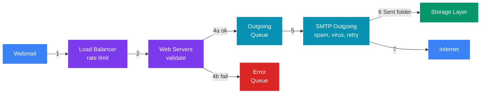
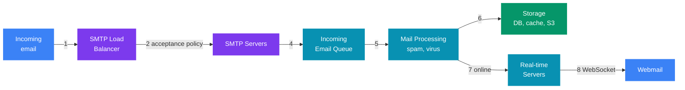
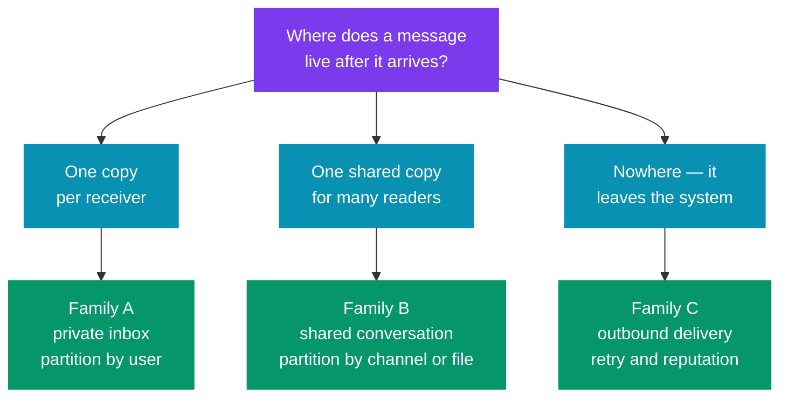

# Ch 8: Distributed Email Service

> 📖 **Vol 2, Chapter 8** (book pages 225–251) &nbsp;·&nbsp; 💤 Low Priority &nbsp;·&nbsp; 💬 **23 Questions**  
> **Source:** Alex Xu & Sahn Lam, *System Design Interview Vol 2*, Ch 8. Page and figure numbers below are the book's printed ones.

---

📊 **Question Count**

| # | Section | Questions |
|---|---|---|
| 1 | [Requirements and Estimation ⚡](#1--requirements-and-estimation-p225227-) | 1 |
| 2 | [Email Basics and Traditional Mail Servers ⚡](#2--email-basics-and-traditional-mail-servers-p227230-) | 2 |
| 3 | [Email APIs and High-level Design 🔥](#3--email-apis-and-high-level-design-p230233-) | 1 |
| 4 | [Sending and Receiving Flows 🔥🔥](#4--sending-and-receiving-flows-p233236-) | 9 |
| 5 | [Metadata Database — Choice and Data Model 🔥🔥](#5--metadata-database--choice-and-data-model-p236240-) | 3 |
| 6 | [Threads, Consistency and Deliverability 🔥](#6--threads-consistency-and-deliverability-p240243-) | 3 |
| 7 | [Search — Elasticsearch vs Custom Engine 🔥](#7--search--elasticsearch-vs-custom-engine-p243246-) | 1 |
| 8 | [Scalability, Availability and Wrap Up ⚡](#8--scalability-availability-and-wrap-up-p246249-) | 2 |
| 9 | [Similar Problems This Design Solves 📎 🔥](#9--similar-problems-this-design-solves--) | 1 |
| | **Total** | **23** |

> 🔥🔥 Very high priority — asked in almost every Tier-1 interview loop &nbsp;·&nbsp; 🔥 High priority — very frequent in Tier-1 interviews &nbsp;·&nbsp; ⚡ Medium priority — commonly asked &nbsp;·&nbsp; 💤 Low priority — good to know, rarely asked

> **How to read this note.** Sections 1–8 follow the book, step by step. §9, at the end, maps this design to 13 similar problems. Anything the book does not say is marked **📎 Beyond the book**. Where the book has a mistake, the note says so and gives the fix.  
> Attachments go to an S3-like store. That store is designed in the next chapter: [Ch 9: S3-like Object Storage](./ch09_s3_like_object_storage.md).

---

## 🗒️ Cheat Sheet

<details>
<summary><strong>🗒️ Show cheat sheet</strong></summary>

### 🎯 Clarifying Questions — and the book's answers
| Question | Book's answer (p.225–226) |
|---|---|
| How many users? | **1 billion** |
| Which features? | Send and receive emails, fetch all emails, filter by read/unread, search by subject/sender/body, anti-spam and anti-virus |
| Authentication? | **Out of scope** — the interviewer drops it |
| How do clients talk to mail servers? | Assume **HTTP**. SMTP, POP and IMAP are legacy to some extent, but still popular |
| Attachments? | **Yes** |

**Non-functional** (p.226):
- **Reliability** — never lose email data.
- **Availability** — replicate across nodes. Keep working through partial failures.
- **Scalability** — performance must not drop as users grow.
- **Flexibility / extensibility** — POP and IMAP are too limited, so we may need custom protocols.

### 🏗️ Core Components (Figure 8.5)
- **Webmail** — the user's browser.
- **Web servers** — stateless request/response services. All email APIs go through them: send, load folders, load emails.
- **Real-time servers** — **stateful**. They push new emails to online clients over **WebSocket**, with long polling as a fallback.
- **Metadata DB** — subject, body, from, to, and so on. The DB choice is the main deep dive.
- **Attachment store** — an object store such as **Amazon S3**. Attachments go up to 25 MB.
- **Distributed cache** — **Redis**, for the most recent emails.
- **Search store** — a distributed document store with an **inverted index** for full-text search.

### Key Schema (Tables 8.1–8.4, p.238–240)
```
folders_by_user (user_id UUID K, folder_id UUID, folder_name TEXT)
emails_by_folder(user_id UUID K, folder_id UUID K, email_id TIMEUUID C↓,
                 from TEXT, subject TEXT, preview TEXT, is_read BOOLEAN)
emails_by_user  (user_id UUID K, email_id TIMEUUID C↓, from TEXT, to LIST<TEXT>,
                 subject TEXT, body TEXT, attachments LIST<filename|size>)  -- ⚠️ see §5
attachments     (email_id TIMEUUID C, filename TEXT K, url TEXT)   -- ⚠️ see §5
read_emails / unread_emails  -- same columns as emails_by_folder, minus is_read
-- K = partition key, C = clustering key, ↓ = descending
```

### 💡 Key Insights
1. **Email is storage-heavy.** About 730 PB of metadata and 1,460 PB of attachments a year. So we need a distributed database (p.226–227).
2. **Every query belongs to one user.** Partition everything by `user_id`. Users are independent, so most parts scale horizontally (p.236, p.246).
3. **A NoSQL table answers only queries on its keys.** `is_read` is not a key, so the book splits the folder into `read_emails` and `unread_emails` (p.239–240).
4. **Queues decouple everything.** An outgoing queue on the send path and an incoming queue on the receive path. Each side scales on its own (p.234–236).
5. **Consistency over availability for a mailbox.** One primary per mailbox. During a failover, the mailbox pauses (p.241).

### ⚖️ Trade-offs / Alternatives
| Option | Pro | Con | Book's verdict |
|---|---|---|---|
| Relational DB (MySQL, PostgreSQL) for metadata | Indexes on header and body make simple searches fast | Built for small rows. A typical email is > a few KB, often > 100 KB with HTML. Search over BLOBs is slow | ❌️ "Not good fits" (p.237) |
| Object storage (S3) for raw emails | Good for backup | Hard to mark as read, search by keyword, or build threads | ❌️ For metadata (p.237) |
| NoSQL — Bigtable | Gmail uses it | Not open source. How Gmail search works is unknown | ✅ "Definitely a viable solution" (p.237) |
| NoSQL — Cassandra | Could work | No large email provider is known to use it | "Might be a good option" (p.237) |
| S3 for attachments | Built for large files | — | ✅ Chosen (p.233) |
| Cassandra for attachments | One store fewer | Practical blob limit < 1 MB; attachments break the row cache | ❌️ (p.233) |
| Elasticsearch | Easy to integrate | Two copies of data to keep in sync; may need a dedicated team at scale | ✅ For smaller scale (p.246) |
| Custom search engine in the datastore | One system, one copy of data, tuned for email | Big engineering effort | ✅ For Gmail/Outlook scale (p.246) |

### 🔢 Numbers to Remember
| What | Value | Arithmetic |
|---|---|---|
| Users | **1 billion** | Interviewer's answer (p.225) |
| Send QPS | **100,000** | 10⁹ users × 10 emails/day ÷ 10⁵ s = 10⁵ (exact: 10¹⁰ ÷ 86,400 ≈ 115,700) |
| Emails received | **40 per user per day** | Assumption (p.226) |
| Metadata size | **50 KB** per email | Everything except attachments (p.226) |
| Metadata storage | **730 PB / year** | 10⁹ × 40 × 365 × 50 KB = 7.3 × 10¹⁴ KB = 730 PB (≈ 2 PB/day) |
| Attachment share | **20%** of emails, **500 KB** average | Assumption (p.226) |
| Attachment storage | **1,460 PB / year** | 10⁹ × 40 × 365 × 0.2 × 500 KB = 1.46 × 10¹⁵ KB = 1,460 PB (≈ 4 PB/day) |
| 📎 Receive writes | ≈ **400,000 / s** average | 10⁹ × 40 ÷ 10⁵ s. Not in the book |
| Attachment limit | Outlook **20 MB**, Gmail **25 MB** | As of June 2021 (p.228) |
| Cassandra blob | 2 GB in theory, **< 1 MB** in practice | (p.233) |
| Read recency | **82%** of reads are for data < **16 days** old | (p.236) |
| Emails in one account | **> 500,000** | "Can easily have over half a million" (p.244) |
| 📎 Biggest partition in the book's model | **25 GB** | 500,000 emails × 50 KB in `emails_by_user`. Cassandra works best under ~100 MB (§5) |
| Spam share | **> 50%** of all emails sent | Statista (p.241) |
| IP warm-up | **2–6 weeks** | Amazon SES (p.241) |

### ⏱️ 45-Minute Round Plan
| Minutes | Phase | What to say or draw | Trap to avoid |
|---|---|---|---|
| 0–5 | Clarify | 1B users, send/receive, fetch, read/unread filter, search, anti-spam; HTTP for clients; attachments yes | Designing auth, or arguing POP vs IMAP for ten minutes |
| 5–10 | Estimate | 100K send QPS, 730 PB metadata/year, 1,460 PB attachments/year | Skipping storage — it is the main point of this problem |
| 10–15 | Basics | SMTP between servers, MX lookup, why Maildir on one server does not scale | Too much protocol history |
| 15–25 | High-level | Figure 8.5, then the send flow (Fig 8.6) and receive flow (Fig 8.7) with their queues | Calling SMTP servers directly from web servers, with no queue |
| 25–38 | **Deep dive** | Metadata DB choice → tables by `user_id` → read/unread denormalization → threads → single primary per mailbox | Using `WHERE is_read = ?` on a NoSQL table |
| 38–45 | Deep dive + wrap up | Deliverability (IPs, warm-up, feedback queues, SPF/DKIM/DMARC), search (ES vs custom), multi-DC | Forgetting that a new mail server lands in spam |

> 📎 The timings are a suggestion, not from the book. The book gives the steps; the minutes are ours.

---

</details>
<br/>

---

## 1. 📋 Requirements and Estimation (p.225–227) ⚡

The book designs a large email service like **Gmail, Outlook or Yahoo Mail** (Figure 8.1). In 2020, Gmail had over **1.8 billion** active users. Outlook had over **400 million** (p.225).

A modern email service has too many features for 45 minutes, so ask questions first (scope in the Cheat Sheet). Two answers shape the design. **Clients use HTTP**, so the book designs a webmail API. **Attachments are in scope**, and they drive most of the storage.

### Back-of-the-envelope estimation (p.226)

"By design, emails are storage heavy applications."

- **1 billion** users.
- Each person **sends 10** emails a day. Send QPS = 10⁹ × 10 ÷ 10⁵ = **100,000**.
- Each person **receives 40** emails a day. Average **metadata** size is **50 KB**. Metadata means everything about an email except attachment files.
- Metadata for 1 year: 1 billion × 40 × 365 × 50 KB = **730 PB**.
- **20%** of emails have an attachment. The average attachment is **500 KB**.
- Attachments for 1 year: 1 billion × 40 × 365 × 20% × 500 KB = **1,460 PB**.

The book's conclusion (p.227): that is a lot of data, so we need a **distributed database**.

> 📎 **Check the maths.** 10⁹ × 40 × 365 = 1.46 × 10¹³ emails a year. Times 50 KB = 7.3 × 10¹⁴ KB. 1 PB = 10¹² KB, so that is 730 PB. The attachment line is 1.46 × 10¹³ × 0.2 × 500 KB = 1.46 × 10¹⁵ KB = 1,460 PB. Both are right. The storage is counted per **received** copy, because each recipient's mailbox stores its own copy.

### ❓ Interview Questions

1. **Do the back-of-the-envelope estimate for a 1-billion-user email service. 🔥**

<!-- -->
<details>
<summary>💡 Show Answer</summary>

**Answer:** (p.226)

| What | Assumption | Result |
|---|---|---|
| Send QPS | 10 emails sent per user per day | 10⁹ × 10 ÷ 10⁵ s = **100,000** |
| Metadata / year | 40 received per day, 50 KB each | 10⁹ × 40 × 365 × 50 KB = **730 PB** |
| Attachments / year | 20% of emails, 500 KB average | 10⁹ × 40 × 365 × 0.2 × 500 KB = **1,460 PB** |

- The conclusion: **email is storage-heavy**, so we need a **distributed database**.
- 📎 That is about 2 PB of metadata and 4 PB of attachments **per day**. Storage counts each **received** copy, because every mailbox holds its own copy. The 100K QPS is an average. Plan for a peak of 2–5×.

</details>

---

## 2. 📬 Email Basics and Traditional Mail Servers (p.227–230) ⚡

### Email protocols (p.227)

| Protocol | Job | Key facts |
|---|---|---|
| **SMTP** | **Send** email from one mail server to another | Simple Mail Transfer Protocol |
| **POP** | **Retrieve** email | Downloads the **whole** email, then deletes it from the server. So you can use only one device. Slow for large attachments. RFC 1939 |
| **IMAP** | **Retrieve** email | Keeps emails on the server. Downloads a message only when you click it. Downloads **headers only** until then, so it works on slow links. Many devices. The most widely used for personal accounts |
| **HTTPS** | Not a mail protocol, but used for webmail | Example: Outlook talks to mobile devices over HTTPS with **ActiveSync** |

### DNS and MX records (p.227–228)

The sending server looks up the **MX record** (mail exchanger) of the recipient's domain. Figure 8.2 shows `nslookup` for gmail.com. It returns five servers with priorities **5** (`gmail-smtp-in.l.google.com`), **10** (`alt1.gmail-smtp-in.l.google.com`), 20, 30 and 40 (`alt2`–`alt4`).

A **lower** number means **more preferred**. The sender tries priority 5 first. If that fails, it tries priority 10.

### Attachments (p.228)

- An attachment travels with the email, usually **Base64**-encoded.
- **MIME** (Multipurpose Internet Mail Extension) is the spec that lets attachments go over the internet.
- Size limits: Outlook **20 MB**, Gmail **25 MB** (June 2021). Corporate accounts can change this.

### Traditional mail servers (Figure 8.3, p.228–229)

A traditional mail server works for a small number of users, usually on **one server**. Alice (outlook.com) sends to Bob (gmail.com):

1. Alice presses send in her Outlook client. The email goes to the Outlook mail server over **SMTP**.
2. The Outlook server asks **DNS** for the recipient's SMTP server (Gmail's). It sends the email there over **SMTP**.
3. The Gmail server **stores** the email for Bob.
4. Bob's Gmail client **fetches** new emails through the **IMAP/POP** server when he logs in.

### Storage — Maildir (Figure 8.4, p.229–230)

Each email was a **separate file** with a unique name, in a per-user directory. **Maildir** was a popular layout: `/home/<user>/Maildir/` with `cur`, `new` and `tmp` folders.

Why it stops working:
- It is hard to **retrieve and back up** billions of emails.
- **Disk I/O** becomes the bottleneck as volume and structure grow.
- It does not meet **high availability** or **reliability** needs. A disk can break. A server can go down.

The protocols (POP, IMAP, SMTP) are old too. They were not built for threading, search or labels, and not for billions of users (p.230).

### ❓ Interview Questions

1. **Walk me through how an email travels from sender to recipient. Why does a traditional single-server mail system not scale? ⚡**

<!-- -->
<details>
<summary>💡 Show Answer</summary>

**Answer:** (Figure 8.3, p.228–229)

1. Alice's Outlook client sends the email to the Outlook mail server over **SMTP**.
2. The Outlook server queries **DNS** for the **MX record** of gmail.com. Then it sends the email to Gmail's SMTP server, again over **SMTP**.
3. The Gmail server stores the email.
4. Bob's client fetches it through the **IMAP/POP** server when he logs in.

**MX priority** (Figure 8.2): a **lower number is preferred**. The sender tries `gmail-smtp-in.l.google.com` (priority 5) first, then `alt1…` (priority 10) if that fails.

📎 The MX record gives a host name. An A/AAAA lookup on that name gives the IP. The SMTP talk is `EHLO`, `MAIL FROM`, `RCPT TO`, `DATA`, on port 25 between servers.

**Why one server does not scale** (p.229–230, p.232):

- Each email is a **separate file** in a user directory (**Maildir**, Figure 8.4). Billions of files are hard to **retrieve and back up**.
- **Disk I/O** becomes the bottleneck. And there is no **high availability**: one disk or server fails, and mail is lost or unreachable.
- Syncing data across servers is hard. The old protocols were not built for threading, search, or billions of users.

</details>

---

2. **What is the difference between POP, IMAP and HTTPS for reading mail? What does the book use? 💤**

<!-- -->
<details>
<summary>💡 Show Answer</summary>

**Answer:** (p.227)

- **POP** downloads the **whole** email to the device, then deletes it from the server. So you can use **one device** only. A large attachment makes it slow. RFC 1939.
- **IMAP** keeps mail on the server. It downloads a message only **when you click it**, and only **headers** until then. So it works on slow links and on **many devices**. It is the most used for personal accounts.
- **HTTPS** is not a mail protocol, but webmail uses it. Example: Outlook's **ActiveSync** for mobile.

**The book's choice:** the interviewer says to assume **HTTP** between client and server (p.226). POP and IMAP have very limited features, so the system may need **custom protocols** for flexibility.

</details>

---

## 3. 🌐 Email APIs and High-level Design (p.230–233) 🔥

### Email APIs (p.230–231)

"Email API" can mean several things: SMTP/POP/IMAP for native clients, SMTP between mail servers, or a **RESTful API over HTTP** for webmail. The book covers only the webmail API.

| # | Endpoint | What it does |
|---|---|---|
| 1 | `POST /v1/messages` | Sends a message to the recipients in **To, Cc and Bcc** |
| 2 | `GET /v1/folders` | Returns all folders of the account |
| 3 | `GET /v1/folders/{:folder_id}/messages` | Returns all messages in a folder. 📎 The book says real use needs **pagination** |
| 4 | `GET /v1/messages/{:message_id}` | Returns one full message |

**Folder object** (p.231): `id`, `name`, `user_id`. By **RFC 6154**, the default folders can be: All, Archive, Drafts, Flagged, Junk, Sent and Trash.

**Message object** (p.231):

```
{
  user_id: string                       // the account owner
  from:    {name: string, email: string}
  to:      [{name: string, email: string}]
  subject: string
  body:    string
  is_read: boolean
}
```

> 📎 RFC 6154 defines *special-use* mailboxes. **INBOX** is not in that list because the base IMAP spec already defines it.

### Distributed mail server architecture (Figure 8.5, p.232–233)

It is hard to scale a traditional mail server past one server. Syncing data across servers is hard. Keeping your mail out of other servers' spam folders is also hard. So the book uses cloud building blocks. Figure 8.5: webmail talks to **web servers** over HTTPS and to **real-time servers** over WebSocket. Both use one **storage layer**: metadata DB, attachment store, distributed cache and search store.

- **Web servers** handle login, sign-up and profile. In this design, **all** email API calls go through them.
- **Real-time servers** push new emails. They are **stateful**, because they hold persistent connections. Options: **long polling** or **WebSocket**. WebSocket is "more elegant", but has browser compatibility issues. So use WebSocket when you can, and long polling as a fallback. Real example: **Apache James** uses the **JMAP** subprotocol over WebSocket.
- **Metadata DB** stores subject, body, from user, to users, and so on. The choice is in §5.
- **Attachment store** — **S3**. **Cassandra is not a good fit** for two reasons (p.233):
  - Its blob type has a 2 GB theoretical limit, but the **practical limit is under 1 MB**.
  - Attachments use too much memory, so you **cannot use a row cache**.
- **Distributed cache** — clients load the **most recent emails** again and again. Cache them in **Redis**. Redis has rich types such as lists, and it is easy to scale.
- **Search store** — a distributed **document store** with an **inverted index** for fast full-text search (§7).

> 📎 Every modern browser supports WebSocket now. The real reason for a long-polling fallback today is proxies and firewalls that block the upgrade. For a deeper look at WebSocket servers, see [Vol 1 Ch 12: Chat System](../vol_1/ch12_design_a_chat_system.md).

### ❓ Interview Questions

1. **Draw the high-level design. What does each component do? 🔥🔥**

<!-- -->
<details>
<summary>💡 Show Answer</summary>

**Answer:** (Figure 8.5, p.232–233)

- **Webmail** → **web servers** over HTTPS. Stateless. All email APIs go through them.
- **Webmail** → **real-time servers** over **WebSocket**. Stateful, because they hold connections. Long polling is the fallback.
- **Storage layer:**
  - **Metadata DB** — subject, body, from, to.
  - **Attachment store** — **S3**. Not Cassandra: its practical blob limit is **< 1 MB**, and attachments break the row cache.
  - **Distributed cache** — **Redis**, for recent emails.
  - **Search store** — a document store with an **inverted index**.

</details>

---

## 4. 📤 Sending and Receiving Flows (p.233–236) 🔥🔥

### Email sending flow (Figure 8.6, p.234–235)



1. The user writes an email in webmail and presses send. The request goes to the **load balancer**.
2. The load balancer checks the **rate limit** ([Vol 1 Ch 4](../vol_1/ch04_design_a_rate_limiter.md)) and routes to the web servers.
3. The web servers:
   - Run **basic validation** against set rules, such as the email size limit.
   - Check if the recipient's **domain is the same** as the sender's. If yes, they check the email for spam and viruses. Then they insert it into the sender's **Sent** folder and the recipient's **Inbox**. The recipient fetches it through the REST API. **Steps 4 onwards are skipped.**
4. Message queues:
   - **4a.** Validation passes → the email goes to the **outgoing queue**. If the attachment is too large for the queue, store it in the **object store** and put only the reference in the message.
   - **4b.** Validation fails → the email goes to the **error queue**.
5. The **SMTP outgoing workers** pull from the outgoing queue. They check that the email is free of spam and viruses.
6. The email is stored in the **Sent folder** of the storage layer.
7. The workers send the email to the **recipient's mail server**.

Each queue message holds all the metadata needed to build the email. The queue makes sending **asynchronous**. It also lets the SMTP workers **scale apart** from the web servers.

**Monitor the outgoing queue size closely** (p.235). If many emails are stuck, there are two likely causes:

| Cause | Fix |
|---|---|
| The recipient's mail server is down | Retry later. **Exponential backoff** may be a good strategy |
| Not enough consumers | Add consumers |

### Email receiving flow (Figure 8.7, p.235–236)



1. Incoming emails arrive at the **SMTP load balancer**.
2. It spreads traffic across **SMTP servers**. An **email acceptance policy** runs at the SMTP-connection level. For example, invalid emails are **bounced** early to save processing.
3. If an attachment is too large for the queue, it goes into the **attachment store (S3)**.
4. Emails go into the **incoming email queue**. The queue decouples the mail processing workers from the SMTP servers, so each side scales on its own. It is also a **buffer** when email volume surges.
5. The **mail processing workers** filter out spam, stop viruses, and so on. The next steps assume the email passed.
6. The email is stored in the **mail storage, cache and object store**.
7. If the receiver is **online**, the email is pushed to the **real-time servers**.
8. Real-time servers are **WebSocket** servers. The client gets the new email in real time.
9. For an **offline** user, the email stays in the storage layer. When the user comes back, webmail connects to the web servers through the **RESTful API**.
10. The web servers pull new emails from storage and return them.

### ❓ Interview Questions

1. **Walk me through the email sending flow. How do you find out why emails are stuck? 🔥🔥**

<!-- -->
<details>
<summary>💡 Show Answer</summary>

**Answer:** (Figure 8.6, p.234–235)

1. Webmail → **load balancer** (checks the **rate limit**) → **web servers**.
2. Web servers run **basic validation**, such as the size limit.
3. **Same domain?** Check spam and viruses, then write to the sender's **Sent** and the recipient's **Inbox** directly. Done.
4. Otherwise: valid → **outgoing queue**; invalid → **error queue**. A large attachment goes to the **object store**, and the queue message holds only a reference.
5. **SMTP outgoing workers** pull from the queue and check spam and viruses.
6. Store the email in the **Sent** folder. Send it to the recipient's mail server.

The queue makes sending **async** and lets SMTP workers **scale on their own**.

**Stuck emails** — watch the **queue size**:

- Recipient server down → retry with **exponential backoff**.
- Not enough consumers → **add consumers**.

</details>

---

2. **Walk me through the email receiving flow. How does an online user see a new email at once? 🔥**

<!-- -->
<details>
<summary>💡 Show Answer</summary>

**Answer:** (Figure 8.7, p.235–236)

1. **SMTP load balancer** → **SMTP servers**. An **email acceptance policy** runs at the connection level and bounces invalid emails early.
2. A too-large attachment goes to **S3**.
3. The email goes into the **incoming email queue**. It decouples processing from SMTP servers, and it is a **buffer** for surges.
4. **Mail processing workers** filter spam and viruses.
5. Store the email in **mail storage, cache and object store**.
6. **Online** user → push to the **real-time servers** → **WebSocket** to the client.
7. **Offline** user → the email waits in storage. On return, the client calls the **REST API**, and web servers pull the new emails.

📎 For mobile apps in the background, add **APNs / FCM** push. A WebSocket only works while the app is open. See [Vol 1 Ch 10: Notification System](../vol_1/ch10_design_notification_system.md).

</details>

---

3. **How do you prevent duplicate emails when the network is unreliable? 📎 🔥🔥**

<!-- -->
<details>
<summary>💡 Show Answer</summary>

**Answer:**

- Every email **should** have a unique **`Message-ID`** header. RFC 5322 says SHOULD, not MUST. The sending client makes it, so it is unique only if the client behaves.
- The receiving side uses it as an **idempotency key**, scoped to **one mailbox**. If the `Message-ID` is already in that user's mailbox, drop the duplicate.
- Why per mailbox, not global? A global check is a hole. Anyone could send a fake email with a real `Message-ID`, and the real email would then be dropped for another user.
- If the header is missing, fall back to a hash of the main headers and the body.
- For outbound retries, store a delivery record per `Message-ID` and recipient. Do not re-send what was already accepted.
- Note: SMTP itself is **at-least-once**. A lost `250 OK` makes the sender try again, so duplicates are normal.

</details>

---

4. **How do you make sure an email is not lost if a server crashes in the middle of a write? 📎 🔥**

<!-- -->
<details>
<summary>💡 Show Answer</summary>

**Answer:**

- The SMTP server writes the raw email (or its large attachment) to **durable storage**, then puts a small message in the **incoming queue**. It does both **before** it replies `250 OK` to the sender.
- Do not put the whole email in Kafka. Kafka's default `message.max.bytes` is about **1 MB**, and an email can be **25 MB**. The book also moves large attachments to S3 for this reason.
- If the processing worker crashes, the queue keeps the message. The worker processes it again on restart (**at-least-once**).
- The `Message-ID` check (Q3 above) stops the second run from creating a duplicate.

</details>

---

5. **How would you scale SMTP outgoing workers to send millions of emails an hour? 📎 ⚡**

<!-- -->
<details>
<summary>💡 Show Answer</summary>

**Answer:**

- Partition the outgoing queue by **recipient domain**. Workers then reuse SMTP connections per domain.
- A huge domain like gmail.com makes one partition hot, and one partition is read by only one consumer in a group. So give big domains **several partitions** (key = domain + a small hash suffix).
- Keep **persistent connections** to major mail servers.
- **Rate-limit per destination domain.** Many servers defer a fast sender with a **4xx** code, or block it.
- Retry with **exponential backoff** (the book's advice, p.235). After the retries run out, bounce and tell the sender.

</details>

---

6. **A user's mailbox is over quota. What happens to new mail? 📎 💤**

<!-- -->
<details>
<summary>💡 Show Answer</summary>

**Answer:**

- Check the quota in the **receiving** path, before the write to storage.
- Keep each user's usage in a fast counter (for example Redis), updated asynchronously.
- Over quota → reject with SMTP **452** ("insufficient system storage"). It is a temporary error, so the sender's server retries later.
- Some servers answer **552** ("exceeded storage allocation") instead. That is a permanent error, so the sender's server bounces the email.
- Tell the user with a UI banner and an email from a **system mailbox** that skips the quota check.

</details>

---

7. **How do you protect against email header injection? 📎 💤**

<!-- -->
<details>
<summary>💡 Show Answer</summary>

**Answer:**

- Clean all user fields (To, Cc, Subject) at the web server layer.
- Reject any input with **CRLF** (`\r\n`). Attackers use it to add extra headers.
- Validate addresses against the **RFC 5321** format.
- Build messages with a tested mail library, not by hand. It escapes headers for you.

</details>

---

8. **A user reads mail on a phone and a laptop. How does each device fetch only what changed since its last sync? 📎 🔥**

<!-- -->
<details>
<summary>💡 Show Answer</summary>

**Answer:**

The book's offline path says only that web servers "pull new emails" (p.236). It does not say how the client knows what is new. A common design:

- Give each mailbox a **change log** with a sequence number that only grows. Every change gets the next number: new email, mark as read, move, delete.
- Each device stores the **last sequence number** it has seen.
- On reconnect, the device asks for "all changes after N". The server reads the log from N. It returns new emails, flag changes and deletes.
- If N is too old (the log was trimmed), the server says so. The device then does a **full resync** of its recent folders.
- The single primary per mailbox (§6) makes this easy. The primary hands out the numbers, so they never repeat.

Real examples:
- IMAP **CONDSTORE / QRESYNC** (RFC 7162) gives each mailbox change a `MODSEQ` number.
- The **Gmail API** uses a `historyId` for the same job.
- Chat does the same with a `cur_max_message_id` per device ([Vol 1 Ch 12](../vol_1/ch12_design_a_chat_system.md)).

</details>

---

9. **One user sends an email to 5,000 recipients. What happens in your design? 📎 ⚡**

<!-- -->
<details>
<summary>💡 Show Answer</summary>

**Answer:**

- Storage counts each **received** copy (§1). So one send becomes 5,000 inbox writes, one per recipient.
- The web server must not do 5,000 writes inside the request. It writes the sender's **Sent** copy, puts one message on the queue, and returns.
- A **fan-out worker** splits the recipients:
  - Same-domain recipients → insert into each Inbox.
  - Other domains → group by recipient domain. One SMTP transaction can carry many recipients with repeated `RCPT TO` lines. RFC 5321 says a server must accept at least 100 per transaction.
- A large attachment is stored **once** in S3. Every metadata copy points to the same object (the dedup idea in §8).
- **Limits** — cap recipients per message and per day. A send to 5,000 people looks like spam unless the account has a good record (§6 Q3).
- A **mailing list** (one address that expands to many members) works the same way. The list server does the expansion.

</details>

---

## 5. 🧱 Metadata Database — Choice and Data Model (p.236–240) 🔥🔥

The book's deep dive covers four topics: metadata database, search, deliverability, and scalability (p.236).

### Characteristics of email metadata (p.236)

- **Headers** are small and read often.
- **Bodies** range from small to big, but are read rarely. You normally read an email once.
- Most operations belong to **one user**: fetch, mark as read, search. A user's mail is accessed only by that user.
- **Recent data matters most.** **82%** of read queries are for data younger than **16 days**.
- **High reliability.** Data loss is not acceptable.

### Choosing the right database (p.237)

At Gmail or Outlook scale, the DB is usually **custom-made** to reduce **IOPS** (input/output operations per second). IOPS can easily become the main limit.

| Option | Book's view |
|---|---|
| **Relational** (MySQL, PostgreSQL) | Main reason to pick it: indexes on header and body make simple searches fast. But relational DBs are built for small rows. An email is usually more than a few KB, often over **100 KB** with HTML. A BLOB column can hold it, but search over BLOBs is slow. **Not a good fit** |
| **Object storage** (S3) | Good for **backup**. But it is hard to mark emails as read, search by keyword, or build threads |
| **NoSQL** | **Gmail uses Bigtable**, so it is viable. But Bigtable is not open source, and how its search works is unknown. **Cassandra** might work, but no large email provider is known to use it |

So **few existing products fit well**. Large providers build their own DB. In an interview, there is no time to design one. Instead, name the **properties** the DB must have:

- A single column can be **single-digit MB**.
- **Strong data consistency.**
- Designed to **reduce disk I/O**.
- **Highly available** and **fault-tolerant**.
- Easy to make **incremental backups**.

### Data model (p.237–240)

Use **`user_id` as the partition key**, so one user's data lives on **one shard**. The limit: messages are **not shared** between users. That is not a requirement here.

- **Partition key** — spreads data across nodes. Aim for an even spread.
- **Clustering key** — sorts data inside a partition.

The data layer must answer five queries:

| # | Query | Table |
|---|---|---|
| 1 | Get all folders for a user | `folders_by_user` — partition `user_id` (Table 8.1) |
| 2 | Show all emails in a folder | `emails_by_folder` — partition `<user_id, folder_id>`, clustering `email_id` **TIMEUUID**, descending, so newest first (Table 8.2) |
| 3 | Create / delete / get one email | `emails_by_user` + `attachments` (Table 8.3) |
| 4 | Fetch all read or unread emails | `read_emails` / `unread_emails` (Table 8.4) |
| 5 | Bonus: conversation threads | Email headers (§6) |

**Query 3** — the book's query:

```sql
SELECT * FROM emails_by_user WHERE email_id = 123;
```

An email can have many attachments. You get each one by the pair **`email_id` + `filename`**.

> ⚠️ **Book bug — Query 3 has no partition key.** `emails_by_user` is partitioned by `user_id` (Table 8.3). Cassandra rejects a query that does not give the partition key, unless you add `ALLOW FILTERING`. That scans the whole cluster. The book itself says on p.240 that NoSQL "normally only supports queries on partition and cluster keys". Fix: `SELECT * FROM emails_by_user WHERE user_id = ? AND email_id = ?;`

> ⚠️ **Book inconsistency — `attachments` is partitioned by `filename`.** Table 8.3 marks `filename` as the partition key (K) and `email_id` as the clustering key (C). The lookup by "`email_id` + `filename`" still works. But common names like `image001.png` would make huge, hot partitions. And you cannot list one email's attachments from this table. Fix: partition by `email_id`, cluster by `filename`.

**Query 4 — read / unread.** In a relational DB you would write:

```sql
SELECT * FROM emails_by_folder
WHERE user_id = <user_id> AND folder_id = <folder_id> AND is_read = true
ORDER BY email_id;
```

But this model is **NoSQL**. `is_read` is neither a partition key nor a clustering key, so most NoSQL DBs **reject** the query. Fetching the whole folder and filtering in the app works for a small service, not at this scale.

The fix is **denormalization** (Table 8.4). Split `emails_by_folder` into two tables:

- `read_emails` — all emails in read status.
- `unread_emails` — all emails in unread status.

To **mark an email as read**: **delete** it from `unread_emails`, then **insert** it into `read_emails`. To get unread emails of a folder:

```sql
SELECT * FROM unread_emails
WHERE user_id = <user_id> AND folder_id = <folder_id>
ORDER BY email_id;
```

The book's view: denormalization is common practice. It makes the app code **more complex** and harder to maintain, but **reads are faster** at scale.

> 📎 The delete and the insert are two writes. A crash between them can lose the email from both tables, or leave it in both. In Cassandra, put the pair in a **logged batch**: the batch is guaranteed to finish in the end, though not isolated. Also note that `unread_emails` now drives the unread counter, so keep it correct.

> 📎 **The split has a cost for the folder view.** After the split, "show all emails in this folder" must read two tables and merge them by `email_id`. A common alternative: keep `emails_by_folder` for the full list, and add **only** `unread_emails`. Mark as read = update `is_read` in `emails_by_folder` + delete from `unread_emails`.

> ⚠️ **Book gap — partitions that grow forever.** Cassandra works best with partitions under about **100 MB**. One account can hold over half a million emails (p.244). The book's keys break the limit for such a mailbox:
> - `emails_by_user` is partitioned by `user_id` alone and holds the full body. 500,000 × 50 KB = **25 GB in one partition**.
> - `emails_by_folder` grows too. Assume ~500 bytes per row (from, subject, preview): 500,000 rows ≈ **250 MB** for one Inbox.
>
> Fixes:
> - `emails_by_user` — partition by `(user_id, email_id)`. Every read of a full email already has both values.
> - Folder tables — add a time **bucket**: partition by `(user_id, folder_id, month)`. A page read starts at the newest bucket. It moves to the older bucket when the page is not full. Discord buckets its messages the same way ([case study](../../03_case_studies/02_discord_cassandra_to_scylladb.md)).

### ❓ Interview Questions

1. **Which database would you use for email metadata? Why not MySQL or S3? 🔥🔥**

<!-- -->
<details>
<summary>💡 Show Answer</summary>

**Answer:** (p.237)

- **Relational** — indexes make simple searches fast. But it is built for **small rows**. An email is usually more than a few KB, often **> 100 KB** with HTML. Search over BLOBs is slow. **Not a good fit.**
- **S3** — fine for **backup**. But marking as read, keyword search and threads are hard.
- **NoSQL** — **Gmail uses Bigtable**, so it works. Bigtable is not open source. **Cassandra** might work, but no big email provider is known to use it.

At Gmail scale, providers **build a custom DB** to reduce **IOPS**. In the interview, name the properties instead. A column can be **single-digit MB**. **Strong consistency**. Built to **reduce disk I/O**. **Highly available** and **fault-tolerant**. Easy **incremental backups**.

The reason: metadata is **per user**, **recent-heavy** (82% of reads < 16 days old), and **must not be lost** (p.236).

</details>

---

2. **Design the tables. How do you fetch all unread emails in a folder? 🔥🔥**

<!-- -->
<details>
<summary>💡 Show Answer</summary>

**Answer:** (Tables 8.1–8.4, p.237–240)

**Partition by `user_id`** — one user's data sits on one shard. Tables: `folders_by_user`, `emails_by_folder` (partition `<user_id, folder_id>`, clustering `email_id` **TIMEUUID** descending → newest first), and `emails_by_user` (the full email). Full schema in the Cheat Sheet.

**Unread emails:** `WHERE ... AND is_read = false` fails. `is_read` is not a partition or clustering key, so NoSQL rejects it. Filtering in the app does not scale.

**Fix — denormalize** into `read_emails` and `unread_emails`:

```sql
SELECT * FROM unread_emails
WHERE user_id = ? AND folder_id = ?
ORDER BY email_id;
```

Mark as read = **delete** from `unread_emails` + **insert** into `read_emails`. The cost: more complex app code. The gain: fast reads at scale.

📎 Three traps (all above):
- The book's Query 3 leaves out the partition key.
- The delete + insert should be one **logged batch**.
- `emails_by_user` keyed by `user_id` alone grows to **25 GB** for a big mailbox. Partition it by `(user_id, email_id)`, and add a time bucket to the folder tables.

</details>

---

3. **Gmail has labels, not folders. How would you model labels? 📎 ⚡**

<!-- -->
<details>
<summary>💡 Show Answer</summary>

**Answer:**

The book models **folders** (one email, one folder). Labels are **many-to-many**.

- Store a label table keyed for the main query: partition `(user_id, label_id)`, clustering `email_id` descending. This is the book's `emails_by_folder` pattern, with one row **per label**.
- System labels (INBOX, SENT, SPAM, TRASH) work the same way as user labels.
- **Moving** or **archiving** an email is a **label change**, not a data move. It is a cheap metadata write.
- Publish the change as an event so the search index picks it up.

</details>

---

## 6. 🧵 Threads, Consistency and Deliverability (p.240–243) 🔥

### Bonus point: conversation threads (p.240–241)

A **thread** groups replies with their original message. Clients usually use the **JWZ algorithm**. The book explains only the core idea. Three header fields carry it (Table 8.5):

| Header | Meaning |
|---|---|
| `Message-Id` | The ID of this message. The **client** generates it when sending |
| `In-Reply-To` | The parent `Message-Id` this message replies to |
| `References` | A list of message IDs in the thread |

The book shows them as a JSON `headers` object, with IDs such as `<7BA04B2A-…@gmail.com>`. With these fields, a client can rebuild the conversation — **if all messages in the reply chain are preloaded**.

### Consistency trade-off (p.241)

Replicated databases must choose between **consistency** and **availability**. For email, **correctness is very important**. So the book wants a **single primary for each mailbox**.

- During a **failover**, clients cannot access the mailbox. Sync and update pause until failover ends.
- So the design **trades availability for consistency**.

### Email deliverability (p.241–243)

Setting up a mail server is easy. Getting mail into the **inbox** is hard. Mail in the spam folder is likely never read. **More than 50%** of all emails sent are spam (Statista). A **new** mail server has **no reputation**, so its mail will probably land in spam.

| Factor | What to do |
|---|---|
| **Dedicated IPs** | Send from dedicated IP addresses. Providers distrust new IPs with no history |
| **Classify emails** | Send different kinds of mail from **different IPs**. Do not send marketing and important mail from the same servers. ISPs may mark all of it as promotional |
| **Sender reputation** | **Warm up** new IPs slowly. Amazon SES says this takes about **2 to 6 weeks** |
| **Ban spammers quickly** | Before they hurt the server's reputation |
| **Feedback processing** | Set up **feedback loops** with ISPs. Keep the complaint rate low. Ban spam accounts fast |
| **Email authentication** | **SPF**, **DKIM** and **DMARC** fight phishing |

**Feedback outcomes** (p.242):

- **Hard bounce** — the ISP rejects the email because the recipient address is **invalid**.
- **Soft bounce** — delivery failed for a **temporary** reason, such as the ISP being too busy.
- **Complaint** — the recipient clicked **"report spam"**.

Figure 8.8: the ISP sends bounces and complaints to a **feedback processing** service. It routes them into **three separate queues** — soft bounces, hard bounces, complaints — so each is handled on its own.

**Why authentication matters:** by Verizon's 2018 report, **phishing and pretexting are 93% of breaches**. Figure 8.9 shows a Gmail header where `@info6.citi.com` **passes SPF, DKIM and DMARC**.

The book's advice (p.243): you do not need to remember every term. The point is that deliverability is **hard**. It needs domain knowledge **and** good relationships with ISPs.

> 📎 **What each check does:**
> - **SPF** (Sender Policy Framework) — a DNS TXT record lists the IPs allowed to send for a domain. The receiver checks the sending IP against it.
> - **DKIM** (DomainKeys Identified Mail) — the sender signs chosen headers and a body hash with a private key. The receiver checks the signature with the public key in DNS.
> - **DMARC** — a DNS policy that tells receivers what to do when SPF/DKIM fail (`none`, `quarantine`, `reject`). It also needs the passing domain to **match** the visible From domain.

### ❓ Interview Questions

1. **How do you group emails into conversation threads? ⚡**

<!-- -->
<details>
<summary>💡 Show Answer</summary>

**Answer:** (p.240–241, Table 8.5)

Use three headers:

- `Message-Id` — this message's ID, made by the **client** when sending.
- `In-Reply-To` — the parent's `Message-Id`.
- `References` — the list of message IDs in the thread.

A client can rebuild the conversation from these, **if all messages in the chain are preloaded**. The usual algorithm is **JWZ**.

📎 On the server side, you can do the work at write time instead. Follow `In-Reply-To` / `References` to the root. Store a `thread_id` on every email. Then a thread view is `WHERE thread_id = ?`.

</details>

---

2. **A new mail server's emails land in spam. How do you improve deliverability? 🔥**

<!-- -->
<details>
<summary>💡 Show Answer</summary>

**Answer:** (p.241–243)

- **Dedicated IPs** — providers distrust new IPs with no history.
- **Classify emails** — send marketing and important mail from **different IPs**.
- **Warm up** new IPs slowly. It takes about **2–6 weeks** (Amazon SES).
- **Ban spammers quickly**, before they hurt the reputation.
- **Feedback loops** with ISPs. Route outcomes into **three queues** (Figure 8.8): **hard bounce** (invalid address), **soft bounce** (temporary, e.g. ISP busy), **complaint** ("report spam").
- **Authentication** — **SPF, DKIM, DMARC**. Phishing and pretexting are 93% of breaches (Verizon 2018).

Context: more than **50%** of all email is spam. Deliverability needs domain knowledge **and** good relationships with ISPs.

📎 Act on each queue. Stop sending to a hard-bounced address. Retry a soft bounce with backoff. Throttle or suspend an account with a high complaint rate. Moving a bad sender to a fresh IP does not help — providers see IP hopping as a spam signal.

</details>

---

3. **How do you stop a user from sending spam through your service? 📎 🔥**

<!-- -->
<details>
<summary>💡 Show Answer</summary>

**Answer:**

- **Per-user send limits** (for example 500 a day, 50 an hour), with a sliding-window counter in Redis. The book puts a rate-limit check at the load balancer (p.234).
- **New accounts** get stricter limits (for example 20 a day). Limits loosen as the account builds a good record.
- **Watch bounce and complaint rates** per account. Over the threshold → suspend the account until someone reviews it. The book says to "ban spammers quickly" (p.242).
- **Check outgoing mail** for spam and viruses in the SMTP workers (book step 5, p.234).

</details>

---

## 7. 🔍 Search — Elasticsearch vs Custom Engine (p.243–246) 🔥

Basic search finds emails with the keywords in the subject or body. Advanced search filters by From, Subject, Unread and so on.

Email search is **write-heavy**: every send, receive or delete needs **reindexing**. A query runs only when the user presses search (p.243).

**Table 8.6 — Google search vs email search:**

| | Scope | Sorting | Accuracy |
|---|---|---|---|
| Google search | The whole internet | By relevance | Indexing takes time. Some items do not show at once |
| Email search | The **user's own mailbox** | By **attributes**: time, has attachment, date within, is unread | Indexing must be **near real-time**, and results must be **accurate** |

### Option 1: Elasticsearch (Figure 8.10, p.244)

- Queries hit only the user's own mail, so **group documents by `user_id`** as the partition key.
- **Search** is **synchronous**: the user waits for the result.
- **Send / receive / delete** events need nothing returned to the client. They go **asynchronously** through **Kafka** to the reindexing jobs. Kafka decouples the services that trigger reindexing from the ones that do it.
- Elasticsearch was the most popular search engine as of June 2021. It handles full-text email search well.
- **Main challenge:** keeping the primary email store **in sync** with Elasticsearch.

### Option 2: Custom search solution (p.244–245)

Large providers build their own search engine. The book only covers its main bottleneck: **disk I/O**.

- Metadata and attachments added each day are at the **petabyte** level. One account can easily hold **over half a million** emails.
- Building the index is **write-heavy**. So store the index in an **LSM tree** (Log-Structured Merge-Tree, Figure 8.11). The write path does only **sequential writes**.
- LSM trees are the core of **Bigtable, Cassandra and RocksDB**.
- A new email first goes to **level 0, in memory**. When memory reaches a threshold, data **merges to the next level** on disk.
- LSM also **separates data that changes often from data that does not**. Email content rarely changes. Folder data changes more often, because of filter rules. Keep them in different sections. A folder change then touches only the folder data.
- For more, the book points to search in **Microsoft Exchange**.

**Table 8.7 — Elasticsearch vs custom search engine** (p.246):

| Feature | Elasticsearch | Custom search engine |
|---|---|---|
| Scalability | Scalable to some extent | Easier to scale — tuned for email |
| System complexity | Two systems: datastore + Elasticsearch | One system |
| Data consistency | Two copies of data. Hard to keep consistent | One copy, in the metadata datastore |
| Data loss possible | No. Rebuild the index from primary storage | No |
| Development effort | Easy to integrate. At large scale you may need a dedicated Elasticsearch team | Significant engineering effort |

**The book's verdict** (p.246):

- **Smaller scale** → **Elasticsearch**. Easy to integrate, small effort.
- **Larger scale** → Elasticsearch may still work, but you may need a dedicated team.
- **Gmail or Outlook scale** → a **native search embedded in the database**, not a separate index.

### ❓ Interview Questions

1. **How do you build email search? Elasticsearch or a custom engine? 🔥**

<!-- -->
<details>
<summary>💡 Show Answer</summary>

**Answer:** (p.243–246)

Email search differs from Google search. The scope is **one mailbox**. It sorts by **attributes** (time, has attachment, unread). Indexing must be **near real-time and accurate**. It is **write-heavy** — every send, receive and delete reindexes.

**Elasticsearch** (Figure 8.10):

- Partition documents by **`user_id`**.
- **Search is sync.** Send/receive/delete events go **async through Kafka** to reindexing jobs.
- Problem: keeping **two copies** of data in sync.

**Custom engine:**

- The bottleneck is **disk I/O** (PB of new data a day, > 500K emails per account).
- Store the index in an **LSM tree**: only sequential writes; level 0 in memory, merged down to disk.
- Keep often-changing **folder data** apart from rarely-changing **email data**.

**Verdict:** Elasticsearch for smaller scale. **Native search embedded in the DB** at Gmail/Outlook scale.

</details>

---

## 8. 📈 Scalability, Availability and Wrap Up (p.246–249) ⚡

### Scalability and availability (Figure 8.12, p.246–247)

- Each user's data access is **independent** of other users. So most components scale **horizontally**.
- For availability, data is **replicated across data centers**. A user talks to the mail server that is **closest** in the network.
- During a **network partition**, the user can reach messages from **another data center**. In Figure 8.12, a US user loses the US data center and is routed to the Europe one.

> ⚠️ **Book inconsistency — "single primary" vs "use another data center".** §6 says each mailbox has a **single primary**, and the mailbox is **not accessible** during failover (p.241). Figure 8.12 says the user simply moves to the Europe data center (p.246). Both can be true only in one way. The Europe replica **serves reads** (maybe slightly stale), and **writes wait** until the mailbox's primary fails over to Europe. Say this in the interview, so the two claims do not sound like a contradiction.

### Wrap up — extra talking points (p.247–248)

- **Fault tolerance** — node failures, network issues, event delays.
- **Compliance** — handle and store **PII** from Europe under **GDPR**. **Legal intercept** (lawful interception) is another common feature.
- **Security** — emails hold sensitive data. Gmail offers phishing protection, safe browsing, proactive alerts, account safety, **confidential mode** and email encryption.
- **Optimizations** — the same email to many recipients stores the **same attachment several times** in S3. **Check whether the attachment already exists** before the expensive save.

> 📎 A common way to "check existence" is to key the attachment by a **content hash** (for example SHA-256). Each recipient's metadata points to the same object.

The chapter summary mind map (p.249) repeats the Step 1–4 headings of this note.

### ❓ Interview Questions

1. **Where do you store attachments, and how do you avoid storing the same one many times? ⚡**

<!-- -->
<details>
<summary>💡 Show Answer</summary>

**Answer:**

- **S3** (an object store). It is built for large files: images, videos, documents. Attachments go up to **25 MB** (p.233).
- **Not Cassandra:** blob limit is 2 GB in theory but **< 1 MB in practice**. Attachments also use too much memory for a **row cache**.
- In both flows, a **too-large attachment goes to S3 first**. The queue message carries only a **reference** (p.234–235).
- **Dedup** (p.248): the same email to many recipients stores the same file again and again. **Check if the attachment exists** before the expensive save.

📎 For uploads, use **multipart upload** (e.g. 5 MB parts, retried one by one). For the existence check, key the object by a **content hash** such as SHA-256.

📎 **Dedup makes delete harder.** Many emails now point to one object. When one user deletes the email, you cannot delete the object. Keep a **reference count** per content hash, and delete the object only when it reaches zero. Or run a regular job that deletes objects that no email points to.

</details>

---

2. **How does the system scale? For a mailbox, do you pick consistency or availability? 🔥**

<!-- -->
<details>
<summary>💡 Show Answer</summary>

**Answer:**

**Scale** (p.246–247):

- Users are **independent** of each other. Partition by `user_id`, and most parts scale **horizontally**.
- Queues let web servers, SMTP workers and processing workers **scale separately**.
- **Replicate** across data centers. Users talk to the **nearest** one. During a **network partition**, they reach their mail from **another data center** (Figure 8.12).

**Consistency** (p.241):

- Correctness matters a lot for email. So each mailbox has a **single primary**.
- During a **failover**, clients **cannot access** the mailbox. Sync and update pause until failover ends. The design **gives up some availability** for consistency.

📎 Join the two: a replica in another region can still **serve reads** at once. **Writes wait** for the new primary (see the book inconsistency above).

</details>

---

## 9. 🧬 Similar Problems This Design Solves 📎 🔥

📎 The book does not list similar problems for this chapter. But the same core solves **at least 13 common interview problems**. Learn the core once, then change only a few parts for each one.

**The core that never changes:**
- **Partition by the owner** (`user_id` here), and sort by time, newest first. One owner's reads stay on one shard.
- **An async ingest path** — a queue between the front door and the workers that check, store and index.
- **Push to online clients, pull for offline ones.** Real-time servers do the push. A REST API (with a sync cursor) does the pull.
- **Big files go to an object store.** The database keeps only a reference.
- **A search index per owner**, fed asynchronously from the write path.

**The tag on each problem** says how often it is asked as an HLD round on its own (same legend as the questions). 🔥🔥 = learn its "what is different" column well; 💤 = knowing the family is enough.

**The one choice that splits them into three families:** where does a message live after it arrives?



### Family A — one private copy per receiver (like this chapter)

| # | Problem | What is different from this chapter |
|---|---|---|
| 1 | **Email service (Gmail, Outlook) ⚡** (this chapter) | — |
| 2 | **In-app notification inbox (the bell icon) ⚡** — [Vol 1 Ch 10](../vol_1/ch10_design_notification_system.md) | The producers are your own services, not outside SMTP servers. Items are small and of low value, so keep only recent ones (a TTL). Read/unread and the unread count work like §5. No spam filter and no attachments |
| 3 | **News feed 🔥🔥** — [Vol 1 Ch 11](../vol_1/ch11_design_news_feed_system.md) | The same fan-out on write as one email to many recipients (§4 Q9). But each follower's feed stores only the **post ID**, not a full copy. For a celebrity with millions of followers, switch to fan-out on read. The feed is also ranked, not only sorted by time |
| 4 | **Customer support ticket inbox (Zendesk, Freshdesk) ⚡** | Inbound email is parsed into a ticket. A reply joins its ticket through `In-Reply-To` / `References` (§6) or a ticket ID in the subject. The inbox belongs to a team, not one user, so you need assignment and SLA timers |
| 5 | **Statements and documents inbox (bank statements, invoices) 💤** | Write once, never edited. The files are PDFs in an object store. The database holds `user_id`, type, period and the object key. Search is by type and date, not full text. Regulation, not the user, decides how long to keep them |

### Family B — one shared copy, many readers

| # | Problem | What is different from this chapter |
|---|---|---|
| 6 | **Chat — one-to-one and group 🔥🔥** — [Vol 1 Ch 12](../vol_1/ch12_design_a_chat_system.md) | Partition by `channel_id`, not `user_id`. Messages are small and must stay in order inside a channel (`message_id`). Each device keeps a "last message seen" cursor instead of read/unread tables. Presence (online / offline) matters |
| 7 | **Slack / Discord channels 🔥** — [Discord case study](../../03_case_studies/02_discord_cassandra_to_scylladb.md) | A channel can have thousands of members, so keep one copy per channel, never one per member. Partition by `(channel_id, time bucket)` — the same fix as the §5 partition-size note |
| 8 | **Comments on a post (YouTube, Reddit) ⚡** | Partition by `post_id`. Replies form a tree through a `parent_id`, like email threads (§6). Sort by score as well as time. A viral post becomes one hot partition |
| 9 | **Google Drive / Dropbox 🔥** — [Vol 1 Ch 15](../vol_1/ch15_design_google_drive.md) | Files are shared and edited, so you need versions and conflict handling. Files are split into blocks and synced by delta. An email copy is never edited after delivery, and the book's model does not share messages between users (p.237) |

### Family C — the message leaves the system

| # | Problem | What is different from this chapter |
|---|---|---|
| 10 | **Transactional email API (Amazon SES, SendGrid) 🔥** | Only the send half: §4's outgoing queue and workers, plus §6 deliverability. The customers are other companies, so each one gets a send quota and can get dedicated IPs. Bounces and complaints go back to the customer as webhooks, and onto a suppression list |
| 11 | **Notification system (push, SMS, email) 🔥🔥** — [Vol 1 Ch 10](../vol_1/ch10_design_notification_system.md) | Many channels, each through a third-party provider (APNs, FCM, an SMS gateway). There is no mailbox to store. User settings and rate limits are checked before the queue |
| 12 | **Email marketing / newsletter platform (Mailchimp) ⚡** | Bulk sends to lists of millions. Every email needs an unsubscribe link, and hard bounces go on a suppression list. Send in waves and warm up IPs (§6) to protect the sender reputation |
| 13 | **Webhook delivery service (Stripe, GitHub) 🔥** | The target is each customer's HTTPS URL, not an SMTP server. The same per-destination queues, limits and backoff as §4 Q5. Sign each payload (HMAC). Disable an endpoint that keeps failing |

### How to use this in an interview — five questions

When you get any "store and deliver messages" problem, answer these five questions aloud. Each answer picks one part of the design:

| Ask | It decides |
|---|---|
| 1. Does each receiver get a private copy, or do many people read one shared copy? | The **family**, and the **partition key** (user, or channel / file) |
| 2. Can a stored message change after delivery? | **Write-once** (email, statements) or **versions and conflicts** (Drive) |
| 3. How big is one message, and can it carry files? | Whether you need an **object store**, and **dedup** for repeated files |
| 4. Must the receiver see it at once? | **Push** (WebSocket, mobile push) or **pull** with a sync cursor |
| 5. Does the message leave your system? | **Retries, backoff, bounces and sender reputation** (Family C) |

> **Where this does *not* transfer directly:**
>
> - **Real-time co-editing (Google Docs).** Many users change one document at the same moment. That needs operational transformation or CRDTs, not an inbox.
> - **Live comments to millions of viewers.** A missed comment is fine, so use pub/sub to open connections. There is no durable per-user store.
> - **Anything that moves money.** A mailbox may pause during failover (§6). A payment needs exactly-once effects and a ledger ([Vol 2 Ch 11](ch11_payment_system.md)).

### ❓ Interview Questions

1. **Where else can you use this email design? Pick three problems and say what changes. 📎 🔥**

<!-- -->
<details>
<summary>💡 Show Answer</summary>

**Answer:**

The core stays the same. Partition by the owner and sort by time. Put a queue in front of the workers. Push to online users and let offline users pull. Keep big files in an object store. What changes is **where a message lives**, **who writes it**, and **whether it leaves the system**.

| | Email (this chapter) | In-app notification inbox | Group chat | Transactional email API |
|---|---|---|---|---|
| Where a message lives | One copy per recipient | One copy per user | One copy per channel | Not stored. Only a delivery log |
| Partition key | `user_id` (+ a time bucket) | `user_id`, with a TTL | `channel_id` (+ a time bucket) | Queue keyed by destination domain |
| Who writes | Outside SMTP servers and own users | Your own services | Channel members | Customer apps, through an API |
| Online delivery | WebSocket push, REST pull | WebSocket or mobile push | WebSocket; mobile push if offline | None. It goes to other mail servers |
| Main risk | Storage (PB a year) and spam | Many small writes; old items expire | Order inside a channel; hot channels | Sender reputation and bounces |

**Three families to name:**

- **One private copy per receiver** (email, notification inbox, news feed, support tickets, statements): this chapter, with a different producer or retention.
- **One shared copy** (chat, Slack channels, comments, Drive): partition by the channel or file, not the user.
- **The message leaves the system** (SES, notification system, newsletters, webhooks): the send half, with retries and sender reputation.

🧬 **The full list — 13 problems in three families, plus five questions that map any new one:** see the tables above.

</details>

---
