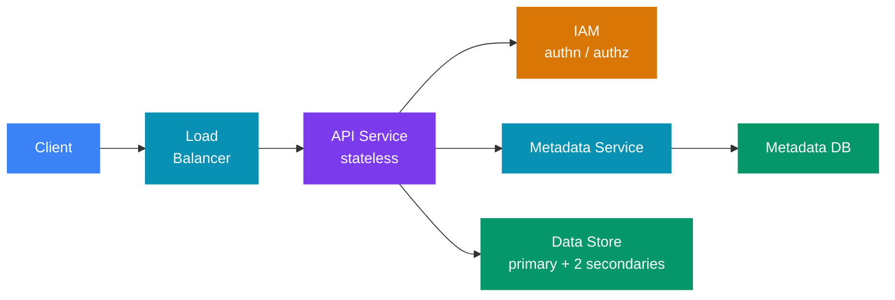
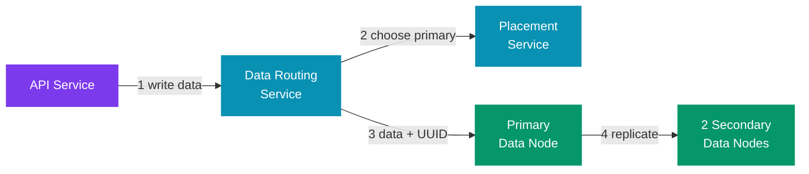
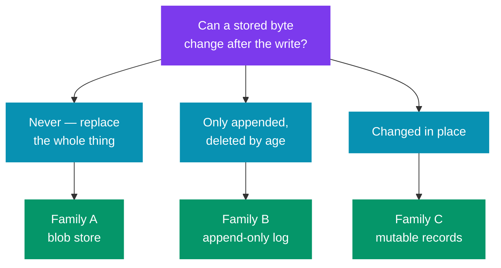

# Ch 9: S3-Like Object Storage

> 📖 **Vol 2, Chapter 9** (book pages 253–288) &nbsp;·&nbsp; ⚡ Medium Priority &nbsp;·&nbsp; 💬 **22 Questions**  
> **Source:** Alex Xu & Sahn Lam, *System Design Interview Vol 2*, Ch 9. Page and figure numbers below are the book's printed ones.  
> **Scan gap:** the PDF scan skips printed **page 286** (the end of the Wrap Up). Everything else from p.253 to p.288 was read.

---

📊 **Question Count**

| # | Section | Questions |
|---|---|---|
| 1 | [Storage System 101 ⚡](#1--storage-system-101-p253256-) | 1 |
| 2 | [Requirements and Estimation 🔥](#2--requirements-and-estimation-p256257-) | 1 |
| 3 | [High-level Design — Upload and Download 🔥🔥](#3--high-level-design--upload-and-download-p257262-) | 4 |
| 4 | [Data Store — Routing, Placement, Replication 🔥🔥](#4--data-store--routing-placement-replication-p263267-) | 3 |
| 5 | [How Data Is Organized on a Data Node 🔥](#5--how-data-is-organized-on-a-data-node-p267270-) | 1 |
| 6 | [Durability — Replication, Erasure Coding, Checksums 🔥🔥](#6--durability--replication-erasure-coding-checksums-p270276-) | 4 |
| 7 | [Metadata Data Model and Listing 🔥](#7--metadata-data-model-and-listing-p276280-) | 2 |
| 8 | [Versioning, Multipart Upload, Garbage Collection 🔥](#8--versioning-multipart-upload-garbage-collection-p280285-) | 5 |
| 9 | [Similar Problems This Design Solves 📎 🔥](#9--similar-problems-this-design-solves--) | 1 |
| | **Total** | **22** |

> 🔥🔥 Very high priority — asked in almost every Tier-1 interview loop &nbsp;·&nbsp; 🔥 High priority — very frequent in Tier-1 interviews &nbsp;·&nbsp; ⚡ Medium priority — commonly asked &nbsp;·&nbsp; 💤 Low priority — good to know, rarely asked

---

## 🗒️ Cheat Sheet

<details>
<summary><strong>🗒️ Show cheat sheet</strong></summary>

### 🎯 Clarifying Questions — and the book's answers
| Question | Book's answer (p.256) |
|---|---|
| Which features? | **Bucket creation**, **object upload and download**, **object versioning**, and **listing objects** in a bucket (like `aws s3 ls`) |
| Typical data size? | Both **massive objects** (a few GBs or more) and **many small objects** (tens of KBs). Both must be efficient |
| How much data per year? | **100 PB** |
| Durability and availability? | **6 nines** durability (99.9999%) and **4 nines** availability (99.99%) |
| Anything else? | **Storage efficiency** — keep storage cost low but stay reliable and fast |

📎 Not in the book, but worth one question each: multipart upload, pre-signed URLs, lifecycle rules, multi-region replication.

### 🏗️ Core Components (Figure 9.4, p.259–260)
- **Load balancer** — spreads REST requests across the API servers.
- **API service** — calls IAM, the metadata service and the data store. It is **stateless**, so it scales out.
- **IAM (Identity and Access Management)** — authentication (who you are) and authorization (what you may do).
- **Data store** — stores the object bytes by **object ID (UUID)**. It never sees the object name. Inside it: **data routing service**, **placement service**, **data nodes** (Figure 9.8).
- **Metadata store** — maps names to object IDs, and holds bucket and version data.

### Key Schema (Figure 9.21 and Table 9.3)
```
-- metadata store (sharded by hash(bucket_name, object_name))
bucket(bucket_name, bucket_id, owner_id, enable_versioning)
object(bucket_name, object_name, object_version, object_id)

-- on each data node, in a local SQLite database
object_mapping(object_id, file_name, start_offset, object_size)

-- object_version is a TIMEUUID; the latest one is the current version (p.281)
-- ⚠️ the book's queries filter object by bucket_id, which this table lacks (see §7)
```

### 💡 Key Insights
1. **Split metadata from data**, like a UNIX inode and its disk blocks. The data store holds **immutable** bytes. The metadata store holds **mutable** data. Each can be built and tuned on its own (p.258).
2. **Objects are immutable.** You can delete or replace an object, but not change part of it (p.257).
3. **Write once, read many.** LinkedIn found **95%** of requests are reads (p.257). This one fact drives the database choices.
4. **Many small objects go into one big file.** One file per object wastes disk blocks and runs out of inodes (p.267–268).
5. **Durability comes from copies in separate failure domains.** 3 copies give about 6 nines. Erasure coding gives about 11 nines at a lower storage cost (p.270–274).

### ⚖️ Trade-offs / Alternatives
| Option | Pro | Con | Book's verdict |
|---|---|---|---|
| Ack after **all 3** replicas (vs primary + 1, or primary only) | Best consistency | Highest latency | ✅ The book's flow; the other two are eventual (p.266–267) |
| Many objects appended to one read-write file (vs one file per object) | No wasted 4 KB blocks, no inode limit | Writes to one file must be serialized | ✅ Chosen; one read-write file **per core** (p.268) |
| `object_mapping` in **RocksDB** (SSTable) | Fast writes | Slower reads | ❌️ Rejected |
| `object_mapping` in a **relational DB** (B+ tree) | Fast reads | Slower writes | ✅ SQLite on each data node (p.269) |
| 3-copy replication | Simple, fast reads and writes | 200% extra storage, 6 nines | ✅ "We mainly focus on replication" (p.275) |
| Erasure coding (8+4) | 50% extra storage, 11 nines | More CPU, slower reads, complex | For cost-sensitive storage (p.274) |
| Shard `object` by `bucket_id` | Listing is easy | Hot shards — one bucket can hold billions of objects | ❌️ Rejected (p.277) |
| Shard `object` by `object_id` | Even load | Lookup by name needs every shard | ❌️ Rejected (p.277) |
| Shard by **hash(bucket_name, object_name)** | Even load; name lookup hits one shard | Listing by prefix needs every shard | ✅ Chosen (p.277) |
| Separate **listing table sharded by bucket ID** | Listing hits one database | Data is stored twice | ✅ Accepted — listing speed is "rarely a priority" (p.280) |

### 🔢 Numbers to Remember
| What | Value | Arithmetic |
|---|---|---|
| Data per year | **100 PB** | 100 × 1000 × 1000 × 1000 MB = **10¹¹ MB** (p.257) |
| Object mix | 20% small · 60% medium · 20% large | < 1 MB · 1–64 MB · > 64 MB (p.256) |
| Average object size | **59.3 MB** | 0.2 × 0.5 + 0.6 × 32 + 0.2 × 200 = 0.1 + 19.2 + 40 |
| Number of objects | **0.68 billion** | 10¹¹ × 0.4 ÷ 59.3 ≈ 6.75 × 10⁸ (40% storage usage ratio) |
| Metadata size | **0.68 TB** | 0.68 billion × 1 KB |
| HDD IOPS | **100–150** | One SATA disk, 7200 rpm (p.256–257). The book gives it but never uses it |
| Durability target | **6 nines** (99.9999%) | Availability target: **4 nines** (99.99%) |
| 3-copy durability | ≈ **6 nines** | 1 − 0.0081³ = 1 − 5.3 × 10⁻⁷ ≈ 0.9999995 (annual disk failure rate 0.81%) |
| Replication overhead | **200%** | 3 copies ÷ 1 copy − 1 |
| Erasure coding overhead | **50%** | 8+4: 12 ÷ 8 = 1.5. 4+2: 1 GB → 6 × 0.25 GB = 1.5 GB (Figure 9.17) |
| Erasure coding durability | **11 nines** (8+4) | From Backblaze's calculation; the book does not show the maths (p.274) |
| 8+4 failure tolerance | Up to **4** nodes down | A read needs **8** healthy nodes (p.272–273) |
| Placement service cluster | **5 or 7** nodes (Paxos/Raft) | 7 nodes: majority is 4, so it survives **3** failures (p.265) |
| Heartbeat grace period | **15 s** | Then the node is marked "down" (p.265) |
| Bucket table size | **10 GB** | 1 million customers × 10 buckets × 1 KB (p.277) |
| Multipart example | **8 parts of 200 MB** | 1.6 GB ÷ 8 (p.283) |
| S3 Standard-IA design targets | 11 nines durability, **99.9%** availability | Survives the loss of one whole AZ (p.255–256). The book calls these the "SLA"; the contract with service credits is **99%** (see §1) |

### ⏱️ 45-Minute Round Plan
| Minutes | Phase | What to say or draw | Trap to avoid |
|---|---|---|---|
| 0–5 | Clarify | Buckets, upload/download, versioning, listing. Small and huge objects. 100 PB/year. 6 nines durability, 4 nines availability | Designing a file system. Say "flat namespace, immutable objects" early |
| 5–8 | Estimate | Average object ≈ 59 MB → ~0.7 billion objects → ~0.7 TB metadata | Spending minutes on IOPS. Say: "metadata fits a sharded DB; disk is the cost" |
| 8–18 | High-level | Figure 9.4: LB → API service → IAM, metadata service, data store. Upload and download flows | Putting the object name in the data store |
| 18–28 | **Data store** | Routing → placement (cluster map, heartbeats, Raft) → primary + 2 secondaries. Ack options. Small objects in one big file + `object_mapping` | One file per object |
| 28–38 | **Durability + metadata** | Failure domains, 3 copies vs 8+4 erasure coding, checksums. Schema, shard by hash(bucket, name), listing table | Saying "erasure coding is free" — reads need 8 nodes |
| 38–45 | Wrap up | Versioning with TIMEUUID + delete marker, multipart upload, GC by compaction | Forgetting orphan parts of failed multipart uploads |

> 📎 The timings are a suggestion, not from the book. The book gives the steps; the minutes are ours.

---

</details>
<br/>

---

## 1. 📦 Storage System 101 (p.253–256) ⚡

The chapter designs a service like **Amazon S3**, which gives object storage through a RESTful API (p.253). The book says S3 launched in June 2006. ⚠️ **Book bug** — AWS launched S3 on **14 March 2006**. It stored **2 trillion** objects by 2013 and **over 100 trillion** by 2021.

### Three kinds of storage (Figure 9.1, p.253–254)

- **Block storage** — came first, in the 1960s. HDDs and SSDs attached to a server are block storage. The server gets raw blocks as a **volume**. It can format them as a file system, or give them to an app like a database or a VM engine. Block storage can also sit on the network, over **Fibre Channel** or **iSCSI**.
- **File storage** — built on top of block storage. Data lives as files in a **directory tree**. Many servers can share it over **SMB/CIFS** or **NFS**. It is the most common general-purpose storage.
- **Object storage** — new. It **gives up performance** to get high durability, huge scale and low cost. It targets "cold" data, mainly for archive and backup. All data sits in a **flat structure**, with no directories. Access is through a RESTful API. Examples: AWS S3, Google object storage, Azure Blob Storage.

### Table 9.1 — storage options (p.255)

| | Block | File | Object |
|---|---|---|---|
| Mutable content | Y | Y | **N** (versioning yes, in-place update no) |
| Cost | High | Medium to high | **Low** |
| Performance | Medium to high, very high | Medium to high | Low to medium |
| Consistency | Strong | Strong | Strong |
| Data access | SAS / iSCSI / FC | File access, CIFS/SMB, NFS | **RESTful API** |
| Scalability | Medium | High | **Vast** |
| Good for | VMs, high-performance apps like databases | General file system access | Binary and unstructured data |

### Terminology (p.255–256)

- **Bucket** — a logical container for objects. The name is **globally unique**. You create a bucket before you upload.
- **Object** — one piece of data in a bucket. It has **object data** (the payload) and **metadata** (name-value pairs).
- **Versioning** — keeps many versions of an object in one bucket. You turn it on per bucket. It lets you recover deleted or overwritten objects.
- **URI** — each bucket and object has a unique URI for the REST API.
- **SLA** — a contract between the provider and the client. The book's example is S3 Standard-IA: **11 nines** durability across AZs, survives the loss of **one whole AZ**, and **99.9%** availability.

> ⚠️ **Book imprecision — design target vs SLA.** AWS says Standard-IA is *designed for* 11 nines and 99.9%. Those are design targets, not the contract. The S3 SLA (the part that pays service credits) promises **99%** monthly uptime for Standard-IA. It says nothing about durability. In an interview, keep the two words apart. The **SLO** is your internal target. The **SLA** is the lower number you promise in writing.

### ❓ Interview Questions

1. **What is the difference between object storage, file storage, and block storage? 🔥**

<!-- -->
<details>
<summary>💡 Show Answer</summary>

**Answer:**

(Table 9.1, p.253–255)

- **Block storage** (e.g. AWS EBS) gives **raw blocks** to a server as a volume. The OS formats it, or a database or VM uses it directly. High performance, high cost. Good for databases and VMs.
- **File storage** (e.g. AWS EFS, NFS) sits **on top of block storage**. It gives files in a directory tree. Many servers share it over NFS or SMB/CIFS.
- **Object storage** (e.g. S3) stores **immutable** objects in a **flat** structure, through a **RESTful API**. It gives up performance for **durability, vast scale and low cost**. Good for unstructured data: images, videos, backups.

</details>

---

## 2. 📋 Requirements and Estimation (p.256–257) 🔥

The requirements are in the Cheat Sheet. Non-functional: **100 PB** of data, **6 nines** durability, **4 nines** availability, and **storage efficiency**.

### Back-of-the-envelope (p.256–257)

Object storage hits limits in **disk capacity** or **disk IOPS**. The book assumes 20% small objects (< 1 MB), 60% medium (1–64 MB) and 20% large (> 64 MB), with median sizes 0.5 MB, 32 MB and 200 MB. One SATA HDD at 7200 rpm does **100–150 IOPS**. The storage usage ratio is **40%**.

```
100 PB = 10^11 MB
objects = (10^11 × 0.4) / (0.2 × 0.5 + 0.6 × 32 + 0.2 × 200) MB
        = 4 × 10^10 / 59.3
        ≈ 0.68 billion objects
metadata = 0.68 billion × 1 KB ≈ 0.68 TB
```

> ⚠️ **Book inconsistency — is 100 PB the data or the disk?** The interviewer says we must *store* 100 PB of data (p.256). The formula then fills only 40% of the 100 PB (p.257). That treats 100 PB as **disk capacity**, not data. If 100 PB is the data, the count is 10¹¹ ÷ 59.3 ≈ **1.7 billion objects** and ≈ **1.7 TB** of metadata. Say which one you mean. The conclusion does not change: the metadata is about 1 TB, so a sharded database holds it easily.

> 📎 **Use the IOPS number.** The book never does. With 3 copies, 100 PB of data needs 300 PB of disk. With 20 TB HDDs, that is 300 PB ÷ 20 TB = **15,000 disks**. At 100–150 IOPS each, the cluster has about **1.5–2.25 million IOPS**. Reads go to one replica, so read IOPS are rarely the limit. **Capacity** is the cost.

### ❓ Interview Questions

1. **Walk me through the back-of-the-envelope estimation for this system. 🔥**

<!-- -->
<details>
<summary>💡 Show Answer</summary>

**Answer:**

(p.256–257)

- **Assumptions:** 100 PB = 10¹¹ MB. Objects are 20% small (0.5 MB median), 60% medium (32 MB), 20% large (200 MB). A 40% storage usage ratio. One HDD does **100–150 IOPS**.
- **Average object** 0.1 + 19.2 + 40 = **59.3 MB** → **objects** 10¹¹ × 0.4 ÷ 59.3 ≈ **0.68 billion** → **metadata** × 1 KB ≈ **0.68 TB**.

The point: metadata is about **1 TB**, which a sharded database handles. The real cost is **disk capacity**. (If 100 PB is the data, not the disk, the numbers become ~1.7 billion objects and ~1.7 TB — see the warning above.)

</details>

---

## 3. 🔄 High-level Design — Upload and Download (p.257–262) 🔥🔥

### Properties that shape the design (p.257–258)

- **Object immutability** — you can delete or fully replace an object, but not change part of it. **Key-value store** — the URI is the key, the data is the value (Listing 9.1).
- **Write once, read many** — 95% of requests are reads (LinkedIn's Ambry research). **Small and large objects** — support both.

### The UNIX inode idea (Figure 9.2, p.257–258)

A UNIX file system keeps the file name and metadata in an **inode**, apart from the data. The inode holds **file block pointers** to the data on disk. Object storage works the same way:

| UNIX file system | Object storage |
|---|---|
| inode | **Metadata store** — object name → object ID |
| disk blocks | **Data store** — object ID → bytes |
| local disk access | a **network request** |

The data store holds **immutable** data. The metadata store holds **mutable** data. So the two can be built and tuned on their own. Figure 9.3 shows the metadata. A bucket has ID, name, policy and life cycle. An object has ID, name, version ID, expiration, access control and bucket.

### High-level design (Figure 9.4, p.259)



The metadata and data stores are **logical** parts. You can build them in other ways. In **Ceph's Rados Gateway** there is no separate metadata store: everything, even the bucket, is stored as Rados objects (p.260).

### Uploading an object (Figure 9.5, p.260–261)

The client creates a bucket `bucket-to-share`, then uploads `script.txt` into it.

1. The client sends `HTTP PUT` to create the bucket. The LB forwards it to the API service.
2. The API service calls **IAM**. The user must have **WRITE** permission.
3. The API service asks the metadata store to create the **bucket entry**. Then it returns success.
4. The client sends `HTTP PUT` to create the object `script.txt`.
5. The API service checks the user's identity and **WRITE** permission on the bucket.
6. The API service sends the payload to the **data store**. The data store saves it and **returns the object's UUID**.
7. The API service asks the metadata store to create an entry: `object_id` (UUID), `bucket_id`, `object_name`, and more (Table 9.2).

Listing 9.2 shows the request: `PUT /bucket-to-share/script.txt`, with `Authorization`, `Content-Type`, `Content-Length: 4567` and a custom header `x-amz-meta-author: Alex`.

### Downloading an object (Figure 9.6, p.261–262)

A bucket has no directories. You can fake a folder by putting `/` in the object name, like `bucket-to-share/script.txt`.

1. The client sends `GET /bucket-to-share/script.txt`.
2. The API service asks IAM: does the user have **READ** access to the bucket?
3. The API service gets the object's **UUID** from the metadata store.
4. It gets the object data from the data store **by UUID**.
5. It returns the data in the HTTP GET response.

The data store never stores the object name. So every read is **two steps**: name → UUID, then UUID → bytes.

### ❓ Interview Questions

1. **Draw the high-level design and walk through an upload. 🔥🔥**

<!-- -->
<details>
<summary>💡 Show Answer</summary>

**Answer:**

(Figures 9.4–9.5, p.259–261)

Parts: **load balancer → stateless API service → IAM, metadata service, data store**.

Upload of `script.txt` into `bucket-to-share`:

1. `PUT` the bucket → IAM checks **WRITE** → the metadata store creates the **bucket entry**.
2. `PUT` the object → IAM checks **WRITE** on the bucket.
3. The payload goes to the **data store**. It saves the bytes and returns a **UUID**.
4. The API service writes the metadata: `object_name`, `object_id` (UUID), `bucket_id`.

📎 The data is saved **before** the metadata. So a crash leaves at worst an **orphan** object with no name. The GC cleans those up (p.284).

</details>

---

2. **Why split metadata from object data? How does a download work? 🔥🔥**

<!-- -->
<details>
<summary>💡 Show Answer</summary>

**Answer:**

**Why split** (p.257–258): it is the **UNIX inode** idea. The inode holds the name and block pointers; the disk holds the bytes. Here the metadata store maps **name → UUID** and the data store maps **UUID → bytes**.

- The data store holds **immutable** data. The metadata store holds **mutable** data.
- So each part is built, tuned and scaled **on its own**.

**Download** (Figure 9.6, p.262): `GET /bucket-to-share/script.txt` → IAM checks **READ** → the metadata store gives the **UUID** → the data store returns the bytes **by UUID**. The data store never knows object names.

📎 For a big object, the client can send several `Range: bytes=start-end` GETs in parallel. The data node adds the range start to `start_offset`, so it reads only the bytes asked for.

</details>

---

3. **How do pre-signed URLs work for direct client upload and download? 📎 🔥**

<!-- -->
<details>
<summary>💡 Show Answer</summary>

**Answer:**

A pre-signed URL lets a client use the object store **without passing through your API servers**.

1. Your server signs `(bucket, key, operation, expiry)` with the credentials of a user who may do that operation. In S3 this is **SigV4**, an HMAC-SHA256 signature.
2. The client sends the request **straight to the storage endpoint** with that URL.
3. The store checks the signature and expiry, then serves it. The URL has **only** the signer's permissions.

- Keep the **TTL short** (e.g. 15 minutes) — anyone with the URL can use it. With SigV4 the maximum is **7 days**.
- Bytes no longer flow through your servers, which saves cost and latency.

</details>

---

4. **How do you encrypt objects at rest? 📎 ⚡**

<!-- -->
<details>
<summary>💡 Show Answer</summary>

**Answer:**

The book does not cover encryption. The standard answer is **envelope encryption**.

1. For each object, make a random **data key** (AES-256). Encrypt the bytes with it.
2. Encrypt the data key with a **master key** that lives in a **KMS** (Key Management Service). The master key never leaves the KMS.
3. Store the **encrypted data key** next to the object's metadata.
4. On a read, ask the KMS to decrypt the data key. Then decrypt the bytes and stream them out.

**Why two keys:** rotating the master key only re-encrypts the small data keys, not petabytes of objects. And one leaked data key exposes one object, not the whole store.

**S3's three options:**

| Option | Who holds the key | Note |
|---|---|---|
| **SSE-S3** | S3 | The default for all new objects since January 2023 |
| **SSE-KMS** | AWS KMS | Every key use is logged. Each request calls KMS, so **S3 Bucket Keys** cut those calls |
| **SSE-C** | The client | The client sends the key with every request. S3 does not store it |

Data in transit uses **TLS**. Compute checksums on the stored (encrypted) bytes, so the scrubber can check them without the key.

</details>

---

## 4. 💾 Data Store — Routing, Placement, Replication (p.263–267) 🔥🔥

The API service calls the data store to save or read an object. Upload returns an `ObjectID`; download sends the `ObjectID` and gets the bytes (Figure 9.7). The data store has **three parts** (Figure 9.8).

### Data routing service (p.264)

It gives RESTful or **gRPC** APIs to the data node cluster. It is **stateless**, so it scales by adding servers. It has three jobs:

- ask the **placement service** for the best data node;
- **read** data from data nodes for the API service;
- **write** data to data nodes.

### Placement service (p.264–265)

- It picks the **primary and replica** data nodes for each object.
- It keeps a **virtual cluster map** — the physical layout of the cluster (Figure 9.9: root → datacenter → host → partition). It uses the map to place replicas **physically apart**. This separation is the key to durability.
- It watches every data node through **heartbeats**. No heartbeat within a **15-second grace period** → the node is marked "down" in the map.
- It is critical, so run it as a cluster of **5 or 7 nodes** with **Paxos** or **Raft**. The cluster keeps working while **more than half** the nodes are healthy. With 7 nodes, it survives **3** failures.

### Data node (p.265)

- It stores the object data and **replicates** it to a **replication group**. A **data service daemon** sends heartbeats: how many disks (HDD or SSD) the node manages, and how much data is on each.
- On the **first** heartbeat, the placement service gives the node a **unique ID** and adds it to the cluster map. It returns three things: the ID, the virtual cluster map, and **where to replicate data**.

### Data persistence flow (Figure 9.10, p.266)



1. The API service sends the object data to the data store.
2. The data routing service **makes a UUID** for the object. It asks the placement service for a node. The placement service checks the cluster map and returns the **primary** node.
3. The data routing service sends the data and the UUID **straight to the primary**.
4. The primary saves the data locally and **replicates it to two secondaries**. It replies when **all** secondaries have the data.
5. The UUID (ObjId) goes back to the API service.

**How does step 2 pick the group?** The lookup UUID → replication group must be **deterministic**. It must also keep working when replication groups are added or removed. **Consistent hashing** is a common way to do this (p.266).

### Consistency vs latency (Figure 9.11, p.266–267)

In step 4 the primary waits for **all** secondaries. That is strong consistency, but you wait for the slowest replica. There are three options:

| # | Success after… | Consistency | Latency |
|---|---|---|---|
| 1 | All **three** nodes store the data | Best | Highest |
| 2 | The primary and **one** secondary | Medium | Medium |
| 3 | The **primary** only | Worst | Lowest |

Options 2 and 3 are forms of **eventual consistency**.

> 📎 Option 2 is a write quorum of 2 out of 3 (W = 2, N = 3). If reads also use R = 2, then R + W > N and a read always sees the latest write. See [Vol 1 Ch 6](../vol_1/ch06_design_a_key_value_store.md) for quorums.

### ❓ Interview Questions

1. **Inside the data store, how is a new object placed and saved? 🔥🔥**

<!-- -->
<details>
<summary>💡 Show Answer</summary>

**Answer:**

Three parts (Figure 9.8, p.264–265):

- **Data routing service** — stateless REST/gRPC front door to the data nodes.
- **Placement service** — keeps the **virtual cluster map** and places replicas **physically apart**. No heartbeat in **15 s** → node "down". Runs as **5 or 7 nodes** with **Paxos or Raft**.
- **Data nodes** — store the bytes and replicate within a **replication group**.

**Flow** (Figure 9.10, p.266):

1. Routing **makes a UUID**, and placement returns the **primary**.
2. Routing sends the data + UUID to the primary.
3. The primary replicates to **two secondaries**. It replies after **all** succeed.
4. The UUID goes back to the API service.

The UUID → replication group lookup must be **deterministic** and survive groups being added or removed. **Consistent hashing** is a common choice — see [Vol 1 Ch 5](../vol_1/ch05_design_consistent_hashing.md) for the ring, virtual nodes and the 1/n key movement.

</details>

---

2. **When should a write be acknowledged? What does each choice cost? 🔥**

<!-- -->
<details>
<summary>💡 Show Answer</summary>

**Answer:**

(Figure 9.11, p.266–267)

| Ack after… | Consistency | Latency |
|---|---|---|
| All 3 nodes | Best | Highest — you wait for the slowest replica |
| Primary + 1 secondary | Medium | Medium |
| Primary only | Worst | Lowest |

The last two are **eventual consistency**. The book's flow uses the first: the primary waits for all secondaries.

📎 For **read-after-write** on the object as a whole, the order matters too. Ack the PUT only after the **data** is durable **and** the **metadata** row is committed. A GET then always finds the new version. S3 has given strong read-after-write since December 2020.

</details>

---

3. **How do you serve a hot object that gets millions of reads per second? 📎 ⚡**

<!-- -->
<details>
<summary>💡 Show Answer</summary>

**Answer:**

1. Put a **CDN** in front. Edge caches serve most reads, so few reach the origin.
2. **Spread reads** across all replicas, not only the primary.
3. Find hot objects from access metrics, and add **extra temporary replicas** for them.
4. For a known event (e.g. a software release), copy the object to every region **before** the event.

</details>

---

## 5. 📁 How Data Is Organized on a Data Node (p.267–270) 🔥

### Why not one file per object? (p.267–268)

It is simple, but slow with many small files. Two problems:

- **Wasted disk blocks.** A file system stores files in fixed-size blocks, usually **4 KB**. A file smaller than 4 KB still uses a whole block.
- **Running out of inodes.** Most file systems fix the number of inodes when the disk is set up. Millions of small files can use them all. The OS also handles a huge number of inodes badly, even with caching.

### Many small objects in one big file (Figure 9.12, p.268)

It works like a **write-ahead log (WAL)**. A new object is **appended** to the current **read-write file**. When the file reaches its limit (usually **a few GB**), it becomes **read-only** and only serves reads. A new read-write file takes new objects.

**Writes to one read-write file must be serialized**, because objects sit one after another. On a server with many cores this limits write throughput. **Fix:** give **each core** its own read-write file.

### Object lookup (Tables 9.3–9.4, p.268–269)

To find an object by UUID, the data node needs: the **file**, the **start offset**, and the **size**.

| Field | Description |
|---|---|
| `object_id` | UUID of the object |
| `file_name` | The file that holds the object |
| `start_offset` | Where the object starts in the file |
| `object_size` | Number of bytes in the object |

**Where to keep this mapping?** (p.269) **RocksDB** (SSTable) has fast writes but slower reads. A **relational DB** (B+ tree) has fast reads but slower writes. The pattern is **write once, read many**, so the book picks the **relational database**.

**How to deploy it?** One big cluster for all nodes is hard to manage. But the mapping data **belongs to one data node** — no other node needs it. So run a small relational DB **on each data node**. The book picks **SQLite**, a file-based relational DB with a solid name.

### Updated data persistence flow (Figure 9.13, p.269–270)

1. The API service asks to save `object 4`.
2. The data node service **appends** it to the read-write file `/data/c`.
3. It **inserts** a row into `object_mapping`.
4. It returns the **UUID**.

### ❓ Interview Questions

1. **How do you store billions of small objects efficiently on a data node? 🔥**

<!-- -->
<details>
<summary>💡 Show Answer</summary>

**Answer:**

**Problem with one file per object** (p.267–268): files use whole **4 KB** blocks, so small files waste space. Millions of files can also use up the **inodes**, and the OS handles huge inode counts badly.

**Fix — pack objects into big files**, like a **WAL** (Figure 9.12). **Append** each object to the current **read-write file**. At a few GB, mark it **read-only** and open a new one. Writes to one file must be serialized, so give **each core** its own read-write file.

**Lookup** (Table 9.3): `object_mapping(object_id, file_name, start_offset, object_size)`, in **SQLite on each data node** — the mapping belongs to one node only. **Relational (B+ tree)** beats **RocksDB (SSTable)** here: the pattern is **write once, read many**, and B+ trees read faster (p.269).

</details>

---

## 6. 🔐 Durability — Replication, Erasure Coding, Checksums (p.270–276) 🔥🔥

### Hardware failure and failure domains (p.270–271)

Disks fail, whatever the media. One disk cannot give the durability target. So the design **stores 3 copies**.

- A spinning disk has an **annual failure rate of 0.81%** (Backblaze). This depends a lot on model and make.
- 3 copies: **1 − 0.0081³ ≈ 0.999999** — about **6 nines**. The book calls this "a very rough estimate".

A **failure domain** is a part of the system that fails together when a critical service has a problem. **Node level:** parts inside one server (motherboard, CPUs, power supply, disks). **Rack level:** servers that share switches and power. **AZ level:** **Availability Zones** that share nothing. Replicate to **different AZs** (Figure 9.14).

The choice of failure domain level **does not directly increase durability**. It gives better reliability in **extreme** cases: big power outages, cooling failures, natural disasters.

> 📎 The 1 − p³ formula assumes the three disks fail independently and never get repaired. Real systems repair a lost copy in hours. So the true number depends on **repair time** more than on the formula. Putting copies in separate failure domains is what keeps the "independent" assumption true.

### Erasure coding (Figures 9.15–9.16, p.271–273)

Erasure coding splits data into smaller pieces on different servers and adds **parities** for redundancy. After a failure, the remaining chunks and parities **rebuild** the lost data.

**4+2 example (Figure 9.15):**

1. Split the data into four equal chunks: d1, d2, d3, d4.
2. Compute two parities with a formula (**Reed–Solomon**). A much simpler example: `p1 = d1 + 2×d2 − d3 + 4×d4` and `p2 = −d1 + 5×d2 + d3 − 3×d4`.
3. d3 and d4 are lost in node crashes.
4. Use the formula with d1, d2, p1 and p2 to rebuild d3 and d4.

**8+4 example (Figure 9.16):** 8 data chunks + 4 parities = 12 chunks of the same size, in **12 different failure domains**. The data survives while **at most 4** nodes are down.

The price: with replication, a read needs **one** healthy node. With 8+4, the data router must read from **at least 8** healthy nodes. You accept a more complex, slower design for **higher durability and lower storage cost**. When storage is the main cost, that trade can be worth it.

**Extra space (Figure 9.17, p.273–274):** erasure coding has one parity for every two data chunks → **50%** overhead (1 GB → 6 × 0.25 GB = 1.5 GB). 3-copy replication has **200%** overhead (1 GB → 3 GB).

**Durability:** with a 0.81% node failure rate, Backblaze's calculation gives erasure coding **11 nines**. The book skips the maths.

### Table 9.5 — replication vs erasure coding (p.274)

| | Replication | Erasure coding |
|---|---|---|
| Durability | 6 nines (3 copies) | **11 nines** (8+4). **EC wins** |
| Storage efficiency | 200% overhead | **50%** overhead. **EC wins** |
| Compute | No computation. **Replication wins** | More CPU to compute parities |
| Write performance | No calculation. **Replication wins** | Slower: parities first, then write |
| Read performance | Normal reads come from one replica. A failed node does not slow reads. **Replication wins** | Normal reads come from many nodes. Reads in failure mode are slower — data must be rebuilt first |

**Book's verdict** (p.274–275): replication fits **latency-sensitive** apps. Erasure coding fits when you want to **lower storage cost**. Erasure coding complicates the data node a lot, so **this design focuses on replication**.

> 📎 Real systems mix both. They keep new and hot data replicated and later convert it to erasure coding. Backblaze uses 17+3. Azure Storage uses Local Reconstruction Codes. Do not claim S3's exact scheme — AWS does not publish it.

### Correctness verification — checksums (Figures 9.18–9.20, p.275–276)

A disk that fails fully and visibly is just a data node failure — erasure coding rebuilds it. The harder problem is **silent corruption**. In-memory data corruption is a **regular event** in large systems.

The fix: **verify checksums between process boundaries**. A checksum is a small block of data that detects errors.

Different checksums → the data is **corrupted**. Same checksums → **very likely** fine (not 100%, but treat it as the same).

There are many algorithms: **MD5**, **SHA1**, **HMAC**. A good one gives a very different output for a tiny input change. The book picks **MD5** for simplicity.

> 📎 MD5 is fine for finding random errors, but it is broken for security. HMAC is a keyed signature, not a plain checksum. Storage systems often use a fast **CRC32C** for error checks.

**Layout (Figure 9.20):** append a checksum **after each object**. Before a file becomes read-only, add a checksum of the **whole file** at its end.

**Read path with 8+4 erasure coding and checksums** (p.276):

1. Fetch the object data and its checksum, and compute the checksum of the data received.
2. Match → no errors. Mismatch → corrupted, so read it from **other failure domains**.
3. Repeat until all **8** pieces are back. Then rebuild the data and send it to the client.

### ❓ Interview Questions

1. **Replication or erasure coding? Explain erasure coding and its cost. 🔥🔥**

<!-- -->
<details>
<summary>💡 Show Answer</summary>

**Answer:**

**Erasure coding** splits data into **k** data chunks and computes **m** parity chunks (Reed–Solomon). Any **k** of the **k+m** chunks rebuild the data (Figures 9.15–9.16, p.271–273).

- **4+2:** 1 GB → 6 × 0.25 GB = **1.5 GB**. Survives 2 lost chunks.
- **8+4:** 12 chunks in **12 failure domains**. Survives **4** lost. Overhead 12 ÷ 8 = **50%**.

**Compare** (Table 9.5, p.274):

| | 3-copy replication | 8+4 erasure coding |
|---|---|---|
| Durability | ~6 nines | ~11 nines |
| Storage overhead | 200% | 50% |
| CPU | None | Parity maths |
| Writes | Faster | Slower — compute parities first |
| Reads | From **one** replica | From **8** nodes; rebuild on failure |

**Book's verdict:** replication for **latency-sensitive** data, erasure coding to **cut storage cost**. The book's design **focuses on replication**, because erasure coding makes the data node much more complex (p.274–275).

</details>

---

2. **How do you reach 6 nines of durability? What are failure domains? 🔥**

<!-- -->
<details>
<summary>💡 Show Answer</summary>

**Answer:**

(p.270–271)

- One disk is never enough. **Store 3 copies**.
- Disk annual failure rate **0.81%** → 1 − 0.0081³ ≈ **0.999999** — about 6 nines. The book calls it a rough estimate.

A **failure domain** is a part of the system that fails together. Three levels: a **node** (shared motherboard, power supply), a **rack** (shared switches and power), an **AZ** (independent power and networking). Replicate across AZs (Figure 9.14). This does not directly raise durability. It protects against **extreme** events: large power outages, cooling failures, natural disasters.

📎 **When a node dies:** the placement service marks it down after 15 s of no heartbeats. A repair job then finds the objects that lost a copy. It copies them from healthy replicas to new nodes, in other failure domains. Reads keep going to the surviving replicas. Repair speed matters: the shorter the window with only 2 copies, the higher the real durability.

</details>

---

3. **How do you detect silent data corruption? ⚡**

<!-- -->
<details>
<summary>💡 Show Answer</summary>

**Answer:**

(Figures 9.18–9.20, p.275–276)

A fully dead disk is easy — treat it as a node failure. **In-memory corruption** is the hard case, and it happens often at scale.

- **Verify checksums between process boundaries.** The book uses **MD5** (others: SHA1, HMAC).
- **Layout:** a checksum **after each object**, and one for the **whole file** before it becomes read-only.
- **Read path (8+4):** fetch data + checksum and recompute. A mismatch means corruption, so read that piece from **another failure domain**. Repeat until 8 good pieces, then rebuild.

📎 Also run a **background scrubber** that reads every chunk and checks its checksum. It finds bit rot on cold data that nobody reads, before a second copy fails too.

</details>

---

4. **How do you replicate objects to another region? 📎 ⚡**

<!-- -->
<details>
<summary>💡 Show Answer</summary>

**Answer:**

The book's design copies data across **AZs inside one region**. A full region outage still makes the data unreachable. Cross-region replication fixes that.

1. The PUT is acked after the **local** write, as before.
2. The store writes a **replication event** to a queue or change log.
3. A worker copies the bytes and the metadata to the store in the other region.

**Why asynchronous:** a synchronous copy would add a cross-region round trip to every write. The cost is an **RPO (Recovery Point Objective) above zero**. Writes that were acked but not yet copied are lost if the region dies. S3 **Replication Time Control** promises that 99.99% of objects are copied within **15 minutes**.

**Details an interviewer may push on:**

- **Same key written in both regions:** last writer wins, by timestamp or version.
- **Deletes:** S3 does not replicate delete markers unless you turn it on. It never replicates the delete of a specific version. This protects the copy from a bad or malicious delete.
- S3 needs **versioning** on both buckets before replication works.

</details>

---

## 7. 📇 Metadata Data Model and Listing (p.276–280) 🔥

### Schema (Figure 9.21, p.276–277)

The schema must support three queries. **Query 1:** find the object ID by name. **Query 2:** insert and delete an object by name. **Query 3:** list objects in a bucket that share a prefix.

| `bucket` | `object` |
|---|---|
| `bucket_name` | `bucket_name` |
| `bucket_id` | `object_name` |
| `owner_id` | `object_version` |
| `enable_versioning` | `object_id` |

### Scale the `bucket` table (p.277)

Users can only create a limited number of buckets, so the table is **small**. 1 million customers × 10 buckets × 1 KB = **10 GB**. It fits on one modern DB server. If one server lacks the CPU or network for all reads, add **read replicas**.

### Scale the `object` table (p.277)

The object table will not fit in one DB at our scale. So **shard** it:

- **By `bucket_id`** — all objects of a bucket on one shard. ❌️ **Hot shards**: one bucket can hold billions of objects.
- **By `object_id`** — even load. ❌️ Queries 1 and 2 use the **URI**, so they cannot find the shard.
- ✅ **By hash of `<bucket_name, object_name>`**. Most metadata operations use the URI, so they hit one shard. Load is even.

Queries 1 and 2 are now easy. Query 3 (listing) is harder.

### Listing objects in a bucket (p.277–279)

The namespace is flat. In `s3://mybucket/abc/d/e/f/file.txt`, the bucket is `mybucket` and the object name is `abc/d/e/f/file.txt`. S3 uses **prefixes** to make this look like folders. A prefix is a string at the **start** of the name — here `abc/d/e/f/`. Prefixes are not directories.

The `aws s3` listing command has three uses:

1. **List all buckets of a user** — `aws s3 list-buckets`.
2. **List one level under a prefix** — `aws s3 ls s3://mybucket/abc/`. Names with more slashes after the prefix are **rolled up** into a common prefix. With `CA/cities/losangeles.txt`, `CA/cities/sanfranciso.txt`, `NY/cities/ny.txt` and `federal.txt`, a top-level listing returns `CA/`, `NY/`, `federal.txt`.
3. **List recursively** — `aws s3 ls s3://mybucket/abc/ --recursive`. Every object under the prefix, with no roll-up. Under `CA/` it returns both `CA/cities/…` files.

> ⚠️ **Book inconsistency — prefix vs delimiter.** The book says the top-level listing uses the `"/"` **prefix** (p.278). No key here starts with `/`, so a prefix of `/` returns nothing. The roll-up comes from the **delimiter** `/` with an **empty prefix**. In the S3 API that is `ListObjectsV2` with `prefix=""` and `delimiter="/"`.

**Single database** (p.278–279):

```sql
-- list all buckets of a user
SELECT * FROM bucket WHERE owner_id = {id};

-- list objects in a bucket that share a prefix
SELECT * FROM object
WHERE bucket_id = "123" AND object_name LIKE 'abc/%';
```

The **application code** rolls up names with more slashes (use 2). The same query serves the recursive mode (use 3) with no roll-up.

> ⚠️ **Book inconsistency — `bucket_id` is not in the `object` table.** Figure 9.21 gives `object` a `bucket_name` column, but every listing query filters on `bucket_id` (p.278–279). Versioning also says the new row has "the same `bucket_id`" (p.281). The page-2 query even reads `FROM metadata` instead of `FROM object` (p.279). **Fix:** add `bucket_id` to `object` (or filter by `bucket_name`), and use one table name.

### Distributed databases (p.279–280)

With a sharded table you do not know which shards hold a prefix. So the metadata service runs the query on **every shard** and **aggregates** the results.

**Pagination** makes this harder. On one database, the cursor holds an offset:

```sql
SELECT * FROM object
WHERE bucket_id = "123" AND object_name LIKE 'a/b/%'
ORDER BY object_name OFFSET 0 LIMIT 10;
-- next page: OFFSET 10 LIMIT 10, the offset is encoded in the cursor
```

The loop ends when the server returns a special "end" cursor. On shards, each shard returns a different number of rows. The server merges, sorts and returns 10. The rows it did not return must come back next round. So **each shard needs its own offset**, and the cursor must carry all of them. Hundreds of shards → hundreds of offsets.

**The book's solution** (p.280): object storage is built for scale and durability. **Listing speed is rarely a priority** — every commercial object store lists slowly. So **denormalize** listing data into a **separate table sharded by bucket ID**, used only for listing. A listing query then hits **one database**. Even a bucket with billions of objects gives acceptable speed.

> 📎 **Keyset pagination removes the many-offsets problem.** Put the **last returned key** in the cursor, not offsets. Each shard runs `WHERE object_name > :lastKey ORDER BY object_name LIMIT 10`. Merge, take the first 10, and the new cursor is the 10th key. One key is enough, because every shard can restart from it. It is also faster than a deep `OFFSET`, which reads and throws away every skipped row. S3's `ContinuationToken` works this way from the client's view.

### ❓ Interview Questions

1. **Design the metadata schema. How do you shard it? 🔥🔥**

<!-- -->
<details>
<summary>💡 Show Answer</summary>

**Answer:**

**Tables** (Figure 9.21, p.276–277):

- `bucket(bucket_name, bucket_id, owner_id, enable_versioning)`
- `object(bucket_name, object_name, object_version, object_id)` — add `bucket_id`; the book's queries use it (see the warning above).

**Bucket table:** 1M customers × 10 buckets × 1 KB = **10 GB**. One server, plus **read replicas**. **Object table** — too big for one DB, so shard:

| Shard key | Result |
|---|---|
| `bucket_id` | ❌️ Hot shards — a bucket can hold billions of objects |
| `object_id` | ❌️ Even load, but lookup by name must ask every shard |
| **hash(`bucket_name`, `object_name`)** | ✅ Even load; name lookup, insert and delete hit **one shard** |

The cost: **listing by prefix** now spans every shard (next question).

</details>

---

2. **How do you list a bucket that has billions of objects, with pagination? ⚡**

<!-- -->
<details>
<summary>💡 Show Answer</summary>

**Answer:**

(p.277–280)

- **Single DB:** `WHERE bucket_id = ? AND object_name LIKE 'abc/%' ORDER BY object_name OFFSET n LIMIT 10`, with the offset in a **cursor**. The app rolls up deeper names into common prefixes like `CA/`.
- **Sharded DB:** query **every shard** and merge. Each shard needs **its own offset**, so the cursor carries hundreds of them.
- **Book's solution:** listing speed is **rarely a priority**, so **denormalize** listing data into a **separate table sharded by bucket ID**. A listing then hits one DB.

📎 **Keyset pagination** is simpler: the cursor holds the **last key** returned. Each shard runs `WHERE object_name > :lastKey ORDER BY object_name LIMIT 10`. Merge and take 10. One key is enough for all shards, and it avoids slow deep `OFFSET` scans. The delimiter `/` (not a prefix of `/`) gives the folder-like roll-up.

</details>

---

## 8. 🔖 Versioning, Multipart Upload, Garbage Collection (p.280–285) 🔥

### Object versioning (Figures 9.22–9.24, p.280–282)

Versioning keeps many versions of an object in a bucket. It lets you restore objects deleted or overwritten by mistake.

- **Without versioning:** the new metadata **replaces** the old. The old object is marked deleted, and the GC later frees its space.
- **With versioning:** the metadata store keeps **all** previous versions. Old versions are never marked deleted.

**Upload of a versioned object** (versioning must be on for the bucket):

1. The client sends `HTTP PUT` for `script.txt`. The API service checks **WRITE** permission.
2. The data store saves the data as a **new object** and returns a **new UUID**.
3. The API service calls the metadata store to save the metadata.
4. The `object` table has an `object_version` column, used only with versioning. The store **inserts a new row**. It has the same bucket and `object_name`, a new `object_id` (the UUID from step 2), and a new `object_version`. It does not overwrite the old row.

`object_version` is a **TIMEUUID**, made at insert. The **current version** is the row with the **largest TIMEUUID** for that `object_name`. This lookup must be fast in any DB (Figure 9.23).

**Delete of a versioned object** (Figure 9.24):

All versions **stay**. The store inserts a **delete marker**, which is a **new version** and so becomes the current one. A `GET` whose current version is a delete marker returns **`404 Object Not Found`**.

### Multipart upload (Figure 9.25, p.282–284)

20% of objects are large, and some are many GBs. A direct upload takes long. If the network fails half-way, you start again. So split the object into parts and upload them **independently**.

1. The client asks to **start** a multipart upload. The data store returns an **`uploadID`** that identifies the upload.
2. The client splits the file. Example: **1.6 GB into 8 parts of 200 MB**. It uploads each part with the `uploadID`.
3. For each part, the data store returns an **ETag** — basically the **MD5 checksum** of that part. It is used to check the upload.
4. After all parts, the client sends **complete multipart upload** with the `uploadID`, the part numbers and the ETags.
5. The data store **reassembles** the object by part number. For a really large object this can take a few minutes. Then it returns success.

After reassembly, the **old parts are no longer useful**. A garbage collection service frees them.

> 📎 Real S3 limits: parts are **5 MiB to 5 GiB** (the last part can be smaller), and at most **10,000 parts**. A single `PUT` is limited to **5 GB**. The final ETag of a multipart object is **not** an MD5 of the object. It is a hash of the part hashes, with a `-N` suffix. The largest object is **5 TB**.

### Garbage collection (Figure 9.26, p.284–285)

Data becomes garbage in three ways:

- **Lazy object deletion** — the object is marked deleted at delete time, not removed.
- **Orphan data** — half-uploaded data, or abandoned multipart uploads.
- **Corrupted data** — data that failed checksum verification.

The GC does **not** remove objects right away. It cleans them up later by **compaction**. It also frees space in **replicas**: delete from the primary **and** the backups. With 8+4 erasure coding, delete from **all 12** nodes.

**Compaction (Figure 9.26):**

1. The GC copies objects from `/data/b` to a new file `/data/d`. It **skips** "Object 2" and "Object 5", whose delete flag is set.
2. Then it updates `object_mapping`. For "Object 3", `obj_id` and `object_size` stay the same. `file_name` and `start_offset` change to the new place. Wrap these updates in a **database transaction**.

The new file is smaller than the old one. To avoid many small files, the GC **waits** until there are many read-only files. Then it packs objects from many files into a **few large** new files.

### Wrap up (p.285)

The book recaps the chapter. It lists storage types, the four flows, and data store vs metadata store. It also lists replication vs erasure coding, multipart upload, the schema and sharding.

> ⚠️ **Scan gap:** printed page **286** is missing from this PDF scan. It holds the end of the Wrap Up (and probably the Chapter Summary mind map).

### ❓ Interview Questions

1. **How does object versioning work, and what happens on delete? ⚡**

<!-- -->
<details>
<summary>💡 Show Answer</summary>

**Answer:**

(Figures 9.22–9.24, p.280–282)

- Turn versioning on **per bucket** (`enable_versioning`).
- Each PUT stores the bytes as a **new object** with a **new UUID**. The metadata store **inserts a new row**: same bucket and `object_name`, new `object_id`, new `object_version`. It never overwrites.
- `object_version` is a **TIMEUUID**. The **current version** is the row with the **largest** TIMEUUID.
- **Delete** inserts a **delete marker** as a new version. All old versions stay. A `GET` on an object whose current version is a delete marker returns **404**.
- **Without versioning**, the new metadata replaces the old, and the GC frees the old bytes.

📎 **Two PUTs to the same key at the same time:** both succeed. Without versioning, the later timestamp wins. With versioning, both stay, and the larger TIMEUUID is current. To stop a silent overwrite, use a **conditional write**: `If-None-Match: *` (create only if absent) or `If-Match: <ETag>` (replace only if unchanged). S3 supports both since 2024.

</details>

---

2. **Walk me through uploading a very large file (e.g. 10 GB). 🔥🔥**

<!-- -->
<details>
<summary>💡 Show Answer</summary>

**Answer:**

Use **multipart upload** (Figure 9.25, p.282–284). A single upload is slow, and a network failure means starting over.

1. **Start** the upload → get an **`uploadID`**.
2. **Split** the file (book: 1.6 GB → 8 × 200 MB; 10 GB could be 50 × 200 MB). Upload parts with the `uploadID`, in parallel, retrying only failed ones. Each returns an **ETag** (the part's **MD5**).
3. **Complete**: send `uploadID` + part numbers + ETags. The data store **reassembles** by part number (can take minutes).
4. The **GC** frees the old parts and **abandoned** uploads (orphan data).

📎 S3 limits: parts 5 MiB–5 GiB, max 10,000 parts. A single PUT is limited to 5 GB, so bigger files **must** use multipart.

</details>

---

3. **How does garbage collection work? 💤**

<!-- -->
<details>
<summary>💡 Show Answer</summary>

**Answer:**

(p.284–285)

**What becomes garbage:** lazily deleted objects, **orphan data** (half uploads, abandoned multipart uploads), and **corrupted data** that failed a checksum.

**How it is freed — compaction** (Figure 9.26):

1. Copy the **live** objects from an old read-only file (`/data/b`) to a new file (`/data/d`). Skip objects with the **delete flag**.
2. Update `object_mapping`: new `file_name` and `start_offset`. Do it in **one DB transaction**.
3. Wait until **many** read-only files need it, then pack them into a **few large** files.

Delete from **every copy**: primary and backups, or all **12** nodes with 8+4. 📎 The DELETE API stays fast because it only sets a flag.

</details>

---

4. **How do lifecycle policies move objects to cheaper storage? 📎 ⚡**

<!-- -->
<details>
<summary>💡 Show Answer</summary>

**Answer:**

The book only lists "life cycle" in the bucket metadata (Figure 9.3).

1. Each bucket stores rules, e.g. "move to an archive class after 90 days, delete after 365 days".
2. A background job scans the metadata for objects that match a rule (by age, prefix, storage class).
3. On a match it updates `storage_class` and copies the bytes to cheaper storage, often **erasure coded** instead of 3 copies. The old copy becomes garbage.

The cheaper class costs less per GB but is slower or more costly to read back.

</details>

---

5. **What is an ETag, and is it a checksum? 📎 💤**

<!-- -->
<details>
<summary>💡 Show Answer</summary>

**Answer:**

- For a simple upload (plain or SSE-S3), S3's ETag is the **MD5** of the object.
- For a **multipart** upload it is a hash of the part hashes, with a `-N` suffix. For SSE-KMS or SSE-C objects it is **not** an MD5.
- It is used for **conditional requests** (`If-Match`, `If-None-Match`): cache checks and "update only if unchanged".

So it is a version fingerprint, not a reliable checksum. For integrity, send S3's **additional checksums** (e.g. SHA-256 or CRC32C) in `x-amz-checksum-*` headers.

</details>

---

## 9. 🧬 Similar Problems This Design Solves 📎 🔥

📎 The book does not list similar problems for this chapter. But the same core solves **at least 13 common interview problems**. Learn the core once, then change only a few parts for each one.

**The core that never changes:**
- **Split metadata from data.** A small, mutable metadata store maps a name to an ID. A large data store maps the ID to bytes.
- **Immutable blobs, addressed by ID.** A change writes a new blob; the old one becomes garbage.
- **Copies in separate failure domains** — replication for hot data, erasure coding for cold data.
- **Append-only files on disk**, plus an index of `(file, offset, size)`.
- **A garbage collector** that frees space later, by compaction.

**The tag on each problem** says how often it is asked as an HLD round on its own (same legend as the questions). 🔥🔥 = learn its "what is different" column well; 💤 = knowing the family is enough.

**The one choice that splits them into three families:** can a stored byte change after it is written?



### Family A — immutable blobs (like this chapter)

A user stores whole files. A change means a new file or a new version. This chapter's design is the storage layer under all of them.

| # | Problem | What is different from this chapter |
|---|---|---|
| 1 | **S3-like object storage ⚡** (this chapter) | — |
| 2 | **Google Drive / Dropbox 🔥🔥** — [Vol 1 Ch 15](../vol_1/ch15_design_google_drive.md) | Files are split into **blocks** (Dropbox: 4 MB) and deduplicated by block hash. Only changed blocks are uploaded. Adds sync to many devices, conflicts and sharing |
| 3 | **YouTube / Netflix video storage 🔥🔥** — [Vol 1 Ch 14](../vol_1/ch14_design_youtube.md) | Each upload is **transcoded** into many resolutions and formats. Reads are streamed in small segments through a **CDN**, not served from the store |
| 4 | **Photo storage (Instagram, Facebook Haystack) 🔥** | Billions of small photos. Haystack packs them into big **volume files** with an in-memory index of offsets — the same idea as §5. Thumbnails are made at upload |
| 5 | **Pastebin ⚡** — the short-key part is in [Vol 1 Ch 8](../vol_1/ch08_design_url_shortener.md) | Text blobs are small. The text goes to the object store. The short key, its object ID and the expiry go to a DB |
| 6 | **Container image registry (Docker Hub) 💤** | **Content-addressed**: each layer's ID is its SHA-256 digest. Identical layers are stored once and shared by many images |
| 7 | **Backup / archive service (like Glacier) 💤** | Writes once, reads almost never. Erasure coded on cheap disks; a restore may take hours. Lifecycle rules move data here |

### Family B — append-only logs

Data is only **appended**. Old data is deleted by **age**, not one object at a time. The "one big read-write file, then read-only" idea from §5 is the whole design here.

| # | Problem | What is different from this chapter |
|---|---|---|
| 8 | **Distributed message queue (Kafka) 🔥** — [Vol 2 Ch 4](ch04_distributed_message_queue.md) | Messages are appended to **segment files** (Kafka default 1 GiB) that roll over to read-only. Retention deletes whole old segments, so there is no per-object GC. Readers track an **offset**, not an ID |
| 9 | **Metrics / time-series storage ⚡** — [Vol 2 Ch 5](ch05_metrics_monitoring_alerting.md) | Tiny points, written all the time. The design compresses them and **downsamples** old data. Queries read a time range, not one key |
| 10 | **Log aggregation / data lake 💤** | Logs land in the object store as large compressed files, partitioned by date. Query engines scan whole partitions. This chapter's store is the bottom layer |

### Family C — mutable records

A stored value is **changed in place**. You keep the replication and sharding ideas, but you now need versions or quorums to handle concurrent updates.

| # | Problem | What is different from this chapter |
|---|---|---|
| 11 | **Distributed key-value store 🔥🔥** — [Vol 1 Ch 6](../vol_1/ch06_design_a_key_value_store.md) | Values are small and are **overwritten**. Uses quorums (N, W, R) and vector clocks for conflicts. No metadata/data split — the key leads straight to the value |
| 12 | **Distributed file system (HDFS / GFS) ⚡** | Same split: one **NameNode** holds metadata in memory; data nodes hold **128 MB blocks** with 3 copies. But names form a real **directory tree**, so a rename is cheap, and files can be appended |
| 13 | **Email service ⚡** — [Vol 2 Ch 8](ch08_distributed_email_service.md) | The message body and attachments are blobs in an object store. The metadata (read/unread, folder, labels) **changes often** and lives in a separate DB |

### How to use this in an interview — five questions

When you get any storage-heavy problem, answer these five questions aloud. Each answer picks one part of the design:

| Ask | It decides |
|---|---|
| 1. Can a stored byte change after the write? | **Family A** (blob), **B** (log) or **C** (mutable) |
| 2. Are most objects tiny or huge? | **Pack** small ones into big files (§5), or **split** huge ones into parts or blocks (§8) |
| 3. How are they read — hot, streamed, or almost never? | A **CDN** and cache, **range reads**, or a cold **erasure-coded** tier (§6) |
| 4. Do many users store the same bytes? | **Content-addressed** IDs (a hash) for dedupe, instead of a random UUID |
| 5. How is data deleted — by the user, by age, or never? | **GC by compaction** (§8), **retention** of whole files, or lifecycle rules |

> **Where this does *not* transfer directly:**
> - **Transactions across many objects.** An object store has no multi-object transaction. Use a database for that.
> - **Search inside the content.** The store only lists by prefix. Full-text search needs a separate index.
> - **Small random updates** to part of a file, like a database page. That needs block storage, not objects.
> - **Renaming a "folder".** The namespace is flat, so a rename rewrites the key of every object under the prefix.

### ❓ Interview Questions

1. **Where else does "split metadata from immutable blobs" show up? Compare three designs. 📎 🔥**

<!-- -->
<details>
<summary>💡 Show Answer</summary>

**Answer:**

The core stays the same. A small metadata store maps a name to an ID. A large data store keeps the bytes. The difference is **what the unit is** and **how data changes and leaves**.

| | S3 (this chapter) | Google Drive / Dropbox | Kafka |
|---|---|---|---|
| Unit stored | A whole **object** | A **block** of a file (Dropbox: 4 MB) | A **message**, appended to a segment |
| Metadata maps | `(bucket, name, version)` → object ID | file → list of block hashes | topic-partition + offset → segment file and position |
| Can bytes change? | No — replace the whole object | No — a change writes new blocks | No — append only |
| Dedupe | No | **Yes**, by block hash | No |
| How data leaves | User delete → **GC by compaction** | Old versions expire → unused blocks freed | **Retention** deletes whole old segments |
| Special part | Erasure coding for durability at low cost | **Sync** and conflict handling across devices | **Consumer offsets** and ordering per partition |

**Three families to name:**

- **Immutable blobs** (S3, Drive, video, photos): change = new blob, freed later by GC.
- **Append-only logs** (Kafka, metrics, data lakes): data leaves by age, a whole file at a time.
- **Mutable records** (key-value store, HDFS, email metadata): changes in place, so you need versions or quorums.

🧬 **The full list — 13 problems in three families, plus five questions that map any new one:** see the tables above.

</details>

---
