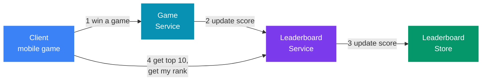
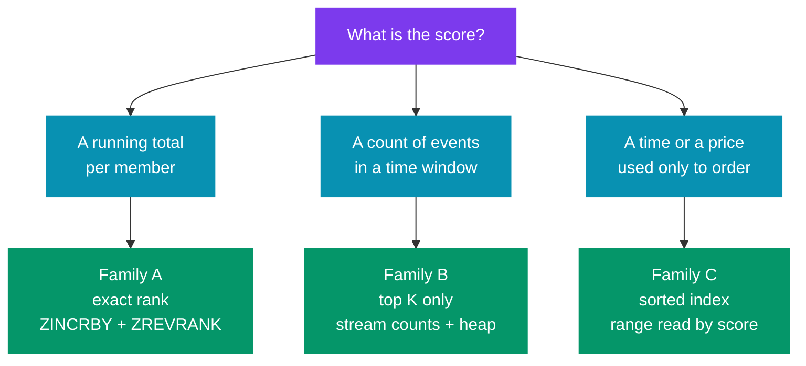

# Ch 10: Real-time Gaming Leaderboard

> 📖 **Vol 2, Chapter 10** (book pages 289–314) &nbsp;·&nbsp; 🔥 High Priority &nbsp;·&nbsp; 💬 **26 Questions**  
> **Source:** Alex Xu & Sahn Lam, *System Design Interview Vol 2*, Ch 10. Page and figure numbers below are the book's printed ones.  
> **Scan note:** in our PDF, page 310 is scanned crooked and its left edge is cut off. The text in §7 for that page is rebuilt from what is visible and from Figures 10.23–10.24.

---

📊 **Question Count**

| # | Section | Questions |
|---|---|---|
| 1 | [Requirements and Estimation ⚡](#1--requirements-and-estimation-p289291-) | ref |
| 2 | [API and High-level Design 🔥](#2--api-and-high-level-design-p291295-) | 3 |
| 3 | [First Try — a Relational Database 🔥](#3--first-try--a-relational-database-p295297-) | 1 |
| 4 | [Redis Sorted Sets 🔥🔥](#4--redis-sorted-sets-p297303-) | 10 |
| 5 | [Own Servers or the Cloud 💤](#5--own-servers-or-the-cloud-p303305-) | 1 |
| 6 | [Scaling Redis — Sharding 🔥🔥](#6--scaling-redis--sharding-p305309-) | 3 |
| 7 | [Alternative — NoSQL with DynamoDB ⚡](#7--alternative--nosql-with-dynamodb-p309312-) | 1 |
| 8 | [Wrap Up — Ties and Failure Recovery 🔥](#8--wrap-up--ties-and-failure-recovery-p312313-) | 6 |
| 9 | [Similar Problems This Design Solves 📎 🔥](#9--similar-problems-this-design-solves--) | 1 |
| | **Total** | **26** |

> 🔥🔥 Very high priority — asked in almost every Tier-1 interview loop &nbsp;·&nbsp; 🔥 High priority — very frequent in Tier-1 interviews &nbsp;·&nbsp; ⚡ Medium priority — commonly asked &nbsp;·&nbsp; 💤 Low priority — good to know, rarely asked

---

## 🗒️ Cheat Sheet

<details>
<summary><strong>🗒️ Show cheat sheet</strong></summary>

### 🎯 Clarifying Questions — and the book's answers
| Question | Book's answer (p.289–290) |
|---|---|
| How is the score calculated? | A user gets **1 point** for each match they **win** |
| Are all players on the leaderboard? | **Yes** |
| Is there a time segment? | **Yes.** Each **month** a new tournament starts, with a new leaderboard |
| Only the top 10? | Show the **top 10** and **one user's rank**. Bonus: the users **4 places above and below** a user |
| How many users? | **5 million DAU**, **25 million MAU** |
| How many matches? | Each player plays **10 matches per day** on average |
| Two players with the same score? | They get the **same rank**. Tie-breaking is a bonus topic |
| Real-time? | **Yes**, or as close as possible. A batched history is not okay |

**Functional:** show the top 10; show one user's rank; show 4 places above and below a user (bonus).
**Non-functional:** scores update in real time, the leaderboard shows the update in real time, plus general scalability, availability and reliability (p.290).

### 🏗️ Core Components (Figure 10.2, Figure 10.15)
- **Game service** — the user plays here. It **checks that a win is valid**, then calls the leaderboard service.
- **Leaderboard service** — updates scores and returns the top 10 and a user's rank.
- **Redis sorted set** — one per month, for example `leaderboard_feb_2021`. Member = user id, score = points.
- **MySQL** — a **user** table (id, display name) and a **point** table (user id, score, timestamp of each win). The point table can rebuild Redis after a failure (p.303).
- **User profile cache** (Redis) — names and pictures of the top 10 players. Optional (p.303).

### 💡 Key Insights
1. **A relational DB can store the scores, but it cannot rank millions of changing rows in real time.** Rank needs a sort or a count over the whole table (p.296–297).
2. **A sorted set keeps the order on every write.** Add, update and rank are all **O(log n)**. Inside it is a **hash table + skip list** (p.297).
3. **One Redis server is enough for 5M DAU.** About 650 MB of data and 2,500 updates/s at peak (p.302).
4. **At 500M DAU, shard.** The book prefers **fixed (score-range) partitions** over Redis Cluster hash partitions (p.308).
5. **The client never sets the score.** The game service does, after it checks the win (p.293–294).

### ⚖️ Trade-offs / Alternatives
| Option | Pro | Con | Book's verdict |
|---|---|---|---|
| Relational DB (`ORDER BY score`) | Simple, durable | Rank needs a table scan. "10s of seconds" on millions of rows | ❌️ Only for a few users (p.296) |
| **Redis sorted set** | O(log n) add, update, rank | Data is in memory; restart from disk is slow | ✅ Chosen (p.297) |
| Client sets the score | Simple | Man-in-the-middle: players use a proxy to change scores | ❌️ Not secure (p.294) |
| Kafka between game and leaderboard service | Many consumers (analytics, push) can read the same score | One more system | ❌️ Not used — not a requirement here (p.294) |
| Manage own servers (Figure 10.15) | Full control | You run and scale everything | Fine if your infra is not on the cloud |
| AWS API Gateway + Lambda | Auto-scaling, no server work | Tied to one cloud | ✅ Recommended when you build from scratch (p.305) |
| **Fixed partition** (by score range) | Top 10 = one shard. Rank = local rank + count of higher shards | Users move between shards; ranges need tuning | ✅ "We lean towards" this (p.308) |
| Hash partition (Redis Cluster) | Even spread, automatic | Top 10 needs scatter-gather; rank is hard | ❌️ (p.308) |
| DynamoDB with write sharding | Managed, scales writes | Scatter-gather; exact rank is hard — use percentiles | Alternative (p.309–312) |

### 🔢 Numbers to Remember
| What | Value | Arithmetic |
|---|---|---|
| Average users per second | **50** | 5,000,000 DAU ÷ 10⁵ s (1 day = 86,400 s ≈ 10⁵) |
| Peak users per second | **250** | 50 × 5 (peak = 5 × average) |
| Score-update QPS | **500** average, **2,500** peak | 50 × 10 matches = 500; 500 × 5 = 2,500 |
| Top-10 fetch QPS | **~50** | Each user opens the game once a day. 📎 Peak would be ~250 |
| Bytes per entry (book) | **26 B** | 24-char user id + 2-byte (16-bit) score |
| Redis data, 25M MAU | **650 MB** (×2 for overhead = 1.3 GB) | 26 B × 25,000,000 = 650,000,000 B |
| 📎 Real Redis memory | **≈ 2.5–3 GB** | ~100–120 B per member in a big sorted set × 25M. Still one server |
| 500M DAU (100×) | **65 GB**, **250,000 QPS** | 650 MB × 100; 2,500 × 100 (p.305) |
| Redis Cluster hash slots | **16,384** | slot = CRC16(key) % 16384 |
| Skip list example | **62 → 11** nodes visited | Base list vs 5 levels of index (Figure 10.10) |
| Write-heavy Redis node | **2×** memory | Room for the snapshot (p.308) |
| 📎 Max wins in a month | **~310** | 10 matches × 31 days — fits in 16 bits (max 65,535) |

### ⏱️ 45-Minute Round Plan
| Minutes | Phase | What to say or draw | Trap to avoid |
|---|---|---|---|
| 0–5 | Clarify | 1 point per win, monthly tournament, top 10 + my rank + 4 around me, 5M DAU, ties share a rank, real-time | Not asking about the time segment — it decides the key name |
| 5–8 | Estimate | 50 users/s → 500 updates/s → **2,500 peak**; 650 MB in Redis | Long maths. Say: "one Redis node is enough" |
| 8–15 | API + high-level | 3 APIs; game service → leaderboard service → store (Figure 10.2) | Letting the client post its own score |
| 15–25 | Data model | Why SQL rank is slow → Redis sorted set → `ZINCRBY`, `ZREVRANGE`, `ZREVRANK` | Saying "skip list" without saying why it is O(log n) |
| 25–40 | **Deep dive** | 500M DAU → 65 GB / 250k QPS → fixed vs hash partition → DynamoDB write sharding | Assuming Redis Cluster splits one sorted set for you |
| 40–45 | Wrap up | Ties (timestamp), user hash cache, rebuild from the MySQL point table, replica failover | Forgetting that `ZREVRANK` does not give tied players the same rank |

> 📎 The timings are a suggestion, not from the book. The book gives the steps; the minutes are ours.

---

</details>
<br/>

---

## 1. 📋 Requirements and Estimation (p.289–291) ⚡

A leaderboard shows who leads a tournament. Users get points for tasks. The user with the most points is at the top. Figure 10.1 shows a mobile game leaderboard: rank, player and points, plus the user's own position.

The questions and answers are in the Cheat Sheet. Three of them shape the design:

- One win = **+1 point**.
- A **new leaderboard every month** — one sorted set per month.
- **Ties share a rank.** Redis rank commands do not do that for you (§8).

**Estimation** (p.290–291):

- 5 million DAU, spread evenly over 24 hours: 5,000,000 ÷ 10⁵ s ≈ **50 users per second**.
- Usage is not even. Evenings are busy across time zones. Assume **peak = 5 × average = 250 users/s**.
- **Scoring a point:** 10 games per user per day → 50 × 10 = **500 QPS**. Peak: 500 × 5 = **2,500 QPS**.
- **Fetching the top 10:** a user opens the game once a day, and the top 10 loads only then → about **50 QPS**.

> 📎 The book gives the peak only for writes. With the same ×5 rule, the read peak is about 250 QPS. Writes are still the bigger load — this is a **write-heavy** system.

---

## 2. 🔌 API and High-level Design (p.291–295) 🔥

### APIs (p.291–292)

**`POST /v1/scores`** — update a user's position when they win a game. This is an **internal API**. Only the game servers call it. The client must not update the score directly.

| Field | Description |
|---|---|
| `user_id` | The user who wins a game |
| `points` | The number of points the user gained by winning |

*(Table 10.1)* Response: `200 OK` — score updated; `400 Bad Request` — failed to update (Table 10.2).

**`GET /v1/scores`** — fetch the top 10 players.

```json
{ "data": [ { "user_id": "user_id1", "user_name": "alice", "rank": 1, "score": 976 },
            { "user_id": "user_id2", "user_name": "bob",   "rank": 2, "score": 965 } ],
  "total": 10 }
```

**`GET /v1/scores/{:user_id}`** — fetch the rank of one user (Table 10.3). Sample response:
`{ "user_info": { "user_id": "user5", "score": 940, "rank": 6 } }`

### High-level architecture (Figure 10.2, p.292–293)

There are two services. The **game service** lets users play. The **leaderboard service** creates and shows the leaderboard.



1. A player wins a game. The client sends a request to the **game service**.
2. The game service **checks that the win is valid**. Then it calls the leaderboard service to update the score.
3. The leaderboard service updates the score in the leaderboard store.
4. The player calls the leaderboard service **directly** to read: (a) the top 10, (b) their own rank.

### Should the client talk to the leaderboard service directly? (Figure 10.3, p.293–294)

- **For reads, yes** (step 4).
- **For writes, no.** If the client sets the score, a player can put a **proxy** in the middle and change the score at will (a **man-in-the-middle attack**). So the score is set on the **server side**.
- In a **server-authoritative** game, such as online poker, the client does not even need to report the win. The game server runs all the game logic. It knows when a game ends and sets the score itself.

### Do we need a message queue? (Figure 10.4, p.294)

It depends on how the scores are used.

- If many services use the score — leaderboard, **analytics**, **push notification** — put it in **Kafka**. Each consumer reads the same data. This fits a turn-based or multi-player game that must tell other players about a score.
- Here, that is **not** a requirement. So the book does **not** use a message queue.

### ❓ Interview Questions

1. **Walk me through the high-level design of a real-time top-10 leaderboard for a mobile game. 🔥🔥**

<!-- -->
<details>
<summary>💡 Show Answer</summary>

**Answer:**

(Figure 10.2, p.292–293)

- **Write path:** the player wins → the client tells the **game service** → it **checks the win** → it calls the **leaderboard service** (`POST /v1/scores`, internal only) → `ZINCRBY leaderboard_<month> 1 <user>` on Redis. It also inserts a row in the MySQL **point** table (Figure 10.16).
- **Read path:** the client calls the leaderboard service directly. Top 10: `ZREVRANGE leaderboard_<month> 0 9 WITHSCORES`, plus names from MySQL or the profile cache. My rank: `ZREVRANK`, plus 1 for display.
- **One sorted set per month**, because each month is a new tournament.
- **Scale:** 2,500 updates/s at peak and ~650 MB of data. One Redis node with a replica is enough.

</details>

---

2. **Why can't the game client send its own score to the leaderboard? ⚡**

<!-- -->
<details>
<summary>💡 Show Answer</summary>

**Answer:**

(Figure 10.3, p.293–294)

- If the client sets the score, a player can put a **proxy** in the middle and change the score. This is a **man-in-the-middle attack**.
- So the **game service** checks the win and calls `POST /v1/scores`. That API is **internal** — only game servers may call it.
- In a **server-authoritative** game (online poker), the game server runs all the logic. It sets the score when the game ends, with no client request at all.
- 📎 Also add anomaly checks: flag scores that jump unrealistically fast. You can remove a flagged user from the set with `ZREM` during an investigation. MySQL keeps the record.

</details>

---

3. **Do you need a message queue between the game service and the leaderboard service? ⚡**

<!-- -->
<details>
<summary>💡 Show Answer</summary>

**Answer:**

(Figure 10.4, p.294)

**It depends on who else uses the score.**

- If several services need it — leaderboard, analytics, push notifications — publish the score to **Kafka**. Each one consumes the same event. This fits turn-based or multi-player games that tell other players about scores.
- In this interview, no other consumer is a requirement. So the **book does not use a queue**.

📎 If you add Kafka, consumers get events **at least once**. `ZINCRBY` is not idempotent, so a replay adds a point twice. Dedup by event id, or write an absolute score with `ZADD`.

</details>

---

## 3. 🐢 First Try — a Relational Database (p.295–297) 🔥

The book discusses three stores: relational DB, Redis, and NoSQL (§7). It starts with the simplest one, for a game with few users.

**The table** (Figure 10.5): `leaderboard(user_id varchar, score int)`. A real table also has `game_id`, a timestamp, and so on. Assume it holds only the current month.

**A user wins a point** (Figure 10.6):

```sql
INSERT INTO leaderboard (user_id, score) VALUES ('mary1934', 1);
UPDATE leaderboard SET score = score + 1 WHERE user_id = 'mary1934';
```

**Find a user's position** (Figure 10.7) — sort the whole table:

```sql
SELECT (@rownum := @rownum + 1) AS rank, user_id, score
FROM leaderboard
ORDER BY score DESC;
```

The result (Table 10.4) is the list with a rank column: 1 happy_tomato 987, 2 mallow 902, 3 smith 870, 4 mary1934 850.

**Why it fails at scale** (p.296–297):

- To find one user's rank, the DB must put **every** player in order. Ties mean the rank is not just a row position.
- A rank over millions of rows takes **tens of seconds**. That is not real time.
- The data changes all the time, so a **cache** does not help.
- A batch job could work, but the requirement is a **real-time** position.

**An optimization:** add an index on `score` and use `LIMIT 10`. This makes the **top 10** cheap. It does **not** fix a user's rank, which still needs a scan. And it gives no easy way to find the rank of a user who is not near the top.

The book also shows the rank as a nested query (p.300):

```sql
SELECT *, (SELECT COUNT(*) FROM leaderboard lb2
           WHERE lb2.score >= lb1.score) RANK
FROM leaderboard lb1
WHERE lb1.user_id = {:user_id};
```

> 📎 This counts **every** row with a score ≥ the user's score. That is O(n) per call. Also, with `>=`, two players tied at the top both get rank **2**. For the usual "1, 2, 2, 4" ranking, count `>` and add 1.

### ❓ Interview Questions

1. **Why not just use a relational database with an index on score? 🔥🔥**

<!-- -->
<details>
<summary>💡 Show Answer</summary>

**Answer:**

(p.296–297)

- An index plus `ORDER BY score DESC LIMIT 10` makes the **top 10** cheap.
- A **user's rank** is the problem. It needs a sort or a `COUNT(*)` over all higher scores. That is O(n) for every call. On millions of rows it takes **tens of seconds**.
- The data changes all the time, so you cannot cache the result.
- A batch job would work, but the requirement is **real time**.

A Redis **sorted set** keeps the order on every write. Update and rank are both **O(log n)**. Nothing is sorted at query time.

</details>

---

## 4. 🚀 Redis Sorted Sets (p.297–303) 🔥🔥

### What is a sorted set? (p.297–298)

- It is like a set. Each **member** is unique and has a **score**. Scores may repeat.
- Members are ranked by score, in **ascending** order.
- Inside, it uses **two data structures**: a **hash table** (user → score) and a **skip list** (score → users).

Picture it as a two-column table sorted by score, high to low (Figure 10.8, `leaderboard_feb_2021`: user10 = 99, user20 = 97, user105 = 94, …).

### The skip list (Figures 10.9–10.10, p.298–299)

- The base is a **sorted linked list**. Insert, remove and search are **O(n)**.
- Add a **level 1 index** that skips every other node. Add a **level 2 index** that skips every other node of level 1. Keep adding levels. Now a search jumps close to the middle, like binary search.
- Searching for 45 in Figure 10.9 visits far fewer nodes.
- With **5 levels** of index (Figure 10.10), a search visits **11 nodes** instead of **62**.

So add and find in a sorted set are **O(log n)**. Each element is put in the right place on insert or update. That is why it beats a relational DB here (p.299).

> 📎 Real Redis does not build the levels "every other node". Each new node gets a **random** level (probability 0.25 per level, up to a fixed maximum level). On average this gives the same O(log n).

### The commands (p.300)

| Command | What it does | Cost |
|---|---|---|
| `ZADD` | Insert the user if new, else **set** their score | O(log n) |
| `ZINCRBY` | **Add** to the user's score. A new user starts at 0 | O(log n) |
| `ZRANGE` / `ZREVRANGE` | Fetch a range of users, sorted by score | O(log n + m), m = entries returned |
| `ZRANK` / `ZREVRANK` | Position of a user, ascending / descending | O(log n) |

> 📎 Since Redis 6.2, `ZREVRANGE` is marked deprecated. It still works. The new form is `ZRANGE key 0 9 REV WITHSCORES`. The book's commands are fine in an interview.

### The workflow (Figures 10.11–10.14, p.300–302)

**1. A user scores a point.** Every month we create a new sorted set. Older months move to **historical storage**. A win adds 1 point:

```
ZINCRBY leaderboard_feb_2021 1 'mary1934'
```

**2. Fetch the top 10.** Use the **REV** command, because we want the highest scores first. `WITHSCORES` also returns each score:

```
ZREVRANGE leaderboard_feb_2021 0 9 WITHSCORES
-- [(user2, score2), (user1, score1), (user5, score5), ...]
```

**3. Fetch a user's position:**

```
ZREVRANK leaderboard_feb_2021 'mary1934'
```

**4. Fetch 4 above and 4 below** (bonus). If `Mallow007` has rank 361 (Figure 10.14):

```
ZREVRANGE leaderboard_feb_2021 357 365
```

> ⚠️ **Book inconsistency — 0-based index vs displayed rank.** Redis ranks start at **0** (the top 10 is `0 9`). Figure 10.14 shows a *displayed* rank, where Mallow007 is 361. Its Redis index is then **360**, and 4 above and below is `ZREVRANGE … 356 364`. The book's `357 365` is right only if 361 is the raw `ZREVRANK` result. Rule: get `r = ZREVRANK`, then ask for `max(0, r − 4)` to `r + 4`.

> 📎 Clamp the start at 0. A negative index counts from the **end** of the set, so a user at rank 2 would get a wrong window.

> 📎 **Daily, weekly and all-time boards.** A common follow-up. Use one key per time window:
> - Keys such as `lb:day:2021-02-14`, `lb:week:2021-W07` and `lb:all`.
> - On each win, run `ZINCRBY` on every live key, in one pipeline.
> - Set an `EXPIRE` on the short windows, so old days delete themselves.
> - `ZUNIONSTORE` can build a week from 7 daily keys (the default `AGGREGATE` is `SUM`). But it is O(N) + O(M log M) over all members. On sets with millions of members, run it as a batch job, never per request.

### Storage requirement (p.302)

- At least the user id and the score. Worst case: all **25 million MAU** win at least one game this month.
- A 24-character id + a 16-bit score (2 bytes) = **26 bytes** per entry.
- 26 B × 25,000,000 = **650 MB**. Double it for the skip list and hash overhead: **1.3 GB**. One modern Redis server is enough.
- **CPU and I/O:** the peak is **2,500 updates/s**. That is well within one Redis server.

> 📎 **Reality check on memory.** Redis stores every score as an 8-byte `double`, not 16 bits. Each member also costs a hash entry, a skip-list node and string headers. A big sorted set uses roughly **100–120 bytes per member** with short ids. So 25M members ≈ **2.5–3 GB**. The book's conclusion still holds: one server is enough. Measure it with `MEMORY USAGE <key>`.

**Persistence.** Redis can persist to disk, but restarting a large instance from disk is **slow**. So Redis usually has a **read replica**. When the main node fails, the replica is promoted, and a new replica is attached.

**Two MySQL tables** (p.303):

- **user** — user id and display name (a real app stores much more).
- **point** — user id, score, and the **timestamp** of each win. It serves play history, and it can **rebuild Redis** after an infrastructure failure.

**Small optimization:** cache the user details of the **top 10**, because they are read the most. It is not much data.

### ❓ Interview Questions

1. **How does a Redis sorted set work inside, and why is it O(log n)? 🔥**

<!-- -->
<details>
<summary>💡 Show Answer</summary>

**Answer:**

(p.297–299)

- Two structures: a **hash table** (member → score, for O(1) score lookup) and a **skip list** (ordered by score).
- A skip list is a sorted linked list plus **levels of index**. Each level skips about half the nodes of the level below. A search starts at the top level and drops down, like binary search.
- Book example (Figure 10.10): with 5 levels, a search visits **11 nodes** instead of **62**.
- 📎 In real Redis, each node's level is **random** (p = 0.25, up to a fixed maximum level). Each node also stores a **span**, so Redis can compute a **rank** while it walks down. That is why `ZRANK` is O(log n).
- 📎 Small sets (≤ 128 members, values ≤ 64 bytes) use a compact **listpack** instead (a ziplist before Redis 7.0).

</details>

---

2. **What is the difference between ZADD and ZINCRBY? Which one fits this game? ⚡**

<!-- -->
<details>
<summary>💡 Show Answer</summary>

**Answer:**

(p.300)

- `ZADD key score member` **sets** the score. It adds the member if it is new.
- `ZINCRBY key delta member` **adds** to the score. A new member starts at 0.
- Both are O(log n) and atomic.

**This game** gives one point per win, so the book uses **`ZINCRBY … 1 …`**. No read is needed before the write.

📎 Use `ZADD` when you know the full new score, for example a "best score" board. Add **`GT`** (Redis 6.2+) so a lower score never overwrites a higher one. Plain `ZADD` overwrites with any value.

</details>

---

3. **How do you show a user their own rank when they are not in the top 10? 🔥**

<!-- -->
<details>
<summary>💡 Show Answer</summary>

**Answer:**

- `ZREVRANK leaderboard_<month> <user>` returns the 0-based position from the top, in O(log n) (p.301). Add 1 for display.
- Call it with the top-10 `ZREVRANGE` in one **pipeline** to save a round trip.
- 📎 **Watch the ties.** The book's requirement is "same score → same rank". `ZREVRANK` gives tied users different ranks. For a shared rank, use `ZCOUNT key (score +inf` + 1 (see §8).
- 📎 A user with no win this month is not in the set. `ZREVRANK` returns nil. Show "unranked".

</details>

---

4. **How do you show the 4 players above and below a user? ⚡**

<!-- -->
<details>
<summary>💡 Show Answer</summary>

**Answer:**

(Figure 10.14, p.302)

1. `r = ZREVRANK leaderboard_<month> <user>` (0-based).
2. `ZREVRANGE leaderboard_<month> max(0, r−4) r+4 WITHSCORES`.

The book's example uses `357 365` for a user it shows at rank 361. That is right only if 361 is the 0-based index. If 361 is the displayed rank, the range is `356 364` (see above).

📎 Clamp the start at 0: a negative index counts from the end. To show the top 10 **and** the window, run both calls in one pipeline and remove duplicates.

</details>

---

5. **The leaderboard resets every month. How do you handle that? 🔥**

<!-- -->
<details>
<summary>💡 Show Answer</summary>

**Answer:**

(p.300)

- **Every month, create a new sorted set**, for example `leaderboard_mar_2021`. The month is in the key name.
- No reset job has to clear scores at midnight. Writes simply go to the new key.
- **Older months move to historical storage.** The MySQL point table keeps every win with a timestamp, so old months can be queried there.
- 📎 After the move, delete the old key with **`UNLINK`**, not `DEL`. `DEL` on a set with millions of members blocks Redis while it frees memory. Or set an `EXPIRE` on the old key. Note: expiry also frees the memory on the main thread, unless `lazyfree-lazy-expire yes` is set. Check the default of your Redis version.

</details>

---

6. **Estimate the load and the memory. Is one Redis server enough? 🔥**

<!-- -->
<details>
<summary>💡 Show Answer</summary>

**Answer:**

(p.290–291, p.302)

- 5M DAU ÷ 10⁵ s = **50 users/s**. Peak ×5 = **250 users/s**.
- 10 matches per user per day → **500 updates/s**, **2,500** at peak.
- Top-10 reads: once per user per day → **~50 QPS**.
- Memory: 25M MAU × (24-byte id + 2-byte score) = **650 MB**. ×2 for overhead = **1.3 GB**.

**Yes.** One modern Redis server holds this, and 2,500 updates/s is easy for it. Add a **read replica** for failover.

📎 Real Redis memory is higher: ~100–120 bytes per member, so **≈ 2.5–3 GB**. The answer does not change.

</details>

---

7. **Many game servers update the same player at the same time. Do you need a lock? 📎 🔥**

<!-- -->
<details>
<summary>💡 Show Answer</summary>

**Answer:**

- **No.** `ZINCRBY` is **atomic**. Redis runs commands one at a time on a single thread, so concurrent increments never lose an update.
- For absolute scores, use `ZADD key GT score member` (Redis 6.2+). It updates only if the new score is higher, and it still adds a new member. Do not combine `GT` with `NX` — Redis rejects that.
- Read-modify-write in the app (`ZSCORE`, then `ZADD`) **is** a race. Avoid it, or use a Lua script.

</details>

---

8. **Why not keep a sorted structure in the application, like a Java `TreeMap`? 📎 💤**

<!-- -->
<details>
<summary>💡 Show Answer</summary>

**Answer:**

- Each API server would have its **own** copy. With many servers, each one sees only part of the scores.
- The data is **lost on restart**.
- A `TreeMap` also cannot give a **rank** in O(log n). It has no subtree sizes, so counting higher entries is O(n).

Redis is one **shared** view for all servers, it can persist, and `ZREVRANK` is O(log n).

</details>

---

9. **Inactive players should drop off the board. How do you expire single members? 📎 ⚡**

<!-- -->
<details>
<summary>💡 Show Answer</summary>

**Answer:**

- A sorted set has **no TTL per member**. Only the whole key can expire.
- Keep a second sorted set: member = user, score = **last-active time**.
- A periodic job finds stale users with `ZRANGE tracker -inf <cutoff> BYSCORE` (Redis 6.2+; `ZRANGEBYSCORE` before that). It removes them from both sets with `ZREM`.
- With monthly keys, this is often not needed: the whole month expires at once.

</details>

---

10. **Show a user their rank among their friends only. How? 📎 ⚡**

<!-- -->
<details>
<summary>💡 Show Answer</summary>

**Answer:**

- A friend list is small — usually hundreds, not millions. So do **not** build a sorted set per user.
- **Read-time merge (default):**
  1. Get the friend ids from the social or friends service.
  2. Get their scores in one call: `ZMSCORE leaderboard_<month> f1 f2 …` (Redis 6.2+). On older Redis, pipeline one `ZSCORE` per friend.
  3. Sort that small list in the app. The user's position in it is the friend rank.
- Cost: O(F) in Redis, because a score lookup uses the hash table (O(1) each). Then O(F log F) to sort in the app. F = number of friends.
- **Write-time fan-out** — only if friend lists are tiny and reads are very hot. Keep one sorted set per user. On each win, run `ZINCRBY` in every friend's set. Writes grow by the average friend count. At 2,500 wins/s and 200 friends, that is 500,000 writes/s.
- A friend with no win this month has a nil score. Show them as 0 or leave them out.
- With sharded boards (§6), the friends' scores live on many shards. Read them from the user id → score cache instead.

</details>

---

## 5. 🌐 Own Servers or the Cloud (p.303–305) 💤

### Manage our own services (Figure 10.15)

Client → load balancer → web servers → three stores: the Redis **sorted set**, **MySQL** (user profile + points), and a Redis **profile cache** for the top 10.

- A new sorted set each month holds member and score.
- Names and profile pictures live in **MySQL**. When the API server fetches the leaderboard, it also queries MySQL for those details.
- If that becomes slow, add a **user profile cache** for the top 10.

### Build on the cloud (Table 10.5, Figures 10.16–10.17)

Assume the company already runs on AWS. Use **Amazon API Gateway** for the REST endpoints and **AWS Lambda** for the logic:

| API | Lambda function |
|---|---|
| `GET /v1/scores` | `LeaderboardFetchTop10` |
| `GET /v1/scores/{:user_id}` | `LeaderboardFetchPlayerRank` |
| `POST /v1/scores` | `LeaderboardUpdateScore` |

- **Score a point** (Figure 10.16): API Gateway → Lambda → `ZINCRBY` on Redis **and** insert a row into the MySQL **point** table.
- **Get the leaderboard** (Figure 10.17): API Gateway → Lambda → (1) `ZREVRANGE` on Redis, (2) fetch user details from MySQL.
- Google Cloud Functions and Azure Functions are the same idea on other clouds.

**Book's verdict:** Lambda scales by itself, so there is no server setup or maintenance. **If we build the game from the ground up, go serverless** (p.305).

### ❓ Interview Questions

1. **Would you run your own servers or use serverless? 💤**

<!-- -->
<details>
<summary>💡 Show Answer</summary>

**Answer:**

(p.303–305)

- **Own servers** (Figure 10.15): load balancer → web servers → Redis sorted set, MySQL (profiles, points), and a Redis profile cache for the top 10.
- **AWS** (Table 10.5): API Gateway maps each API to a Lambda — `LeaderboardFetchTop10`, `LeaderboardFetchPlayerRank`, `LeaderboardUpdateScore`. Lambda calls Redis and MySQL.
- **Book's verdict:** if you build the game from the ground up, go **serverless**. It scales by itself, with no servers to manage.
- 📎 A Lambda must reach Redis inside the VPC. Reuse the Redis connection across calls, or connection setup will eat the latency gain.

</details>

---

## 6. 📈 Scaling Redis — Sharding (p.305–309) 🔥🔥

With 5M DAU, one Redis node is enough for storage and QPS. Now imagine **500M DAU** — 100 times more:

- Storage: 650 MB × 100 = **65 GB**.
- QPS: 2,500 × 100 = **250,000** per second.

This needs sharding. There are two ways.

### Fixed partition (Figure 10.18, p.305–306)

Split by **score range**. Say scores in a month go from 1 to 1000. Use **10 shards**, 100 scores each: `[1,100]`, `[101,200]`, … `[901,1000]`.

- **Even spread:** scores must be spread fairly evenly. If not, adjust each shard's range. The application does this sharding, not Redis.
- **Which shard is the user in?** You could read the score from MySQL. Faster: a **secondary cache** of user id → score.
- **A user moves up:** when the score crosses a range, **remove** the user from the old shard and **add** them to the new one.
- **Top 10:** read the shard with the **highest** scores, `[901,1000]`.
- **A user's rank:** the **local rank** inside their shard **plus** the number of players in **all higher shards**.

> ⚠️ **Book bug — wrong command for the shard size.** The book says to count the players in a shard with `info keyspace` in O(1) (p.306). `INFO keyspace` returns the number of **keys** in each database, not the number of **members** in a sorted set. Use **`ZCARD <shard-key>`**, which is O(1).

📎 **Example.** A user has 450 points, so they are in shard `[401,500]`. Global rank (1-based) = `ZREVRANK` in that shard + `ZCARD` of each shard from `[501,600]` to `[901,1000]` + 1.

> 📎 **Three problems the book does not mention.**
> - **A score range is not a load range.** At the start of a month every user has a low score. So almost all writes go to the lowest shard. Later the load moves up. The ranges must change over the month, or shards must split.
> - **The top shard is a hot shard for reads.** Every top-10 read goes to `[901,1000]`. Cache the top-10 result in the service for about a second, or read from that shard's replicas. Cache the `ZCARD` of the higher shards too. They change slowly.
> - **A move between shards is not atomic.** The old and new shard can be on different nodes, and there is no transaction across nodes. Run `ZADD` on the new shard first, then `ZREM` on the old one. If the process dies in between, the user is counted twice for a short time. A check job, or the user's next win, repairs it.

### Hash partition (Figures 10.19–10.20, p.306–308)

Use **Redis Cluster**. It is useful when scores are very **clustered** (bunched together).

- Redis Cluster does **not** use consistent hashing. Every key belongs to a **hash slot**. There are **16,384** slots, and slot = `CRC16(key) % 16384`.
- Nodes can be added or removed without moving all keys.
- Figure 10.19: 3 shards, each a primary with 2 replicas, holding slots `[0, 5500]`, `[5501, 11000]`, `[11001, 16383]`.
- **Update:** change the user's score in the shard for that key.
- **Top 10:** get the top 10 **from every shard**, then let the application sort them. This is **scatter-gather** (Figure 10.20). Run the shard queries in parallel.

Limits of this approach (p.308):

- **Large k** (top k with a big k) is slow. Each shard returns many entries, and they all must be sorted.
- **Many partitions** are slow. The query waits for the **slowest** shard.
- **A user's rank** has no simple answer.

**Book's verdict:** **we lean towards fixed partition** (p.308).

> ⚠️ **Book inconsistency — Redis Cluster does not split one sorted set.** Redis Cluster places a **whole key** in one slot, so one `leaderboard_feb_2021` set always lives on one node. To get the hash partition in Figure 10.19, the application must create **N keys** itself, for example `lb:feb_2021:0 … lb:feb_2021:N-1`, and pick one with `hash(user_id) % N`. Redis Cluster then spreads those N keys over the nodes.

### Sizing a Redis node (p.308–309)

- **Write-heavy** applications need much more free memory. The snapshot after a failure must hold all the writes. To be safe, give write-heavy nodes **twice** the memory.
- Use **`redis-benchmark`** to simulate many clients and measure requests per second on your hardware.

> 📎 The 2× rule comes from `BGSAVE`. Redis forks, and with copy-on-write every page that changes during the snapshot gets copied.

### ❓ Interview Questions

1. **The game grows to 500 million DAU. How do you scale the leaderboard? 🔥🔥**

<!-- -->
<details>
<summary>💡 Show Answer</summary>

**Answer:**

(p.305–308)

- 100× the users → **65 GB** of data and **250,000 QPS**. One node is not enough. Shard.
- **Book's choice: fixed partition by score range.** For scores 1–1000, use 10 shards of 100 each.
  - A cache of user id → score tells you the user's shard. A user who crosses a range moves to the next shard.
  - **Top 10** = the highest shard. **Rank** = local rank + sizes of all higher shards (📎 `ZCARD`, not `info keyspace` — book bug, see above).
- Keep the ranges **even**. Give write-heavy nodes **2× memory** for snapshots. Measure with `redis-benchmark`.

</details>

---

2. **Fixed partition or hash partition — which one and why? 🔥**

<!-- -->
<details>
<summary>💡 Show Answer</summary>

**Answer:**

| | Fixed (score range) | Hash (Redis Cluster) |
|---|---|---|
| Spread | Must tune ranges by hand | Even, automatic (16,384 slots) |
| Update | Move the user when they cross a range | Write to the user's shard only |
| Top 10 | Read **one** shard | **Scatter-gather** over all shards |
| A user's rank | Local rank + counts of higher shards | No simple answer |
| Weak spot | Uneven score spread | Big k, many shards (wait for the slowest) |

**Book's verdict:** fixed partition (p.308). Hash partition helps when scores are very bunched.

📎 Redis Cluster puts a **whole key** on one node. For hash partitioning, the app must create N keys and choose one by `hash(user_id) % N`.

</details>

---

3. **Can Redis Cluster spread one big leaderboard across nodes for you? 📎 🔥**

<!-- -->
<details>
<summary>💡 Show Answer</summary>

**Answer:**

- **No.** Redis Cluster hashes the **key** to a slot. One sorted set is one key, so it always lives on one node.
- To spread it, split it into **several keys** yourself: by score range (fixed partition) or by `hash(user_id) % N`. The application merges the results.
- Redis Cluster still helps: it spreads **those keys** over nodes, and gives replication and failover.
- 📎 Hash tags like `lb:{feb_2021}:0` force keys into the **same** slot. That is the opposite of what you want here.

</details>

---

## 7. 🧩 Alternative — NoSQL with DynamoDB (p.309–312) ⚡

We want a NoSQL store that is:

- **optimized for writes**, and
- able to **sort items by score inside one partition**.

DynamoDB, Cassandra or MongoDB fit. The book uses **DynamoDB**. Redis and MySQL are both replaced by DynamoDB (Figure 10.21: leaderboard service → API Gateway → Lambda → DynamoDB).

**Step 1 — one denormalized table** (Figure 10.22), for a chess game. Primary key `user_id`. Attributes: `score`, `email`, `profile_pic`, `leaderboard_name` (e.g. `chess#2020-02`). It holds everything to show a leaderboard. **Problem:** to find the top scores, we must **scan the whole table**.

**Step 2 — add a global secondary index** (Figure 10.23, p.310). A **GSI** holds some attributes of the table, organized by a different primary key. Partition key = `game_name#{year-month}`, sort key = `score`.

**Problem:** DynamoDB spreads data over nodes by the partition key (consistent hashing). With this key, **all of this month's data is in one partition**. That partition becomes a **hot partition**.

**Step 3 — write sharding** (Figure 10.24, p.310–311). Split the data into **n** partitions. Add a partition number to the key:

```
partition key = game_name#{year-month}#p{partition_number}
partition_number = user_id % n                 -- e.g. chess#2020-02#p1
sort key      = score
```

- **How many partitions?** It depends on write volume or DAU. More partitions = less load on each, but more partitions to read.
- **Top 10:** read the top 10 from **each** partition (**scatter**), then sort them in the application (**gather**). Figure 10.25 shows 3 partitions.
- The right number of partitions needs **benchmarking**.

> 📎 **Why n is at least a few.** One DynamoDB partition supports at most **1,000 WCU** and **3,000 RCU** per second. One WCU is one write of up to 1 KB per second. The peak of 2,500 writes/s (§1) is already above one partition's limit. Also, if a GSI cannot keep up with writes, DynamoDB throttles writes to the **base table** too. So a hot GSI key slows every score update, not only the leaderboard reads.

**A user's rank** has no simple answer here either (p.312). The book's idea: show a **percentile** instead.

- Telling a player "you are in the top 10–20%" may be better than "you are rank 1,200,001".
- Assume the score distribution is about the same in every shard. A **cron job** computes it per shard and caches it:

```
10th percentile = score < 100
20th percentile = score < 500
...
90th percentile = score < 6500
```

Then the service quickly returns a user's relative rank, for example "90th percentile".

### ❓ Interview Questions

1. **How would you build the leaderboard on DynamoDB instead? ⚡**

<!-- -->
<details>
<summary>💡 Show Answer</summary>

**Answer:**

(p.309–312)

1. A denormalized table keyed by `user_id` needs a **full scan** for the top scores.
2. Add a **GSI**: partition key `game_name#{year-month}`, sort key `score`. Now this month is one **hot partition**.
3. **Write sharding:** partition key `game_name#{year-month}#p{user_id % n}`. Writes spread over n partitions.
4. **Top 10:** top 10 from each partition (scatter), sort in the app (gather).
5. **Rank:** no simple answer. Show a **percentile**. A cron job computes the score distribution per shard and caches it ("score < 500 = 20th percentile").

Choosing n needs benchmarking: more partitions = less load per partition, but more reads per query.

</details>

---

## 8. 🏁 Wrap Up — Ties and Failure Recovery (p.312–313) 🔥

The book's summary: MySQL was rejected because it does not scale to millions of DAU. Redis sorted sets were chosen. Sharding across Redis nodes scales to 500M DAU. NoSQL is an alternative. With extra time, cover two more topics.

### Faster retrieval and breaking ties (p.312)

Use a **Redis Hash** (string field → value) for two things:

1. **User id → user object** for the leaderboard. Faster than fetching the user from the database.
2. **Breaking ties.** Store user id → **timestamp of the most recently won game**. When scores tie, the user with the **older** timestamp ranks higher — they reached that score first.

> 📎 **Same score, same rank — Redis does not do this for you.** The requirement says tied players share a rank (p.290). `ZREVRANK` never returns the same rank twice: Redis orders equal scores by member name. To get a shared rank, count the players with a strictly higher score: `ZCOUNT key (score +inf`, then add 1. This is O(log n).

> 📎 **Tie-break inside the score.** Instead of a second Hash, put the time into the score: `score = points × 10¹⁰ + (MAX_TS − win_ts_seconds)`. A higher score is still better, and earlier winners win ties. It fits in a `double`: 310 points × 10¹⁰ ≈ 3 × 10¹², far below 2⁵³ ≈ 9 × 10¹⁵.

```java
public long sharedRank(String key, String userId) {
    Double score = redis.opsForZSet().score(key, userId);
    if (score == null) {
        return -1;   // user has no entry this month
    }
    // players with a strictly higher score, plus 1 → "1, 2, 2, 4" ranking
    Long higher = redis.opsForZSet().count(key, Math.nextUp(score), Double.POSITIVE_INFINITY);
    return higher + 1;
}
```

### System failure recovery (p.313)

The Redis cluster can fail on a large scale. MySQL records **one row with a timestamp for every win**. A script can go through all entries for each user and call **`ZINCRBY` once per entry, per user**. This rebuilds the leaderboard offline after a big outage.

> 📎 One `ZINCRBY` per win is slow at scale. 25M users × up to 310 wins = up to ~7.75 billion calls. Faster: compute each user's total in SQL (`GROUP BY user_id`), then load it with `ZADD` in pipelined batches of about 1,000. See Q2 below.

The chapter summary mind map (p.313) matches the steps of this note. The chapter ends with its reference list (p.314).

### ❓ Interview Questions

1. **How do you avoid losing scores if Redis goes down? 🔥**

<!-- -->
<details>
<summary>💡 Show Answer</summary>

**Answer:**

(p.302–303)

- Redis supports persistence, but **restarting a large instance from disk is slow**.
- So run a **read replica**. When the primary fails, **promote the replica** and attach a new replica.
- **MySQL keeps every win** in the point table (user id, score, timestamp). This is the source for a full **rebuild** (Q2 below).
- 📎 Replication is async, so a failover can lose the last few writes. Reconcile from the point table after a failover. RDB/AOF details are in the Redis note, §5.

</details>

---

2. **Redis lost everything. Walk me through the rebuild. ⚡**

<!-- -->
<details>
<summary>💡 Show Answer</summary>

**Answer:**

**The book's way** (p.313): go through all point-table rows for each user and call **`ZINCRBY` once per row**. This rebuilds the board offline.

📎 **A faster way:**

1. `SELECT user_id, SUM(score) FROM point WHERE <this month> GROUP BY user_id`.
2. Load with `ZADD` in **pipelined batches** of about 1,000, so Redis is never blocked for long.
3. Load into a **new key**, then `RENAME` it over the live key in one step.
4. While it loads, reads can return old data or "temporarily unavailable".

One `ZINCRBY` per win can mean billions of calls (25M users × up to 310 wins). One `ZADD` per user means 25M.

</details>

---

3. **Two players have the same score. How do you rank them? 🔥**

<!-- -->
<details>
<summary>💡 Show Answer</summary>

**Answer:**

**The requirement** (p.290): same score → **same rank**.

- 📎 `ZREVRANK` does not do this. Redis orders equal scores by member name, so tied users get different ranks.
- 📎 For a shared rank: `ZCOUNT key (score +inf` gives how many are strictly higher. Add 1.

**The book's tie-break** (p.312), when you want an order: keep a **Redis Hash** of user id → **timestamp of the last win**. On a tie, the **older** timestamp ranks higher — that user got there first.

📎 Or pack the time into the score: `points × 10¹⁰ + (MAX_TS − win_ts)`. Then one `ZREVRANGE` gives the right order with no extra lookup.

</details>

---

4. **Redis and MySQL are written separately. Can they go out of sync? 📎 🔥**

<!-- -->
<details>
<summary>💡 Show Answer</summary>

**Answer:**

**Yes**, for a short time. The book writes both (Figure 10.16) but does not say what happens if one write fails.

- **Simple fix:** write MySQL first (the source of truth), then Redis. If Redis fails, a **reconciliation job** compares totals from MySQL with Redis and corrects them.
- **Stronger fix:** publish the win to **Kafka**. One consumer writes MySQL, another writes Redis, and each retries on its own. This gives eventual consistency without a distributed transaction.
- A retry can apply an event twice. `ZINCRBY` is not idempotent, so track processed event ids, or write the absolute total with `ZADD`.

</details>

---

5. **How would you load-test this system? 📎 💤**

<!-- -->
<details>
<summary>💡 Show Answer</summary>

**Answer:**

- Use JMeter, Gatling or k6 at the peak mix (2,500 writes/s, plus reads). Measure ops/s, **p99 latency** and memory as the set grows.
- Kill the Redis primary. Measure the failover time and the lost writes. Time the rebuild too.
- Check correctness: each user's Redis total must equal the sum of their rows in MySQL.

</details>

---

6. **Which metrics would you monitor? 📎 ⚡**

<!-- -->
<details>
<summary>💡 Show Answer</summary>

**Answer:**

- **Redis:** memory used, fragmentation ratio, `ZCARD` per monthly key, replication lag.
- **Latency:** `ZINCRBY` / `ZREVRANK` at p50 and p99; API error rate.
- **Correctness:** mismatches found by the reconciliation job.

Example alerts: Redis memory above 70% of RAM; p99 command latency above a few milliseconds.

</details>

---

## 9. 🧬 Similar Problems This Design Solves 📎 🔥

📎 The book does not list similar problems for this chapter. But the same core solves **at least 14 common interview problems**. Learn the core once, then change only a few parts for each one.

**The core that never changes:**
- **A store that keeps members in order on every write** — a Redis sorted set (hash table + skip list), not a sort at read time.
- **A score** per member, changed by an atomic command (`ZINCRBY` or `ZADD`).
- **One key per time window** (a month, a day, a contest), so a reset is just a new key.
- **Range reads by position or by score** in O(log n + m).
- **A durable source of truth** (the MySQL point table), so the in-memory order can be rebuilt.

**The tag on each problem** says how often it is asked as an HLD round on its own (same legend as the questions). 🔥🔥 = learn its "what is different" column well; 💤 = knowing the family is enough.

**The one choice that splits them into three families:** what is the score?



### Family A — a running total per member, exact rank (like this chapter)

| # | Problem | What is different from this chapter |
|---|---|---|
| 1 | **Real-time gaming leaderboard 🔥** (this chapter) | — |
| 2 | **Coding contest ranking (LeetCode, Codeforces) ⚡** | The score is problems solved. Ties break on **penalty time** (time taken plus a penalty per wrong submission), and lower wins. Pack both into one score: `solved × 10⁷ − penalty_seconds` (§8). One contest has far fewer users than 25M, so one sorted set per contest is enough. The load is a burst near the end. ICPC-style contests freeze the public board for the last hour |
| 3 | **Fitness step challenge (friends, a company group) ⚡** | Mostly ranked **among friends or a group** (§4 Q10). Devices sync late, so a count must go into the key of the day it **happened**, not the day it arrived. The device sends a daily total, so use `ZADD … GT` (an absolute score) instead of `ZINCRBY`. A resent sync then does no harm |
| 4 | **Reddit / Hacker News "top posts" 🔥** | The score is votes **and age** — old posts must sink. Reddit's old "hot" formula is `log10(net votes) + post_time_seconds / 45000`. Age is part of the score at write time, so nothing is recomputed later. Hacker News divides votes by a power of the post's age, so its scores must be recomputed often. Keep only the top few hundred posts per board (`ZREMRANGEBYRANK`) |
| 5 | **Sales or referral leaderboard for a few thousand agents 💤** | Thousands of members, not millions. A SQL table with an index on score, plus `COUNT(*)` for a rank, is fast enough (§3). Redis adds a system for no gain. Say this — it shows you size the store to the data |

### Family B — a count of events in a time window, top K only

The key space is huge or unknown, and nobody asks for the rank of item number 3,000,000. So you count first and keep only the **top K** in a sorted set for reads.

| # | Problem | What is different from this chapter |
|---|---|---|
| 6 | **Trending hashtags / top-K heavy hitters 🔥🔥** | Millions of possible keys, and a **sliding** window (the last hour). One `ZINCRBY` per tweet on one key becomes a hot key. Count in a stream processor (Flink, Kafka Streams) per time bucket, or use a **Count-Min Sketch + a min-heap of size K** (approximate). Write only the top K to a sorted set. "Trending" often means growth against the normal rate, not the raw count |
| 7 | **Top songs / most viewed videos (daily and weekly charts) 🔥** | A daily chart can be exact: a batch job (Spark, MapReduce) counts the play log once a day. A real-time view can be approximate. Decide what counts as one play — Spotify counts a stream after 30 seconds. Dedupe by user and track before counting |
| 8 | **Top 100 most clicked ads per minute 🔥** — [Vol 2 Ch 6](ch06_ad_click_event_aggregation.md) | Fixed one-minute windows, computed by an aggregation pipeline (Map → Aggregate → Reduce, with a heap for top N). The result is stored per window in a database, not kept as a live sorted set. Clicks are money, so counting must be exactly once |
| 9 | **Search autocomplete — top queries per prefix 🔥🔥** — [Vol 1 Ch 13](../vol_1/ch13_design_search_autocomplete_system.md) | Top k **per prefix**, not one global list. The top k is stored at every trie node and rebuilt from a weekly snapshot. Not real time |

### Family C — a time or a price used only to order

No rank is shown to a user. The sorted set is just an **ordered index**, and reads are ranges by score.

| # | Problem | What is different from this chapter |
|---|---|---|
| 10 | **Rate limiter — sliding window log 🔥🔥** — [Vol 1 Ch 4](../vol_1/ch04_design_a_rate_limiter.md) | One sorted set per user, score = request timestamp. Drop old entries with `ZREMRANGEBYSCORE`, count with `ZCARD`, and reject when the count is over the limit. Uses a lot of memory: one entry per request |
| 11 | **Delayed job queue / job scheduler 🔥** | Score = the time the job must run. Workers read due jobs with `ZRANGE jobs -inf <now> BYSCORE LIMIT 0 100`. A worker claims a job with `ZREM` — only the worker that gets `1` back runs it. Jobs must still be idempotent, because a worker can die after the claim |
| 12 | **News feed timeline cache 🔥🔥** — [Vol 1 Ch 11](../vol_1/ch11_design_news_feed_system.md) | One small sorted set **per receiver**, score = post time, filled by fan-out on write. Trim each one to the last N posts. Millions of small sets instead of one big one, so sharding by key works with no scatter-gather |
| 13 | **Stock exchange order book ⚡** — [Vol 2 Ch 13](ch13_stock_exchange.md) | Orders sorted by price, and at one price by arrival time (FIFO). That is the same "earlier wins the tie" rule as §8. But the book keeps the order book **in memory inside the matching engine**, not in Redis. A network call per order is far too slow there |
| 14 | **Proximity search ("restaurants near me") 🔥** — [Vol 2 Ch 1](ch01_proximity_service.md) | Redis GEO commands store each place in a sorted set, with a 52-bit **geohash** as the score. A nearby search is a few range reads by score — the cell of the point and its neighbours. The order is by location, not by points |

### How to use this in an interview — five questions

When you get any "rank" or "top N" problem, answer these five questions aloud. Each answer picks one part of the design:

| Ask | It decides |
|---|---|
| 1. What is the score — a running total, a count in a window, or a time or price? | The **family** |
| 2. How many members — thousands, millions, or a huge unknown key space? | **SQL with an index**, **one sorted set**, or **sharding / approximate top K** |
| 3. Exact rank for every user, top K only, or a percentile? | `ZREVRANK`, a **top-K heap**, or **percentile buckets** (§7) |
| 4. What is the time window — fixed (a month), sliding (the last hour), or none? | **One key per window**, **counts per time bucket**, or **one key** |
| 5. How do ties break, and can an update arrive twice? | A **packed score** with time (§8), and `ZADD` (absolute) or `ZINCRBY` plus **dedupe** |

> **Where this does *not* transfer directly:**
>
> - **Search ranking by relevance.** The score depends on the query, so it cannot be stored ahead. That needs an inverted index (Elasticsearch).
> - **Personal recommendation feeds.** Each user gets a different score, computed by a model at read time.
> - **Exact top K over a huge sliding stream, in real time.** The exact counts need too much memory. You accept an approximate answer (Count-Min Sketch) or a delay (batch).
> - **Rankings that decide money**, such as prize payouts. Compute the final ranks from the source database after the contest closes, not from Redis.

### ❓ Interview Questions

1. **Where else can you use this leaderboard design? Pick three problems and say what changes. 📎 🔥**

<!-- -->
<details>
<summary>💡 Show Answer</summary>

**Answer:**

The core stays the same. A store keeps members in order on every write. An atomic command changes the score. Each time window gets its own key. A durable table can rebuild the order. What changes is **what the score means**, **how many members there are**, and **whether anyone needs an exact rank**.

| | Game leaderboard (this chapter) | Coding contest ranking | Trending hashtags | Delayed job queue |
|---|---|---|---|---|
| The score | Wins this month | Solved, then penalty time | Mentions in the last hour | The time the job must run |
| Members | 25M users | One contest's users | Millions of unknown hashtags | Jobs waiting to run |
| Update | `ZINCRBY +1` per win | `ZADD` of a packed score | Stream counts per bucket, then top K into a sorted set | `ZADD` when the job is created |
| Read | Top 10 + exact rank | Full board, page by page | Top K only | `ZRANGE … BYSCORE` up to now |
| Ties | Earlier win ranks higher (§8) | Lower penalty ranks higher | Not important | Any order |
| Hard part | Sharding at 500M DAU (§6) | Burst at the end; board freeze | Hot keys and a sliding window | Claiming a job only once (`ZREM`) |

**Three families to name:**

- **A running total per member, exact rank** (games, contests, fitness, Reddit top posts): this chapter, with a different score or tie rule.
- **A count of events in a window, top K only** (trending, charts, top ads, autocomplete): count in a stream or a batch first, then keep only the top K.
- **A time or a price used only to order** (rate limiter log, delayed jobs, feed timelines, order book, geo search): the sorted set is just an ordered index.

🧬 **The full list — 14 problems in three families, plus five questions that map any new one:** see the tables above.

</details>

---
