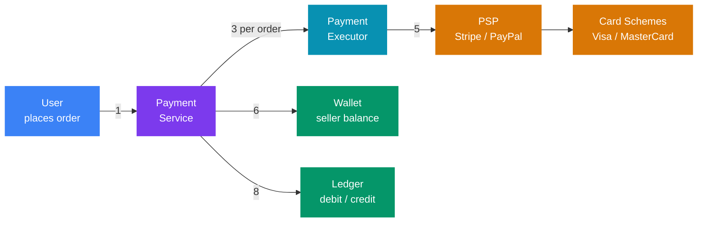
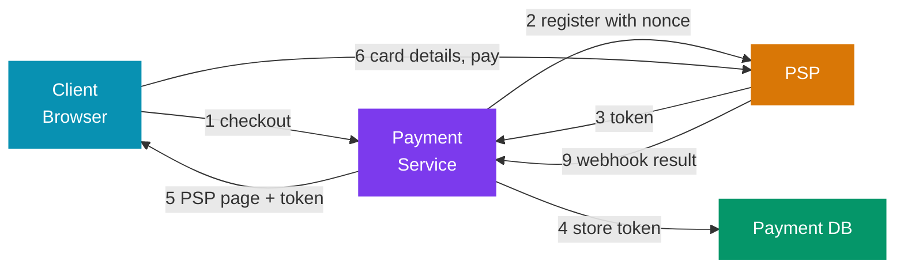
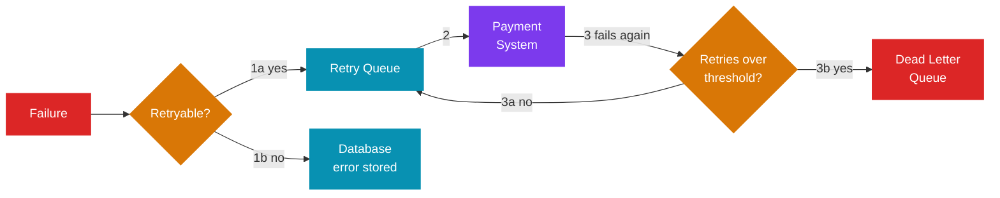
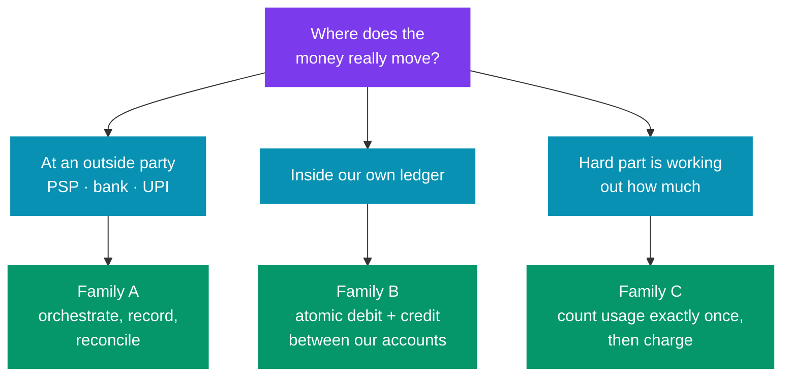

# Ch 11: Payment System

> 📖 **Vol 2, Chapter 11** (book pages 315–340) &nbsp;·&nbsp; 🔥🔥 Very High Priority &nbsp;·&nbsp; 💬 **20 Questions**  
> **Source:** Alex Xu & Sahn Lam, *System Design Interview Vol 2*, Ch 11. Page and figure numbers below are the book's printed ones.

---

📊 **Question Count**

| # | Section | Questions |
|---|---|---|
| 1 | [Requirements and Estimation ⚡](#1--requirements-and-estimation-p315317-) | ref |
| 2 | [High-level Design — Pay-in Flow 🔥🔥](#2--high-level-design--pay-in-flow-p317319-) | 1 |
| 3 | [API and Data Model 🔥](#3--api-and-data-model-p319322-) | 2 |
| 4 | [Double-entry Ledger and Pay-out Flow 🔥](#4--double-entry-ledger-and-pay-out-flow-p322323-) | 3 |
| 5 | [PSP Integration — Hosted Payment Page 🔥🔥](#5--psp-integration--hosted-payment-page-p322326-) | 3 |
| 6 | [Reconciliation and Payment Delays 🔥🔥](#6--reconciliation-and-payment-delays-p326328-) | 2 |
| 7 | [Internal Communication and Failed Payments 🔥](#7--internal-communication-and-failed-payments-p328331-) | 2 |
| 8 | [Exactly-once Delivery — Retry and Idempotency 🔥🔥](#8--exactly-once-delivery--retry-and-idempotency-p331334-) | 4 |
| 9 | [Consistency, Security and Wrap Up ⚡](#9--consistency-security-and-wrap-up-p334337-) | 2 |
| 10 | [Similar Problems This Design Solves 📎 🔥](#10--similar-problems-this-design-solves--) | 1 |
| | **Total** | **20** |

> 🔥🔥 Very high priority — asked in almost every Tier-1 interview loop &nbsp;·&nbsp; 🔥 High priority — very frequent in Tier-1 interviews &nbsp;·&nbsp; ⚡ Medium priority — commonly asked &nbsp;·&nbsp; 💤 Low priority — good to know, rarely asked

---

## 🗒️ Cheat Sheet

<details>
<summary><strong>🗒️ Show cheat sheet</strong></summary>

### 🎯 Clarifying Questions — and the book's answers
| Question | Book's answer (p.315–316) |
|---|---|
| What kind of payment system? | A **payment backend for an e-commerce site** like Amazon.com. It handles all money movement for an order |
| Which payment options? | All of them in real life. In the interview, use **credit card** as the example |
| Do we process cards ourselves? | **No.** We use third-party payment processors: Stripe, Braintree, Square |
| Do we store card data? | **No.** Security and compliance rules are too strict. The PSP handles card data |
| Global? Many currencies? | Global, but **assume one currency** |
| How many transactions? | **1 million per day** |
| Pay-out flow too? | **Yes.** The site pays sellers every month |
| Anything else? | **Reconciliation** is a requirement. Services can fail and leave states out of sync |

**Functional:** pay-in (receive money from customers for sellers) and pay-out (send money to sellers around the world).
**Non-functional:** reliability and fault tolerance (handle failed payments carefully), and a reconciliation process with external services.

### 🏗️ Core Components (Figure 11.2)
- **Payment service** — accepts payment events and controls the whole flow. It first runs a **risk check** (AML/CFT), usually through a third-party provider.
- **Payment executor** — runs **one payment order** through a PSP.
- **PSP (Payment Service Provider)** — moves money from account A to account B. Here, it takes money from the buyer's card.
- **Card schemes** — Visa, MasterCard, Discover. They process card operations.
- **Ledger** — the financial record of every payment. Used for revenue reports and forecasts.
- **Wallet** — keeps the **merchant's** account balance. It may also record how much a user has paid in total.
- **Reconciliation** (Figure 11.6) — compares the PSP's nightly settlement file with the ledger and wallet.

### Key Schema (Tables 11.3–11.4)
```
payment_event(checkout_id PK, buyer_info, seller_info, credit_card_info, is_payment_done)
payment_order(payment_order_id PK, buyer_account, amount, currency,
              checkout_id FK, payment_order_status, ledger_updated, wallet_updated)
-- every column is a string except the booleans; amount is a string on purpose (p.320)
-- payment_order_status: NOT_STARTED → EXECUTING → SUCCESS | FAILED
-- ⚠️ buyer_account is the book's column; seller_account fits the flow better (see §3)
```

### 💡 Key Insights
1. **10 TPS is small.** The hard part is correctness, not throughput (p.316–317).
2. **One checkout = one payment event = many payment orders** (one per seller). The `payment_order_id` is the idempotency key the PSP uses (p.320).
3. **Never touch card data.** Use the PSP's hosted payment page. Our system sends a **nonce** and gets back a **token** (p.324–325).
4. **Exactly-once = at-least-once + at-most-once.** Retry gives the first. Idempotency gives the second (p.331).
5. **Reconciliation is the last line of defence.** It catches what the other mechanisms miss (p.327).

### ⚖️ Trade-offs / Alternatives
| Option | Pro | Con | Book's verdict |
|---|---|---|---|
| Connect directly to banks / card schemes | No PSP fee | Rare, very specialised, big investment | Only for very large companies (p.324) |
| PSP API integration (we collect card data) | Full control of the payment page | We store card data → PCI DSS rules apply | Only if the company can store card data safely |
| PSP **hosted payment page** | Card data never reaches us | Less control of the UI | ✅ "The approach most companies take" (p.324) |
| `amount` as **string** | No rounding errors across systems; handles very big and very small numbers | Must parse before maths | ✅ Chosen (p.320) |
| `amount` as `double` | Easy maths | Rounding errors; precision differs across systems | ❌️ Rejected |
| 📎 `amount` as integer in the smallest unit (cents, paise) | Exact maths; Stripe's own API does this | Each currency has its own smallest unit | Not in the book |
| Relational DB with ACID | Proven, good tools, easy to hire DBAs | — | ✅ Preferred over NoSQL/NewSQL (p.321) |
| Synchronous calls (HTTP) | Simple design | Slow, poor failure isolation, tight coupling, hard to scale | ❌️ For large scale |
| Asynchronous (queue / Kafka) | Scales, fails better | Less simple, weaker consistency | ✅ "A better choice" for a large payment system (p.330) |

### 🔢 Numbers to Remember
| What | Value | Arithmetic |
|---|---|---|
| Transactions per second | **10 TPS** | 1,000,000 per day ÷ 10⁵ seconds (1 day = 86,400 s ≈ 10⁵) |
| Exponential backoff | **1 s → 2 s → 4 s** | The wait doubles after each failure (p.332) |
| Why not `double` | Japan's GDP ≈ **5 × 10¹⁴ yen**; 1 satoshi = **10⁻⁸** bitcoin | Too big / too small for safe precision (p.320) |
| Proven DB stability | Used by big financial firms for **> 5 years** | (p.320) |
| Double-entry rule | Sum of all entries = **0** | Debit buyer $1 + credit seller $1 (Table 11.5) |
| 📎 Stripe idempotency key lifetime | Can be removed after **24 hours** | A retry after that is a new request |
| 📎 Stripe webhook retries | Up to **3 days** (live mode) | With exponential backoff |

### ⏱️ 45-Minute Round Plan
| Minutes | Phase | What to say or draw | Trap to avoid |
|---|---|---|---|
| 0–5 | Clarify | E-commerce backend, card example, PSP does card work, no card storage, 1 currency, pay-out, reconciliation | Designing a digital wallet. Ask "which kind of payment system?" first |
| 5–8 | Estimate | 1M/day → **10 TPS** | Long maths. Say: "10 TPS — the problem is correctness" |
| 8–18 | High-level | Figure 11.2: payment service → executor → PSP → card schemes; wallet; ledger | Leaving out the payment event vs payment order split |
| 18–25 | API + data | `POST /v1/payments`, `amount` as string, two tables, status enum | Using `double` for money |
| 25–40 | **Deep dive** | Hosted page (nonce → token) → retry + idempotency → reconciliation → retry queue + DLQ | Retrying a charge with no idempotency key |
| 40–45 | Wrap up | Consistency, security table, monitoring, pay-out via a provider like Tipalti | Skipping reconciliation — the interviewer named it as a requirement |

> 📎 The timings are a suggestion, not from the book. The book gives the steps; the minutes are ours.

---

</details>
<br/>

---

## 1. 📋 Requirements and Estimation (p.315–317) ⚡

"Payment system" means different things to different people (p.315). Some think of a **digital wallet** (Apple Pay, Google Pay — the next chapter). Others think of a **payment backend** (PayPal, Stripe). So ask first. Here, it is the payment backend of an e-commerce site.

**Estimation** (p.316): 1 million transactions per day ÷ 10⁵ seconds = **10 TPS**. A typical database handles this easily. So the interview is about handling each payment **correctly**, not about scale.

---

## 2. 🔄 High-level Design — Pay-in Flow (p.317–319) 🔥🔥

The money moves in two steps (Figure 11.1):

- **Pay-in:** the buyer's card → the e-commerce site's bank account.
- **Pay-out:** the site's bank account → the seller's bank account, after the products are delivered.

The site does not own all the money it holds. It is only the **custodian** (the keeper) for most of it. The seller gets the balance minus fees.

### The pay-in flow (Figure 11.2, p.318–319)



The nine steps (p.319):

1. The user clicks "place order". A **payment event** goes to the payment service.
2. The payment service stores the payment event in its database.
3. One payment event may hold **several payment orders** (for example, products from many sellers). The payment service calls the payment executor **for each order**.
4. The payment executor stores the payment order in its database.
5. The payment executor calls an external PSP to process the card payment.
6. On success, the payment service updates the **wallet**: how much money each seller has.
7. The wallet stores the new balance in its database.
8. After the wallet succeeds, the payment service calls the **ledger**.
9. The ledger **appends** the new entry to its database.

**The risk check** (p.318) comes first. The payment service checks AML/CFT rules (anti-money laundering / counter-terrorist financing) and looks for signs of crime. Only payments that pass are processed. This check is complex, so it usually uses a third-party provider.

> 📎 The wallet here is the **merchant's** balance inside the payment system. It is not a user's spending wallet. For a wallet that users pay from, see [Ch 12](./ch12_digital_wallet.md).

### ❓ Interview Questions

1. **Walk me through the pay-in flow when a user clicks "place order". 🔥🔥**

<!-- -->
<details>
<summary>💡 Show Answer</summary>

**Answer:**

(Figure 11.2, p.319)

1. A **payment event** goes to the payment service. It runs a **risk check** (AML/CFT), then stores the event.
2. One event may hold several **payment orders**, one per seller. For each order, the payment service calls the **payment executor**.
3. The executor stores the order and calls the **PSP**. The PSP charges the card through the **card schemes**.
4. On success, the payment service updates the **wallet** (seller balance), then the **ledger** (double-entry record).

The money lands in the **site's** bank account. Sellers get paid later, in the pay-out flow, through a provider such as Tipalti.

</details>

---

## 3. 🔌 API and Data Model (p.319–322) 🔥

### APIs (RESTful)

**`POST /v1/payments`** — runs one payment event (Table 11.1):

| Field | Description | Type |
|---|---|---|
| `buyer_info` | Information about the buyer | json |
| `checkout_id` | A globally unique ID for this checkout | string |
| `credit_card_info` | Encrypted card info **or a payment token**. PSP-specific | json |
| `payment_orders` | A list of payment orders | list |

Each item of `payment_orders` (Table 11.2):

| Field | Description | Type |
|---|---|---|
| `seller_account` | Which seller gets the money | string |
| `amount` | The amount for this order | **string** |
| `currency` | The currency (ISO 4217) | string |
| `payment_order_id` | A globally unique ID for this payment | string |

- `payment_order_id` is **globally unique**. The PSP uses it as the **deduplication ID**, also called the **idempotency key** (p.320).
- **`GET /v1/payments/{:id}`** returns the status of one payment order, by `payment_order_id`.

### Why `amount` is a string, not a `double` (p.320)

1. Protocols, software and hardware support **different numeric precision** when they serialize and deserialize. This can cause rounding errors.
2. The number can be **very big** (Japan's GDP ≈ 5 × 10¹⁴ yen in 2020) or **very small** (1 satoshi = 10⁻⁸ bitcoin).

The book's advice: keep the number as a string for transmission **and** storage. Parse it only to display it or to calculate.

> 📎 Many real systems use an **integer in the smallest currency unit** (cents, paise) instead. Stripe's API does this. In Java, parse the string into `BigDecimal` — never into `double`.

### Choosing the database (p.320–321)

Performance is **not** the main factor. The book picks by:

1. Proven stability — big financial firms have used it for more than 5 years, with good feedback.
2. Rich tools for monitoring and investigation.
3. A mature DBA job market — can we hire experienced DBAs?

So the book prefers a **traditional relational database with ACID transactions** over NoSQL/NewSQL.

### The two tables (Tables 11.3–11.4)

The columns are in the Cheat Sheet's **Key Schema**. `checkout_id` is the PK of the payment event and the FK in each payment order. One checkout creates one payment event with several payment orders.

> ⚠️ **Book inconsistency — the payment order stores the buyer, not the seller.** Table 11.4 has `buyer_account`, but the API sends `seller_account` for each order (Table 11.2). Step 6 must credit the **seller** in the wallet, and a checkout has one buyer anyway. Store `seller_account` in the payment order (the buyer is already in `payment_event`).

**Why only card info, not the seller's bank account?** During pay-in, money goes to the **site's** bank account, not to the seller. The seller is paid later, in pay-out (p.321).

### Payment order status (p.321–322)

`payment_order_status` is an enum: `NOT_STARTED`, `EXECUTING`, `SUCCESS`, `FAILED`.

- It starts as `NOT_STARTED`. It becomes `EXECUTING` when sent to the executor. The executor's response sets `SUCCESS` or `FAILED`.

After `SUCCESS`:

- The payment service calls the **wallet** and sets `wallet_updated = TRUE`. The book assumes wallet updates always succeed.
- Then it calls the **ledger** and sets `ledger_updated = TRUE`.
- When **all** orders of a `checkout_id` succeed, it sets `is_payment_done = TRUE` in the payment event.

A **scheduled job** checks in-flight orders at a fixed interval. It alerts engineers when an order does not finish within a time limit.

### ❓ Interview Questions

1. **Why split a payment into a payment event and payment orders? How do you track each order? 🔥**

<!-- -->
<details>
<summary>💡 Show Answer</summary>

**Answer:**

- One **checkout** = one **payment event** (`checkout_id`). A cart with **many sellers** gives one **payment order** per seller (`payment_order_id`).
- The executor runs **one order** through the PSP. So each order has its own status, and the PSP uses `payment_order_id` as the **idempotency key** (p.320).
- `payment_order_status`: `NOT_STARTED` → `EXECUTING` → `SUCCESS` or `FAILED` (p.321–322).
- After `SUCCESS`: update the wallet → `wallet_updated = TRUE`, then the ledger → `ledger_updated = TRUE`. These flags show how far an order got.
- When all orders succeed, `is_payment_done = TRUE`. A **scheduled job** alerts on orders that do not finish in time.

</details>

---

2. **How do you store money amounts, and in which database? 🔥🔥**

<!-- -->
<details>
<summary>💡 Show Answer</summary>

**Answer:**

**`amount` is a string, not a `double`** (p.320):

1. Systems use **different numeric precision** when they serialize and deserialize. A `double` can pick up rounding errors.
2. Amounts can be **very big** (Japan's GDP ≈ 5 × 10¹⁴ yen) or **very small** (1 satoshi = 10⁻⁸ bitcoin).

Keep it a string in transmission and storage. Parse it only to display or calculate. 📎 In Java, parse into `BigDecimal`. Many systems (Stripe's API, for one) use an **integer in the smallest unit** (cents, paise) instead.

**Database:** a **relational DB with ACID transactions** (p.321). Performance is not the main factor. The book picks by **proven stability** (> 5 years at big financial firms), **rich tools**, and a **mature DBA job market**.

</details>

---

## 4. 📒 Double-entry Ledger and Pay-out Flow (p.322–323) 🔥

### Double-entry ledger (p.322)

The ledger uses the **double-entry principle** (double-entry accounting / bookkeeping). Every transaction goes into **two ledger accounts with the same amount**. One is debited. The other is credited.

| Account | Debit | Credit |
|---|---|---|
| buyer | $1 | |
| seller | | $1 |

*(Table 11.5)*

- **The rule:** the sum of all entries must be **0**. One cent lost means someone else gained a cent.
- It gives **end-to-end traceability** and keeps the payment cycle consistent.
- The book points to Square's blog on an **immutable** double-entry accounting database.

> 📎 Two rows is only the simplest case. The real rule is "debits = credits". A payment with a platform fee has three legs: debit buyer $100, credit seller $97, credit platform fee $3. It still sums to 0.

### Pay-out flow (p.323)

The parts are almost the same as pay-in. One difference:

- Pay-in uses a **PSP** to move money from the buyer's card to the site's bank account.
- Pay-out uses a **third-party pay-out provider** to move money from the site's bank account to the seller's. The book names **Tipalti**, an "account payable" provider.

Pay-outs also have many bookkeeping and regulatory rules.

### ❓ Interview Questions

1. **Explain double-entry bookkeeping. Why does a payment system need it? 🔥🔥**

<!-- -->
<details>
<summary>💡 Show Answer</summary>

**Answer:**

Every transaction goes into **two ledger accounts with the same amount**: one debit, one credit (Table 11.5, p.322). The buyer pays $1: debit buyer $1, credit seller $1.

- **The rule:** the sum of all entries is **0**. One cent lost means someone else gained a cent. A non-zero sum shows a bug at once.
- It gives **end-to-end traceability** across the payment cycle.
- 📎 The ledger is **append-only**: fix a mistake with a new reversing entry. More than two legs is normal (buyer, seller, platform fee). The rule is "debits = credits", not "two rows".

</details>

---

2. **What should the ledger table look like? 📎 🔥**

<!-- -->
<details>
<summary>💡 Show Answer</summary>

**Answer:**

```sql
CREATE TABLE ledger_entry (
    id               BIGINT PRIMARY KEY,
    payment_order_id VARCHAR(64) NOT NULL,
    account_id       VARCHAR(64) NOT NULL,
    direction        VARCHAR(6)  NOT NULL,   -- DEBIT or CREDIT
    amount_minor     BIGINT      NOT NULL,   -- in paise / cents
    currency         CHAR(3)     NOT NULL,   -- ISO 4217
    created_at       TIMESTAMP   NOT NULL
);
CREATE INDEX idx_ledger_order   ON ledger_entry (payment_order_id);
CREATE INDEX idx_ledger_account ON ledger_entry (account_id, created_at);
```

- **Append-only** — no `UPDATE` or `DELETE`. Fix a mistake with a reversing entry.
- Write all legs of one payment in **one** transaction, so the sum stays 0.
- A stored balance is only a cache of the sum. Update it in the **same** transaction.

</details>

---

3. **How do refunds and chargebacks work, and how do they hit the ledger? 📎 🔥**

<!-- -->
<details>
<summary>💡 Show Answer</summary>

**Answer:**

They look alike in the ledger, but they start from different people.

| | Refund | Chargeback |
|---|---|---|
| Who starts it | **We** (the merchant), through the PSP's refund API | The **cardholder**, by disputing the charge with their bank |
| How we learn of it | Our own API call, then the PSP's webhook | A PSP webhook or dispute report — the card network has already pulled the money back |
| Extra cost | Usually none beyond the PSP's fee rules | A **chargeback fee**, and a deadline to send evidence |
| Can we reverse it? | No — it is our decision | Yes — if we win the dispute, the money comes back (one more entry) |

How to build a refund:

- Make it a **new payment order** of type `REFUND`, linked to the original. Give it its **own idempotency key** (the refund ID), so a retry does not refund twice.
- Allow partial refunds, but check that **total refunded ≤ amount captured**. Do the check and the insert in one transaction, so two parallel refunds cannot both pass.
- **Never edit the original ledger rows.** Write new reversing entries: debit seller, credit buyer.

The seller's state decides who pays:

- **Not paid out yet** → reduce the seller's wallet balance.
- **Already paid out** → the seller's balance goes negative. Recover it from the next pay-out.

Both show up in the next settlement file as negative lines. Reconciliation must match them like any other line.

</details>

---

## 5. 💳 PSP Integration — Hosted Payment Page (p.322–326) 🔥🔥

### Two ways to use a PSP (p.324)

- **API integration.** The company builds the payment pages and stores card data itself. The PSP connects to banks and card schemes. Only for companies that can store card data safely.
- **Hosted payment page.** The PSP collects and stores the card details. **This is what most companies do.**

Why avoid card data? If you store it, you must follow complex rules such as **PCI DSS** (Payment Card Industry Data Security Standard). So companies use the PSP's page (p.322). On websites it is a **widget or iframe**. In mobile apps it is a page from the PSP's **SDK**. Figure 11.3 shows PayPal's page.

### The hosted payment flow (Figure 11.4, p.324–326)



1. The user clicks "checkout". The client sends the payment order info to the payment service.
2. The payment service sends a **payment registration** request to the PSP. It holds the amount, currency, expiry date of the request, and the **redirect URL**. It also holds a UUID so the order is registered **only once**. This UUID is the **nonce**. Usually it is the payment order ID.
3. The PSP returns a **token**. It is a UUID on the PSP side for this registration. We can check the registration and its status later with this token.
4. The payment service **stores the token** in its database **before** it shows the PSP page.
5. The client shows the PSP's hosted page (Stripe's JavaScript library on the web, Figure 11.5). It needs two things:
   - **The token.** The PSP's code uses it to get the payment details from the PSP backend, such as how much to collect.
   - **The redirect URL.** The page the browser opens when the payment is done. It is usually an order-status page. It is **not** the webhook URL.
6. The user enters the card details on the PSP page and clicks pay. The PSP starts processing.
7. The PSP returns the payment status.
8. The browser goes to the redirect URL, usually with the status in the URL, for example `https://your-company.com/?tokenID=JIOUIQ123NSF&payResult=X324FSa`.
9. Asynchronously, the PSP calls our **webhook** with the status. The webhook URL was registered with the PSP at setup. The payment service updates `payment_order_status`.

The card data **never reaches our system**. (Figure 11.4 leaves out the executor, ledger and wallet.) All 9 steps can fail on a bad network. The book's systematic answer to that is **reconciliation** (p.326).

### ❓ Interview Questions

1. **Why use a PSP's hosted payment page? Walk me through the flow. 🔥🔥**

<!-- -->
<details>
<summary>💡 Show Answer</summary>

**Answer:**

**Why:** if we store card data, **PCI DSS** and other complex rules apply. With a hosted page, the card data **never reaches our system**. Most companies do this (p.324).

**Flow** (Figure 11.4, full steps above):

1. Checkout → the payment service **registers** the payment with the PSP, with a **nonce**.
2. The PSP returns a **token**. We **store the token** before showing the page.
3. The client shows the PSP's page with the token and a **redirect URL**. The user pays there.
4. The browser goes to the redirect URL. **Asynchronously**, the PSP calls our **webhook**, and we update `payment_order_status`.

</details>

---

2. **Nonce, token, redirect URL, webhook — what is each one for? 🔥**

<!-- -->
<details>
<summary>💡 Show Answer</summary>

**Answer:**

| | Made by | What it does |
|---|---|---|
| **Nonce** | Us (usually the payment order ID) | Registers each payment order with the PSP **only once** (step 2) |
| **Token** | The PSP | Identifies the registration. The PSP page uses it to get the amount. It is the PSP's **idempotency key** (steps 3–5) |
| **Redirect URL** | Us | The **browser** opens it when the payment is done. Shows the checkout status (step 8) |
| **Webhook** | Us, registered at setup | The **PSP server** calls it, asynchronously, with the result (step 9) |

📎 Trust the webhook, not the redirect. The user can close the tab or change the URL.

</details>

---

3. **How do you handle the PSP's webhook safely? 📎 🔥**

<!-- -->
<details>
<summary>💡 Show Answer</summary>

**Answer:**

The webhook is the PSP telling us the result (step 9). Treat it as untrusted input that can come **twice, late, or out of order**.

1. **Check it really came from the PSP.** Verify the signature — an HMAC of the raw body with a shared secret (for example, Stripe's `Stripe-Signature` header). Check its timestamp too, to stop a replayed old message.
2. **Answer fast.** Save the raw event, return `2xx`, and process it in the background. A slow or failed answer makes the PSP send it again.
3. **Dedup.** Put a unique constraint on the PSP's **event ID**. A second copy fails the insert and is ignored.
4. **Do not trust the order.** The status may only move **forward**. Use a conditional update:

```sql
UPDATE payment_order SET payment_order_status = 'SUCCESS'
WHERE payment_order_id = ? AND payment_order_status IN ('NOT_STARTED', 'EXECUTING');
```

   If 0 rows change, the order was already final. A late `FAILED` after `SUCCESS` is ignored and logged for alerts.

5. **Plan for a missed webhook.** Poll the PSP for orders stuck in `EXECUTING`, and let nightly reconciliation catch the rest.

</details>

---

## 6. 🧾 Reconciliation and Payment Delays (p.326–328) 🔥🔥

### Reconciliation (Figure 11.6, p.326–328)

Async messages may never arrive, and PSPs and banks prefer async too. **Reconciliation** regularly compares the states of related services and check that they agree. It is usually **the last line of defence**.

- **Every night**, the PSP or bank sends a **settlement file**. It has the account balance and all of the day's transactions.
- The reconciliation system parses the file and compares it with the **ledger**.
- It also checks **internal** consistency. For example, the ledger and the wallet may disagree.

Mismatches are usually fixed by the **finance team** with manual adjustments. The book sorts them into three groups (p.327–328):

| # | Mismatch | Fix |
|---|---|---|
| 1 | We know the cause and the fix, and automating it is cheap | **Automate** both the detection and the adjustment |
| 2 | We know the cause and the fix, but automating it costs too much | Put it in a **job queue**. Finance fixes it by hand |
| 3 | We do **not** know the cause | Put it in a **special job queue**. Finance investigates by hand |

### Handling payment processing delays (p.328)

Most payments finish in seconds. Some take hours or days:

- The PSP thinks the payment is **high risk** and wants a human to review it.
- The card needs extra checks such as **3D Secure Authentication**.

With a PSP-hosted page, the PSP handles long payments like this:

- It returns a **pending** status to our client. The client shows it, and gives the customer a page to check the current status.
- The PSP tracks the payment for us. When it finishes, the PSP calls our **webhook**. The payment service updates its state and completes the shipment.
- **Alternative:** some PSPs make **us poll** them for the status of every pending payment.

### ❓ Interview Questions

1. **How does reconciliation work? And what if a payment takes hours or days? 🔥🔥**

<!-- -->
<details>
<summary>💡 Show Answer</summary>

**Answer:**

**Reconciliation** regularly checks that related services agree. It is **the last line of defence** (p.327).

- **Every night** the PSP or bank sends a **settlement file** (balance + the day's transactions). We compare it with the **ledger**. We also compare ledger vs wallet.
- The finance team fixes mismatches. There are three groups (p.327–328). Cause known, cheap to automate → **automate**. Cause known, costly to automate → **job queue**, fixed by hand. Cause **unknown** → **special job queue**, investigated.

**Slow payments** (p.328) — a **human review** of a high-risk payment, or **3D Secure Authentication**:

- The PSP returns **pending**. Our client shows it, plus a page to check the status.
- The PSP calls our **webhook** when it finishes. Some PSPs make **us poll** instead.

</details>

---

2. **What is the difference between authorization, capture and settlement? 📎 🔥**

<!-- -->
<details>
<summary>💡 Show Answer</summary>

**Answer:**

- **Authorization** — real time. The card network checks the card and funds and puts a **hold** on the amount.
- **Capture** — the merchant takes the held amount, at once or later (e.g. when the item ships).
- **Settlement** — the money really moves, in a batch, usually **T+1** or later.

A hold expires if it is not captured in time, and then the capture can fail. Reconciliation finds it as a mismatch.

</details>

---

## 7. 📨 Internal Communication and Failed Payments (p.328–331) 🔥

### Synchronous vs asynchronous (p.328–330)

**Synchronous (e.g. HTTP)** works for small systems. At scale it creates a long request chain, with four problems:

| Problem | Why |
|---|---|
| Low performance | One slow service slows the whole chain |
| Poor failure isolation | If a PSP fails, the client gets no response |
| Tight coupling | The sender must know the receiver |
| Hard to scale | No queue to absorb a traffic spike |

**Asynchronous** has two kinds:

- **Single receiver** — a shared message queue. Many services subscribe, but each message goes to **one** of them and is then removed (Figures 11.7 and 11.8).
- **Multiple receivers** — **Kafka**. Consumers do **not** remove messages, so many services can process the same one. This fits payments: one payment can trigger push notifications, financial reports and analytics (Figure 11.9: payment system, analytics, billing).

**The book's verdict:** sync is simpler, but services are not independent, and performance drops as the dependency graph grows. Async trades simplicity and consistency for scale and resilience. For a large payment system with complex logic and many third parties, **async is the better choice**.

### Handling failed payments (p.330–331)

- **Track payment state.** Keep a definite state at every stage. After a failure, the state tells you whether to retry or refund. Store it in an **append-only** table.
- **Retry queue** — retryable errors, such as transient errors, go here.
- **Dead letter queue (DLQ)** — a message that keeps failing ends up here. Engineers inspect it to find out why.



*(Figure 11.10)* A failure that is **not** retryable (for example, invalid input) is stored in a database. A retry that fails again goes back to the retry queue, until the retry count passes the limit. Then it goes to the DLQ.

The book points to **Uber's payment system**, which uses Kafka for these queues.

### ❓ Interview Questions

1. **Sync or async between internal services? And how do you handle failed payments? 🔥**

<!-- -->
<details>
<summary>💡 Show Answer</summary>

**Answer:**

**Sync (HTTP)** at scale (p.328–330): low performance, poor failure isolation, tight coupling, hard to scale. **Async** has a single-receiver queue (each message to one consumer) or **Kafka** (many services read the same payment event). **Book's verdict:** for a large payment system, **async is better**.

**Failed payments** (p.330–331, Figure 11.10):

- **Track the payment state** in an **append-only** table. It tells you to retry or refund.
- **Retryable** → the **retry queue**. **Not retryable** (e.g. invalid input) → store the error in a database.
- Fails again: under the retry limit → back to the retry queue. Over it → the **dead letter queue**.

</details>

---

2. **The PSP is down. What is your fallback? 📎 🔥**

<!-- -->
<details>
<summary>💡 Show Answer</summary>

**Answer:**

- A **circuit breaker** around PSP calls: after N failures, fail fast for a cooldown period.
- A **backup PSP** behind a PSP abstraction layer, for **new** payments only. Never send an order whose result is unknown to a second PSP — that can charge twice.
- A clear message to the user, not a hanging page.
- Waiting payments go to a **durable queue** and keep their idempotency keys. Note that Stripe can remove a key after 24 hours.

</details>

---

## 8. 🎯 Exactly-once Delivery — Retry and Idempotency (p.331–334) 🔥🔥

Double-charging a customer is one of the worst problems a payment system can have. So the system must run each payment order **exactly once**.

Split the problem in two. An operation runs exactly once if:

1. it runs **at least once** — give this with **retry**, and
2. it runs **at most once** — give this with an **idempotency check**.

### Retry — at least once (Figure 11.11, p.332–333)

In Figure 11.11, a client tries to pay $10. The network fails three times. The fourth try succeeds.

Retry strategies:

| Strategy | How it works |
|---|---|
| Immediate retry | Resend at once |
| Fixed intervals | Wait the same time before each retry |
| Incremental intervals | Short wait first, then a little longer each time |
| **Exponential backoff** | **Double** the wait after each failure: 1 s, 2 s, 4 s |
| Cancel | The client stops. Use it when the failure is permanent or retries will not help |

- No strategy fits every case. Use exponential backoff when the network problem will probably last a while.
- Very aggressive retries waste compute and can overload a service.
- Good practice: return an error code with a **`Retry-After`** header.

**The risk of retry is double payment.** Two cases (p.333):

- **Scenario 1:** the site uses a hosted payment page, and the user clicks pay **twice**.
- **Scenario 2:** the PSP **succeeds**, but the response is lost on the network. The user clicks pay again, or the client retries.

### Idempotency — at most once (p.333–334)

**Idempotency:** you can repeat the operation and the result does not change after the first time. For an API, the same call gives the same result.

- The **idempotency key** is usually a unique value **made by the client**. It **expires** after some time. A **UUID** is common; Stripe and PayPal recommend it.
- It goes in an HTTP header: `idempotency-key: key_value`.

**Scenario 1 — double click (Figure 11.12):**

- On an e-commerce site, the key is usually **the ID of the shopping cart** right before checkout.
- The second request is treated as a retry, because the server has seen the key. The server returns **the latest status of the first request**.
- If **concurrent** requests arrive with the same key, only one is processed. The others get **`429 Too Many Requests`**.

> ⚠️ **Book bug — wrong status code for a concurrent duplicate.** `429` means "rate limited", so a client may just back off and retry. 📎 The IETF draft for the `Idempotency-Key` header says: return **`409 Conflict`** while a request with the same key is still in progress. Stripe returns `409` too. Use `409`.

**How to build it — a unique key constraint** (p.334):

1. When a payment arrives, insert a row whose **primary key is the idempotency key**.
2. Insert succeeds → a new request. Process it.
3. Insert fails on the duplicate key → we have seen it. Do **not** process it again.

**Scenario 2 — PSP succeeded, response lost** (p.334):

- In Figure 11.4 (steps 2–3), we send the PSP a **nonce** and get back a **token**.
- The nonce identifies the payment order. The token maps to the nonce. So the token identifies the payment order.
- When the user clicks pay again, the order is the same, so the **token is the same**.
- The PSP uses the token as **its idempotency key**. It spots the double payment and returns the status of the first one.

### ❓ Interview Questions

1. **How does the book get exactly-once payment, and which retry strategy would you use? 🔥🔥**

<!-- -->
<details>
<summary>💡 Show Answer</summary>

**Answer:**

**Exactly once = at least once + at most once** (p.331). **Retry** gives at least once. An **idempotency check** gives at most once.

Retry strategies (p.332): immediate, fixed intervals, incremental intervals, **exponential backoff** (1 s, 2 s, 4 s), cancel.

- There is no single right one. Use exponential backoff if the network problem may last a while.
- Very aggressive retries waste compute and can overload a service. Return an error code with a **`Retry-After`** header.
- 📎 Add **jitter** (a small random delay), so clients do not all retry at once. Kafka consumers must be idempotent too. With the usual settings, Kafka delivers at least once. Kafka's exactly-once feature covers only read → process → write **inside Kafka**. It does not cover a call to a PSP or a write to your own database.

</details>

---

2. **The user clicks "pay" twice quickly. How do you stop a double charge? 🔥🔥**

<!-- -->
<details>
<summary>💡 Show Answer</summary>

**Answer:**

An **idempotency key** in a header: `idempotency-key: <value>` (p.333–334, Figure 11.12).

- On an e-commerce site it is usually the **shopping cart ID** right before checkout. A UUID is also common.
- The second request has the same key, so it is a retry. The server returns the **latest status of the first request**.
- For **concurrent** requests with the same key, only one runs. The book returns `429` to the rest. 📎 Use `409 Conflict` (see the book-bug note above).

Build it with a **unique key constraint** — the key is the primary key:

```java
public PaymentResult pay(String idempotencyKey, PaymentRequest req) {
    try {
        jdbc.update(
            "INSERT INTO payment_request (idempotency_key, status) VALUES (?, 'EXECUTING')",
            idempotencyKey);
    } catch (DuplicateKeyException seenBefore) {
        // seen before: do not charge again, return the stored status
        return findResult(idempotencyKey);
    }
    return execute(idempotencyKey, req);
}
```

📎 Two details interviewers ask about:

- Store a **hash of the request body** with the key. The same key with a different body is a client bug, so reject it. The IETF draft says `422`.
- Store the **final response** with the key, so a retry gets the same answer and causes no new call. If the row still says `EXECUTING`, return `409`.

</details>

---

3. **The PSP charged the card, but its response was lost. The user clicks pay again. What happens? 🔥🔥**

<!-- -->
<details>
<summary>💡 Show Answer</summary>

**Answer:**

(Scenario 2, p.334)

- In Figure 11.4 we sent a **nonce** and got a **token**. The nonce maps to the payment order, and the token maps to the nonce.
- The second click is for the **same** order, so we send the **same token**.
- The PSP uses the token as **its idempotency key**. It spots the duplicate and returns the first result.

Key point: the idempotency key must reach the **PSP**. Our own dedup table cannot help when the PSP charged and we never heard back.

</details>

---

4. **The PSP call timed out. You do not know if the card was charged. What do you do? 📎 🔥🔥**

<!-- -->
<details>
<summary>💡 Show Answer</summary>

**Answer:**

This is the **ambiguous** failure. Keep the order in `EXECUTING`. Do **not** mark it `FAILED` — that can hide a real charge. **Never** send a new charge. Retry with the **same** key (only if the PSP honours it) or **query the PSP** first. The webhook, a status poll, or reconciliation settles it.

| Failure | Example | Action |
|---|---|---|
| Definite, transient | HTTP 429, connection refused before sending | Retry with backoff |
| Definite, permanent | Card **declined**, invalid input | Do not retry. Card networks also limit retries on declines |
| **Ambiguous** | Timeout, connection reset | Same-key retry or status query |

</details>

---

## 9. 🔒 Consistency, Security and Wrap Up (p.334–337) ⚡

### Consistency (p.334–335)

One payment touches many stateful parts. They are the payment service (nonce, token, status), the ledger, the wallet, the PSP and the DB replicas. Any link between two of them can fail. The book's fixes:

> 📎 The book does not discuss the gap between "update the DB" and "call the next service" inside one service. That is the dual-write problem. See §9 Q2 below (transactional outbox).
>
> For 2PC vs Saga across services, see [Ch 12: Digital Wallet](./ch12_digital_wallet.md) — it is not repeated here.

### Payment security (Table 11.6, p.335–336)

| Problem | Solution |
|---|---|
| Request/response eavesdropping | Use HTTPS |
| Data tampering | Enforce encryption and integrity monitoring |
| Man-in-the-middle attack | Use SSL with **certificate pinning** |
| Data loss | DB replication across regions + snapshots |
| DDoS | Rate limiting and firewall |
| Card theft | **Tokenization** — store and use tokens, not real card numbers |
| PCI compliance | PCI DSS — the security standard for anyone who handles branded credit cards |
| Fraud | Address verification, CVV, user behaviour analysis |

### Wrap up — more topics (p.336–337)

- **Monitoring and alerting** — e.g. the acceptance rate of a payment method, or server CPU, on a dashboard. Alert on-call engineers fast.
- **Debugging tools** — "why did this payment fail?" Let staff see the status, server history and PSP records.
- **Currency exchange**, **geography** (each region has its own payment methods), **cash payment** (common in India and Brazil), and **Google Pay / Apple Pay**.
- 📎 Useful alerts: orders stuck in `EXECUTING` (the scheduled job in §3), PSP error rate by code, reconciliation mismatches per night, and DLQ depth.

### ❓ Interview Questions

1. **How do you keep data consistent across services, and how do you secure the system? 🔥**

<!-- -->
<details>
<summary>💡 Show Answer</summary>

**Answer:**

**Consistency** (p.334–335):

**Security** (Table 11.6, see above):

- HTTPS, SSL with certificate pinning, encryption and integrity monitoring.
- Cross-region replication + snapshots; rate limiting + firewall for DDoS.
- **Tokenization**, **PCI DSS**, and fraud checks (address verification, CVV, behaviour analysis).

📎 A hosted page **reduces** PCI scope but never removes it. A PSP iframe or redirect may qualify for **SAQ A**. If your page's JavaScript sends card data to the PSP, it is **SAQ A-EP**. Never store CVV after authorization, and never log card numbers.

</details>

---

2. **You update the DB and then publish an event to Kafka. What can go wrong? 📎 🔥🔥**

<!-- -->
<details>
<summary>💡 Show Answer</summary>

**Answer:**

This is a **dual write**. A crash between the two steps breaks it. DB first → the event is lost. Publish first → an event goes out for a change that rolled back.

**Fix — the transactional outbox:**

1. In **one** DB transaction, update the payment order **and** insert a row into an `outbox` table.
2. A relay publishes the outbox rows to Kafka — CDC (e.g. Debezium) or a poller.
3. The relay is at least once, so consumers dedup by payment order ID.

</details>

---

## 10. 🧬 Similar Problems This Design Solves 📎 🔥

📎 The book does not list similar problems for this chapter. But the same core solves **at least 15 common interview problems**. Learn the core once, then change only a few parts for each one.

**The core that never changes:**
- **One unique ID per money movement.** It is the idempotency key in our DB **and** at the outside party.
- **A state machine** with a definite status at every step. An unknown result is settled by asking, never by guessing.
- **An append-only, double-entry ledger** in an ACID database.
- **Calls to an outside party** with retry and the same key. The result comes back later, by webhook or poll.
- **Reconciliation** against a file or report from the outside party.

**The tag on each problem** says how often it is asked as an HLD round on its own (same legend as the questions). 🔥🔥 = learn its "what is different" column well; 💤 = knowing the family is enough.

**The one choice that splits them into three families:** where does the money really move?



### Family A — an outside party moves the money (like this chapter)

| # | Problem | What is different from this chapter |
|---|---|---|
| 1 | **E-commerce payment system 🔥🔥** (this chapter) | — |
| 2 | **Payment gateway itself (we are the PSP) 🔥** | We connect to acquiring banks and card networks ourselves. Many merchants, so we send webhooks **out**. We can route each payment to the bank with the best success rate. Full PCI DSS scope is ours |
| 3 | **UPI / bank-transfer app 🔥🔥** | Most payments are push: the payer starts them (collect requests also exist). There is no card authorization or capture. Money moves bank to bank through the NPCI switch. A timeout leaves the payment **pending**, settled by a status-check API and reconciliation |
| 4 | **Seller pay-out / payroll / mass pay-out 🔥** | Money **leaves** us, usually in a batch file to a bank. Check the bank account first (a small test credit). A failed credit can come back days later. The pay-out ID must stop a double pay-out |
| 5 | **Subscription / recurring billing 🔥** | A **scheduler** starts the charge; no user is present. It uses a saved card token or a mandate (in India, an e-mandate with a pre-debit notice). Failed charges are retried over days (**dunning**) |
| 6 | **Loan disbursement and EMI collection ⚡** | Disbursement is a pay-out. EMIs are pulled on a schedule through a mandate. A bounced EMI adds a penalty entry. Each loan has its own ledger account |

### Family B — the money moves inside our own ledger

| # | Problem | What is different from this chapter |
|---|---|---|
| 7 | **Digital wallet 🔥🔥** — [Ch 12](./ch12_digital_wallet.md) | No PSP in the main path: a transfer is a debit and a credit between two of **our** accounts. At the book's 1,000,000 TPS the two accounts sit on different nodes, so you need 2PC, Saga or event sourcing |
| 8 | **Stock broker / exchange 🔥** — [Ch 13](./ch13_stock_exchange.md) | Cash and shares are **blocked** before an order is sent. Matching is in-memory and takes microseconds. Settlement happens later, T+1, through a clearing house |
| 9 | **Credit limit / BNPL ⚡** | The check is `used + amount ≤ limit`, the same conditional update as the hotel's count — [Ch 7](./ch07_hotel_reservation_system.md). Repayment comes later, with interest and late fees |
| 10 | **Loyalty points / gift cards / reward coins ⚡** | An internal currency, no PSP. Points expire, so each earn is a lot spent oldest-first. Fraud is on the **earning** side |
| 11 | **Splitwise ⚡** — [LLD](../../04_lld_and_machine_coding/09_splitwise.md) | No money moves at all. The ledger holds **IOUs** (who owes whom). The interesting part is simplifying debts |

### Family C — the hard part is working out how much

| # | Problem | What is different from this chapter |
|---|---|---|
| 12 | **Usage-based billing / invoicing (a cloud bill) 🔥** | A huge number of meter events are counted **exactly once** per period, then turned into one charge. An issued invoice is never edited; a correction is a credit note |
| 13 | **Ad billing / ad click aggregation 🔥** — [Ch 6](./ch06_ad_click_event_aggregation.md) | The money comes from click counts, so a counting bug is a billing bug. Stream aggregation, then an end-of-day reconciliation job checks the results |
| 14 | **Ride fare and driver pay-outs ⚡** | The fare is known only after the trip. One ride is a multi-leg ledger entry: rider charge, driver earning, platform fee. Drivers are paid out daily or weekly |
| 15 | **Food-delivery order payment and refunds ⚡** — [design](../../05_designs/04_food_delivery_swiggy_zomato.md) | One order splits money three ways: restaurant, rider, platform. Cancellations and partial refunds are common, so the refund flow (§4 Q3) is part of the core |

### How to use this in an interview — five questions
When you get any money problem, answer these five questions aloud. Each answer picks one part of the design:

| Ask | It decides |
|---|---|
| 1. Who really moves the money — an outside party, or us? | **Family A** (orchestrate + reconcile) or **Family B** (atomic transfer in our ledger) |
| 2. Is the result known at once, or later (webhook, file)? | Whether you need a **pending** state, webhooks and polling |
| 3. What is the idempotency key, and does it reach the outside party? | Whether a retry can **double-charge** |
| 4. Who starts the movement — the user, a scheduler, or the outside party? | A **scheduler and dunning**, or **inbound** handling (chargebacks, incoming credits) |
| 5. What is the daily "truth" to reconcile against? | The **reconciliation** job: settlement file, bank statement, or a batch recompute |

> **Where this does *not* transfer directly:**
> - **Internal transfers at huge TPS** (a wallet at 1M TPS). One ACID database is not enough. You need sharding plus 2PC, Saga or event sourcing — see [Ch 12](./ch12_digital_wallet.md).
> - **Matching engines** (an exchange). The hot path is an in-memory sequencer measured in microseconds, not a request to a PSP.
> - **Blockchain payments.** Finality is probabilistic (wait for confirmations), and there are no chargebacks.
> - **Fraud and risk scoring.** That is a real-time ML system with its own design. The book only calls a third-party provider for it.

### ❓ Interview Questions

1. **Name three other systems this payment design solves. What changes for each one? 📎 🔥**

<!-- -->
<details>
<summary>💡 Show Answer</summary>

**Answer:**

The core stays the same: one unique ID per money movement as the idempotency key, a status at every step, a double-entry ledger, and reconciliation. What changes is **who moves the money** and **who starts the movement**.

| | This chapter (e-commerce) | UPI app | Digital wallet | Subscription billing |
|---|---|---|---|---|
| Who moves the money | The PSP and card schemes | Banks, through the NPCI switch | **We do**, inside our ledger | The PSP, using a saved token or mandate |
| Who starts it | The buyer, at checkout | The payer (push payment) | The user, sending to another user | A **scheduler**, no user present |
| Unknown result | Webhook, poll, reconciliation | **Pending** status, then a status check | Cannot happen — it is our own DB | Webhook, then dunning retries |
| Hard part | Never charging twice | Timeouts and pending payments | Atomic debit + credit across shards | Retrying failed charges over days |
| Family | A | A | B | A |

**Three families to name:**

- **Family A — an outside party moves the money** (this chapter, UPI, pay-outs, subscriptions). We orchestrate, record and reconcile.
- **Family B — the money moves inside our own ledger** (wallet, broker, credit limit, points). The hard part is an atomic transfer between our own accounts.
- **Family C — the hard part is working out how much** (usage billing, ad billing, ride fares). Count exactly once, then charge.

🧬 **The full list — 15 problems in three families, plus five questions that map any new one:** see the tables above.

</details>

---
