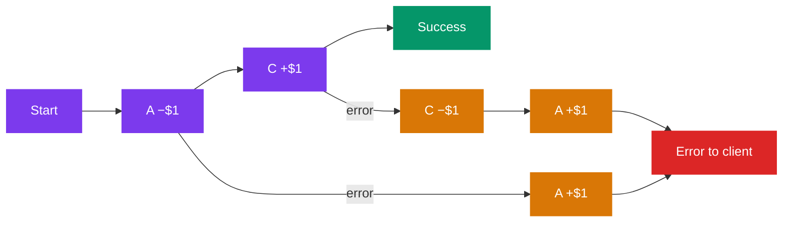
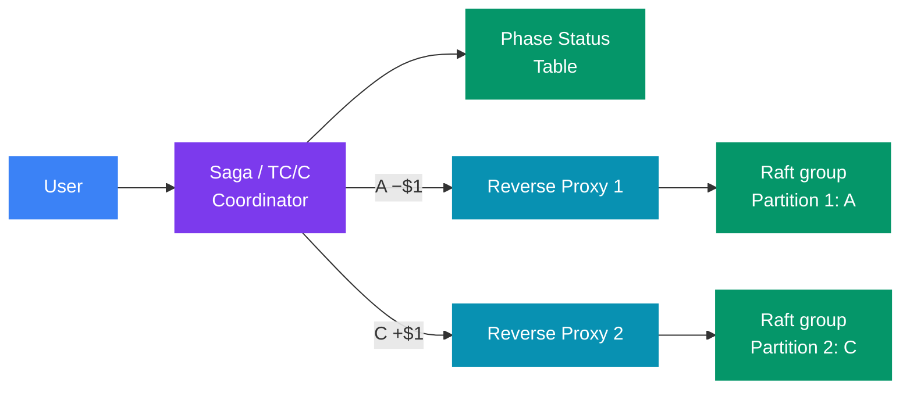
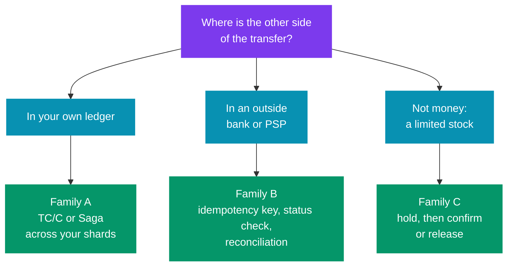

# Ch 12: Digital Wallet

> 📖 **Vol 2, Chapter 12** (book pages 341–377) &nbsp;·&nbsp; 🔥🔥 Very High Priority &nbsp;·&nbsp; 💬 **22 Questions**  
> **Source:** Alex Xu & Sahn Lam, *System Design Interview Vol 2*, Ch 12. Page and figure numbers below are the book's printed ones.

---

📊 **Question Count**

| # | Section | Questions |
|---|---|---|
| 1 | [Requirements and Estimation ⚡](#1--requirements-and-estimation-p341343-) | 3 |
| 2 | [API and the In-memory Sharding Solution 🔥](#2--api-and-the-in-memory-sharding-solution-p343345-) | 1 |
| 3 | [Distributed Transactions — Database Sharding and 2PC 🔥🔥](#3--distributed-transactions--database-sharding-and-2pc-p345347-) | 2 |
| 4 | [Try-Confirm/Cancel (TC/C) 🔥🔥](#4--try-confirmcancel-tcc-p347353-) | 3 |
| 5 | [Saga, and TC/C vs Saga 🔥🔥](#5--saga-and-tcc-vs-saga-p353355-) | 3 |
| 6 | [Event Sourcing and CQRS 🔥🔥](#6--event-sourcing-and-cqrs-p355362-) | 4 |
| 7 | [High-performance Event Sourcing 🔥](#7--high-performance-event-sourcing-p362365-) | 1 |
| 8 | [Reliable Event Sourcing — Raft 🔥](#8--reliable-event-sourcing--raft-p365368-) | 1 |
| 9 | [Distributed Event Sourcing and Wrap Up 🔥](#9--distributed-event-sourcing-and-wrap-up-p368375-) | 3 |
| 10 | [Similar Problems This Design Solves 📎 🔥](#10--similar-problems-this-design-solves--) | 1 |
| | **Total** | **22** |

> 🔥🔥 Very high priority — asked in almost every Tier-1 interview loop &nbsp;·&nbsp; 🔥 High priority — very frequent in Tier-1 interviews &nbsp;·&nbsp; ⚡ Medium priority — commonly asked &nbsp;·&nbsp; 💤 Low priority — good to know, rarely asked

> **How to read this note.** Sections 1–9 follow the book, step by step. §10, at the end, maps this design to 13 similar problems. Anything the book does not say is marked **📎 Beyond the book**. Where the book has a mistake, the note says so and gives the fix.
> This chapter is the place for 2PC, TC/C, Saga and event sourcing. The previous chapter covers idempotency, reconciliation and the double-entry ledger: [Ch 11: Payment System](./ch11_payment_system.md).

---

## 🗒️ Cheat Sheet

<details>
<summary><strong>🗒️ Show cheat sheet</strong></summary>

### 🎯 Clarifying Questions — and the book's answers
| Question | Book's answer (p.342) |
|---|---|
| Which features? | **Balance transfer between two digital wallets** only |
| How many transactions per second? | **1,000,000 TPS** |
| Are transactional guarantees enough for correctness? | **Yes** |
| Must we prove correctness? | **Yes.** Reconciliation only shows *that* a difference exists, not *how* it happened. So the system must be **reproducible**: rebuild any past balance by replaying the data from the very beginning |
| Availability? | **99.99%** |
| Foreign exchange? | **Out of scope** |

📎 Also worth asking in a real round: closed-loop or open-loop wallet (§1 Q2)? Audit and retention rules (§6 Q1)? Top-up from a bank or card (§1 Q1)?

### 🏗️ Core Components (Figure 12.28)
- **Wallet service / coordinator** — receives transfer commands, validates them, and coordinates TC/C or Saga. In the early designs it is stateless.
- **Partition info in ZooKeeper** (Figures 12.3, 12.4) and a **phase status table** that lets the coordinator recover after a restart (p.350).
- **Command list and event list** — append-only, in FIFO order. A **state machine** turns valid commands into events and applies them to the **state** (balances: first a relational DB, later RocksDB). A **snapshot** saves the state at one point in time.
- **Raft node group** — one partition = 3 nodes that replicate the event list.
- **Read path (CQRS)** — read-only state machines build views and push the result to a **reverse proxy**.

### Key API (p.343)
```
POST /v1/wallet/balance_transfer      -- transfer balance from one wallet to another

from_account    string   the debit account
to_account      string   the credit account
amount          string   string, not double (same reason as Ch 11, p.320)
currency        string   ISO 4217
transaction_id  uuid     ID used for deduplication

response: { "Status": "success", "Transaction_id": "01589980-2664-11ec-9621-0242ac130002" }
```

### 💡 Key Insights
1. **A transfer updates two accounts.** At 1M TPS they almost always live on different nodes. The hard part is making both updates **atomic** (p.345).
2. **Three designs, each fixing the last one** (p.343): in-memory (not atomic) → database + distributed transaction (not auditable) → event sourcing (reproducible).
3. **TC/C and Saga work at the application layer.** Each step is its own local transaction. So the app can see — and must handle — a middle state where money is "missing" (p.351).
4. **Always deduct first.** The only valid Try phase is "A −$1, C does nothing" (p.352).
5. **Event sourcing stores facts, not just balances.** Replay the events and you get any past balance. Only the **event list** needs strong reliability (p.366).

### ⚖️ Trade-offs / Alternatives
| Option | Pro | Con | Book's verdict |
|---|---|---|---|
| In-memory Redis sharding | Fast; the wallet service is stateless and scales | Two updates are not atomic; data is not durable | ❌️ Fails the correctness requirement (p.345) |
| 2PC (X/Open XA) | The databases do the work; strong consistency | Locks held for a long time; coordinator is a single point of failure; DB must support "prepare" | ❌️ "Not performant" (p.347) |
| TC/C | Works with any transactional DB; steps can run in parallel | Complex business logic; must handle the unbalanced state and out-of-order calls | ✅ If latency matters and there are many services (p.355) |
| Saga | Simple linear model; "de-facto standard" in microservices | Steps run one by one, so it is slower with many steps | ✅ If there are few services, like this transfer (p.355) |
| Saga orchestration (vs choreography) | One coordinator; handles complexity well | Choreography: every service keeps its own state machine — hard with many services | ✅ Orchestration is "usually the preferred solution in a digital wallet" (p.354) |
| Event sourcing | Reproducible; answers auditors | More moving parts; reads are eventually consistent | ✅ "The de facto solution for the wallet service" (p.360) |
| Local file + mmap + RocksDB (vs Kafka + remote DB) | Sequential disk writes; no network hop | The server is now stateful → single point of failure | ✅ Plus Raft replication (p.362–367) |
| Pull vs push for the result | Pull is simple | Pull is not real-time and can overload the service | ✅ Push to a reverse proxy (p.370) |

### 🔢 Numbers to Remember
| What | Value | Arithmetic |
|---|---|---|
| Transfers | **1,000,000 TPS** | Requirement (p.342) |
| DB operations | **2,000,000 per second** | Each transfer = 1 debit + 1 credit |
| Nodes at 1,000 TPS per node | **2,000** | 2,000,000 ÷ 1,000 (the first guess of 1,000 forgets the ×2) |
| Nodes at 100 / 10,000 TPS per node | **20,000 / 200** | 2,000,000 ÷ 100; 2,000,000 ÷ 10,000 (Table 12.1) |
| Availability | **99.99%** | 📎 ≈ **52.6 minutes** of downtime a year: 525,960 min × 0.0001 |
| Saga operations | **2n** | n normal steps + n compensating steps (p.353) |
| Raft fault tolerance | 3 nodes → 1 down; 5 nodes → 2 down | A majority (⌊n/2⌋ + 1) must be up (p.367) |
| Events per transfer | **2** | "A:−$1" and "C:+$1" (p.358) |
| Final design partitions | **2** (hash % 2) | 📎 For a random pair, the chance that a transfer crosses partitions is (N−1)/N: 50% at N = 2, 99.95% at N = 2,000 |
| Snapshot | Daily at **00:00** | The finance team wants it (p.364) |
| Final transfer flow | **15 steps** | Figure 12.29 |

### ⏱️ 45-Minute Round Plan
| Minutes | Phase | What to say or draw | Trap to avoid |
|---|---|---|---|
| 0–5 | Clarify | Transfer only, 1M TPS, transactions, **reproducibility**, 99.99%, no FX | Missing reproducibility — it decides the final design |
| 5–8 | Estimate | 1M × 2 ops = 2M/s → **2,000 nodes** at 1,000 TPS each | Saying 1,000 nodes (forgetting the ×2) |
| 8–14 | API + first design | `POST /v1/wallet/balance_transfer`; Redis shards + ZooKeeper | Stopping here. Say why it is not atomic |
| 14–27 | Distributed transactions | 2PC → TC/C (deduct first, phase status table, out-of-order) → Saga; compare | "Just use 2PC" with no word on locks or the coordinator |
| 27–37 | Event sourcing + CQRS | Command, event, state, state machine; replay; read-only views | Claiming event sourcing removes the need for distributed transactions |
| 37–45 | Deep dive | Local files + mmap + RocksDB + snapshot → Raft group → push via reverse proxy → Saga across partitions | No plan for a lost local disk |

> 📎 The timings are a suggestion, not from the book. The book gives the steps; the minutes are ours.

---

</details>
<br/>

---

## 1. 📋 Requirements and Estimation (p.341–343) ⚡

A digital wallet lets a user store money and spend it later (Figure 12.1). For example, add money from a bank card, then pay for products online from the wallet. A platform like **PayPal** also lets a user **transfer** money to another wallet on the same platform (Figure 12.2). This is faster than a bank-to-bank transfer, and it usually has **no extra fee**.

The task: design the backend for the **cross-wallet balance transfer**.

**Requirements** (p.342):

- Balance transfer between two digital wallets.
- 1,000,000 TPS.
- Reliability of at least 99.99%.
- Support transactions.
- Support reproducibility.

**Why reproducibility?** Correctness is usually only checked **after** a transaction is done. One way is to compare our records with bank statements — reconciliation. But reconciliation only shows **that** there is a difference. It cannot show **how** the difference was made. So the interviewer wants a system that can rebuild any past balance by replaying the data from the start.

### Back-of-the-envelope estimation (p.342–343)

"TPS" implies a **transactional database**. A relational DB on a typical data-center node handles **a few thousand TPS**. The book assumes **1,000 TPS per node**.

- First guess: 1,000,000 ÷ 1,000 = 1,000 nodes.
- But each transfer is **two** operations: deduct from one account, deposit to another. So the system handles **2 million** operations per second → **2,000 nodes**.
- Table 12.1: at 100 TPS per node → 20,000 nodes; at 10,000 → 200 nodes.

With the same hardware, more TPS per node means fewer nodes and lower cost. So **one design goal is to raise the TPS that one node can handle.** This goal drives the deep dive in §7.

### ❓ Interview Questions

1. **How do you handle a wallet top-up from a bank account or card? 📎 ⚡**

<!-- -->
<details>
<summary>💡 Show Answer</summary>

**Answer:**

Top-up brings money from **outside** the wallet system. It is a payment, so it uses the [Ch 11](./ch11_payment_system.md) flow: PSP, idempotency key, webhook.

- When the PSP confirms, write a **CREDIT event** for the wallet. The balance view updates from it.
- Store the PSP's transaction ID on the entry as the **external reference**, for reconciliation.
- Never credit on the browser redirect. Credit only on the webhook or a status check.

</details>

---

2. **Closed-loop vs open-loop wallet — how does the design differ? 📎 🔥**

<!-- -->
<details>
<summary>💡 Show Answer</summary>

**Answer:**

**Closed-loop** (a Starbucks card, a retailer gift card, transit stored value): money moves only inside one platform. All wallets are in one system, so a transfer can be an in-system transaction.

**Open-loop:** money can go to bank accounts or other platforms through payment networks (UPI, SWIFT). This needs PSP and network adapters, and reconciliation against network settlement files. It usually needs a payment-system licence from the central bank, with stricter rules.

> **India specifics — know these before a PhonePe / Paytm / CRED round.**  
> - The Indian instrument is a **Prepaid Payment Instrument (PPI)**. It is authorised under the **Payment and Settlement Systems Act, 2007** and governed by the RBI's PPI Master Direction.  
> - Two tiers matter:  
>   - *small PPIs* (minimum details, limited balance; only for buying goods and services — no fund transfer, no cash withdrawal)  
>   - *full-KYC PPIs*, which must be interoperable (wallets through UPI). RBI mandated this in 2021, with a deadline of **31 March 2022**.  
> - So the popular Indian wallets are **not** closed-loop. Saying they are is an obvious domain mistake.  
> - Record retention: the **RBI PPI Master Direction** requires a transaction log for **at least 10 years** (para 6.3). The **PMLA** adds 5 years from the transaction date (and 5 years past the end of the relationship for KYC records).

</details>

---

3. **How do you deal with currency risk in a multi-currency wallet? 📎 💤**

<!-- -->
<details>
<summary>💡 Show Answer</summary>

**Answer:**

The book puts FX **out of scope** (p.342). If asked:

- Each wallet holds **one** currency, stored in its smallest unit (paise, cents).
- A cross-currency transfer gets the rate from an FX service, **records the rate in the transfer event**, then converts.
- The ledger keeps the original and the converted amount separately.
- A short **rate lock** (e.g. 30 seconds) stops the rate from changing between the quote and the transfer.
- If the platform pays the conversion cost, reconciliation must include the FX profit and loss.

</details>

---

## 2. 🔌 API and the In-memory Sharding Solution (p.343–345) 🔥

The book shows three high-level designs (p.343). First, a simple in-memory solution. Second, a database-based distributed transaction solution. Third, an event sourcing solution with reproducibility.

### API (p.343–344)

One RESTful API: `POST /v1/wallet/balance_transfer`. The fields are in the Cheat Sheet's **Key API**.

- `amount` is a **string**, not a `double`. The reason is in [Ch 11 §3](./ch11_payment_system.md) (book p.320).
- The book adds (p.344): many people still use `float` or `double`, because every language and database supports them. That is "a proper choice" **if** you understand the risk of losing precision.
- `transaction_id` is a UUID used for **deduplication**.

> 📎 In a Java interview, do not defend `double` for money. Use `BigDecimal`, or a `long` in the smallest unit (paise, cents).

### In-memory sharding solution (Figure 12.3, p.344–345)

The data is a `<user, balance>` map, so a key-value store fits. **Redis** is a popular choice. One Redis node cannot handle 1M TPS, so the accounts are spread over a **cluster** of Redis nodes. This is called **partitioning** or **sharding**.

```java
String accountID = "A";
int partitionNumber = 7;
int myPartition = accountID.hashCode() % partitionNumber;   // the book's pseudocode
```

- The number of partitions and the address of every Redis node are kept in **ZooKeeper**, a highly available config store.
- The **wallet service** receives a transfer command, validates it, and updates the two balances. In a cluster, the two balances are likely on **different Redis nodes**.
- The wallet service is **stateless**, so it scales out easily.

> 📎 Two fixes to the pseudocode. In Java, `hashCode()` can be negative, so `%` can return a negative partition. Use `Math.floorMod(accountID.hashCode(), partitionNumber)`. And plain `hash % n` moves almost every key when `n` changes. That is why the partition map lives in ZooKeeper, and why many systems use consistent hashing instead.

**Why it fails** (p.345): to move $1 from A to B, the wallet service sends **two** commands to **two** Redis nodes. If the service crashes after the first update and before the second, the transfer is half done. **The two updates must be one atomic transaction.** Also, the Wrap Up notes, the data in Redis is not durable (p.374).

### ❓ Interview Questions

1. **Estimate the nodes for 1 million transfers per second. Why can't you just shard the balances across Redis? 🔥**

<!-- -->
<details>
<summary>💡 Show Answer</summary>

**Answer:**

**Estimate** (p.342–343):

- Assume a relational node handles **1,000 TPS**.
- Each transfer = **2 operations** (debit + credit). So 1M transfers = **2M operations/s**.
- 2,000,000 ÷ 1,000 = **2,000 nodes**. (100 TPS/node → 20,000; 10,000 TPS/node → 200.)
- So one design goal is to **raise the TPS per node**. That drives the deep dive (local files, mmap, RocksDB).

**Why Redis sharding fails** (Figure 12.3, p.345):

- A transfer sends **two** commands to **two** Redis nodes. If the wallet service crashes between them, the transfer is **half done**. The two updates are not atomic.
- In-memory data is also **not durable** (p.374).

📎 With 2,000 nodes, almost every transfer touches two nodes. Cross-node atomicity is the main problem, not an edge case.

</details>

---

## 3. 🔐 Distributed Transactions — Database Sharding and 2PC (p.345–347) 🔥🔥

### Database sharding (Figure 12.4, p.345–346)

Step one: replace each Redis node with a **transactional relational database**. Clients A, B and C now live in 3 databases.

This solves only part of the problem. One transfer still updates **two accounts in two databases**. Nothing makes both updates happen at the same time. If the wallet service restarts right after the first update, how do we make sure the second one happens?

A **distributed transaction** is the answer. There are two kinds (p.346):

- A **low-level** solution, inside the database: **two-phase commit (2PC)**.
- A **high-level** solution, in the application: **TC/C** and **Saga**.

### Two-phase commit (Figure 12.5, p.346–347)

1. The **coordinator** (here, the wallet service) reads and writes on several databases as normal. Databases A and C are **locked**.
2. When the app is about to commit, the coordinator asks all databases to **prepare**.
3. In the second phase, the coordinator collects the replies:
   - All say **yes** → it asks all databases to **commit**.
   - Any says **no** → it asks all databases to **abort**.

It is "low-level" because the prepare step needs a **special change to the database transaction**. The **X/Open XA** standard coordinates different databases for 2PC.

**Problems** (p.347):

- **Not performant.** Locks can be held for a very long time while the nodes wait for messages.
- **The coordinator is a single point of failure** (Figure 12.6). If it crashes after the databases vote "yes", they wait with their locks held.

> 📎 That wait has no time limit. A participant that voted "yes" cannot decide alone, because it does not know what the others voted. It holds its locks until the coordinator comes back or an operator steps in. This blocking is the main reason teams reject 2PC for a high-throughput wallet. Also, an external system such as a PSP or a bank cannot take part in an XA transaction.

### ❓ Interview Questions

1. **What is two-phase commit, and why is it a poor fit for a wallet at this scale? 🔥🔥**

<!-- -->
<details>
<summary>💡 Show Answer</summary>

**Answer:**

**How it works** (Figure 12.5, p.346–347):

1. The coordinator writes to several databases. Each one **locks** its rows.
2. **Prepare:** the coordinator asks all databases to prepare.
3. All say yes → **commit** everywhere. Any says no → **abort** everywhere.

It is **low-level**: the database must support the prepare step (the **X/Open XA** standard).

**Problems** (p.347):

- **Slow.** Locks can be held a very long time while nodes wait for messages.
- **The coordinator is a single point of failure** (Figure 12.6).

📎 A participant that voted yes cannot decide alone. It keeps its locks, with **no time limit**, until the coordinator recovers. Also, banks and PSPs do not speak XA.

</details>

---

2. **Both wallets are in the same database. How do you make the transfer atomic? 📎 🔥🔥**

<!-- -->
<details>
<summary>💡 Show Answer</summary>

**Answer:**

Use one ACID transaction — **and lock both rows in a fixed order**:

```sql
BEGIN;
-- lock BOTH accounts, always in ascending id order, whatever the direction
SELECT id, balance FROM wallets WHERE id IN (:a, :b) ORDER BY id FOR UPDATE;
UPDATE wallets SET balance = balance - 500
  WHERE id = :a AND balance >= 500;    -- 0 rows → ROLLBACK: not enough money
UPDATE wallets SET balance = balance + 500 WHERE id = :b;
INSERT INTO ledger (account_id, amount, type)
  VALUES (:a, -500, 'DEBIT'), (:b, 500, 'CREDIT');
COMMIT;
```

If anything fails, the whole transaction rolls back.

> ⚠️ **The deadlock this avoids. This is the answer interviewers want to hear.**  
> Suppose you lock only the sender (`WHERE id = A FOR UPDATE`) and then update B. This is a classic deadlock:  
> - A B-to-A transfer holds B's lock and waits for A's.  
> - At the same time, you hold A's lock and wait for B's.  
> - Neither can go on. The database detects it and aborts one. (PostgreSQL checks after `deadlock_timeout`, default 1s. MySQL InnoDB detects it at once.)  
>
> The fix is **deterministic lock ordering**. Sort the account IDs and always lock in that order. Then a cycle can never form.

</details>

---

## 4. 🔄 Try-Confirm/Cancel (TC/C) (p.347–353) 🔥🔥

TC/C is a kind of **compensating transaction** with two steps (p.347). First, **Try**: the coordinator asks all databases to **reserve** resources. Then it collects the replies. All say **yes** → it asks all to **confirm** (Try-Confirm). Any says **no** → it asks all to **cancel** (Try-Cancel).

**The key difference from 2PC:** in 2PC both phases are inside **the same** transaction. In TC/C, **each phase is a separate transaction**.

### The $1 example (Table 12.2, p.348–349)

Move $1 from account A (balance $1) to account C (balance $0). The wallet service is the coordinator.

| Phase | Operation | A | C |
|---|---|---|---|
| 1 | Try | Balance change: −$1 | Do nothing (NOP) |
| 2 | Confirm | Do nothing | Balance change: +$1 |
| 2 | Cancel | Balance change: +$1 | Do nothing |

- **Try** (Figure 12.7): a local transaction on A's database runs `UPDATE balance SET amount=amount-1 WHERE account='A'`. C's database gets a **NOP** command. It does nothing and always replies "success". The lock on A is held only **inside** that local transaction.
- **Confirm** (Figure 12.8): A is already updated. The coordinator adds $1 to C in a **new** local transaction.
- **Cancel** (Figure 12.9): suppose the Try on C fails — for example, the regulator has blocked account C. A's Try transaction is **already committed**, so it cannot be cancelled. The coordinator starts **another** transaction that adds $1 back to A. C gets a NOP.

### 2PC vs TC/C (Table 12.3, p.349–350)

| | First phase | Second phase: success | Second phase: fail |
|---|---|---|---|
| **2PC** | Local transactions are **not done yet** (still locked) | Commit all local transactions | Cancel all local transactions |
| **TC/C** | All local transactions are **completed** — committed or cancelled | Execute new local transactions if needed | Reverse the side effect of the committed transaction ("undo") |

In 2PC, phase two **finishes** an open transaction. In TC/C, phase two runs a **reverse operation** when there is an error. TC/C is also called a **distributed transaction by compensation**. It is high-level because the "undo" lives in the **business logic**.

- **Advantage:** it is **database-agnostic**. Any database that supports transactions works.
- **Disadvantage:** the application must handle all the details and the complexity.

### Phase status table (Figure 12.10, p.350–351)

What if the wallet service **restarts** in the middle of TC/C? Its memory is lost. The fix: store the progress in a **transactional database**. The phase status holds at least:

- The ID and content of the distributed transaction.
- The Try status for each database: `not sent yet`, `has been sent`, `response received`.
- The name of the second phase: `Confirm` or `Cancel` (it can be computed from the Try result).
- The status of the second phase.
- An **out-of-order** flag (see below).

Where? Usually in the database that holds the account **money is deducted from**.

### Unbalanced state (Figure 12.11, p.351)

After the Try phase, A has $0 and C has $0. The sum was $1 before; now it is $0. **$1 is missing.** This breaks a basic accounting rule: the total must stay the same after a transaction.

The transactional guarantee still holds. TC/C is a set of independent local transactions, driven by the application. So the application **can see** the middle state. With a DB transaction or 2PC, the databases hide it. The book's point: there are **always** differences (mismatches) during a distributed transaction. Either a lower layer hides them, or we handle them ourselves, as in TC/C.

### Valid operation orders (Table 12.4, p.352)

| Try phase choice | Account A | Account C | Valid? |
|---|---|---|---|
| Choice 1 | −$1 | NOP | ✅ The only valid one |
| Choice 2 | NOP | +$1 | ❌️ |
| Choice 3 | −$1 | +$1 | ❌️ |

- **Choice 2:** C gets +$1 but A's step fails, so we must cancel. Before we can, someone may **move the $1 out of C**. Then the cancel finds nothing to take back.
- **Choice 3:** if both run at the same time, $1 may reach C while the deduction from A fails. What then? Too many cases.

**Rule: deduct first, credit later.**

### Out-of-order execution (Figure 12.12, p.352–353)

The Try on A fails, so the coordinator sends **Cancel** to A and C. But C's database has network trouble. It gets the **Cancel before the Try**. There is nothing to cancel.

The fix — each node may cancel a TC/C it has never seen a Try for:

- An out-of-order Cancel leaves a **flag** in the database: "Cancel seen, Try not seen yet".
- Every Try first **checks for this flag**. If it is there, the Try returns **failure**.

This is why the phase status table has an out-of-order flag.

> 📎 Two rules make TC/C safe in practice. Every Try, Confirm and Cancel must be **idempotent**, because the coordinator retries after a crash. And a Cancel for an unknown transaction must succeed (an "empty cancel"), which is the case above.

> 📎 **Many TC/C systems freeze the money in Try instead of deducting it.** The account gets a second column, such as `frozen_amount`.
> - **Try** moves $1 from the available balance to `frozen_amount`.
> - **Confirm** removes the $1 from `frozen_amount`. **Cancel** moves it back to the available balance.
> - The $1 is now never "missing". It shows as **on hold**, like a card authorisation.
>
> The book's version deducts at once, which is simpler. Both follow the same rule: take from the payer first.

### ❓ Interview Questions

1. **Explain TC/C with the "$1 from A to C" example. How is it different from 2PC? 🔥🔥**

<!-- -->
<details>
<summary>💡 Show Answer</summary>

**Answer:**

(Table 12.2, Figures 12.7–12.9, p.348–349 — full table above)

- **Try:** A's database deducts $1 in a local transaction and **commits**. C gets a NOP.
- All say yes → **Confirm:** add $1 to C in a new local transaction.
- Any says no (e.g. the regulator blocked C) → **Cancel:** A's Try is already committed, so add the $1 **back** in a new transaction.

**vs 2PC** (Table 12.3, p.349–350):

- 2PC: both phases are in **one** transaction. Locks stay until phase two. Phase two **finishes** the open transaction.
- TC/C: **each phase is a separate transaction**. No locks between phases. Phase two runs a **new** transaction or an "undo".
- TC/C lives in **business logic**, so it works on any transactional DB. The cost: the app owns all the complexity.

</details>

---

2. **Two TC/C edge cases: the coordinator restarts mid-way, and a Cancel arrives before its Try. How do you handle each? 🔥**

<!-- -->
<details>
<summary>💡 Show Answer</summary>

**Answer:**

**Restart → phase status table** (p.350, Figure 12.10). It lives in a transactional DB, usually the one holding the account **money is deducted from**. It keeps:

- the transaction ID and content;
- the Try status per database (`not sent yet`, `has been sent`, `response received`);
- the second phase (`Confirm` or `Cancel`) and its status;
- an **out-of-order flag**.

After a restart, the service reads it and continues each transaction.

**Cancel before Try** (Figure 12.12, p.352–353). The Try on A fails, so Cancel goes to A and C. C has network trouble and gets the **Cancel first**. The fix:

The early Cancel leaves a **flag**: "Cancel seen, Try not seen yet". Every Try first **checks the flag**; if it is set, the Try **fails**.

📎 Without the flag, the late Try would reserve money that nobody ever confirms or cancels. Every Try, Confirm and Cancel must also be **idempotent**, because a restarted coordinator re-sends them.

</details>

---

3. **After the Try phase, $1 is "missing". Why is that allowed, and why must the Try deduct first? 🔥🔥**

<!-- -->
<details>
<summary>💡 Show Answer</summary>

**Answer:**

**Unbalanced state** (Figure 12.11, p.351): after Try, A = $0 and C = $0. The sum dropped from $1 to $0. The guarantee still holds, because TC/C is a set of local transactions run by the app. The app **can see** the middle state, so it must handle it. With 2PC, the database hides it.

**Valid Try orders** (Table 12.4, p.352):

- A −$1, C NOP — ✅ the only valid one.
- A NOP, C +$1 — ❌️. If A then fails, we must take $1 back from C. Someone may have **spent** it already.
- A −$1 and C +$1 together — ❌️. $1 may reach C while the deduction from A fails.

**Rule: deduct first, credit later.** Saga uses the same rule (p.354).

</details>

---

## 5. 🔗 Saga, and TC/C vs Saga (p.353–355) 🔥🔥

### Linear order execution (p.353–354)

**Saga** is "the de-facto standard in a microservice architecture":

1. All operations are in a **sequence**. Each one is an independent transaction on its own database.
2. They run from first to last. When one finishes, the next starts.
3. When one fails, the process **rolls back** from the current operation to the first one, in **reverse order**, using **compensating transactions**. So n operations need **2n**: n for the normal case and n for rollback.



*(Figure 12.13)* The deduction comes **before** the addition, for the reason in §4 (valid operation orders).

### Choreography vs orchestration (p.354)

- **Choreography** — each service subscribes to the others' events and does its job. Fully decentralised.
- **Orchestration** — one coordinator tells every service what to do, in the right order.

With choreography, services talk fully asynchronously. Each one keeps an internal state machine to know what to do when another emits an event. This gets hard with many services. **Orchestration handles complexity well, so it is usually preferred in a digital wallet.**

### TC/C vs Saga (Table 12.5, p.354–355)

| | TC/C | Saga |
|---|---|---|
| Compensating action | In the Cancel phase | In the rollback phase |
| Central coordination | Yes | Yes (orchestration mode) |
| Operation execution order | Any | Linear |
| Parallel execution possible | Yes | No (linear execution) |
| Can see the partial inconsistent status | Yes | Yes |
| Application or database logic | Application | Application |

**Which one?** It depends on latency (p.355):

1. No latency requirement, or very few services (like this transfer) → **either** works. To follow the microservice trend, pick **Saga**.
2. Latency-sensitive, with many services or operations → **TC/C** may be better, because its steps can run in parallel.

### 📎 2PC vs TC/C vs Saga — one table

The book compares them in pairs (Tables 12.3 and 12.5). Here they are side by side:

| | 2PC | TC/C | Saga |
|---|---|---|---|
| Layer | Database (XA) | Application | Application |
| Locks held between phases | Yes — the weak point | No | No |
| App sees the middle state | No | Yes | Yes |
| On failure | DB aborts the open transaction | Cancel phase "undoes" Try | Compensations in reverse order |
| Step order | — | Any (can be parallel) | Linear |
| Main risk | Blocking; coordinator is a single point of failure | Complex logic; out-of-order calls | Slow when there are many steps |
| Book's pick for the wallet | ❌️ | ✅ if latency-sensitive with many services | ✅ for few services |

> 📎 Both TC/C and Saga give up **isolation**. Another transaction can see the "missing $1" in the middle. Compensations must be idempotent and must not fail for business reasons — "add $1 back to A" always succeeds. That is one more reason to deduct first.

> 📎 **How real systems limit the isolation problem:**
> - **Semantic lock** — mark the transfer `PENDING` until the last step ends. Other flows treat a pending transfer as not final.
> - **Show the available balance** — it already leaves out money in a pending debit.
> - **Order the steps** — the debit goes first, so nobody can spend money that a compensation may take back.

> 📎 **The orchestrator must not lose a step (transactional outbox).** Suppose it saves its state in the DB and then sends the next command to Kafka.
> - A crash between the two writes loses the command. Or the command goes out, but the state was never saved.
> - The fix: write the state change and an **outbox row** in **one** local transaction. A relay reads the outbox and publishes it.
> - The relay may publish twice. So every step handler dedupes by the transfer ID.

### ❓ Interview Questions

1. **Explain Saga. Choreography or orchestration? What happens when the credit step fails? 🔥🔥**

<!-- -->
<details>
<summary>💡 Show Answer</summary>

**Answer:**

**Saga** (p.353) — "the de-facto standard in a microservice architecture":

1. Operations run **in a sequence**. Each is its own local transaction.
2. Each one triggers the next.
3. On failure, roll back **in reverse order** with **compensating transactions**. So n operations need **2n**.

**Credit fails** (Figure 12.13): `A −$1` succeeds, `C +$1` fails → run `C −$1`, then `A +$1` → return an error.

**Coordination** (p.354):

- **Choreography** — services react to each other's events. Each keeps its own state machine. Hard with many services.
- **Orchestration** — one coordinator drives the order. **Usually preferred for a wallet.**

📎 In practice: the orchestrator saves its state **before** each step. A transient failure is **retried** before compensation. Every compensation carries the transfer ID and is **idempotent**, because a crashed orchestrator may send it twice.

</details>

---

2. **Two wallets live on different databases. What are your options, and how do you pick between TC/C and Saga? 🔥🔥**

<!-- -->
<details>
<summary>💡 Show Answer</summary>

**Answer:**

Three options: **2PC**, **TC/C** and **Saga**. The side-by-side table is above.

- 2PC holds locks between phases and depends on one coordinator → rejected (p.347).
- TC/C and Saga both run in the app, both compensate, and both show a partial state (Table 12.5). The difference is **order**: TC/C can run steps **in parallel**; Saga runs them **one by one**.

**The book's rule** (p.355):

- No latency need, or few services (like a 2-account transfer) → either. Pick **Saga** to follow the microservice trend.
- Latency-sensitive with many services → **TC/C**.

**Common mistake:** "event sourcing removes the need for a distributed transaction." It does not. In the final design (p.371), a transfer across two partitions still uses **TC/C or Saga**. Event sourcing adds reproducibility, not atomicity across partitions.

</details>

---

3. **How does idempotency work for wallet transfers, and what edge cases must you handle? 📎 🔥🔥**

<!-- -->
<details>
<summary>💡 Show Answer</summary>

**Answer:**

The client creates a UUID — the book's `transaction_id` (p.343) — and sends it on every retry. The server inserts it atomically:

```sql
INSERT INTO transfer_idempotency (idem_key, status, result)
VALUES (?, 'IN_PROGRESS', NULL)
ON CONFLICT (idem_key) DO NOTHING;
```

- 1 row inserted → a new request. Process it.
- 0 rows inserted → the key exists. `COMPLETED` → return the stored result. `IN_PROGRESS` → `409 Conflict` (retry later). `FAILED` → return the stored reason.

**Edge case:** the server crashes after the debit and before the credit. The key stays `IN_PROGRESS`. On restart, the Saga orchestrator reads its saved state and finishes (or compensates). Then the key becomes `COMPLETED`, and client retries get that result.

</details>

---

## 6. 📜 Event Sourcing and CQRS (p.355–362) 🔥🔥

The interviewer's next problem (p.355): users may enter a **wrong operation**, so the amount may be wrong. We need to trace the root cause and **audit** every account operation.

A digital wallet provider may be **audited**. Auditors ask three hard questions (p.355): what was the balance **at any given time**? Are past and current balances **correct**? Is the logic still correct **after a code change**? **Event sourcing**, a technique from Domain-Driven Design (DDD), answers all three.

### The four terms (p.356–357)

| Term | What it is |
|---|---|
| **Command** | The intended action from the outside world, e.g. "transfer $1 from A to C". Commands go into a **FIFO queue**, because order matters |
| **Event** | The result of a **validated** command. A historical fact, named in the past tense: "transferr**ed** $1 from A to C". Events are also kept in FIFO order |
| **State** | What changes when an event is applied: a map of account → balance, in a key-value store or a relational DB |
| **State machine** | (1) validates commands and generates events; (2) applies events to update the state |

**Command vs event** (p.356):

- A command is an **intention**. It may be invalid — the transfer fails if the balance would go negative. An event is a **fact**. It must be applied.
- Commands may contain randomness or I/O. **Events must be deterministic.**
- One command can make **zero or more** events.

The state machine must be **deterministic**: no random I/O, no random numbers. Applying an event to a state must always give the same result (p.357).

> ⚠️ **Book inconsistency — where the randomness lives.** p.357 says the state machine generates events and must never use outside I/O or random numbers. But p.356 and p.366 say event **generation** may use random numbers or external I/O. Both cannot be true for the same step. The fix: only **applying** an event must be deterministic. Turning a command into an event may be non-deterministic. That is exactly why the system stores and replicates **events**, not commands (§8).

### Event sourcing view (Figures 12.14–12.15)

Command → state machine (validate, reading the state) → event → state machine (apply) → state. The book draws two state machines: one validates commands, one applies events. Over time, the system takes commands one by one (Figure 12.15).

### Wallet service example (Figures 12.16–12.17, p.358–359)

Commands are balance transfers in a FIFO **command queue** — **Kafka** is a popular choice. The state is in a relational DB. Start: A $5, B $4, C $3, D $2.

For each command, in FIFO order, the state machine checks the balance. If it is enough, it makes **one event per account**: "A → $1 → C" becomes "A:−$1" and "C:+$1". The five steps:

1. Read commands from the command queue.
2. Read the balance state from the database.
3. Validate the command. If valid, generate the two events.
4. Read the next event.
5. Apply the event: update the balance in the database.

> 📎 Kafka keeps order only **inside one partition**. Key the command topic by account, or one account's commands can be applied out of order.

### Reproducibility (Figure 12.18, p.359–360)

This is event sourcing's **biggest advantage**.

- In the distributed-transaction designs, the DB keeps only the latest balance. **Why** it changed is unknown, and the old balance is lost on each update.
- In event sourcing, every change is saved first as **immutable history**. The DB is only a view of the balance at some point in time.
- The event list is immutable and the state machine is deterministic. So **every replay gives the same history.**

The answers to the auditors (p.360):

- Balance at any time → replay events from the start up to that time.
- Are balances correct? → recalculate them from the event list.
- Is new code correct? → run old and new code on the same events and compare the results.

### CQRS (Figure 12.19, p.360–361)

The client still needs to **see** its balance. Event sourcing does not publish the state. It **publishes all the events**, and the outside world builds whatever state it needs. This is **CQRS** (Command-Query Responsibility Segregation).

- **One** state machine owns the write side.
- **Many read-only** state machines build views for queries. One may save balances in a DB for the balance query. Another may build the state for one time period, to look into a possible double charge.
- Read-only state machines **lag behind**, but always catch up. The design is **eventually consistent**.

### ❓ Interview Questions

1. **Why is reconciliation not enough for a wallet? How do you answer an auditor? 🔥**

<!-- -->
<details>
<summary>💡 Show Answer</summary>

**Answer:**

Reconciliation compares our records with bank statements. It shows **that** there is a difference, not **how** it happened (p.342). And a design that updates balances in place loses the old balance on every update (p.359).

**Event sourcing answers the auditors** (p.355, p.360). Balance at any time → replay events up to that time. Are balances correct → recalculate them from the events. Is new code correct → run old and new code on the same events and compare.

This is why event sourcing is "the de facto solution for the wallet service" (p.360).

📎 **Audit trail for a regulated wallet.** The event list is the core of it. Add who did it and from where:

```sql
audit_log(id, actor_wallet_id, action_type, target_wallet_id, amount,
          transfer_id, ip_address, device_fingerprint, created_at, operator_id)
```

- Append-only, in a separate schema; the app can only write.
- Keep it for **at least 10 years** (RBI PPI Master Direction, para 6.3); PMLA adds 5 years for transaction and KYC records.
- Export old monthly partitions to S3 as Parquet; query them with Athena.
- Reconciliation is still needed at the edges, against settlement files ([Ch 11 §6](./ch11_payment_system.md)).

</details>

---

2. **Explain event sourcing for a wallet: command, event, state and state machine. 🔥🔥**

<!-- -->
<details>
<summary>💡 Show Answer</summary>

**Answer:**

(p.356–359)

- **Command** — an intention: "transfer $1 from A to C". Kept in a **FIFO** queue (Kafka in the first design).
- **Event** — a validated **fact**, in the past tense: "transferred $1". It must be applied.
- **State** — the balances: a map of account → balance.
- **State machine** — validates a command against the state and makes events; then applies events to the state. **Applying must be deterministic.**

**One transfer** (Figure 12.17): read command → read balance → if valid, make "A:−$1" and "C:+$1" → read next event → apply it.

**Command vs event:** a command may be invalid (the balance would go negative). One command makes **zero or more** events. Making events may use I/O or random values; applying them never does.

📎 So the stored **state is a cache** of the event list. Replay the events and you get it back exactly.

</details>

---

3. **How do you stop a user from spending more than their balance under concurrent requests? 📎 🔥**

<!-- -->
<details>
<summary>💡 Show Answer</summary>

**Answer:**

**In the book's event sourcing design** there is no race inside a partition. The state machine takes commands **one at a time, in FIFO order**. It rejects any command that would make the balance negative (p.356, p.358).

**In a database design:**

- **Pessimistic lock:** `SELECT ... FOR UPDATE` on the wallet row, check `balance >= amount`, deduct — all in one transaction.
- **Conditional update (optimistic):**

```sql
UPDATE wallets
SET balance = balance - :amt, version = version + 1
WHERE id = :a AND version = :old_version AND balance >= :amt;
```

If 0 rows change, re-read. Version changed → retry. Balance too low → reject. In a distributed design, the Saga's first step (debit A) uses the same local check.

</details>

---

4. **Your events must be kept for 10 years. How do you change the event format? 📎 ⚡**

<!-- -->
<details>
<summary>💡 Show Answer</summary>

**Answer:**

Old events are **immutable**. They are the audit record, so you never rewrite them in place.

- **Put a version on every event**, for example `"schema_version": 2`.
- **Additive change** (a new optional field with a default): old events still parse. Nothing else to do.
- **Breaking change** (a field renamed, split or removed): add a new version. An **upcaster** turns an old event into the new shape when it is read, before the state machine applies it.
- **Keep the old apply logic.** The audit check replays old events with the new code (p.360). If the new code applies an old event differently, past balances change. So the state machine must apply each event by the rules of its own version.
- **Check compatibility before deploy.** A schema registry (Avro or Protobuf) can reject a breaking change in CI.

📎 A snapshot does not remove this need. Auditors can still ask for a replay from the very first event.

</details>

---

## 7. 🚀 High-performance Event Sourcing (p.362–365) 🔥

The interviewer (p.362): this handles one event at a time and talks to several external systems (Kafka, the DB). Can it be faster?

### File-based command and event list (Figure 12.20, p.362–363)

- **Save commands and events to local disk**, not to a remote store like Kafka. No network transit time.
- The lists are **append-only**. Appending is a **sequential write**, which is fast even on magnetic disks. The OS is heavily optimised for it. Sequential disk access can even beat random memory access in some cases (reference [12]).
- **Cache recent commands and events in memory.** They are processed right after they are saved, so there is no need to load them back from disk.
- **mmap** does both at once. It maps a disk file into memory as an array. The OS caches parts of the file. For append-only files, almost all data stays in memory.

> 📎 Data written through mmap sits in the OS page cache. A power or OS crash loses what was not flushed (`msync`/`fsync`). The book covers node loss with Raft replication in §8, not with flushing.

### File-based state (Figure 12.21, p.363–364)

The state also moves to local disk. Options: **SQLite** (a file-based relational DB) or **RocksDB** (a file-based key-value store). The book picks **RocksDB**: it uses a **log-structured merge-tree (LSM)**, which is optimised for writes. The most recent data is cached for reads.

### Snapshot (Figure 12.22, p.364–365)

Replaying from the very beginning every time is slow. So, periodically, **stop the state machine and save the current state to a file**. This is a **snapshot** — an immutable view of a past state.

- After that, the state machine loads a snapshot, checks where it stopped, and continues from there.
- Finance teams often want a snapshot at **00:00**, to check all the transactions of that day. Without snapshots, a read-only state machine would replay from the start up to that time.
- A snapshot is a big binary file. The book saves it in **HDFS**.

> ⚠️ **Book bug — HDFS is not object storage.** p.364 says to save the snapshot "in an object storage solution, such as HDFS". HDFS is a distributed **file system**. Use an object store such as Amazon S3, or say "a distributed file system such as HDFS". Either works for big immutable files.

With everything file-based, the system can use the full I/O throughput of the hardware. The interviewer's next problem (p.365): data on a **local disk** makes the server **stateful** — a single point of failure.

### ❓ Interview Questions

1. **The event sourcing design is too slow. How do you make it faster? 🔥**

<!-- -->
<details>
<summary>💡 Show Answer</summary>

**Answer:**

(p.362–365)

1. **Commands and events on local disk**, not in remote Kafka. Append-only = **sequential writes**, fast even on spinning disks.
2. **Cache recent data in memory.** **mmap** does both: the file is mapped into memory, and the OS caches it.
3. **State in RocksDB** on local disk — an LSM-tree, optimised for writes. (SQLite was the other option.)
4. **Snapshots** — now and then, stop the state machine and save the state to a file. Recovery loads the latest snapshot and replays only the newer events. Finance often wants one at **00:00**.

**The new problem:** a local disk makes the server **stateful** — a single point of failure. That leads to Raft.

📎 A snapshot must match an exact event position: "balance as of event ID N". On recovery, replay only events with ID > N.

</details>

---

## 8. 🔒 Reliable Event Sourcing — Raft (p.365–368) 🔥

### Reliability analysis (p.365–366)

A node does two things: **data** and **computation**. If the data is safe, the computation can be re-run on another node. So reliability is about the data. There are four kinds:

| Data | Needs strong reliability? | Why |
|---|---|---|
| File-based command | ❌️ | Event generation may not be deterministic (random numbers, external I/O). Replaying commands may not give the same events |
| File-based event | ✅ **Only this one** | Immutable historical facts. Everything else can be rebuilt from them |
| File-based state | ❌️ | Rebuilt by replaying events |
| State snapshot | ❌️ | Rebuilt by replaying events |

### Consensus (Figure 12.23, p.366–367)

Replicate the event list across several nodes. Two guarantees are needed: **no data loss**, and the **same relative order** of data on every node.

Consensus-based replication fits. The book uses **Raft**:

- As long as **more than half** of the nodes are up, their append-only lists hold the same data. With 5 nodes, 3 must be up.
- Roles: **leader**, **candidate**, **follower**. At most one leader. The leader takes external commands and replicates data to the followers.
- 3 nodes tolerate 1 failure. 5 nodes tolerate 2.

### Reliable solution (Figure 12.24, p.367–368)

Three event sourcing nodes form a **Raft node group**:

- The **leader** takes commands, turns them into events, and appends them to its local event list. Raft replicates new events to the followers.
- **All nodes** process the event list and update their state. Raft keeps the event lists the same. Event sourcing then keeps the states the same.

Failures:

- **Leader crash** → Raft elects a new leader from the healthy nodes. If the crash happened **before** a command became an event, the client sees a timeout or an error. It must **resend the same command** to the new leader.
- **Follower crash** → requests to it fail. Raft keeps retrying until the node restarts or is replaced.

> 📎 "Resend the same command" is only safe with deduplication. Use the `transaction_id` from the API (p.343) as the idempotency key, so a resent command does not move the money twice. See [Ch 11 §8](./ch11_payment_system.md). For Raft itself, see [Distributed Fundamentals](../../02_distributed_systems/01_distributed_fundamentals.md).

### ❓ Interview Questions

1. **Which data must be replicated for reliability, and how? 🔥**

<!-- -->
<details>
<summary>💡 Show Answer</summary>

**Answer:**

(p.365–368)

- State and snapshots can be **rebuilt** from events.
- Commands are **not enough**: making events may use random numbers or external I/O, so a replay may not give the same events.
- So **only the event list** needs strong reliability.

**How — Raft**, with no data loss and the same order on every node:

- More than half the nodes must be up: 3 nodes tolerate 1 failure; 5 tolerate 2.
- The **leader** takes commands, makes events and appends them. Raft copies them to the followers. **All** nodes apply the events.
- **Leader crash** → a new leader is elected. If the command had not become an event, the client times out and **resends** it.
- **Follower crash** → Raft retries until it is back or replaced.

📎 The resend must be deduplicated by `transaction_id`, or the money moves twice.

</details>

---

## 9. 🌍 Distributed Event Sourcing and Wrap Up (p.368–375) 🔥

The interviewer (p.368): one server cannot handle 1M TPS. The reliable design has **two limits**:

1. **Slow responses.** With CQRS, the client does not know when its wallet was updated. It may have to poll.
2. **One Raft group has limited capacity.** At scale, shard the data and use distributed transactions.

### Pull vs push (Figures 12.25–12.27, p.368–371)

| Model | How | Problem |
|---|---|---|
| Pull | The client polls the read-only state machine | Not real-time; high polling can overload the wallet service |
| Pull + reverse proxy | The client sends the command to a **reverse proxy**. It forwards the command and polls for the status | Simpler client, but still not real-time |
| **Push** | The read-only state machine **pushes** the status to the reverse proxy as soon as it gets the event | ✅ Feels real-time to the user |

### Distributed transaction (Figure 12.28, p.371–372)

Once each event sourcing node group runs **synchronously** (from the client's view), we can reuse **TC/C or Saga** across groups. The book splits the data into **2 partitions** by `hash(key) % 2`: Partition 1 holds account A, Partition 2 holds account C.



### The transfer, step by step (Figure 12.29, p.372–373)

The book uses Saga and shows only the happy path, in 15 steps. In short:

1. The user sends "A:−$1, C:+$1" to the Saga coordinator. It writes a record in the **phase status table** (steps 1–2).
2. Deduct first: it sends A:−$1 to **Partition 1** (step 3).
3. Partition 1's **Raft leader** stores the command, validates it and turns it into an event. Raft syncs the event; then the event runs (step 4).
4. The **read path** (CQRS) rebuilds the state and **pushes** the status to the coordinator, which records the success (steps 5–8).
5. The same happens for C:+$1 on **Partition 2** (steps 9–14).
6. All steps succeeded. The coordinator replies to its caller (step 15).

> 📎 Partitions here are found with `hash % 2`. For a random pair of accounts, a transfer crosses partitions with chance (N−1)/N. With 2,000 partitions (the node count from §1), that is 99.95%. So the cross-partition Saga is the **normal** path, not a rare one.

### Wrap Up (p.374–375)

The design story, in order:

1. Estimate: 1M TPS needs **a few thousand** nodes.
2. In-memory Redis → the data is **not durable**.
3. Transactional DBs + **2PC, TC/C, Saga** → hard to **audit**.
4. Event sourcing on an external DB and queue → **not fast** enough.
5. Command, event and state on a **local node** → a **single point of failure**.
6. **Raft** replicates the event list.
7. **CQRS + reverse proxy** turn the async framework into a sync one for users. **TC/C or Saga** coordinates commands across node groups.

### ❓ Interview Questions

1. **What is CQRS here? How does the client learn the result of its transfer? 🔥**

<!-- -->
<details>
<summary>💡 Show Answer</summary>

**Answer:**

**CQRS** (Figure 12.19, p.360–361):

- Event sourcing **publishes the events**, not the state. Consumers build the state they need.
- **One** state machine owns writes. **Many read-only** ones build views — one for the balance query, another to rebuild a time window when checking a possible double charge.
- **Cost:** the read side **lags** but always catches up. It is **eventually consistent**.

**Getting the result** (Figures 12.25–12.27, p.368–371):

- **Pull:** the client polls the read-only state machine. Not real-time, and heavy polling can overload the service.
- **Pull + reverse proxy:** the proxy forwards the command and polls. A simpler client, but still not real-time.
- **Push:** the read-only state machine pushes the status to the reverse proxy as soon as it gets the event. ✅ Feels real-time.

With push, each node group looks **synchronous** to its caller. So a Saga or TC/C coordinator can call it like a normal service (p.371).

</details>

---

2. **Walk me through a $1 transfer from A to C in the final design. 🔥🔥**

<!-- -->
<details>
<summary>💡 Show Answer</summary>

**Answer:**

(Figures 12.28–12.29, p.371–373) Two partitions by `hash % 2`: A in Partition 1, C in Partition 2. Each is a 3-node **Raft group** with a read path and a reverse proxy. A **Saga coordinator** keeps a **phase status table**.

1. The user sends "A:−$1, C:+$1". The coordinator writes a phase status record.
2. **Deduct first:** A:−$1 goes to Partition 1. Its Raft leader stores, validates, makes the event, syncs it with Raft, and runs it. The read path **pushes** "success" back, and the coordinator records it.
3. C:+$1 goes to Partition 2. Same steps.
4. The coordinator records success and replies to the user. If step 3 had failed, the Saga would compensate with A:+$1.

**Why this design** (p.374–375): reproducible (event sourcing), fast (local files, mmap, RocksDB), reliable (Raft), real-time for users (push), and scalable (partitions + Saga or TC/C).

</details>

---

3. **A big merchant's wallet gets thousands of credits per second. How do you handle this hot account? 📎 🔥**

<!-- -->
<details>
<summary>💡 Show Answer</summary>

**Answer:**

**The problem.** All events for one account go to **one partition**. One Raft leader applies them one at a time. In a database design, one row lock does the same. So one account can never go faster than one node, however many partitions you add.

**The key fact:** a **credit** can never make the balance negative, so it needs no balance check. Only a **debit** needs one. So credits can be split, batched or delayed.

| Fix | How | Cost |
|---|---|---|
| **Sub-accounts** | Split the wallet into N buckets on different partitions. Each credit goes to a random bucket. Balance = the sum of the buckets | A debit must find a bucket with enough money, or first move money between buckets. Reading the balance touches N buckets |
| **Batch credits** | Collect credits for a short window (say 100 ms). Apply one summed balance update. Keep every single credit in the event list for audit | Adds up to one window of delay |
| **Apply credits later** | Record each credit event at once. Update the merchant's balance view in the background | The merchant sees a short "pending" amount. Merchants are often settled in batches anyway |

Pick by who reads the balance. A merchant who withdraws once a day is fine with batching. A wallet that pays out at once needs sub-accounts.

</details>

---

## 10. 🧬 Similar Problems This Design Solves 📎 🔥

📎 The book does not list similar problems for this chapter. But the same core solves **at least 13 common interview problems**. Learn the core once, then change only a few parts for each one.

**The core that never changes:**
- **Two sides change together, or not at all.** One side loses value; the other side gains it.
- **Take from the payer first** (§4). Never give value that you may have to take back.
- **An idempotency key** on every command, so a retry never moves the value twice.
- **A record of every change**, not only the latest balance — a ledger or an event list.
- **TC/C or Saga** when the two sides live on different shards or services (§4–§5).

**The tag on each problem** says how often it is asked as an HLD round on its own (same legend as the questions). 🔥🔥 = learn its "what is different" column well; 💤 = knowing the family is enough.

**The one choice that splits them into three families:** where is the other side of the transfer?



### Family A — both sides are in your own ledger (like this chapter)

You own both accounts, so you can run TC/C or Saga across your own shards.

| # | Problem | What is different from this chapter |
|---|---|---|
| 1 | **Digital wallet 🔥🔥** (this chapter) | — |
| 2 | **Ledger service / core banking transfer 🔥** — [Ch 11 §4](./ch11_payment_system.md) | Every transfer is one **double-entry** journal entry: total debits = total credits. One entry can have more than two lines (amount, fee, tax), and all lines commit together. Balances are a sum of entries, like events here |
| 3 | **Loyalty points / airline miles ⚡** | Points **expire**, so the balance is a set of lots, each with its own expiry date. A redeem uses the oldest lot first. Earned points often stay pending until the return window ends |
| 4 | **In-game currency / gift cards / store credit 💤** | Closed-loop and low risk. The hard part is the edge: real money comes in through a payment (Family B). A refund or chargeback must claw back value that may already be spent |
| 5 | **Stock exchange 🔥** — [Vol 2 Ch 13](./ch13_stock_exchange.md) | The same engine: a sequenced event log, a deterministic state machine, mmap and a replicated log. But the state machine **matches buy and sell orders**, not transfers. Latency is in microseconds, so one thread handles each symbol |

### Family B — the other side is outside your system

A bank or PSP cannot join your TC/C or Saga. You send a request with a unique reference, and you check the result later.

| # | Problem | What is different from this chapter |
|---|---|---|
| 6 | **Payment system 🔥🔥** — [Ch 11](./ch11_payment_system.md) | The PSP holds the card money. You get the result by a webhook or a status call. **Reconciliation** with settlement files catches what the webhooks missed |
| 7 | **Wallet top-up and withdrawal to a bank 🔥** — §1 Q1 | Top-up: credit the wallet **only** after the PSP confirms. Withdrawal: debit (or freeze) the wallet first, then call the bank. A bank timeout means "unknown", not "failed" — check the status before you refund the wallet |
| 8 | **Cross-border money transfer (Wise, remittance) ⚡** | Two currencies, so the FX rate is locked and stored with the transfer (§1 Q3). Money moves between pooled accounts in each country. Steps can take days, so the Saga needs long timeouts and status checks |
| 9 | **P2P bank transfer switch (UPI-style) ⚡** | The money sits in the banks, not in your ledger. You only route a debit request to the payer's bank and a credit request to the payee's bank. A credit that times out after the debit needs a status check and a reversal path |

### Family C — not money: a limited stock is held, then confirmed

The "account" is a stock of rooms, seats or items. The TC/C Try becomes a **hold**.

| # | Problem | What is different from this chapter |
|---|---|---|
| 10 | **Hotel reservation 🔥🔥** — [Vol 2 Ch 7](./ch07_hotel_reservation_system.md) | The balance is a count per room type per date. The check is `reserved + n ≤ limit`, with a conditional update. Reservation and payment are separate services, joined by a Saga (Ch 7 §8) |
| 11 | **Event ticketing / seat booking 🔥** — [Ticketmaster](../../05_designs/03_ticketmaster_event_ticketing.md), [BookMyShow LLD](../../04_lld_and_machine_coding/08_bookmyshow_seat_booking.md) | Each seat is one exact item with a status: AVAILABLE → HELD → BOOKED. A hold has a **TTL** (often a few minutes). If payment does not finish in time, the seat is released — an automatic Cancel |
| 12 | **Flash sale 🔥** — [Flash sale design](../../05_designs/02_flash_sale_system.md) | One item is the **hot account** (§9 Q3) with millions of buyers in seconds. Pre-load the stock count in Redis, decrement it atomically, and create orders later through a queue |
| 13 | **E-commerce checkout (order → stock → payment → shipping) 🔥** | A longer Saga with 3–4 services and different owners. Orchestration is easier to follow (§5). A failed payment releases the stock hold and cancels the order |

### How to use this in an interview — five questions

When you get any "move value from one owner to another" problem, answer these five questions aloud. Each answer picks one part of the design:

| Ask | It decides |
|---|---|
| 1. Where is the other side — in my ledger, in an outside system, or a stock of items? | The **family**: TC/C or Saga across your own shards, or a reference + status check + reconciliation |
| 2. Must I prove every past balance to an auditor? | **Event sourcing** (§6), or a balance table plus an append-only ledger |
| 3. Can the value go below zero, or be oversold? | **Deduct first**, a hold or freeze, and a conditional update |
| 4. Is one account or one item very hot? | **Sub-accounts**, batching, or a Redis counter in front (§9 Q3) |
| 5. How long can one step take — milliseconds, minutes or days? | A short TC/C hold, a Saga with a TTL, or a long Saga with timeouts and status checks |

> **Where this does *not* transfer directly:**
>
> - **Counters where "about right" is fine** (likes, views). No two-sided transfer, so no TC/C or Saga is needed.
> - **Public blockchains.** The nodes do not trust each other, so they need a different kind of consensus. Raft assumes all nodes are yours and honest.
> - **Card authorisation inside the card network.** You do not own that ledger. You only send a request and get a result — that is [Ch 11](./ch11_payment_system.md).

### ❓ Interview Questions

1. **Where else can you use the digital wallet design? Pick three problems and say what changes. 📎 🔥**

<!-- -->
<details>
<summary>💡 Show Answer</summary>

**Answer:**

The core stays the same. Two sides change together. The payer is debited first. Every command has an idempotency key. Every change is recorded, not only the latest balance. What changes is **where the other side lives**, **what the "balance" is**, and **how long a step can take**.

| | Digital wallet (this chapter) | Loyalty points | Payment system | Hotel reservation |
|---|---|---|---|---|
| The "balance" | Money per wallet | Points, in lots with expiry dates | Money held by the PSP | Rooms left per type per date |
| Other side | Another wallet you own | Your own partner account | An outside PSP | Your own inventory |
| Atomic across shards | TC/C or Saga | Saga | Not possible — idempotency key, webhook, reconciliation | Conditional update, then a Saga with payment |
| Must not happen | Spend more than the balance | Redeem expired points | Charge the card twice | Sell more rooms than exist |
| Middle state | "$1 missing" after Try | Points pending until the return window ends | Payment pending until the webhook | Reservation pending until payment |

**Three families to name:**

- **Both sides in your own ledger** (wallet, ledger service, loyalty points, game currency, stock exchange): TC/C or Saga across your shards.
- **Other side outside** (payments, top-up and withdrawal, cross-border, UPI-style): a unique reference, a status check and reconciliation.
- **A limited stock, not money** (hotel, ticketing, flash sale, checkout): the Try becomes a hold with a TTL.

🧬 **The full list — 13 problems in three families, plus five questions that map any new one:** see the tables above.

</details>

---
