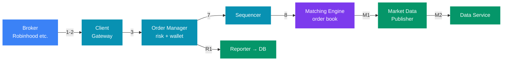
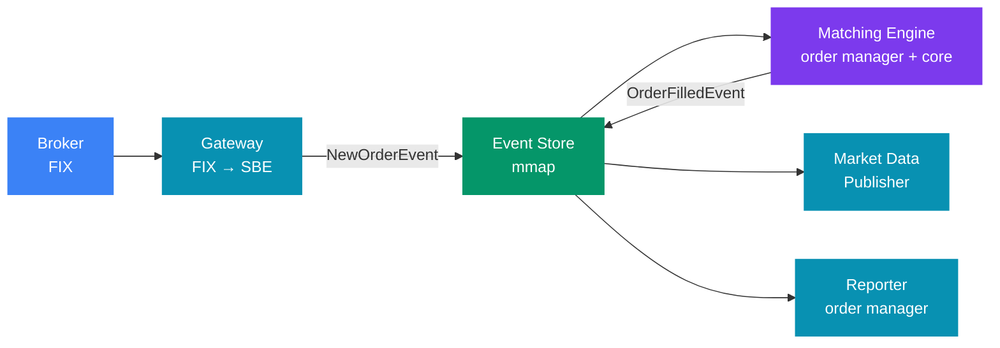
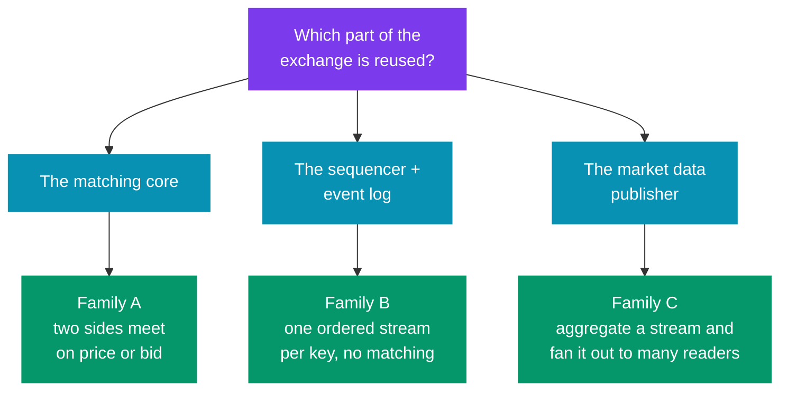

# Ch 13: Stock Exchange

> 📖 **Vol 2, Chapter 13** (book pages 379–414) &nbsp;·&nbsp; 🔥 High Priority &nbsp;·&nbsp; 💬 **23 Questions**  
> **Source:** Alex Xu & Sahn Lam, *System Design Interview Vol 2*, Ch 13. Page and figure numbers below are the book's printed ones.

---

📊 **Question Count**

| # | Section | Questions |
|---|---|---|
| 1 | [Requirements and Estimation 🔥](#1--requirements-and-estimation-p379381-) | 1 |
| 2 | [Business Knowledge 101 ⚡](#2--business-knowledge-101-p382384-) | 1 |
| 3 | [High-level Design — Three Flows 🔥🔥](#3--high-level-design--three-flows-p384390-) | 4 |
| 4 | [API Design ⚡](#4--api-design-p390393-) | 1 |
| 5 | [Data Models and the Order Book 🔥🔥](#5--data-models-and-the-order-book-p393398-) | 1 |
| 6 | [Performance — One Server, mmap, Application Loop 🔥](#6--performance--one-server-mmap-application-loop-p398401-) | 4 |
| 7 | [Event Sourcing and the Sequencer 🔥🔥](#7--event-sourcing-and-the-sequencer-p401404-) | 2 |
| 8 | [High Availability and Fault Tolerance 🔥](#8--high-availability-and-fault-tolerance-p404407-) | 2 |
| 9 | [Matching Algorithms and Determinism 🔥🔥](#9--matching-algorithms-and-determinism-p407409-) | 4 |
| 10 | [Market Data, Fairness, Security and Wrap Up ⚡](#10--market-data-fairness-security-and-wrap-up-p409411-) | 2 |
| 11 | [Similar Problems This Design Solves 🔥](#11--similar-problems-this-design-solves--) | 1 |
| | **Total** | **23** |

> 🔥🔥 Very high priority — asked in almost every Tier-1 interview loop &nbsp;·&nbsp; 🔥 High priority — very frequent in Tier-1 interviews &nbsp;·&nbsp; ⚡ Medium priority — commonly asked &nbsp;·&nbsp; 💤 Low priority — good to know, rarely asked

---

## 🗒️ Cheat Sheet

<details>
<summary><strong>🗒️ Show cheat sheet</strong></summary>

### 🎯 Clarifying Questions — and the book's answers
| Question | Book's answer (p.380–381) |
|---|---|
| Which securities? Stocks, options, futures? | **Only stocks** |
| Which order operations and types? | **Place a new order** and **cancel an order**. Only **limit orders** |
| After-hours trading? | **No.** Normal trading hours only |
| Basic functions? | Place or cancel limit orders, get matched trades in **real time**, see the real-time **order book** |
| Scale? | **Tens of thousands** of users trading at the same time, **at least 100 symbols**, **billions of orders per day** |
| Risk checks? | Yes, it is a regulated facility. Simple ones: a user can trade **at most 1 million shares of Apple a day** |
| User wallet? | Yes. Check the user has **enough funds**. **Hold back** the funds of an order that waits in the book |

**Non-functional** (p.381): availability **≥ 99.99%**. Fault tolerance with fast recovery. **Millisecond-level** round-trip latency, with a focus on **p99**. Security: KYC for new accounts, DDoS protection for public pages. The book adds: the scale says "small-to-medium exchange", but interviewers often ask how to **extend** it.

### 🏗️ Core Components (Figure 13.6)
- **Broker** — the retail app (Robinhood, Charles Schwab, …). Sends orders to the exchange.
- **Client gateway** — the gatekeeper: auth, validation, rate limit, normalization, FIX support. Keep it **light**.
- **Order manager** — risk check, **wallet** check, sends orders to the sequencer, keeps **order state**.
- **Sequencer** — stamps **sequence IDs** on orders (inbound) and on executions (outbound). Also a message queue and an event store.
- **Matching engine** — keeps one **order book per symbol**, matches buys and sells, emits **two executions (fills)** per match.
- **Market data publisher (MDP)** — builds order books and **candlestick charts** from the execution stream.
- **Data service** — stores market data and serves it to brokers.
- **Reporter** — merges orders and executions into records in the **DB** (not on the critical path).

### Key Data Structures (p.396–398)
```java
class PriceLevel {
    private Price limitPrice;
    private long totalVolume;
    private List<Order> orders;            // the book changes this to a doubly-linked list
}
class Book<Side> {
    private Side side;
    private Map<Price, PriceLevel> limitMap;
}
class OrderBook {
    private Book<Buy> buyBook;
    private Book<Sell> sellBook;
    private PriceLevel bestBid;
    private PriceLevel bestOffer;
    private Map<OrderID, Order> orderMap;  // finds an order to cancel in O(1)
}
```

### 💡 Key Insights
1. **Determinism is the base of everything.** Same input sequence → same fills. That gives replay, recovery and hot-warm failover (p.386, p.404).
2. **The sequencer makes it deterministic.** Gap-free sequence numbers also show a lost message at once (p.386).
3. **Latency = the sum of the work on the critical path.** So cut the steps and remove network and disk. Put everything on **one server** and talk over **mmap** (p.398–401).
4. **One thread per component, pinned to one CPU core.** No context switch, no locks, low p99 (p.400).
5. **Event sourcing replaces the database** on the critical path. The event store is the source of truth (p.401–403).

### ⚖️ Trade-offs / Alternatives
| Option | Pro | Con | Book's verdict |
|---|---|---|---|
| Components on separate servers | Simple to scale and deploy | ~500 µs per network hop + disk → tens of ms | ❌️ Too slow for a modern exchange (p.399) |
| Everything on **one server**, mmap bus | Tens of µs end to end | One big machine to protect | ✅ "Exactly how some exchanges are designed" (p.411) |
| Kafka as the event stream | Known tool, pub-sub | Latency not low or predictable enough | ✅ Only if there is no strict latency need (p.387, p.402) |
| Plain `List<Order>` in a price level | Simple | Cancel is O(n) | ❌️ Use a **doubly-linked list** (p.396) |
| Central order manager service | One owner of order state | Other components must call it → latency | ❌️ Use a **library embedded** in each component (p.403) |
| Many sequencers | No single writer | They fight over the event store (lock contention) | ❌️ **One sequencer per event store** (p.403) |
| **Raft** cluster of event stores | Leader election, near-zero RPO | More moving parts | ✅ Used for fault tolerance (p.406) |
| Automatic failover from day 1 | Fast | False alarms, the same bug kills the backup | ❌️ Start **manual**, automate later (p.406) |
| Subscribers served in connect order | Simple | The first subscriber always wins | ❌️ Use **multicast** or a **random order** (p.410) |

### 🔢 Numbers to Remember
| What | Value | Arithmetic |
|---|---|---|
| Symbols | **100** | Given (p.381) |
| Orders per day | **1 billion** | Given (p.381) |
| Trading day | **6.5 hours = 23,400 s** | NYSE 9:30 am – 4:00 pm Eastern; 6.5 × 3,600 |
| Average QPS | **~43,000** | 1,000,000,000 ÷ 23,400 = 42,735 → the book rounds to 43,000 |
| Peak QPS | **215,000** | 5 × 43,000 (busy at the open and the close) |
| 📎 Wrong divisor | ~11,600 | 10⁹ ÷ 86,400 — 3.7× too low; the market is not open 24 h |
| 4 nines downtime | **8.64 s/day** | 86,400 × 0.0001 (p.404) |
| Network round trip | **~500 µs** per hop | → single-digit ms across several hops (p.399) |
| Old design end to end | **tens of ms** | Network + disk (p.399) |
| Modern target | **tens of µs** | One server, no network, no disk (p.399) |
| mmap message bus | **sub-microsecond** per message | `/dev/shm` = memory, no disk (p.401) |
| Raft quorum, 5 nodes | **3** | ⌊5/2⌋ + 1 (p.406). 📎 It survives 2 failures |
| MDP ring buffer | **100** most recent ticks | Figure 13.24 |
| L2 depth | **5** levels default, **10** paid | p.409 |
| Figure 13.13 buy | **2,700** shares | 200 + 400 + 1,100 + 100 (all of 100.10) + 900 (first at 100.11) |
| FIX protocol | book: **1991** · real: **1992** | p.384. ⚠️ Book bug, see §2 |

### ⏱️ 45-Minute Round Plan
| Minutes | Phase | What to say or draw | Trap to avoid |
|---|---|---|---|
| 0–5 | Clarify | Stocks only, limit orders, new + cancel, 100 symbols, 1B orders/day, risk check, wallet | Designing a broker app instead of the exchange |
| 5–8 | Estimate | 10⁹ ÷ 23,400 s ≈ **43k QPS**, peak **215k** | Dividing by 86,400 |
| 8–18 | High-level | Figure 13.6: three flows. Critical path: gateway → order manager → sequencer → matching engine | Putting the reporter or a DB on the critical path |
| 18–25 | API + order book | `POST /v1/order`; price levels with a **doubly-linked list**, `orderMap` for O(1) cancel | A plain list (O(n) cancel) |
| 25–40 | **Deep dive** | One server + mmap, pinned app loops, event sourcing + one sequencer, hot-warm, Raft | Saying "use Kafka" with no latency reasoning |
| 40–45 | Wrap up | Determinism (p99.99), MDP ring buffers, multicast fairness, colocation, DDoS | Forgetting fairness of market data |

> 📎 The timings are a suggestion, not from the book. The book gives the steps; the minutes are ours.

---

</details>
<br/>

---

## 1. 📋 Requirements and Estimation (p.379–381) 🔥

An exchange matches buyers and sellers efficiently (p.379). NYSE trades billions of matches a day. HKEX trades about 200 billion shares a day. Exchanges differ: some focus on technology (LMAX), some on fairness (IEX). So check the **scale** and the **key features** first.

The clarifying answers and the non-functional list are in the Cheat Sheet.

**Estimation** (p.381):

- 100 symbols, 1 billion orders per day.
- NYSE is open Monday to Friday, 9:30 am to 4:00 pm Eastern Time. That is **6.5 hours**.
- QPS = 1 billion ÷ (6.5 × 3,600) ≈ **43,000**.
- Peak QPS = 5 × QPS = **215,000**. Volume is much higher just after the open and just before the close.

> 📎 Check: 1,000,000,000 ÷ 23,400 = 42,735. The book's 43,000 is a fair round-up. The key move is to divide by the **trading hours**, not by 24 hours.

> ⚠️ **Book inconsistency — shares or dollars?** The interviewer's risk rule is "at most **1 million shares** of Apple stock in one day" (p.380). The order manager section says "a user's trade volume is below **$1M** a day" (p.387). Pick one in the interview. The p.380 rule (shares per symbol per day) is the stated requirement.

### ❓ Interview Questions

1. **Clarify and estimate: what scale does the book design for, and what is the QPS? 🔥**

<!-- -->
<details>
<summary>💡 Show Answer</summary>

**Answer:**

Scope (p.380–381): **stocks only**, **limit orders**, place and **cancel**, normal hours only. Scale: **≥ 100 symbols**, tens of thousands of concurrent users, billions of orders a day. Checks: a simple risk check and a wallet check.

Estimation (p.381):

- 1 billion orders a day over **6.5 trading hours** (9:30 am – 4:00 pm ET) = 23,400 s.
- QPS = 10⁹ ÷ 23,400 ≈ **43,000**.
- Peak = 5 × 43,000 = **215,000**. Volume spikes at the open and the close.

Non-functional: **99.99%** availability, fault tolerance, **ms-level** latency with focus on **p99**, security (KYC, DDoS).

The key move is dividing by **trading hours**. Dividing by 86,400 gives ~11,600 — 3.7× too low.

</details>

---

## 2. 📚 Business Knowledge 101 (p.382–384) ⚡

- **Broker** — most retail clients trade through a broker (Charles Schwab, Robinhood, E\*Trade, Fidelity). The broker gives the user interface.
- **Institutional client** — trades big volumes with special software. A pension fund trades rarely but in large size. It needs **order splitting** to reduce market impact. A market-making hedge fund needs **low latency**.
- **Limit order** — a buy or sell at a **fixed price**. It may not match at once, or may match only in part.
- **Market order** — no price. It runs at once at the current market price. It gives up price to **guarantee execution**.
- **Candlestick** — open, close, high and low for one time interval (Figure 13.5). Common intervals: 1 minute, 5 minutes, 1 hour, 1 day, 1 week, 1 month.
- **FIX** — Financial Information eXchange protocol. The book says it was created in **1991**. A vendor-neutral protocol for securities transactions, as `tag=value` pairs: `8=FIX.4.2 | 9=176 | 35=8 | … | 55=MSFT | …`.

> ⚠️ **Book bug — the FIX year.** FIX started in **1992**, as a link between Fidelity Investments and Salomon Brothers for equity trading. Say "early 1990s" if you are not sure. No interviewer grades the year.

### Market data levels (US, Figures 13.2–13.4)

| Level | What it shows | Book's Apple example |
|---|---|---|
| **L1** | Best bid and best ask, with quantities | best ask 100.10 × 1,800; best bid 100.08 × 2,000 |
| **L2** | **More price levels**, total quantity per level | asks 100.10–100.13, bids 100.05–100.08 |
| **L3** | Price levels **and each order queued** at each level | 100.10: 200, 400, 1,100, 100 |

- **Bid** = the highest price a buyer will pay. **Ask** = the lowest price a seller will accept.
- L3 sums match L2: 200 + 400 + 1,100 + 100 = 1,800 at the best ask.

### ❓ Interview Questions

1. **Market order vs limit order, and L1 vs L2 vs L3 data? ⚡**

<!-- -->
<details>
<summary>💡 Show Answer</summary>

**Answer:**

(p.382–383)

- **Limit order** — a fixed price. It may not match at once, or may match only in part. The rest waits in the book.
- **Market order** — no price. It runs at once at the market price. It gives up price to **guarantee execution**.

Market data levels (US):

- **L1** — best bid and best ask with quantities (100.08 × 2,000 / 100.10 × 1,800).
- **L2** — **several price levels**, with total quantity per level.
- **L3** — price levels **and each queued order** at each level.

The book's API serves **L2** with a `depth` parameter. Retail gets 5 levels by default, 10 if they pay (p.409).

</details>

---

## 3. 🔄 High-level Design — Three Flows (p.384–390) 🔥🔥



*(Figure 13.6, simplified. Executions return on steps 10–14.)*

### Trading flow — the critical path (p.385)

1. A client places an order in the broker's web or mobile app.
2. The broker sends the order to the exchange.
3. The order enters the **client gateway**: input validation, rate limiting, authentication, normalization. It forwards the order to the order manager.
4. Steps 4–5: the order manager runs **risk checks** with rules from the risk manager.
5. Step 6: it checks the **wallet** has enough funds.
6. Steps 7–9: the order goes to the matching engine. A match gives **two executions (fills)**, one for the buy side and one for the sell side. Orders **and** executions go through the **sequencer**, so replay gives the same result.
7. Steps 10–14: the executions go back to the client.

### Market data flow (p.385)

- **M1:** the matching engine sends a stream of executions to the **market data publisher**.
- **M2:** the MDP builds **candlestick charts** and **order books** from executions and orders. It sends them to the data service.
- **M3:** market data is saved in special storage for real-time analytics. Brokers read it from the data service.

### Reporting flow (p.385)

- **R1–R2:** the reporter collects fields such as `client_id`, `price`, `quantity`, `order_type`, `filled_quantity`, `remaining_quantity`. It writes merged records to the DB.

Only the trading flow (steps 1–14) is on the critical path. The other two flows have looser latency needs.

### The components in detail

**Matching engine** (also "cross engine", p.386) — keeps the **order book for each symbol**. It matches buys and sells (one match = **two executions**). It sends the execution stream out as market data. It must be **deterministic**: the same order sequence in → the same fills out on replay. This is the base of high availability.

**Sequencer** (Figure 13.7, p.386–387):

- An **inbound** sequencer stamps each incoming order. An **outbound** sequencer stamps each pair of executions. Each keeps its own sequence.
- The numbers must be **sequential**, so a missing number is easy to see.
- Why stamp them: (1) **timeliness and fairness**, (2) **fast recovery / replay**, (3) **exactly-once** guarantee.
- It is also a **message queue** (orders in, executions back) and an **event store**. It is like two Kafka streams. The book: "we could have used Kafka if its latency was lower and more predictable."

**Order manager** (p.387) — runs the **risk check**, checks the **wallet** (the book points to [Ch 12](./ch12_digital_wallet.md)), and sends **only the needed attributes** to the sequencer. It returns executions to brokers through the gateway. Its hard part is order **state changes** — tens of thousands of cases. **Event sourcing** fits it well (§7).

**Client gateway** (Figures 13.8–13.9, p.387–388):

- Functions: **auth, validation, rate limit, normalization, FIXT support**.
- It is on the critical path, so keep it **light**. Leave complex work to the matching engine and risk check.
- Different gateways for different clients. An **app/web gateway** (HTTP) serves the exchange's own site. An **API gateway** (FIX / non-FIX) serves brokers and other API users.
- The extreme case is the **colo engine**: the broker's trading software runs on servers **rented inside the exchange's data center**. The latency is the time for light to travel from that server to the exchange server.

**Market data publisher** (Figure 13.10) and **reporter** (Figure 13.11, p.388–390):

- The MDP keeps order books and candlestick charts, persists them, and passes them to the data service.
- The reporter is not on the critical path, but it is critical. It serves trading history, tax, compliance and **settlement**. Here **accuracy and compliance** matter more than latency.
- A new order has the full details. An execution usually has only order ID, price, quantity and status. The reporter **merges** both (NewOrderReq + NewOrderAck + Fill → ExecutionReport). It then feeds settlement & clearing, books & records, and reporting.

### ❓ Interview Questions

1. **Walk me through the life of an order in the high-level design. 🔥🔥**

<!-- -->
<details>
<summary>💡 Show Answer</summary>

**Answer:**

(Figure 13.6, p.384–385) Three flows.

**Trading flow — the critical path:**

1. Client → **broker** app → the exchange.
2. **Client gateway**: validation, rate limit, auth, normalization.
3. **Order manager**: risk check (steps 4–5), **wallet** funds check (step 6).
4. **Sequencer** stamps a sequence ID → **matching engine** (steps 7–9). A match makes **two executions**. Executions are also sequenced.
5. Executions return to the client (steps 10–14).

**Market data flow (M1–M3):** executions → MDP → candlesticks + order books → data service → brokers.

**Reporting flow (R1–R2):** the reporter merges order and execution fields and writes them to the DB.

Only the trading flow is on the critical path. The others have looser latency needs.

</details>

---

2. **What does the order manager do? Why use event sourcing for it? 🔥**

<!-- -->
<details>
<summary>💡 Show Answer</summary>

**Answer:**

(p.387)

- Sends each order to the **risk check**.
- Checks the **wallet** has enough funds. While an order waits in the book, its funds are **held back** (p.381).
- Sends the order to the sequencer with **only the needed attributes**, to keep messages small.
- Gets executions back and returns them to brokers through the gateway.

Its hard part is **state changes** — tens of thousands of cases in a real exchange. **Event sourcing** fits: state = replay of events, so it is traceable and rebuildable.

In the deep dive (p.403) it becomes a **library embedded** in several components (matching engine, reporter). A central service would add latency. Event sourcing keeps every copy identical.

</details>

---

3. **A trader types 1,000,000 shares instead of 1,000. How do you stop it? 📎 💤**

<!-- -->
<details>
<summary>💡 Show Answer</summary>

**Answer:**

The **"fat finger"** problem. Pre-trade checks in the order manager, before sequencing:

- **Maximum quantity** per order, and **maximum order value** (quantity × price).
- A **price collar**: the price must be within a band of the last trade price (e.g. 5%).
- The book's daily rule also helps: at most **1 million shares** of one stock per user per day (p.380).
- Reject at once with a clear error code.

If a bad trade still executes, exchanges have **"clearly erroneous trade"** rules that let them **bust** (cancel) it within a short window.

</details>

---

4. **What is clearing and settlement, and how is it different from matching? 📎 🔥**

<!-- -->
<details>
<summary>💡 Show Answer</summary>

**Answer:**

- **Matching (execution)** — real time, in microseconds, inside the exchange. It decides **who trades with whom**.
- **Clearing** — after the trade. A central counterparty (in India, **NSE Clearing Ltd**, formerly NSCCL) **nets** each member's trades into one obligation.
- **Settlement** — the actual transfer. Shares move between demat accounts at the depository (**NSDL / CDSL**). Cash moves between banks.
- The cycle is **T+1** — India since January 2023, the US since 28 May 2024.
- Why the delay: funds and holdings must be checked, and **netting** cuts the number of transfers.

In the book, the **reporter** feeds "Settlement & Clearing" (Figure 13.11). It is not on the critical path.

</details>

---

## 4. 🔌 API Design (p.390–393) ⚡

The book puts the API **after** the high-level design in this chapter, because the API needs its concepts. The API is RESTful, between **brokers and the client gateway**. Institutions such as hedge funds likely use a faster special protocol, but it needs the same functions.

| Endpoint | Purpose | Key fields |
|---|---|---|
| `POST /v1/order` | Place an order (auth needed) | In: `symbol`, `side`, `price` (Long), `orderType` (limit or market), `quantity` (Long). Out: `id`, `creationTime`, `filledQuantity`, `remainingQuantity`, `status` (new / canceled / filled) |
| `GET /v1/execution?symbol=&orderId=&startTime=&endTime=` | Query executions (auth needed) | `executions[]`: `id`, `orderId`, `symbol`, `side`, `price`, `orderType`, `quantity` (filled) |
| `GET /v1/marketdata/orderBook/L2?symbol=&depth=` | L2 order book for a symbol | `depth` per side; returns `bids[]`, `asks[]` (price and size) |
| `GET /v1/marketdata/candles?symbol=&resolution=&startTime=&endTime=` | Candlestick history | `resolution` = window in seconds; returns `candles[]`: `open`, `close`, `high`, `low` |

Codes: **200** success, **40x** parameter error / not found / access denied / unauthorized, **500** server error.

> ⚠️ **Book inconsistency — price types.** Order and execution prices are **Long** (p.391–392), and the `Candlestick` class stores `long` prices (p.397). But the candles API returns prices as **Double** (p.393). Keep prices as integers in the smallest **tick** unit everywhere. A `double` brings rounding errors (see [Ch 11](./ch11_payment_system.md) on money types).

> 📎 There is no cancel endpoint in the list, though cancel is a requirement (p.380). A natural one is `DELETE /v1/order/{id}`. The answer is "canceled", or an error if the order already matched (the book's `CANNOT_CANCEL_ALREADY_MATCHED`, p.408).

### ❓ Interview Questions

1. **There is no cancel endpoint. Add one, and stop a retry from placing the same order twice. 📎 ⚡**

<!-- -->
<details>
<summary>💡 Show Answer</summary>

**Answer:**

**Cancel:** `DELETE /v1/order/{id}`, with auth.

- The order manager checks the user owns the order, then sends a `CANCEL` event through the sequencer.
- The matching engine handles it in sequence order, like any other event. If the order is still in `orderMap`, it is removed and the status becomes `CANCELED`.
- If it already filled, the answer is `CANNOT_CANCEL_ALREADY_MATCHED` (p.408). A partly filled order cancels only its **remaining** quantity.
- Cancel is a **request**, not a promise. A fill can win the race, because both go through one sequence.

**Duplicate orders:** the network can time out after the exchange got the order. The broker then retries.

- The broker sends its own unique `clientOrderID` with each order. It is in the book's order model (Figure 13.12).
- The order manager keeps the `(broker, clientOrderID)` pairs it has seen today. A repeat gets the **first** answer back. No new order is created.
- This is the same idea as an idempotency key in [Ch 11](./ch11_payment_system.md).

</details>

---

## 5. 🗃 Data Models and the Order Book (p.393–398) 🔥🔥

Three kinds of data (p.393): **product / order / execution**, the **order book**, and the **candlestick chart**.

### Product, order, execution (Figure 13.12)

- **Product** — attributes of a symbol: type, symbol, lot size, tick size, quote and settle currency. It rarely changes. Used for the UI. Any DB works, and it caches well.
- **Order** — the inbound buy or sell instruction. Fields include `orderID`, `productID`, `price`, `quantity`, `side`, `orderStatus`, `orderType`, `timeInForce`, `userID`, `clientOrderID`, `broker`, `accountID`, `entryTime`, `transactionTime`.
- **Execution** (fill) — the outbound matched result. Fields include `execID`, `orderID`, `price`, `quantity`, `side`, fee currency / rate / amount, `execStatus`. One order has **0..n** executions. One match gives **two** executions.

The figure is a logical model, not a DB schema. Where the data lives (p.394–395):

- **Critical path:** orders and executions are **not** in a database. Trades run **in memory**. Orders and executions are stored in the **sequencer** (on disk or shared memory) for fast recovery, and archived after the close.
- **Reporter:** writes them to a DB for reconciliation and tax reports.
- **MDP:** uses executions to rebuild the order book and candlesticks.

### The order book (p.395–398)

An order book is the list of buy and sell orders for one symbol, **organized by price level**. Its requirements:

- Constant-time lookup: volume at a price level, or between levels.
- Fast add / cancel / execute, **preferably O(1)**.
- Fast update (replace an order).
- Query best bid / ask.
- Iterate through price levels.

**The book's example (Figure 13.13).** A large **market buy of 2,700** Apple shares arrives. It takes **all** sell orders at the best ask 100.10 (200 + 400 + 1,100 + 100 = 1,800). Then it takes the **first** order at 100.11 (900). Total 2,700. The best ask becomes 100.11, so the spread **widens**.

> 📎 The scope is limit orders only (p.380), but this example is a market order. A **limit buy at 100.11 or higher** gives the same fills.

**Getting to O(1)** (p.396). The first code (Cheat Sheet) uses `List<Order>`, so cancel is not O(1). Change `orders` to a **doubly-linked list**:

| Operation | How | Cost |
|---|---|---|
| Place a new order | Add to the **tail** of its `PriceLevel` | O(1) |
| Match an order | Remove from the **head** of the `PriceLevel` | O(1) |
| Cancel an order | Find it in `orderMap` by `OrderID`, then unlink it with its own `prev` pointer | O(1) |

With a **singly**-linked list, cancel must walk the list to find the previous node: O(n). The doubly-linked node already knows its previous node. Figure 13.14 shows all three operations. The same order book structure is used in the MDP to rebuild L1/L2/L3 data.

> ⚠️ **Book inconsistency — `LinkedHashMap` keeps insertion order, not price order.** Figure 13.14 labels the buy book `LinkedHashMap<Price, PriceLevel>`. That map iterates in the order levels were **created**. A new level between two old ones goes to the end. So "iterate through price levels" and "find the next best bid when a level empties" do not work. 📎 Use a `TreeMap` (sorted; a new level costs O(log n)). Or use an **array indexed by tick** from a reference price — price ranges are narrow, so this gives O(1).

### Candlestick chart (p.397–398)

```java
class Candlestick {
    private long openPrice;
    private long closePrice;
    private long highPrice;
    private long lowPrice;
    private long volume;
    private long timestamp;
    private int interval;
}
class CandlestickChart {
    private LinkedList<Candlestick> sticks;
}
```

When an interval ends, a new `Candlestick` is added to the list. Many symbols × many intervals use a lot of memory. Two fixes:

1. Pre-allocated **ring buffers** for the sticks, to cut new object allocations.
2. Keep **a limited number** of sticks in memory. Persist the rest to disk.

Market data usually goes to an **in-memory columnar DB** (e.g. **KDB**) for real-time analytics. After the close, it moves to a historical DB.

### ❓ Interview Questions

1. **Design the order book. How do you make place, match and cancel O(1)? 🔥🔥**

<!-- -->
<details>
<summary>💡 Show Answer</summary>

**Answer:**

(p.395–397, Figure 13.14) One order book per symbol: a buy book and a sell book, each a map **price → `PriceLevel`**. A `PriceLevel` holds its price, total volume and a queue of orders. Keep `bestBid` and `bestOffer` pointers.

- The orders in a level must be a **doubly-linked list**, not a plain list.
- **Place:** add to the **tail** — O(1).
- **Match:** remove from the **head** — O(1).
- **Cancel:** `orderMap: OrderID → Order` finds the node in O(1). The node's `prev` pointer lets you unlink it in O(1). A singly-linked list needs an O(n) walk.

Example (Figure 13.13): a buy of 2,700 takes all of 100.10 (1,800) and the first 900 at 100.11. The best ask moves to 100.11.

📎 The figure's `LinkedHashMap` does **not** sort prices (see above). Use a `TreeMap` (O(log n) for a **new** level) or an array indexed by tick (O(1)).

</details>

---

## 6. 🚀 Performance — One Server, mmap, Application Loop (p.398–401) 🔥

The surprise of the deep dive: **some large exchanges run almost everything on one huge server** (p.398).

**Latency** = Σ execution time along the critical path. The p99 measures how **stable** it is. Two ways to cut it:

1. Fewer **tasks** on the critical path. It holds only gateway → order manager → sequencer → matching engine. **Even logging is removed** from it.
2. Less **time per task** — reduce or remove **network and disk**, and make each task faster.

**Why the old design is slow** (p.399):

- Each network round trip is about **500 µs**. Several hops add up to **single-digit milliseconds**.
- The sequencer persists events to disk. Even with fast sequential writes, that is **tens of milliseconds**.
- Total: **tens of milliseconds**. That was fine in the early days. It is not enough now.

> 📎 **"Tens of ms" for disk fits a spinning disk** — one seek is about 10 ms. A sequential append on a modern SSD is much faster. The point still holds: any disk or network step is far slower than a sub-µs write to shared memory.

**The modern design** (Figure 13.15): put **everything on one server** and remove network hops. Components talk through **mmap**. End-to-end latency drops to **tens of microseconds**. The server holds the order manager, matching engine and market data publisher, each with its own application loop. Reporter, logging, aggregated risk check and position keeper attach to the same mmap bus.

### The application loop (Figure 13.16, p.400)

- A `while` loop that keeps polling for tasks. It is the main way work runs. Only **mission-critical** tasks go in it.
- Each component is a **process**. Its application loop is **single-threaded**, and that thread is **pinned to one CPU core** (CPU 1 for the order manager in the figure). An input thread feeds it and an output thread sends its results.
- Benefits of pinning: (1) **no context switch** — the core belongs to the loop; (2) **no locks**, so no lock contention — only one thread updates state. Both give a low p99.
- Trade-off: coding is harder. Each task must be short, or it blocks the tasks behind it.

### mmap (p.400–401)

- `mmap(2)` is a POSIX system call. It maps a file into a process's memory, so processes can **share memory** fast.
- If the file is in **`/dev/shm`** (a memory-backed file system), access causes **no disk I/O at all**.
- Exchanges use it as a **message bus** between critical-path components. No network, no disk: a message takes **under a microsecond**.
- mmap as an event store + event sourcing = low-latency "microservices **inside one server**".

### ❓ Interview Questions

1. **Why does the book put the whole exchange on one server? 🔥🔥**

<!-- -->
<details>
<summary>💡 Show Answer</summary>

**Answer:**

(p.398–401) **Latency = Σ execution time on the critical path.** Cut the number of tasks, and cut the time per task — mostly network and disk.

- Separate servers: ~**500 µs** per network round trip → single-digit ms. Disk persistence in the sequencer → **tens of ms**. Total: tens of ms.
- One server (Figure 13.15): no network hops. Components share memory through **mmap** over a file in **`/dev/shm`** (memory-backed, no disk I/O). A message on this bus takes **under 1 µs**. End to end: **tens of µs**.
- The critical path keeps only gateway → order manager → sequencer → matching engine. **Even logging is removed.**

The wrap-up (p.411): some exchanges really are one gigantic server, or one process.

</details>

---

2. **What is an application loop, and why pin it to a CPU core? 🔥**

<!-- -->
<details>
<summary>💡 Show Answer</summary>

**Answer:**

(Figure 13.16, p.400)

- A `while` loop that keeps polling for tasks. Only mission-critical work runs in it.
- Each component is a process. Its loop is **single-threaded** and **pinned** to one core (CPU 1 for the order manager). Input and output threads feed it.
- **No context switch** — the core is only for this loop.
- **No locks** — only one thread updates the state.
- Both give a **low p99**.
- Trade-off: harder code. A long task blocks every task behind it, so each one must be timed with care.

📎 In Java: busy-spin instead of blocking, use thread affinity, and avoid allocation on the hot path so GC does not pause the loop.

</details>

---

3. **The exchange grows past one server. How do you scale it? 📎 🔥**

<!-- -->
<details>
<summary>💡 Show Answer</summary>

**Answer:**

- **Partition by symbol.** Each order book is independent, so one matching engine (one pinned thread) can own a set of symbols. RELIANCE and HDFC never need to share state.
- Each partition has its **own sequencer and event store**. Ordering is needed only **inside** a symbol, not across symbols.
- The gateway routes by symbol. Market data and reporting fan in from all partitions.
- Hot symbols get their **own** engine. Spread the rest by load, not by hash alone.
- What breaks: a risk or wallet check that spans symbols. Do it in the order manager **before** sequencing, with funds held per user.

</details>

---

4. **The event store lives in `/dev/shm`, which is memory. What happens on a power loss? 📎 🔥**

<!-- -->
<details>
<summary>💡 Show Answer</summary>

**Answer:**

`/dev/shm` is a memory-backed file system. A reboot or power loss **wipes it**. So shared memory gives speed, not durability.

Durability must come from somewhere else:

- **Copies on other machines.** The book replicates the event store to warm servers over reliable UDP, and uses Raft (§8). A crash of one server loses nothing if another server holds the events.
- **Acknowledge late.** Send the fill to the client only after enough replicas hold the event. Otherwise the client sees a trade the exchange forgot.
- **Disk off the critical path.** A separate process copies the event store to disk in the background. The book also archives orders and executions after the close (p.395).

📎 LMAX did both before its business logic ran. One stage wrote each input event to a journal on disk, and another sent it to a replica. The matching logic ran only after these stages. Martin Fowler's article *The LMAX Architecture* (2011) describes this.

The trade-off: waiting for a replica adds latency to every order. Waiting for nothing is fastest, but a crash then loses data.

</details>

---

## 7. 📜 Event Sourcing and the Sequencer (p.401–404) 🔥🔥

**Event sourcing** (p.401): do not store the current state. Store an **immutable log of every state-changing event**. The events are the golden source of truth. Replay them, in order, to rebuild any state. Figure 13.17 shows `NewOrderEvent` seq 100 → `OrderFilledEvent` seq 101. A plain table keeps only V1 New → V2 Filled. The book's in-depth version is in [Ch 12](./ch12_digital_wallet.md).

### The event sourcing design (Figure 13.18, p.402–403)



- The **external domain** speaks **FIX**. The gateway turns FIX into **FIX over SBE** (Simple Binary Encoding), which is fast and compact. It writes each order as a `NewOrderEvent` through the event store client.
- An event store entry has a **sequence**, an **event type** and an **SBE-encoded payload**.
- The **order manager, embedded in the matching engine**, reads the `NewOrderEvent` in its app loop. It validates the order, updates its order state and sends it to the matching core.
- A match produces an `OrderFilledEvent`, written back to the event store.
- The MDP and the reporter subscribe to the event store. It looks like Kafka pub-sub. The book: with no strict latency need, **Kafka could be used**.

**Two changes from the high-level design** (p.403):

1. The **order manager becomes a reusable library** embedded in several components. Many components need order state. A central order manager would add latency, mainly for components off the critical path (like the reporter). Each copy keeps its own state, but event sourcing makes all copies **identical and replayable**.
2. The **sequencer seems to vanish.** It still exists: it injects the **sequence field** into each event store entry.

### The sequencer in this design (Figure 13.19, p.403–404)

- **One sequencer per event store.** Many sequencers would fight for the right to write. In a busy exchange that wastes time on lock contention. So the sequencer is a **single writer**.
- Unlike the high-level sequencer, it does **one simple thing** (no message store), so it is super fast.
- Flow:
  1. The gateway and the matching engine write to their **own local ring buffer**.
  2. The sequencer **pulls** events from each ring buffer.
  3. It stamps a sequence ID and writes to the event store.
- **Backup sequencers** give high availability if the primary goes down.

### ❓ Interview Questions

1. **What does the sequencer do, and why is it the key component? 🔥🔥**

<!-- -->
<details>
<summary>💡 Show Answer</summary>

**Answer:**

It makes the matching engine **deterministic** (p.386).

- The **inbound** sequencer stamps every order before matching. The **outbound** sequencer stamps every pair of executions (Figure 13.7).
- Numbers are **sequential**, so a missing number is detected at once.
- Reasons: (1) **timeliness and fairness**, (2) **fast recovery / replay**, (3) **exactly-once** guarantee.
- 📎 How a number gives exactly-once: each consumer stores the last sequence it applied. A repeat (sequence ≤ last) is skipped. A jump (sequence > last + 1) means a lost message, so the consumer asks for it again. Delivery is at-least-once; processing is exactly-once.
- It is also a **message queue** and an **event store** — like two Kafka streams. Kafka would work "if its latency was lower and more predictable" (p.387).

In the event-sourcing design (p.403) it is a **single writer**: one sequencer per event store. It pulls from each component's ring buffer and stamps the sequence field. Many sequencers would waste time on lock contention.

</details>

---

2. **Walk through the event-sourcing design. Where did the sequencer go? 🔥🔥**

<!-- -->
<details>
<summary>💡 Show Answer</summary>

**Answer:**

(Figure 13.18, p.402–403)

1. The gateway turns **FIX** into **FIX over SBE** and writes a `NewOrderEvent` to the mmap **event store**.
2. The order manager, **embedded in the matching engine**, reads it in its app loop, validates it, updates state, and sends it to the matching core.
3. A match writes an `OrderFilledEvent` to the event store.
4. The MDP and the reporter subscribe to the event store.

The sequencer is still there. Each event store entry has a **sequence field**, and the sequencer injects it. There is **one sequencer per event store** — a single writer. It pulls events from each component's ring buffer, stamps them, and writes them (Figure 13.19). **Backup sequencers** cover failure.

</details>

---

## 8. 🔋 High Availability and Fault Tolerance (p.404–407) 🔥

### High availability (p.404–405)

The goal is **99.99%** — only **8.64 seconds of downtime a day**. That needs near-instant recovery.

- **Find single points of failure.** A dead matching engine is a disaster, so run **redundant instances**.
- **Detect failure and fail over fast.**
- **Stateless** services (the client gateway): add servers. **Stateful** ones (order manager, matching engine): copy state across replicas.

**Hot-warm matching engine** (Figure 13.20):

- The **hot** (primary) engine reads `NewOrderEvent`s and writes `OrderFilledEvent`s.
- The **warm** engine reads and processes the **same events**, but writes **nothing** to the event store.
- Primary down → the warm one takes over at once and starts sending events. Warm one down → on restart, it recovers all state from the event store.
- Detection: hardware and process monitoring, plus **heartbeats** from the matching engine. A missed heartbeat means a possible problem.

The catch: hot-warm only works **inside one server**. To go further, make a **whole server** hot or warm and replicate the **entire event store** to all warm servers. That takes time. Use **reliable UDP** to broadcast events to all warm servers efficiently — see **Aeron** for an example.

### Fault tolerance (p.405–407)

What if the warm instances go down too? It is rare but catastrophic. Big companies replicate core data to **data centers in several cities** (earthquake, power outage). Four questions:

1. When do we fail over?
2. How do we choose the new leader?
3. What is the recovery time (**RTO**)?
4. How much data can we lose (**RPO**)? Can we run in a degraded mode?

**When to fail over.** "Down" is not simple:

- **False alarms** cause needless failovers.
- **A code bug** can kill the primary, and then the **same bug** kills the backup.
- Book's advice: at first, **fail over by hand**. Automate only after you have enough signals and experience. **Chaos engineering** finds edge cases faster.

**Leader election — Raft** (Figures 13.21–13.22):

- A 5-server Raft cluster. Each server has its own mmap event store. The leader sends new events to followers with **`AppendEntries` RPCs**.
- Votes needed = **⌊n/2⌋ + 1**. For 5 servers: **3**.
- The leader sends **heartbeats** (empty `AppendEntries`). A follower that hears nothing for a while hits its **election timeout**. It becomes a **candidate** and asks for votes (`RequestVote`). A **majority** makes it the leader.
- The book: "if the first follower has a lower **term** value than the new node, it cannot be the leader." If several followers become candidates at once, it is a **split vote**: the election times out and a new one starts. Time is split into **terms** (election + normal operation).

> ⚠️ **Book gap — the vote rule that keeps RPO at zero.** The book's term sentence is vague. Raft has two real rules:
>
> - A node rejects a candidate whose **term** is lower than its own.
> - A node also rejects a candidate whose **log is less up to date** than its own (compare the last entry's term, then its index). This is the **election restriction**.
>
> The second rule is the important one. An event is **committed** only when a majority holds it. Any majority that elects a new leader must include one of those nodes. So the new leader always has every committed event. That is why "Raft gives near-zero RPO" is true.

**RTO** — how long the application can be down without real harm. An exchange needs a **second-level RTO**, so failover must be **automatic**. Rank services by priority and define a **degradation** strategy.

**RPO** — how much data can be lost without real harm. For an exchange, data loss is not acceptable, so **RPO is near zero**. Raft keeps many copies and reaches consensus. A new leader can work at once.

> ⚠️ **Book inconsistency — manual or automatic failover?** p.406 says "perform failovers manually" at first. p.407 says a second-level RTO "definitely requires automatic failover". Both can be true in one answer. Let Raft elect a new leader **automatically** when a node crashes — that case is well understood. Keep a **human** decision for unclear cases, such as a bug that may crash every replica. Automate more as you gain confidence.

> 📎 **Push back — Raft across cities costs latency.** Every committed event waits for a majority to reply. Light in fibre travels about 5 µs per km. So two sites 1,000 km apart add about **10 ms** per round trip. That does not fit a tens-of-µs critical path. One option: keep the voting replicas close together (one site or nearby sites). Send events to the far disaster-recovery site **asynchronously**. The cost: if the whole main site is lost, RPO is no longer zero.

> ⚠️ **Book inconsistency — RPO definition.** The question list (p.405) says RPO is "what functionalities need to be recovered". The book's own later definition (p.407) is the right one: RPO is the **amount of data you can lose**. Recovering functions in a degraded mode is a separate question.

### ❓ Interview Questions

1. **The matching engine crashes. How does the book keep the exchange up? 🔥🔥**

<!-- -->
<details>
<summary>💡 Show Answer</summary>

**Answer:**

(p.404–405) Target **99.99%** = **8.64 s** downtime a day.

- **Hot-warm** (Figure 13.20): the warm engine reads and processes the **same events** but writes nothing. When the hot one dies, the warm one takes over at once and starts writing.
- A restarted engine **replays the event store** to rebuild its state. Determinism makes the rebuilt state exact.
- **Heartbeats** from the matching engine, plus hardware and process monitoring, detect failure.
- Stateless parts (the gateway) just scale out. Stateful parts copy state across replicas.

Hot-warm only works **inside one server**. To survive a server loss, make a **whole server** hot or warm and replicate the event store to the warm servers with **reliable UDP** (e.g. Aeron).

</details>

---

2. **How does the book handle fault tolerance across machines — failover, leader, RTO, RPO? 🔥**

<!-- -->
<details>
<summary>💡 Show Answer</summary>

**Answer:**

(p.405–407)

- **When to fail over:** false alarms cause needless failovers. A code bug can kill the primary and then the backup. So start with **manual** failover, automate later, and use **chaos engineering**.
- **Leader:** **Raft**. 5 servers, each with its own mmap event store; the leader replicates with `AppendEntries`. Majority = ⌊5/2⌋ + 1 = **3**. A follower that misses heartbeats becomes a candidate and asks for votes. A tie is a split vote → new election.
- **RTO:** **second-level**, so failover must be automatic. Rank services and plan a degraded mode.
- **RPO:** **near zero** — no data loss is acceptable. Raft keeps several agreed copies.
- Replicate core data to **data centers in several cities**.

</details>

---

## 9. 🎯 Matching Algorithms and Determinism (p.407–409) 🔥🔥

### The book's pseudo-code (p.407–408)

- `handleOrder` — if the event's sequence ID is not `nextSequence`, return `OUT_OF_ORDER`. Validate the order (`INVALID_ORDER`). Then switch on the message type: `NEW` → `handleNew`, `CANCEL` → `handleCancel`.
- `handleNew` — a **buy** matches against the **sell book**; a **sell** against the **buy book**.
- `handleCancel` — if `orderMap` does not hold the order, return `CANNOT_CANCEL_ALREADY_MATCHED`. Else remove it and set status `CANCELED`.
- `match` — walk the orders at the price level; fill each one in turn; generate a fill per match.

It uses **FIFO** matching: at one price level, the first order in is matched first. Other algorithms exist, mostly in **futures**. Example: **FIFO with LMM** (Lead Market Maker). The LMM gets a share of the quantity **before** the FIFO queue. The ratio is agreed with the exchange. The CME website lists more. A **dark pool** is another place matching algorithms are used.

> ⚠️ **Book bug — the `match` pseudo-code does not match correctly** (p.408).
> - It reads only `limitMap.get(order.price)`, the level at **exactly** the order's price. A buy at 100.11 should first take the **best** ask (100.10), then move up.
> - It uses `min(limitIter.next.quantity, order.quantity)`. It should use the **remaining** quantity, `leavesQuantity`.
> - It calls `limitIter.next` twice per loop, so it skips every other order.
> - It removes the resting order even when only **part** of it filled.
> - It never adds the leftover quantity to the book.
>
> A fixed version, in Java:

```java
/** Match an incoming order against the opposite side, best price first. */
List<Fill> match(Order in, NavigableMap<Long, Deque<Order>> opposite) {
    List<Fill> fills = new ArrayList<>();
    while (in.leaves() > 0 && !opposite.isEmpty()) {
        Map.Entry<Long, Deque<Order>> best = opposite.firstEntry();
        if (!crosses(in, best.getKey())) {
            break;                                   // best price is not good enough
        }
        Deque<Order> queue = best.getValue();
        Order resting = queue.peekFirst();           // FIFO: oldest order first
        long qty = Math.min(in.leaves(), resting.leaves());
        in.fill(qty);
        resting.fill(qty);
        fills.add(new Fill(in.id(), resting.id(), best.getKey(), qty));
        if (resting.leaves() == 0) {
            queue.pollFirst();
            orderMap.remove(resting.id());
        }
        if (queue.isEmpty()) {
            opposite.pollFirstEntry();               // the level is empty: drop it
        }
    }
    return fills;
}

boolean crosses(Order in, long bookPrice) {
    if (in.side() == Side.BUY) {
        return in.price() >= bookPrice;
    }
    return in.price() <= bookPrice;
}
```

- The sell book is a `TreeMap<Long, Deque<Order>>` (lowest ask first). The buy book uses `Comparator.reverseOrder()` (highest bid first).
- After `match`, if `in.leaves() > 0`, add the order to the **tail** of its own side's level and to `orderMap`.
- 📎 `ArrayDeque` keeps the example short, but cancelling from the middle is O(n). The book's doubly-linked list makes it O(1).

### Determinism (p.408–409)

- **Functional determinism** — the sequencer and event sourcing make sure that the same events in the same order give the same results. The **real time** of an event does not matter; only the **order**. So replay can squeeze the uneven timestamps together (Figure 13.23), and replay is much faster.
- **Latency determinism** — almost the **same latency for every trade**. Measure it with the **p99**, or more strictly **p99.99**. **HdrHistogram** can calculate it. A low p99 = stable performance for almost all trades.
- Look into big latency spikes. In Java, **safepoints** are a common cause — e.g. HotSpot **stop-the-world GC**.

### ❓ Interview Questions

1. **How does FIFO matching work? What other matching algorithms exist? 🔥🔥**

<!-- -->
<details>
<summary>💡 Show Answer</summary>

**Answer:**

(p.407–408)

- First check the event's **sequence ID** is the next expected one, else `OUT_OF_ORDER`. Then validate.
- `NEW` buy → match against the **sell book**; `NEW` sell → against the **buy book**. `CANCEL` → remove from `orderMap`, or `CANNOT_CANCEL_ALREADY_MATCHED`.
- **FIFO**: at one price level, the first order in is filled first.

Others, mostly in futures: **FIFO with LMM** — the Lead Market Maker gets a set share **before** the FIFO queue, for a negotiated privilege. The CME lists more. Dark pools also use matching algorithms.

📎 **Pro-rata** is the main alternative to name. An incoming order is split across all resting orders at the best price, **in proportion to their size**. Time in the queue does not matter. It rewards big orders, not fast ones, so traders post large orders. CME uses pro-rata variants for some interest-rate futures.

The book's `match` pseudo-code has bugs. It looks at one exact price level. It uses the full quantity instead of the remaining one. It calls `next` twice. The fixed Java version is above: walk **best price first**, fill `min(remaining, resting)`, remove only fully filled orders, rest the leftover.

</details>

---

2. **What is functional determinism vs latency determinism? 🔥**

<!-- -->
<details>
<summary>💡 Show Answer</summary>

**Answer:**

(p.408–409)

- **Functional** — the same events in the same order give the same results. The sequencer and event sourcing give this. Only the **order** matters, not the wall-clock time. So replay can pack events tightly and run much faster (Figure 13.23).
- **Latency** — nearly the **same latency for every trade**. Measure the **p99**, or stricter, **p99.99**, with a tool like **HdrHistogram**.
- Investigate big spikes. In Java, **safepoints** are a common cause, such as HotSpot **stop-the-world GC**.

</details>

---

3. **How do stop-loss orders work in the matching engine? 📎 ⚡**

<!-- -->
<details>
<summary>💡 Show Answer</summary>

**Answer:**

A stop-loss sell has a **trigger price** and a **limit price** (or none, for stop-market).

- It waits in a separate **stop book**, not the active order book.
- When a trade prints at or past the trigger, the engine **activates** it. It enters the active book as a limit or market order.
- So after **every trade**, the engine checks the stop book. Keep stops sorted by trigger price so the check is cheap. The cost is O(k), where k = stops triggered.
- One trade can trigger stops that trade and trigger more stops. Process them in sequence, in the same deterministic loop.

</details>

---

4. **What is a circuit breaker on an exchange? 📎 💤**

<!-- -->
<details>
<summary>💡 Show Answer</summary>

**Answer:**

An **automatic trading halt** when the price moves too far, too fast.

- **Per stock** — the US **Limit Up-Limit Down (LULD)** rule uses a **5%** band for large stocks. A breach can pause trading for **5 minutes**.
- **Market-wide** — India halts all trading when Nifty 50 or Sensex moves **10%** (then 15%, 20%). The US halts when the S&P 500 **falls 7%** (level 1).
- Regulators require them (SEBI, SEC). They stop panic selling from feeding on itself.
- In the design: the risk check rejects new orders for a halted symbol. The halt itself is an **event** in the event store, so replay stays deterministic.

</details>

---

## 10. 📡 Market Data, Fairness, Security and Wrap Up (p.409–411) ⚡

### Market data publisher optimizations (Figure 13.24, p.409–410)

- **L3** data gives the best view of the market. One-day candlesticks are free (Google Finance), but L2/L3 data is expensive. Many hedge funds record it themselves from the exchange's real-time API.
- The MDP rebuilds order books and candlesticks from matched results and publishes them. Its order book rebuild is like the matching pseudo-code.
- MDP has **levels of service**: a retail client sees **5 levels of L2** by default and pays extra for **10**.
- Memory cannot grow forever, so there is an **upper limit on candlesticks**. Each chart (1 min, 1 hour, 1 day) is a **ring buffer** holding the **recent 100 ticks**.
- **Ring buffer** (circular buffer): a fixed-size queue whose head joins its tail. The producer writes, consumers read. Space is **pre-allocated**, so no object creation or deallocation. It is **lock-free**. **Padding** keeps the sequence number on its own **cache line** (no false sharing).

### Distribution fairness (p.410)

Lower latency than others is like "an oracle that can see the future". A regulated exchange must give all receivers market data **at the same time**.

- The problem: if the MDP serves subscribers in the order they connected, the first one always gets data first. Smart clients will fight to connect first when the market opens.
- Fixes: **multicast with reliable UDP** to reach many receivers at once, or give each subscriber a **random position** when it connects.

### Multicast (p.410–411)

Three ways to send data:

- **Unicast** — one source → one destination.
- **Broadcast** — one source → a whole subnetwork.
- **Multicast** — one source → a set of hosts, which can be on different subnetworks.

Receivers in the same multicast group get data at the same time, in theory. But UDP is unreliable, so a datagram can be lost. There are retransmission solutions (e.g. NACK-oriented reliable multicast).

### Colocation (p.411)

Many exchanges let hedge funds or brokers put servers **in the exchange's data center**. Order latency is roughly proportional to **cable length**. The book: colocation does **not** break fairness. It is a **paid VIP service**.

### Network security (p.411)

Five ways to fight DDoS on public interfaces:

1. Isolate public services and data from private ones. If the same data is served, use several **read-only copies**.
2. A **caching layer** for data that rarely changes. Most queries then miss the DB.
3. Harden URLs. `https://my.website.com/data?from=123&to=456` lets an attacker make endless different requests. `https://my.website.com/data/recent` is better, and the CDN can cache it.
4. A **safelist / blocklist** mechanism. Many gateway products have one.
5. Rate limiting.

### Wrap up (p.411)

- The ideal model for a big exchange may be **one gigantic server**, or even **one process**. Some exchanges really are built this way.
- Many **crypto exchanges** run on cloud infrastructure (the book cites Coinbase on AWS).
- Some DeFi projects use **AMM** (automated market making) and **need no order book** at all.
- The cloud lowers the cost of entering the industry.

### ❓ Interview Questions

1. **How does the market data publisher save memory with ring buffers, and how do you keep data delivery fair? 🔥**

<!-- -->
<details>
<summary>💡 Show Answer</summary>

**Answer:**

**Memory** (p.398, p.409–410):

- Candlestick charts (1 min, 1 hour, 1 day) live in **pre-allocated ring buffers** holding the **recent 100 ticks**. No object creation, lock-free, cache-line **padding**.
- Keep a limited number of sticks in memory, persist the rest. Market data goes to an in-memory columnar DB (**KDB**), then to a historical DB after the close.

**Fairness** (p.410–411):

- Serving subscribers in connect order lets the first one always win, so clients race to connect.
- Fix: **multicast over reliable UDP** (all receivers at once), or a **random order** per subscriber.
- **Colocation** does not break fairness — it is a **paid VIP service**.

**📎 LMAX Disruptor** — LMAX, "famous for its open-source Disruptor", is the book's first reference (p.413). It is a ring buffer for passing events between threads:

- Producers claim slots with a **sequence counter**. Consumers track their own sequence. Memory barriers replace locks.
- `BusySpinWaitStrategy` makes consumers spin, so there is no OS context switch. The default `BlockingWaitStrategy` uses a lock and a condition variable.
- Result: sub-microsecond hand-off between stages (network receive → risk → matching).

</details>

---

2. **A market data subscriber misses some UDP packets. How does it recover? 📎 ⚡**

<!-- -->
<details>
<summary>💡 Show Answer</summary>

**Answer:**

UDP multicast can drop packets (p.410–411). The sequence number shows the loss.

- Every market data message carries a **sequence number**, per channel.
- The subscriber expects `last + 1`. If it sees a jump, it knows exactly which messages are missing.
- **Small gap:** ask a retransmission service for just those numbers. This is the NACK idea the book mentions — the receiver asks only for what it lost.
- **Big gap, or a restart:** get a **snapshot** of the order book at sequence N. Then apply the live messages after N. Buffer the live stream while the snapshot loads.
- Until it catches up, the subscriber must not trade on the stale book.

This works only because the stream is sequenced and deterministic. It is the same replay idea as recovery in §8: a known state plus the events after it gives the current state.

</details>

---

## 11. 🧬 Similar Problems This Design Solves 📎 🔥

📎 The book does not list similar design problems for this chapter. Its wrap-up only says that crypto exchanges often run in the cloud, and that some DeFi projects need no order book (p.411). But the same core solves **at least 14 common interview problems**. Learn the core once, then change only a few parts for each one.

**The core that never changes:**
- **One sequencer per partition** stamps every input with a gap-free number (§3, §7).
- **One single-threaded writer** owns the hot state in memory. No locks (§6).
- **An append-only event log** is the source of truth. State = replay of the log (§7).
- **Deterministic logic** — the same events in the same order give the same result. So replicas and recovery are exact (§8, §9).
- **Partition by a key** that never needs another partition's state — symbol here (§6 Q3).

**The tag on each problem** says how often it is asked as an HLD round on its own (same legend as the questions). 🔥🔥 = learn its "what is different" column well; 💤 = knowing the family is enough.

**The one choice that splits them into three families:** which part of the exchange does the problem reuse?



### Family A — two sides meet on price (like this chapter)

Buyers and sellers (or bidders) send orders. A deterministic engine decides who trades with whom, one partition per item or symbol.

| # | Problem | Key | What is different from this chapter |
|---|---|---|---|
| 1 | **Stock exchange 🔥🔥** (this chapter) | symbol | — |
| 2 | **Crypto exchange 🔥** | trading pair | Trades **24×7**, so there is no close for archiving or batch work — take snapshots while it runs. Often runs in the cloud (p.411). Quantities are fractions. Deposits and withdrawals touch a blockchain, so a separate wallet service holds keys and funds |
| 3 | **Online auction (eBay) ⚡** | item | One item and one side: bidders only. No resting book on both sides — the highest bid wins at a **fixed end time**. Many bids arrive in the last seconds, so the per-item sequencer still decides the order |
| 4 | **Ad exchange / real-time bidding ⚡** | ad impression | Each impression is a separate sealed-bid auction with a deadline of about 100 ms. Nothing rests in a book. The hard part is **fan-out** to many bidders and dropping late replies |
| 5 | **Betting exchange 💤** | market (one match outcome) | The same two-sided book: "back" and "lay" orders, with the **odds** as the price. Settlement waits for the real-world result |

### Family B — one ordered stream per key, no matching

The sequencer and the event log stay. The engine applies each event to some state — a balance, a document, a game — instead of matching orders.

| # | Problem | Key | What is different from this chapter |
|---|---|---|---|
| 6 | **Digital wallet 🔥** — [Vol 2 Ch 12](./ch12_digital_wallet.md) | account | The book's own source for event sourcing (p.401). The state is a balance, not a book. Milliseconds are fine. A transfer between two accounts on two partitions needs a saga or 2PC — the exchange never needs that |
| 7 | **Payment system / ledger 🔥🔥** — [Vol 2 Ch 11](./ch11_payment_system.md) | account / payment | Append-only double-entry ledger, like the event log. But it calls slow external payment providers, so it is async with **idempotency keys and reconciliation**, not a µs in-memory loop |
| 8 | **Distributed message queue (Kafka) 🔥** — [Vol 2 Ch 4](./ch04_distributed_message_queue.md) | topic partition | The partition **offset** is the sequence number. One leader per partition is the single writer. But it stores bytes on disk and runs no business logic. Consumers keep their own offset, like the subscribers here |
| 9 | **Collaborative editor (Google Docs) 🔥** | document | The server orders the edits of one document — a sequencer per document. Clients edit at the same time, so concurrent edits are transformed (OT) or merged (CRDT). Latency only needs to be fast enough for typing, not µs |
| 10 | **Multiplayer game server ⚡** | match / room | One authoritative loop per match, at a fixed tick rate — the app loop of §6. Some games use **deterministic lockstep**, the same replay idea. Position updates go over UDP, and a lost one is simply replaced by the next |

### Family C — aggregate a stream and fan it out

This is the market data half (§10). Many readers, eventual results, fairness rarely matters.

| # | Problem | Key | What is different from this chapter |
|---|---|---|---|
| 11 | **Live stock ticker in a broker app (Zerodha, Groww) 🔥** | symbol | The broker **reads** the exchange feed and pushes it to millions of phones over WebSocket. It sends only the latest price per symbol (**conflation**) instead of every tick. No fairness rule applies here |
| 12 | **Ad click aggregation 🔥** — [Vol 2 Ch 6](./ch06_ad_click_event_aggregation.md) | ad + time window | A tumbling window count, like building a candlestick per interval. But it is internet scale, uses Kafka + stream processing, and must handle **late events** |
| 13 | **Real-time leaderboard ⚡** — [Vol 2 Ch 10](./ch10_real_time_gaming_leaderboard.md) | game / season | A sorted structure (Redis sorted set) updated per event, like the sorted price levels. "Top 10" is like L2 depth. Correctness is relaxed — no money moves |
| 14 | **Nearby friends 💤** — [Vol 2 Ch 2](./ch02_nearby_friends.md) | user | Pub/sub fan-out of location updates, one channel per user. Loss is fine — the next update replaces it. No sequencing or replay |

### How to use this in an interview — five questions

When you get a problem that looks like this one, answer these five questions aloud. Each answer picks one part of the design:

| Ask | It decides |
|---|---|
| 1. Do two sides meet on a price, or does one stream update one state? | **Family A** (matching) or **Family B** (ordered stream) |
| 2. What key never needs another key's state — symbol, account, document, match? | The **partition**: one sequencer and one writer each |
| 3. Is the latency target µs, ms, or seconds? | **One server + mmap + pinned loops**, or normal services with Kafka and a DB |
| 4. Must a replay give the exact same result? | **Sequencer + event sourcing + deterministic code** (no wall clock or random numbers in the logic) |
| 5. How many readers get the result, and must they get it at the same time? | **Multicast / random order** (fair), or **WebSocket fan-out with conflation** (Family C) |

> **Where this does *not* transfer directly:**
>
> - **Ride or delivery matching (Uber, Swiggy).** Matching is by location and ETA, not price. Supply moves, and a batch optimiser often picks the pairs. See [food delivery](../../05_designs/04_food_delivery_swiggy_zomato.md).
> - **DeFi with an AMM.** There is no order book at all — a formula sets the price (p.411).
> - **Booking a fixed stock (hotel rooms, seats).** One side only, and the stock is reserved, not matched. See [Vol 2 Ch 7](./ch07_hotel_reservation_system.md).
> - **Updates that span partitions.** A single writer per key cannot do an atomic change across two keys. That needs a saga or 2PC ([Vol 2 Ch 12](./ch12_digital_wallet.md)).

### ❓ Interview Questions

1. **Which other systems use the same core as a stock exchange, and what changes for each? 📎 🔥**

<!-- -->
<details>
<summary>💡 Show Answer</summary>

**Answer:**

The core stays the same: a sequencer per partition, one single-threaded writer, an append-only event log, and deterministic logic. What changes is **what the writer does with each event** and **how fast it must be**.

| | Stock exchange (this chapter) | Crypto exchange | Digital wallet | Google Docs |
|---|---|---|---|---|
| Partition key | Symbol | Trading pair | Account | Document |
| What one event does | Matches against the opposite side | Same — matches | Changes a balance | Changes the text |
| Latency target | Tens of µs | Usually looser than a stock exchange | Milliseconds | Human speed — fast enough for typing |
| Hours | Market hours, then a close | **24×7** — no close | 24×7 | 24×7 |
| Where it runs | One big server, mmap bus | Often the cloud (p.411) | Normal services + Raft or a DB | Normal services |
| Hard extra part | Fairness of market data | Blockchain deposits and withdrawals | Transfers across partitions (saga) | Concurrent edits (OT / CRDT) |

**Three families to name:**

- **Family A — matching:** two sides meet on price or bid. Stock and crypto exchanges, auctions, ad exchanges, betting exchanges.
- **Family B — one ordered stream per key:** the sequencer and event log stay, but there is no matching. Wallet, payment ledger, Kafka, Google Docs, game servers.
- **Family C — fan-out:** the market data half. Live tickers, click aggregation, leaderboards.

🧬 **The full list — 14 problems in three families, plus five questions that map any new one:** see the tables above.

</details>

---
