# 🏗️ Load Balancing Strategies — Justifying, Not Naming

> 🧭 **Distributed systems** &nbsp;·&nbsp; 🔥 High Priority &nbsp;·&nbsp; 💬 **10 Questions**

> _"Anyone can say 'I'll add a load balancer.' A senior engineer explains **why** they chose a
> specific strategy and **what trade-offs** they accepted."_

---

📊 **Question Count**

| # | Section | Questions |
|---|---|---|
| 1–8 | Concepts, algorithms, comparison, justification, advanced, real-world, checklist | — |
| 10 | Practice Questions | 10 |
| | **Total** | **10** |

> 🔥🔥 Very high priority — asked in almost every Tier-1 interview loop &nbsp;·&nbsp; 🔥 High priority — very frequent in Tier-1 interviews &nbsp;·&nbsp; ⚡ Medium priority — commonly asked &nbsp;·&nbsp; 💤 Low priority — good to know, rarely asked

> **This file teaches *delivery*, not just content.**  
> - §6 compares the tick-the-box answer with one driven by constraints.  
> - §6 also gives four scenario answers in first person, ready to speak.  
> - §8 lists the mistakes that end the topic.  
>
> That is why this file was kept when notes were deleted on 2026-09-01. Two other load-balancing notes were removed.
> Neither of them had an argument, only a list.

---

## 1. 📑 Table of Contents

1. [What is Load Balancing?](#-1-what-is-load-balancing)
2. [Types of Load Balancers](#-2-types-of-load-balancers)
3. [Load Balancing Algorithms (Deep Dive)](#-3-load-balancing-algorithms-deep-dive)
4. [Comparison Table](#-4-algorithm-comparison-table)
5. [How to Justify Load Balancer Choice in Interviews](#-5-how-to-justify-load-balancer-choice-in-interviews)
6. [Advanced Concepts](#-6-advanced-concepts)
7. [Real-World Connections](#-7-real-world-connections)
8. [Interview Checklist & Revision](#-8-interview-checklist--revision)
9. [Practice Questions](#-9-practice-questions)

---

## 2. 🌐 1. What is Load Balancing?

### 📖 Definition

A **Load Balancer** is a component that spreads incoming network traffic across multiple servers (or instances). Its goal: **no single server gets too much load**. This improves the availability, reliability, and performance of applications.

### ❓ Why Does It Exist?

| Problem Without LB | How LB Solves It |
|---|---|
| 🔥 Single point of failure | Distributes traffic, so failure of one server doesn't bring down the system |
| 🐌 Performance bottleneck | Spreads load to prevent any single server from being overwhelmed |
| 📉 Poor scalability | Enables horizontal scaling by adding more servers behind the LB |
| ⏱️ Uneven latency | Routes to the fastest / least-loaded server |
| 🔄 No zero-downtime deploys | Enables rolling deploys by draining traffic from servers being updated |

### 🗺️ Where Does It Sit in Architecture?

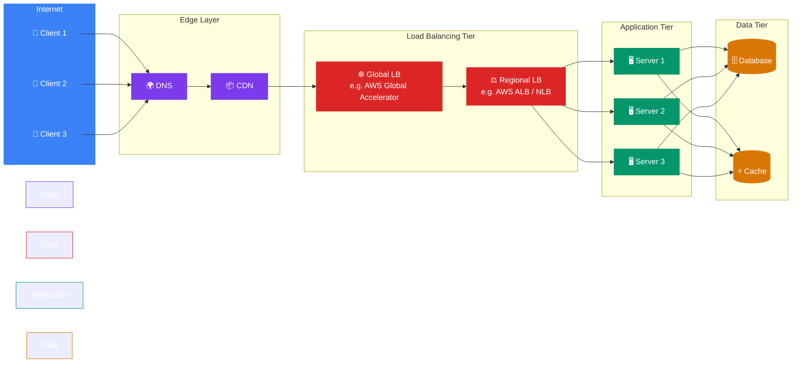

> **Key Insight:** Load balancers can exist at **multiple layers** of your architecture:  
> - at the edge (DNS-level)  
> - between clients and web servers  
> - between web servers and application servers  
> - between application servers and databases/caches

### 🏢 Load Balancer Placement Points

| Placement | Purpose | Example |
|---|---|---|
| Between Client & Web Server | Distribute incoming user requests | AWS ALB |
| Between Web Server & App Server | Balance internal service calls | NGINX reverse proxy |
| Between App Server & Database | Distribute read replicas traffic | ProxySQL, PgBouncer |
| DNS Level | Geographic routing | Route 53, Cloudflare DNS |

---

## 3. 🔧 2. Types of Load Balancers

### 🔀 L4 vs L7 Load Balancers

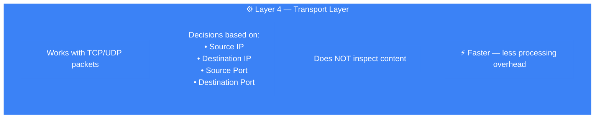

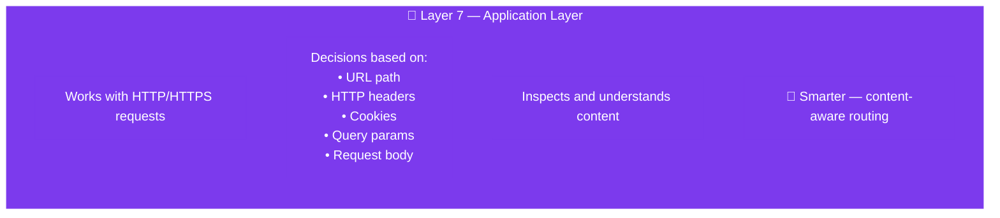

| Feature | L4 (Transport) | L7 (Application) |
|---|---|---|
| **OSI Layer** | Layer 4 (TCP/UDP) | Layer 7 (HTTP/HTTPS/gRPC) |
| **Decision Data** | IP + Port | URL, Headers, Cookies, Body |
| **Speed** | ⚡ Very Fast | 🐢 Slightly Slower |
| **TLS Termination** | ❌️ Passes through | ✅ Can terminate & re-encrypt |
| **Content Routing** | ❌️ No | ✅ Yes (path-based, host-based) |
| **Sticky Sessions** | IP-based only | Cookie-based, header-based |
| **WebSocket Support** | ✅ Native | ✅ With configuration |
| **Use Case** | Low-latency, high-throughput | Microservices, API Gateway |
| **AWS Example** | NLB (Network Load Balancer) | ALB (Application Load Balancer) |

> 🎤 **Interview Tip:** _"Say the system needs content-based routing. For example, `/api/v1/users` goes to the user service and `/api/v1/orders` goes to the order service. Then I'd choose an L7 load balancer. If ultra-low latency is the priority and I just need TCP distribution, I'd pick L4."_

### 🏭 Hardware vs Software Load Balancers

| Aspect | Hardware LB | Software LB |
|---|---|---|
| **Cost** | 💰💰💰 Very expensive ($10K-$100K+) | 💰 Low / Free (open-source) |
| **Performance** | 🚀 Extremely high (ASIC-based) | ⚡ High (depends on host) |
| **Flexibility** | ❌️ Rigid, vendor-specific | ✅ Highly configurable |
| **Scalability** | Requires more hardware | Auto-scales with infra |
| **Examples** | F5 BIG-IP, Citrix ADC | NGINX, HAProxy, Envoy |
| **Modern Trend** | Declining usage | 📈 Industry standard |

### ☁️ Managed vs Self-Hosted

| Aspect | Managed (Cloud) | Self-Hosted |
|---|---|---|
| **Ops Overhead** | ✅ Zero management | ❌️ You manage everything |
| **Cost Model** | Pay-per-use | Fixed infra + ops cost |
| **Customization** | Limited to provider features | Full control |
| **HA / Failover** | Built-in | You build it |
| **TLS Management** | Integrated (ACM, Let's Encrypt) | Manual setup |
| **Examples** | AWS ALB/NLB, GCP Cloud LB, Azure LB | NGINX, HAProxy, Traefik |

> 🎤 **Interview Tip:** _"For a startup or most production systems, I'd recommend managed cloud load balancers. They remove the operational overhead for HA, TLS, and health checks. Some edge cases need deep customization (e.g., custom routing logic). For those, self-hosted NGINX or Envoy makes sense."_

---

## 4. 📊 3. Load Balancing Algorithms (Deep Dive)

### 🖼️ Visual Overview of All 8 Algorithms

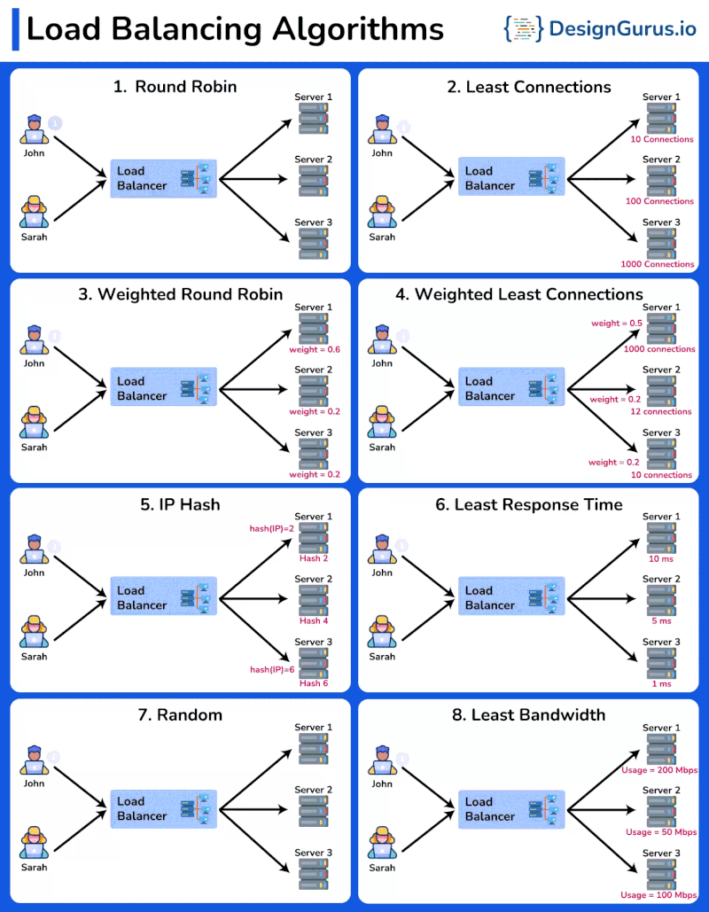

### 🎯 Choosing an Algorithm — The Mental Model

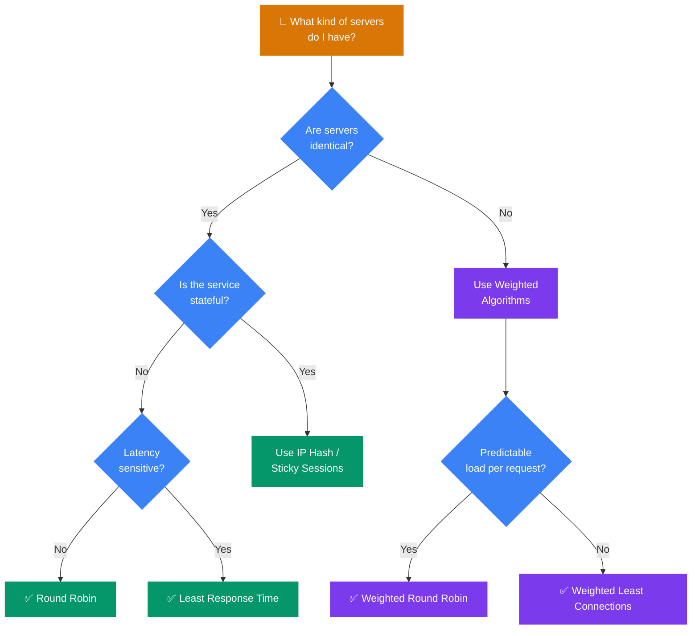

---

### 1️⃣ Round Robin

#### 📖 How It Works

Requests go to servers **one after another, in a circular order**. Server 1 gets the first request. Server 2 gets the second. Server 3 gets the third. Then it goes back to Server 1.

```
Request 1 → Server A
Request 2 → Server B
Request 3 → Server C
Request 4 → Server A  (cycle repeats)
Request 5 → Server B
...
```

#### ✅ When to Use

- All servers have **identical hardware and capacity**
- Requests have **roughly uniform processing cost**
- Stateless services (no session affinity needed)
- Simple, predictable traffic patterns

#### ❌️ When NOT to Use

- Servers have **different capacities** (some will get too much load)
- Requests have **very different processing times** (e.g., image upload vs. health check)
- **Long-lived connections** (e.g., WebSockets) — these create uneven distribution
- When you need session persistence

#### 📊 Pros & Cons

| Advantages | Disadvantages |
|---|---|
| ✅ Simplest to implement | ❌️ Ignores server load |
| ✅ Zero overhead | ❌️ Ignores request complexity |
| ✅ Perfectly predictable | ❌️ No server health awareness |
| ✅ Even distribution for uniform workloads | ❌️ Poor for heterogeneous servers |

#### 🏢 Real-World Example

**DNS Round Robin** — simple websites use DNS-level round robin. It spreads traffic across multiple IP addresses. When you resolve `example.com`, the DNS server rotates through A records.

#### 🎤 Interview Explanation

> _"For this service, all our API servers are identical `t3.medium` instances. The requests are simple CRUD operations with similar latency profiles. So Round Robin gives us even distribution with zero overhead. There's no reason to add complexity here."_

---

### 2️⃣ Least Connections

#### 📖 How It Works

Each new request is sent to the server with the **fewest active connections** at that moment. The load balancer keeps a real-time count of active connections to each backend.

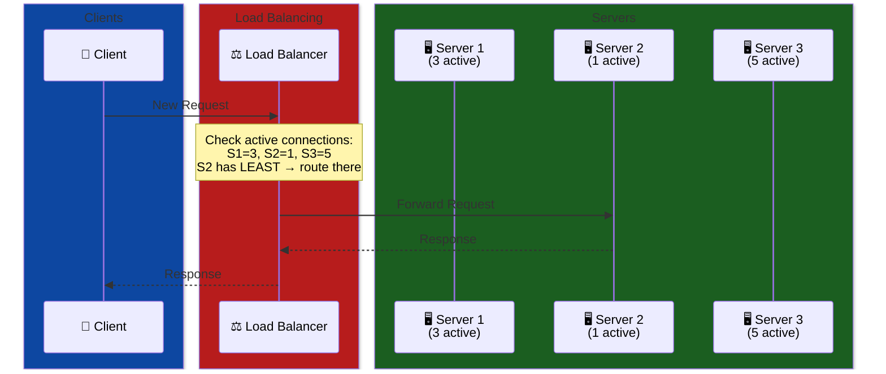

#### ✅ When to Use

- Requests have **variable processing times**
- Mix of lightweight and heavyweight operations
- **Long-lived connections** (WebSockets, gRPC streams)
- When some requests naturally take longer (file uploads, complex queries)

#### ❌️ When NOT to Use

- All requests are uniform → Round Robin is simpler and equally effective
- Servers have **different capacities** → Use **Weighted** Least Connections instead
- Need **session persistence** → Combine with sticky sessions

#### 📊 Pros & Cons

| Advantages | Disadvantages |
|---|---|
| ✅ Adapts to variable request durations | ❌️ Slightly more overhead (connection tracking) |
| ✅ Naturally handles slow requests | ❌️ Doesn't account for server capacity |
| ✅ Great for long-lived connections | ❌️ New server gets all traffic initially (thundering herd) |
| ✅ Better than Round Robin for real workloads | ❌️ Connection count ≠ actual CPU/memory load |

#### 🏢 Real-World Example

**Chat applications (e.g., Slack, Discord)** — WebSocket connections vary a lot in duration. Some users connect for 8 hours, others for 5 minutes. Least Connections makes sure new connections go to the servers with the most free capacity.

#### 🎤 Interview Explanation

> _"Our chat service uses WebSocket connections that can last from seconds to hours. Round Robin would create severe imbalance. With Least Connections, take a server with 100 active WebSocket users. It won't receive new connections while another server with only 10 users has capacity. This balances the load based on actual usage."_

---

### 3️⃣ Weighted Round Robin

#### 📖 How It Works

Like Round Robin, but each server gets a **weight** proportional to its capacity. A server with weight `3` receives 3x more requests than a server with weight `1`.

```
Servers: A (weight=3), B (weight=1), C (weight=2)

Request distribution: A, A, A, B, C, C, A, A, A, B, C, C, ...
```

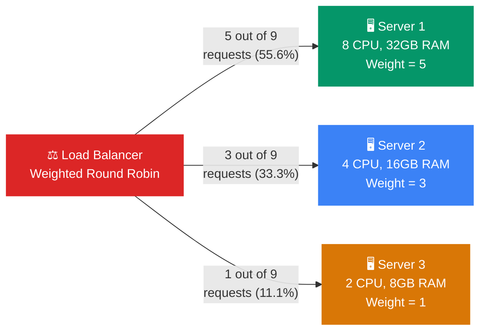

#### ✅ When to Use

- Servers have **different hardware specifications**
- Mixed fleet (e.g., during migration from old to new hardware)
- **Canary deployments** — send 5% traffic to the new version (weight=1), 95% to stable (weight=19)
- Requests have **predictable, uniform cost**

#### ❌️ When NOT to Use

- Servers are identical → Plain Round Robin is simpler
- Request costs are unpredictable → Use Weighted Least Connections
- Real-time adaptability is needed → Weights are static

#### 📊 Pros & Cons

| Advantages | Disadvantages |
|---|---|
| ✅ Handles heterogeneous hardware | ❌️ Weights must be manually configured |
| ✅ Great for canary/blue-green deploys | ❌️ Static — doesn't adapt to runtime load |
| ✅ Simple and predictable | ❌️ Requires knowledge of server capacities |
| ✅ Low overhead | ❌️ Weight misconfiguration = imbalance |

#### 🏢 Real-World Example

**Canary deployments** — A team rolls out a new service version with weighted routing. It sends ~1-5% of traffic to canary servers. If metrics look good, the weights slowly shift to 100%. AWS ALB weighted target groups and Istio route weights both work this way. (Netflix does canaries differently: Kayenta compares a small canary cluster with a same-size baseline cluster.)

#### 🎤 Interview Explanation

> _"We're running a mixed fleet during our migration. Some servers are `c5.2xlarge` (8 vCPU) and some are `c5.xlarge` (4 vCPU). I'd use Weighted Round Robin with weights proportional to vCPU count. Larger instances then get proportionally more traffic. This stops the smaller ones from getting too much load. It also gives us a ratio we can control."_

---

### 4️⃣ Weighted Least Connections

#### 📖 How It Works

It combines the **active connection awareness** of Least Connections with **server capacity weights**. The routing decision uses the formula:

```
Score = Active Connections / Weight
Route to the server with the LOWEST score.
```

**Example:**
| Server | Active Connections | Weight | Score |
|---|---|---|---|
| Server A | 10 | 5 | 10/5 = **2.0** |
| Server B | 4 | 2 | 4/2 = **2.0** |
| Server C | 3 | 4 | 3/4 = **0.75** ← Winner! |

→ Next request goes to **Server C** (lowest score).

#### ✅ When to Use

- **Heterogeneous servers** + **variable request durations**
- Best general-purpose algorithm for complex environments
- Mixed fleet with varying hardware capabilities
- Services with unpredictable per-request processing times

#### ❌️ When NOT to Use

- Homogeneous servers with uniform requests → Overkill, use Round Robin
- Static workloads → Simpler algorithms are enough
- When you can't accurately estimate server weights

#### 📊 Pros & Cons

| Advantages | Disadvantages |
|---|---|
| ✅ Uses both signals (capacity + load) | ❌️ Most complex to configure |
| ✅ Excellent for heterogeneous setups | ❌️ Requires accurate weight configuration |
| ✅ Dynamically adapts to load | ❌️ Higher computation overhead |
| ✅ Production-grade fairness | ❌️ Over-engineered for simple setups |

#### 🏢 Real-World Example

**E-commerce platforms during sales events** — Servers of different sizes handle many kinds of requests. They range from product views (fast) to checkout processing (slow). Weighted Least Connections makes powerful servers take more traffic. At the same time, no server gets stuck with too many slow requests.

#### 🎤 Interview Explanation

> _"Our fleet has mixed instance types. Our API handles everything from 5ms health checks to 500ms database-heavy operations. Weighted Least Connections is ideal here. It respects server capacity differences. It ALSO avoids routing to servers already slowed down by slow operations."_

---

### 5️⃣ IP Hash

#### 📖 How It Works

The LB **hashes the client's IP address**. The hash value decides which server handles the request. The same client IP **always** maps to the same server (unless the server pool changes).

```
hash(client_ip) % number_of_servers = server_index
```

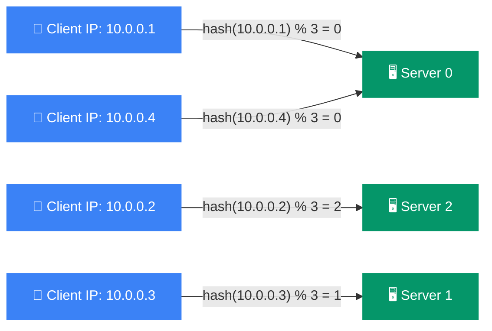

#### ✅ When to Use

- **Session persistence** without external session store
- Stateful services where same user should hit the same server
- **Caching layers** — maximize cache hit rates by routing same users to same cache
- When L7 cookie-based stickiness isn't available (L4 LB scenarios)

#### ❌️ When NOT to Use

- Behind **NAT / corporate proxies** — thousands of users share one IP, creating hotspots
- **Mobile users** — IP changes when switching WiFi↔Cellular
- When the server pool changes often (scaling up/down) — rehashing moves most clients (75% when going from 3 to 4 servers)
- When even distribution is critical (hash distribution is probabilistic, not perfectly even)

#### 📊 Pros & Cons

| Advantages | Disadvantages |
|---|---|
| ✅ Natural session affinity (no cookies) | ❌️ Uneven distribution with NAT/proxies |
| ✅ Works at L4 (no need to inspect HTTP) | ❌️ Server addition/removal = mass redistribution |
| ✅ Simple deterministic routing | ❌️ Mobile IP changes break persistence |
| ✅ Great for cache affinity | ❌️ Doesn't consider server load |

#### 🏢 Real-World Example

**Gaming servers (simple example)** — A simple multiplayer game backend can route players to the same game server based on IP hash. This keeps the game state in one place. NGINX's `ip_hash` directive implements this. Note: for IPv4, nginx hashes only the first three octets. So 10.0.0.1 to 10.0.0.4 would all go to the same server, unlike the diagram above.

```nginx
upstream backend {
    ip_hash;
    server 10.0.0.1;
    server 10.0.0.2;
    server 10.0.0.3;
}
```

#### 🎤 Interview Explanation

> _"In our gaming backend, players keep in-memory session state. IP Hash makes sure each player always reaches the same server. But I'd note the risk: if we scale the server pool, modular hashing redistributes most players. For a safer approach, I'd suggest **consistent hashing** instead. It keeps redistribution small."_

---

### 6️⃣ Least Response Time

#### 📖 How It Works

Routes each request to the server with the **lowest average response time** AND fewest active connections. The LB keeps monitoring response times from each backend.

```
Ranking = f(average_response_time, active_connections)
Route to the server with the BEST ranking.
```

#### ✅ When to Use

- **Latency-critical systems** (real-time APIs, trading platforms)
- Servers with **variable performance** (shared infra, or noisy neighbors: other workloads on the same host that slow it down)
- When user experience is measured by **response time** (P99 latency SLAs)
- Multi-region setups where servers have different network proximity

#### ❌️ When NOT to Use

- Measurement adds overhead. It is not worth it for low-traffic systems
- Cold-start scenarios — no response time data initially
- Servers behind caches (response time reflects cache hits, not server capacity)
- When response time spikes are short-lived (they can cause oscillation / thundering herd)

#### 📊 Pros & Cons

| Advantages | Disadvantages |
|---|---|
| ✅ Optimizes for user-perceived latency | ❌️ Requires continuous monitoring |
| ✅ Adapts to real-time server performance | ❌️ Thundering herd on recovery (fast server gets flooded) |
| ✅ Handles noisy neighbor problems | ❌️ Complex implementation |
| ✅ Best for latency-sensitive apps | ❌️ Response time ≠ server health always |

#### 🏢 Real-World Example

**NGINX Plus `least_time`** — a real Least Response Time method. It picks the server with the lowest average response time and fewest active connections. **AWS ALB's "Least Outstanding Requests"** is often named here, but it only counts in-flight requests. So it is closer to Least Connections. ALB has no pure response-time algorithm.

#### 🎤 Interview Explanation

> _"In our real-time bidding system, every millisecond of latency affects revenue. So I'd use Least Response Time. It routes requests to the server that's currently responding fastest. So it moves traffic away from servers with garbage collection pauses, I/O bottlenecks, or noisy neighbor issues. It does this without waiting for a health check to act."_

---

### 7️⃣ Least Bandwidth

#### 📖 How It Works

Routes traffic to the server that currently uses the **least amount of bandwidth** (measured in Mbps). It is useful when the bottleneck is **network throughput**, not CPU or connections.

#### ✅ When to Use

- **Media streaming services** (video, audio, large file downloads)
- **CDN origin servers** where bandwidth is the constrained resource
- When responses have **very different sizes** (thumbnails vs. 4K videos)
- Network I/O-bound workloads

#### ❌️ When NOT to Use

- CPU-bound workloads (bandwidth doesn't reflect server load)
- Uniform response sizes (no meaningful difference)
- When connection count or latency is the real bottleneck

#### 📊 Pros & Cons

| Advantages | Disadvantages |
|---|---|
| ✅ Perfect for bandwidth-heavy workloads | ❌️ Niche use case |
| ✅ Prevents network saturation | ❌️ Doesn't account for CPU/memory |
| ✅ Optimizes throughput for streaming | ❌️ Measurement overhead |
| ✅ Good for large file transfers | ❌️ Rarely needed in typical web apps |

#### 🏢 Real-World Example

**Video streaming origin servers** — origin servers that serve large video chunks are a typical case. The LB spreads chunk requests based on current bandwidth use. This makes sure no single server's network interface gets saturated while others are idle.

#### 🎤 Interview Explanation

> _"Our file storage service handles downloads from 1KB text files to 10GB video files. So connection count alone is misleading. One server could have 2 connections serving 10GB each. Another could have 50 connections serving 1KB. Least Bandwidth routing lets us balance by the actual network throughput. That is our bottleneck."_

---

### 8️⃣ Random

#### 📖 How It Works

Each request is routed to a **randomly selected server** from the pool. Simple, stateless, and requires no tracking.

```
server_index = random(0, number_of_servers - 1)
```

#### ✅ When to Use

- Stateless services with **homogeneous servers**
- When you want **zero state** in the load balancer (as simple as possible)
- Large server pools (with many servers, random choice evens out)
- Testing and development environments
- **"Power of Two Choices"** — pick 2 random servers, choose the one with fewer active requests (used by Envoy Proxy)

#### ❌️ When NOT to Use

- Small server pools (randomness can be very uneven)
- When even distribution is critical
- Latency-sensitive applications
- Heterogeneous servers

#### 📊 Pros & Cons

| Advantages | Disadvantages |
|---|---|
| ✅ Zero state required | ❌️ Uneven distribution for small pools |
| ✅ Simplest possible implementation | ❌️ No intelligence whatsoever |
| ✅ Works well at massive scale | ❌️ No session affinity |
| ✅ No synchronization needed (multi-LB) | ❌️ Pure luck-based routing |

#### 🏢 Real-World Example

**Envoy Proxy's "Random" and "Least Request" (P2C, Power of Two Choices)** — Envoy's Least Request policy picks two servers at random. Then it chooses the one with fewer active requests. Research (Mitzenmacher) shows this gets most of the benefit of a full least-loaded search, at much lower cost.

#### 🎤 Interview Explanation

> _"Our stateless microservice has 200 identical pods in Kubernetes. Random selection with the Power of Two Choices gives us near-optimal distribution with zero coordination overhead. At this scale, the law of large numbers gives even distribution. P2C catches any temporary imbalances."_

---

## 5. 📈 4. Algorithm Comparison Table

| Algorithm | Best For | Avoid When | Complexity | Sticky Support | Smartness Level | State Required |
|---|---|---|---|---|---|---|
| **Round Robin** | Identical servers, uniform requests | Heterogeneous servers, variable-cost requests | ⭐ Trivial | ❌️ None | 🧠 Low | Counter only |
| **Least Connections** | Variable-duration requests, WebSockets | Uniform, fast requests; heterogeneous servers | ⭐⭐ Low | ❌️ None | 🧠🧠 Medium | Connection counters |
| **Weighted Round Robin** | Mixed hardware, canary deploys | Variable request costs, dynamic scaling | ⭐⭐ Low | ❌️ None | 🧠🧠 Medium | Counter + weights |
| **Weighted Least Conn.** | Mixed hardware + variable durations | Simple uniform setups | ⭐⭐⭐ Medium | ❌️ None | 🧠🧠🧠 High | Counters + weights |
| **IP Hash** | Session affinity, cache locality | NAT/proxy users, mobile, dynamic scaling | ⭐⭐ Low | ✅ IP-based | 🧠🧠 Medium | Hash function |
| **Least Response Time** | Latency-critical real-time systems | Cold starts, cached backends | ⭐⭐⭐⭐ High | ❌️ None | 🧠🧠🧠🧠 Very High | Response time tracker |
| **Least Bandwidth** | Streaming, large file downloads | CPU-bound workloads | ⭐⭐⭐ Medium | ❌️ None | 🧠🧠🧠 High | Bandwidth monitor |
| **Random** | Massive stateless pools, testing | Small pools, latency-sensitive | ⭐ Trivial | ❌️ None | 🧠 Low | None |

---

## 6. 🧠 5. How to Justify Load Balancer Choice in Interviews

### 🚫 The Wrong Way

> ❌️ _"I'll put a load balancer in front of my servers."_

This says nothing about **why**, **what kind**, or **what algorithm**. It only ticks a box.

### ✅ The Right Way — Constraint-Driven Thinking

Specific **system constraints** should drive every load balancing decision:

#### 📊 Traffic Pattern
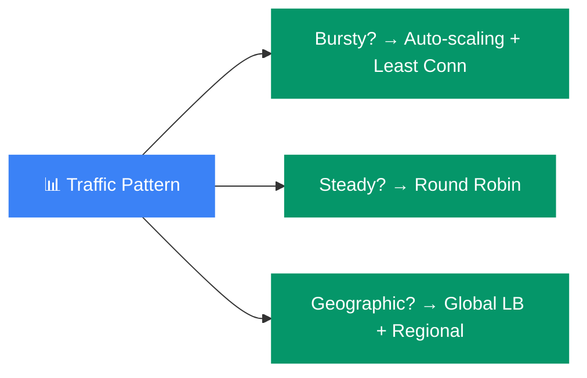

#### ⚡ Latency Requirements
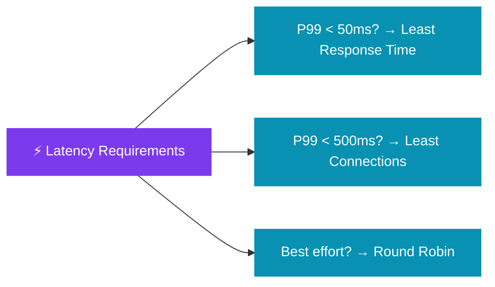

#### 🖥️ Server Homogeneity
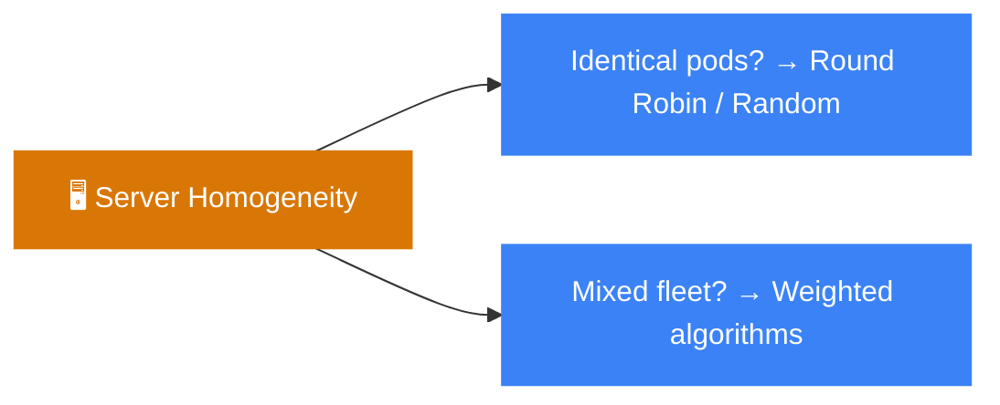

#### 🔄 Statefulness
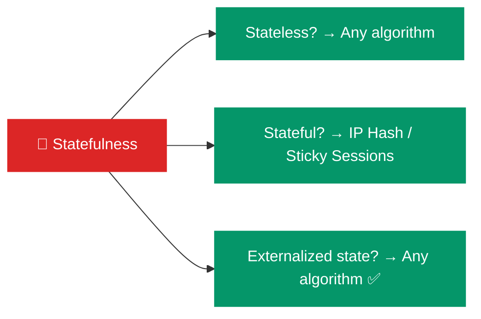

#### 📈 Scale
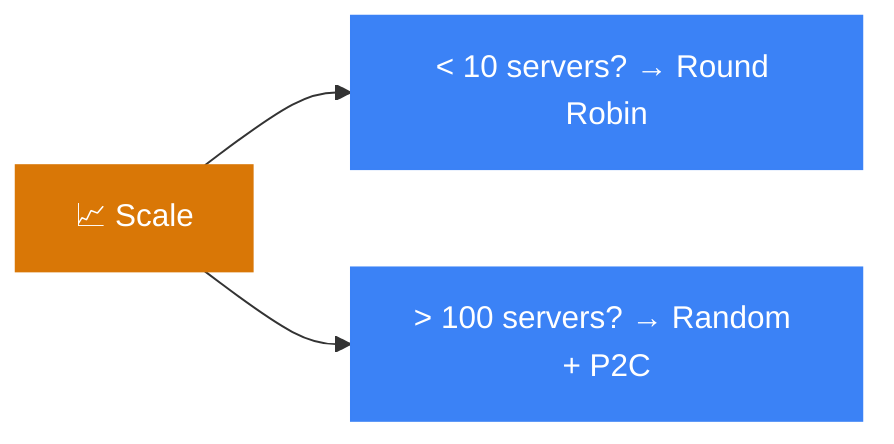

### 🎯 Decision Framework for Interviews

| Constraint | Question to Ask | Recommended Strategy |
|---|---|---|
| **Latency** | _"What's the P99 latency SLA?"_ | Strict → Least Response Time; Relaxed → Round Robin |
| **Throughput** | _"What's the expected QPS?"_ | High QPS → L4 NLB; Moderate → L7 ALB |
| **Statefulness** | _"Does the service maintain session state?"_ | Stateful → IP Hash / Sticky; Stateless → Any |
| **Server Fleet** | _"Are all servers identical?"_ | No → Weighted algorithms; Yes → Unweighted |
| **Traffic Pattern** | _"Is traffic steady or bursty?"_ | Bursty → Auto-scaling + Least Conn; Steady → Round Robin |
| **Failure Handling** | _"What happens when a server crashes?"_ | Health checks + automatic removal from pool |
| **Session Persistence** | _"Do users need to reach the same server?"_ | Cookie-based stickiness (L7) or IP Hash (L4) |
| **Health Checks** | _"How do we detect unhealthy servers?"_ | Active (pings) + Passive (error rate monitoring) |

### 💬 Example Interview Answers

#### Scenario 1: URL Shortener

> _"A URL shortener has a high read-to-write ratio. I'd use an **L7 ALB with Round Robin**. The requests are uniform (simple redirects). The service is stateless (reads from a distributed cache). All servers are identical. Round Robin is the simplest correct choice. There's no reason to add complexity."_

#### Scenario 2: Real-Time Multiplayer Game

> _"For the game server, I'd use an **L4 load balancer with Least Connections**, such as HAProxy in TCP mode. AWS NLB cannot do this, because it routes by flow hash. Game sessions use long-lived TCP connections. Some run for 5 minutes and others for 2 hours. Least Connections makes sure servers with fewer active game sessions get the new ones. I'd also add **connection draining** for graceful shutdown during deployments."_

#### Scenario 3: E-Commerce Platform (Flash Sale)

> _"During a flash sale, traffic spikes 100x. I'd use an **L7 load balancer with Weighted Least Connections** (for example HAProxy or NGINX), backed by auto-scaling. AWS ALB has no weighted least-connections mode. Its closest option, Least Outstanding Requests, ignores weights. The weighted part handles the transition period during scale-up. In that period, old (smaller) and new (larger) instances run together. The Least Connections part handles slow checkout requests. It makes sure they don't cause new traffic to pile up on servers that are already busy."_

#### Scenario 4: Video Streaming Service

> _"For video streaming, I'd use **two tiers**. First, a **Global Load Balancer (DNS-based)** does geographic routing to the nearest region. Then a **Regional L4 load balancer** distributes traffic within the region. Within each region, **Least Bandwidth** routing stops any single origin server's network interface from saturating. AWS NLB cannot do this, because it uses a flow hash. You need an LB that supports it, such as Citrix ADC."_

---

## 7. 🚀 6. Advanced Concepts

### 🔄 Auto-Scaling Interaction

Load balancers and auto-scalers work together:

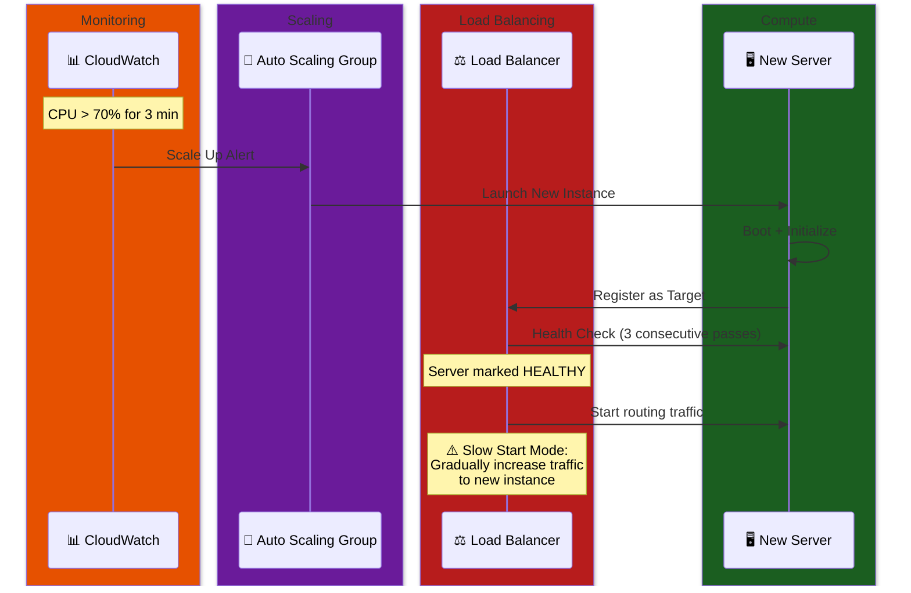

> **Key Insight:** Always configure **slow start** on your load balancer when using auto-scaling. Without it, a newly launched server gets full traffic right away. This often happens before its caches are warm. The result is higher latency or failures.

---

### 🏥 Health Checks

| Type | How It Works | Detects | Speed |
|---|---|---|---|
| **Active (Probing)** | LB periodically sends requests to `/health` endpoint | Server crash, OOM, app deadlocks | Seconds (configurable interval) |
| **Passive (Observation)** | LB monitors real traffic error rates | Degraded performance, partial failures | Real-time |
| **Deep Health** | `/health` checks dependencies (DB, cache, queue) | Cascade failures | Slower, more thorough |
| **Shallow Health** | `/health` returns 200 if process is alive | Process crashes only | Fast, least thorough |

**Best Practice:**

```
GET /health          → Shallow (process alive)
GET /health/ready    → Deep (all dependencies connected)
GET /health/live     → Liveness (process not deadlocked)
```

> 🎤 **Interview Tip:** _"I'd configure both active and passive health checks. Active health checks ping `/health/ready` every 10 seconds. The threshold is 3 failures before removal. Passive checks monitor 5xx error rates. If a server returns > 50% errors, the LB removes it from the pool for a while. This happens even before active checks catch it."_

---

### ⚡ Circuit Breakers

Circuit breakers **prevent cascading failures** by stopping traffic to failing backends.

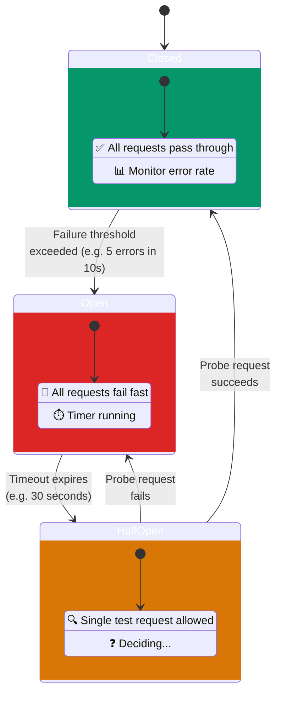

**LB + Circuit Breaker Interaction:**
- Load balancer routes traffic to backends
- A per-backend circuit breaker tracks error rates
- When a backend trips the circuit, LB stops routing to it
- After timeout, one probe request is sent to test recovery

---

### 🌐 CDN vs Load Balancer

| Aspect | CDN | Load Balancer |
|---|---|---|
| **Primary Purpose** | Cache & serve static content close to users | Distribute requests across origin servers |
| **Location** | Edge PoPs worldwide | In front of your server fleet |
| **Content Type** | Static (images, JS, CSS, video) | Dynamic (API calls, DB queries) |
| **Caching** | ✅ Core function | ❌️ Not its job |
| **SSL/TLS** | ✅ Terminates at edge | ✅ Can terminate |
| **DDoS Protection** | ✅ Absorbs attacks at edge | ⚠️ Limited |
| **Examples** | CloudFront, Cloudflare, Akamai | ALB, NLB, NGINX |

> 🎤 **Interview Tip:** _"CDN and load balancer work together. The CDN handles static content at the edge, which reduces load on origins. The load balancer distributes the remaining dynamic requests across application servers. In my design, the request flow is: Client → CDN (cache hit?) → Load Balancer → App Servers."_

---

### 🌎 Global vs Regional Load Balancing

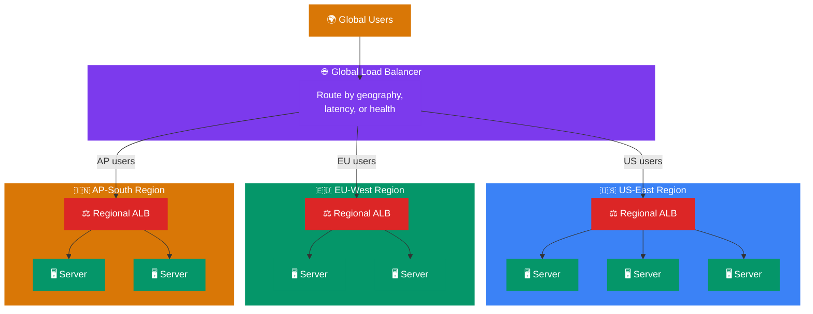

| Aspect | Global LB | Regional LB |
|---|---|---|
| **Scope** | Across regions/continents | Within a single region/data center |
| **Decision Basis** | Geography, latency, region health | Server load, connections, response time |
| **Mechanism** | DNS routing, Anycast IP | L4/L7 proxying |
| **Failover** | Region-level failover | Server-level failover |
| **Examples** | AWS Global Accelerator, Cloudflare LB | AWS ALB/NLB, NGINX |

---

### 🔑 Consistent Hashing vs IP Hashing

| Feature | IP Hashing | Consistent Hashing |
|---|---|---|
| **Server Added** | `hash % N` changes → about N/(N+1) of keys move (75% for 3→4) | Only `K/N` keys redistribute (~1/N of traffic) |
| **Server Removed** | Most keys move (about (N-1)/N) | Only affected slot's traffic remaps |
| **Hotspot Handling** | ❌️ Poor | ✅ Virtual nodes spread load |
| **Implementation** | Simple modular arithmetic | Hash ring with virtual nodes |
| **Use Case** | Simple session affinity | Distributed caches, databases |
| **Examples** | NGINX `ip_hash` | Cassandra, DynamoDB, Memcached |

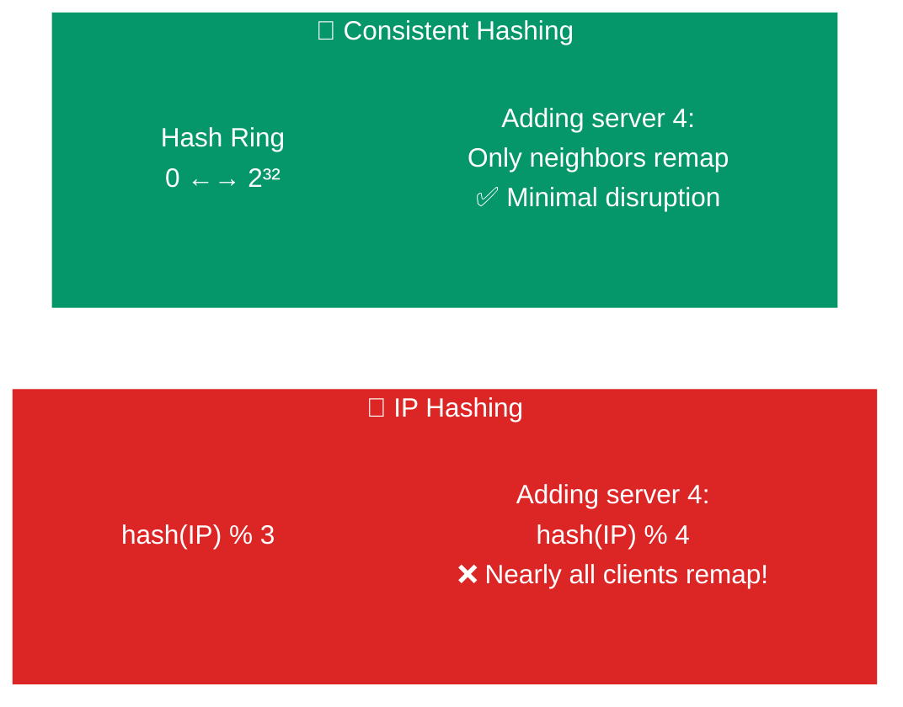

> 🎤 **Interview Tip:** _"IP Hash gives basic session affinity. But I'd choose consistent hashing for our distributed cache layer. Auto-scaling adds or removes nodes. When that happens, consistent hashing only redistributes about `1/N` of the keys, instead of reshuffling everything. This is critical for keeping cache hit rates high."_

---

### 🔄 Failover vs Active-Active

| Pattern | How It Works | RTO | Cost | Complexity |
|---|---|---|---|---|
| **Active-Passive (Failover)** | Standby LB takes over if primary fails | Higher (switchover time) | 💰 Lower (idle standby) | ⭐⭐ Moderate |
| **Active-Active** | Both LBs serve traffic simultaneously | ⚡ Near-zero | 💰💰 Higher (both active) | ⭐⭐⭐ Higher |

Teams prefer **Active-Active architectures** for production systems that cannot accept downtime. Cloud-managed LBs (ALB, NLB) are Active-Active across availability zones by design.

---

## 8. 📦 7. Real-World Connections

### ☁️ AWS — ALB & NLB

| Feature | ALB (Application LB) | NLB (Network LB) |
|---|---|---|
| **Layer** | L7 | L4 |
| **Protocols** | HTTP, HTTPS, gRPC, WebSocket | TCP, UDP, TLS |
| **Routing** | Path-based, host-based, header-based | Port-based |
| **Performance** | High | ⚡ Ultra-high (millions of RPS) |
| **Static IP** | ❌️ No (DNS name only) | ✅ Yes (Elastic IP) |
| **TLS Termination** | ✅ Full (with ACM integration) | ✅ TLS passthrough or termination |
| **Health Checks** | HTTP/HTTPS status codes | TCP connect, HTTP |
| **Pricing** | Per LCU (LB Capacity Unit) | Per NLCU |
| **Best For** | Microservices, APIs | Gaming, IoT, financial |

**ALB Configuration Example (Target Group):**
```json
{
    "TargetType": "instance",
    "HealthCheckPath": "/health",
    "HealthCheckIntervalSeconds": 15,
    "HealthyThresholdCount": 3,
    "UnhealthyThresholdCount": 3,
    "DeregistrationDelay": 300,
    "SlowStart": 60,
    "Algorithm": "round_robin"
}
```

> ALB does not allow slow start with `least_outstanding_requests`. To use that algorithm, set `SlowStart` to 0. The key names here are simplified; the real attributes are `slow_start.duration_seconds`, `deregistration_delay.timeout_seconds` and `load_balancing.algorithm.type`.

---

### 🟢 NGINX

NGINX is one of the most widely used open-source software load balancers.

```nginx
# Round Robin (default)
upstream backend_rr {
    server 10.0.0.1:8080;
    server 10.0.0.2:8080;
    server 10.0.0.3:8080;
}

# Least Connections
upstream backend_lc {
    least_conn;
    server 10.0.0.1:8080;
    server 10.0.0.2:8080;
    server 10.0.0.3:8080;
}

# Weighted Round Robin
upstream backend_wrr {
    server 10.0.0.1:8080 weight=5;
    server 10.0.0.2:8080 weight=3;
    server 10.0.0.3:8080 weight=1;
}

# IP Hash
upstream backend_iphash {
    ip_hash;
    server 10.0.0.1:8080;
    server 10.0.0.2:8080;
    server 10.0.0.3:8080;
}

# Health checks + failover
upstream backend_resilient {
    least_conn;
    server 10.0.0.1:8080 max_fails=3 fail_timeout=30s;
    server 10.0.0.2:8080 max_fails=3 fail_timeout=30s;
    server 10.0.0.3:8080 backup;  # only used if others are down
}
```

---

### 🔵 HAProxy

HAProxy is a high-performance TCP/HTTP load balancer used at scale.

```haproxy
frontend http_front
    bind *:80
    default_backend http_back

backend http_back
    balance leastconn              # Algorithm selection
    option httpchk GET /health     # Active health checks
    http-check expect status 200

    server s1 10.0.0.1:8080 check weight 5 inter 10s fall 3 rise 2
    server s2 10.0.0.2:8080 check weight 3 inter 10s fall 3 rise 2
    server s3 10.0.0.3:8080 check weight 1 inter 10s fall 3 rise 2 backup
```

---

### ☸️ Kubernetes Services

Kubernetes provides built-in load balancing:

| K8s Component | LB Type | Scope |
|---|---|---|
| **ClusterIP Service** | Random (iptables/nftables mode) or Round Robin (IPVS default) | Intra-cluster |
| **NodePort Service** | Simple port-based routing | External → Cluster |
| **LoadBalancer Service** | Cloud provider L4 LB (e.g. AWS NLB) | External → Cluster |
| **Ingress Controller** | L7 LB (NGINX, Traefik, Envoy) | HTTP(S) routing |
| **Gateway API** | Advanced L7 routing | Next-gen Ingress |

```yaml
# Kubernetes Ingress with NGINX Ingress Controller
apiVersion: networking.k8s.io/v1
kind: Ingress
metadata:
  name: app-ingress
  annotations:
    nginx.ingress.kubernetes.io/load-balance: "ewma"   # supported: round_robin (default), ewma
spec:
  rules:
  - host: api.example.com
    http:
      paths:
      - path: /users
        pathType: Prefix
        backend:
          service:
            name: user-service
            port:
              number: 80
      - path: /orders
        pathType: Prefix
        backend:
          service:
            name: order-service
            port:
              number: 80
```

> The ingress-nginx project was retired in March 2026. It gets no more releases or security fixes. For new clusters, use the Gateway API or another Ingress controller.

---

### 🟠 Cloudflare

Cloudflare offers global load balancing with these features:

| Feature | Details |
|---|---|
| **Geographic Steering** | Route users to nearest healthy origin pool |
| **Dynamic Steering** | Route based on real-time latency measurements |
| **Proximity Steering** | Route to geographically closest data center |
| **Health Checks** | HTTP/HTTPS/TCP from 13+ global regions |
| **Failover** | Automatic with configurable priorities |
| **Session Affinity** | Cookie-based, IP-based, or header-based |

---

## 9. 📌 8. Interview Checklist & Revision

### ✅ Interview Checklist

Use this checklist every time you discuss load balancing in a system design interview:

- [ ] **Identify the need** — Why is a load balancer needed here?
- [ ] **Choose L4 vs L7** — Do I need content-based routing?
- [ ] **Choose managed vs self-hosted** — What's the ops budget?
- [ ] **Pick the algorithm** — Based on constraints (see decision flowchart)
- [ ] **Justify the choice** — Explain WHY, not just WHAT
- [ ] **Address health checks** — How do we detect unhealthy servers?
- [ ] **Address session persistence** — Is the service stateful?
- [ ] **Address scalability** — How does it interact with auto-scaling?
- [ ] **Address failure modes** — What happens when the LB itself fails?
- [ ] **Address global vs regional** — Is multi-region needed?

---

### ❌️ Common Mistakes

| Mistake | Why It's Wrong | Better Approach |
|---|---|---|
| _"I'll add a load balancer"_ | No justification, no specifics | Specify type, algorithm, and reason |
| _"Round Robin is always fine"_ | Ignores heterogeneous servers, variable requests | Evaluate constraints first |
| _"IP Hash for sticky sessions"_ | Breaks with NAT, mobile, scaling | Use cookie-based stickiness or externalize state |
| Forgetting LB is a SPOF | Single LB = single point of failure | Mention HA (Active-Active, managed LB) |
| Ignoring health checks | Dead servers keep receiving traffic | Always mention health check strategy |
| Not considering TLS termination | Security oversight | Mention where TLS terminates and re-encryption |
| Using L7 when L4 suffices | Unnecessary overhead and latency | Match LB layer to actual routing needs |
| Ignoring slow start for auto-scaling | New servers get flooded before warm-up | Configure slow start / warm-up period |

---

### 🏆 Senior-Level Insights

**1. "Externalize state, then LB choice barely matters."**
   The best approach to session persistence is to **not need it**. Store sessions in Redis/DynamoDB. Then any server can handle any request. Now Round Robin works perfectly.

**2. "The load balancer you don't manage is the best load balancer."**
   Managed LBs (ALB, Cloud LB) remove a whole type of operations problems. Use them unless you need deep customization.

**3. "Load balancing is not just about distribution — it's about observability."**
   Your LB is the best place to collect request metrics (latency, error rates, throughput). Always instrument it.

**4. "Consistent hashing is the bridge between load balancing and distributed systems."**
   If you understand consistent hashing, you can connect LB theory to real distributed systems (DynamoDB, Cassandra, cache rings).

**5. "The algorithm matters less than health checks."**
   Even the simplest algorithm (Round Robin) works well if health checks are fast and accurate. The smartest algorithm fails if it routes to dead servers.

**6. "Think in layers."**
   Production architectures use load balancing at multiple layers — DNS, edge, L4, L7, service mesh. Each layer serves a different purpose.

**7. "Global load balancing is a data residency and compliance concern too."**
   GDPR, data sovereignty laws, etc. affect global LB routing. So it isn't just about latency. It is also about making sure data stays in the right region.

---

### 📋 Quick Revision Summary

```
Load Balancer = Distribute traffic + Increase availability + Enable scaling

Types:
  L4 → Fast, TCP/UDP, no content inspection
  L7 → Smart, HTTP-aware, content-based routing

Algorithms (most → least common in interviews):
  1. Round Robin       → Identical servers, uniform requests
  2. Least Connections → Variable request durations
  3. Weighted RR       → Mixed hardware, canary deploys
  4. IP Hash           → Session affinity (but prefer consistent hashing)
  5. Least Resp. Time  → Latency-critical systems
  6. Random + P2C      → Massive stateless fleets

Key interview points:
  ✅ Always justify your algorithm choice
  ✅ Always mention health checks
  ✅ Always address LB as SPOF (HA)
  ✅ Know L4 vs L7 trade-offs
  ✅ Understand interaction with auto-scaling
  ✅ Know the difference: CDN vs LB vs API Gateway
```

---

## 10. 🧪 9. Practice Questions

### 10 Interview Practice Problems

1. **Design a load balancing strategy for a URL shortener serving 10M requests/day. ⚡**
   _Hint: Think about read-heavy, stateless, uniform requests._

2. **Your service has 3 servers: a 32-core machine, a 16-core machine, and an 8-core machine. Which algorithm do you choose and why? 🔥**
   _Hint: Heterogeneous fleet → weighted algorithms._

3. **Users report that after logging in, they sometimes get logged out on the next request. What went wrong with the LB configuration? 🔥🔥**
   _Hint: Session state + Round Robin without sticky sessions._

4. **During a flash sale, your auto-scaler adds 20 new servers. Users on these new servers experience 5x higher latency for the first minute. Why? 🔥**
   _Hint: Cold caches, JIT compilation, slow start configuration._

5. **You're building a real-time multiplayer game with long-lived TCP connections. Compare Round Robin vs Least Connections for this use case. 🔥**
   _Hint: Connection duration variability matters here._

6. **Your LB uses IP Hash for session affinity, but a single server is receiving 60% of all traffic. What happened? 🔥🔥**
   _Hint: Corporate NAT or proxy — thousands of users sharing one IP._

7. **Design a multi-region load balancing strategy for a social media app with users in US, Europe, and Asia. 🔥**
   _Hint: Global LB (DNS/Anycast) → Regional LB → Server-level LB._

8. **Should you terminate TLS at the load balancer or pass it through? Discuss trade-offs. 🔥**
   _Hint: Performance (offload CPU from backends) vs. security (end-to-end encryption)._

9. **You're migrating from a monolith to microservices. How does your load balancing strategy change? ⚡**
   _Hint: Service mesh, per-service LB, L7 path-based routing, sidecar proxies._

10. **Your health check endpoint `/health` always returns 200, but users report errors. What's wrong with your health check? 🔥🔥**
    _Hint: Shallow health check — not checking dependencies. Need deep health check._

---

> 📝 _"The goal in a system design interview is not to give the 'right' answer. It is to show that you think about trade-offs, constraints, and failure modes. Load balancing is the perfect topic to show this depth."_

---

_Last Updated: February 2026_ | _Study Guide Version: 1.0_

---

