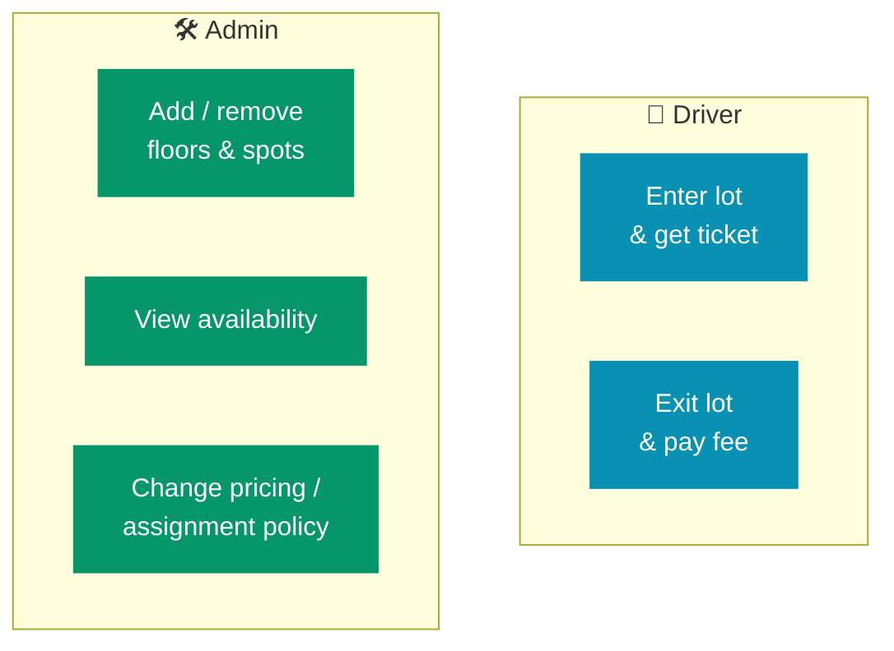
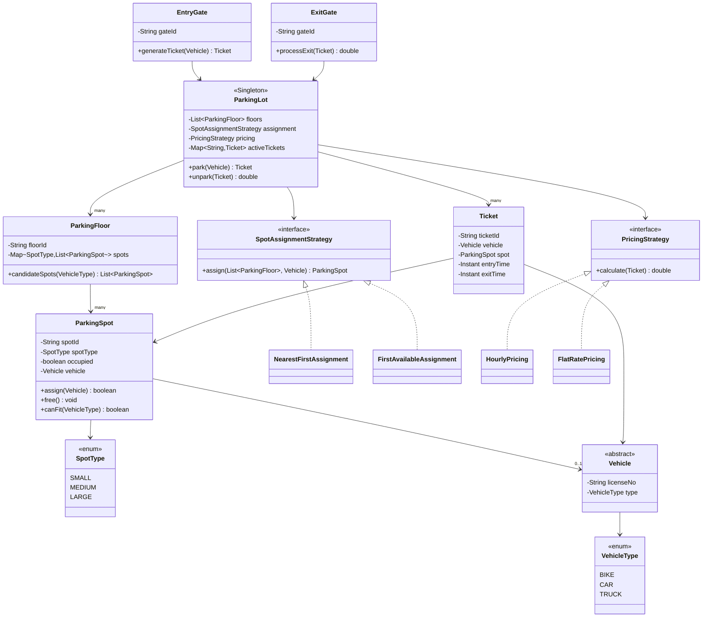
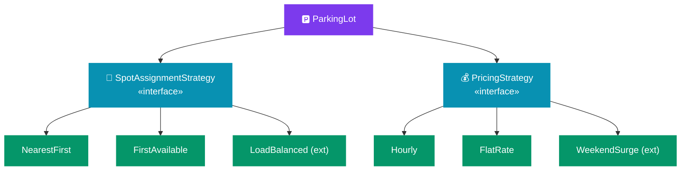
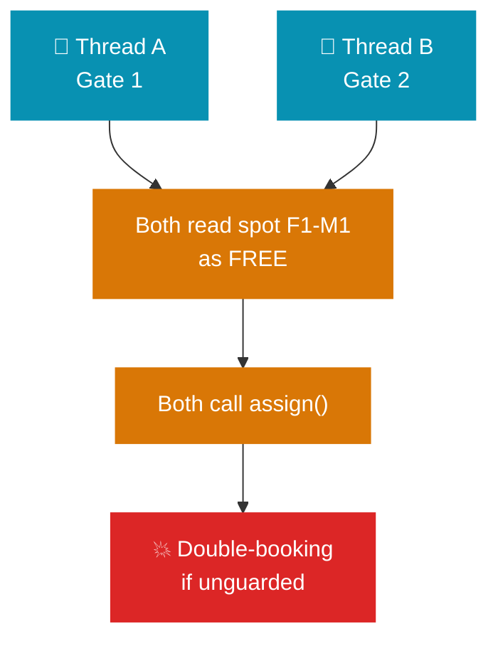
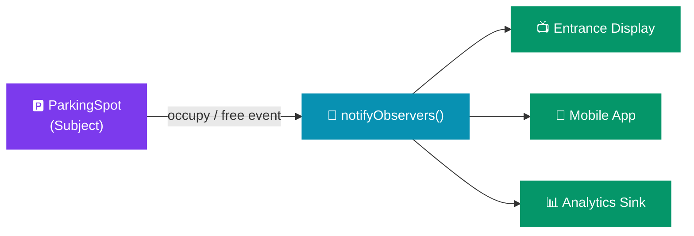
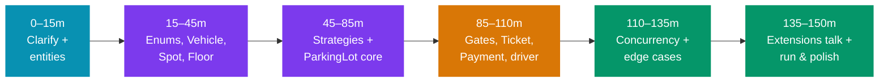

# 🅿️ Machine Coding / LLD — Parking Lot System

> 🎯 **Difficulty:** 🟡 Intermediate → 🔴 Hard (depends on which follow-ups the interviewer asks)  
> 🏢 **Asked at:** Tekion (signature machine-coding round), Amazon, Uber, Swiggy, Flipkart, Atlassian, Walmart Global Tech  
> ⏱️ **Format:** Live machine-coding round — **~2.5 hours**, working & compilable code expected (not just class diagram)  
> 🧑‍💻 **For:** SDE-2 / experienced backend engineer — clean OOP, SOLID, GoF patterns, concurrency awareness  
> 🥡 **One-liner:** *"It looks like CRUD over spots. But the marks come from the extension points: pluggable spot-assignment + pricing, and correct concurrency on the last free spot."*

---

## 1. 🧭 What Makes This Problem Tick

The Parking Lot is the **standard machine-coding warm-up**. But at SDE-2 level, the interviewer is *not* testing whether you can loop over a list of spots. They are testing these things:

| What they say | What they actually grade |
|---|---|
| "Design a parking lot" | Can you find the **right entities** and their cardinality (Lot → Floor → Spot)? |
| "Support bikes, cars, trucks" | Do you model the **vehicle ↔ spot-size compatibility** cleanly, or with a long, messy `if/else` chain? |
| "Charge a fee" | Do you isolate **pricing behind an interface** so a new pricing model = new class, not an edit? |
| "Which spot do we assign?" | Do you isolate **assignment policy** (nearest / first-free / by-floor) behind a **Strategy**? |
| "Two cars, one spot left" | Do you know **where the race is** and how to make reservation atomic? |
| "Add an availability board / EV charging later" | Did you leave **extension points** (Observer, new SpotType), or is it hardcoded? |

> 💡 Here, **OCP discipline** (Open/Closed Principle) is what makes a senior answer different from a mid-level one.
> - Pricing and assignment must be *open for extension, closed for modification*.
> - Test: does adding "weekend surge pricing" force you to edit the `ParkingLot` class? Then your extension point has failed.


---

## 2. ❓ Problem Statement & Clarifying Questions

**Problem:** Design the software for a multi-floor parking lot. It must:
- let vehicles in at entry gates,
- assign each one a suitable parking spot,
- issue a ticket,
- at exit, compute and collect a parking fee. The fee depends on how long the vehicle was parked and on the vehicle type.

> 🗣️ **Golden rule:** Spend the first 10–15 minutes clarifying.
> - In a Tekion-style round, the interviewer *wants* you to set the scope yourself.
> - A parking lot with no limits ("also handle valet, subscriptions, ANPR cameras, and multi-city") will use up all your time.

### Clarifying questions to ask (and sensible default answers)

| # | Ask the interviewer | Sensible default (state it, move on) |
|---|---|---|
| 1 | **Multi-floor?** | Yes — `ParkingLot` → many `ParkingFloor` → many `ParkingSpot`. |
| 2 | **Multiple entry / exit gates?** | Yes, N entry + M exit gates (this matters for concurrency and for "nearest to *this* gate"). |
| 3 | **Vehicle types?** | BIKE, CAR, TRUCK (3 is enough to show the compatibility model). |
| 4 | **Spot types?** | SMALL (bike), MEDIUM (car), LARGE (truck). Optionally EV / HANDICAPPED as extensions. |
| 5 | **Can a big spot hold a small vehicle?** | Yes — a car may take a LARGE spot if no MEDIUM is free (fallback). Ask to confirm — some versions of the problem say strict matching. |
| 6 | **Pricing model?** | Hourly by vehicle type, rounded **up** to the hour. Flat-rate as an alternate strategy. |
| 7 | **Payment?** | Model a `Payment` abstraction + `PaymentStatus`; don't build a real gateway. |
| 8 | **Real-time availability display?** | Nice-to-have — model as an **Observer** extension, implement only if time allows. |
| 9 | **Reservations / subscriptions?** | Out of scope for v1; mention as an extension. |
| 10 | **Scale / persistence / distributed?** | In-memory, single JVM. This is **LLD**, not HLD — no DB/sharding unless asked. |
| 11 | **Concurrency — many cars at once?** | Yes, assume concurrent gates. This is the key senior follow-up (see §8). |
| 12 | **Lost ticket handling?** | Flat penalty fee — mention as extension. |

> 💡 Say each default clearly and wait for the interviewer to agree. As in the locker-system session: *"get an approval at every instant, so the interviewer can't point you out later."*

---

## 3. 📋 Requirements

### ✅ Functional Requirements

| # | Requirement |
|---|---|
| F1 | Support **multiple floors**, each with multiple **spots** of varying sizes. |
| F2 | Support **multiple vehicle types** (bike, car, truck) with a **size-compatibility** rule for spots. |
| F3 | On entry, **assign a suitable free spot** using a pluggable **assignment strategy** and **issue a ticket**. |
| F4 | On exit, **compute the fee** using a pluggable **pricing strategy**, collect **payment**, and **free the spot**. |
| F5 | Reject entry cleanly, with a clear message, when **no compatible spot** is free ("Lot Full for CAR"). |
| F6 | Track **real-time availability** counts per floor / spot type. |
| F7 | Support **multiple entry and exit gates** operating concurrently. |

### 🛡️ Non-Functional Requirements

| # | Requirement | Why it matters |
|---|---|---|
| N1 | **Thread-safety** — no two vehicles get the same spot (no double-booking). | The main concern at senior level. |
| N2 | **Extensibility (OCP)** — new spot types, vehicle types, pricing & assignment policies without editing core classes. | This is what gets you marked as "senior". |
| N3 | **Low latency** on assign/free — close to O(1) to get a spot; avoid full scans where possible. | A lot can have 10k+ spots. |
| N4 | **Testability** — strategies mockable; core flow deterministic. | Interviewer may ask for a unit test. |
| N5 | **Availability** — a slow pricing/payment step must not block spot allocation. | Separation of concerns. |

---

## 4. 🧱 Core Entities / Use Cases

| Entity | Responsibility | Key attributes |
|---|---|---|
| `Vehicle` (abstract) | A vehicle wanting to park; knows its `VehicleType`. | `licenseNo`, `type` |
| `Bike` / `Car` / `Truck` | Concrete vehicles. | — |
| `VehicleType` (enum) | BIKE, CAR, TRUCK. | — |
| `SpotType` (enum) | SMALL, MEDIUM, LARGE (+ EV, HANDICAPPED as extensions). | — |
| `ParkingSpot` | A single physical spot; occupied/free; holds a vehicle. | `spotId`, `spotType`, `isOccupied`, `vehicle` |
| `ParkingFloor` | A floor holding many spots; gives candidate spots and availability counts (computed by scan). | `floorId`, `spots` (grouped by `SpotType`) |
| `ParkingLot` (Singleton) | Holds all floors; the single entry point for park/unpark; owns the strategies. | `floors`, `assignmentStrategy`, `pricingStrategy`, `activeTickets` |
| `Ticket` | Proof of parking; links vehicle ↔ spot ↔ entry time. | `ticketId`, `vehicle`, `spot`, `entryTime`, `exitTime` |
| `EntryGate` | Admits a vehicle → asks lot to park → returns ticket. | `gateId` |
| `ExitGate` | Accepts a ticket → computes fee → collects payment → frees spot. | `gateId` |
| `SpotAssignmentStrategy` (interface) | Picks *which* free compatible spot to give. | — |
| `PricingStrategy` (interface) | Computes fee from a ticket. | — |
| `Payment` | Records the money movement + status. | `amount`, `status` |

### Use cases



---

## 5. 🏗️ Class Diagram



> 🔑 **Cardinality that interviewers ask about:**
> - `ParkingSpot` holds `0..1 Vehicle`. The link is close to bidirectional: the spot knows its vehicle, and the `Ticket` links both.
> - One `Ticket` → one `Vehicle` → one `Spot`.
> - The `ParkingLot` owns the *policies* (strategies), not the spots directly. Spots live on floors.

---

## 6. 🎨 Design Patterns Used — and Why

This problem uses **many patterns**. A memorised answer only names them. A senior answer names them *and explains each one using SOLID*.

| Pattern | Where | Why (tied to SOLID) |
|---|---|---|
| **Strategy** ⭐ | `SpotAssignmentStrategy` (which spot?) and `PricingStrategy` (how much?) | Two things are most likely to **change**: the assignment policy (nearest / first-fit / load-balanced) and the fee model (hourly / flat / surge). Put each one behind an interface. Then a new policy is a **new class**, not an edit to `ParkingLot`. This is a textbook case of **OCP** + **DIP** (the lot depends on the abstraction). |
| **Factory** | `VehicleFactory` (create Bike/Car/Truck from a `VehicleType`), optionally `SpotFactory` | Keeps object creation in one place, so the `EntryGate` does not hard-code `new Car(...)`. A new vehicle type changes only the factory. That is **OCP** again, and **SRP** (the gate is not responsible for construction rules). |
| **Singleton** | `ParkingLot` | There is exactly **one** physical lot. All gates must see the *same* spot inventory and availability counts. A second instance = split-brain (two copies of the state) and double-booking. Use an **eager/holder-idiom** thread-safe singleton (see §7). |
| **Observer** (extension) | Availability board / display subscribes to spot occupy/free events | When a spot changes state, displays update. The lot does not know who is listening. This gives **OCP** (add a mobile app display without editing the lot) + loose coupling. Implement only if time allows. |

### Why Strategy for *both* assignment and pricing?



> 💡 **The OCP test to say to the interviewer:** *"If the interviewer asks for surge pricing on weekends, I add a `WeekendSurgePricing` class and inject it — I do not touch `ParkingLot`, `Ticket`, or `ExitGate`. Same for a new assignment policy."* That one sentence shows you are senior.

---

## 7. 💻 Full Java Implementation

A clean, compilable end-to-end slice: **park → ticket → unpark → fee**. You can build it in 2.5h. It puts the extension points first, not a full list of features.

### 7.1 Enums

```java
public enum VehicleType {
    BIKE, CAR, TRUCK
}

public enum SpotType {
    SMALL, MEDIUM, LARGE;

    // Which spot sizes can fit a given vehicle (with fallback to bigger spots).
    public static boolean canFit(SpotType spot, VehicleType vehicle) {
        switch (vehicle) {
            case BIKE:  return true;                              // bike fits any spot
            case CAR:   return spot == MEDIUM || spot == LARGE;   // car needs medium+
            case TRUCK: return spot == LARGE;                     // truck needs large only
            default:    return false;
        }
    }
}

public enum PaymentStatus {
    PENDING, SUCCESS, FAILED
}
```

> 🔎 **Compatibility rule kept in one place.** `SpotType.canFit` is the only place that decides which size fits where. There is no `if/else` spread across strategies. To add an EV vehicle/spot, you edit this one method (or better, move it to a policy object).

### 7.2 Vehicle hierarchy

```java
public abstract class Vehicle {
    private final String licenseNo;
    private final VehicleType type;

    protected Vehicle(String licenseNo, VehicleType type) {
        this.licenseNo = licenseNo;
        this.type = type;
    }
    public String getLicenseNo() { return licenseNo; }
    public VehicleType getType()  { return type; }
}

public class Bike extends Vehicle {
    public Bike(String licenseNo)  { super(licenseNo, VehicleType.BIKE); }
}
public class Car extends Vehicle {
    public Car(String licenseNo)   { super(licenseNo, VehicleType.CAR); }
}
public class Truck extends Vehicle {
    public Truck(String licenseNo) { super(licenseNo, VehicleType.TRUCK); }
}
```

### 7.3 Factory — create vehicles

```java
public class VehicleFactory {
    public static Vehicle create(VehicleType type, String licenseNo) {
        switch (type) {
            case BIKE:  return new Bike(licenseNo);
            case CAR:   return new Car(licenseNo);
            case TRUCK: return new Truck(licenseNo);
            default:    throw new IllegalArgumentException("Unknown type: " + type);
        }
    }
}
```

### 7.4 ParkingSpot — the unit of contention

```java
import java.util.concurrent.locks.ReentrantLock;

public class ParkingSpot {
    private final String spotId;
    private final SpotType spotType;
    private volatile boolean occupied;   // volatile: isOccupied() reads it without the lock
    private Vehicle vehicle;
    private final ReentrantLock lock = new ReentrantLock();

    public ParkingSpot(String spotId, SpotType spotType) {
        this.spotId = spotId;
        this.spotType = spotType;
    }

    /**
     * Atomically claim this spot. Returns false if it was already taken
     * (loser in a race for the last spot). This is the concurrency hot-spot.
     */
    public boolean assign(Vehicle v) {
        lock.lock();
        try {
            if (occupied) return false;   // someone beat us to it
            this.occupied = true;
            this.vehicle = v;
            return true;
        } finally {
            lock.unlock();
        }
    }

    public void free() {
        lock.lock();
        try {
            this.occupied = false;
            this.vehicle = null;
        } finally {
            lock.unlock();
        }
    }

    public boolean canFit(VehicleType vt) { return SpotType.canFit(spotType, vt); }
    public boolean isOccupied() { return occupied; }
    public String  getSpotId()  { return spotId; }
    public SpotType getSpotType() { return spotType; }
}
```

### 7.5 ParkingFloor

```java
import java.util.*;

public class ParkingFloor {
    private final String floorId;
    // spots grouped by type for fast candidate lookup
    private final Map<SpotType, List<ParkingSpot>> spots = new EnumMap<>(SpotType.class);

    public ParkingFloor(String floorId) {
        this.floorId = floorId;
        for (SpotType t : SpotType.values()) spots.put(t, new ArrayList<>());
    }

    public void addSpot(ParkingSpot spot) {
        spots.get(spot.getSpotType()).add(spot);
    }

    /** Candidate spots on this floor that could fit the vehicle, smallest-fit first. */
    public List<ParkingSpot> candidateSpots(VehicleType vt) {
        List<ParkingSpot> result = new ArrayList<>();
        for (SpotType st : SpotType.values()) {          // SMALL, MEDIUM, LARGE order
            if (SpotType.canFit(st, vt)) result.addAll(spots.get(st));
        }
        return result;
    }

    public String getFloorId() { return floorId; }

    public long availableCount(VehicleType vt) {
        return candidateSpots(vt).stream().filter(s -> !s.isOccupied()).count();
    }
}
```

### 7.6 Ticket

```java
import java.time.Instant;
import java.util.UUID;

public class Ticket {
    private final String ticketId;
    private final Vehicle vehicle;
    private final ParkingSpot spot;
    private final Instant entryTime;
    private Instant exitTime;

    public Ticket(Vehicle vehicle, ParkingSpot spot) {
        this.ticketId  = UUID.randomUUID().toString();
        this.vehicle   = vehicle;
        this.spot      = spot;
        this.entryTime = Instant.now();
    }

    public void markExit() { this.exitTime = Instant.now(); }

    public String getTicketId()  { return ticketId; }
    public Vehicle getVehicle()  { return vehicle; }
    public ParkingSpot getSpot() { return spot; }
    public Instant getEntryTime(){ return entryTime; }
    public Instant getExitTime() { return exitTime; }
}
```

### 7.7 Spot-assignment Strategy (Strategy pattern)

```java
import java.util.List;

public interface SpotAssignmentStrategy {
    /**
     * Returns a spot that has been *successfully claimed* for the vehicle,
     * or null if the lot is full for that vehicle type.
     * The strategy owns the retry-on-race loop; the lot just links the ticket.
     */
    ParkingSpot assign(List<ParkingFloor> floors, VehicleType type);
}
```

```java
import java.util.List;

/** First compatible free spot, scanning floors in order. Simple & fast. */
public class FirstAvailableAssignment implements SpotAssignmentStrategy {
    @Override
    public ParkingSpot assign(List<ParkingFloor> floors, VehicleType type) {
        for (ParkingFloor floor : floors) {
            for (ParkingSpot spot : floor.candidateSpots(type)) {
                if (!spot.isOccupied() && spot.assign(vehicleTypeGuard(spot, type))) {
                    return spot;               // atomically claimed
                }
            }
        }
        return null; // lot full for this type
    }
    // assign() takes a Vehicle in the real call; simplified guard for illustration.
    private static Vehicle vehicleTypeGuard(ParkingSpot s, VehicleType t) {
        throw new UnsupportedOperationException("replaced by the fixed interface below");
    }
}
```

> ⚠️ The snippet above shows a real design question: **does the strategy need the `Vehicle` to call `spot.assign(vehicle)`?** Yes. The clean fix is to pass the `Vehicle` (not just its type) into `assign`. Here is the corrected, final interface + implementations that the driver uses:

```java
import java.util.List;

public interface SpotAssignmentStrategy {
    ParkingSpot assign(List<ParkingFloor> floors, Vehicle vehicle);
}

/** First compatible free spot, floors scanned in order; retries on lost races. */
public class FirstAvailableAssignment implements SpotAssignmentStrategy {
    @Override
    public ParkingSpot assign(List<ParkingFloor> floors, Vehicle vehicle) {
        for (ParkingFloor floor : floors) {
            for (ParkingSpot spot : floor.candidateSpots(vehicle.getType())) {
                // assign() is atomic: returns false if another thread grabbed it first.
                if (spot.assign(vehicle)) return spot;
            }
        }
        return null; // lot full for this vehicle type
    }
}

/**
 * "Nearest first" — prefers lower floors and smallest-fitting spot so that
 * large spots stay free for trucks (better utilisation).
 * candidateSpots() already returns SMALL→LARGE order, and floors are ordered,
 * so a plain scan is already nearest-smallest-first here.
 */
public class NearestFirstAssignment implements SpotAssignmentStrategy {
    @Override
    public ParkingSpot assign(List<ParkingFloor> floors, Vehicle vehicle) {
        for (ParkingFloor floor : floors) {                 // ground floor first
            for (ParkingSpot spot : floor.candidateSpots(vehicle.getType())) {
                if (spot.assign(vehicle)) return spot;
            }
        }
        return null;
    }
}
```

> 🗣️ In the interview, present **one clean interface** (`assign(floors, vehicle)`) from the start. The first snippet above is only here to show *why* `Vehicle` (not `VehicleType`) belongs in the signature. Do not make that mistake in the live round.

### 7.8 Pricing Strategy (Strategy pattern)

```java
public interface PricingStrategy {
    double calculate(Ticket ticket);
}
```

```java
import java.time.Duration;
import java.time.Instant;
import java.util.EnumMap;
import java.util.Map;

/** Hourly rate by vehicle type, rounded UP to the next full hour. */
public class HourlyPricing implements PricingStrategy {
    private final Map<VehicleType, Double> hourlyRate = new EnumMap<>(VehicleType.class);

    public HourlyPricing() {
        hourlyRate.put(VehicleType.BIKE,  10.0);
        hourlyRate.put(VehicleType.CAR,   20.0);
        hourlyRate.put(VehicleType.TRUCK, 40.0);
    }

    @Override
    public double calculate(Ticket ticket) {
        Instant exit = ticket.getExitTime() != null ? ticket.getExitTime() : Instant.now();
        long minutes = Duration.between(ticket.getEntryTime(), exit).toMinutes();
        long hours = Math.max(1, (long) Math.ceil(minutes / 60.0));  // min 1 hour
        return hours * hourlyRate.get(ticket.getVehicle().getType());
    }
}

/** Flat rate regardless of duration (e.g. event parking). */
public class FlatRatePricing implements PricingStrategy {
    private final double flatFee;
    public FlatRatePricing(double flatFee) { this.flatFee = flatFee; }

    @Override
    public double calculate(Ticket ticket) { return flatFee; }
}
```

### 7.9 Payment

```java
public class Payment {
    private final String ticketId;
    private final double amount;
    private PaymentStatus status;

    public Payment(String ticketId, double amount) {
        this.ticketId = ticketId;
        this.amount = amount;
        this.status = PaymentStatus.PENDING;
    }
    // In a real system this calls a gateway; here we just mark success.
    public void process() { this.status = PaymentStatus.SUCCESS; }

    public PaymentStatus getStatus() { return status; }
    public double getAmount() { return amount; }
}
```

### 7.10 ParkingLot — Singleton front door

```java
import java.util.*;
import java.util.concurrent.ConcurrentHashMap;

public class ParkingLot {

    // ---- Thread-safe Singleton (initialization-on-demand holder idiom) ----
    private ParkingLot() {}
    private static class Holder { static final ParkingLot INSTANCE = new ParkingLot(); }
    public static ParkingLot getInstance() { return Holder.INSTANCE; }

    private final List<ParkingFloor> floors = new ArrayList<>();
    private final Map<String, Ticket> activeTickets = new ConcurrentHashMap<>();

    // Policies are injected — swap without touching this class (OCP).
    private volatile SpotAssignmentStrategy assignmentStrategy = new NearestFirstAssignment();
    private volatile PricingStrategy pricingStrategy = new HourlyPricing();

    public void addFloor(ParkingFloor floor) { floors.add(floor); }
    public void setAssignmentStrategy(SpotAssignmentStrategy s) { this.assignmentStrategy = s; }
    public void setPricingStrategy(PricingStrategy s)          { this.pricingStrategy = s; }

    /** Entry: claim a spot atomically and issue a ticket. */
    public Ticket park(Vehicle vehicle) {
        ParkingSpot spot = assignmentStrategy.assign(floors, vehicle);
        if (spot == null) {
            throw new IllegalStateException("Parking full for " + vehicle.getType());
        }
        Ticket ticket = new Ticket(vehicle, spot);
        activeTickets.put(ticket.getTicketId(), ticket);
        return ticket;
    }

    /** Exit: compute fee, take payment, free the spot. Returns the fee. */
    public double unpark(Ticket ticket) {
        Ticket active = activeTickets.remove(ticket.getTicketId());
        if (active == null) {
            throw new IllegalArgumentException("Invalid or already-used ticket");
        }
        active.markExit();
        double fee = pricingStrategy.calculate(active);

        Payment payment = new Payment(active.getTicketId(), fee);
        payment.process();                 // collect money BEFORE freeing (business choice)

        active.getSpot().free();           // spot back in circulation
        return fee;
    }

    public long availability(VehicleType vt) {
        return floors.stream().mapToLong(f -> f.availableCount(vt)).sum();
    }
}
```

### 7.11 Gates

```java
public class EntryGate {
    private final String gateId;
    private final ParkingLot lot;
    public EntryGate(String gateId, ParkingLot lot) { this.gateId = gateId; this.lot = lot; }

    public Ticket generateTicket(Vehicle vehicle) {
        Ticket t = lot.park(vehicle);
        System.out.println("[" + gateId + "] Ticket " + t.getTicketId()
                + " -> spot " + t.getSpot().getSpotId());
        return t;
    }
}

public class ExitGate {
    private final String gateId;
    private final ParkingLot lot;
    public ExitGate(String gateId, ParkingLot lot) { this.gateId = gateId; this.lot = lot; }

    public double processExit(Ticket ticket) {
        double fee = lot.unpark(ticket);
        System.out.println("[" + gateId + "] Fee for ticket "
                + ticket.getTicketId() + " = Rs." + fee);
        return fee;
    }
}
```

### 7.12 Demo driver

```java
public class ParkingLotDemo {
    public static void main(String[] args) {
        ParkingLot lot = ParkingLot.getInstance();

        // --- Setup: 1 floor, mixed spots ---
        ParkingFloor floor = new ParkingFloor("F1");
        floor.addSpot(new ParkingSpot("F1-S1", SpotType.SMALL));
        floor.addSpot(new ParkingSpot("F1-M1", SpotType.MEDIUM));
        floor.addSpot(new ParkingSpot("F1-M2", SpotType.MEDIUM));
        floor.addSpot(new ParkingSpot("F1-L1", SpotType.LARGE));
        lot.addFloor(floor);

        lot.setAssignmentStrategy(new NearestFirstAssignment());
        lot.setPricingStrategy(new HourlyPricing());

        EntryGate entry = new EntryGate("ENTRY-1", lot);
        ExitGate  exit  = new ExitGate("EXIT-1", lot);

        // --- Park a car ---
        Vehicle car = VehicleFactory.create(VehicleType.CAR, "KA-01-HH-1234");
        Ticket carTicket = entry.generateTicket(car);
        System.out.println("CAR availability now: " + lot.availability(VehicleType.CAR));

        // --- Park a truck ---
        Vehicle truck = VehicleFactory.create(VehicleType.TRUCK, "KA-05-MJ-9999");
        Ticket truckTicket = entry.generateTicket(truck);

        // --- Exit the car -> fee computed ---
        exit.processExit(carTicket);
        System.out.println("CAR availability after exit: " + lot.availability(VehicleType.CAR));

        // --- Switch to flat pricing at runtime (OCP demo) ---
        lot.setPricingStrategy(new FlatRatePricing(100.0));
        exit.processExit(truckTicket);   // now flat Rs.100
    }
}
```

**Expected console (times ≈ 0h → rounds up to 1h):**

```
[ENTRY-1] Ticket <uuid> -> spot F1-M1
CAR availability now: 2         (M2 + L1 still fit a car)
[ENTRY-1] Ticket <uuid> -> spot F1-L1
[EXIT-1] Fee for ticket <uuid> = Rs.20.0
CAR availability after exit: 2
[EXIT-1] Fee for ticket <uuid> = Rs.100.0
```

---

## 8. ⚡ Concurrency — Two Cars, One Last Spot

> This is **the** senior follow-up. Almost every Tekion / Amazon panel asks it. Have the answer ready.

### The race



A simple `if (!spot.isOccupied()) { spot.setOccupied(true); }` is a **check-then-act** race. Two threads can both pass the `if` before either one writes.

### The fix — atomic claim at the spot level

The **spot itself** is the unit of mutual exclusion (the thing we lock). `ParkingSpot.assign()` does the check-and-set *inside a lock* and returns a boolean. The **thread that loses simply moves on to the next candidate spot** in the strategy's loop. There is no exception and no large burst of retries.

| Technique | How | Trade-off |
|---|---|---|
| **`ReentrantLock` / `synchronized` per spot** (used here) | Lock the individual spot, re-check `occupied`, set, unlock. | Fine-grained → high concurrency. The lock sits on the object that threads compete for. ✅ Recommended. |
| **`AtomicBoolean` CAS per spot** | `occupied.compareAndSet(false, true)` — lock-free. | Even cheaper. Very good when a spot has no other invariants to protect. |
| **One global lock on the lot** | `synchronized(lot)` around assignment. | Simplest, but serializes *all* gates → throughput drops badly at scale. ❌️ Only for a toy. |
| **DB row lock / `SELECT ... FOR UPDATE`** | If persisted, let the DB arbitrate. | Correct across JVMs, but that is HLD. Mention it only if asked about multi-node. |

> 💡 **Key sentence to say:** *"I push the mutual exclusion down to the individual spot. The lock lives on the resource that threads compete for. The assignment strategy loops over candidates, and the loser of a race just takes the next free spot. This avoids one big lock on the whole lot. So N gates can park in parallel, as long as they are taking different spots."*

**CAS variant (lock-free) for reference:**

```java
private final java.util.concurrent.atomic.AtomicBoolean occupied =
        new java.util.concurrent.atomic.AtomicBoolean(false);

public boolean assign(Vehicle v) {
    if (occupied.compareAndSet(false, true)) {  // atomic check-and-set
        this.vehicle = v;
        return true;
    }
    return false;   // lost the race — caller tries the next spot
}
```

> ⚠️ **Availability counters** (`availableCount`) are computed by scanning here, so they never drift. But the count is not an atomic snapshot — a spot can change while you scan. `isOccupied()` reads without the lock, which is why `occupied` is `volatile` (§7.4).
> - If you cache counts for O(1) reads, the counts also become shared mutable state.
> - Update them with an `AtomicInteger` or under the same lock. Otherwise they slowly become wrong.

---

## 9. 🧪 Edge Cases

| # | Edge case | Handling |
|---|---|---|
| E1 | **Lot full for a vehicle type** | `assign` returns `null` → `park` throws `IllegalStateException("Parking full for CAR")`. Gate shows "Lot Full". |
| E2 | **Truck when only SMALL/MEDIUM free** | `canFit` filters them out → no candidate → treated as full for TRUCK, even though bike spots exist. |
| E3 | **Two vehicles race for the last spot** | Atomic `assign()`; the loser takes the next spot, and the caller does not see the race (§8). |
| E4 | **Invalid / already-used ticket at exit** | `activeTickets.remove()` returns `null` → throw `IllegalArgumentException`. |
| E5 | **Exit within the same minute** | `Math.max(1, ceil(minutes/60))` → minimum 1-hour charge. |
| E6 | **Small vehicle taking a large spot** | Allowed by fallback. But `candidateSpots` returns SMALL→LARGE order, so the smallest fit comes first. This keeps LARGE free for trucks. |
| E7 | **Free an already-free spot** | `free()` is idempotent (just sets flags) — safe on double exit. |
| E8 | **Lost ticket** | Extension: charge a flat penalty; look the vehicle up by license plate instead of ticket. |
| E9 | **Vehicle parked but never exits** | Extension: nightly sweep / max-duration cap → auto-bill. |
| E10 | **Concurrent exit of the same ticket** | `ConcurrentHashMap.remove` is atomic → exactly one thread gets the ticket; the other sees `null`. |

---

## 10. 🚀 Extensions / Follow-ups the Interviewer May Push

| Extension | How to add it *without* rewriting the core |
|---|---|
| **Multiple entry/exit gates** | Already modeled. Gates are stateless clients of the singleton lot. Concurrency is handled at spot level (§8). |
| **EV charging spots** | Add `SpotType.EV`; extend `canFit`; add an `EvAssignmentStrategy` that prefers EV spots for EV vehicles. New classes, no edits to `ParkingLot`. |
| **Handicapped / reserved spots** | New `SpotType` + a strategy that reserves them for vehicles that are allowed to use them. |
| **Dynamic / surge pricing** | New `WeekendSurgePricing` or `DemandBasedPricing implements PricingStrategy`; inject at runtime (`setPricingStrategy`). A clean OCP benefit. |
| **Reservations / subscriptions** | Add a `Reservation` entity + a `ReservationAwareAssignment` strategy that skips reserved spots. |
| **Lost-ticket handling** | Look up active ticket by license plate; apply a flat penalty via a dedicated pricing path. |
| **Real-time availability board** 👀 | **Observer pattern**: `ParkingSpot` (subject) notifies `DisplayBoard` observers on occupy/free. The lot never knows who is watching → you can add a mobile app view later with no change to the lot. |
| **Persistence / multi-node lot** | This becomes **HLD**: spots in a DB, and `SELECT … FOR UPDATE` or a distributed lock (Redis) to decide who gets the last spot across JVMs. Mention it, but do not build it. |

### Observer sketch for the availability board



---

## 11. ⏱️ 2.5-Hour Time-Box Plan

You have ~150 minutes. You are expected to finish with **compiling, runnable** code. Build a clean end-to-end slice first, and add features later.



| Slot | Minutes | Deliverable | Watch-out |
|---|---|---|---|
| 1 | **0–15** | Clarify scope, list requirements, name entities + cardinality on the board. Get the interviewer to agree. | Do not ask too many questions — pick defaults and move on. |
| 2 | **15–45** | `VehicleType`/`SpotType` enums + `canFit`, `Vehicle` hierarchy + `Factory`, `ParkingSpot`, `ParkingFloor`. Compile. | Put compatibility in **one** place. |
| 3 | **45–85** | `SpotAssignmentStrategy` + 1–2 impls, `PricingStrategy` + 2 impls, `ParkingLot` singleton wiring them, `park()`/`unpark()`. | Most of the marks are here — make the extension points easy to see. |
| 4 | **85–110** | `Ticket`, `Payment`, `EntryGate`/`ExitGate`, `main` driver. **Run it.** | A running demo > more features. |
| 5 | **110–135** | Make `assign()` atomic; talk through the last-spot race; handle full-lot & invalid-ticket. | Have the exact concurrency sentence ready (§8). |
| 6 | **135–150** | Talk through the EV/surge/Observer extensions. Show that each one is 1 new class. Final compile + clean-up. | End on OCP — it is what the interviewer remembers last. |

> 💡 **If you are running late:** build only *one* assignment strategy + *one* pricing strategy. But still define the **interfaces** and inject them. The extension point matters more than a second implementation.

---

## 12. 🎯 Interview Tips — What Impresses

| # | Tip |
|---|---|
| 1 | **Start with the extension points.** Say early: *"The two things that change most are which-spot and how-much — both go behind Strategy interfaces."* This shows you know which parts of the design will change. |
| 2 | **One source of truth for compatibility.** `SpotType.canFit` in one place is better than size checks spread across strategies. Interviewers notice `if/else` code spread everywhere. |
| 3 | **Make the last-spot concurrency answer short and clear.** "Lock lives on the contended spot; loser takes the next candidate." Practise it. |
| 4 | **Run the code.** A working `main` that prints ticket → fee is better than three extra half-built features. Tekion grades running software. |
| 5 | **Prove OCP live.** Swap `HourlyPricing` → `FlatRatePricing` at runtime in the demo (as the driver does). It *shows* the open/closed extension point instead of only describing it. |
| 6 | **Right patterns, not all patterns.** Strategy + Factory + Singleton (+ Observer as ext) is the correct set, and you can justify each one. Do not force in Visitor/Mediator just to look clever. |
| 7 | **Say the cardinality clearly.** Lot → Floor → Spot; Spot 0..1 Vehicle; Ticket links Vehicle+Spot. State it while drawing. |
| 8 | **Singleton with a reason.** "One physical lot → one inventory → holder-idiom singleton, thread-safe by classloader guarantee." Not just "it's a singleton." |
| 9 | **Keep the interviewer agreeing.** Confirm each default (fallback fitment, min-1-hour billing) before you code it. They cannot blame you for a decision they approved. |
| 10 | **Close on extensibility.** Use your last 10 minutes for "here is how EV / surge / a display board each get added as one class." The interviewer should leave thinking *senior*. |

---

> 🥡 *"The parking lot is not a CRUD problem. It is an OCP problem that looks like a CRUD problem. The spot assignment and the pricing are going to change; everything else is simple wiring code."*
>
> 🥡 *"Put mutual exclusion on the contended spot, not the whole lot. Then N gates park in parallel, and the race for the last spot resolves itself."*
>
> 🥡 *"A running demo that swaps pricing at runtime shows 'open/closed' more clearly than any diagram."*
