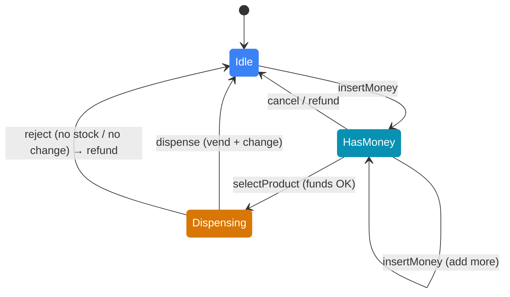
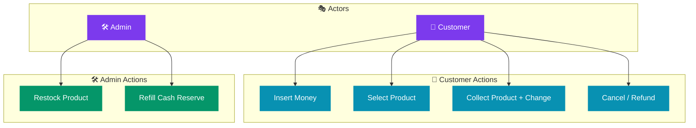
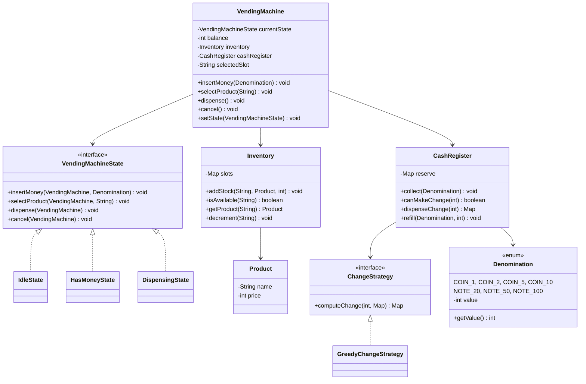
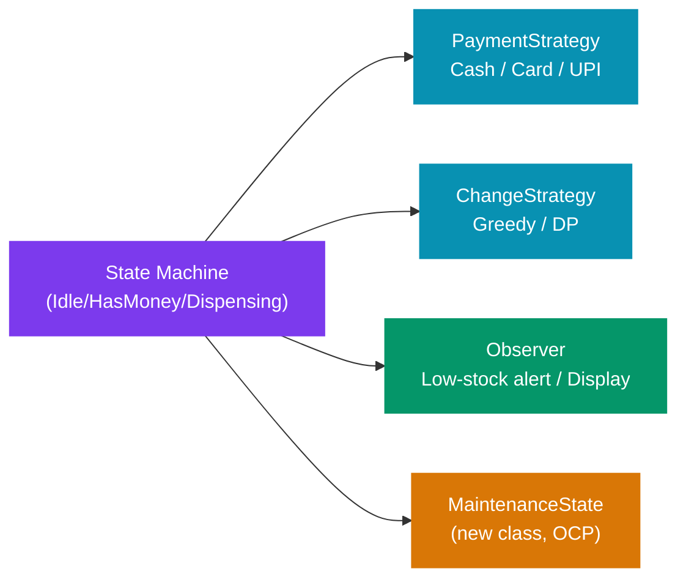

# 🥤 Low Level Design of a Vending Machine — The Canonical State Pattern Problem

---

## 1. 🧭 What This Problem Is About

Design the software that runs a **physical vending machine**. A customer walks up and inserts coins/notes. Then they select a product. The machine gives out the product **plus any change**. If the customer changes their mind, they can **cancel** and get a **refund**.

The whole problem depends on one fact: **the machine behaves differently depending on what state it is in.**

- Pressing "select product" while **no money** has been inserted → error.
- Inserting money while the machine is **dispensing** → rejected.
- Pressing "cancel" while **idle** → nothing to refund.

> 💡 The set of *legal operations changes as the machine moves through states*. That is the exact signal that the **State design pattern** fits. It is also why interviewers like this problem. It is a small, complete test. Can you model a **finite state machine** in normal OOP style, without a long, messy `if/else` chain?

Use this document in three ways: study it from zero, code from it, and check your own work against it. The **state machine is the centre** of the design. Everything else (inventory, change-making, payments) is built around it.

---

## 2. 📋 Problem Statement & Clarifying Questions

**Prompt (as typically given):** *"Design a vending machine that accepts coins, lets a user pick a product, dispenses it, and returns change."*

That one sentence hides many decisions. In the first 5 minutes, **ask before you build**. This is what makes an SDE-2 different from a junior. Below are the clarifying questions and the **assumptions this document commits to**. Say your assumptions to the interviewer and wait for them to agree.

| # | Clarifying Question | Assumption Taken Here |
|---|---|---|
| 1 | Multiple products at different prices? | ✅ Yes — a rack of products, each with its own price and slot code (e.g. `A1`, `B2`). |
| 2 | Accept **coins and notes**, or coins only? | ✅ Both — model a single `Denomination` enum (₹1, ₹2, ₹5, ₹10 coins + ₹20, ₹50, ₹100 notes). |
| 3 | Must return **change**? | ✅ Yes — return change greedily from the machine's own cash reserve. |
| 4 | What if **exact change is unavailable**? | ✅ Reject the purchase and refund fully (don't shortchange the customer). |
| 5 | **Refund / cancel** mid-transaction? | ✅ Yes — customer can cancel after inserting money but before dispensing. |
| 6 | **Restock / admin mode**? | ✅ Yes — an admin can refill inventory and cash. Kept as a thin seam, not the focus. |
| 7 | Buy **multiple quantities / multiple products** in one go? | ❌️ Out of scope for v1 — one product per transaction. Called out as a follow-up. |
| 8 | Track inventory **quantities**? | ✅ Yes — each slot has a count; selecting a sold-out slot is rejected. |
| 9 | **Card / UPI** payment? | ❌️ Out of scope for v1 — designed as a `PaymentStrategy` seam for later. |
| 10 | **Concurrency** — one physical panel, or many? | ✅ One physical machine = one user at a time. We still guard shared state. |

> 🗣️ **Say this to the interviewer:** *"A physical vending machine has exactly one keypad and one coin slot, so at the hardware level it's single-user. I'll model it that way. But I'll keep the context's 4 event methods `synchronized`. Then the object is safe if a test harness calls it from multiple threads."*

---

## 3. ✅ Requirements

### Functional Requirements

| # | Requirement |
|---|---|
| F1 | Accept money via coins **and** notes, one denomination at a time. |
| F2 | Show/select a product by slot code; validate price and availability. |
| F3 | Dispense the product when inserted amount ≥ price. |
| F4 | Return **change** = insertedAmount − price, from the machine's cash reserve. |
| F5 | Allow **cancel** → full refund of inserted money at any point before dispensing. |
| F6 | Reject invalid operations for the current state (e.g. select while idle). |
| F7 | Reject purchase if the slot is **out of stock**. |
| F8 | Reject + full refund if **exact change cannot be made**. |
| F9 | Admin can **restock** products and **refill** cash. |

### Non-Functional Requirements

| # | Requirement | Why it matters |
|---|---|---|
| N1 | **Extensible** — add a new state or payment type without touching existing states. | OCP — the whole point of using State + Strategy. |
| N2 | **Correct state transitions** — impossible to reach an invalid state. | The machine handles real money; illegal transitions = lost cash. |
| N3 | **Thread-safe context** — no lost updates on balance/inventory. | Defensive. Real hardware is single-user, but a test harness may be concurrent. |
| N4 | **Testable** — deterministic, no hidden `System.currentTimeMillis()` in core logic. | Machine-coding rounds are graded on a compiling happy path + edge tests. |
| N5 | **No money lost or created** — invariant: `cashIn = retainedCash + changeReturned + refunded`. | Auditability. |

---

## 4. 🔑 The State Machine — The Centerpiece

This is the core of the design. Model the vending machine as a **finite state machine (FSM)**. It has:

- a small set of **states**
- a small set of **events**
- a table of **legal transitions**

### 4.1 States

| State | Meaning | Balance | Legal Events |
|---|---|---|---|
| **`IdleState`** | Waiting for a customer. No money inserted. | `0` | `insertMoney` → HasMoney |
| **`HasMoneyState`** | Money inserted. Waiting for a product selection or more money. | `> 0` | `insertMoney` (add more), `selectProduct` → Dispensing, `cancel` → refund → Idle |
| **`DispensingState`** | Product selected & paid. Machine is vending + returning change. | `≥ price` | `dispense` → Idle (auto-triggered) |
| **`OutOfStockState`** *(optional)* | Machine has nothing to sell (all slots empty). | `0` | admin `restock` → Idle |

> 💡 **Design choice:** `DispensingState` is transient (the machine passes through it quickly).  
> - `selectProduct` moves us into it. Then `dispense()` runs at once (validate stock → validate change → vend → return change → reset).  
> - We keep it as a separate state. Then the machine cleanly rejects any event that arrives *during* a dispense (for example, an unexpected `insertMoney`).  
> - Some candidates merge dispense into `HasMoneyState`. Keeping it separate is cleaner, and it shows OCP better.

### 4.2 Events (the `VendingMachineState` interface methods)

| Event | Meaning |
|---|---|
| `insertMoney(Denomination)` | Customer drops in a coin or note. |
| `selectProduct(String slotCode)` | Customer presses a slot button. |
| `dispense()` | Internal: vend the selected product + return change. |
| `cancel()` | Customer aborts → full refund. |

Every concrete state implements **all four**. But only the **legal** ones do real work. The rest throw a clear exception (or do nothing and print a message). This is the key point: **each state owns exactly one row of the transition table.**

### 4.3 State-Transition Diagram



> The happy path is a short loop: **Idle → HasMoney → Dispensing → Idle**. There are two ways out of it:  
> - **cancel** (the customer starts it)  
> - **reject** (the machine starts it: no stock / can't make change)  
>
> Both send us back to **Idle** after a full refund.

### 4.4 Why State Pattern Beats a Giant `if/else` on an Enum

The simple (naive) approach is a single `currentState` enum. Every method then branches on it:

```java
// ❌️ ANTI-PATTERN: one enum, branching everywhere
void insertMoney(Denomination d) {
    switch (currentState) {
        case IDLE:        balance += d.getValue(); currentState = HAS_MONEY; break;
        case HAS_MONEY:   balance += d.getValue(); break;
        case DISPENSING:  throw new IllegalStateException("busy");
        // ...repeat this switch in selectProduct(), dispense(), cancel()...
    }
}
```

| Dimension | Giant `if/else` on enum | **State Pattern** |
|---|---|---|
| **Add a new state** | Edit *every* method's switch → touch all existing code. | Add one class implementing the interface. **Zero edits** to existing states → **OCP** ✅ |
| **Where's the logic for state X?** | Scattered across N methods. | All in one class. **SRP** ✅ |
| **Illegal transition** | Easy to forget a `case` → silent bug. | Compiler forces you to implement all 4 events per state. |
| **Readability** | Nested switches. Size grows as states × events. | Linear — one class per state. |
| **Testability** | Must set up global enum + fields. | Test each state class in isolation. |

---

## 5. 🧱 Core Entities / Use Cases

| Entity | Responsibility |
|---|---|
| **`VendingMachine`** (context) | Holds `currentState`, `balance`, `Inventory`, `CashRegister`, `selectedSlot`. Delegates every event to `currentState`. Singleton. |
| **`VendingMachineState`** | Interface — the 4 events. Implemented by each concrete state. |
| **`IdleState` / `HasMoneyState` / `DispensingState`** | Concrete states owning their legal transitions. |
| **`Product`** | Immutable metadata: name, price. |
| **`Inventory`** | `Map<slotCode → (Product, quantity)>`. Add/decrement/check stock. |
| **`Denomination`** (enum) | Coins + notes with an integer `value` in the smallest unit (₹). |
| **`CashRegister`** | The machine's cash reserve. Computes change (greedy), collects payment, dispenses change. |
| **`ChangeStrategy`** | Interface for change computation (greedy default) — Strategy seam. |
| **`Admin`** | Restock products, refill cash. |

### Use Cases



---

## 6. 🏗️ Class Diagram



---

## 7. 🧩 Design Patterns Used

| Pattern | Where | Why (tie to SOLID) |
|---|---|---|
| **State** ⭐ | `VendingMachineState` + `IdleState`/`HasMoneyState`/`DispensingState`. | The core. Behavior changes by state. Each state owns its transitions. **OCP** — add a state without touching others. **SRP** — one class = one state's rules. |
| **Strategy** | `ChangeStrategy` (greedy default, pluggable). Also the seam for `PaymentStrategy` (cash/card/UPI). | You can swap the change algorithm (greedy vs DP-optimal) without editing `CashRegister`. **DIP** — `CashRegister` depends on the interface. |
| **Singleton** | `VendingMachine` context. | One physical machine = one shared state. Prevents two "machines" over the same cash reserve. |
| **Factory** *(optional)* | A `StateFactory`/static state accessors that hand out state instances (they're stateless → can be shared/flyweight). | Keeps state creation in one place. Keeps `setState` calls clean. |

> 🗣️ **OCP line to say:** *"To add a `MaintenanceState` (jammed motor, tech servicing), I write one class that implements the four events. Then I add one transition into it. I don't reopen `IdleState`, `HasMoneyState`, or `DispensingState`. That's Open/Closed — open for extension, closed for modification."*

> 💡 **Stateless states → Flyweight/Singleton:** the concrete state objects hold **no instance data**. All mutable data lives in the `VendingMachine` context. Each state method gets the context as a parameter. So one shared instance per state class is enough. You don't need to `new` them on each transition.

---

## 8. 💻 Full Java Implementation

The code is clean, it compiles, and it follows normal Java style. The design keeps **all mutable data in the context**. It passes the context into each state method. So states are stateless and can be shared.

### 8.1 Enum — `Denomination` (coins + notes)

```java
public enum Denomination {
    COIN_1(1), COIN_2(2), COIN_5(5), COIN_10(10),   // coins
    NOTE_20(20), NOTE_50(50), NOTE_100(100);        // notes

    private final int value;

    Denomination(int value) { this.value = value; }

    public int getValue() { return value; }

    /** Denominations from largest to smallest — used by greedy change-making. */
    public static java.util.List<Denomination> descending() {
        java.util.List<Denomination> list =
            new java.util.ArrayList<>(java.util.Arrays.asList(values()));
        list.sort((a, b) -> Integer.compare(b.value, a.value));
        return list;
    }
}
```

### 8.2 `Product`

```java
public class Product {
    private final String name;
    private final int price; // in smallest currency unit (₹)

    public Product(String name, int price) {
        this.name = name;
        this.price = price;
    }

    public String getName() { return name; }
    public int getPrice() { return price; }
}
```

### 8.3 `Inventory` — slots with quantities

```java
import java.util.HashMap;
import java.util.Map;

public class Inventory {

    /** A slot holds a product type and how many units remain. */
    private static class Slot {
        final Product product;
        int quantity;
        Slot(Product product, int quantity) {
            this.product = product;
            this.quantity = quantity;
        }
    }

    private final Map<String, Slot> slots = new HashMap<>();

    public void addStock(String slotCode, Product product, int qty) {
        Slot slot = slots.get(slotCode);
        if (slot == null || slot.product == null) {
            slots.put(slotCode, new Slot(product, qty));
        } else {
            slot.quantity += qty; // restock existing slot
        }
    }

    public boolean isAvailable(String slotCode) {
        Slot slot = slots.get(slotCode);
        return slot != null && slot.quantity > 0;
    }

    public Product getProduct(String slotCode) {
        Slot slot = slots.get(slotCode);
        if (slot == null) return null;
        return slot.product;
    }

    public void decrement(String slotCode) {
        Slot slot = slots.get(slotCode);
        if (slot == null || slot.quantity <= 0) {
            throw new IllegalStateException("Slot " + slotCode + " is empty");
        }
        slot.quantity--;
    }

    public boolean isEmpty() {
        return slots.values().stream().allMatch(s -> s.quantity == 0);
    }
}
```

### 8.4 `ChangeStrategy` + `GreedyChangeStrategy` (Strategy)

```java
import java.util.LinkedHashMap;
import java.util.Map;

public interface ChangeStrategy {
    /**
     * Compute how to make `amount` from the available reserve.
     * @return denomination -> count, or null if exact change is impossible.
     */
    Map<Denomination, Integer> computeChange(int amount, Map<Denomination, Integer> reserve);
}
```

```java
import java.util.LinkedHashMap;
import java.util.Map;

public class GreedyChangeStrategy implements ChangeStrategy {

    @Override
    public Map<Denomination, Integer> computeChange(
            int amount, Map<Denomination, Integer> reserve) {

        Map<Denomination, Integer> change = new LinkedHashMap<>();
        int remaining = amount;

        // Largest denomination first (greedy).
        for (Denomination d : Denomination.descending()) {
            int available = reserve.getOrDefault(d, 0);
            if (available == 0 || d.getValue() > remaining) continue;

            int needed = Math.min(remaining / d.getValue(), available);
            if (needed > 0) {
                change.put(d, needed);
                remaining -= needed * d.getValue();
            }
        }

        // If we couldn't cover the amount exactly, change is NOT possible.
        return remaining == 0 ? change : null;
    }
}
```

### 8.5 `CashRegister` — the machine's cash reserve

```java
import java.util.HashMap;
import java.util.Map;

public class CashRegister {

    private final Map<Denomination, Integer> reserve = new HashMap<>();
    private final ChangeStrategy changeStrategy;

    public CashRegister(ChangeStrategy changeStrategy) {
        this.changeStrategy = changeStrategy;
    }

    /** Admin refills, or a customer's inserted cash is retained here. */
    public synchronized void refill(Denomination d, int count) {
        reserve.merge(d, count, Integer::sum);
    }

    /** Add the customer's inserted denomination into the reserve. */
    public synchronized void collect(Denomination d) {
        reserve.merge(d, 1, Integer::sum);
    }

    public synchronized boolean canMakeChange(int amount) {
        if (amount == 0) return true;
        return changeStrategy.computeChange(amount, reserve) != null;
    }

    /** Deduct `amount` worth of change from the reserve and return the breakdown. */
    public synchronized Map<Denomination, Integer> dispenseChange(int amount) {
        if (amount == 0) return new HashMap<>();
        Map<Denomination, Integer> change = changeStrategy.computeChange(amount, reserve);
        if (change == null) {
            throw new IllegalStateException("Cannot make change for " + amount);
        }
        change.forEach((d, cnt) -> reserve.merge(d, -cnt, Integer::sum));
        return change;
    }
}
```

### 8.6 `VendingMachineState` interface (the 4 events)

```java
public interface VendingMachineState {
    void insertMoney(VendingMachine machine, Denomination denomination);
    void selectProduct(VendingMachine machine, String slotCode);
    void dispense(VendingMachine machine);
    void cancel(VendingMachine machine);
}
```

### 8.7 `IdleState`

```java
public class IdleState implements VendingMachineState {

    @Override
    public void insertMoney(VendingMachine machine, Denomination d) {
        machine.addBalance(d);                 // retain the cash
        machine.getCashRegister().collect(d);
        System.out.println("Inserted " + d.getValue() + ". Balance = " + machine.getBalance());
        machine.setState(machine.getHasMoneyState());  // Idle -> HasMoney
    }

    @Override
    public void selectProduct(VendingMachine machine, String slotCode) {
        throw new IllegalStateException("Insert money before selecting a product.");
    }

    @Override
    public void dispense(VendingMachine machine) {
        throw new IllegalStateException("Nothing to dispense — no product selected.");
    }

    @Override
    public void cancel(VendingMachine machine) {
        System.out.println("Nothing to cancel — machine is idle.");
    }
}
```

### 8.8 `HasMoneyState`

```java
import java.util.Map;

public class HasMoneyState implements VendingMachineState {

    @Override
    public void insertMoney(VendingMachine machine, Denomination d) {
        machine.addBalance(d);                 // add more money
        machine.getCashRegister().collect(d);
        System.out.println("Inserted " + d.getValue() + ". Balance = " + machine.getBalance());
        // stays in HasMoney
    }

    @Override
    public void selectProduct(VendingMachine machine, String slotCode) {
        Inventory inv = machine.getInventory();

        if (!inv.isAvailable(slotCode)) {
            System.out.println("Slot " + slotCode + " is out of stock. Refunding.");
            machine.refundAll();
            machine.setState(machine.getIdleState());
            return;
        }

        Product product = inv.getProduct(slotCode);
        if (machine.getBalance() < product.getPrice()) {
            System.out.println("Insufficient funds. Need " + product.getPrice()
                + ", have " + machine.getBalance() + ". Insert more or cancel.");
            return; // stay in HasMoney
        }

        // Funds OK, stock OK -> move to Dispensing and vend.
        machine.setSelectedSlot(slotCode);
        machine.setState(machine.getDispensingState());
        machine.dispense(); // auto-trigger the vend
    }

    @Override
    public void dispense(VendingMachine machine) {
        throw new IllegalStateException("Select a product first.");
    }

    @Override
    public void cancel(VendingMachine machine) {
        System.out.println("Transaction cancelled.");
        machine.refundAll();                          // full refund
        machine.setState(machine.getIdleState());     // HasMoney -> Idle
    }
}
```

### 8.9 `DispensingState`

```java
import java.util.Map;

public class DispensingState implements VendingMachineState {

    @Override
    public void insertMoney(VendingMachine machine, Denomination d) {
        throw new IllegalStateException("Please wait — dispensing in progress.");
    }

    @Override
    public void selectProduct(VendingMachine machine, String slotCode) {
        throw new IllegalStateException("Please wait — dispensing in progress.");
    }

    @Override
    public void dispense(VendingMachine machine) {
        String slot = machine.getSelectedSlot();
        Product product = machine.getInventory().getProduct(slot);
        int changeDue = machine.getBalance() - product.getPrice();

        // Guard: can we return exact change? If not, reject and full-refund.
        if (!machine.getCashRegister().canMakeChange(changeDue)) {
            System.out.println("Exact change unavailable. Refunding full amount.");
            machine.refundAll();
            machine.setState(machine.getIdleState());
            return;
        }

        // Vend the product.
        machine.getInventory().decrement(slot);
        System.out.println("Dispensed: " + product.getName());

        // Return change (may be zero).
        if (changeDue > 0) {
            Map<Denomination, Integer> change =
                machine.getCashRegister().dispenseChange(changeDue);
            System.out.println("Returned change of " + changeDue + ": " + change);
        }

        // Reset and go back to Idle.
        machine.resetBalance();
        machine.setSelectedSlot(null);
        machine.setState(machine.getIdleState());     // Dispensing -> Idle
    }

    @Override
    public void cancel(VendingMachine machine) {
        throw new IllegalStateException("Cannot cancel — dispensing in progress.");
    }
}
```

### 8.10 `VendingMachine` context (Singleton)

```java
import java.util.HashMap;
import java.util.Map;

public class VendingMachine {

    // ---- Singleton ----
    private static VendingMachine instance;

    // ---- Stateless state instances (shared) ----
    private final VendingMachineState idleState        = new IdleState();
    private final VendingMachineState hasMoneyState    = new HasMoneyState();
    private final VendingMachineState dispensingState  = new DispensingState();

    // ---- Mutable context data ----
    private VendingMachineState currentState;
    private int balance = 0;
    private String selectedSlot;
    private final Inventory inventory = new Inventory();
    private final CashRegister cashRegister = new CashRegister(new GreedyChangeStrategy());

    /** Tracks coins/notes the CURRENT customer inserted, for clean refunds. */
    private final Map<Denomination, Integer> currentInsertions = new HashMap<>();

    private VendingMachine() {
        this.currentState = idleState;
    }

    public static synchronized VendingMachine getInstance() {
        if (instance == null) instance = new VendingMachine();
        return instance;
    }

    // ---- Public API — delegates to current state ----
    public synchronized void insertMoney(Denomination d) {
        currentState.insertMoney(this, d);
    }
    public synchronized void selectProduct(String slotCode) {
        currentState.selectProduct(this, slotCode);
    }
    public synchronized void dispense() {
        currentState.dispense(this);
    }
    public synchronized void cancel() {
        currentState.cancel(this);
    }

    // ---- Balance / refund helpers ----
    public void addBalance(Denomination d) {
        balance += d.getValue();
        currentInsertions.merge(d, 1, Integer::sum);
    }

    public void resetBalance() {
        balance = 0;
        currentInsertions.clear();
    }

    /** Return every coin/note the current customer inserted, exactly. */
    public void refundAll() {
        if (balance == 0) return;
        System.out.println("Refunding " + balance + ": " + currentInsertions);
        // Cash physically leaves the reserve.
        currentInsertions.forEach((d, cnt) -> cashRegister.refill(d, -cnt));
        resetBalance();
    }

    // ---- Getters / setters ----
    public void setState(VendingMachineState state) { this.currentState = state; }
    public VendingMachineState getIdleState()       { return idleState; }
    public VendingMachineState getHasMoneyState()   { return hasMoneyState; }
    public VendingMachineState getDispensingState() { return dispensingState; }

    public int getBalance()             { return balance; }
    public String getSelectedSlot()     { return selectedSlot; }
    public void setSelectedSlot(String s) { this.selectedSlot = s; }
    public Inventory getInventory()     { return inventory; }
    public CashRegister getCashRegister() { return cashRegister; }
}
```

### 8.11 Demo `main` — three flows

```java
public class Demo {
    public static void main(String[] args) {
        VendingMachine machine = VendingMachine.getInstance();

        // ---- Admin: stock products + seed cash reserve ----
        machine.getInventory().addStock("A1", new Product("Coke", 25), 5);
        machine.getInventory().addStock("A2", new Product("Water", 20), 3);
        machine.getInventory().addStock("B1", new Product("Chips", 30), 0); // sold out

        // Seed change so the machine can return money.
        machine.getCashRegister().refill(Denomination.COIN_5, 10);
        machine.getCashRegister().refill(Denomination.COIN_10, 10);
        machine.getCashRegister().refill(Denomination.COIN_1, 10);

        System.out.println("\n===== FLOW 1: HAPPY PATH (Coke = 25, pay 50, change 25) =====");
        machine.insertMoney(Denomination.NOTE_20);   // Idle -> HasMoney, bal 20
        machine.insertMoney(Denomination.NOTE_20);   // bal 40
        machine.insertMoney(Denomination.COIN_10);   // bal 50
        machine.selectProduct("A1");                 // HasMoney -> Dispensing -> vend + 25 change -> Idle

        System.out.println("\n===== FLOW 2: CANCEL / REFUND =====");
        machine.insertMoney(Denomination.NOTE_50);   // Idle -> HasMoney, bal 50
        machine.cancel();                            // full refund -> Idle

        System.out.println("\n===== FLOW 3: INSUFFICIENT FUNDS then top-up =====");
        machine.insertMoney(Denomination.NOTE_20);   // bal 20
        machine.selectProduct("A1");                 // Coke=25 > 20 -> "Insufficient funds", stays HasMoney
        machine.insertMoney(Denomination.COIN_10);   // bal 30
        machine.selectProduct("A1");                 // now 30 >= 25 -> vend + 5 change -> Idle

        System.out.println("\n===== FLOW 4: OUT OF STOCK =====");
        machine.insertMoney(Denomination.NOTE_50);
        machine.selectProduct("B1");                 // sold out -> refund -> Idle
    }
}
```

**Expected output (abridged):**

```
===== FLOW 1: HAPPY PATH =====
Inserted 20. Balance = 20
Inserted 20. Balance = 40
Inserted 10. Balance = 50
Dispensed: Coke
Returned change of 25: {NOTE_20=1, COIN_5=1}

===== FLOW 2: CANCEL / REFUND =====
Inserted 50. Balance = 50
Transaction cancelled.
Refunding 50: {NOTE_50=1}

===== FLOW 3: INSUFFICIENT FUNDS then top-up =====
Inserted 20. Balance = 20
Insufficient funds. Need 25, have 20. Insert more or cancel.
Inserted 10. Balance = 30
Dispensed: Coke
Returned change of 5: {COIN_5=1}

===== FLOW 4: OUT OF STOCK =====
Inserted 50. Balance = 50
Slot B1 is out of stock. Refunding.
Refunding 50: {NOTE_50=1}
```

> 💡 **Why ₹20 in Flow 1's change?** `collect()` puts the customer's notes into the reserve first. So greedy can hand back one of the customer's own ₹20 notes as change.

> 💡 **Why track `currentInsertions`?** A clean refund returns the *exact* coins/notes the customer inserted. It does not return an equal amount computed from the reserve. It also keeps the money-conservation invariant (N5) true in an easy, obvious way. On refund, we call `refill(d, -cnt)`. This puts the reserve back to its state before the transaction.

---

## 9. 🪙 Change-Making Note — Greedy vs DP

The `GreedyChangeStrategy` above picks the **largest denomination first**. This is correct **only for standard coin systems** (the math term is *canonical*). In such a system, the denominations fit together so that greedy is optimal. For example, Indian ₹ {1,2,5,10} and most real currencies are standard.

> ⚠️ **A standard coin system is not enough here.** "Standard" means greedy is optimal when you have an **unlimited** supply of each coin. This machine has a **limited** reserve. Example: make ₹6 from a reserve of one ₹5 and three ₹2 coins. Greedy takes ₹5, then needs ₹1 and returns `null`. But 2 + 2 + 2 works. So greedy can refund a sale that was possible. A count-aware DP fixes this.

### When greedy fails

Take a denomination set that is **any set / non-standard**. Here greedy can go wrong in two ways:

- it can fail to find change that *does* exist, or
- it can use more coins than needed.

> **Classic counterexample:** denominations `{1, 3, 4}`, make change for `6`.  
> - **Greedy:** `4 + 1 + 1` = 3 coins.  
> - **Optimal (DP):** `3 + 3` = 2 coins.

The interviewer may say "denominations can be any values". Then swap in a **DP-based `ChangeStrategy`** (the classic Coin Change min-coins problem, O(amount × denominations)). Change computation sits behind the `ChangeStrategy` interface. So this is a **one-class swap**, with no change to `CashRegister` or any state. That is the benefit of Strategy.

| Strategy | Works for | Complexity | Note |
|---|---|---|---|
| **Greedy** (default) | Canonical currencies (₹, $, €) | O(denominations) | Fast, simple. With a limited reserve it can miss change that exists. |
| **DP min-coins** | Arbitrary denominations | O(amount × denominations) | Handles the `{1,3,4}` counterexample. |

> 🗣️ **Line to say:** *"Real currencies are standard coin systems, so greedy is simple and fast here. But greedy breaks on non-standard sets like {1,3,4}. It can also miss change when the reserve is low on some coins. If needed, I'd plug in a DP strategy behind the same `ChangeStrategy` interface."*

---

## 10. ⚠️ Edge Cases

| # | Edge Case | Handling |
|---|---|---|
| 1 | **Insufficient money** for selected product. | Stay in `HasMoneyState`. Ask the user to insert more or cancel. No state change. |
| 2 | **Out of stock** slot selected. | Reject in `HasMoneyState`, full refund, back to `Idle`. |
| 3 | **Exact change unavailable** in reserve. | `DispensingState.dispense()` checks `canMakeChange()` first. If false → full refund, no vend. |
| 4 | **Invalid selection while idle** (`selectProduct` before inserting money). | `IdleState.selectProduct` throws `IllegalStateException`. |
| 5 | **Cancel while idle** (nothing to refund). | `IdleState.cancel` is a friendly no-op message. |
| 6 | **Insert money while dispensing.** | `DispensingState.insertMoney` throws — machine is busy. |
| 7 | **Change due is zero.** | `changeDue == 0` → `canMakeChange` returns true, no change returned. |
| 8 | **Concurrent access** (harness driving multiple threads). | The context's 4 event methods + `CashRegister` methods are `synchronized`. Admin calls through `getInventory()` are not locked (`Inventory` uses a plain `HashMap`). The physical machine is single-user anyway. |
| 9 | **Invalid slot code** (`Z9`). | `isAvailable` returns false → treated as out of stock → refund. |
| 10 | **Exact payment** (insert exactly the price). | `changeDue == 0`, vend, no change, reset to `Idle`. |

> 💡 **Money-conservation invariant (N5):** every path either vends-and-returns-change **or** refunds-fully. No path keeps the customer's money without giving the product. Always state this invariant. It shows you thought about correctness, not just the happy path.

---

## 11. 🚀 Extensions / Follow-Ups

| Extension | How the design handles it |
|---|---|
| **Card / UPI payment** | Introduce a `PaymentStrategy` interface (`pay(amount)` → success/fail). `HasMoneyState` (or a new `PaymentState`) delegates to it. Cash becomes one strategy among several. No state is rewritten. **Strategy**. |
| **Multiple products / quantity per transaction** | Model a `Cart` in the context. `selectProduct` adds to the cart. A `checkout` event moves to `Dispensing`. Balance check sums cart price. |
| **Admin restock / maintenance mode** | Add a `MaintenanceState`. The admin key-switch moves Idle → Maintenance. Restock/refill only allowed there. **OCP** — one new class. |
| **Inventory low-stock alert** | **Observer** pattern: `Inventory` is a subject. A `RestockService` observer fires when a slot's quantity drops below a threshold. |
| **DP-optimal change** | Swap `GreedyChangeStrategy` → `DpChangeStrategy` behind `ChangeStrategy`. **Strategy**. |
| **Display / UI events** | Context publishes state-change events. A display observer renders "Insert money", "Dispensing…", etc. **Observer**. |
| **Persistence / audit log** | Wrap events in a `Transaction` record. Append it to a log, so you can later reconcile (cross-check) the N5 invariant. |



---

## 12. ⏱️ 2.5-Hour Time-Box Plan

| Phase | Time | What to do |
|---|---|---|
| 1️⃣ **Clarify & scope** | 0:00–0:15 | Ask the §2 questions. Say your assumptions to the interviewer. Fix the scope: 1 product/txn, cash only, greedy change. |
| 2️⃣ **Model the FSM** | 0:15–0:35 | Draw the state-transition diagram. List states + events + the transition table. Justify State over enum-switch. |
| 3️⃣ **Class skeleton** | 0:35–0:55 | Write interfaces + enums + entity signatures (`Denomination`, `Product`, `Inventory`, `CashRegister`, `VendingMachineState`). |
| 4️⃣ **Core states** | 0:55–1:35 | Implement `IdleState`, `HasMoneyState`, `DispensingState`. This is the main part. Get the transitions right. |
| 5️⃣ **Context + change-making** | 1:35–2:00 | Implement `VendingMachine` (Singleton, delegation, refund) + `GreedyChangeStrategy`. |
| 6️⃣ **Demo + edge cases** | 2:00–2:20 | Wire the `main` driver: happy path, cancel, insufficient funds, out of stock. Get it compiling. |
| 7️⃣ **Discuss extensions** | 2:20–2:30 | Talk about concurrency, DP change, card/UPI, Observer low-stock alert. Show the seams. |

> 💡 With 2.5 hours you have time to actually **run** the code. Get a **compiling happy path early** (by ~2:00) first. Then add edge cases on top. A running Idle→HasMoney→Dispensing→Idle loop is better than a half-written "perfect" design.

---

## 13. 🎤 Interview Tips — What Impresses

| # | Tip |
|---|---|
| 1 | **Name the pattern up front.** Say "this is a State-machine problem" in the first 2 minutes. It shows you know this type of problem and won't build a messy if/else chain. |
| 2 | **Draw the transition table before coding.** States × events grid. It's your spec. You code straight from it. |
| 3 | **Keep states stateless.** All mutable data lives in the context and is passed in. Then states are shareable singletons/flyweights. This small detail impresses interviewers. |
| 4 | **Justify OCP concretely.** "To add MaintenanceState I write one class, touch zero existing states." Don't just say "SOLID". Show it. |
| 5 | **Guard money correctness.** State the invariant: every path either vends+change or refunds fully. Never keep money without product. |
| 6 | **Check change BEFORE vending.** Dispensing checks `canMakeChange` first. Vending and then failing to make change is a real-world bug. |
| 7 | **Put change-making behind Strategy.** Then briefly mention greedy vs DP + the `{1,3,4}` counterexample. This earns easy depth points. |
| 8 | **Mention concurrency even if single-user.** "Hardware is single-user, but I `synchronized` the context so a test harness can't corrupt state." |
| 9 | **Get it compiling.** Machine-coding rounds give more marks to a working happy path than to an elegant unfinished design. Vertical slice first. |
| 10 | **Track exact insertions for refunds.** Return the same coins the customer inserted (not newly computed change). This is both correct and careful. |

---

## 14. 🎯 Key Takeaways

| # | Takeaway |
|---|---|
| 1️⃣ | **Vending Machine = the standard State pattern problem.** Behavior changes by state. Each state owns its transitions. |
| 2️⃣ | **State is better than enum-switch on every point**: OCP, SRP, readability, testability. Adding a state = one new class. |
| 3️⃣ | **Keep mutable data in the context.** Pass it into stateless state objects → states become shareable. |
| 4️⃣ | **Change-making is a Strategy seam.** Greedy for real (canonical) currency. DP for any other denomination set (`{1,3,4}`). |
| 5️⃣ | **Check `canMakeChange` before vending.** Protect the money-conservation invariant on every path. |
| 6️⃣ | **Singleton context** — one physical machine, one shared cash reserve and inventory. |
| 7️⃣ | **In a 2.5h round, get a compiling happy path by the 2-hour mark**, then layer edge cases and discuss extensions. |

---

> 🥡 *"The Vending Machine isn't about coins. It's about proving you can turn a transition table into polymorphism. Each state is one row. The machine just delegates the current event to the current state. Add a state, add a class. Never edit the switch again."*
