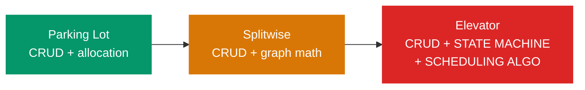
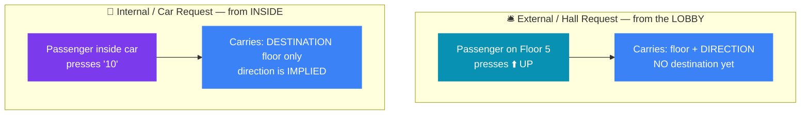
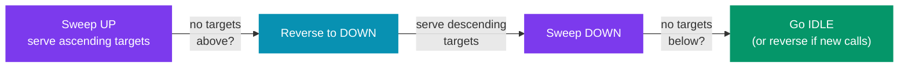
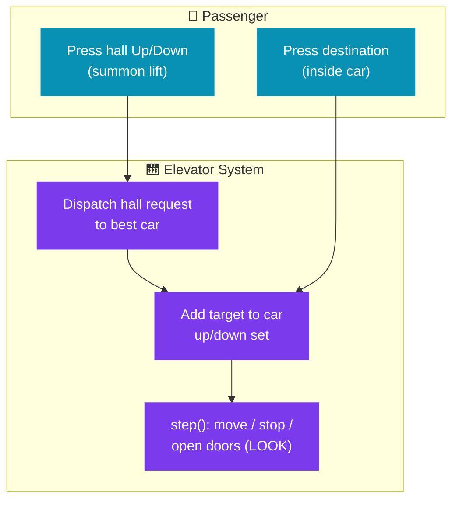
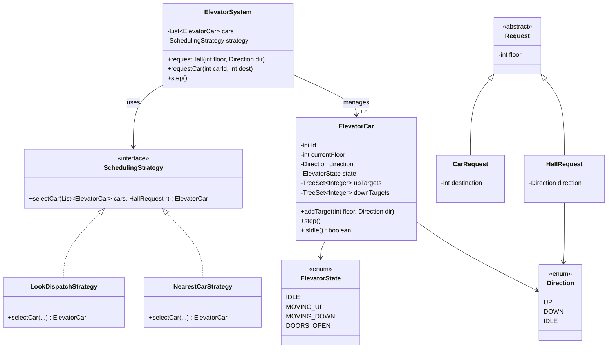
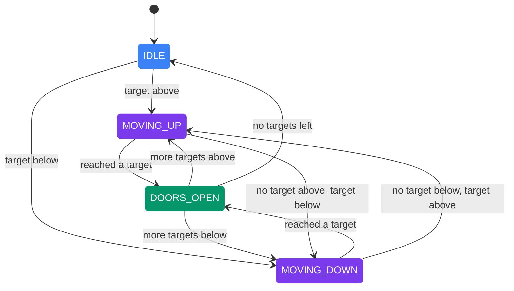
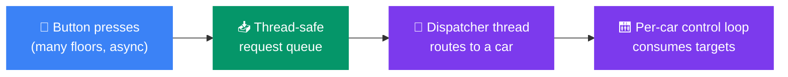

# 🛗 Machine Coding LLD — Elevator System (Lift)

> 🎯 **Difficulty:** 🔴 **Hard** — strong candidates stand out on the scheduling/dispatch algorithm  
> 🏢 **Asked at:** Tekion (very frequent), Amazon, Uber, Google, Atlassian, Directi/Media.net, Flipkart  
> ⏱️ **Format:** 2.5-hour **live machine-coding round**. The interviewer expects code that compiles, runs and is easy to extend  
> 👤 **Target:** Experienced backend engineer (SDE-2). The interviewer wants clean OOD **and** a correct LOOK/SCAN scheduler  
> 🧭 **One-liner:** *"Model two request types (hall vs car). Drive one elevator correctly with the LOOK algorithm. Then show the multi-car dispatcher as a pluggable strategy extension point."*

---

## 1. 🧭 Why This Is the Hardest of the Three Classics

The three machine-coding classics are **Parking Lot**, **Snake & Ladder / Splitwise**, and the **Elevator System**. The other two are mostly *state-tracking CRUD*. The Elevator adds a **live scheduling algorithm** on top of the OOD. That is why it is the hardest.



Candidates fail on three things at the same time:

| Trap | What weak candidates do | What strong candidates do |
|------|-------------------------|---------------------------|
| **Request modeling** | Treat every button press the same | Separate the **hall request** (floor + direction) from the **car request** (destination only) |
| **Scheduling** | Serve requests FCFS → the elevator "yo-yos" up and down | Implement **LOOK/SCAN** — move in one direction, then reverse |
| **Multi-car dispatch** | Hardcode "nearest car" inside the controller | Make dispatch a **Strategy**, so LOOK / nearest-car / minimize-wait can be swapped |

> 💡 **The single most impressive thing you can do:** get the request-type distinction right *and* build a working LOOK sweep on a single car. That alone puts you ahead of most candidates. Show the multi-car dispatcher last, as the *extension point*. You rarely need to fully code it in 2.5h.

---

## 2. 📋 Problem Statement & Clarifying Questions

> **Problem:** Design the control software for an elevator system in a building. Passengers press **up/down buttons on each floor** (to call a lift). They also press **destination-floor buttons inside the car**. The system must move elevators to serve all requests efficiently.

Never start coding before you ask these. In a 2.5h round, the interviewer *expects* you to spend 10–12 minutes here. This step shows the difference between seniors and juniors.

| # | Clarifying Question | Sensible Default (state it, then proceed) |
|---|---------------------|-------------------------------------------|
| 1 | **How many elevators?** | Design for **N cars**, but code & demo **1 car** in depth. The multi-car dispatcher is the extension point |
| 2 | **How many floors?** | Configurable `0 .. maxFloor` (e.g. 0–15). Support a basement (negative floors) as a stretch goal |
| 3 | **Two request types?** | Yes — **external/hall** (floor + direction, from the lobby) and **internal/car** (destination floor, from inside) |
| 4 | **Directional hall buttons?** | Yes — a hall panel has separate **Up** and **Down** buttons (top floor only Down, ground only Up) |
| 5 | **Optimize for wait time or throughput?** | **Minimize average wait time** (the most common ask). LOOK balances both by its nature |
| 6 | **Capacity / weight limits?** | Ignore them for v1. Model `maxCapacity` as a field, and treat "full" as an edge case / extension |
| 7 | **Real-time or simulation?** | Simulate with discrete **`step()` ticks** (1 tick = move 1 floor / open-close doors). This is cleaner than threads for a coding round |
| 8 | **Emergency / maintenance / VIP?** | Out of scope for v1. Mention them as extensions |

> 🗣️ **How to say it in the room:** *"I'll assume N elevators, but I'll build one car correctly first with a LOOK scheduler. Then I'll expose a `Dispatcher` strategy. So adding more cars and swapping the dispatch rule is an open-closed change. For time control I'll simulate with discrete ticks, not real threads. I'll discuss the concurrent version in words."*

---

## 3. ✅ Requirements

### Functional

| # | Requirement |
|---|-------------|
| F1 | A passenger can **call** a lift from any floor by pressing **Up** or **Down** (hall request) |
| F2 | A passenger inside a car can press a **destination floor** (car request) |
| F3 | The elevator **moves** floor by floor and **stops** where it has a pending request |
| F4 | The elevator serves requests in the **current direction first**, then reverses (LOOK) |
| F5 | The elevator **opens/closes doors** at a floor it serves |
| F6 | When idle (no requests), the elevator **stays where it is** (or parks at a lobby — configurable) |
| F7 | (Multi-car) A **dispatcher** sends each hall request to the **best** car |

### Non-Functional

| # | Requirement | Design implication |
|---|-------------|--------------------|
| N1 | **Low average wait time** | LOOK scheduling; a smart dispatch rule |
| N2 | **Extensible scheduling** | Dispatch + car-scheduling behind a **Strategy** interface (OCP) |
| N3 | **Thread-safe** request intake | Requests arrive concurrently; guard the shared target sets (discussed §11) |
| N4 | **Deterministic & testable** | Discrete `step()` simulation → repeatable unit tests |
| N5 | **No starvation** | LOOK guarantees that every request is served in the end, on some sweep |

---

## 4. 🔀 The Two Request Types — *The Distinction Candidates Miss*

This is the **single most important modeling decision**. If you get it right, the interviewer sees at once that you have thought about real elevators.



| Aspect | 🛎️ **Hall / External Request** | 🔢 **Car / Internal Request** |
|--------|-------------------------------|-------------------------------|
| **Origin** | Floor lobby (outside the car) | Inside the car |
| **Data** | `sourceFloor` **+ `direction`** | `destinationFloor` only |
| **Direction** | Explicit (passenger chose Up/Down) | **Implied** by `destination vs currentFloor` |
| **Who handles routing** | The **Dispatcher** picks which car | Already inside a car → goes to *that* car |
| **Analogy** | "A lift, please — I want to go **up**" | "Take **me** to floor 10" |

> 🔑 **Why direction matters on a hall call:** A passenger on floor 5 who presses **Up** wants a car that is *going up* (or idle). A car that sweeps *down* through floor 5 should **not** stop for them. It would take them the wrong way. Direction lets LOOK correctly decide "is this request in my current sweep?"

> ⚠️ **Common bug:** modeling a hall call as just a floor number. Then a down-going car "helpfully" stops at floor 5 for an up-passenger. Real elevators keep the up and down calls on **separate queues** for exactly this reason.

---

## 5. 🧮 Scheduling Algorithm — *The Core of This Problem*

Spend the most whiteboard time on this section. Get the single-car sweep right first.

### 5.1 Naive FCFS — and why it's wrong

Serve requests strictly in arrival order.

```
Car at floor 0. Requests arrive: [10, 2, 12, 3]
FCFS path:  0 → 10 → 2 → 12 → 3
Distance traveled: 10 + 8 + 10 + 9 = 37 floors  😱
```

The car **yo-yos** (it goes up and down again and again). It passes floors 2 and 3 on the way up to 10 and ignores them. Then it comes back down and goes up again. This gives a very bad wait time and wasted travel.

### 5.2 LOOK / SCAN — the "Elevator Algorithm"

> **LOOK:** Keep moving in the **current direction**. Serve every request on the way. Stop when there are **no more requests ahead** in that direction. Then **reverse** and sweep back. (SCAN is the related disk-scheduling algorithm. It always runs to the physical end. **LOOK** stops at the last *request*, which is better for elevators.)

```
Car at floor 0, direction UP. Requests: [10, 2, 12, 3]
LOOK path (UP sweep, ascending): 0 → 2 → 3 → 10 → 12
Distance traveled: 12 floors  ✅  (vs 37 for FCFS)
```

Same requests, **3x less travel**. The car picks up every passenger in a single smooth pass.



### 5.3 The data structure: two ordered sets

The clean way to implement LOOK is **two sorted sets of target floors**, one for each direction:

| Structure | Type | Purpose | Which floor next? |
|-----------|------|---------|-------------------|
| `upTargets` | `TreeSet<Integer>` (ascending) | Floors to visit while going **up** | `upTargets.ceiling(currentFloor)` = lowest at or above me |
| `downTargets` | `TreeSet<Integer>` (ascending, read from the top) | Floors to visit while going **down** | `downTargets.floor(currentFloor)` = highest at or below me |

In code, query each `TreeSet` with `ceiling()` / `floor()`:

- **Going UP:** next stop = `upTargets.ceiling(currentFloor)` (smallest floor still ≥ current). When `upTargets` is empty → flip to DOWN.
- **Going DOWN:** next stop = `downTargets.floor(currentFloor)` (largest floor still ≤ current). When `downTargets` is empty → flip to UP.

A `TreeSet` gives you three things that LOOK needs:

- **O(log n)** insert
- **auto-dedup** (pressing floor 5 twice = one target)
- **auto-sorted** iteration

Two `PriorityQueue`s (min-heap for up, max-heap for down) also work. But they lack two things that `TreeSet.ceiling/floor` give you: the O(log n) "is X already queued?" check, and ordered navigation.

### 5.4 How each request type feeds the sets

```
Car request (destination D):
    if D > currentFloor → upTargets.add(D)
    if D < currentFloor → downTargets.add(D)

Hall request (floor F, direction DIR):
    if DIR == UP   → upTargets.add(F)     // will be served on an UP sweep
    if DIR == DOWN → downTargets.add(F)   // will be served on a DOWN sweep
```

> 🔑 The hall request's **direction picks the set**. This is the whole benefit of §4. The up-passenger on floor 5 goes into `upTargets`, so a down-sweeping car never stops for them.

### 5.5 Worked example (single car, mixed requests)

The car starts **idle at floor 0**. These requests arrive:

| Time | Event | Set updated |
|------|-------|-------------|
| t0 | Hall(5, UP) | `upTargets = {5}`, direction → UP |
| t0 | Hall(3, UP) | `upTargets = {3,5}` |
| t0 | Hall(8, DOWN) | `downTargets = {8}` |
| t1 | Car enters at 3, presses 9 | `upTargets = {5,9}` (3 consumed) |

**LOOK trace** (each `step()` moves one floor):

```
Floor 0 → 3   [stop, doors, pick up → they press 9]  upTargets={5,9} down={8}
     3 → 5   [stop, doors, Hall(5,UP) served]        upTargets={9}   down={8}
     5 → 9   [stop, doors, Car dest 9 served]         upTargets={}    down={8}
   upTargets empty → REVERSE to DOWN
     9 → 8   [stop, doors, Hall(8,DOWN) served]        down={}
   downTargets empty → IDLE at floor 8
```

One clean up-sweep, one reverse, done. No wasted travel.

### 5.6 Multi-car dispatch — picking the *best* car

With N cars, a **Dispatcher** decides which car answers each **hall** request. (Car requests always belong to the car the passenger is already in.) Common dispatch rules:

| Heuristic | Rule | Trade-off |
|-----------|------|-----------|
| **Nearest Car** | Assign the idle/same-direction car with min `|carFloor − requestFloor|` | Simple, greedy; can bunch cars |
| **Minimize Wait (LOOK-aware)** | Score each car by *estimated stops before it reaches the request*, based on its current sweep | Best average wait; more code |
| **Directional-suitability** | Prefer a car that already moves toward the floor **in the requested direction**; penalize wrong-direction cars | The realistic production choice |

A good scoring function:

```
cost(car, request):
    if car is IDLE                          → distance
    if car moving TOWARD request in SAME dir → distance         (great — pick up en route)
    if car moving AWAY / opposite dir        → distance + BIG_PENALTY
pick car with minimum cost
```

> 💬 **What to say:** *"Dispatch is a Strategy. v1 uses nearest-car. Production uses a LOOK-aware cost. It prefers a car that is already sweeping toward the caller in the right direction. Swapping it is an OCP change — the cars and the controller don't change."*

---

## 6. 🧩 Core Entities / Use Cases

| Entity | Responsibility |
|--------|----------------|
| **ElevatorSystem / Dispatcher** | Singleton controller. Holds all cars, routes hall requests, runs the simulation `step()`s |
| **ElevatorCar** | One physical lift. Holds `currentFloor`, `direction`, `state`, `upTargets`, `downTargets`; implements `step()` (the LOOK move) |
| **Request** (abstract) | A pending request. `HallRequest` (floor + dir) / `CarRequest` (destination) |
| **Direction** (enum) | `UP`, `DOWN`, `IDLE` |
| **ElevatorState** (enum / State pattern) | `IDLE`, `MOVING_UP`, `MOVING_DOWN`, `DOORS_OPEN` |
| **Button** (hierarchy) | `HallButton` (up/down on a floor) / `CarButton` (destination inside car) → generate Requests |
| **SchedulingStrategy** (interface) | Pluggable: `LookDispatchStrategy`, `NearestCarStrategy` |

### Use-case view



---

## 7. 🏗️ Class Diagram



---

## 8. 🎨 Design Patterns Used — *and Why*

| Pattern | Where | Reason (say this in the interview) |
|---------|-------|-----------------------------------|
| **Strategy** | `SchedulingStrategy` (dispatch) | The "which car?" rule changes with the building and traffic. Swap LOOK ↔ nearest-car ↔ minimize-wait **without touching** `ElevatorCar` or the controller → **OCP** |
| **State** | `ElevatorState` (Idle/MovingUp/MovingDown/DoorsOpen) | What the elevator does on `step()` depends fully on its state. The State pattern removes giant `if/else` chains and keeps each transition in one place. (For a coding round, an `enum` + `switch` is an acceptable lightweight State) |
| **Singleton** | `ElevatorSystem` controller | One physical control unit per building; one shared source of truth for all cars |
| **Command / Observer** *(optional)* | Button press → `Request` object placed on a queue | A button-press is a **Command** (encapsulated request, queueable, undoable). Or model buttons/panels as **Observers**. The car notifies them on arrival, to light/clear the button. Mention it as a clean extension |
| **Factory** *(optional)* | Building the fleet | An `ElevatorFactory` to create N configured cars — minor, only if time allows |

### SOLID tie-in

- **SRP:** `ElevatorCar` moves; `Dispatcher` routes; `Strategy` decides. Three responsibilities, three owners.
- **OCP:** New scheduling algorithm = new `Strategy` class. Zero edits to existing classes. **This is the most important line to say in the interview.**
- **LSP/DIP:** The controller depends on the `SchedulingStrategy` abstraction, not on a concrete algorithm.

---

## 9. 🔁 State-Transition Diagram (single car)



> 📝 The transitions `MOVING_UP → MOVING_DOWN` (and vice-versa) are the **LOOK reversal**. `DOORS_OPEN → IDLE` is the final "nothing left to do" step.

---

## 10. 💻 Full Java Implementation

The code is clean, compilable and single-threaded. It is **simulation-stepped** (it moves one tick at a time) to keep it clear. LOOK drives one car correctly. The multi-car dispatcher is shown as the extension point.

### 10.1 Enums

```java
public enum Direction {
    UP, DOWN, IDLE
}

public enum ElevatorState {
    IDLE, MOVING_UP, MOVING_DOWN, DOORS_OPEN
}
```

### 10.2 Requests (abstract + two concrete types)

```java
// Base type — every demand carries at least a floor.
public abstract class Request {
    protected final int floor;
    protected Request(int floor) { this.floor = floor; }
    public int getFloor() { return floor; }
}

// EXTERNAL: pressed in the lobby → carries a DIRECTION, no destination yet.
public class HallRequest extends Request {
    private final Direction direction;
    public HallRequest(int floor, Direction direction) {
        super(floor);
        this.direction = direction;
    }
    public Direction getDirection() { return direction; }
}

// INTERNAL: pressed inside the car → carries a DESTINATION; direction is implied.
public class CarRequest extends Request {
    public CarRequest(int destination) { super(destination); }
    public int getDestination() { return floor; }
}
```

### 10.3 `ElevatorCar` — the LOOK engine

```java
import java.util.TreeSet;

public class ElevatorCar {
    private final int id;
    private int currentFloor;
    private Direction direction = Direction.IDLE;
    private ElevatorState state = ElevatorState.IDLE;

    // The two ordered target sets — the heart of LOOK.
    // TreeSet gives sorted order + auto-dedup + O(log n) navigation.
    private final TreeSet<Integer> upTargets   = new TreeSet<>();
    private final TreeSet<Integer> downTargets = new TreeSet<>();

    public ElevatorCar(int id, int startFloor) {
        this.id = id;
        this.currentFloor = startFloor;
    }

    /** Add a target floor. Direction decides which set it lands in. */
    public synchronized void addTarget(int floor, Direction reqDir) {
        if (floor == currentFloor && state == ElevatorState.DOORS_OPEN) {
            return; // already serving this floor
        }
        if (reqDir == Direction.UP) {
            upTargets.add(floor);
        } else if (reqDir == Direction.DOWN) {
            downTargets.add(floor);
        } else { // CarRequest with no explicit dir → derive from position
            if (floor > currentFloor) upTargets.add(floor);
            else if (floor < currentFloor) downTargets.add(floor);
        }
        // Kick an idle car into motion toward the nearest pending target.
        if (direction == Direction.IDLE) chooseDirection();
    }

    /** Decide a sweep direction when idle. */
    private void chooseDirection() {
        if (!upTargets.isEmpty()   && (downTargets.isEmpty()
                || nearestUpDist() <= nearestDownDist())) {
            direction = Direction.UP;   state = ElevatorState.MOVING_UP;
        } else if (!downTargets.isEmpty()) {
            direction = Direction.DOWN; state = ElevatorState.MOVING_DOWN;
        } else {
            direction = Direction.IDLE; state = ElevatorState.IDLE;
        }
    }

    private int nearestUpDist() {
        Integer f = upTargets.ceiling(currentFloor);
        if (f == null) f = upTargets.first();          // all below → will detour
        return Math.abs(f - currentFloor);
    }
    private int nearestDownDist() {
        Integer f = downTargets.floor(currentFloor);
        if (f == null) f = downTargets.last();
        return Math.abs(f - currentFloor);
    }

    /**
     * One simulation tick. Implements LOOK:
     * move one floor toward the next target in the current direction;
     * stop & open doors on arrival; reverse when the current-direction set empties.
     */
    public synchronized void step() {
        if (state == ElevatorState.DOORS_OPEN) {
            closeDoorsAndContinue();
            return;
        }
        if (direction == Direction.UP) {
            Integer next = upTargets.ceiling(currentFloor); // smallest target >= me
            if (next == null && !upTargets.isEmpty()) {
                // All remaining UP requests are BELOW us (hall-UP calls from lower floors).
                // Travel down to the nearest one, serve it, and repeat while any are left below.
                currentFloor--;
                state = ElevatorState.MOVING_DOWN;
                return;
            }
            if (next == null) { reverseOrIdle(); return; }

            if (next == currentFloor) { arrive(upTargets, next); return; }
            currentFloor++;                                 // move up one floor
            log("moving UP to floor " + currentFloor);
            if (upTargets.contains(currentFloor)) arrive(upTargets, currentFloor);

        } else if (direction == Direction.DOWN) {
            Integer next = downTargets.floor(currentFloor); // largest target <= me
            if (next == null && !downTargets.isEmpty()) {
                // Mirror case: all remaining DOWN requests are ABOVE us.
                // Travel up to them first, then sweep down.
                currentFloor++;
                state = ElevatorState.MOVING_UP;
                return;
            }
            if (next == null) { reverseOrIdle(); return; }
            if (next == currentFloor) { arrive(downTargets, next); return; }
            currentFloor--;                                 // move down one floor
            log("moving DOWN to floor " + currentFloor);
            if (downTargets.contains(currentFloor)) arrive(downTargets, currentFloor);

        } else {
            chooseDirection();                              // was idle, new work arrived
        }
    }

    private void arrive(TreeSet<Integer> set, int floor) {
        set.remove(floor);
        state = ElevatorState.DOORS_OPEN;
        log("STOP at floor " + floor + " → doors OPEN");
    }

    private void closeDoorsAndContinue() {
        log("floor " + currentFloor + " → doors CLOSE");
        // Resume the sweep, or reverse, or idle.
        if (direction == Direction.UP && upTargets.ceiling(currentFloor) != null) {
            state = ElevatorState.MOVING_UP;
        } else if (direction == Direction.DOWN && downTargets.floor(currentFloor) != null) {
            state = ElevatorState.MOVING_DOWN;
        } else {
            reverseOrIdle();
        }
    }

    /** LOOK reversal: current-direction targets exhausted → flip or go idle. */
    private void reverseOrIdle() {
        if (direction == Direction.UP && !downTargets.isEmpty()) {
            direction = Direction.DOWN; state = ElevatorState.MOVING_DOWN;
            log("reverse → DOWN");
        } else if (direction == Direction.DOWN && !upTargets.isEmpty()) {
            direction = Direction.UP;   state = ElevatorState.MOVING_UP;
            log("reverse → UP");
        } else if (!upTargets.isEmpty()) {
            direction = Direction.UP;   state = ElevatorState.MOVING_UP;
        } else if (!downTargets.isEmpty()) {
            direction = Direction.DOWN; state = ElevatorState.MOVING_DOWN;
        } else {
            direction = Direction.IDLE; state = ElevatorState.IDLE;
            log("IDLE at floor " + currentFloor);
        }
    }

    private void log(String msg) {
        System.out.println("  [Car " + id + "] " + msg);
    }

    // --- accessors used by the dispatcher ---
    public boolean isIdle()        { return direction == Direction.IDLE; }
    public int getCurrentFloor()   { return currentFloor; }
    public Direction getDirection(){ return direction; }
    public int getId()             { return id; }
    public boolean hasWork() {
        return !upTargets.isEmpty() || !downTargets.isEmpty()
                || state == ElevatorState.DOORS_OPEN;
    }
}
```

> ⚠️ **The livelock this fixes.** Every `Direction.UP` hall request goes into `upTargets`.
> This happens whether the caller is above or below the car. Now suppose they are *all* below:
>
> 1. `ceiling()` returns `null`, so the car calls `reverseOrIdle()`.
> 2. That method sees that `upTargets` is non-empty, and flips the direction back to `UP`.
> 3. The next tick repeats this, forever.
>
> Reproduced: the car is idle at floor 10, and a passenger presses UP on floor 3. **The car
> never moves across 12 ticks, and the passenger is never served.** A common LLD fix
> uses three queues (up, down, pending-next-sweep). The guards above are the minimal version:
> when the only UP work is below you, travel down to it first. The DOWN branch has the mirror guard.
> Without it, a DOWN call above an idle car (car at 0, call at 8) is never served.
> These guards serve the calls nearest-first. For example, a car at 10 with UP calls at 3 and 5 stops at 5, then 3. A perfect sweep would go down to 3 first, then serve 5 on the way up.

### 10.4 `SchedulingStrategy` — the pluggable dispatcher (Strategy + OCP)

```java
import java.util.List;

public interface SchedulingStrategy {
    /** Pick the best car to serve a hall request. */
    ElevatorCar selectCar(List<ElevatorCar> cars, HallRequest request);
}
```

```java
import java.util.List;

/** v1 heuristic: nearest car, preferring same-direction / idle cars. */
public class NearestCarStrategy implements SchedulingStrategy {
    private static final int WRONG_DIRECTION_PENALTY = 1000;

    @Override
    public ElevatorCar selectCar(List<ElevatorCar> cars, HallRequest req) {
        ElevatorCar best = null;
        int bestCost = Integer.MAX_VALUE;
        for (ElevatorCar car : cars) {
            int cost = cost(car, req);
            if (cost < bestCost) { bestCost = cost; best = car; }
        }
        return best;
    }

    private int cost(ElevatorCar car, HallRequest req) {
        int distance = Math.abs(car.getCurrentFloor() - req.getFloor());
        if (car.isIdle()) return distance;                 // idle: pure distance
        boolean movingToward =
            (car.getDirection() == Direction.UP   && req.getFloor() >= car.getCurrentFloor())
         || (car.getDirection() == Direction.DOWN && req.getFloor() <= car.getCurrentFloor());
        boolean sameDir = car.getDirection() == req.getDirection();
        if (movingToward && sameDir) return distance;      // en route in right dir: best
        return distance + WRONG_DIRECTION_PENALTY;         // must finish sweep first
    }
}
```

### 10.5 `ElevatorSystem` — Singleton controller + simulation driver

```java
import java.util.ArrayList;
import java.util.List;

public class ElevatorSystem {
    private static final ElevatorSystem INSTANCE = new ElevatorSystem();
    public static ElevatorSystem getInstance() { return INSTANCE; }

    private final List<ElevatorCar> cars = new ArrayList<>();
    private SchedulingStrategy strategy = new NearestCarStrategy();

    private ElevatorSystem() { }

    public void addCar(ElevatorCar car)                 { cars.add(car); }
    public void setStrategy(SchedulingStrategy s)       { this.strategy = s; }

    /** EXTERNAL hall request → dispatcher chooses a car, then adds the target. */
    public void requestHall(int floor, Direction dir) {
        HallRequest req = new HallRequest(floor, dir);
        ElevatorCar car = strategy.selectCar(cars, req);
        System.out.println("HALL  request floor " + floor + " " + dir
                + " → dispatched to Car " + car.getId());
        car.addTarget(floor, dir);
    }

    /** INTERNAL car request → goes straight to that car. */
    public void requestCar(int carId, int destination) {
        ElevatorCar car = cars.get(carId);
        System.out.println("CAR   request in Car " + carId + " → floor " + destination);
        car.addTarget(destination, Direction.IDLE); // dir derived from position
    }

    /** Advance the whole simulation by one tick. */
    public void step() {
        for (ElevatorCar car : cars) car.step();
    }

    public boolean anyWork() {
        return cars.stream().anyMatch(ElevatorCar::hasWork);
    }
}
```

### 10.6 Demo driver (`main`)

```java
public class ElevatorDemo {
    public static void main(String[] args) {
        ElevatorSystem system = ElevatorSystem.getInstance();
        system.addCar(new ElevatorCar(0, 0)); // one car, starts at floor 0

        // Passenger on floor 5 wants to go UP (hall request).
        system.requestHall(5, Direction.UP);
        // Passenger on floor 3 wants to go UP (hall request).
        system.requestHall(3, Direction.UP);
        // Passenger on floor 8 wants to go DOWN (hall request).
        system.requestHall(8, Direction.DOWN);

        int tick = 0;
        while (system.anyWork() && tick < 50) {
            System.out.println("--- tick " + (++tick) + " ---");
            system.step();

            // Simulate: when the car opens doors at floor 3, that rider presses 9.
            // (In a real system this is a fresh CarRequest event.)
            if (tick == 4) system.requestCar(0, 9);
        }
        System.out.println("Simulation complete in " + tick + " ticks.");
    }
}
```

**Illustrative output** (floor-by-floor LOOK sweep):

```
HALL  request floor 5 UP → dispatched to Car 0
HALL  request floor 3 UP → dispatched to Car 0
HALL  request floor 8 DOWN → dispatched to Car 0
--- tick 1 ---   [Car 0] moving UP to floor 1
--- tick 2 ---   [Car 0] moving UP to floor 2
--- tick 3 ---   [Car 0] moving UP to floor 3 / STOP → doors OPEN
--- tick 4 ---   [Car 0] floor 3 → doors CLOSE   (rider pressed 9 → upTargets {5,9})
--- tick 5 ---   [Car 0] moving UP to floor 4
--- tick 6 ---   [Car 0] moving UP to floor 5 / STOP → doors OPEN
...              (continues up to 9, then reverses DOWN to serve floor 8)
```

> 💡 See how the car serves floors 3 and 5 (both UP hall calls) **on the way up**, in one pass. That is LOOK. It serves floor 8 (a DOWN call) **only after** the up-sweep finishes and the car reverses. This is the direction-set separation from §4.

---

## 11. ⚡ Concurrency Note

Real elevators are **event-driven and multi-threaded**. Button presses come from many floors and cars. They come at the same time, asynchronously, at any moment. The coded version is single-threaded/simulation-stepped on purpose, for **clarity and deterministic testing**. But you should explain the concurrent design clearly:



| Concern | Concurrent design |
|---------|-------------------|
| **Requests arrive concurrently** | Producers (buttons) push onto a **`BlockingQueue<Request>`**; a dispatcher thread consumes it. This is classic producer/consumer. It decouples intake from processing |
| **Shared target sets** | Intake changes `upTargets` / `downTargets`, **and** the car's move loop reads them → guard them with a lock. The code above uses `synchronized` methods on `ElevatorCar`. A `ReentrantReadWriteLock` helps only when reads are much more common. Here both intake and `step()` change the sets, so a plain lock is enough |
| **Per-car thread** | Each `ElevatorCar` can run its own control loop (a thread), separate from other cars → true parallelism across the fleet |
| **Visibility** | The dispatcher reads `currentFloor` / `state`, so they must be `volatile` or lock-guarded to avoid stale reads |
| **Idle waiting** | The car thread calls `wait()` when idle, and gets `notify()` on a new target. This avoids busy-spin |

> 🗣️ **Say this:** *"I kept the demo single-threaded and tick-driven, so it's deterministic and unit-testable. In production, each car is an independent worker that consumes a thread-safe queue. The mutable target sets are the only shared state, and I'd guard them with a lock. Concurrency correctness is easy to get wrong, so I isolate it behind the request queue."*

---

## 12. 🧨 Edge Cases

| # | Edge Case | Handling |
|---|-----------|----------|
| E1 | **Request to current floor** | If the doors are already open there → ignore it (guarded in `addTarget`). If the car is idle there, a hall call is added and the doors open on the next tick. A car request for the current floor is dropped |
| E2 | **Duplicate press** (floor 5 twice) | `TreeSet` auto-dedups — no double stop |
| E3 | **All cars idle** | The dispatcher picks the nearest car by distance only; the car moves from IDLE → moving |
| E4 | **Conflicting directions same floor** | Two hall requests (5-UP and 5-DOWN) → **two separate targets**, each served on its own sweep (up-pass and down-pass) |
| E5 | **Out-of-range floor** | Validate `0 ≤ floor ≤ maxFloor` at intake; reject invalid requests |
| E6 | **Capacity full** | The car ignores more *hall* pickups (skip that floor for boarding). It still serves existing *car* destinations. The dispatcher sends new hall calls to other cars |
| E7 | **New request behind the car mid-sweep** | A car request behind the car goes into the opposite-direction set → served on the return sweep (no yo-yo). A hall call keeps its own direction's set, so it is served after the current sweep ends (§10.3 guards) |
| E8 | **Idle parking** | After serving all requests, it can return to a lobby floor to reduce future wait (configurable strategy) |

---

## 13. 🚀 Extensions / Follow-ups

| Extension | Approach |
|-----------|----------|
| **Multiple elevators + smart dispatch** | The extension point already exists via `SchedulingStrategy`; add `LookDispatchStrategy`, which scores by estimated stops-to-reach |
| **Express elevators** | Cars that only serve some floors (e.g. lobby + 20–30); the dispatcher filters to the cars that can serve the floor |
| **Capacity / weight sensors** | `maxCapacity` field; `board()`/`exit()` update load; skip pickups when full (E6) |
| **Priority / VIP / freight** | A high-priority request pre-empts or reserves a car; model it as a `PriorityBlockingQueue` |
| **Energy optimization** | Off-peak: park idle cars at ground/lobby; minimize direction reversals; group calls |
| **Zoning / rush-hour modes** | Swap dispatch Strategy by time-of-day (morning up-peak → bias cars to lobby) |
| **Maintenance / emergency** | Add an `OUT_OF_SERVICE` state; the car leaves the dispatcher's pool of available cars |
| **Destination-dispatch (modern)** | The passenger enters the destination *in the lobby* → the system groups riders and assigns the best car before boarding |

---

## 14. ⏱️ 2.5-Hour Time-Box Plan

| Phase | Time | Deliverable |
|-------|------|-------------|
| **1. Clarify + requirements** | 0:00–0:15 | Ask §2 questions; state defaults; make the hall-vs-car distinction clear on the board |
| **2. Entities + class diagram** | 0:15–0:35 | Enums, Request hierarchy, ElevatorCar, Strategy, Controller sketched |
| **3. Scheduling design** | 0:35–0:55 | Explain LOOK vs FCFS with the worked example; choose TreeSet up/down sets |
| **4. Code single-car LOOK** | 0:55–1:40 | Enums → Requests → `ElevatorCar.step()` (the key part) — get this compiling & correct |
| **5. Controller + demo main** | 1:40–2:05 | Singleton controller, `requestHall`/`requestCar`, run the demo, show output |
| **6. Dispatcher (Strategy)** | 2:05–2:25 | `SchedulingStrategy` + `NearestCarStrategy`; explain the multi-car OCP extension point |
| **7. Edge cases + concurrency + Q&A** | 2:25–2:30 | Walk through the edge-case table; explain the concurrent design in words |

> ⚖️ **If short on time:** deliver a *correct single-car LOOK* and *talk through* the dispatcher. Do not write half of each. A working sweep is better than two broken halves.

---

## 15. 🎤 Interview Tips — What Impresses

| # | Tip |
|---|-----|
| 1 | **Start with the request-type distinction.** Say "hall requests carry a direction, car requests carry a destination" in the first 5 minutes. It shows at once that you understand real elevators. |
| 2 | **Show FCFS is wrong before showing LOOK.** The 37-vs-12-floor worked example makes your LOOK choice *clearly* justified, not a random pick. |
| 3 | **Get one car sweeping correctly.** A compiling, correct single-car LOOK is worth more than a large multi-car design that doesn't run. |
| 4 | **Name the Strategy extension point clearly.** "Dispatch is a Strategy → swapping LOOK for minimize-wait is an OCP change" is the sentence that shows you are senior. |
| 5 | **Use TreeSet and say why.** Sorted + dedup + O(log n) `ceiling`/`floor` navigation is *exactly* what LOOK needs. |
| 6 | **Simulate with ticks, discuss threads.** Deterministic `step()` code + a spoken concurrent design shows experience. You also avoid messy race-condition bugs during the live round. |
| 7 | **Volunteer edge cases** (same-floor conflicting directions, request behind the car) before the interviewer asks. |
| 8 | **State pattern for car behavior** (even as an enum+switch). It shows you know that behavior depends on state, not on one giant `if`. |
| 9 | **Keep the interviewer informed.** Confirm the LOOK choice and the tick model before coding, so nobody can challenge these decisions later. |

---

## 16. 🎯 Key Takeaways

| # | Takeaway |
|---|----------|
| 1️⃣ | **Two request types drive everything.** Hall = floor + direction; Car = destination. Direction routes the request into the up or down set. |
| 2️⃣ | **LOOK/SCAN is much better than FCFS.** Sweep one direction and serve all targets, then reverse. ~3x less travel in the worked example. |
| 3️⃣ | **Two ordered sets (`upTargets`/`downTargets`, TreeSet)** are the cleanest LOOK data structure: sorted, dedup, O(log n) navigation. |
| 4️⃣ | **Strategy pattern for dispatch = OCP.** Swap nearest-car ↔ minimize-wait without touching cars or controller. |
| 5️⃣ | **State pattern for the car** (Idle/MovingUp/MovingDown/DoorsOpen) keeps transition logic in one place. Reversals are the LOOK turning points. |
| 6️⃣ | **Single car deep > multi-car shallow.** Code one correct LOOK engine; present the dispatcher as the extension point. |
| 7️⃣ | **Simulate with `step()` ticks; discuss threads in words.** Deterministic, testable code + a real concurrent design story. |

---

> 🥡 *"Anyone can move a lift up and down. You win the interview with two things: (a) split hall requests from car requests, and (b) make one elevator sweep with LOOK, instead of serving requests in FCFS order. Everything else (multi-car, capacity, express) is a Strategy plugged into that clean core."*
