# 🔐 Low Level Design of an Inventory Locker System — Amazon / Warehouse Management

> 📺 **Video:** [LLD of Inventory Locker System](https://www.youtube.com/watch?v=Ku6xVU2lM38)  
> 📋 **Playlist:** [LLD Series by Gaurav Sen](https://www.youtube.com/playlist?list=PLMCXHnjXnTnvQVh7WsgZ8SurU1O2v_UM7)  
> 🎙️ **Speakers:** Gaurav Sen + Arun Goel (SDE-2 at Atlassian)  
> 🏢 **Origin:** Popular interview question at Amazon and other companies  
> 🎯 **Difficulty:** 🟡 Intermediate (LLD + Strategy Pattern)  
> 🎬 **Format:** Live coding session — Extension of the Inventory Management System video

---

## 1. 🧭 What This Session Is About

Gaurav and Arun design a **warehouse/inventory locker system**. It is the kind used by Amazon fulfillment centers, BigBasket, or any large-scale inventory warehouse. The system does three things:
- It manages **lockers of different sizes** (small, medium, large).
- It **places items into the best lockers**.
- It **retrieves items** on demand.

This is an **extension** of the earlier Inventory Management System video. It goes deeper into:
- **Use Case Diagrams** → **Class Diagrams** → **Code**
- The **Strategy Pattern** for locker selection
- The **Product vs. Item** distinction (category vs. instance)
- Real-world points like distance, perishable goods (goods that spoil fast), and good use of lockers

> 💡 *"It looks like a CRUD thing, But it is much more complex, because this CRUD has an algorithm and it has constraints."*

---

## 2. 📋 The Problem Statement

Design a system to manage a warehouse with lockers of different sizes. The system must:

1. **Three types of storage**: Small, Medium, Large lockers
2. **Flexible placement**: Small packages can go into small, medium, OR large lockers
3. **Product listing**: New products can be registered in the system
4. **Item placement**: When a delivery agent brings a package, the system assigns the best locker
5. **Distance awareness**: Each locker is at a certain distance from the system entry point
6. **Item retrieval**: The system can locate and retrieve items from lockers
7. **QR code scanning**: The agent scans a QR code to get product information

### 🎯 Core Operations

| Operation | Description |
|-----------|-------------|
| **Add (Place)** | Find the optimal locker and place an item in it |
| **Remove (Retrieve)** | Locate an item and remove it from its locker |
| **Get (Find)** | Search for a product and return its locker location |

### Real-World Context

Think of this as the system behind:
- 📦 **Amazon Fulfillment Centers** — Millions of products in organized lockers/shelves
- 🥛 **BigBasket / Grocery Warehouses** — Perishable goods that need smart placement (FEFO: first expired, first out)
- 🏪 **Any large inventory system** — Where tracking by hand is impossible because there are too many items

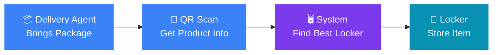

---

## 3. 📊 Use Case Diagram

Gaurav and Arun start by finding the actors and their use cases in the requirements:

### Actors Identified

| Actor | Responsibilities |
|-------|-----------------|
| **System** | Scans QR, finds products, chooses lockers, manages inventory |
| **Locker** | Stores items, has size/distance attributes |
| **Product** | Metadata about item category (e.g., "Milk", "Surf Excel") |

### Use Cases

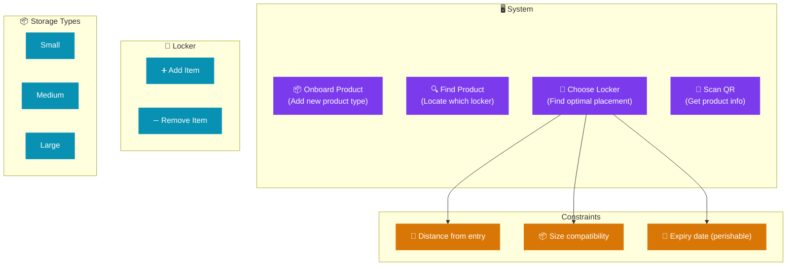

> 🗣️ Arun: *"We took all that English text and compressed it into this small diagram. The diagram is usable and makes sense."*

### Locker Selection Constraints

Choosing the right locker depends on several factors:

| Factor | Description | Example |
|--------|-------------|---------|
| **Size** | Small item → try small locker first, fall back to medium/large | Bread → small locker preferred |
| **Distance** | Closer lockers preferred for fast-moving items | High-demand items near entry |
| **Expiry** | Perishable goods with earlier expiry → front lockers | Milk expiring tomorrow → front |
| **Frequency** | Items sold often → closer lockers | Popular products near entry |

> 🗣️ Gaurav: *"If something is near its expiry date, you try to sell it faster. So place it ahead. Place items with a later expiry date behind."*

---

## 4. 🏗️ Class Diagram

### The Key Design Insight: Product vs. Item

A key discussion is the difference between **Product** (a category/blueprint) and **Item** (a physical instance):

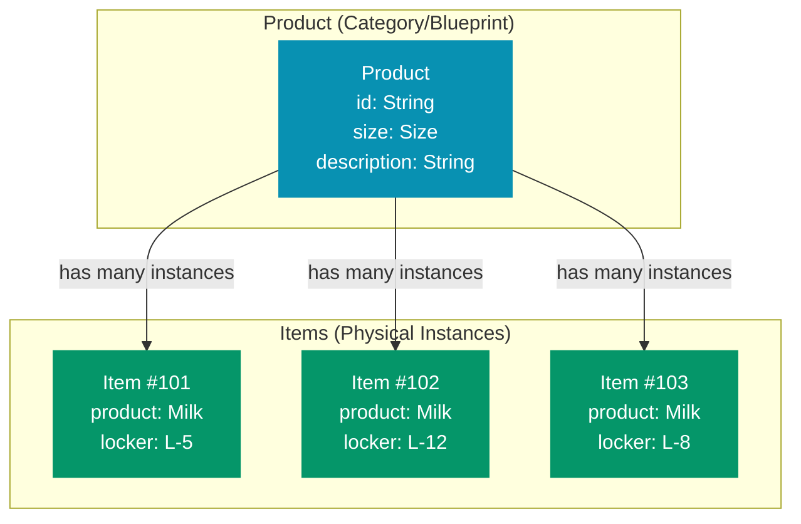

> 🗣️ Gaurav: *"Surf Excel is a product. But there could be 10 packets of Surf Excel in the inventory. Each packet is an Item — an instance of the Product."*

### Why NOT Inherit Item from Product?

Arun first thinks of making `Item extends Product`, but Gaurav disagrees:

> 🗣️ Gaurav: *"An item is NOT a product. An item is an instance of a product. A product is a category. It has a description, temperature requirements, etc. An item is just one physical unit placed in a locker."*

| | Product | Item |
|---|---------|------|
| **Is-a** | Category/Blueprint | Physical instance |
| **Example** | "Milk" | "Milk carton #101" |
| **Attributes** | id, size, description | id, product reference, locker |
| **Cardinality** | 1 Product → Many Items | 1 Item → 1 Product |
| **Relationship** | Does not hold its Items (System's `productInstances` does) | References Product |

### Complete Class Diagram

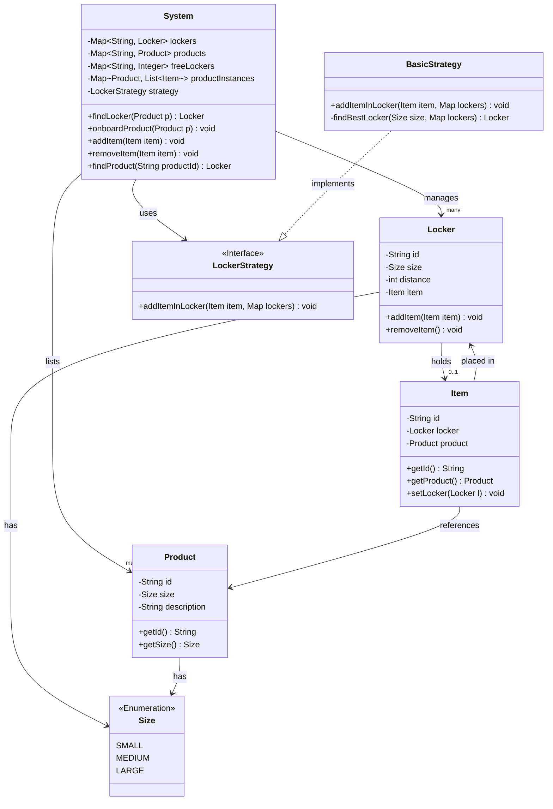

---

## 5. 💻 Code Implementation

### 📦 The `Size` Enum

```java
public enum Size {
    SMALL,
    MEDIUM,
    LARGE
}
```

### 📦 The `Product` Class

```java
public class Product {
    private String id;
    private Size size;
    private String description;

    public Product(String id, Size size, String description) {
        this.id = id;
        this.size = size;
        this.description = description;
    }

    public String getId() { return id; }
    public Size getSize() { return size; }
    public String getDescription() { return description; }
}
```

**Design note:** Product is a **blueprint/category**. It describes what kind of thing it is (size, description). It does not represent a physical unit in the warehouse.

### 📦 The `Item` Class

```java
public class Item {
    private String id;
    private Locker locker;    // Which locker is this item in?
    private Product product;  // Which product type does this item belong to?

    public Item(String id, Product product) {
        this.id = id;
        this.product = product;
    }

    public String getId() { return id; }
    public Product getProduct() { return product; }
    public Locker getLocker() { return locker; }
    public void setLocker(Locker locker) { this.locker = locker; }
}
```

**Design note:** Item holds a **reference** to its Product (composition, not inheritance). It also has a **bidirectional reference** (a link both ways) to its Locker. The Item points to its Locker. The Locker points back to the Item.

### 🔐 The `Locker` Class

```java
public class Locker {
    private String id;
    private Size size;
    private int distance;     // Distance from the entry point
    private Item item;        // null if locker is empty

    public Locker(String id, Size size, int distance) {
        this.id = id;
        this.size = size;
        this.distance = distance;
    }

    // Core operations
    public void addItem(Item item) {
        this.item = item;
    }

    public void removeItem() {
        this.item = null;
    }

    // Getters
    public String getId() { return id; }
    public Size getSize() { return size; }
    public int getDistance() { return distance; }
    public Item getItem() { return item; }
    public boolean isEmpty() { return item == null; }
}
```

**Design note:** A `Locker` holds **at most one Item**. When empty, `item == null`. The `addItem` and `removeItem` methods are simple setters with meaningful names. In an LLD interview, the interviewer expects nothing more.

> 🗣️ Arun: *"This is just a setter but with meaningful names. In LLD rounds, you just write the function and say its return type. They don't ask you to code the internals."*

### 🖥️ The `System` Class

```java
public class System {
    // All lockers in the warehouse (lockerId -> Locker)
    private Map<String, Locker> lockers;

    // All registered products (productId -> Product)
    private Map<String, Product> products;

    // Count of free lockers by type
    private Map<String, Integer> freeLockers;

    // Product -> list of its physical items in the warehouse
    private Map<Product, List<Item>> productInstances;

    // Strategy for choosing lockers (Strategy Pattern!)
    private LockerStrategy strategy;

    public System(LockerStrategy strategy) {
        this.lockers = new HashMap<>();
        this.products = new HashMap<>();
        this.freeLockers = new HashMap<>();
        this.productInstances = new HashMap<>();
        this.strategy = strategy;
    }

    // ========== ONBOARD A NEW PRODUCT TYPE ==========
    public void onboardProduct(Product product) {
        products.put(product.getId(), product);
    }

    // ========== ADD AN ITEM TO THE WAREHOUSE ==========
    public void addItem(Item item) {
        // Use the strategy to find the best locker and place the item
        strategy.addItemInLocker(item, lockers);
        if (item.getLocker() == null) {
            // No free locker fits: do not record the item as in stock
            throw new IllegalStateException("No free locker for item " + item.getId());
        }

        // Track this item as an instance of its product
        Product product = item.getProduct();
        productInstances
            .computeIfAbsent(product, k -> new ArrayList<>())
            .add(item);
    }

    // ========== REMOVE AN ITEM FROM THE WAREHOUSE ==========
    public void removeItem(Item item) {
        // Clear the locker
        Locker locker = item.getLocker();
        locker.removeItem();
        item.setLocker(null);

        // Remove from product instances
        Product product = item.getProduct();
        productInstances.get(product).remove(item);
    }

    // ========== FIND A PRODUCT (GET ITS LOCKER) ==========
    public Locker findProduct(String productId) {
        Product product = products.get(productId);
        List<Item> items = productInstances.get(product);
        if (items != null && !items.isEmpty()) {
            // Return the locker of the first available item
            return items.get(0).getLocker();
        }
        return null; // Product not in stock
    }
}
```

### Why Multiple Maps?

The system keeps **four different maps**. Each one makes a different query fast:

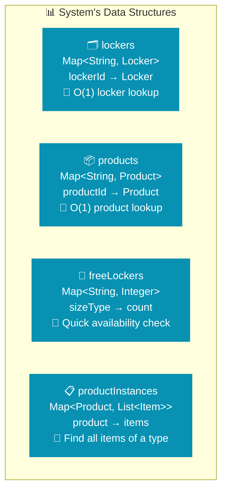

> 🗣️ Gaurav: *"Every product has a unique ID. So a map gives O(1) insertion, deletion, and search."*

---

## 6. 🎯 The Strategy Pattern — The Star of This Design

### Why Strategy Pattern?

The most interesting design decision is using the **Strategy Pattern** for locker selection. For each item the system places, the "optimal locker" depends on the **business context** (what the business needs at that time):

| Strategy | When to Use | Logic |
|----------|-------------|-------|
| **Distance-based** | Default / high-traffic | Choose closest empty locker that fits (same size or bigger) |
| **Expiry-based** | Perishable goods | Items expiring sooner → closer lockers |
| **Load-balancing** | High order volume | Spread items across lanes to avoid congestion |
| **Cost-optimized** | Low traffic periods | Use cheapest storage (small lockers) first |

> 🗣️ Arun: *"When there are fewer orders, a person can go to a far locker. But at peak time, get the product as fast as possible, from the closest locker."*

### The Interface

```java
public interface LockerStrategy {
    void addItemInLocker(Item item, Map<String, Locker> lockers);
}
```

### Basic Strategy (Distance-Based)

```java
public class BasicStrategy implements LockerStrategy {

    @Override
    public void addItemInLocker(Item item, Map<String, Locker> lockers) {
        Size itemSize = item.getProduct().getSize();

        // Find the best locker (closest, compatible size, empty)
        Locker bestLocker = findBestLocker(itemSize, lockers);

        if (bestLocker != null) {
            // Bidirectional linking
            item.setLocker(bestLocker);
            bestLocker.addItem(item);
        }
    }

    private Locker findBestLocker(Size size, Map<String, Locker> lockers) {
        Locker best = null;
        int minDistance = Integer.MAX_VALUE;

        for (Locker locker : lockers.values()) {
            if (locker.isEmpty()
                && isCompatibleSize(size, locker.getSize())
                && locker.getDistance() < minDistance) {
                best = locker;
                minDistance = locker.getDistance();
            }
        }
        return best;
    }

    private boolean isCompatibleSize(Size itemSize, Size lockerSize) {
        // Small items can go in any locker
        // Medium items can go in medium or large
        // Large items can only go in large
        return lockerSize.ordinal() >= itemSize.ordinal();
    }
}
```

### Potential Expiry-Based Strategy

```java
public class ExpiryBasedStrategy implements LockerStrategy {

    @Override
    public void addItemInLocker(Item item, Map<String, Locker> lockers) {
        Size itemSize = item.getProduct().getSize();

        // For perishable goods: items expiring sooner → closer lockers
        // For non-perishable: use distance-based logic
        Locker bestLocker = findBestLockerByExpiry(item, lockers);

        if (bestLocker != null) {
            item.setLocker(bestLocker);
            bestLocker.addItem(item);
        }
    }

    private Locker findBestLockerByExpiry(Item item, Map<String, Locker> lockers) {
        // Items with shorter expiry → lockers with smaller distance
        // This ensures FIFO-like behavior for perishable goods
        // Implementation details left to the specific business logic
        return null; // Placeholder
    }
}
```

### How the System Uses the Strategy

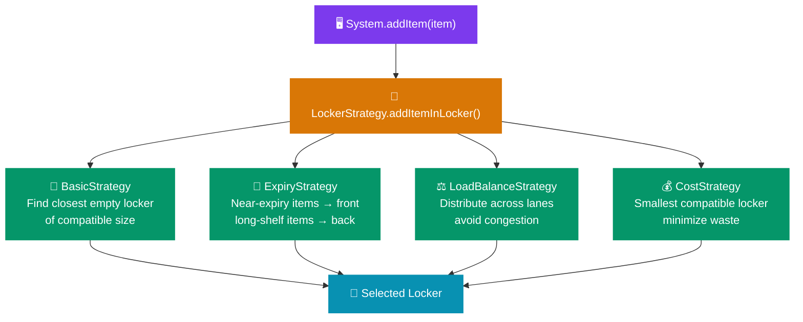

### Refining the Strategy — Extract Common Functionality

An important point is the **bidirectional linking**: set the locker on the item, and set the item on the locker. ALL strategies need this step. So it should NOT be inside each strategy implementation:

```java
// ❌️ BAD: Common logic inside each strategy
class BasicStrategy implements LockerStrategy {
    void addItemInLocker(Item item, Map<String, Locker> lockers) {
        Locker locker = findBestLocker(...);
        item.setLocker(locker);     // Common to all strategies!
        locker.addItem(item);       // Common to all strategies!
    }
}

// ✅ BETTER: Strategy only finds the locker, System does the linking
class System {
    void addItem(Item item) {
        Locker locker = strategy.findBestLocker(item, lockers);  // Strategy's job
        item.setLocker(locker);     // System's job (common)
        locker.addItem(item);       // System's job (common)
        productInstances
            .computeIfAbsent(item.getProduct(), k -> new ArrayList<>())
            .add(item);                                    // System's job
    }
}
```

> 🗣️ Gaurav: *"You have taken the common logic out of all the strategies. You put it in the function where it belongs. The strategy only finds the optimal locker."*

---

## 7. 🔄 Key Flows

### Adding an Item to the Warehouse

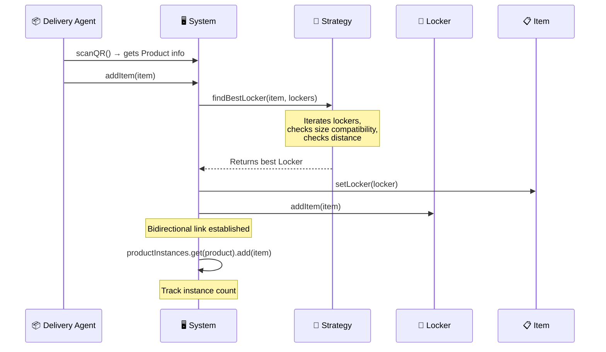

### Retrieving an Item from the Warehouse

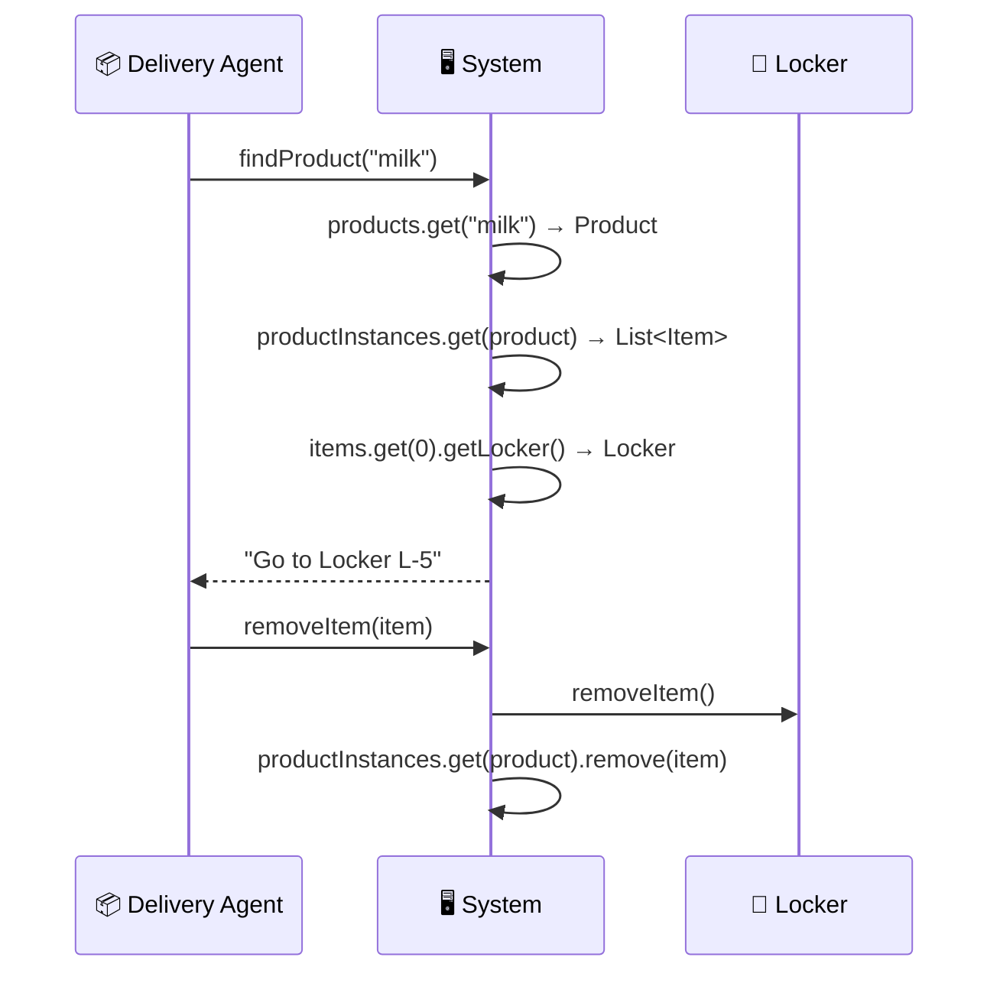

### Handling "Give Me 5 Milk Cartons"

> 🗣️ Gaurav: *"If we order two milk cartons, you go through productInstances. You pick the last two items (they are easy to pop). Their locker references tell you exactly where to go."*

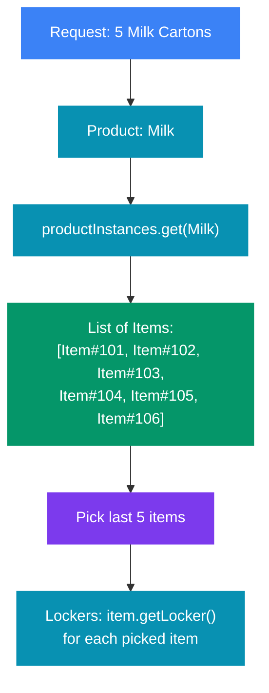

---

## 8. 🔍 Key Design Decisions & Discussions

### 1️⃣ Composition Over Inheritance (Product ↔ Item)

| Decision | Rationale |
|----------|-----------|
| `Item` has a **reference to** `Product` | An item IS NOT a product — it's an instance of one |
| Products should NOT contain items list | A product is a blueprint, not defined by its instances |
| System holds the `productInstances` map | The system manages the relationship between products and their items |

> 🗣️ Gaurav: *"A product is not defined by the items it has. A product is a blueprint — ID, size, description. Maybe you have a product list which says: for this product, here is a list of items."*

### 2️⃣ Why Distance Is Pre-Calculated

```java
// In Locker class:
private int distance;  // Pre-calculated from entry point

// NOT this:
private int x, y;  // Coordinates requiring calculation every time
```

> 🗣️ Gaurav: *"Instead of storing coordinates and calculating distance every time, just store the distance directly. You don't need to calculate it every time."*

### 3️⃣ Bidirectional References (Locker ↔ Item)

Both the `Locker` and `Item` hold references to each other:

| Direction | Purpose |
|-----------|---------|
| `Locker.item` | "What's in this locker?" — for checking if empty |
| `Item.locker` | "Where is this item?" — for quick retrieval |

This creates a **1:1 bidirectional relationship**:
- Each locker holds at most one item
- Each item is in exactly one locker

### 4️⃣ Free Lockers Count (`Map<String, Integer>`)

Keep a count of free lockers for each size. Then you do not need to loop over all lockers to check if one is free:

```java
freeLockers.put("SMALL", 50);   // 50 small lockers available
freeLockers.put("MEDIUM", 30);  // 30 medium lockers available
freeLockers.put("LARGE", 20);   // 20 large lockers available
```

Quick check: "Are there any small lockers left?" → O(1) instead of iterating.

### 5️⃣ Strategy Pattern for Both ADD and REMOVE

> 🗣️ Arun: *"The same strategy could apply for removal! Remove the closest item? Remove the one expiring soonest? Remove from the farthest locker to free up back storage? Different strategies for different business needs."*

---

## 9. 📊 Size Compatibility Matrix

A small package can go into any locker. A large package only fits in a large locker:

```
     Small Locker  │  Medium Locker  │  Large Locker
─────────────────────────────────────────────────────
Small Package   ✅         ✅               ✅
Medium Package  ❌️         ✅               ✅
Large Package   ❌️         ❌️               ✅
```

Implementation using ordinal comparison:

```java
private boolean isCompatibleSize(Size itemSize, Size lockerSize) {
    // SMALL=0, MEDIUM=1, LARGE=2
    // lockerSize must be >= itemSize
    return lockerSize.ordinal() >= itemSize.ordinal();
}
```

> 🗣️ Gaurav: *"A piece of bread is small, so you can put it in a small locker. If you are out of space, you can also keep it in a medium or large locker."*

---

## 10. 🎤 Q&A Highlights

### ❓ Why not map Product directly to Locker?
> 🗣️ Arun: *"Because there could be 10 packets of Surf Excel — same product, 10 different lockers. Each physical unit needs its own ID. That's why Item exists as a separate entity."*

### ❓ Do you really code all this in an LLD interview?
> 🗣️ Arun: *"In LLD rounds, you just make the function signature — argument types, return type. The interviewer doesn't ask you to code map.put(). They know you can do that. The debate is around the CLASS DIAGRAM."*

> 🗣️ Gaurav: *"Most of the time is spent around the class diagram. What are you taking as an argument? Why that return type? There is a lot of debate about it."*

### ❓ Is an Item inheriting from Product?
> 🗣️ Gaurav: *"No! An item is an instance of a product. Product is a category — 'Milk'. Item is 'Milk carton #101 in Locker L-5'. Use composition, not inheritance."*

### ❓ Where should the Items list live — in Product or System?
> 🗣️ Gaurav: *"A product is not defined by the items it has. Having items inside Product creates a circular reference problem. Keep productInstances as a map in the System class instead."*

### ❓ Are top companies language agnostic?
> 🗣️ Arun: *"From Atlassian and Uber — yes, language agnostic. What matters is problem solving. The syntax is different, but the logic stays the same. A for loop is a for loop."*

### ❓ Can we use CQRS pattern here?
> 🗣️ Gaurav: *"You need it only if you fill and query the data in different ways, that is, with different read vs write models. I don't see you needing CQRS here. But do think about it."*

### ❓ Should we add categories for perishable items?
> 🗣️ Gaurav: *"Yes! You can make the algorithm more detailed — cooling infra, sell-fast shelves. We're starting with basics first, but that's a great real-world extension."*

---

## 11. 🧩 Design Patterns Used

| Pattern | Where | Why |
|---------|-------|-----|
| **Strategy Pattern** | Locker selection algorithm | Different business contexts need different locker selection logic (distance, expiry, load) |
| **Composition** | Item → Product | An item is NOT a product, it references one |
| **Single Responsibility** | System, Locker, Item | Each class has one clear purpose |
| **Open/Closed Principle** | `LockerStrategy` interface | Add a new strategy class without changing `System` |

### Strategy Pattern in Detail

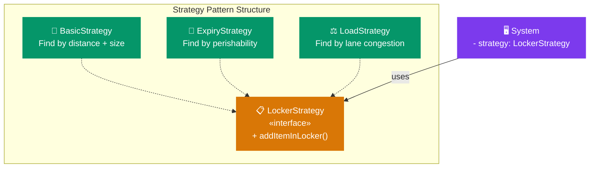

---

## 12. 🧠 Interview Tips from This Session

| # | Tip |
|---|-----|
| 1 | **Start with the Use Case Diagram.** Compress the English requirements into actors and use cases before touching code. |
| 2 | **Identify the entities early.** System, Locker, Product, Item — name them and define their relationships on paper first. |
| 3 | **Don't code internal logic in LLD interviews.** Focus on function signatures — arguments, return types, class relationships. The interviewer knows you can write `map.put()`. |
| 4 | **Think Product vs Item.** This difference between category and instance is a common mistake. Use composition, not inheritance. |
| 5 | **Use Strategy Pattern when there are multiple algorithms.** If "the best locker" depends on context (distance, expiry, load), Strategy Pattern is perfect. |
| 6 | **Pre-calculate expensive values.** Store distance directly instead of coordinates that require calculation. |
| 7 | **Avoid circular references.** Don't put Items list inside Product AND Product reference inside Item. Let the System manage the relationship. |
| 8 | **Use maps.** O(1) lookups for ID-based access. Use HashMaps for IDs and manage relationships through separate maps. |
| 9 | **Think about real-world extensions.** Mention perishable goods, lane congestion, delivery priority — even if you don't implement them. |
| 10 | **SRP matters.** The strategy for finding a locker is separate from the act of placing an item in one. Extract what's unique to the strategy vs what's common. |

---

## 13. 📊 Complete Architecture Overview

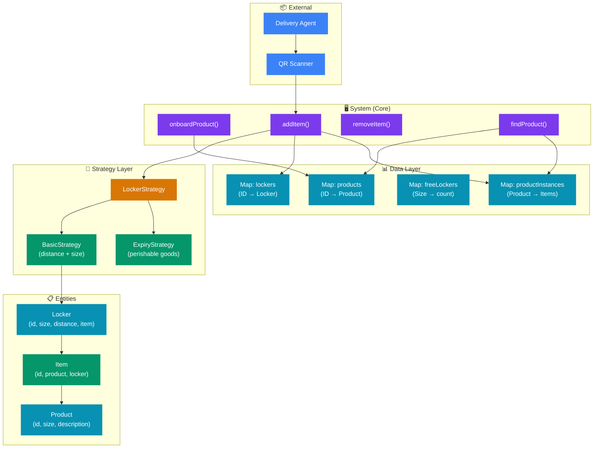

---

## 14. 🎯 Key Takeaways

| # | Takeaway |
|---|----------|
| 1️⃣ | **Use Case Diagram first, then Class Diagram, then Code.** This step-by-step approach turns messy English requirements into a clean design. |
| 2️⃣ | **Product ≠ Item.** Product is a category/blueprint. Item is a physical instance. Use composition, not inheritance. This difference is critical in inventory, e-commerce, and warehouse systems. |
| 3️⃣ | **Strategy Pattern is very useful in multi-constraint optimization.** "The best option" can depend on context (distance, expiry, load, cost). Then Strategy Pattern lets you plug in different algorithms cleanly. |
| 4️⃣ | **LLD interviews are about the class diagram, not the code.** Spend most of your time debating function signatures, return types, and class relationships — not writing HashMap operations. |
| 5️⃣ | **Multiple Maps = Multiple Query Patterns.** Having `lockers`, `products`, `freeLockers`, and `productInstances` as separate maps enables O(1) lookups for different access patterns. |
| 6️⃣ | **Bidirectional references are powerful but dangerous.** Locker ↔ Item is a 1:1 bidirectional relationship. Use it when both sides need to reference each other. But be careful about consistency. |
| 7️⃣ | **Extract common functionality from strategies.** The bidirectional linking (item ↔ locker) is common to ALL strategies. Only the "which locker?" logic belongs in the strategy. |

---

> 🥡 *"It looks like a CRUD thing, But it is much more complex, because this CRUD has an algorithm and it has some constraints."* — Gaurav Sen
>
> 🥡 *"In LLD rounds, you just write the function signature: the return type and the arguments you take. There is a lot of debate around the class diagram."* — Arun Goel
>
> 🥡 *"Add item in locker itself IS a strategy. It's not a function OF a strategy — it IS the strategy."* — Gaurav Sen
