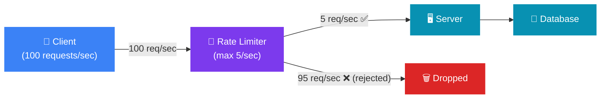
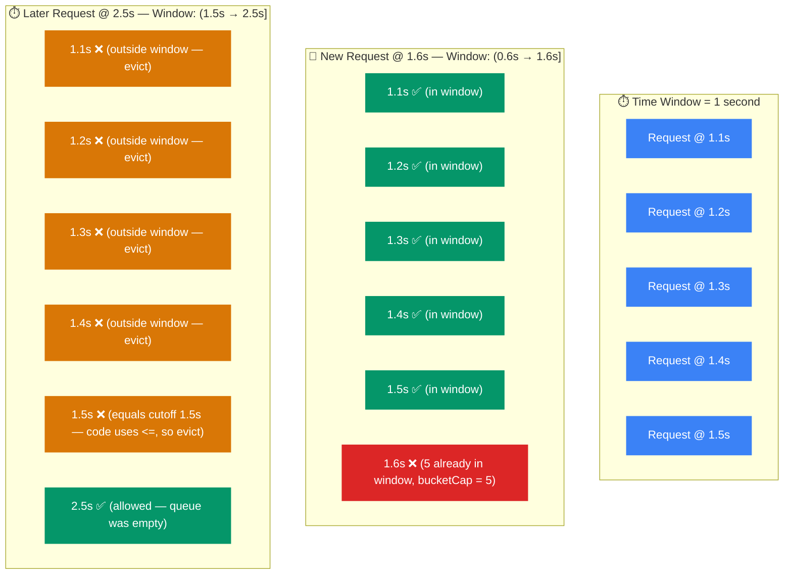
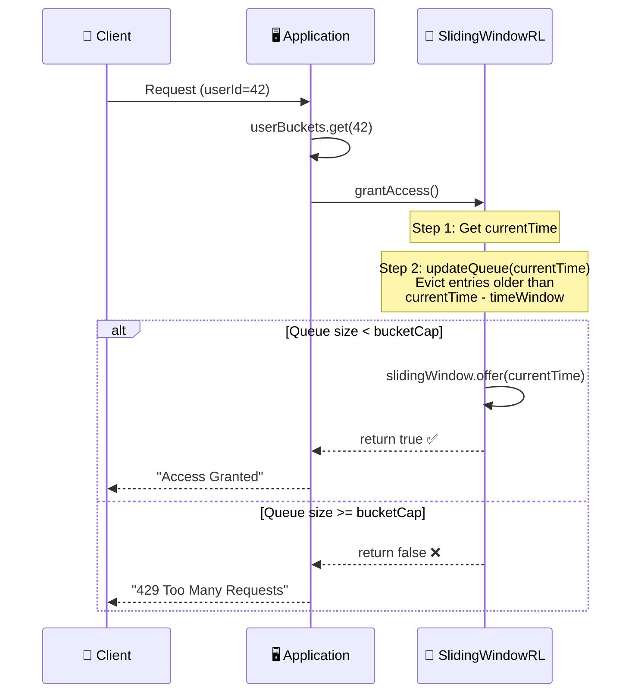
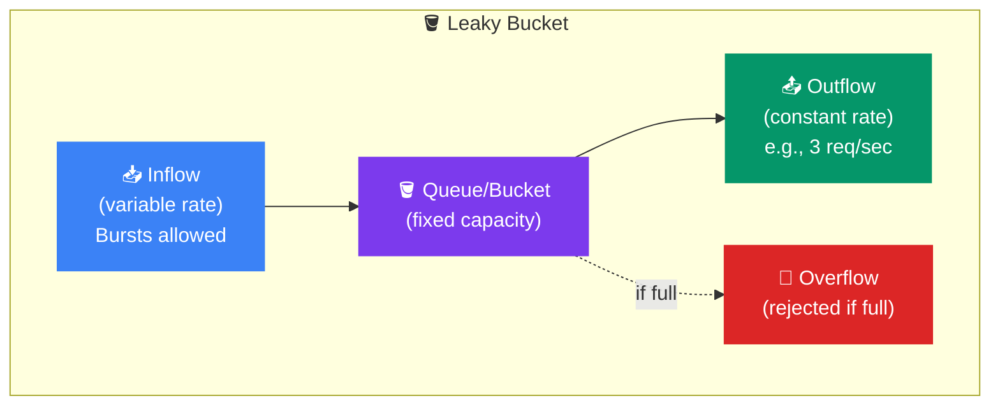
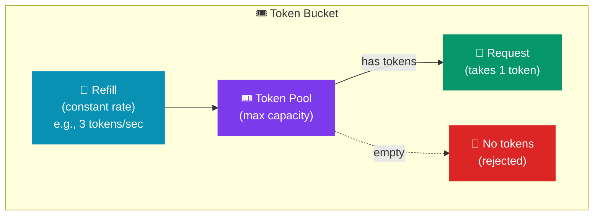
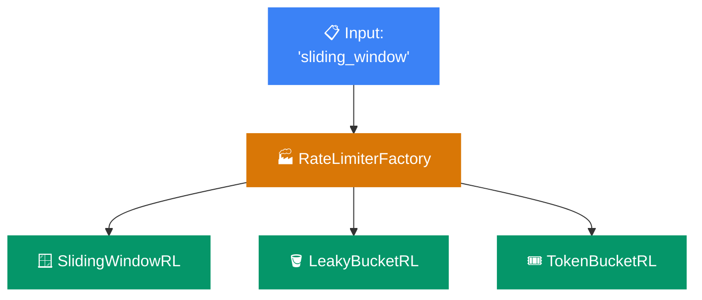
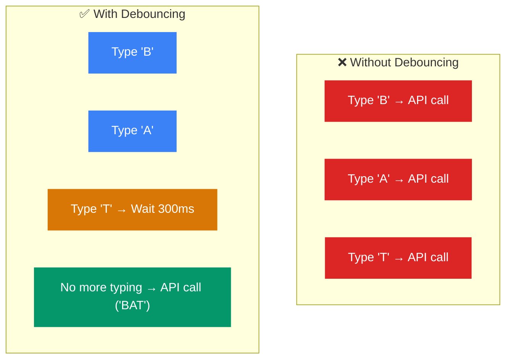
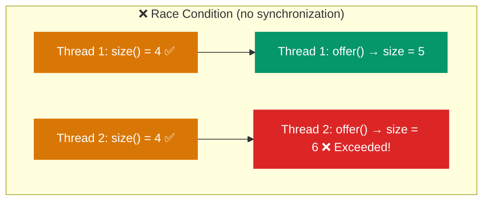
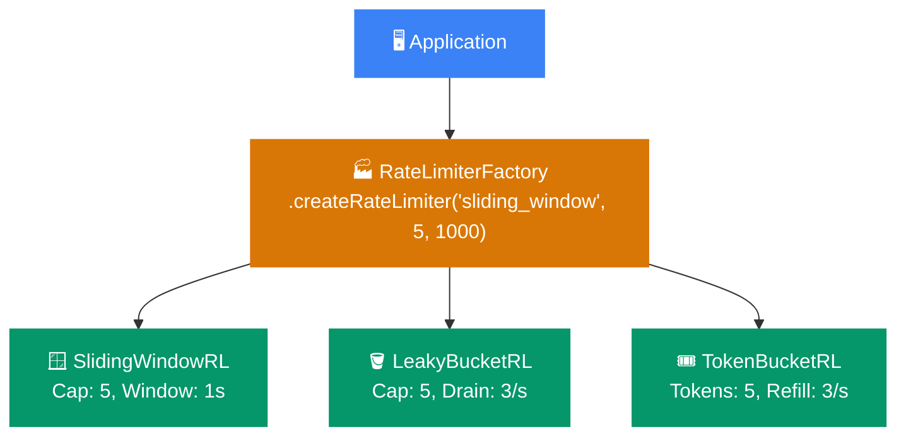
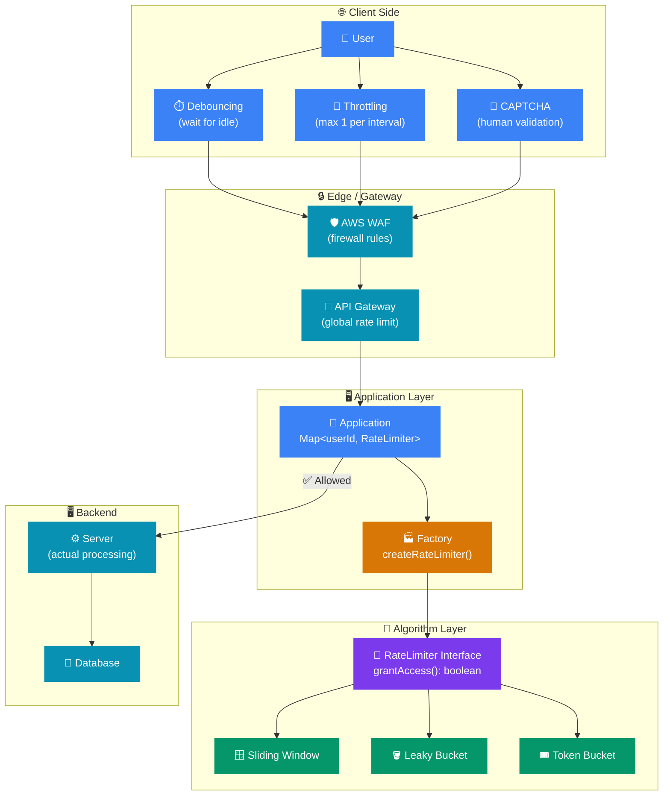

# 🚦 Low Level Design of a Rate Limiter — Sliding Window, Leaky Bucket & Factory Pattern

> 📺 **Video:** [LLD of Rate Limiter](https://www.youtube.com/watch?v=Eg5uH5sU3zw)  
> 📋 **Playlist:** [LLD Series by Gaurav Sen](https://www.youtube.com/playlist?list=PLMCXHnjXnTnvQVh7WsgZ8SurU1O2v_UM7)  
> 🎙️ **Speakers:** Gaurav Sen + Arun Goel (SDE-2 at Atlassian)  
> 🏢 **Origin:** Common interview question (asked at Atlassian and many other companies)  
> 🎯 **Difficulty:** 🟡 Intermediate (LLD + Factory Pattern)  
> 🎬 **Format:** Live coding session — Rate Limiter as an engineering tool

---

## 1. 🧭 What This Session Is About

Gaurav and Arun design a **Rate Limiter** from scratch — covering the core algorithm (Sliding Window), the **Factory Pattern** for pluggable algorithms, and a discussion of multiple rate limiting strategies (Leaky Bucket, Token Bucket). Unlike previous sessions (MakeMyTrip, Inventory Locker), this is a **simple engineering tool** — so they skip UML/class diagrams entirely and jump straight to code.

Key themes:
- **LLD vs HLD** — Rate limiters can be asked in both contexts
- **Factory Pattern** — Feed in the algorithm type, get the right rate limiter
- **Sliding Window Algorithm** — Queue-based implementation with time windows
- **Leaky Bucket vs Token Bucket** — Conceptual comparison
- **Debouncing vs Throttling** — Client-side rate limiting
- **Concurrency** — `ConcurrentLinkedQueue`, and why it is not enough on its own (§11)

> 💡 *"This is very similar to cache design. In cache, we had eviction policies and a factory to give us the right cache. Here, we feed in the algorithm and get the rate limiter."*

---

## 2. 📋 The Problem Statement

### What Is a Rate Limiter?

A rate limiter **controls the number of requests** a client can make within a given time window. If a client exceeds the limit, subsequent requests are **rejected** until the window resets.

### Why Do We Need Rate Limiting?

| Threat | Impact Without Rate Limiting |
|--------|-----|
| **DDoS attacks** | Server goes down, all users affected |
| **Malicious bots** | Flood your system, increase AWS/cloud costs |
| **Spam users** | Fill databases with junk entries |
| **Runaway scripts** | One buggy client can take down the entire service |

### What Does Rate Limiting Save?

> 🗣️ Gaurav: *"Isn't rate limiting itself expensive? You're reading one million requests anyway..."*  
> 🗣️ Arun: *"We save the internal network calls! The rate limiter sits at the edge — it prevents malicious requests from reaching the actual server, database, and consuming expensive resources."*



### Key Requirements

1. Allow **X requests** in **Y time window** per user
2. Support **multiple algorithms** (Sliding Window, Leaky Bucket, Token Bucket)
3. **Per-user** rate limiting (each user has their own limiter)
4. Optional: **TTL / request expiry** — drop requests if they can't be served within a timeout
5. Handle **concurrent requests** safely

---

## 3. 🤔 LLD vs HLD — When Is a Rate Limiter Asked?

> 🗣️ Arun: *"I've seen it asked for both — LLD and HLD. I've asked this question in Atlassian and two other companies."*

| Aspect | LLD Focus | HLD Focus |
|--------|-----------|-----------|
| **Scope** | Algorithm + data structures + code | Where to place it, distributed rate limiting |
| **Questions** | "How does sliding window work?" | "How do you rate limit across 100 servers?" |
| **Deliverable** | Working code with interfaces | Architecture diagram with edge servers |
| **Design Pattern** | Factory Pattern, Strategy Pattern | Load balancer placement, Redis-backed limiters |

**Interview tip:** If unsure, ask the interviewer:
> *"Do you want me to code this or design it at a high level?"*

---

## 4. 🎯 Why No Class Diagram This Time?

A critical insight from this session — **not every LLD problem needs UML diagrams:**

> 🗣️ Arun: *"In the previous sessions we followed the practice of: requirements → use case diagram → class diagram → code. But here, there are not many requirements — it's just insertion and deletion. It's an engineering tool giving an API for grant/deny access."*

### When to Skip Class Diagrams

| Skip Diagrams | Use Diagrams |
|---------------|--------------|
| Engineering tools (cache, rate limiter) | Complex systems (MakeMyTrip, inventory) |
| Few APIs (1-2 methods) | Many actors and relationships |
| Clear requirements | Ambiguous requirements needing exploration |
| Algorithm-focused | Relationship-focused |

> 🗣️ Gaurav: *"This is very similar to cache. In cache also we had eviction policies and different eviction policies. We used a factory to feed in the policy and get the cache. Here also we'll do the same — feed in the algorithm and get the rate limiter."*

---

## 5. 🏗️ Architecture Overview

```mermaid
graph TD
    subgraph "📋 Interface Layer"
        RL["RateLimiter<br/>«interface»<br/>+ grantAccess(): boolean"]
    end

    subgraph "📐 Algorithm Implementations"
        SW["SlidingWindowRateLimiter<br/>- Queue&lt;Long&gt; slidingWindow<br/>- int bucketCap<br/>- int timeWindowInMs"]
        LB["LeakyBucketRateLimiter<br/>- Queue&lt;Integer&gt; queue<br/>- int bucketCap<br/>- int outflowRate"]
        TB["TokenBucketRateLimiter<br/>- int tokens<br/>- int maxTokens<br/>- int refillRate"]
    end

    subgraph "🏭 Factory"
        F["RateLimiterFactory<br/>+ createRateLimiter(type, cap, windowMs): RateLimiter"]
    end

    subgraph "👤 Per-User Management"
        APP["Application<br/>- Map&lt;Integer, RateLimiter&gt; userBuckets"]
    end

    F --> RL
    SW ..|> RL
    LB ..|> RL
    TB ..|> RL
    APP --> F

    classDef primary fill:#7C3AED,stroke:#7C3AED,color:#fff
    classDef success fill:#059669,stroke:#059669,color:#fff
    classDef warning fill:#D97706,stroke:#D97706,color:#fff
    classDef info fill:#3B82F6,stroke:#3B82F6,color:#fff

    class RL primary
    class SW,LB,TB success
    class F warning
    class APP info
```

---

## 6. 💻 Code Implementation

### 📋 The `RateLimiter` Interface

```java
public interface RateLimiter {
    boolean grantAccess();
}
```

Simple. One method. Returns `true` if the request is allowed, `false` if rate limited.

> 🗣️ Arun: *"Why an interface? Because we want different types of rate limiters — sliding window, leaky bucket, token bucket — and we want to plug and play them."*

### 🪟 Sliding Window Rate Limiter

This is the **primary algorithm** implemented in the session.

#### How Sliding Window Works



> 🗣️ Arun: *"The sliding window is a queue. When a new request comes at 1.6s, I look back 1 second (to 0.6s). Any requests before 0.6s get evicted. Then I check: are there fewer than 5 requests in the window? If yes, allow. If no, reject."*

#### Implementation

```java
import java.util.Queue;
import java.util.concurrent.ConcurrentLinkedQueue;

public class SlidingWindowRateLimiter implements RateLimiter {

    // Queue stores timestamps of accepted requests
    private Queue<Long> slidingWindow;   // MUST be Long — see the note below

    // Maximum requests allowed in the time window
    private int bucketCap;

    // Time window in milliseconds (e.g., 1000ms = 1 second)
    private int timeWindowInMs;

    public SlidingWindowRateLimiter(int bucketCap, int timeWindowInMs) {
        this.bucketCap = bucketCap;
        this.timeWindowInMs = timeWindowInMs;
        this.slidingWindow = new ConcurrentLinkedQueue<>();
    }

    @Override
    public boolean grantAccess() {
        long currentTime = System.currentTimeMillis();

        // Step 1: Evict expired entries from the queue
        updateQueue(currentTime);

        // Step 2: Check if we have capacity
        if (slidingWindow.size() < bucketCap) {
            slidingWindow.offer(currentTime);
            return true;   // ✅ Access granted
        }

        return false;       // ❌️ Too many requests
    }

    // Remove all entries older than the time window
    private void updateQueue(long currentTime) {
        if (slidingWindow.isEmpty()) {
            return;
        }

        // Calculate the cutoff time
        long cutoffTime = currentTime - timeWindowInMs;

        // Evict all entries before the cutoff
        while (!slidingWindow.isEmpty()
               && slidingWindow.peek() <= cutoffTime) {
            slidingWindow.poll();
        }
    }
}
```

> ⚠️ **The bug this fixes — it made the limiter grant everything.** The original code declared
> `Queue<Integer>` and stored `(int) System.currentTimeMillis()`. Epoch millis in 2026 is ~1.79e12,
> far past `Integer.MAX_VALUE` (2,147,483,647), so the cast keeps only the low 32 bits. The result can be any value from −2.1e9 to 2.1e9,
> and is often negative. It is always far below the `long` cutoff `now - windowMs`. Every entry was therefore evicted on the next call and the
> window stayed permanently empty: **20 requests against a cap of 5 were all granted.** Timestamps
> in Java are `long`. Never narrow them.

### Key Implementation Details

| Detail | Decision | Rationale |
|--------|----------|-----------|
| **Queue type** | `ConcurrentLinkedQueue` | Each single call (`offer`, `poll`) is thread-safe. The `size()`-then-`offer()` pair is not — see §11 |
| **Storage** | Timestamps (`long` epoch millis) | Each entry = timestamp when request was accepted |
| **Eviction** | From the front (oldest first) | Queue is naturally ordered by time (FIFO) |
| **Empty check** | Before `peek()` | Avoid `NullPointerException` on empty queue |
| **Grant logic** | Check `size < cap` AFTER eviction | Ensures we only count valid (recent) requests |

#### Why ConcurrentLinkedQueue?

> 🗣️ Arun: *"Why ConcurrentLinkedQueue? Because of the sliding window and concurrent requests coming in. Multiple threads could be calling grantAccess() simultaneously."*

A regular `LinkedList` is not thread-safe. Two threads calling `offer()` or `poll()` at the same time can break its internal links.

`ConcurrentLinkedQueue` fixes that. It does **not** fix this race, which still happens with it:
- Two threads read `size()` at the same time
- Both see capacity available
- Both add — exceeding the limit

The fix for this race is in §11.

### Execution Flow



---

### 👤 Per-User Rate Limiting

Each user gets their **own** rate limiter instance, kept in a `ConcurrentHashMap`:

```java
import java.util.Map;
import java.util.concurrent.ConcurrentHashMap;

public class Application {

    // userId -> their personal rate limiter
    // ConcurrentHashMap: many request threads call computeIfAbsent at once
    private Map<Integer, RateLimiter> userBuckets;

    public Application() {
        this.userBuckets = new ConcurrentHashMap<>();
    }

    public void handleRequest(int userId) {
        // Get or create rate limiter for this user
        RateLimiter limiter = userBuckets.computeIfAbsent(
            userId,
            id -> new SlidingWindowRateLimiter(5, 1000) // 5 req/sec
        );

        if (limiter.grantAccess()) {
            System.out.println("✅ Access granted for user " + userId);
            // Process the actual request...
        } else {
            System.out.println("❌️ Too many requests for user " + userId);
            // Return 429 HTTP status
        }
    }
}
```

> 🗣️ Arun: *"For each user, we have a separate sliding window. The map holds userId → SlidingWindowRateLimiter. When a request comes, we get the user's bucket and check grantAccess()."*

---

## 7. 🪣 Other Rate Limiting Algorithms

### Leaky Bucket

> 🗣️ Arun: *"Imagine a water bucket with a hole. Inflow can be uneven — dump 100 liters at once. But outflow through the hole is constant — always 3 drops per second."*



| Aspect | Sliding Window | Leaky Bucket |
|--------|---------------|--------------|
| **What's removed** | All entries before cutoff time | Fixed number of entries per time interval |
| **Eviction trigger** | "Remove everything older than T" | "Remove N entries since last check" |
| **Burst handling** | Allows bursts within the window | Smooths out bursts to constant rate |
| **Analogy** | "How many in the last second?" | "Water dripping from a hole at constant rate" |

**Example walkthrough:**
```
Configuration: outflowRate = 3 requests/second

Time 1.1s: Request comes → queue: [1.1]
Time 1.2s: Request comes → queue: [1.1, 1.2]
Time 5.0s: Request comes → 
    Pop N = (5.0 - 1.2) * 3 ≈ 11 items
    But only 2 in queue → queue empties
    Add new → queue: [5.0]
Time 5.1s: Request comes → queue: [5.0, 5.1]
Time 5.2s: Request comes →
    Pop N = (5.2 - 5.0) * 3 ≈ 0 (< 1 second passed)
    Queue: [5.0, 5.1, 5.2] — still within capacity
```

### Token Bucket

> 🗣️ Gaurav: *"Token bucket is like — you might be dumping thousands of tokens but the rate of pulling out a token is the same. It allows small bursts of traffic."*



| | Leaky Bucket | Token Bucket |
|---|---|---|
| **Direction** | Empties at constant rate | Fills at constant rate |
| **Burst** | Smooths bursts entirely | Allows small bursts (up to token count) |
| **Use case** | Strict rate smoothing | Flexible — burst-tolerant |

### Comparison Table

| Algorithm | How It Works | Bursts? | Best For |
|-----------|-------------|---------|----------|
| **Sliding Window** | Count requests in last N seconds | ✅ Yes (within window) | Simple per-user limiting |
| **Leaky Bucket** | Drain at constant rate | ❌️ No (smoothed) | Constant throughput |
| **Token Bucket** | Tokens refill at constant rate | ✅ Small bursts | Flexible, burst-tolerant |

---

## 8. 🏭 The Factory Pattern

The **Factory Pattern** is the backbone of the design — it allows you to **plug and play** different rate limiting algorithms:

```java
public class RateLimiterFactory {

    public static RateLimiter createRateLimiter(
            String algorithmType, int capacity, int timeWindowMs) {

        switch (algorithmType.toLowerCase()) {
            case "sliding_window":
                return new SlidingWindowRateLimiter(capacity, timeWindowMs);
            case "leaky_bucket":
                // ⚠️ Not implemented in this file — see the note below the block.
                throw new UnsupportedOperationException("LEAKY_BUCKET not implemented");
            case "token_bucket":
                // ⚠️ Not implemented in this file — see the note below the block.
                throw new UnsupportedOperationException("TOKEN_BUCKET not implemented");
            default:
                throw new IllegalArgumentException(
                    "Unknown algorithm: " + algorithmType);
        }
    }
}
```

> ⚠️ **The factory used to `return new LeakyBucketRateLimiter(...)` and
> `new TokenBucketRateLimiter(...)` — neither class is defined anywhere in this file**, so the
> block did not compile (2 × `cannot find symbol`). §7 covers both algorithms in prose and
> diagrams only. Rather than pretend, the branches now throw.
> **In a machine-coding round, do exactly this.** An honest
> `throw new UnsupportedOperationException(...)` at a boundary you consciously chose not to build
> is a *positive* signal — it shows you know where the seam is and you are managing the clock.
> Code that references classes you never wrote is the thing that fails the round, because the
> interviewer runs it.

### Factory Pattern Analogy

> 🗣️ Arun: *"There's a Shape Factory. You feed in 'square' → it gives you a Square. You feed in 'triangle' → it gives you a Triangle. Here, you feed in 'sliding_window' → it gives you a SlidingWindowRateLimiter."*



### Similarity to Cache Design

> 🗣️ Arun: *"This is very similar to cache design. In cache, we had eviction policies — LRU, LFU, FIFO. We used a factory to feed in the eviction policy and get the right cache. Here, we feed in the algorithm type and get the rate limiter."*

| | Cache Design | Rate Limiter Design |
|---|---|---|
| **Interface** | `Cache` | `RateLimiter` |
| **Implementations** | LRU, LFU, FIFO | Sliding Window, Leaky, Token |
| **Factory** | `CacheFactory` | `RateLimiterFactory` |
| **Pattern** | Factory Pattern | Factory Pattern |
| **Core method** | `get()`, `put()` | `grantAccess()` |
| **Key concept** | Eviction policy | Rate limiting algorithm |

---

## 9. 🔄 Client-Side Rate Limiting: Debouncing & Throttling

An important tangent in the session — rate limiting isn't just server-side:

### Debouncing

> 🗣️ Arun: *"In Amazon search, when you type B-A-T, that's 3 requests. But you don't need 3 requests — you can wait until the user stops typing, then send ONE request."*



**Two approaches to debouncing:**

| Approach | Logic | Example |
|----------|-------|---------|
| **Character threshold** | Send after N characters | After every 3 characters typed → 1/3 requests. Strictly, this is batching, not true debouncing (debouncing is based on time) |
| **Time interval** | Send if gap between keystrokes > threshold | Gap > 300ms → user stopped typing → send |

### Throttling

**Throttling** limits the rate at which a function can fire. It ensures the function is called at most once per specified time interval, regardless of how many times it's triggered.

| | Debouncing | Throttling |
|---|---|---|
| **When it fires** | After activity stops | At regular intervals during activity |
| **Use case** | Search autocomplete | Scroll events, window resize |
| **Analogy** | Wait until calm, then act | Act periodically regardless |

### Other Client-Side Mechanisms

| Mechanism | Description |
|-----------|-------------|
| **CAPTCHA** | Validate user is human before processing |
| **AWS WAF** | Web Application Firewall — rate-based rules at the AWS edge (runs on the server side, not in the client) |
| **Request batching** | Combine multiple updates into one request |

> 🗣️ Gaurav: *"We use AWS WAF at Interview Ready. We had a health check pinging our EC2 instance, and the firewall flagged it as suspicious traffic. We had to allow health check endpoints through."*

---

## 10. ⏱️ Time Complexity

### Sliding Window Rate Limiter

| Operation | Time Complexity | Notes |
|-----------|----------------|-------|
| `grantAccess()` | **O(N)** worst case | Where N = number of expired entries to evict |
| `grantAccess()` | **O(bucketCap)** | Eviction is O(1) amortized, but `ConcurrentLinkedQueue.size()` walks the whole queue |
| `updateQueue()` | **O(K)** | K = number of entries to evict in this call |
| Space per user | **O(bucketCap)** | Queue stays at or below bucketCap only when `grantAccess()` is `synchronized` (§11). Without the lock, the race can add a few extra entries |

### Why O(1) Amortized?

Each request is:
1. **Inserted once** into the queue → O(1)
2. **Removed once** from the queue → O(1)

Even though a single `updateQueue()` call might remove multiple entries, each entry is only removed once in its lifetime. Amortized across all operations, **eviction** is O(1) per request.

But `ConcurrentLinkedQueue.size()` is not O(1). It counts the nodes one by one, so each `grantAccess()` costs O(bucketCap). To get O(1), keep the count in your own `int` field inside the `synchronized` method, or use an `ArrayDeque` (its `size()` is O(1)) under the lock.

---

## 11. 🔐 Concurrency Considerations

### The Race Condition Problem



### Solutions

| Solution | Approach | Trade-off |
|----------|----------|-----------|
| **ConcurrentLinkedQueue** | Thread-safe queue implementation | Individual ops are safe, but check-then-act isn't |
| **synchronized block** | Lock the entire `grantAccess()` method | Simple but reduces throughput |
| **AtomicInteger + CAS** | Lock-free counter for capacity checking | Complex but high performance |
| **Per-user locks** | Lock only the specific user's limiter | Good balance of safety and performance |

> 🗣️ Gaurav: *"We have not taken care of concurrency at a very high depth here. The ConcurrentLinkedQueue helps, but the check-then-add in grantAccess() still has a race condition."*

### Production-Grade Fix

```java
@Override
public synchronized boolean grantAccess() {
    long currentTime = System.currentTimeMillis();
    updateQueue(currentTime);

    if (slidingWindow.size() < bucketCap) {
        slidingWindow.offer(currentTime);
        return true;
    }
    return false;
}
```

This is already a per-user lock. Each user has their own limiter object, so `synchronized` locks only that user. Two different users never wait for each other.

You can also take the same lock from the caller. Keep only the check inside the lock. Do not hold it while the request runs:

```java
// In Application class (userBuckets must be a ConcurrentHashMap):
public void handleRequest(int userId) {
    RateLimiter limiter = userBuckets.computeIfAbsent(
        userId, id -> new SlidingWindowRateLimiter(5, 1000));

    boolean allowed;
    synchronized (limiter) {            // locks only this user's limiter
        allowed = limiter.grantAccess();
    }

    if (allowed) {
        processRequest(userId);
    } else {
        rejectRequest(userId);
    }
}
```

---

## 12. 🌐 Real-World Considerations

### Where Does Rate Limiting Sit?

| Placement | Description | Example |
|-----------|-------------|---------|
| **Client-side** | Debouncing, throttling | Search autocomplete, scroll handlers |
| **API Gateway** | Edge-level rate limiting | AWS API Gateway, Kong, Nginx |
| **Server-side** | Application-level limiting | Custom rate limiter in your service |
| **Middleware** | Between client and server | Load balancer with rate limiting |

### Distributed Rate Limiting

When you have **multiple servers**, a per-server rate limiter isn't enough — user requests could be distributed across servers:

| Approach | How | Pros | Cons |
|----------|-----|------|------|
| **Redis-backed** | Store counts in shared Redis | Consistent across servers | Redis becomes SPOF |
| **Sticky sessions** | Route user to same server | Simple per-server limiting works | Uneven load distribution |
| **Gossip protocol** | Servers share rate info | No central store | Eventually consistent |

### Identifying Users

> 🗣️ Gaurav: *"How do you identify the user? IP address, MAC address, or something else?"*

| Identifier | Pros | Cons |
|------------|------|------|
| **User ID** | Accurate per-user | Requires authentication |
| **IP Address** | Works without auth | Shared IPs (NAT), VPNs |
| **API Key** | Good for API products | Key sharing |
| **MAC Address** | Hardware-level | Not sent past the first router — the server sees only its own router's MAC, so it cannot identify a remote client. Also easy to spoof |

---

## 13. 🎤 Q&A Highlights

### ❓ Is rate limiting done on server side or client side?
> 🗣️ Gaurav: *"Both! Server-side you have the actual rate limiter. Client-side you have debouncing, throttling, and CAPTCHA."*

### ❓ Why ConcurrentLinkedQueue?
> 🗣️ Arun: *"Because of concurrent requests coming in. Multiple threads will be calling grantAccess() — we need a thread-safe queue."*

### ❓ Is this a sliding window or fixed window?
> 🗣️ Arun: *"In grantAccess(), we update the queue FIRST — popping out entries based on time. Our window slides with every call. A fixed window would reset at fixed intervals (e.g., every second at :00, :01, :02)."*

### ❓ Can AWS WAF handle rate limiting?
> 🗣️ Gaurav: *"Yes! AWS WAF has rate-based rules. We use it at Interview Ready. But be careful — health checks can get flagged as suspicious traffic."*

### ❓ How do you handle DDoS across every server?
> 🗣️ Gaurav: *"Rate limiters on each edge server. Google had a massive DDoS attack — the concept is the same. All edge servers need some form of rate limiting."*

### ❓ Should rate limiting have request expiry (TTL)?
> 🗣️ Gaurav: *"Yes, if possible. If a request hits 10 seconds without being processed, drop it. Don't waste resources on stale requests."*

### ❓ Do I need to know this with < 2 years experience?
> 🗣️ Gaurav: *"Don't limit yourself. Would a doctor say 'Do I need to know this with 2 years experience'? No. Learn if you can. Don't think in terms of syllabus."*

---

## 14. 🧩 Design Patterns Used

| Pattern | Where | Why |
|---------|-------|-----|
| **Factory Pattern** | `RateLimiterFactory` | Create different rate limiters based on algorithm type |
| **Interface Segregation** | `RateLimiter` interface | Clean contract — any algorithm, one API: `grantAccess()` |
| **Open/Closed Principle** | Adding new algorithms | Add `TokenBucketRateLimiter` without changing the other limiters. The factory's `switch` still needs one new `case` |

### Factory Pattern in Detail



> 🗣️ Arun: *"Change the internal state, change the internal behavior, but the external behavior has to be the same. The only thing that changes is — this might be more optimized for different scenarios."*

---

## 15. 📊 Complete Architecture



---

## 16. 🧠 Interview Tips from This Session

| # | Tip |
|---|-----|
| 1 | **Ask if it's LLD or HLD.** Rate limiter can be asked as both. If the interviewer doesn't specify, ask: *"Do you want me to code this or design at a high level?"* |
| 2 | **Ask about requirements.** Is it per-user? Per-IP? Distributed? In-memory or persistent? Different answers lead to different designs. |
| 3 | **Skip class diagrams for simple tools.** Rate limiter has 1-2 APIs — `grantAccess()`. No need for UML. Jump straight to code. |
| 4 | **Show multiple algorithms.** Implement one fully (sliding window), mention others (leaky bucket, token bucket). Shows breadth. |
| 5 | **Use the Factory Pattern.** Shows you can design extensible systems where algorithms are pluggable. |
| 6 | **Mention concurrency.** Even if you don't implement full thread safety, mention `ConcurrentLinkedQueue`, `synchronized`, and race conditions. |
| 7 | **Connect to cache design.** Rate limiter design is structurally identical to cache design. Mention the parallel — shows pattern recognition. |
| 8 | **Discuss real-world placement.** Mention client-side (debouncing), edge (AWS WAF), and server-side rate limiting. |
| 9 | **Know the trade-offs.** Sliding window allows bursts. Leaky bucket smooths them. Token bucket is flexible. Know when to use which. |
| 10 | **Don't over-engineer.** Start simple. One interface, one implementation. Then show extensibility with the factory. |

---

## 17. 🎯 Key Takeaways

| # | Takeaway |
|---|----------|
| 1️⃣ | **Rate limiter = Engineering tool, not a complex system.** Simple interface (`grantAccess()`), complex algorithms inside. No need for UML diagrams. |
| 2️⃣ | **Factory Pattern is the backbone.** Feed in the algorithm type, get the right rate limiter. Same pattern used in cache design. |
| 3️⃣ | **Sliding Window = Queue + Time Window.** Store timestamps in a queue, evict entries older than the window, check capacity. Eviction is O(1) amortized; `ConcurrentLinkedQueue.size()` makes each call O(bucketCap). |
| 4️⃣ | **Rate limiting happens at multiple layers.** Client (debouncing), edge (WAF), gateway (API limits), and server (per-user limiters). |
| 5️⃣ | **The external contract is always the same.** Whether sliding window, leaky bucket, or token bucket — the API is `grantAccess(): boolean`. Only the internal algorithm changes. |
| 6️⃣ | **Thread safety matters.** `ConcurrentLinkedQueue` helps, but check-then-add still has race conditions. Use synchronization for production code. |
| 7️⃣ | **Most important benefit of rate limiting = Availability.** Protecting your server from being overwhelmed keeps it available for legitimate users. |

---

> 🥡 *"This is very similar to cache design. In cache, we had eviction policies and a factory. Here, we feed in the algorithm and get the rate limiter."* — Arun Goel
>
> 🥡 *"Rate limiter is just an API for insertion and deletion — that's why we don't need a class diagram. Just go straight to code."* — Arun Goel
>
> 🥡 *"Change the internal state, change the internal behavior, but the external behavior has to be the same."* — Arun Goel
>
> 🥡 *"Don't limit yourself. Would a doctor say 'Do I need to know this with 2 years experience'? No. Learn if you can."* — Gaurav Sen
