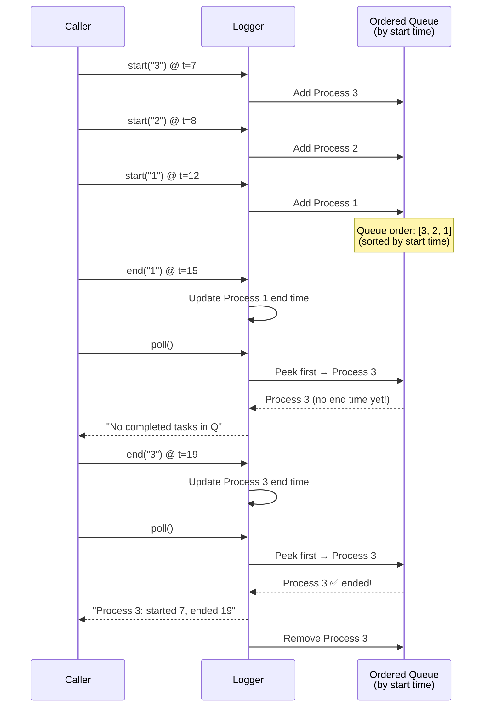
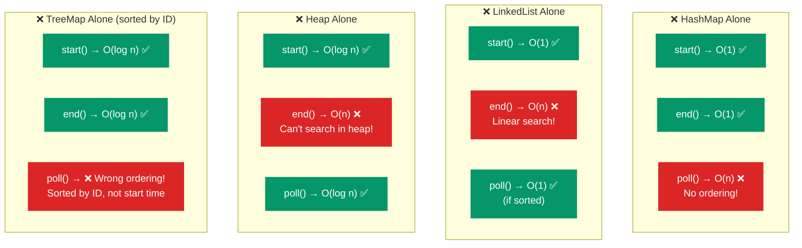
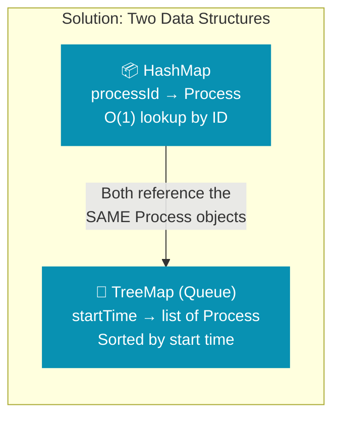
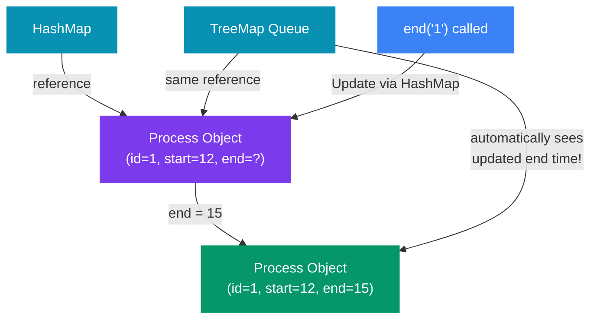
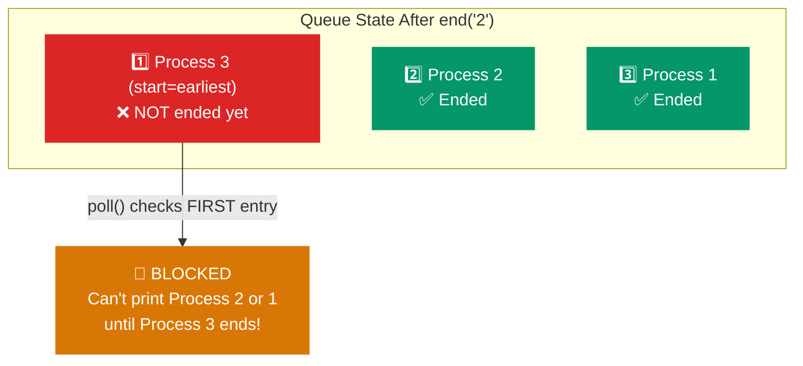
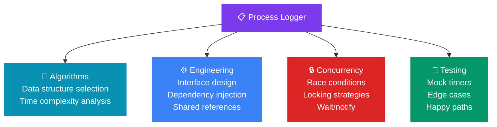
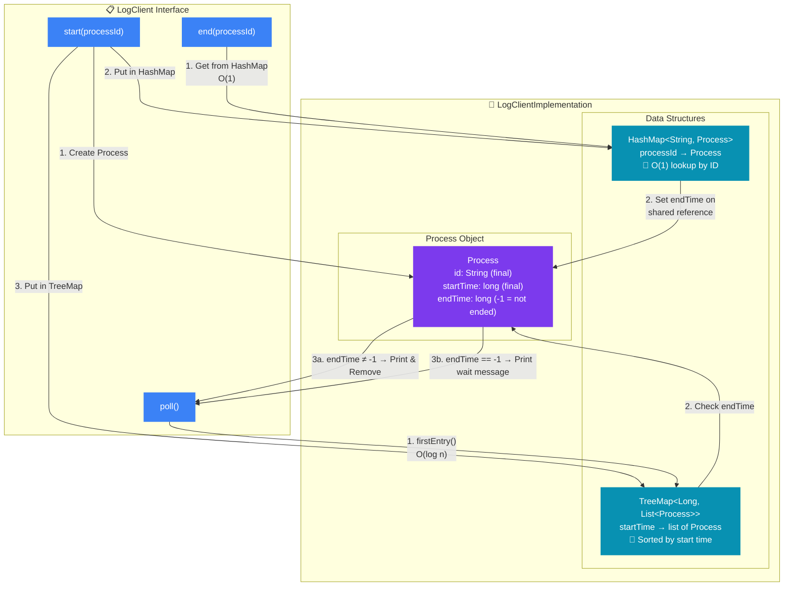

# 📋 Low Level Design of a Process Logger — Google Interview Question (Part 1)

> 📺 **Video:** [LLD of Process Logger](https://www.youtube.com/watch?v=FKA2KgkkcqY)  
> 📋 **Playlist:** [LLD Series by Gaurav Sen](https://www.youtube.com/playlist?list=PLMCXHnjXnTnvQVh7WsgZ8SurU1O2v_UM7)  
> 🎙️ **Speaker:** Gaurav Sen  
> 🏢 **Origin:** Google Interview Question  
> 🎯 **Difficulty:** 🟡 Intermediate (Algorithmic + LLD)  
> 🎬 **Format:** Live coding session — Part 1 of 2 (Part 2 covers concurrency & testing)

---

## 1. 🧭 What This Session Is About

Gaurav solves a **real Google LLD interview question** live. The task: design a **Process Logger**.

- It tracks processes through `start` and `end` events.
- It prints them **in order of start time**.
- But it prints a process only after that process has completed.

This isn't a typical "design classes and relationships" LLD problem. It's an **algorithmic LLD problem**. It mixes three things: choosing data structures, code design, and (later) concurrency.

> 💡 *"This is one of the specialties of Google interview questions — they have simple solutions but you can always make them more complex with a little tweaking around."*

---

## 2. 📋 The Problem Statement

Design a `LogClient` class with three methods:

```java
interface LogClient {
    void start(String processId);        // Event: a process has started
    void end(String processId);          // Event: a process has ended
    void poll();                         // Print the earliest completed process
}
```

### 🎯 Key Behavior of `poll()`

The `poll()` method must:
1. Find the process with the **smallest start time** (earliest started)
2. **Wait/block** until that process has ended
3. Print its details: `"Process {id} started at {start} ended at {end}"`
4. Remove it from the system
5. The next `poll()` then looks at the **next earliest** process

### 📊 Example Walkthrough

| Process ID | Start Time | End Time |
|:----------:|:----------:|:--------:|
| 1 | 12 | 15 |
| 2 | 8 | 12 |
| 3 | 7 | 19 |

**`poll()` calls return in order of START time (not end time!):**

```
1st poll() → Process 3 (started at 7, ended at 19)   ← earliest start
2nd poll() → Process 2 (started at 8, ended at 12)   ← second earliest
3rd poll() → Process 1 (started at 12, ended at 15)  ← third earliest
```

> 🗣️ Gaurav: *"If a process started 10 hours ago and another started 1 hour ago, and the 1 hour one already ended — you're still NOT going to print it because you're waiting for the first process to end."*



---

## 3. 🧠 The Data Structure Challenge

This problem has **three operations**. We want all of them to be fast:

| Operation | What It Does | Ideal Complexity |
|-----------|-------------|:----------------:|
| `start()` | Register a new process | O(log n) |
| `end()` | Mark a process as ended | O(1) |
| `poll()` | Get & remove earliest completed process | O(log n) |

### ❌️ Why Single Data Structures Fail

Gaurav walks through why **no single data structure** works:



> 🗣️ Gaurav: *"We have three operations and you want all of them to be less than O(log n). You can't use a heap, you can't use a simple HashMap, you can't use a simple list."*

### ✅ The Solution: HashMap + TreeMap (Two Data Structures!)

The key idea: **combine a HashMap (for O(1) lookups by ID) with a TreeMap (for ordering by start time)**.



| Operation | HashMap | TreeMap/Queue | Combined |
|-----------|:-------:|:------------:|:--------:|
| `start()` | O(1) put | O(log n) insert | **O(log n)** |
| `end()` | O(1) get + update | Not needed! | **O(1)** |
| `poll()` | O(1) remove | O(log n) poll first | **O(log n)** |

> 🗣️ Gaurav: *"Shang Agarwal has the right answer — use a heap plus map. In my case, I'm using a TreeMap plus map because logically that's the conclusion we come to."*

### 💡 The Brilliant "Shared Reference" Trick

Why doesn't `end()` need to update the queue?

> 🗣️ Gaurav: *"The update is happening on the object. The queue has a reference to that object. The map also has a reference to the same object. So it is updating it and the queue is automatically getting updated."*



Both the HashMap and TreeMap point to the **same Process object in memory**. `end()` updates the process through the HashMap. The TreeMap's reference then shows the change automatically. No extra updates needed!

---

## 4. 💻 Code Implementation

### 📦 The `Process` Class

```java
class Process {
    private final String id;
    private final long startTime;
    private long endTime = -1;  // -1 means "not ended yet"

    public Process(String id, long startTime) {
        this.id = id;
        this.startTime = startTime;
    }

    // Getters
    public String getId() { return id; }
    public long getStartTime() { return startTime; }
    public long getEndTime() { return endTime; }

    // Setter (only for end time)
    public void setEndTime(long endTime) {
        this.endTime = endTime;
    }
}
```

**Design decisions:**
- `id` and `startTime` are `final` — they never change after creation
- `endTime` starts at `-1` as a sentinel (a special marker value) for "not yet ended"
- We pass start time as a parameter (not `System.currentTimeMillis()`). This gives **testability via dependency injection**

> 🗣️ Gaurav: *"The reason I'm taking start time as a parameter is because later on when we'll be trying to test this function, it'll make life easier. We can do some dependency injection there."*

### 📋 The `LogClient` Interface

```java
interface LogClient {
    void start(String processId);
    void end(String processId);
    void poll();
}
```

### 🔧 The `LogClientImplementation` Class

```java
class LogClientImplementation implements LogClient {

    // 🗂️ Data Structure 1: HashMap for O(1) lookup by process ID
    private final Map<String, Process> processes = new HashMap<>();

    // 🔢 Data Structure 2: TreeMap as an ordered queue (sorted by start time).
    // The VALUE is a List — two processes can start in the same millisecond.
    private final TreeMap<Long, List<Process>> queue = new TreeMap<>();

    // ========== START ==========
    @Override
    public void start(String processId) {
        long now = System.currentTimeMillis();

        // Create the process
        Process process = new Process(processId, now);

        // Store in BOTH data structures (same object reference!)
        processes.put(processId, process);
        queue.computeIfAbsent(now, k -> new ArrayList<>()).add(process);
    }

    // ========== END ==========
    @Override
    public void end(String processId) {
        // O(1) lookup in HashMap
        Process process = processes.get(processId);

        // A process id that was never started, or was already polled, is not
        // an assertion failure — it is ordinary caller error. Fail loudly, not with an NPE.
        if (process == null) {
            throw new NoSuchElementException("no running process with id " + processId);
        }

        // Update end time — the queue's reference is automatically updated!
        process.setEndTime(System.currentTimeMillis());
    }

    // ========== POLL ==========
    @Override
    public void poll() {
        // Guard: empty queue
        if (queue.isEmpty()) {
            System.out.println("Q is empty");
            return;
        }

        // Get the earliest process (smallest start time). The bucket is a list,
        // so take the first process inside it — the list keeps the order of the
        // start() calls, which is the true start order within that millisecond.
        Map.Entry<Long, List<Process>> firstBucket = queue.firstEntry();
        Process process = firstBucket.getValue().get(0);

        // Has it ended?
        if (process.getEndTime() != -1) {
            // ✅ Print the log entry
            System.out.println(
                "Process " + process.getId() +
                " started at " + process.getStartTime() +
                " ended at " + process.getEndTime()
            );

            // Remove from BOTH data structures. Drop the whole bucket only once
            // its last process is gone — otherwise same-millisecond siblings vanish.
            List<Process> bucket = firstBucket.getValue();
            bucket.remove(0);
            if (bucket.isEmpty()) {
                queue.pollFirstEntry();
            }
            processes.remove(process.getId());
        } else {
            // ❌️ Earliest process hasn't ended yet. Part 1 does not block:
            // it prints a message and returns (Part 2 makes poll() really wait).
            System.out.println(
                "No completed tasks in Q. Waiting for: " + process.getId()
            );
        }
    }
}
```

> ⚠️ **Why the queue is `TreeMap<Long, List<Process>>` and not `TreeMap<Long, Process>`.**
> The simple version uses `System.currentTimeMillis()` alone as the queue key.
> Then two processes that start in the same millisecond **get the same key**.
> **The second `put` silently overwrites the first.**
> That process is gone from the queue forever. `poll()` never prints it.
> This really happens, on every OS. Three `start()` calls in a row take only microseconds.
> So they often get the same millisecond key. On Windows it is even more likely: `currentTimeMillis()` can move in steps of up to ~15 ms.
> Run the §5 scenario against the original code. It can lose processes. If two calls share a millisecond, it prints only **two**. If all three do, it prints only **one**. Then it prints `Q is empty`.
> The fix above groups processes into buckets by timestamp.
> The other option is a composite key made of two parts: `(startTime, AtomicLong seq)`. It is also correct.
> Use it if every process needs its own fixed place in the order (a strict total order).
> **The general lesson matters more than the fix: a wall-clock timestamp is not a unique key.**
> It is the same mistake, with the same cause, as the clock problem in
> [`02_distributed_systems/01_distributed_fundamentals.md`](../02_distributed_systems/01_distributed_fundamentals.md) §6.

---

## 5. 🎬 Complete Execution Flow

### Test Scenario

```java
public static void main(String[] args) {
    LogClient logger = new LogClientImplementation();

    logger.start("3");      // Start process 3 (earliest start)
    logger.start("2");      // Start process 2
    logger.start("1");      // Start process 1 (latest start)

    logger.end("1");        // Process 1 ends
    logger.poll();          // → "No completed tasks" (3 started first, hasn't ended)

    logger.end("2");        // Process 2 ends
    logger.poll();          // → "No completed tasks" (still waiting for 3)

    logger.end("3");        // Process 3 ends
    logger.poll();          // → ✅ "Process 3 started at ... ended at ..."
    logger.poll();          // → ✅ "Process 2 started at ... ended at ..."
    logger.poll();          // → ✅ "Process 1 started at ... ended at ..."
    logger.poll();          // → "Q is empty"
}
```

### Why Process 2 Blocked Despite Being Done



This is the core behavior: **sequential ordering**.

- Processes 1 and 2 are done, but we can't print them yet.
- Process 3 started first and is still running.
- Real-world log aggregation works the same way. You want logs printed in the order they started, not in the order they finished.

---

## 6. ⚙️ Time Complexity Summary

| Method | Operation Breakdown | Total |
|--------|:------------------:|:-----:|
| **`start()`** | HashMap put: O(1) + TreeMap insert: O(log n) | **O(log n)** |
| **`end()`** | HashMap get: O(1) + set end time: O(1) | **O(1)** |
| **`poll()`** | TreeMap firstEntry: O(log n) + TreeMap poll: O(log n) + HashMap remove: O(1) | **O(log n)** |

> 🗣️ Gaurav: *"Start time has O(log n) because you're putting something in the TreeMap. End method has O(1) because you're just updating the reference in the HashMap. Poll method has O(log n) because you're evicting from the TreeMap."*

### Why TreeMap and Not PriorityQueue (Heap)?

Both work! Gaurav says so himself:

> 🗣️ *"PriorityQueue in Java is implemented using a heap. You can also use that over here. I'm just using TreeMap because it's a little more convenient."*

| | TreeMap | PriorityQueue |
|---|---------|---------------|
| Insertion | O(log n) | O(log n) |
| Get min | O(log n) | O(1) |
| Remove min | O(log n) | O(log n) |
| Access any element | O(log n) | O(n) |

Gaurav picks TreeMap for convenience (key-value pairs, `firstEntry()` method). A heap + map would be equally valid.

---

## 7. 🔍 Key Design Decisions

### 1️⃣ `endTime = -1` as Sentinel

The code uses `-1` instead of `null` for the end time. The reason: `long` (primitive) can't be `null` in Java. If you used `Long` (boxed), you could use `null`.

| Approach | Pros | Cons |
|----------|------|------|
| `long endTime = -1` | Simple, primitive, no boxing overhead | Magic number |
| `Long endTime = null` | More expressive | Boxing/unboxing overhead |
| `boolean hasEnded + long endTime` | Explicit | Extra field |

### 2️⃣ Dependency Injection for Start Time

> 🗣️ Gaurav: *"During tests I don't need to depend on the system timer. I can actually define my own timer which will be a mock."*

Do not hardcode `System.currentTimeMillis()`. Passing the time as a parameter allows:
- **Mock timers** for testing
- **Deterministic test cases**
- **Simulated time progression**

The §4 code does this only halfway. `Process` takes the time as a parameter. But `LogClientImplementation` still calls `System.currentTimeMillis()` itself. To get the full benefit, inject a `java.time.Clock` (or a `LongSupplier`) into `LogClientImplementation` too.

### 3️⃣ Interface + Implementation Pattern

```java
interface LogClient { ... }
class LogClientImplementation implements LogClient { ... }
```

Why separate? This allows:
- **Multiple implementations** (e.g., concurrent version later)
- **Easy mocking** for testing
- **Clean API contract**

### 4️⃣ Shared Object References (Not Copies)

The HashMap and TreeMap store **references to the same Process objects**. `end()` updates a process through the HashMap. The TreeMap then sees the change automatically. So `end()` does not need to update both data structures.

---

## 8. ⚡ Concurrency Teaser (Part 2)

Gaurav says clearly that this solution has concurrency problems:

> 🗣️ *"If concurrency is allowed, that's a real problem. Someone might be updating start, someone might be updating end, and the poll method is also updating the same data structures."*

### The Race Condition

```
Thread A: start("X") → writes to HashMap + TreeMap
Thread B: end("Y") → reads from HashMap, writes to Process
Thread C: poll() → reads from TreeMap, removes from both

💥 All three touching shared mutable state simultaneously!
```

### Three Concurrency Approaches Mentioned

| Approach | Description | Trade-off |
|----------|-------------|-----------|
| 🔒 **Global Lock (Mutex)** | `synchronized` on the entire class | Safe but single-threaded performance |
| 🔑 **Fine-grained Locks** | Lock on individual processes | Better concurrency, more complex |
| ⏳ **Wait/Notify** | `poll()` blocks until process completes | Efficient CPU usage, complex coordination |

> 🗣️ Gaurav: *"If you take a lock on the whole class, it's as good as a single-threaded thing. But you can tell your interviewer: if you want all concurrency guarantees, go for a global lock."*

---

## 9. 🎤 Q&A Highlights

### ❓ Can we use a heap here?
> 🗣️ Gaurav: *"Yes! But a heap alone won't work — you can't search efficiently in a heap. You need heap + map. I'm using TreeMap + map because it's more convenient."*

### ❓ Do we need to update the queue when `end()` is called?
> 🗣️ Gaurav: *"No! The queue has a reference to the same object. The map also has a reference to the same object. So when you update via the map, the queue automatically sees the change."*

Java is **strictly pass-by-value**. Java copies the *reference*, not the object. That is why both data structures hold **the same heap object**: two copies of one reference. (Saying "Java is pass-by-reference" is a common interview mistake. The correct phrase is "pass-by-value of a reference".)

### ❓ Should we remove the process that ends first or starts first?
> 🗣️ Gaurav: *"Remove the process which STARTS first. You're ordering by start times and printing only when they complete. The printing is going sequentially, waiting for each process to complete while others are in queue."*

### ❓ Do you really get to code in an LLD interview?
> 🗣️ Gaurav: *"Yes! Initially you have a board where you draw and give a high-level understanding. But LLD interviews are one of the toughest — your code is expected to compile and one happy path is expected."*

### ❓ What's the difference in expectations for freshers vs seniors?

| Level | What's Expected |
|-------|----------------|
| **Fresher / SDE-1** | Solve the algorithmic problem, write working code |
| **SDE-2 / SDE-3** | Above + concurrency handling + test cases |
| **Senior+** | Above + discuss trade-offs, scalability, production concerns |

> 🗣️ Gaurav: *"This part is what a fresher needs to know. Part 2 is focused on SDE-2s and SDE-3s where you're expected to have good concurrency management."*

### ❓ Can we use a mutex in `poll()` to avoid wasting CPU?
> 🗣️ Gaurav: *"If you take a lock on the whole class, it's as good as single-threaded. But if there is serious concurrency, someone might be updating start, someone end, and poll is also updating the same structures — concurrency will screw this solution."*

---

## 10. 🧩 What Makes This a Google-Level LLD Question

This problem looks simple, but it tests several areas:



> 🗣️ Gaurav: *"A low-level design question for me is a mixture of algorithms, engineering, and HLD. That's the reason why I find this to be the hardest."*

### The Interview Progression

| Phase | Time | What You Do |
|-------|:----:|-------------|
| 1️⃣ **Understand** | 5 min | Clarify the problem, edge cases |
| 2️⃣ **Data Structures** | 10 min | Discuss and eliminate options on paper |
| 3️⃣ **Code** | 20 min | Implement the solution (Part 1 — ~60% of the interview) |
| 4️⃣ **Concurrency** | 15 min | Discuss and handle thread safety (Part 2) |
| 5️⃣ **Testing** | 10 min | Write test cases, discuss edge cases |

> 🗣️ Gaurav: *"Maybe 60% has been taken care of by just solving the algorithmic problem. But now what about concurrency and test cases?"*

---

## 11. 🧠 Interview Tips from This Session

| # | Tip |
|---|-----|
| 1 | **Don't settle for a single data structure.** When one doesn't meet all requirements, combine two. HashMap + TreeMap is a classic combo. |
| 2 | **Think about time complexity for ALL operations.** The interviewer is testing whether you can optimize all three, not just one. |
| 3 | **Use shared references.** Java (and most OOP languages) store references to objects. Knowing this lets you avoid extra updates. |
| 4 | **Design for testability from the start.** Pass `startTime` as a parameter instead of calling `System.currentTimeMillis()` directly. |
| 5 | **Use sentinel values carefully.** `-1` for "not set" works but document it. Consider boxed types (`Long` → `null`) as alternatives. |
| 6 | **Separate interface from implementation.** `LogClient` interface + `LogClientImplementation` class enables mocking and multiple implementations. |
| 7 | **Mention concurrency even if you don't implement it.** Say "this solution has race conditions in a multi-threaded environment". The interviewer will be impressed. |
| 8 | **Code formatting matters.** They may say it doesn't. But interviewers are human, and clean code creates a better impression. |
| 9 | **Log n is good enough.** Don't chase O(1) for everything — O(log n) for all three operations is an excellent answer. |
| 10 | **Know when to stop.** In Part 1, Gaurav solves ~60% of the problem. In a real interview, know what's "good enough". Tell the interviewer what you'd do next. |

---

## 12. 📊 Complete Architecture Overview



---

## 13. 🎯 Key Takeaways

| # | Takeaway |
|---|----------|
| 1️⃣ | **Combine data structures** when a single one can't support all operations efficiently. HashMap + TreeMap is a strong combo for "lookup by ID" + "ordered iteration." |
| 2️⃣ | **Google LLD ≠ Class Diagrams.** Some LLD problems are heavily algorithmic. The "design" is choosing the right data structures and combining them, not drawing UML. |
| 3️⃣ | **Use shared references.** In Java/OOP, multiple data structures can hold references to the same objects. Update through one, read through another. |
| 4️⃣ | **Design for testability.** Dependency injection (passing time as a parameter) makes code testable without depending on system clocks. |
| 5️⃣ | **LLD interviews test 3 things:** Algorithms (data structures), Engineering (clean code, interfaces), and Concurrency (thread safety). Freshers need #1, seniors need all three. |
| 6️⃣ | **O(log n, 1, log n) for start/end/poll** is the target. No single data structure achieves this. That's the entire point of the question. |
| 7️⃣ | **The poll() blocking behavior** is the key idea. It forces printing in start-time order, even if later processes finish first. This mimics real-world log aggregation. |

---

## 14. 📌 What's Coming in Part 2

| Topic | Details |
|-------|---------|
| 🔒 **Concurrency** | Handling multiple threads calling start/end/poll simultaneously |
| 🧪 **Testing** | Writing test cases, mock timers, edge cases |
| ⏳ **Blocking poll()** | Making poll() actually wait (sleep/notify) instead of returning "no tasks" |
| 🏗️ **Refactoring** | Clean separation of concerns, SOLID principles |

> 🗣️ Gaurav: *"In part two, I will be talking about concurrency — the most important thing in this LLD question. Maybe 60% has been taken care of by solving the algorithmic problem. But now: what about concurrency and test cases?"*

---

> 🥡 *"LLD interviews are one of the toughest interviews out there — they bring objectivity to a subjective design question. Your code is expected to compile and one happy path is expected of you."* — Gaurav Sen
>
> 🥡 *"A low-level design question is a mixture of algorithms, engineering, and HLD. That's the reason why I find this to be the hardest."* — Gaurav Sen
