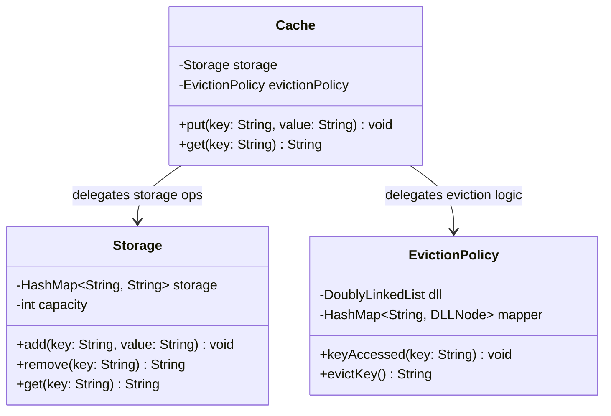
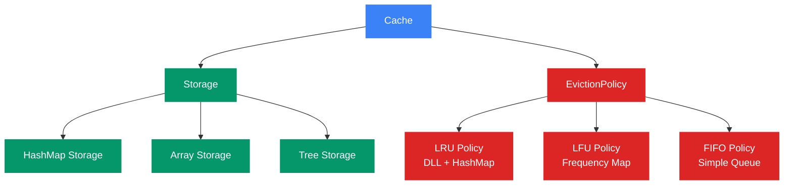
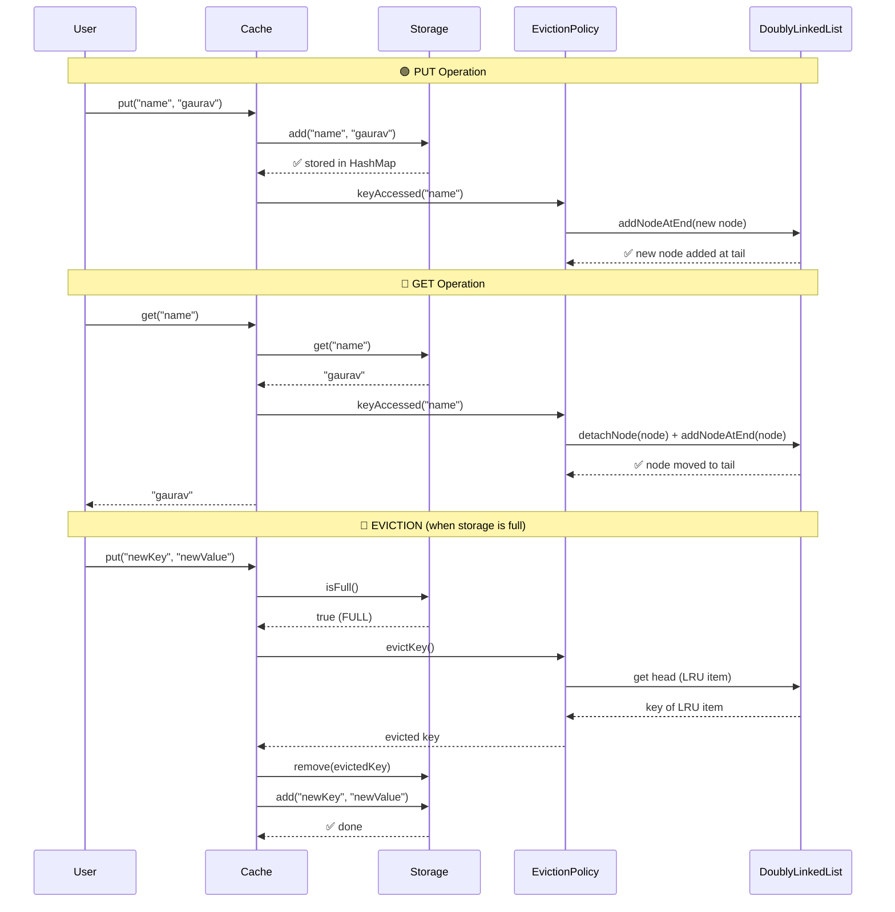

# 🏗️ Low Level Design of a Cache — From Scratch

> ✅ **Code corrected 2026-09-01.** The code in §7, as first transcribed, had six defects.
> It threw an NPE on the first `put`. The note at the end of §7 explains each defect.
> The version here compiles and runs.

> 📺 **Video:** [Low Level Design of Cache](https://www.youtube.com/watch?v=tzbX4ix2RjI)  
> 📋 **Playlist:** [LLD Series by Gaurav Sen](https://www.youtube.com/playlist?list=PLMCXHnjXnTnvQVh7WsgZ8SurU1O2v_UM7)  
> 🎙️ **Speakers:** Gaurav Sen & Arun  
> 🎯 **Difficulty:** 🟡 Intermediate

---

## 1. 🧭 What This Session Is About

This is a **live coding session**. Gaurav and Arun design a **local in-memory cache** from scratch. The goal is not just to build a cache. The goal is to build one with **clean architecture**, using **SOLID principles**. This way, you can plug in different eviction policies (LRU, LFU, FIFO, etc.) **without modifying existing code**.

They stress that this is a classic **Low Level Design (LLD) interview problem**. Companies like Uber, Amazon, and Atlassian commonly ask it. The roles range from SDE-1 to Senior Software Engineers and Architects.

> 💡 *"Think of it as a real interview. You are probably going to build something which kind of works. The important thing is your thought process, your problem solving, and your discussions."* — Gaurav

---

## 2. 🤔 Why Build Your Own Cache?

Before the design, Gaurav gives a practical reason to build your own cache instead of using an existing library:

- Many times you **don't even want to read the documentation** of something as simple as Memcached.
- You start with a simple **in-memory HashMap**. Over time it needs more features: eviction, capacity limits, ordering. Then it **evolves into a cache**.
- Your own **cache design** sits between a plain HashMap and a full cache server like Redis.  
- Learn **how caches work internally** (for example, inside Memcached or Redis). Then you **avoid designing the same thing again** and again.

> 🎯 *"Cache, if you look at it, is also a problem. People insert something, check out some values, remove something that is old. If you take it as a problem, you can see a problem of this sort on coding platforms too."*

---

## 3. 📋 Core Requirements

The cache needs to support three basic operations:

| Operation | Description |
|-----------|-------------|
| 🟢 **Put (Set)** | Store a key-value pair in the cache |
| 🔵 **Get** | Get the value for a given key |
| 🔴 **Evict (Remove)** | When the cache is full, remove an existing item automatically. This makes room for a new one. |

### 🔑 API Design

They decide to expose only **two public APIs** to the user:

```
put(key, value)  →  void
get(key)         →  value
```

> ❓ *"As a user of this cache, do I get an API to delete keys, or do I only get an API to get or set keys?"*
> 
> 🗣️ *"The user will only get the API to get and set. If you want to delete, set the key as `none`. That's as good as deletion."* — Gaurav
>
> ⚠️ Not quite, with the code in §7. `put(key, null)` keeps the key in Storage. It still uses one capacity slot, and `get` returns `null` as if it were a miss. The slot is freed only when the key is evicted.

To keep it simple, both **key** and **value** are `String`. Gaurav notes they could be generalized to any type: objects, integers, image links, etc. The idea:

- For the value, take any object and convert it to JSON.
- For the key, take any value and hash it to a string.

This gives you a **generic cache**.

### ⚡ Time Complexity Goals

For all operations, the target is **O(1)**:

| Operation | Target Complexity |
|-----------|:-----------------:|
| Search (Get) | O(1) |
| Set (Put) | O(1) |
| Eviction | O(1) |

---

## 4. 🎯 Eviction Policies — What Gets Removed?

When the cache reaches its capacity, it must decide **which item to remove**. This decision is called the **eviction policy**. The speakers discuss several strategies:

### 📊 Audience Poll Results
| Policy | Votes |
|--------|:-----:|
| LRU (Least Recently Used) | 53% |
| LFU (Least Frequently Used) | 40% |
| FIFO (First In First Out) | ~7% |
| LIFO (Last In First Out) | 0% |

### 🔹 LRU — Least Recently Used
The **most popular** strategy. The cache evicts the item that was **used longest ago**. "Used" means either a *get* or a *put* operation touched that key.

### 🔹 LFU — Least Frequently Used
Evicts the item that has been **accessed the fewest times** overall. Useful when frequency matters more than recency.

### 🔹 FIFO — First In First Out
Evicts the **oldest inserted item**. It ignores how recently or how often the item was accessed.

### 🔹 LIFO — Last In First Out
Evicts the **most recently inserted item**. Caches rarely use it.

> 💬 *"It depends on the use case how the person wants. We'll write code for LRU and then we can generalize it."* — Gaurav

---

## 5. 🏛️ Architecture — The Big Picture

Here the design becomes very clean. Gaurav separates the cache into **two core responsibilities**:

1. **Storage** 📦 — Where the data actually lives (e.g., HashMap, Array, Tree)
2. **Eviction Policy** 🧠 — The algorithm that tracks usage and decides what to evict (e.g., LRU logic, LFU logic)

The `Cache` class **owns both** of them. It delegates work to each one:



> 🧠 *"A cache will have a different type of storage and the cache will have an eviction policy. That's it."* — Gaurav

---

## 6. 🧱 Design Principles Applied

Gaurav names **three important design principles** used in this design:

### 1️⃣ Single Responsibility Principle (SRP)

Each class has **one job** and one reason to change:

| Class | Responsibility |
|-------|---------------|
| `Cache` | Handles get/put by delegating to Storage and EvictionPolicy |
| `Storage` | Only manages storing, retrieving, and removing data |
| `EvictionPolicy` | Only manages the eviction algorithm (tracking access order) |
| `DoublyLinkedList` | Only manages linked list operations (detach, attach, move) |
| `DLLNode` | Only holds node data (prev, next pointers, element) |

> 🗣️ *"Everything regarding storage is in the storage class. Everything regarding eviction is in the eviction policy class. DLL should have everything related to doubly linked list. Node should have everything related to node."* — Gaurav

### 2️⃣ Open/Closed Principle (OCP)

The design is:
- ✅ **Open for extension** — You can add new eviction policies (LFU, FIFO) or new storage backends (Array, Tree). You do not touch existing classes
- 🚫 **Closed for modification** — The core Cache class doesn't need to change when new strategies are added

Gaurav explains this principle with a comparison:

> 🗣️ *"Think of your software as a platform where layers can be added, not as a block which has to be changed. You take some core behaviors, put them in one class. Tomorrow if another behavior has to be added, it becomes a layer. You add newer layers around the software."*

> 🗣️ *"It's like Linux — you can pipe commands. That's extending the feature. But you're not changing `cat` or `echo` themselves."*

In the code, the `Cache` class's data members are `final`. You can **use** it and build **wrappers** over it. But you **cannot modify** the internal references.

### 3️⃣ Immutability

Where possible, the fields are `final` and private. The classes are not fully immutable, because a cache must change its data. But the references cannot be replaced:
- Storage and EvictionPolicy references inside Cache are `final`
- Private access modifiers stop changes from outside the class
- Only internal methods (within the class) make changes

> 🗣️ *"There's nothing exposed, there are no public variables. The ones making changes will be people in the class."*

---

## 7. 💻 Code Implementation — Step by Step

### Step 1: The Cache Class 🏠

The `Cache` class is the **entry point**. It holds references to both `Storage` and `EvictionPolicy`. It exposes `put()` and `get()` methods.

```java
public class Cache {
    private final Storage storage;
    private final EvictionPolicy evictionPolicy;

    public Cache(EvictionPolicy evictionPolicy, Storage storage) {
        this.evictionPolicy = evictionPolicy;
        this.storage = storage;
    }

    // Store a key-value pair
    public void put(String key, String value) {
        // Capacity is enforced HERE, before the write — the Cache is the only
        // component that can see both the storage and the eviction policy.
        if (!storage.containsKey(key) && storage.isFull()) {
            String evicted = evictionPolicy.evictKey();
            if (evicted != null) {
                storage.remove(evicted);
            }
        }
        storage.add(key, value);
        evictionPolicy.keyAccessed(key);   // now safe: the key exists
    }

    // Retrieve a value by key
    public String get(String key) {
        String value = storage.get(key);
        if (value == null) {
            return null;                   // a MISS must not touch recency
        }
        evictionPolicy.keyAccessed(key);
        return value;
    }
}
```

> 🔍 Notice how simple this is? The Cache class does **no complex logic** itself. It just **delegates** to its components. This is the benefit of SRP.

---

### Step 2: The Storage Class 📦

Storage is backed by a **HashMap** for O(1) access. It manages the actual data and enforces capacity limits.

```java
import java.util.HashMap;

public class Storage {
    private final HashMap<String, String> storage;
    private final int capacity;

    public Storage(int capacity) {
        this.capacity = capacity;
        this.storage = new HashMap<>();
    }

    public boolean isFull() {
        return storage.size() >= capacity;
    }

    public boolean containsKey(String key) {
        return storage.containsKey(key);
    }

    // Add a key-value pair. Capacity is the Cache's job (it owns the eviction
    // policy); Storage refuses loudly rather than dropping the write silently.
    public void add(String key, String value) {
        if (!storage.containsKey(key) && isFull()) {
            throw new IllegalStateException(
                "storage full — Cache must evict before adding '" + key + "'");
        }
        storage.put(key, value);
    }

    // Remove a key-value pair
    public String remove(String key) {
        if (!storage.containsKey(key)) {
            return null;
        }
        return storage.remove(key);
    }

    // Get a value by key
    public String get(String key) {
        if (!storage.containsKey(key)) {
            return null;
        }
        return storage.get(key);
    }
}
```

> 💡 *"Tomorrow if the storage changes, we just have to change the storage class. Nobody needs to know if you're using a HashMap or an Array or a Tree."* — Gaurav
>
> *"Java actually uses a Tree underneath if you have a HashMap bucket with too many collisions."*
>
> This is true from Java 8. A bucket turns into a red-black tree when a 9th entry is added to it (more than `TREEIFY_THRESHOLD = 8`). This happens only when the table has at least 64 buckets. With fewer buckets, HashMap resizes the table instead. Before Java 8, a bucket was always a linked list.

Gaurav points out that **Storage could also be an interface**. Then HashMap-backed, Array-backed, etc. would all be implementations you can swap for each other. For now, he keeps it simple as a concrete class. But the architecture lets you make it extensible later.

---

### Step 3: The Eviction Policy (LRU) 🧠

This is the **core** of the design. The LRU eviction policy uses two data structures together:

1. **DoublyLinkedList (DLL)** — Maintains the **order of usage** (most recent at tail, least recent at head)
2. **HashMap (mapper)** — Maps each key to its **node in the DLL** for O(1) lookup

```java
import java.util.HashMap;

public class EvictionPolicy {
    private final DoublyLinkedList dll;
    private final HashMap<String, DLLNode> mapper;

    public EvictionPolicy() {
        this.dll = new DoublyLinkedList();
        this.mapper = new HashMap<>();
    }

    // Called whenever a key is accessed (get or put).
    // A key seen for the FIRST time has no node yet — create one.
    public void keyAccessed(String key) {
        DLLNode node = mapper.get(key);
        if (node == null) {
            node = new DLLNode(key);
            mapper.put(key, node);          // ← without this the map stays empty
        } else {
            dll.detachNode(node);           // remove from its current position
        }
        dll.addNodeAtEnd(node);             // (re)insert as most-recently-used
    }

    // Evict the least recently used key and return it, so the caller can drop
    // it from Storage too. Returns null when there is nothing to evict.
    public String evictKey() {
        DLLNode lru = dll.removeFirst();
        if (lru == null) {
            return null;
        }
        mapper.remove(lru.element);         // ← or the map leaks forever
        return lru.element;
    }
}
```

---

### Step 4: Doubly Linked List & Node 🔗

The DLL maintains the **ordering of keys by recency**:
- **Head** → Least Recently Used (candidate for eviction)
- **Tail** → Most Recently Used

```java
public class DLLNode {
    String element;
    DLLNode prev;
    DLLNode next;

    public DLLNode(String element) {
        this.element = element;
        this.prev = null;
        this.next = null;
    }
}
```

```java
public class DoublyLinkedList {

    // SENTINELS. head.next is the least-recently-used real node; tail.prev is
    // the most recent. They never move and are never null, which deletes every
    // null-check and every empty-list special case below.
    private final DLLNode head = new DLLNode(null);
    private final DLLNode tail = new DLLNode(null);

    public DoublyLinkedList() {
        head.next = tail;
        tail.prev = head;
    }

    // Detach a node from its current position.
    public void detachNode(DLLNode node) {
        node.prev.next = node.next;
        node.next.prev = node.prev;
        node.prev = null;
        node.next = null;
    }

    // Append as the new most-recently-used node, just before the tail sentinel.
    public void addNodeAtEnd(DLLNode node) {
        node.prev = tail.prev;
        node.next = tail;
        tail.prev.next = node;
        tail.prev = node;
    }

    // Remove and return the least-recently-used node, or null if empty.
    public DLLNode removeFirst() {
        if (head.next == tail) {
            return null;                    // list is empty
        }
        DLLNode lru = head.next;
        detachNode(lru);
        return lru;
    }
}
```

> ⚠️ **What was wrong here, and why you should read it, not skip it.** As first transcribed, this
> LRU did not work *at all*. It had six independent defects. The file's own Q&A called the missing
> eviction *"a single line addition"*. In fact it is at least five. The code above fixes them:
>
> | # | Defect | Effect |
> |---|---|---|
> | 1 | `evictKey()` declared `String` with no `return` | **Did not compile** |
> | 2 | `mapper` was never written to — only read | `keyAccessed` always got `null`, so `detachNode(null)` **NPE'd on the very first `put`** |
> | 3 | `addNodeAtEnd` dereferenced `tail.next` with `tail == null` | NPE on the first insert |
> | 4 | `moveHead()` never cleared `head.prev`, never removed from `mapper`, never touched `Storage` | The "evicted" entry stayed in both maps forever — an unbounded leak |
> | 5 | `Cache.put()` never checked capacity, and `Storage.add()` printed `"Storage is full!"` and **returned** | Once full, every later write was **silently discarded** |
> | 6 | `Cache.get()` called `keyAccessed` on a miss | A miss promoted a key that was not in the cache |
>
> **Sentinel nodes are the fix to remember** (defects 3 and 4). Use one permanent `head` and one
> permanent `tail` that hold no data. Then, for the pointer code, the list is never empty. You get:
>
> - no null checks
> - no first-insert special case
> - no last-removal special case
>
> The relinking in `detachNode` is only two lines. In an interview, using sentinels right away is a strong
> signal. Hand-written null-handling in a doubly linked list is where candidates lose time. It is
> also where they add exactly these bugs.
>
> **The deeper point:** the responsibility split was right, but the implementation did not follow it.
> Only `Cache` can see both `Storage` and `EvictionPolicy`. So **only `Cache` can enforce capacity**.
> That is why `evictKey()` now *returns* the key it dropped. It is also why `Storage.add()` throws
> instead of silently dropping the write. A component that fails quietly is worse than one that fails loudly.

---

## 8. 🎬 Walkthrough: How LRU Works In Action

Let's trace a concrete example. It shows how all the pieces work together.

### 📌 Initial State

Cache has 3 items with keys `1`, `2`, `3`. They were accessed in the order `3`, `2`, `1`. So `3` is the least recently used (at the head). `1` is the most recently used (at the tail):


**Mapper (HashMap):**
| Key | Node Address |
|:---:|:------------:|
| 1 | → Node 1 (0x101) |
| 2 | → Node 2 (0x102) |
| 3 | → Node 3 (0x103) |

### 📌 Now: Someone accesses key `2`

**Step 1: Look up in mapper** → O(1), we get the address `0x102` → directly reach Node 2.

**Step 2: Detach Node 2** from its current position:
```
node.prev.next = node.next    →  Node 3's next = Node 1
node.next.prev = node.prev    →  Node 1's prev = Node 3
```

Now Nodes 3 and 1 are directly connected. Node 2 is not linked to any node.

**Step 3: Add Node 2 at the end (tail)**:
```
node.prev = tail.prev    →  Node 2's prev = Node 1
node.next = tail         →  Node 2's next = TAIL sentinel
tail.prev.next = node    →  Node 1's next = Node 2
tail.prev = node         →  TAIL sentinel's prev = Node 2
```

### 📌 Final State


The linked list is now: **3 → 1 → 2**

- Node 3 is the **least recently used** (eviction candidate)
- Node 2 is the **most recently used** (just accessed)

> ✅ All operations performed in **O(1)** time — no traversal needed!

---

## 9. 🧩 Why a Doubly Linked List? Why Not Singly?

The key point: we need to **remove a node from the middle** of the list in O(1) time.

| Operation | Singly Linked List | Doubly Linked List |
|-----------|:-:|:-:|
| Remove from head | O(1) ✅ | O(1) ✅ |
| Remove from tail | O(n) ❌️ | O(1) ✅ |
| Remove from middle (given pointer) | O(n) ❌️ | **O(1)** ✅ |
| Add at end | O(1) ✅ | O(1) ✅ |

With a **singly linked list**, you may have a pointer to a node. Even then, you can't remove it efficiently. The reason: you don't know the **previous node**. With a **doubly linked list**, each node knows both its `next` and `prev`. So detaching is a constant-time operation.

The **HashMap (mapper)** gives the pointer to the node. The **DLL** allows O(1) detach + reattach. Together they make LRU operations O(1).

---

## 10. 🔌 Extensibility — Adding New Policies

This design makes it easy to add a new eviction policy. Let's think about FIFO:

### FIFO Implementation Idea 💡
- You don't need a key→node mapper for reordering — use the DLL as a queue
- You still need a set of keys already in the queue. `Cache.put` calls `keyAccessed` on an update too, so without it an updated key is queued twice. Later its second eviction finds nothing in Storage, and `Storage.add` throws
- New items go to the **tail**
- Eviction always removes from the **head** (oldest item)
- No reordering on access — FIFO ignores when you last used an item

### LFU Implementation Idea 💡
- Requires a **frequency counter** for each key
- A min-heap could track this, but each access costs O(log n)
- For O(1), keep one linked list per frequency plus a `minFreq` value (the LeetCode 460 approach)

The point is: **the Cache class doesn't change at all**. You just swap out the EvictionPolicy implementation.



---

## 11. 🏭 Factory Design Pattern (Mentioned)

Gaurav briefly mentions that a **Factory Design Pattern** could make cache creation even cleaner. The user only says *which* eviction policy they want. A factory method then returns a fully configured cache, with the right components connected together.

> 🗣️ *"People will tell just the eviction policy they want, and they'll get the cache ready."*

---

## 12. 🌐 In-Memory Cache vs Global Cache

Someone in the audience asks if this design is for an **in-memory cache or a global cache**. This leads to a useful discussion:

- **In-memory cache** and **local cache** are **extremely similar** — this design works for both.
- If you want to scale to a **global/distributed cache**, you **shard on your keys** (distribute keys across multiple cache nodes).
- If you want caches to **talk to each other**, you add a **broadcast protocol** on top. Each cache node can still run this same local logic inside it.
- The difference between an in-memory and a global cache is **not huge**. The exception is when your cache needs to talk to other caches.

> 💬 *"That you can build on top of this also. This is like each cache node can have this local intelligence."*

---

## 13. 🎤 Q&A Highlights

### ❓ Is this session for experienced professionals only?
> 🗣️ No! It's also for freshers and college students. Cache is basically a **problem-solving** exercise: insert, retrieve, remove, with constraints. You can see similar problems on competitive programming platforms.

### ❓ Is coding expected in an LLD round?
> 🗣️ The interviewer expects you to write the **function signatures** — not full implementation.
>
> They already know you can code (from coding rounds). They want to see **how you split your code**: class design, responsibility separation, design patterns.
>
> ⚠️ This holds for a design-discussion LLD round only. In a machine-coding round (the band this file is in, `01–09`), you must write code that compiles and runs.

### ❓ What is the use of the Doubly Linked List? Why not just use a HashMap?
> 🗣️ The DLL is used in the **eviction policy** to keep track of the **ordering** — which item was least recently used. A HashMap alone can't track ordering efficiently.

### ❓ When you hit storage capacity, you're not removing nodes from the DLL — how is eviction managed?
> 🗣️ Good catch! When storage is full during a `put()`, the cache should:
> 1. Call `evictionPolicy.evictKey()` to get the key to remove.
> 2. Call `storage.remove(key)`.
> 3. Only then, `storage.add()` the new item.
>
> This was simplified in the live coding, but it is a single line addition.
>
> ⚠️ Not true — it takes at least five changes. See the note at the end of §7.

### ❓ What's the time complexity if data is the last node in the DLL?
> 🗣️ It's still O(1) because we **maintain a tail pointer**. Removing from the middle is O(1) with the mapper. Removing from head/tail is also O(1).

### ❓ Redis vs Memcached?
> 🗣️ If you want a very basic local cache — **Memcached**. If you want a global cache with more features — **Redis**. It depends on your requirements.
>
> ⚠️ Correction: Memcached is not a local (in-process) cache. Like Redis, it is a separate server, and clients spread keys over many Memcached nodes. The real difference: Memcached keeps only plain key → value blobs. It has no built-in replication and no durable persistence. Redis has data structures (lists, sets, sorted sets), persistence (RDB/AOF) and replication.

### ❓ How to organize the code (packages)?
> 🗣️ For a cache, you'd have:  
> - `algorithm/` package — eviction policies  
> - `storage/` package — storage implementations  
> - `models/` package — DLL, DLLNode, etc.  
> - Interfaces can be defined and then implemented — **Interface Delegation Principle** (not a standard name; the SOLID idea here is the **Dependency Inversion Principle**: `Cache` depends on interfaces, not concrete classes)
> 
> In an interview, you don't need to create all the packages. Just **talk about it**. This shows the interviewer you know how to organize code.

---

## 14. 📊 Complete Class Flow — How Get & Put Work



---

## 15. 🎯 Key Takeaways

| # | Takeaway |
|---|----------|
| 1️⃣ | **Separation of Concerns** is the most important idea. Don't mix storage logic (HashMap) with eviction logic (DLL). Keep them as separate classes. |
| 2️⃣ | **Open/Closed Principle** makes your system extensible. New policies/storage can be added as layers, not modifications. |
| 3️⃣ | **HashMap + Doubly Linked List** together give you O(1) for all cache operations — this is the classic LRU implementation. |
| 4️⃣ | **DSA is practical**. This design shows Data Structures and Algorithms used directly in real-world engineering. |
| 5️⃣ | In **LLD interviews**, focus on class structure, responsibility separation, and design patterns. Do not focus on full implementations. Write signatures and show your thought process. This is for a design-discussion round only. In a machine-coding round, the code must compile and run. |
| 6️⃣ | Think of your software as a **platform** — layers can be added, but you never change the core. Like piping commands in Linux. |
| 7️⃣ | **Immutability** matters — make data members `final`, use private access modifiers, expose only what's necessary. |

---

> 🥡 *"There are no prizes for being first. There are only prizes for understanding."* — Gaurav Sen
