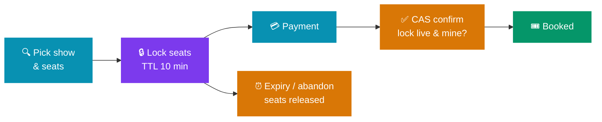
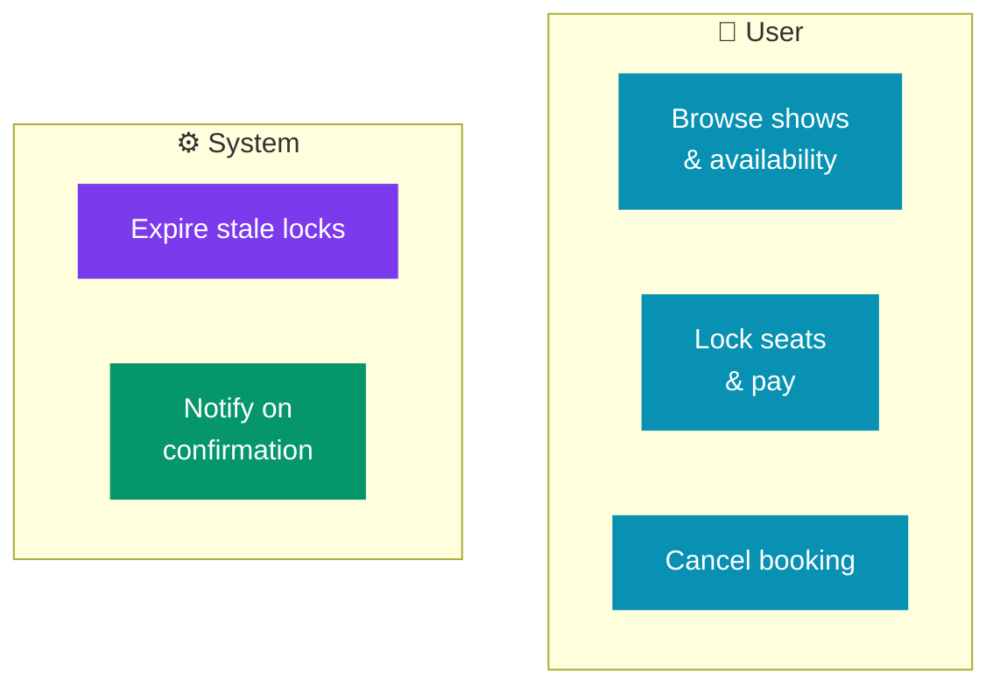
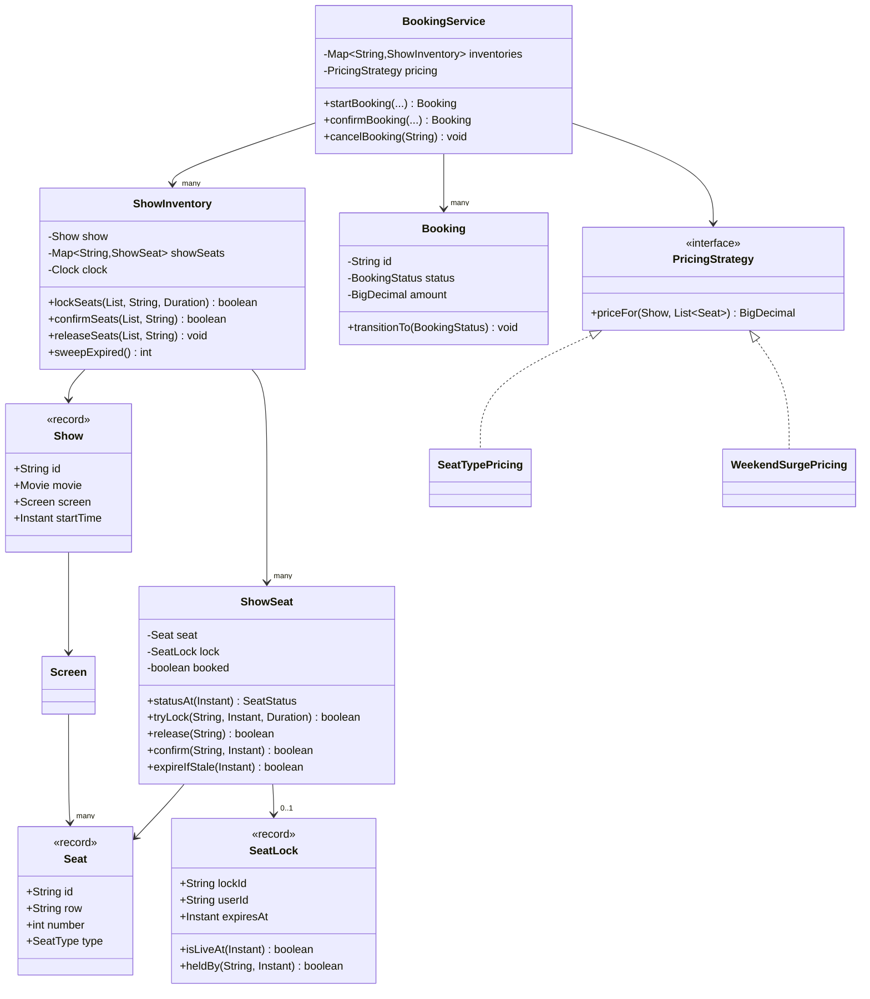
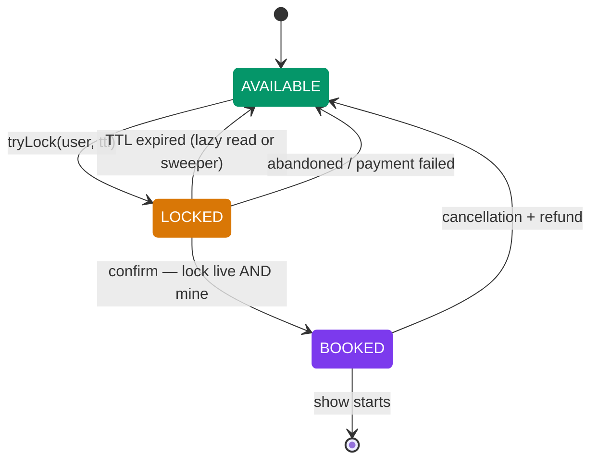
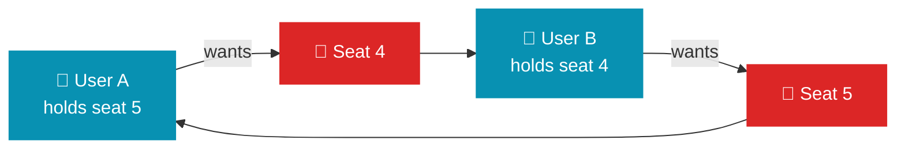
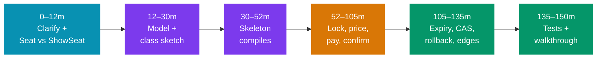

# 🎟️ Machine Coding / LLD — BookMyShow Seat Booking (with Seat Locking)

> 🎯 **Difficulty:** 🔴 Hard — the locking makes it harder than Parking Lot  
> 🏢 **Asked at:** BookMyShow, Swiggy, Zomato, Flipkart, PhonePe, Meesho, Uber, Walmart Global Tech  
> ⏱️ **Format:** Live machine-coding round — **~2.5 hours**, compiling & runnable code expected  
> 🧑‍💻 **For:** SDE-2 / experienced backend engineer — modelling, a lifecycle, and a real concurrency design  
> 🥡 **One-liner:** *"Everything except the seat lock is CRUD. The interview is about the lock — it needs an owner, an expiry, all-or-nothing multi-seat acquisition, and a compare-and-set on confirm."*

> 🔥🔥 Very high priority — asked in almost every Tier-1 interview loop &nbsp;·&nbsp; 🔥 High priority — very frequent in Tier-1 interviews &nbsp;·&nbsp; ⚡ Medium priority — commonly asked &nbsp;·&nbsp; 💤 Low priority — good to know, rarely asked

> 📎 **Method file:** [`00_lld_interview_playbook.md`](./00_lld_interview_playbook.md) — §5.2 (lock with expiry) and §5.3 (deterministic lock ordering) are sketched there and worked in full here in §8.

---

## 1. 🧭 What Makes This Problem Tick

Ticket booking looks like a search-and-insert problem. It is not.
Among the common machine-coding problems, it is the one where a limited resource (the seat) is held
**across a user's think-time and a payment round-trip**.
The whole round is built around that one fact.

| What they say | What they actually grade |
|---|---|
| "Design BookMyShow" | Do you separate the **physical seat** from the **per-show seat state**? (§4 — the modelling trap) |
| "A user picks 4 seats" | Is the multi-seat acquisition **atomic**, or can two users each end up holding two of the four? |
| "Then they pay" | Do you realise the seat must be **held, not booked**, during payment — and held for a *bounded* time? |
| "What if they never pay?" | Is the hold an **expiry**, or a boolean flag that blocks the seats forever? |
| "Payment succeeded, confirm it" | Do you **compare-and-set** — lock still live **and** still mine — or a check-then-act `if (isLocked())`? |
| "Now run this on 10 servers" | Can you name what breaks, and say *fencing token* without being prompted? |
| "Add premium seats / weekend pricing" | Is pricing behind an interface, or an `if` ladder inside the booking service? |

> 💡 The mid-level answer models seats and writes `book(seat)`. The senior answer says: *"booking is
> a two-phase protocol — a time-bounded hold, then a conditional commit — and every interesting bug
> lives in the gap between the two phases."* Say that sentence in the first five minutes.


---

## 2. ❓ Problem Statement & Clarifying Questions

**Problem:** Design the booking service behind a movie-ticket platform. The user flow:

- The user browses shows in a city and selects seats for one show.
- The user holds those seats while paying.
- The user gets a confirmed booking. If payment does not complete in time, the user loses the hold.

No seat may ever be sold twice.

> 🗣️ Ask with a **committed default** (playbook §3). State your position, then ask the interviewer to object.
> Recall the table below under time pressure. It is not a list of open questions.

| # | Ask the interviewer | Committed default (state it, move on) |
|---|---|---|
| 1 | **Single city or multi-city?** | Multi-city in the **model** (City → Theatre → Screen → Show), single city in the demo. It costs one field and gives you the right hierarchy. |
| 2 | **Seat selection or auto-assign?** | **User picks specific seats**. That is the real product, and it is what forces the multi-seat lock. Auto-assign exists as a `SeatSelectionStrategy` for "book me any 4 together". |
| 3 | **Lock duration?** | **10 minutes**, configurable per show. It is long enough for a bank OTP. It is short enough that an abandoned cart is not a lost seat (§🔢). |
| 4 | **Can one user hold seats across two shows?** | **Yes**. The lock is scoped to `(show, seat)`, not to the user. Comparing two showtimes is normal browsing. A per-user cap on concurrently locked seats is an anti-abuse extension, not a core rule. |
| 5 | **Payment sync or async?** | **Synchronous** call to a `PaymentGateway` interface, so confirm is one linear flow. Async webhooks are the extension. They turn "payment lands after expiry" (§9 E1) from the rare case into the common one. |
| 6 | **Is overbooking ever allowed?** | **Never.** Airlines overbook; cinemas cannot. So this is a strict-invariant problem with no compensation path: one seat, one booking. |
| 7 | **Scale / persistence?** | Single JVM, in-memory collections. Distribution is discussed in §8.6, not built. |
| 8 | **Concurrency?** | **Assume required.** Two users on one seat is the entire problem. |
| 9 | **Cancellation and refund?** | Model `cancel()` returning seats to inventory; the refund itself is only logged (it is outside the design). |
| 10 | **Money type?** | `BigDecimal`, scale 2. Never `double` (playbook §7). |

---

## 3. 📋 Requirements

### ✅ Functional Requirements

| # | Requirement |
|---|---|
| F1 | Browse **cities → theatres → shows** and see **live seat availability** for a show. |
| F2 | **Lock** one or more specific seats for a user, **all-or-nothing**, for a bounded TTL. |
| F3 | **Price** the selection through a pluggable strategy (seat type, weekend surge). |
| F4 | **Confirm** a booking after successful payment — only if the hold is still live and still that user's. |
| F5 | **Auto-release** locks on expiry, on payment failure, and on explicit abandonment. |
| F6 | **Cancel** a confirmed booking, returning the seats to inventory. |
| F7 | **Notify** the user on confirmation, without the booking service knowing which channels exist. |

### 🛡️ Non-Functional Requirements

| # | Requirement | Why it matters |
|---|---|---|
| N1 | **No double booking, ever.** | This is the only correctness invariant. Everything else can be negotiated. |
| N2 | **No stranded inventory.** | If a hold lives longer than its user needs it, the screen loses revenue. That matters on a 200-seat screen. |
| N3 | **Fine-grained locking** — per `(show, seat)`, never per show or per service. | Two users booking different rows must not wait for each other. |
| N4 | **Extensibility (OCP)** — new pricing, selection policy, or notification channel as a new class. | These are the predictable follow-ups. |
| N5 | **Testability** — time is injected, so expiry is testable without `Thread.sleep()`. | Playbook §6. Interviewers also give a direct point for this. |
| N6 | **Idempotency** — a double-submitted request creates one booking, not two. | Users double-click. Always. |

---

## 4. 🧱 Core Entities / Use Cases

### ⚠️ The modelling trap: `Seat` vs `ShowSeat`

**The interviewer is watching for this.** It is the reason this problem is on the list.

| | `Seat` | `ShowSeat` |
|---|---|---|
| Nature | **Physical and permanent** — a chair bolted to the floor of a screen | **Per-show state** — that chair's status *for one showtime* |
| Lifetime | Years; changes only when the theatre is renovated | Hours; created with the show, dies with it |
| Holds | `id`, `row`, `number`, `SeatType` | `AVAILABLE / LOCKED / BOOKED`, the current `SeatLock` |
| Cardinality | One per physical screen position | One per **(Show × Seat)** pair |

A candidate who puts `boolean isBooked` on `Seat` **cannot express the sentence**: *"seat A12 is free
for the 9 PM show and booked for the 6 PM show."*

- One screen with 200 seats and 5 shows a day has 200 `Seat` objects and 1,000 `ShowSeat` objects.
- The lock lives on the second one (`ShowSeat`).
- This is the same distinction as `Aircraft` vs `Flight` in
  [`51_flight_booking_modelling.md`](./51_flight_booking_modelling.md).
  Point out this parallel to the interviewer. It is a strong signal.

### The entities

| Entity | Responsibility | Key attributes |
|---|---|---|
| `City` | Geographic scope for browsing. | `id`, `name` |
| `Theatre` | A venue in a city, owning screens. | `id`, `name`, `city`, `screens` |
| `Screen` | An auditorium — a fixed physical seat layout. | `id`, `name`, `seats` |
| `Seat` | **Physical** seat: row, number, type. Immutable. | `id`, `row`, `number`, `type` |
| `Movie` | Title and runtime. | `id`, `title`, `durationMinutes` |
| `Show` | A movie on a screen at a start time. | `id`, `movie`, `screen`, `startTime` |
| `ShowSeat` | **Per-show state** of one seat plus its lock. Owns the no-double-book invariant. | `seat`, `lock`, `booked` |
| `SeatLock` | A hold: **who**, and **until when**. Immutable value. | `lockId`, `userId`, `expiresAt` |
| `ShowInventory` | All `ShowSeat`s of one show; all-or-nothing lock/confirm; sweeping. | `show`, `showSeats`, `clock` |
| `Booking` | The user's order and its lifecycle state. | `id`, `userId`, `showId`, `seatIds`, `amount`, `status` |
| `PaymentGateway` / `PaymentResult` | Charging money and recording the outcome. | `status`, `reference` |
| `BookingService` | Orchestrates lock → price → pay → confirm; idempotency; observers. | strategies, inventories, bookings |
| `PricingStrategy` | How much the selection costs. | — |
| `SeatSelectionStrategy` | Which seats to suggest for "any N together". | — |
| `BookingObserver` | Notified on confirmation. | — |

### Use cases



---

## 5. 🏗️ Class Diagram



> 🔑 **The cardinality to say to the interviewer:**
> - `Screen → many Seat` (physical, permanent).
> - `ShowInventory → many ShowSeat` (per-show, short-lived), with `ShowSeat → 1 Seat`.
> - The `SeatLock` is `0..1` **on the `ShowSeat`**. It is not on the `Seat`, and not in a global lock table keyed by user.

---

## 6. 🎨 Design Patterns Used — and Why

Four patterns. Each one protects a requirement that will actually change.
The playbook warns that "pattern soup" (many patterns with no reason) is a negative signal.
If you cannot name the change a pattern handles, drop it.

| Pattern | Where | The change it absorbs |
|---|---|---|
| **Strategy** ⭐ | `PricingStrategy`, `SeatSelectionStrategy` | Pricing is the rule that changes most often in this domain: seat type today, weekend surge next month, demand-based after that. Each is a **new class** injected into `BookingService`, with zero edits to the booking flow. `SeatSelectionStrategy` absorbs the other change: "any 4 seats" → "any 4 **together**" → "4 together, prefer the middle". **OCP + DIP.** |
| **State** | `BookingStatus` with an explicit transition table | The allowed operations depend on the booking's current state. You can pay a `SEATS_LOCKED` booking but not an `EXPIRED` one. You can cancel a `CONFIRMED` one but not a `CANCELLED` one. One transition table removes the illegal-state bugs. An `if (status == ...)` ladder spread over three methods always produces them. |
| **Observer** | `BookingObserver` — email, SMS, analytics | "Also send a WhatsApp message" is the most predictable follow-up in this problem. The booking service must not get a new `whatsAppClient` field. Subscribers register themselves, and the service sends each event to all of them. |
| **Factory** | `PaymentGatewayFactory.create(PaymentMode)` | New payment modes keep coming (UPI, card, wallet, net-banking). Construction rules stay in one place, so `BookingService` never writes `new UpiGateway()`. |

> ⚠️ **Patterns I deliberately do *not* use, and would say so:**
> - **Singleton.** The service is injected, not globally reachable. A singleton here only makes tests harder.
> - **Chain of Responsibility** for validation. Three `if`s are not a chain. Add it when the rules become configurable.

> 💡 **The OCP test, spoken:** *"Weekend surge pricing is a new `PricingStrategy` that wraps
> the existing one and multiplies. I do not open `BookingService`, `Booking`, or `ShowInventory`."*
> Then actually do it in the demo driver. Showing it is stronger than only saying it.

---

## 7. 💻 Full Java Implementation

A small version that compiles and runs the full flow: **browse → lock → price → pay → confirm**, plus expiry, cancellation
and a sweeper. Java 17 (records, switch expressions). Every class used below is also defined below.
No class is missing.

### 7.1 Enums and the booking state machine

```java
public enum SeatType { REGULAR, PREMIUM, RECLINER }

public enum SeatStatus { AVAILABLE, LOCKED, BOOKED }

public enum PaymentMode { UPI, CARD }

public enum PaymentStatus { PENDING, SUCCESS, FAILED }
```

```java
import java.util.EnumMap;
import java.util.EnumSet;
import java.util.Map;
import java.util.Set;

/** State pattern, enum flavour: every legal transition lives in ONE table. */
public enum BookingStatus {
    CREATED, SEATS_LOCKED, CONFIRMED, EXPIRED, CANCELLED;

    private static final Map<BookingStatus, Set<BookingStatus>> ALLOWED =
            new EnumMap<>(BookingStatus.class);

    static {
        ALLOWED.put(CREATED, EnumSet.of(SEATS_LOCKED, CANCELLED));
        ALLOWED.put(SEATS_LOCKED, EnumSet.of(CONFIRMED, EXPIRED, CANCELLED));
        ALLOWED.put(CONFIRMED, EnumSet.of(CANCELLED));
        ALLOWED.put(EXPIRED, EnumSet.noneOf(BookingStatus.class));
        ALLOWED.put(CANCELLED, EnumSet.noneOf(BookingStatus.class));
    }

    public boolean canMoveTo(BookingStatus next) {
        return ALLOWED.getOrDefault(this, EnumSet.noneOf(BookingStatus.class)).contains(next);
    }
}
```

### 7.2 The static domain — City → Theatre → Screen → Seat, and Show

Immutable records. None of these carry booking state. That is exactly the point of §4.

```java
import java.time.Instant;
import java.util.List;

public record City(String id, String name) { }

public record Movie(String id, String title, int durationMinutes) { }

/** PHYSICAL seat. Permanent. Knows nothing about any show. */
public record Seat(String id, String row, int number, SeatType type) { }

public record Screen(String id, String name, List<Seat> seats) { }

public record Theatre(String id, String name, City city, List<Screen> screens) { }

public record Show(String id, Movie movie, Screen screen, Instant startTime) { }
```

### 7.3 `SeatLock` and `ShowSeat` — where the invariant lives

```java
import java.time.Instant;

/** A hold: WHO holds it and UNTIL WHEN. Immutable — replaced, never mutated. */
public record SeatLock(String lockId, String userId, Instant expiresAt) {

    public boolean isLiveAt(Instant now) {
        return now.isBefore(expiresAt);
    }

    public boolean heldBy(String candidateUserId, Instant now) {
        return isLiveAt(now) && userId.equals(candidateUserId);
    }
}
```

```java
import java.time.Duration;
import java.time.Instant;
import java.util.UUID;

/**
 * PER-SHOW state of one physical seat. Every method that touches `lock` or `booked`
 * is synchronized on this object: the seat is the unit of mutual exclusion (N3),
 * so two users on different seats never contend.
 */
public class ShowSeat {

    private final Seat seat;
    private SeatLock lock;      // null == not held
    private boolean booked;

    public ShowSeat(Seat seat) {
        this.seat = seat;
    }

    public Seat seat() {
        return seat;
    }

    /** LAZY EXPIRY: a dead lock is erased the moment anybody looks at the seat. */
    public synchronized SeatStatus statusAt(Instant now) {
        if (booked) {
            return SeatStatus.BOOKED;
        }
        if (lock != null && lock.isLiveAt(now)) {
            return SeatStatus.LOCKED;
        }
        lock = null;
        return SeatStatus.AVAILABLE;
    }

    public synchronized boolean isHeldBy(String userId, Instant now) {
        return lock != null && lock.heldBy(userId, now);
    }

    /** Atomic claim. Re-locking your own live hold extends it (idempotent retry). */
    public synchronized boolean tryLock(String userId, Instant now, Duration ttl) {
        SeatStatus status = statusAt(now);
        if (status == SeatStatus.BOOKED) {
            return false;
        }
        if (status == SeatStatus.LOCKED && !lock.userId().equals(userId)) {
            return false;
        }
        this.lock = new SeatLock(UUID.randomUUID().toString(), userId, now.plus(ttl));
        return true;
    }

    /** Release only your OWN lock — never somebody else's. */
    public synchronized boolean release(String userId) {
        if (!booked && lock != null && lock.userId().equals(userId)) {
            lock = null;
            return true;
        }
        return false;
    }

    /** COMPARE-AND-SET: book only if the hold is still live AND still this user's. */
    public synchronized boolean confirm(String userId, Instant now) {
        if (booked || lock == null || !lock.heldBy(userId, now)) {
            return false;
        }
        booked = true;
        lock = null;
        return true;
    }

    /** Undo a confirm — rolls back a partially booked multi-seat request. */
    public synchronized boolean undoConfirm() {
        if (!booked) {
            return false;
        }
        booked = false;
        return true;
    }

    /** Sweeper hook: proactively drop a dead lock. True if one was freed. */
    public synchronized boolean expireIfStale(Instant now) {
        if (!booked && lock != null && !lock.isLiveAt(now)) {
            lock = null;
            return true;
        }
        return false;
    }
}
```

> 🔑 Notice what is **not** here: no `setBooked()`, no `setLock()`. The invariant "a seat is booked
> only from a live lock owned by the booker" cannot be broken from outside. There is no
> setter that could break it. This is the fix for the anaemic model, a class with data but no rules (playbook §7).

### 7.4 `ShowInventory` — all-or-nothing across many seats

```java
import java.time.Clock;
import java.time.Duration;
import java.time.Instant;
import java.util.ArrayList;
import java.util.Comparator;
import java.util.List;
import java.util.Map;
import java.util.concurrent.ConcurrentHashMap;

public class ShowInventory {

    private final Show show;
    private final Map<String, ShowSeat> showSeats = new ConcurrentHashMap<>();
    private final Clock clock;                    // injected — expiry is testable

    public ShowInventory(Show show, Clock clock) {
        this.show = show;
        this.clock = clock;
        for (Seat seat : show.screen().seats()) {
            showSeats.put(seat.id(), new ShowSeat(seat));
        }
    }

    public Show show() {
        return show;
    }

    public List<Seat> availableSeats() {
        Instant now = clock.instant();
        return showSeats.values().stream()
                .filter(showSeat -> showSeat.statusAt(now) == SeatStatus.AVAILABLE)
                .map(ShowSeat::seat)
                .sorted(Comparator.comparing(Seat::id))
                .toList();
    }

    public List<Seat> seatsFor(List<String> seatIds) {
        List<Seat> seats = new ArrayList<>();
        for (String id : seatIds) {
            ShowSeat showSeat = showSeats.get(id);
            if (showSeat == null) {
                throw new IllegalArgumentException("No seat " + id + " in show " + show.id());
            }
            seats.add(showSeat.seat());
        }
        return seats;
    }

    /**
     * ALL-OR-NOTHING acquisition. Two rules make it correct:
     *   1. DETERMINISTIC ORDER — every caller sorts the ids, so no cycle can form;
     *   2. ROLLBACK — a partial acquisition releases only what THIS call took,
     *      never a hold the user already had before the call.
     */
    public boolean lockSeats(List<String> seatIds, String userId, Duration ttl) {
        List<String> ordered = seatIds.stream().distinct().sorted().toList();
        Instant now = clock.instant();
        List<ShowSeat> newlyAcquired = new ArrayList<>();
        for (String id : ordered) {
            ShowSeat showSeat = showSeats.get(id);
            if (showSeat == null) {
                rollback(newlyAcquired, userId);
                return false;
            }
            boolean alreadyMine = showSeat.isHeldBy(userId, now);
            if (!showSeat.tryLock(userId, now, ttl)) {
                rollback(newlyAcquired, userId);
                return false;
            }
            if (!alreadyMine) {
                newlyAcquired.add(showSeat);
            }
        }
        return true;
    }

    private void rollback(List<ShowSeat> acquired, String userId) {
        for (ShowSeat showSeat : acquired) {
            showSeat.release(userId);
        }
    }

    public void releaseSeats(List<String> seatIds, String userId) {
        for (String id : seatIds) {
            ShowSeat showSeat = showSeats.get(id);
            if (showSeat != null) {
                showSeat.release(userId);
            }
        }
    }

    /** CAS on every seat; if any one fails, none of them stays booked. */
    public boolean confirmSeats(List<String> seatIds, String userId) {
        Instant now = clock.instant();
        List<String> ordered = seatIds.stream().distinct().sorted().toList();
        List<ShowSeat> booked = new ArrayList<>();
        for (String id : ordered) {
            ShowSeat showSeat = showSeats.get(id);
            if (showSeat == null || !showSeat.confirm(userId, now)) {
                for (ShowSeat done : booked) {
                    done.undoConfirm();
                }
                return false;
            }
            booked.add(showSeat);
        }
        return true;
    }

    public void releaseBookedSeats(List<String> seatIds) {
        for (String id : seatIds) {
            ShowSeat showSeat = showSeats.get(id);
            if (showSeat != null) {
                showSeat.undoConfirm();
            }
        }
    }

    /** Belt-and-braces sweep. Returns how many dead holds were reclaimed. */
    public int sweepExpired() {
        Instant now = clock.instant();
        int freed = 0;
        for (ShowSeat showSeat : showSeats.values()) {
            if (showSeat.expireIfStale(now)) {
                freed++;
            }
        }
        return freed;
    }
}
```

### 7.5 Strategy seams — pricing and seat selection

```java
import java.math.BigDecimal;
import java.util.List;

public interface PricingStrategy {
    BigDecimal priceFor(Show show, List<Seat> seats);
}
```

```java
import java.math.BigDecimal;
import java.math.RoundingMode;
import java.util.EnumMap;
import java.util.List;
import java.util.Map;

public class SeatTypePricing implements PricingStrategy {

    private final Map<SeatType, BigDecimal> rates = new EnumMap<>(SeatType.class);

    public SeatTypePricing() {
        rates.put(SeatType.REGULAR, new BigDecimal("200.00"));
        rates.put(SeatType.PREMIUM, new BigDecimal("350.00"));
        rates.put(SeatType.RECLINER, new BigDecimal("600.00"));
    }

    @Override
    public BigDecimal priceFor(Show show, List<Seat> seats) {
        BigDecimal total = BigDecimal.ZERO;
        for (Seat seat : seats) {
            total = total.add(rates.getOrDefault(seat.type(), BigDecimal.ZERO));
        }
        return total.setScale(2, RoundingMode.HALF_UP);
    }
}
```

```java
import java.math.BigDecimal;
import java.math.RoundingMode;
import java.time.DayOfWeek;
import java.time.ZoneId;
import java.util.List;

/** Wraps ANY other rule — the OCP proof: not one existing class is edited. */
public class WeekendSurgePricing implements PricingStrategy {

    private final PricingStrategy delegate;
    private final BigDecimal multiplier;
    private final ZoneId zone;

    public WeekendSurgePricing(PricingStrategy delegate, BigDecimal multiplier, ZoneId zone) {
        this.delegate = delegate;
        this.multiplier = multiplier;
        this.zone = zone;
    }

    @Override
    public BigDecimal priceFor(Show show, List<Seat> seats) {
        BigDecimal base = delegate.priceFor(show, seats);
        DayOfWeek day = show.startTime().atZone(zone).getDayOfWeek();
        if (day == DayOfWeek.SATURDAY || day == DayOfWeek.SUNDAY) {
            return base.multiply(multiplier).setScale(2, RoundingMode.HALF_UP);
        }
        return base;
    }
}
```

```java
import java.util.ArrayList;
import java.util.Comparator;
import java.util.List;
import java.util.Map;
import java.util.TreeMap;

public interface SeatSelectionStrategy {
    List<Seat> select(List<Seat> available, int count);
}

/** "Any N seats, but TOGETHER" — the group-booking adjacency constraint. */
public class ContiguousSeatSelection implements SeatSelectionStrategy {

    @Override
    public List<Seat> select(List<Seat> available, int count) {
        Map<String, List<Seat>> byRow = new TreeMap<>();
        for (Seat seat : available) {
            byRow.computeIfAbsent(seat.row(), row -> new ArrayList<>()).add(seat);
        }
        for (List<Seat> row : byRow.values()) {
            row.sort(Comparator.comparingInt(Seat::number));
            for (int i = 0; i + count <= row.size(); i++) {
                if (row.get(i + count - 1).number() - row.get(i).number() == count - 1) {
                    return List.copyOf(row.subList(i, i + count));
                }
            }
        }
        return List.of();                       // no adjacent block that big
    }
}
```

### 7.6 Payment (Factory) and notifications (Observer)

```java
import java.math.BigDecimal;

public record PaymentResult(PaymentStatus status, String reference) { }

public interface PaymentGateway {
    PaymentResult charge(String bookingId, BigDecimal amount);
}

/** The factory is an INTERFACE so a test can inject a failing gateway. */
public interface PaymentGatewayFactory {
    PaymentGateway create(PaymentMode mode);
}

public class UpiGateway implements PaymentGateway {

    @Override
    public PaymentResult charge(String bookingId, BigDecimal amount) {
        // A real PSP call lives here. The demo always succeeds.
        return new PaymentResult(PaymentStatus.SUCCESS, "UPI-" + bookingId);
    }
}

public class CardGateway implements PaymentGateway {

    @Override
    public PaymentResult charge(String bookingId, BigDecimal amount) {
        return new PaymentResult(PaymentStatus.SUCCESS, "CARD-" + bookingId);
    }
}

public class DefaultPaymentGatewayFactory implements PaymentGatewayFactory {

    @Override
    public PaymentGateway create(PaymentMode mode) {
        return switch (mode) {
            case UPI -> new UpiGateway();
            case CARD -> new CardGateway();
        };
    }
}
```

```java
public interface BookingObserver {
    void onBookingConfirmed(Booking booking);
}

public class EmailNotifier implements BookingObserver {

    @Override
    public void onBookingConfirmed(Booking booking) {
        System.out.println("EMAIL -> " + booking.userId() + " : booking " + booking.id() + " confirmed");
    }
}

public class SmsNotifier implements BookingObserver {

    @Override
    public void onBookingConfirmed(Booking booking) {
        System.out.println("SMS   -> " + booking.userId() + " : seats " + booking.seatIds());
    }
}
```

### 7.7 `Booking` — the lifecycle object

```java
import java.math.BigDecimal;
import java.util.List;

public class Booking {

    private final String id;
    private final String userId;
    private final String showId;
    private final List<String> seatIds;
    private final BigDecimal amount;
    private BookingStatus status = BookingStatus.CREATED;
    private PaymentResult payment;

    public Booking(String id, String userId, String showId,
                   List<String> seatIds, BigDecimal amount) {
        this.id = id;
        this.userId = userId;
        this.showId = showId;
        this.seatIds = List.copyOf(seatIds);
        this.amount = amount;
    }

    /** Illegal transitions fail loudly instead of quietly corrupting state. */
    public synchronized void transitionTo(BookingStatus next) {
        if (!status.canMoveTo(next)) {
            throw new IllegalStateException("Illegal transition " + status + " -> " + next);
        }
        this.status = next;
    }

    public synchronized BookingStatus status() {
        return status;
    }
    public synchronized void setPayment(PaymentResult result) {
        this.payment = result;
    }
    public synchronized PaymentResult payment() {
        return payment;
    }
    public String id() {
        return id;
    }
    public String userId() {
        return userId;
    }
    public String showId() {
        return showId;
    }
    public List<String> seatIds() {
        return seatIds;
    }
    public BigDecimal amount() {
        return amount;
    }
}
```

### 7.8 `BookingService` — the two-phase orchestrator

```java
import java.math.BigDecimal;
import java.time.Duration;
import java.util.List;
import java.util.Map;
import java.util.UUID;
import java.util.concurrent.ConcurrentHashMap;
import java.util.concurrent.CopyOnWriteArrayList;

public class SeatUnavailableException extends RuntimeException {

    public SeatUnavailableException(String message) {
        super(message);
    }
}

public class BookingService {

    private final Map<String, ShowInventory> inventories = new ConcurrentHashMap<>();
    private final Map<String, Booking> bookings = new ConcurrentHashMap<>();
    private final Map<String, String> requestIndex = new ConcurrentHashMap<>();   // idempotency
    private final List<BookingObserver> observers = new CopyOnWriteArrayList<>();

    private final PricingStrategy pricing;
    private final PaymentGatewayFactory gateways;
    private final Duration lockTtl;

    public BookingService(PricingStrategy pricing, PaymentGatewayFactory gateways, Duration lockTtl) {
        this.pricing = pricing;
        this.gateways = gateways;
        this.lockTtl = lockTtl;
    }

    public void register(ShowInventory inventory) {
        inventories.put(inventory.show().id(), inventory);
    }
    public void subscribe(BookingObserver observer) {
        observers.add(observer);
    }
    public List<Seat> availableSeats(String showId) {
        return inventory(showId).availableSeats();
    }

    private ShowInventory inventory(String showId) {
        ShowInventory inventory = inventories.get(showId);
        if (inventory == null) {
            throw new IllegalArgumentException("Unknown show " + showId);
        }
        return inventory;
    }

    /**
     * PHASE 1 — hold the seats and quote a price.
     * computeIfAbsent runs the mapping function at most once per requestId, so a
     * double-submitted click returns the SAME booking instead of locking twice.
     */
    public Booking startBooking(String requestId, String userId, String showId, List<String> seatIds) {
        String bookingId = requestIndex.computeIfAbsent(requestId,
                key -> createBooking(userId, showId, seatIds));
        return bookings.get(bookingId);
    }

    private String createBooking(String userId, String showId, List<String> seatIds) {
        ShowInventory inventory = inventory(showId);
        if (!inventory.lockSeats(seatIds, userId, lockTtl)) {
            throw new SeatUnavailableException("Seats not available: " + seatIds);
        }
        BigDecimal amount = pricing.priceFor(inventory.show(), inventory.seatsFor(seatIds));
        Booking booking = new Booking(UUID.randomUUID().toString(), userId, showId, seatIds, amount);
        booking.transitionTo(BookingStatus.SEATS_LOCKED);
        bookings.put(booking.id(), booking);
        return booking.id();
    }

    /** PHASE 2 — charge, then COMPARE-AND-SET every seat from LOCKED to BOOKED. */
    public Booking confirmBooking(String bookingId, PaymentMode mode) {
        Booking booking = bookings.get(bookingId);
        if (booking == null) {
            throw new IllegalArgumentException("Unknown booking " + bookingId);
        }
        ShowInventory inventory = inventory(booking.showId());
        boolean confirmed = false;
        synchronized (booking) {
            if (booking.status() == BookingStatus.CONFIRMED) {
                return booking;                       // idempotent re-confirm
            }
            if (booking.status() != BookingStatus.SEATS_LOCKED) {
                throw new IllegalStateException("Cannot pay a booking in state " + booking.status());
            }
            PaymentResult result = gateways.create(mode).charge(bookingId, booking.amount());
            booking.setPayment(result);
            if (result.status() != PaymentStatus.SUCCESS) {
                inventory.releaseSeats(booking.seatIds(), booking.userId());
                booking.transitionTo(BookingStatus.CANCELLED);
                return booking;
            }
            if (!inventory.confirmSeats(booking.seatIds(), booking.userId())) {
                // Money taken, hold gone. NEVER silently book — refund and fail (§9 E1).
                booking.transitionTo(BookingStatus.EXPIRED);
                refund(booking);
                return booking;
            }
            booking.transitionTo(BookingStatus.CONFIRMED);
            confirmed = true;
        }
        if (confirmed) {
            for (BookingObserver observer : observers) {
                observer.onBookingConfirmed(booking);   // fan-out OUTSIDE the lock
            }
        }
        return booking;
    }

    public void cancelBooking(String bookingId) {
        Booking booking = bookings.get(bookingId);
        if (booking == null) {
            throw new IllegalArgumentException("Unknown booking " + bookingId);
        }
        ShowInventory inventory = inventory(booking.showId());
        synchronized (booking) {
            if (booking.status() == BookingStatus.CONFIRMED) {
                inventory.releaseBookedSeats(booking.seatIds());
                refund(booking);
            } else {
                inventory.releaseSeats(booking.seatIds(), booking.userId());
            }
            booking.transitionTo(BookingStatus.CANCELLED);
        }
    }

    private void refund(Booking booking) {
        System.out.println("REFUND " + booking.amount() + " for booking " + booking.id());
    }
}
```

### 7.9 The sweeper and an injectable clock

```java
import java.time.Duration;
import java.util.List;
import java.util.concurrent.Executors;
import java.util.concurrent.ScheduledExecutorService;
import java.util.concurrent.TimeUnit;

public class LockSweeper implements AutoCloseable {

    private final List<ShowInventory> inventories;
    private final ScheduledExecutorService scheduler;

    public LockSweeper(List<ShowInventory> inventories) {
        this.inventories = List.copyOf(inventories);
        this.scheduler = Executors.newSingleThreadScheduledExecutor(runnable -> {
            Thread thread = new Thread(runnable, "seat-lock-sweeper");
            thread.setDaemon(true);              // must never keep the JVM alive
            return thread;
        });
    }

    public void start(Duration period) {
        long seconds = Math.max(1, period.toSeconds());
        scheduler.scheduleAtFixedRate(this::sweep, seconds, seconds, TimeUnit.SECONDS);
    }

    private void sweep() {
        try {
            for (ShowInventory inventory : inventories) {
                int freed = inventory.sweepExpired();
                if (freed > 0) {
                    System.out.println("SWEEP freed " + freed + " on " + inventory.show().id());
                }
            }
        } catch (RuntimeException e) {
            // An escaping throw CANCELS all future runs of a scheduled task, silently.
            System.err.println("sweep failed: " + e.getMessage());
        }
    }

    @Override
    public void close() {
        scheduler.shutdownNow();
    }
}
```

```java
import java.time.Clock;
import java.time.Duration;
import java.time.Instant;
import java.time.ZoneId;

/** Injectable time: expiry becomes instant and deterministic — no Thread.sleep. */
public class MutableClock extends Clock {

    private volatile Instant now;
    private final ZoneId zone;

    public MutableClock(Instant start, ZoneId zone) {
        this.now = start;
        this.zone = zone;
    }

    public void advance(Duration amount) {
        this.now = now.plus(amount);
    }

    @Override
    public Instant instant() {
        return now;
    }
    @Override
    public ZoneId getZone() {
        return zone;
    }
    @Override
    public Clock withZone(ZoneId otherZone) {
        return new MutableClock(now, otherZone);
    }
}
```

### 7.10 Demo driver — run this

```java
import java.math.BigDecimal;
import java.time.Duration;
import java.time.Instant;
import java.time.ZoneId;
import java.util.ArrayList;
import java.util.List;

public class BookMyShowDemo {

    private static final ZoneId IST = ZoneId.of("Asia/Kolkata");

    public static void main(String[] args) {
        MutableClock clock = new MutableClock(Instant.parse("2026-09-05T12:00:00Z"), IST);

        Screen screen = screenWith("SCR-1", "Audi 1", 2, 6);
        Movie movie = new Movie("MOV-1", "Interstellar", 169);
        City city = new City("CTY-1", "Bengaluru");
        Theatre theatre = new Theatre("THR-1", "PVR Forum", city, List.of(screen));
        Show show = new Show("SHW-1", movie, screen, Instant.parse("2026-09-05T15:30:00Z"));

        ShowInventory inventory = new ShowInventory(show, clock);
        PricingStrategy pricing =
                new WeekendSurgePricing(new SeatTypePricing(), new BigDecimal("1.25"), IST);
        BookingService service =
                new BookingService(pricing, new DefaultPaymentGatewayFactory(), Duration.ofMinutes(10));
        service.register(inventory);
        service.subscribe(new EmailNotifier());
        service.subscribe(new SmsNotifier());

        System.out.println(theatre.name() + " | " + show.movie().title()
                + " | free seats: " + service.availableSeats("SHW-1").size());

        // --- Happy path: hold two seats, pay, confirm ---
        Booking booking = service.startBooking("req-1", "user-A", "SHW-1", List.of("A2", "A3"));
        System.out.println("Held A2,A3 for Rs." + booking.amount() + " -> " + booking.status());
        service.confirmBooking(booking.id(), PaymentMode.UPI);
        System.out.println("Booking status: " + booking.status());

        // --- Contention: user-B wants A3 (booked) + A4 -> all-or-nothing failure ---
        try {
            service.startBooking("req-2", "user-B", "SHW-1", List.of("A3", "A4"));
        } catch (SeatUnavailableException e) {
            System.out.println("user-B rejected: " + e.getMessage());
        }
        System.out.println("A4 still free after the failed request? " + isFree(service, "A4"));

        // --- Expiry: user-C holds B1 and walks away; clock moves 11 minutes ---
        service.startBooking("req-3", "user-C", "SHW-1", List.of("B1"));
        System.out.println("B1 free while held? " + isFree(service, "B1"));
        clock.advance(Duration.ofMinutes(11));
        System.out.println("B1 free after TTL?  " + isFree(service, "B1"));
        System.out.println("Sweeper reclaimed: " + inventory.sweepExpired());
    }

    private static boolean isFree(BookingService service, String seatId) {
        return service.availableSeats("SHW-1").stream()
                .anyMatch(seat -> seat.id().equals(seatId));
    }

    private static Screen screenWith(String id, String name, int rows, int perRow) {
        List<Seat> seats = new ArrayList<>();
        for (int r = 0; r < rows; r++) {
            String row = String.valueOf((char) ('A' + r));
            for (int n = 1; n <= perRow; n++) {
                SeatType type = (r == 0) ? SeatType.REGULAR : SeatType.PREMIUM;
                seats.add(new Seat(row + n, row, n, type));
            }
        }
        return new Screen(id, name, List.copyOf(seats));
    }
}
```

**Expected console** (the show starts on a Saturday, so surge applies: 2 × ₹200 × 1.25 = ₹500.00):

```
PVR Forum | Interstellar | free seats: 12
Held A2,A3 for Rs.500.00 -> SEATS_LOCKED
EMAIL -> user-A : booking <uuid> confirmed
SMS   -> user-A : seats [A2, A3]
Booking status: CONFIRMED
user-B rejected: Seats not available: [A3, A4]
A4 still free after the failed request? true
B1 free while held? false
B1 free after TTL?  true
Sweeper reclaimed: 0
```

> 🔎 **Read the last two lines together.** `isFree` already ran `statusAt`, which erased the dead
> lock *lazily*. So when the sweeper runs, there is nothing left to reclaim. The output shows
> the lazy-vs-sweeper trade-off (§8.3).

### 7.11 🧪 JUnit tests — the six that matter

```java
import static org.junit.jupiter.api.Assertions.assertEquals;
import static org.junit.jupiter.api.Assertions.assertFalse;
import static org.junit.jupiter.api.Assertions.assertNotNull;
import static org.junit.jupiter.api.Assertions.assertSame;
import static org.junit.jupiter.api.Assertions.assertTrue;

import java.math.BigDecimal;
import java.time.Duration;
import java.time.Instant;
import java.time.ZoneId;
import java.util.ArrayList;
import java.util.List;
import java.util.concurrent.CountDownLatch;
import java.util.concurrent.ExecutorService;
import java.util.concurrent.Executors;
import java.util.concurrent.TimeUnit;
import java.util.concurrent.atomic.AtomicInteger;

import org.junit.jupiter.api.BeforeEach;
import org.junit.jupiter.api.Test;

public class SeatBookingTest {

    private static final ZoneId IST = ZoneId.of("Asia/Kolkata");
    private static final Duration TTL = Duration.ofMinutes(10);

    private MutableClock clock;
    private ShowInventory inventory;
    private BookingService service;

    @BeforeEach
    void setUp() {
        clock = new MutableClock(Instant.parse("2026-09-07T12:00:00Z"), IST);   // a Monday
        List<Seat> seats = new ArrayList<>();
        for (int n = 1; n <= 4; n++) {
            seats.add(new Seat("A" + n, "A", n, SeatType.REGULAR));
        }
        Screen screen = new Screen("SCR-1", "Audi 1", List.copyOf(seats));
        Show show = new Show("SHW-1", new Movie("M1", "Dune", 155), screen,
                Instant.parse("2026-09-07T15:30:00Z"));
        inventory = new ShowInventory(show, clock);
        service = new BookingService(new SeatTypePricing(), new DefaultPaymentGatewayFactory(), TTL);
        service.register(inventory);
    }

    // 1. HAPPY PATH — hold, price, pay, confirm.
    @Test
    void booksAndPricesTheSelection() {
        Booking booking = service.startBooking("r1", "user-A", "SHW-1", List.of("A1", "A2"));
        assertEquals(new BigDecimal("400.00"), booking.amount());
        assertEquals(BookingStatus.SEATS_LOCKED, booking.status());

        service.confirmBooking(booking.id(), PaymentMode.UPI);
        assertEquals(BookingStatus.CONFIRMED, booking.status());
        assertNotNull(booking.payment());
        assertEquals(2, service.availableSeats("SHW-1").size());
    }

    // 2. EXPIRY — injected Clock, so no Thread.sleep and no flakiness.
    @Test
    void holdExpiresAndSeatReturnsToInventory() {
        assertTrue(inventory.lockSeats(List.of("A1"), "user-A", TTL));
        assertEquals(3, inventory.availableSeats().size());

        clock.advance(Duration.ofMinutes(11));
        assertEquals(1, inventory.sweepExpired());          // sweeper reclaims it
        assertEquals(4, inventory.availableSeats().size());
    }

    // 3. THE RACE — the test that earns the round.
    @Test
    void exactlyOneUserWinsTheContestedSeat() throws Exception {
        int threads = 16;
        CountDownLatch start = new CountDownLatch(1);
        AtomicInteger wins = new AtomicInteger();
        ExecutorService pool = Executors.newFixedThreadPool(threads);

        for (int i = 0; i < threads; i++) {
            final int id = i;
            pool.submit(() -> {
                start.await();                              // release all threads TOGETHER
                try {
                    service.startBooking("req-" + id, "user-" + id, "SHW-1", List.of("A1"));
                    wins.incrementAndGet();
                } catch (SeatUnavailableException expected) {
                    // losing is the correct outcome for 15 of the 16
                }
                return null;
            });
        }
        start.countDown();
        pool.shutdown();
        assertTrue(pool.awaitTermination(5, TimeUnit.SECONDS));
        assertEquals(1, wins.get());
    }

    // 4. ALL-OR-NOTHING — a partial acquisition must leave NOTHING held.
    @Test
    void partialLockAcquisitionRollsBackCompletely() {
        assertTrue(inventory.lockSeats(List.of("A3"), "user-A", TTL));

        assertFalse(inventory.lockSeats(List.of("A1", "A2", "A3"), "user-B", TTL));

        List<String> free = inventory.availableSeats().stream().map(Seat::id).toList();
        assertTrue(free.contains("A1"), "A1 must be rolled back");
        assertTrue(free.contains("A2"), "A2 must be rolled back");
        assertFalse(free.contains("A3"));
        assertTrue(inventory.lockSeats(List.of("A1", "A2"), "user-C", TTL));
    }

    // 5. THE NASTY ONE — payment succeeds AFTER the hold expired.
    @Test
    void paymentAfterExpiryRefundsInsteadOfBooking() {
        Booking booking = service.startBooking("r5", "user-A", "SHW-1", List.of("A1"));
        clock.advance(Duration.ofMinutes(11));               // hold dies mid-payment

        service.confirmBooking(booking.id(), PaymentMode.CARD);

        assertEquals(BookingStatus.EXPIRED, booking.status());
        assertEquals(PaymentStatus.SUCCESS, booking.payment().status());   // money WAS taken
        assertEquals(4, service.availableSeats("SHW-1").size());           // seat NOT sold
    }

    // 6. IDEMPOTENCY — the user double-clicks Pay.
    @Test
    void doubleSubmitCreatesOneBooking() {
        Booking first = service.startBooking("same-req", "user-A", "SHW-1", List.of("A1", "A2"));
        Booking second = service.startBooking("same-req", "user-A", "SHW-1", List.of("A1", "A2"));

        assertSame(first, second);
        assertEquals(2, service.availableSeats("SHW-1").size());
    }
}
```

> ⚠️ **Test 3 is worthless without the `CountDownLatch`.**
> - Sixteen tasks submitted in a loop largely run *sequentially*. The first one finishes before the last is scheduled.
> - So the assertion passes even against a completely broken implementation.
> - The latch is what forces real contention.
>
> Say this to the interviewer while you write it.

---

## 8. 🔒 Seat Locking — The Heart of the Problem

> The round is really about this section. Everything in §7 exists to make this section
> possible. If you have twenty minutes left and must choose, spend them here.

### 8.1 The lifecycle



**Every path back to `AVAILABLE`, and who triggers it:**

| Path | Trigger | Who acts |
|---|---|---|
| Explicit release | User clicks Back / abandons the cart | Client calls `releaseSeats` |
| Payment failure | Gateway declines | `confirmBooking` releases before returning |
| **TTL expiry** | Nobody acts — time passes | `statusAt()` on the next read, or `sweepExpired()` |
| Cancellation | Confirmed booking cancelled | `releaseBookedSeats` + refund |
| Show ends | The whole `ShowInventory` is discarded | Housekeeping job |

Only one of those five happens with nobody acting, and **it is the common case**.
That is the main reason for the next subsection.

### 8.2 Why a lock needs an expiry, not a flag

The first idea most people have is `boolean locked` plus "release it when the user is done".
That fails on the most frequent event in the system: **the user closes the tab.**

| Failure | Frequency | With a flag | With an expiry |
|---|---|---|---|
| Closes the tab / loses network | **Constantly**: 20–30% of users abandon the payment page | Seat blocked **forever** | Freed in ≤ TTL |
| Payment page times out at the bank | Common | Blocked | Freed |
| App server crashes mid-flow | Rare | Blocked | Freed |

> 💡 **The sentence to say:** *"I do not design the hold for the crash case, I design it for the tab
> case — it is thousands of times more common. A flag needs somebody to come back and clear it, and
> the whole problem is that nobody is coming back. An expiry needs nobody."*

This changes how you see the lock. It is not mutual exclusion. It is a **lease**: a permission that
ends unless someone renews it. Everything else follows from that word. A lease must record:

- **who** holds it. Without this, you cannot tell whose payment to accept.
- **until when**. Without this, it is a flag again.

That is exactly the `SeatLock(lockId, userId, expiresAt)` record, and nothing more.

### 8.3 Lazy expiry vs a sweeper thread

There are two ways to make time actually free a seat. You should be able to argue for both.

| | **Lazy — expire on read** | **Sweeper — `ScheduledExecutorService`** |
|---|---|---|
| Mechanism | `statusAt(now)` treats an expired lock as absent and nulls it | A daemon task walks the inventory every N seconds |
| Threads | **None.** Nothing to reason about, nothing to shut down | One more thread, one more failure mode |
| Correctness | **Complete on its own**. No read can ever see a stale hold | Also complete, but only correct *because* the lazy check is there too |
| Weakness | A seat nobody looks at stays "held" in a **cached** availability count | Fixes exactly that. Inventory is freed quickly, so the seat map is accurate |
| Cost | Zero | A `synchronized` touch of every seat per sweep. Very small at 300 seats/show |

**Lazy-on-read is the right default.** Say it like this: *correctness comes from
the lazy check; the sweeper is a **freshness** optimisation, not a correctness mechanism.*
If the sweeper thread dies, the system is still correct. This shows which one the correctness depends on.

Add the sweeper when the server **pushes** availability to clients, instead of clients pulling it. A live seat map on 5,000 open
browsers cannot wait for someone to read the seat before it turns green. Then state the two rules
that make it safe (both are in `LockSweeper`):

- **Daemon thread.** It must never keep the JVM alive.
- **Never let an exception escape the task.** One escaping `RuntimeException` from a
  `scheduleAtFixedRate` body cancels *all future runs*, silently. This bug causes real production
  incidents. If you name it, you get credit.

> ⚠️ Do **not** use a `DelayQueue` or a `ScheduledFuture` per lock.
> - One timer object per held seat means thousands of live objects to cancel and re-schedule on every extension.
> - It goes wrong the first time a lock is extended.
>
> Time as *data* (an `expiresAt` field) is better than time as a *scheduled callback*.

### 8.4 The all-or-nothing multi-seat lock

A user selecting 4 seats must get **all four or none**. Take two users with overlapping selections.
A simple loop produces this:



**There are two failure modes, depending on how you lock. Know which one you have:**

- **Blocking locks** (`ReentrantLock.lock()` per seat, held while acquiring the next): a real
  **deadlock**. Neither thread ever proceeds.
- **State locks with a try-semantics** (what §7 implements; `tryLock` returns `false` immediately):
  no deadlock, but **mutual abort**. Both users fail, both retry, both fail again. That is a
  livelock. Under load, they can keep failing again and again.

**The same thing fixes both: a deterministic global order.** Sort the seat ids and always
acquire them in ascending order. Now the two requests can no longer form a cycle:

- One user takes seat 4 first and goes on to take 5.
- The other finds 4 taken and fails immediately, having taken nothing.

```java
List<String> ordered = seatIds.stream().distinct().sorted().toList();
```

That one line is the fix. It is the same fix as locking two accounts in ascending id order
before a wallet transfer. Say so. The interviewer is grading whether you see the general rule.

**Rollback is the other half.** A partial acquisition must release what it took.
Most candidates miss this detail: release **only what *this call* took**.

- Say the user already held seat 3 from an earlier selection.
- A failed attempt at seats 1–3 must not take seat 3 back from them.
- So the code calls `isHeldBy(...)` before `tryLock(...)`. Only truly new acquisitions go into the rollback
  list.

### 8.5 The compare-and-set on confirm

Payment succeeded. Now book the seats. The tempting line is:

```java
// ❌️ WRONG on two independent counts
if (showSeat.isLocked()) {
    showSeat.setBooked(true);
}
```

1. **Check-then-act.** Between the `if` and the `set`, the lock can expire and another user can take
   the seat. Two threads pass the check, and both write.
2. **Whose lock?** `isLocked()` returns true for *somebody else's* lock too. A user whose hold expired
   ten minutes ago can get the seat that a different user is paying for right now. This is the worst
   kind of bug here, because it silently sells one seat twice.

The correct confirm is a single atomic operation. It checks **three** things at once:

```java
public synchronized boolean confirm(String userId, Instant now) {
    if (booked || lock == null || !lock.heldBy(userId, now)) {
        return false;   // not booked yet, AND live, AND mine — or nothing happens
    }
    booked = true;
    lock = null;
    return true;
}
```

> 💡 **The sentence:** *"Confirm is a compare-and-set, not a check followed by a write. The compare
> is 'this seat is unbooked and the live lock on it is mine'; the set is `booked = true`; and both
> happen under the seat's own monitor so no one can interleave between them."*

A booking covers several seats. So `confirmSeats` applies the same all-or-nothing rule as
the lock phase: if any single CAS fails, it rolls back the ones already booked. A booking is never
partially fulfilled.

### 8.6 What changes when this is distributed

In a single JVM, `synchronized` on the `ShowSeat` object is the whole mechanism. On ten app servers there
is no shared object to synchronize on. So the design moves to an external lock:

```
SET seat:SHW-1:A12 "lock-uuid:user-A" NX PX 600000
```

- **`NX`**: set only if absent. That is the atomic claim. Exactly one server wins.
- **`PX 600000`**: a 10-minute TTL *inside the lock service*. So the expiry still works if the client
  dies. It is the same lease, moved to a service whose clock keeps running when the holder stops.
- **Release must be conditional.** Delete only if the value is still your `lock-uuid`, using a small
  Lua script. A plain `DEL` deletes the lock of whoever holds it *now*. After your TTL has passed,
  that is somebody else.

**And it is still not safe.** Here is how it fails:

1. A client acquires the lock.
2. A long GC or a scheduler stall pauses it past the TTL.
3. It wakes up, believes it still holds the lock, and writes.

From outside, you cannot tell a paused process from a crashed one. No lock protocol fixes that on its own,
Redlock included. The fix is a **fencing token**:

- With each grant, the lock service returns a number that only goes up (monotonically increasing).
- The client passes it on every write.
- The *storage layer* rejects any write with a token lower than the highest it has seen.

That moves the safety guarantee from the lock service to the resource. The resource is the only place
where it can be enforced.

Worked in full in
[`../02_distributed_systems/01_distributed_fundamentals.md`](../02_distributed_systems/01_distributed_fundamentals.md) §7.

> 🗣️ **How to use this in the round:** do not offer a distributed design if nobody asks. It uses
> time you need for code. But when they ask *"how would this work across servers?"*, the answer has
> three steps: **`SET NX PX`** → **conditional release** → **fencing token, because a paused client
> looks exactly like a dead one.** It takes thirty seconds, and it is a strong finish.

**The database alternative, worth one sentence:** if the seats live in a relational store, the same
guarantee is `UPDATE show_seat SET status='LOCKED', locked_by=?, expires_at=? WHERE seat_id=? AND
(status='AVAILABLE' OR (status='LOCKED' AND expires_at < now()))` — the CAS is the `WHERE` clause, and you check the
affected-row count.

- One round trip, no lock service, no fencing problem. The reason: the system that decides and the
  resource are the same system.
- For a cinema-scale workload, this is usually the better answer. Saying so shows judgement, not a memorised answer.

### 🔢 Numbers to Remember

| Quantity | Value | The reasoning that matters |
|---|---|---|
| **Lock TTL** | **~10 min** | Both sides: a bank OTP plus a 3-D Secure redirect really takes 3–5 minutes, so anything under ~5 fails real paying users. But every held minute on a sold-out show is inventory nobody can buy. And 20–30% of users abandon payment pages. So with a 30-minute hold, about a quarter of all holds block their seats for 30 minutes and then sell nothing. 10 minutes is where those two curves cross. BookMyShow's real countdown is in that range. |
| **Seats per screen** | **100–300** | Small enough that per-seat locking is cheap: a `sweepExpired()` pass is a few hundred `synchronized` touches. This is why fine-grained locking is *obviously* right here. Do not spend time worrying about it. |
| **Shows per screen per day** | **4–5** | So one 200-seat screen generates ~800–1,000 `ShowSeat` rows per day against 200 `Seat` rows that never change. That ratio *is* the §4 argument, in numbers. |
| **Read : write ratio** | **~100 : 1** (browse vs book) | Browsing (city, movie, showtimes, seat map) is cacheable and can be served a second or two stale. **Booking cannot be.** It is strongly consistent, single-writer-per-seat, and must not use a cache. If the round turns into HLD, the first thing to say is: split the system on that line. |
| **Peak concurrency** | **1000s of users on one show** | A blockbuster first-day-first-show is the worst case: thousands of clients competing for ~250 seats. This is why a service-wide `synchronized` is fatal, and why locks must be per `(show, seat)`. |

---

## 9. 🧪 Edge Cases

| # | Edge case | What you do |
|---|---|---|
| **E1** | **Payment succeeds *after* the hold expired**. This is the worst one | The CAS in `confirmSeats` fails. So the booking goes to `EXPIRED` and **an automatic refund is raised**. Never book the seat anyway. It may already belong to somebody else. You cannot undo double-selling, but a refund is routine. Say the priority to the interviewer: *"a refund is an apology; a double booking is two people in one seat at 9 PM."* If the interviewer pushes, reduce the risk window: validate the hold *before* charging as well as after. With async payment, reconcile from a webhook against the booking's state machine, never against the seat directly. |
| **E2** | **Double-submit / double-click on Pay** | Two layers. `startBooking` is keyed by `requestId` through `computeIfAbsent`, so one booking is created. `confirmBooking` returns early if the booking is already `CONFIRMED`. Both are idempotency, not locking. A real system also passes the same key down to the payment gateway, so the *charge* is idempotent too. |
| **E3** | **A user re-locks seats they already hold** | `tryLock` succeeds and **extends** the TTL. That is what you want for a real retry. The tricky detail is rollback. `lockSeats` records whether each seat was *already* the user's before this call. A failed acquisition releases only the truly new ones. Otherwise, a failed request would take away holds the user had before. |
| **E4** | **Another user's lock has expired but nobody has looked** | No one can see this state. Every read path goes through `statusAt(now)`, which treats an expired lock as absent and clears it. The sweeper only makes the reclaim *fast*, never *correct*. |
| **E5** | **The show starts while seats are locked** | Stop selling at `show.startTime()` minus a cutoff (say 20 min). `startBooking` rejects new requests. Existing holds may complete or expire normally. Then the whole `ShowInventory` is retired. Never extend a hold past the show start. |
| **E6** | **Cancellation of a confirmed booking** | `releaseBookedSeats` puts the seats back to `AVAILABLE` and a refund is raised. Real products apply a time-based refund policy. That is another `Strategy` (`RefundPolicy`). Naming it as one shows that you really think in extension points, and did not just memorise them. |
| **E7** | **Partial multi-seat acquisition** | All-or-nothing with rollback (§8.4). Never hand back "3 of your 4 seats". The user wanted the group. A partial success becomes a support ticket. |
| **E8** | **Same user, two shows, at once** | Allowed by design: locks are keyed by `(show, seat)`. A per-user cap on concurrently held seats is an anti-abuse extension, not a correctness rule. |
| **E9** | **Seat id not in this show** | `lockSeats` meets the unknown id first. It rolls back anything already taken and returns `false`, so `startBooking` throws `SeatUnavailableException`. (`seatsFor` would throw `IllegalArgumentException`, but it runs only after the lock succeeds.) Validate before charging, never after. |
| **E10** | **Booking in a terminal state receives another action** | The `BookingStatus` transition table rejects it with `IllegalStateException`. `EXPIRED` and `CANCELLED` have no outgoing edges. That is the point of having the table. |

---

## 10. 🚀 Extensions / Follow-ups

| Extension | How to add it without rewriting the core |
|---|---|
| **Seat-type pricing** | Already there: `SeatTypePricing`. Adding `SeatType.RECLINER_PLUS` is an enum constant and a map entry. |
| **Dynamic / surge pricing** | A new `PricingStrategy` that wraps the existing one (`WeekendSurgePricing` is the worked example). Occupancy-based pricing reads `availableSeats()` and multiplies. Zero edits to `BookingService`. |
| **Waitlist for a sold-out show** | A queue per show. On `releaseBookedSeats` or a swept expiry, fire an event. Give the head of the queue a **short** exclusive hold (2–3 min, not 10, because the system pushed the seat to them; they are not browsing). Here `Observer` proves its value a second time. |
| **Group booking with adjacency** | `ContiguousSeatSelection` already returns N seats in one row. Extend to "prefer centre" or "allow a split across two rows" as further strategies. The booking flow does not change. |
| **Seat recommendation** | Another `SeatSelectionStrategy`. Score by distance to screen centre, aisle preference, past bookings. It is a ranking function behind an interface that already exists. |
| **Snacks / combos on the ticket** | A `LineItem` list on `Booking`. Pricing becomes a sum over line items. Do **not** put food into `PricingStrategy`. That interface prices *seats*. |
| **Multi-server deployment** | §8.6: Redis `SET NX PX` or a conditional SQL `UPDATE`, plus a fencing token. Discuss, do not build. |
| **Async payment (webhook)** | The state machine already has `SEATS_LOCKED → CONFIRMED / EXPIRED`. The webhook handler drives the same transition. This makes E1 the *common* path. So the refund branch is no longer an edge case. It becomes a main flow. |

---

## 11. ⏱️ 2.5-Hour Time-Box Plan

~150 minutes, and you must hand over something that runs. The time split follows the playbook §2.



| Slot | Minutes | Deliverable | Watch-out |
|---|---|---|---|
| 1 | **0–12** | Clarify with committed defaults (§2). **Announce the plan.** State the `Seat` vs `ShowSeat` split and the two-phase hold-then-commit protocol. | Do not negotiate scope for 25 minutes. You should do the talking for ten of these twelve minutes, not them. |
| 2 | **12–30** | Entities + cardinality on the board; enums; the `SeatLock` record. | Draw only what guides the code. The diagram is not the deliverable. |
| 3 | **30–52** | `Seat`, `Show`, `ShowSeat`, `ShowInventory` skeleton, `PricingStrategy` interface. **Compile.** | If nothing compiles by ~minute 50, you are in trouble, and you cannot see it yet. |
| 4 | **52–105** | `tryLock` / `release` / `confirm` on `ShowSeat`, all-or-nothing `lockSeats`, `BookingService.startBooking` + `confirmBooking`, one pricing impl, a `main`. **Run it.** | This is the graded core. Do not add a second pricing strategy until it runs end to end. |
| 5 | **105–135** | Lazy expiry, the sorted-order + rollback argument, the CAS on confirm, E1 (pay-after-expiry), the sweeper if time allows. | Explain §8 while you write it. This slot decides the round. |
| 6 | **135–150** | 3–4 JUnit tests (happy path, the race with a latch, expiry with an injected `Clock`, rollback) + a two-minute walkthrough. | **Defend this slot.** Take the time from features, never from tests. |

> 💡 **If you are running behind:** ship single-seat locking that is *completely correct*: owner,
> expiry, CAS confirm. Describe the multi-seat extension in words. A correct lease is always better than a
> half-built multi-seat flow with a check-then-act bug in it.

---

## 12. 🎯 Interview Tips — What Impresses

| # | Tip |
|---|---|
| 1 | **Say `Seat` vs `ShowSeat` in the first five minutes.** It is the fastest way to show that you modelled this domain and did not just recall it. Everything after it depends on it. |
| 2 | **Frame booking as a two-phase protocol**: a time-bounded hold, then a conditional commit. These words immediately put you above "insert a booking row". |
| 3 | **Use the word *lease*.** A lock that ends unless someone renews it is a lease. The word contains the whole design: owner, expiry, renewal, and expiry-without-a-releaser. |
| 4 | **Design the hold for the closed tab, not the crash.** Give the frequency argument without being asked. It shows you are thinking about user behaviour, not just failure modes. |
| 5 | **Separate correctness from freshness.** "Lazy expiry makes it correct; the sweeper makes it prompt. Kill the sweeper and the system is still correct." This distinction is a clear senior signal. |
| 6 | **State the CAS as three conditions**: unbooked, live, and *mine*. Most candidates check one. The "and mine" check is what sets you apart. |
| 7 | **Name the general rule behind sorted lock ordering**. It is the same rule as ascending account ids in a wallet transfer. Connecting two problems is worth more than solving one. |
| 8 | **Answer E1 before it is asked.** *"What happens if payment succeeds after the hold expired?"* Say refund, never double-sell, and say why. The interviewer was planning to ask this question. |
| 9 | **Write the race test, and explain the latch.** Fifteen minutes of tests, where you explain the `CountDownLatch`, is worth more than one more feature. |
| 10 | **Keep the distributed answer to thirty seconds** unless they ask for more: `SET NX PX`, conditional release, fencing token. Then stop. Knowing when to stop is also graded. |

---

> 🥡 *"Everything except the lock is CRUD. The lock is a lease — an owner and an expiry — and the
> confirm is a compare-and-set against it."*
>
> 🥡 *"I design the hold for the user who closes the tab, not the server that crashes. One happens
> ten thousand times a day; the other happens on Tuesday."*
>
> 🥡 *"Lazy expiry is what makes it correct. The sweeper only makes it prompt."*
>
> 🥡 *"A refund is an apology. A double booking is two people in one seat at 9 PM."*

---
