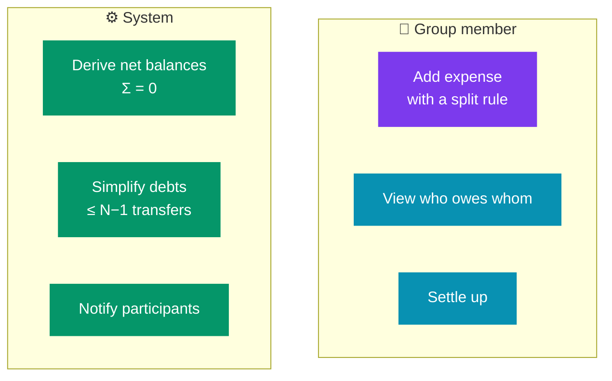
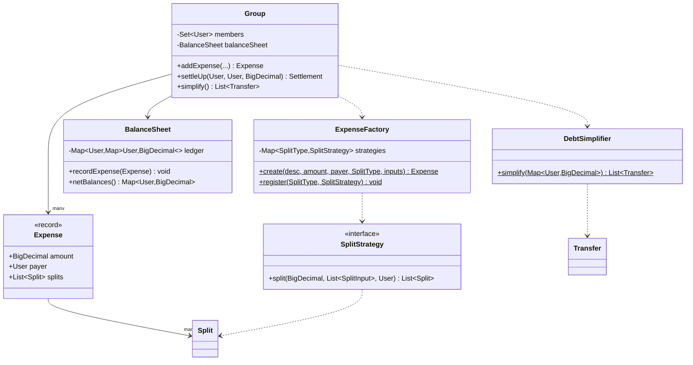
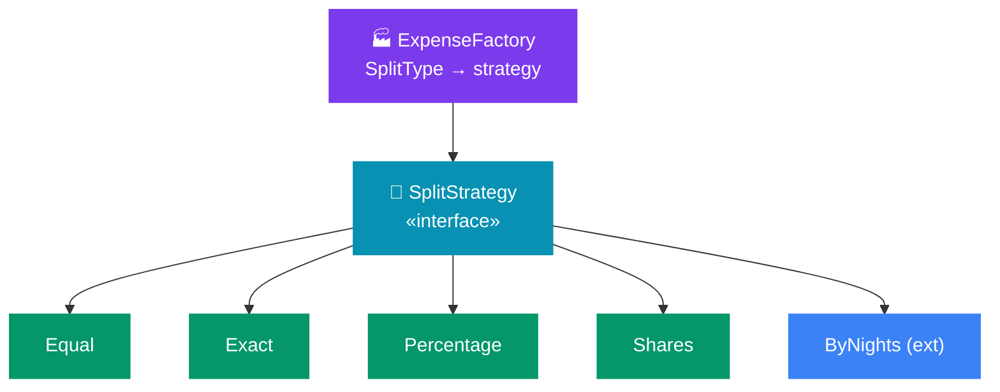
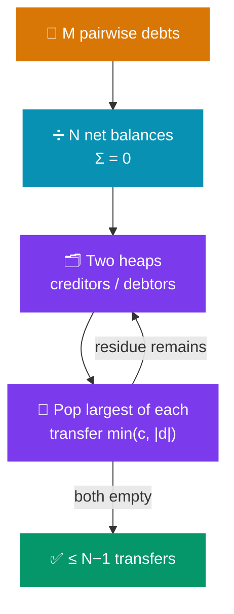
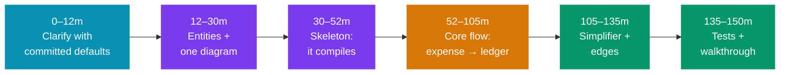

# 💸 Machine Coding / LLD — Splitwise (Expense Sharing)

> 🎯 **Difficulty:** 🟡 Intermediate → 🔴 Hard (the simplifier is where it turns hard)  
> 🏢 **Asked at:** Uber, Amazon, Swiggy, Zeta, Groww, PhonePe, Flipkart, Atlassian  
> ⏱️ **Format:** Live machine-coding round — **~2.5 hours**, working & compilable code expected  
> 🧑‍💻 **For:** SDE-2 / experienced backend engineer — modelling + **one real algorithm** + money correctness  
> 🥡 **One-liner:** *"Every other problem in this folder is modelling plus a race. This one has a real algorithm in the middle. First collapse pairwise debts to net balances. Then greedily match the biggest creditor with the biggest debtor. A senior candidate knows that the greedy is **not** provably minimal."*

---

> 🔥🔥 Very high priority — asked in almost every Tier-1 interview loop &nbsp;·&nbsp; 🔥 High priority — very frequent in Tier-1 interviews &nbsp;·&nbsp; ⚡ Medium priority — commonly asked &nbsp;·&nbsp; 💤 Low priority — good to know, rarely asked

---

## 1. 🧭 What Makes This Problem Tick

Splitwise looks like a ledger CRUD. It is not. It is the **only machine-coding problem in this
folder whose core is a non-trivial algorithm**. Every other one is modelling plus a race condition:
parking lot, vending machine, elevator, locker, rate limiter, seat booking.

Here the modelling is easy. The marks come from three places:

- the split seam
- the arithmetic
- the simplifier

| What they say | What they actually grade |
|---|---|
| "Users can add an expense to a group" | Do you find the right entities? Do you see that `Split` is a **first-class value**, not a `Map<User, Double>` on the expense? |
| "Split equally, or by exact amounts, or by percentage" | Is that a **Strategy seam**, or a `switch` inside `addExpense`? This is *the* thing they are looking for. |
| "Show me who owes whom" | Do you keep a **pairwise ledger** and derive net balances from it? Or do you store only nets and lose the "who" detail? |
| "Can you minimise the number of payments?" | The real question. Do you reduce to net balances first? Do you know the greedy is a **heuristic** (a rough rule, not a proven best)? |
| "₹100 between three people" | Do you pick `double`? Or do you state a **deterministic rounding rule** before you write the line? |
| "Two people add an expense to the same group at once" | Where does the lock go: on the group, or on the whole service? |

> 💡 The one sentence that marks a senior answer: *"greedy min-cash-flow gives at most
> N−1 transfers and it is the standard answer, but it is not guaranteed minimal —
> the exact minimum needs the maximum number of disjoint zero-sum subsets, which is NP-hard."*
> A candidate who claims greedy is optimal has made a correctness error.
> A good interviewer is waiting for that error.


---

## 2. ❓ Problem Statement & Clarifying Questions

**Problem:** Design an expense-sharing application.

- Users belong to groups.
- Any member can record an expense they paid for some subset of the group.
- The expense is split by one of several rules.
- The system must always answer *"who owes whom, how much"*.
- Users can settle up.
- On demand, the system must **minimise the number of payments** needed to clear the group.

> 🗣️ **Commit to defaults, don't ask open questions.** The playbook's rule matters a lot here.
> Multi-currency alone can take twenty minutes if you give the decision back to the interviewer.

| # | Ask the interviewer | **Committed default** (state it, move on) |
|---|---|---|
| 1 | **Multi-currency?** | **No — single currency (INR), integer paise precision.** FX raises an "at what rate, fixed when?" question. That doubles the model. Extension in §11. |
| 2 | **Group expenses only, or 1:1 too?** | **Both — but a 1:1 expense is just a system-managed 2-person group.** One code path, no `if (isGroup)` anywhere. Say this to the interviewer. It is a modelling decision, not a shortcut. |
| 3 | **Can the payer be excluded from the split?** | **Yes.** Alice pays for the cab she didn't ride in. The payer is *not* automatically a participant. This is the domain question worth asking. If you get it wrong, every balance becomes wrong, with no error. |
| 4 | **Split types?** | **EQUAL, EXACT, PERCENTAGE, SHARES.** Four types are enough to force the Strategy seam. You do not need more. |
| 5 | **Settle-up: partial or full only?** | **Partial allowed**, over-settlement rejected. Partial is realistic. It costs only one comparison. |
| 6 | **History / audit needed?** | **Yes — expenses and settlements are append-only; balances are derived.** Never change an expense. Add a reversing one instead. A fintech reviewer wants to hear this. |
| 7 | **Floating point or integer minor units?** | **`BigDecimal` at scale 2, `RoundingMode.DOWN`, remainder absorbed by the payer.** Never `double` (§9). |
| 8 | **Does simplification happen automatically?** | **No — it is an explicit user action.** Auto-simplifying destroys the "why do I owe *him*?" audit trail. Real Splitwise makes it a group setting that users can turn on or off. We choose opt-in here to keep the audit trail. |
| 9 | **Persistence / scale / distributed?** | **In-memory, single JVM.** This is LLD. Groups are ~2–30 people. |
| 10 | **Concurrency?** | **Yes, assume it.** Two members may add expenses to one group at the same time. Lock at group level (§11). |
| 11 | **Can a user leave a group with a non-zero balance?** | **No — block it.** Otherwise Σ(net) ≠ 0, and every invariant in the system breaks. |
| 12 | **Comments, receipts, reminders?** | Out of scope for v1. Listed as extensions. |

---

## 3. 📋 Requirements

### ✅ Functional Requirements

| # | Requirement |
|---|---|
| F1 | Users can be created and added to **groups**. |
| F2 | A member records an **expense**: amount, description, payer, participants, split type. |
| F3 | Support **EQUAL / EXACT / PERCENTAGE / SHARES** splits, pluggably. |
| F4 | The **payer need not be a participant**. A participant need not be the payer. |
| F5 | The system answers **"who owes whom"** (pairwise) and **net balance per user**. |
| F6 | Users can **settle up**, fully or partially, against a real outstanding debt. |
| F7 | On demand, produce a **minimised set of transfers** that clears the group. |
| F8 | Expenses and settlements are **append-only** — an audit history. |
| F9 | Notify participants when an expense involving them is added. |

### 🛡️ Non-Functional Requirements

| # | Requirement | Why it matters |
|---|---|---|
| N1 | **Monetary exactness** — Σ(net balances) is **exactly** zero, always. | The whole system depends on this one invariant. `double` breaks it (§9). |
| N2 | **Extensibility (OCP)** — a new split rule is a new class, not an edit. | The graded seam. |
| N3 | **Thread-safety** — concurrent expense adds to one group must not corrupt the ledger. | Read-modify-write on a shared map. |
| N4 | **Auditability** — every balance traceable to the expenses that produced it. | Why simplification must be opt-in. |
| N5 | **Determinism** — same expenses ⇒ same splits and same simplified transfers. | Rounding remainders and heap ties both need tie-break rules. Without them, two runs can give different results. |

---

## 4. 🧱 Core Entities / Use Cases

| Entity | Responsibility | Key attributes |
|---|---|---|
| `User` | A person. Identity is the id, not the name. | `id`, `name` |
| `Group` | Members + expense/settlement history + its own `BalanceSheet`. The aggregate root (the one object that owns the others) and the **lock boundary**. | `id`, `name`, `members`, `expenses`, `settlements` |
| `Expense` | An immutable record of money one user paid for the participants. | `id`, `description`, `amount`, `payer`, `splits`, `createdAt` |
| `Split` | **One participant's resolved share** of one expense. A value object, not a map entry. | `user`, `amount` |
| `SplitInput` | The *request* form — participant plus the strategy-specific parameter (exact ₹, %, share units). | `user`, `value` |
| `SplitType` (enum) | EQUAL, EXACT, PERCENTAGE, SHARES. | — |
| `SplitStrategy` (interface) | Turns `(total, inputs, payer)` into `List<Split>` that sums **exactly** to the total. | — |
| `BalanceSheet` | The pairwise ledger `a owes b`, mirrored. Derives net balances. | `ledger` |
| `Settlement` | An immutable record of a real payment between two users. | `from`, `to`, `amount`, `at` |
| `Transfer` | A *proposed* payment emitted by the simplifier (not yet made). | `from`, `to`, `amount` |
| `DebtSimplifier` | The min-cash-flow algorithm. Stateless. | — |
| `GroupObserver` (interface) | Notification fan-out on expense/settlement events. | — |

> 🔑 **The difference interviewers check:** `Settlement` is *history* (money moved).
> `Transfer` is *advice* (money should move). Merging them into one class is the most common
> modelling mistake here. With one class, you cannot express "simplify but don't record anything yet".

### Use cases



---

## 5. 🏗️ Class Diagram



> 🔑 **Cardinality to state in the interview:**
> - Group → many Expense → many Split.
> - One Split per participant. The Splits of an expense sum **exactly** to its amount.
> - The Group owns the `BalanceSheet`, because balances are per-group.
> - `DebtSimplifier` is a *dependency*, not a member. It is stateless. It takes net balances in and gives transfers out.

---

## 6. 🎨 Design Patterns Used — and Why

Two seams and one supporting pattern. This follows the playbook's "two is usually the right number" rule.

| Pattern | Where | The requirement it defends against |
|---|---|---|
| **Strategy** ⭐ | `SplitStrategy` → `Equal` / `Exact` / `Percentage` / `Shares` | **The main seam, and the thing the interviewer is looking for.** A PM will add new split rules next quarter: "split by number of nights stayed", "split by itemised bill lines", "everyone pays their own tax". Each is a new class with one method. If adding one forces you to open `Group.addExpense`, the seam is in the wrong place. **OCP + DIP.** |
| **Factory** | `ExpenseFactory.create(...)` resolves `SplitType → SplitStrategy` from a registry and builds the validated `Expense` | Keeps the `switch` in exactly one place, not at every call site. Makes `Group` depend on the abstraction. Registering a new rule is one new `SplitType` constant plus `register(type, strategy)`. `Group` and `Expense` do not change. **SRP:** `Group` is not responsible for construction rules. |
| **Observer** | `GroupObserver` → `ConsoleNotifier`, and later push/email/analytics sinks | "…and notify everyone in the split" is the classic fan-out requirement. The group must not know who is listening. Otherwise, adding a push-notification channel becomes an edit to the domain. |

> ⚠️ **Patterns deliberately *not* used. Be ready to say why.**
> - State for expense lifecycle: there isn't one, because expenses are immutable.
> - Chain of Responsibility for validation: there are three checks, so a chain is just extra code.
> - Visitor over split types: the operation set is fixed at one.
>
> Naming what you rejected, and why, is worth more than a fourth pattern.



> 💡 **The OCP test, as you say it in the interview:** *"'Split by number of nights stayed' is a new
> `SplitStrategy` implementation, one new `SplitType` constant, and one `register` call. I do not touch `Group`, `Expense`,
> or `BalanceSheet`."*

---

## 7. 💻 Full Java Implementation

Compilable code for one full path: **expense → splits → ledger → net balances → simplify → settle.**
Records hold the value objects. This keeps the code short enough to finish in
2.5 hours. Imports are declared once, in 7.1, and left out of later blocks.

### 7.1 Value objects

```java
import java.math.BigDecimal;
import java.math.RoundingMode;
import java.time.Instant;
import java.util.*;

public enum SplitType { EQUAL, EXACT, PERCENTAGE, SHARES }
```

```java
/** Record equality covers every component; a production User is an entity keyed by id alone. */
public record User(String id, String name) {
    public User {
        if (id == null || id.isBlank()) throw new IllegalArgumentException("user id is required");
    }

    @Override
    public String toString() {
        return name;
    }
}

/** One participant's RESOLVED share of one expense. A value object, not a map entry. */
public record Split(User user, BigDecimal amount) { }

/** The REQUEST form: participant + the rule-specific parameter (exact ₹, %, or share units). */
public record SplitInput(User user, BigDecimal value) {
    /** For EQUAL, where there is no per-user parameter. */
    public static SplitInput of(User user) {
        return new SplitInput(user, BigDecimal.ZERO);
    }

    public static SplitInput of(User user, String value) {
        return new SplitInput(user, new BigDecimal(value));
    }
}

/** A payment that ACTUALLY happened — append-only history. */
public record Settlement(User from, User to, BigDecimal amount, Instant at) { }

/** A payment the simplifier ADVISES. Not history until someone actually pays it. */
public record Transfer(User from, User to, BigDecimal amount) {
    @Override
    public String toString() {
        return from + " -> " + to + " : Rs." + amount;
    }
}
```

### 7.2 Money arithmetic and the remainder rule

```java
public final class SplitMath {
    public static final int SCALE = 2;                        // 2 dp — paise
    public static final BigDecimal HUNDRED = new BigDecimal("100");

    private SplitMath() { }

    public static BigDecimal money(BigDecimal raw) {
        return raw.setScale(SCALE, RoundingMode.HALF_UP);
    }

    public static BigDecimal sum(List<Split> splits) {
        BigDecimal total = BigDecimal.ZERO;
        for (Split split : splits) total = total.add(split.amount());
        return total.setScale(SCALE, RoundingMode.HALF_UP);
    }

    /**
     * Per-share rounding is DOWN, so the parts can sum to LESS than the total. Exactly one
     * participant absorbs the leftover paise, chosen DETERMINISTICALLY: the payer if they are
     * in the split, else the lowest user id. See §9 — this rule must be stated, not discovered.
     */
    public static List<Split> absorbRemainder(BigDecimal total, List<Split> raw, User payer) {
        BigDecimal remainder = money(total).subtract(sum(raw));
        if (remainder.signum() == 0) return raw;
        int absorber = absorberIndex(raw, payer);
        List<Split> out = new ArrayList<>(raw);
        Split target = out.get(absorber);
        out.set(absorber, new Split(target.user(), target.amount().add(remainder)));
        return out;
    }

    private static int absorberIndex(List<Split> raw, User payer) {
        for (int i = 0; i < raw.size(); i++) {
            if (raw.get(i).user().equals(payer)) return i;
        }
        int best = 0;                                          // payer is not a participant
        for (int i = 1; i < raw.size(); i++) {
            if (raw.get(i).user().id().compareTo(raw.get(best).user().id()) < 0) best = i;
        }
        return best;
    }
}
```

### 7.3 The Strategy seam — four split rules

```java
public interface SplitStrategy {
    /**
     * @param total  the expense amount
     * @param inputs one entry per participant, carrying the rule-specific parameter
     * @param payer  used only to pick the deterministic remainder absorber
     * @return one Split per participant, summing EXACTLY to total
     */
    List<Split> split(BigDecimal total, List<SplitInput> inputs, User payer);
}
```

```java
public class EqualSplitStrategy implements SplitStrategy {
    @Override
    public List<Split> split(BigDecimal total, List<SplitInput> inputs, User payer) {
        BigDecimal each = total.divide(BigDecimal.valueOf(inputs.size()),
                                       SplitMath.SCALE, RoundingMode.DOWN);
        List<Split> raw = new ArrayList<>();
        for (SplitInput input : inputs) raw.add(new Split(input.user(), each));
        return SplitMath.absorbRemainder(total, raw, payer);
    }
}

/** The caller supplies exact amounts — they must reconcile, so there is no remainder to absorb. */
public class ExactSplitStrategy implements SplitStrategy {
    @Override
    public List<Split> split(BigDecimal total, List<SplitInput> inputs, User payer) {
        List<Split> raw = new ArrayList<>();
        for (SplitInput input : inputs) {
            BigDecimal amount = SplitMath.money(input.value());
            if (amount.signum() < 0) throw new IllegalArgumentException("negative share");
            raw.add(new Split(input.user(), amount));
        }
        BigDecimal parts = SplitMath.sum(raw);
        if (parts.compareTo(SplitMath.money(total)) != 0) {
            throw new IllegalArgumentException("EXACT splits sum to " + parts
                    + " but the expense is " + SplitMath.money(total));
        }
        return raw;
    }
}

public class PercentageSplitStrategy implements SplitStrategy {
    @Override
    public List<Split> split(BigDecimal total, List<SplitInput> inputs, User payer) {
        BigDecimal percent = BigDecimal.ZERO;
        for (SplitInput input : inputs) {
            if (input.value().signum() < 0) throw new IllegalArgumentException("negative %");
            percent = percent.add(input.value());
        }
        if (percent.compareTo(SplitMath.HUNDRED) != 0) {
            throw new IllegalArgumentException("percentages sum to " + percent + ", not 100");
        }
        List<Split> raw = new ArrayList<>();
        for (SplitInput input : inputs) {
            raw.add(new Split(input.user(), total.multiply(input.value())
                    .divide(SplitMath.HUNDRED, SplitMath.SCALE, RoundingMode.DOWN)));
        }
        return SplitMath.absorbRemainder(total, raw, payer);
    }
}

/** "Alice takes 2 shares of the room, Bob 1" — the rent-splitting case. */
public class ShareSplitStrategy implements SplitStrategy {
    @Override
    public List<Split> split(BigDecimal total, List<SplitInput> inputs, User payer) {
        BigDecimal units = BigDecimal.ZERO;
        for (SplitInput input : inputs) {
            if (input.value().signum() <= 0) throw new IllegalArgumentException("shares must be > 0");
            units = units.add(input.value());
        }
        List<Split> raw = new ArrayList<>();
        for (SplitInput input : inputs) {
            raw.add(new Split(input.user(), total.multiply(input.value())
                    .divide(units, SplitMath.SCALE, RoundingMode.DOWN)));
        }
        return SplitMath.absorbRemainder(total, raw, payer);
    }
}
```

### 7.4 Expense + Factory

```java
/** Immutable. Corrections are a reversing expense, never a mutation (F8). */
public record Expense(String id, String description, BigDecimal amount,
                      User payer, List<Split> splits, Instant createdAt) {
    public Expense {
        splits = List.copyOf(splits);
        amount = SplitMath.money(amount);
    }

    static Expense of(String description, BigDecimal amount, User payer, List<Split> splits) {
        return new Expense(UUID.randomUUID().toString(), description, amount,
                           payer, splits, Instant.now());
    }
}

public final class ExpenseFactory {
    private static final Map<SplitType, SplitStrategy> STRATEGIES = new EnumMap<>(SplitType.class);
    static {
        STRATEGIES.put(SplitType.EQUAL, new EqualSplitStrategy());
        STRATEGIES.put(SplitType.EXACT, new ExactSplitStrategy());
        STRATEGIES.put(SplitType.PERCENTAGE, new PercentageSplitStrategy());
        STRATEGIES.put(SplitType.SHARES, new ShareSplitStrategy());
    }

    private ExpenseFactory() { }

    /** A new split rule is a map entry here — not an edit to Group or Expense (OCP). */
    public static void register(SplitType type, SplitStrategy strategy) {
        STRATEGIES.put(type, strategy);
    }

    public static Expense create(String description, BigDecimal amount, User payer,
                                 SplitType type, List<SplitInput> inputs) {
        if (amount == null || amount.signum() <= 0) {
            throw new IllegalArgumentException("expense amount must be positive");
        }
        if (inputs == null || inputs.isEmpty()) {
            throw new IllegalArgumentException("an expense needs at least one participant");
        }
        Set<User> distinct = new HashSet<>();
        for (SplitInput input : inputs) {
            if (!distinct.add(input.user())) {
                throw new IllegalArgumentException("duplicate participant: " + input.user());
            }
        }
        SplitStrategy strategy = STRATEGIES.get(type);
        if (strategy == null) throw new UnsupportedOperationException("no strategy for " + type);
        return Expense.of(description, amount, payer, strategy.split(amount, inputs, payer));
    }
}
```

### 7.5 BalanceSheet — the pairwise ledger

```java
public class BalanceSheet {
    /** ledger[a][b] = what a owes b, net. Every write is mirrored as its negation. */
    private final Map<User, Map<User, BigDecimal>> ledger = new LinkedHashMap<>();

    public synchronized void recordExpense(Expense expense) {
        for (Split split : expense.splits()) {
            if (split.user().equals(expense.payer())) continue;      // you never owe yourself
            addDebt(split.user(), expense.payer(), split.amount());
        }
    }

    public synchronized void addDebt(User debtor, User creditor, BigDecimal amount) {
        if (debtor.equals(creditor)) {
            throw new IllegalArgumentException("self-payment: " + debtor + " cannot owe themselves");
        }
        BigDecimal next = amountOwed(debtor, creditor).add(SplitMath.money(amount));
        ledger.computeIfAbsent(debtor, k -> new LinkedHashMap<>()).put(creditor, next);
        ledger.computeIfAbsent(creditor, k -> new LinkedHashMap<>()).put(debtor, next.negate());
    }

    public synchronized BigDecimal amountOwed(User debtor, User creditor) {
        return ledger.getOrDefault(debtor, Map.of()).getOrDefault(creditor, BigDecimal.ZERO);
    }

    /** Positive = the world owes this user. Σ over all users is EXACTLY zero — see §8. */
    public synchronized Map<User, BigDecimal> netBalances() {
        Map<User, BigDecimal> net = new LinkedHashMap<>();
        for (Map.Entry<User, Map<User, BigDecimal>> row : ledger.entrySet()) {
            BigDecimal owes = BigDecimal.ZERO;
            for (BigDecimal cell : row.getValue().values()) owes = owes.add(cell);
            net.put(row.getKey(), owes.negate());
        }
        return net;
    }

    /** The audit view simplification would destroy — which is why simplify stays opt-in. */
    public synchronized List<String> pairwiseDebts() {
        List<String> out = new ArrayList<>();
        for (Map.Entry<User, Map<User, BigDecimal>> row : ledger.entrySet()) {
            for (Map.Entry<User, BigDecimal> cell : row.getValue().entrySet()) {
                if (cell.getValue().signum() > 0) {
                    out.add(row.getKey() + " owes " + cell.getKey() + " Rs." + cell.getValue());
                }
            }
        }
        return out;
    }
}
```

### 7.6 DebtSimplifier — greedy min-cash-flow

```java
public final class DebtSimplifier {
    private record Node(User user, BigDecimal amount) { }

    private DebtSimplifier() { }

    /**
     * Repeatedly settle the largest creditor against the largest debtor. Emits AT MOST N-1
     * transfers for N non-zero balances, in O(N log N) with two heaps. NOT minimal — see §8.
     */
    public static List<Transfer> simplify(Map<User, BigDecimal> netBalances) {
        BigDecimal check = BigDecimal.ZERO;
        for (BigDecimal value : netBalances.values()) check = check.add(value);
        if (check.signum() != 0) {
            throw new IllegalStateException("net balances do not sum to zero: " + check);
        }

        // Tie-break on user id, or the output depends on heap internals and is not reproducible.
        Comparator<Node> biggestCreditFirst = (a, b) -> {
            int byAmount = b.amount().compareTo(a.amount());
            return byAmount != 0 ? byAmount : a.user().id().compareTo(b.user().id());
        };
        Comparator<Node> biggestDebtFirst = (a, b) -> {
            int byAmount = a.amount().compareTo(b.amount());
            return byAmount != 0 ? byAmount : a.user().id().compareTo(b.user().id());
        };
        PriorityQueue<Node> creditors = new PriorityQueue<>(biggestCreditFirst);
        PriorityQueue<Node> debtors = new PriorityQueue<>(biggestDebtFirst);
        for (Map.Entry<User, BigDecimal> entry : netBalances.entrySet()) {
            int sign = entry.getValue().signum();
            if (sign > 0) creditors.add(new Node(entry.getKey(), entry.getValue()));
            else if (sign < 0) debtors.add(new Node(entry.getKey(), entry.getValue()));
        }

        List<Transfer> transfers = new ArrayList<>();
        while (!creditors.isEmpty() && !debtors.isEmpty()) {
            Node credit = creditors.poll();
            Node debt = debtors.poll();
            BigDecimal settled = credit.amount().min(debt.amount().negate());
            transfers.add(new Transfer(debt.user(), credit.user(), settled));

            BigDecimal creditLeft = credit.amount().subtract(settled);
            BigDecimal debtLeft = debt.amount().add(settled);
            if (creditLeft.signum() > 0) creditors.add(new Node(credit.user(), creditLeft));
            if (debtLeft.signum() < 0) debtors.add(new Node(debt.user(), debtLeft));
        }
        return transfers;
    }
}
```

### 7.7 Observer — notification fan-out

```java
public interface GroupObserver {
    void onExpenseAdded(Group group, Expense expense);

    void onSettled(Group group, Settlement settlement);
}

public class ConsoleNotifier implements GroupObserver {
    @Override
    public void onExpenseAdded(Group group, Expense expense) {
        for (Split split : expense.splits()) {
            if (!split.user().equals(expense.payer())) {
                System.out.println("[notify] " + split.user() + ": " + expense.payer()
                        + " paid Rs." + expense.amount() + " for '" + expense.description()
                        + "', your share is Rs." + split.amount());
            }
        }
    }

    @Override
    public void onSettled(Group group, Settlement settlement) {
        System.out.println("[notify] " + settlement.to() + ": " + settlement.from()
                + " settled Rs." + settlement.amount());
    }
}
```

### 7.8 Group — the aggregate root and the lock boundary

```java
public class Group {
    private final String id;
    private final String name;
    private final Set<User> members = new LinkedHashSet<>();
    private final List<Expense> expenses = new ArrayList<>();
    private final List<Settlement> settlements = new ArrayList<>();
    private final List<GroupObserver> observers = new ArrayList<>();
    private final BalanceSheet balanceSheet = new BalanceSheet();

    public Group(String id, String name, List<User> members) {
        this.id = id;
        this.name = name;
        this.members.addAll(members);
    }

    public synchronized void subscribe(GroupObserver observer) {
        observers.add(observer);
    }

    /** Lock granularity = one group. Two different groups never contend. */
    public synchronized Expense addExpense(String description, BigDecimal amount, User payer,
                                           SplitType type, List<SplitInput> inputs) {
        if (!members.contains(payer)) {
            throw new IllegalArgumentException(payer + " is not a member of " + name);
        }
        for (SplitInput input : inputs) {
            if (!members.contains(input.user())) {
                throw new IllegalArgumentException(input.user() + " is not a member of " + name);
            }
        }
        Expense expense = ExpenseFactory.create(description, amount, payer, type, inputs);
        balanceSheet.recordExpense(expense);
        expenses.add(expense);
        for (GroupObserver observer : observers) observer.onExpenseAdded(this, expense);
        return expense;
    }

    /** Partial settlement allowed; paying more than you owe is rejected. */
    public synchronized Settlement settleUp(User from, User to, BigDecimal amount) {
        BigDecimal paid = SplitMath.money(amount);
        if (paid.signum() <= 0) throw new IllegalArgumentException("settlement must be positive");
        BigDecimal owed = balanceSheet.amountOwed(from, to);      // re-read INSIDE the lock
        if (paid.compareTo(owed) > 0) {
            throw new IllegalArgumentException(from + " owes " + to + " only Rs." + owed
                    + ", cannot settle Rs." + paid);
        }
        balanceSheet.addDebt(to, from, paid);                     // reverse entry cancels the debt
        Settlement settlement = new Settlement(from, to, paid, Instant.now());
        settlements.add(settlement);
        for (GroupObserver observer : observers) observer.onSettled(this, settlement);
        return settlement;
    }

    public synchronized Map<User, BigDecimal> netBalances() {
        return balanceSheet.netBalances();
    }

    public synchronized List<String> pairwiseDebts() {
        return balanceSheet.pairwiseDebts();
    }

    public synchronized List<Transfer> simplify() {
        return DebtSimplifier.simplify(balanceSheet.netBalances());
    }

    /**
     * Deliberately bypasses settleUp's over-payment guard: a simplified transfer is allowed to
     * exceed the DIRECT pairwise debt — that is the entire point of simplifying.
     */
    public synchronized void applyTransfers(List<Transfer> transfers) {
        for (Transfer transfer : transfers) {
            balanceSheet.addDebt(transfer.to(), transfer.from(), transfer.amount());
        }
    }

    public synchronized void removeMember(User member) {
        BigDecimal net = balanceSheet.netBalances().getOrDefault(member, BigDecimal.ZERO);
        if (net.signum() != 0) {
            throw new IllegalStateException(member + " has an outstanding balance of Rs." + net);
        }
        members.remove(member);
    }

    public String getId() {
        return id;
    }
}
```

### 7.9 Demo driver — runnable end to end

```java
public class SplitwiseDemo {
    public static void main(String[] args) {
        User alice = new User("u1", "Alice");
        User bob = new User("u2", "Bob");
        User charlie = new User("u3", "Charlie");
        User diana = new User("u4", "Diana");

        Group trip = new Group("g1", "Goa Trip", List.of(alice, bob, charlie, diana));
        trip.subscribe(new ConsoleNotifier());

        // 1. Alice pays Rs.1200 for dinner, split EQUALLY four ways.
        trip.addExpense("Dinner", new BigDecimal("1200"), alice, SplitType.EQUAL,
                List.of(SplitInput.of(alice), SplitInput.of(bob),
                        SplitInput.of(charlie), SplitInput.of(diana)));

        // 2. Bob pays Rs.600 for the cab. Alice did not ride -> not a participant.
        trip.addExpense("Cab", new BigDecimal("600"), bob, SplitType.EQUAL,
                List.of(SplitInput.of(bob), SplitInput.of(charlie), SplitInput.of(diana)));

        // 3. Charlie pays Rs.400 for snacks, split EXACTLY with Alice.
        trip.addExpense("Snacks", new BigDecimal("400"), charlie, SplitType.EXACT,
                List.of(SplitInput.of(alice, "200"), SplitInput.of(charlie, "200")));

        System.out.println("--- pairwise debts (" + trip.pairwiseDebts().size() + ") ---");
        trip.pairwiseDebts().forEach(System.out::println);

        System.out.println("--- net balances (positive = is owed) ---");
        trip.netBalances().forEach((user, net) -> System.out.println(user + ": " + net));

        List<Transfer> transfers = trip.simplify();
        System.out.println("--- simplified to " + transfers.size() + " transfers ---");
        transfers.forEach(System.out::println);

        trip.applyTransfers(transfers);
        System.out.println("--- after applying ---");
        System.out.println(trip.netBalances());
    }
}
```

**Expected console (the `[notify]` lines trimmed):**

```
--- pairwise debts (5) ---
Bob owes Alice Rs.300.00
Charlie owes Alice Rs.100.00
Charlie owes Bob Rs.200.00
Diana owes Alice Rs.300.00
Diana owes Bob Rs.200.00
--- net balances (positive = is owed) ---
Bob: 100.00
Alice: 700.00
Charlie: -300.00
Diana: -500.00
--- simplified to 3 transfers ---
Diana -> Alice : Rs.500.00
Charlie -> Alice : Rs.200.00
Charlie -> Bob : Rs.100.00
--- after applying ---
{Bob=0.00, Alice=0.00, Charlie=0.00, Diana=0.00}
```

> 🔎 **Six obligations, five ledger rows.**
> - Expense 1 makes Charlie owe Alice ₹300.
> - Expense 3 makes Alice owe Charlie ₹200.
> - The ledger holds **one net cell per pair**. So those two collapse to "Charlie owes Alice ₹100" on write.
>
> Netting already happens at the pair level. §8 nets again at the *user* level. That second step is what really removes transactions.

### 7.10 JUnit tests

> Only three problem files in this folder include tests: this one, 08 and 10. In a machine-coding round, tests often decide
> between two candidates who both finished. See the playbook §6.

```java
import static org.junit.jupiter.api.Assertions.assertEquals;
import static org.junit.jupiter.api.Assertions.assertThrows;
import static org.junit.jupiter.api.Assertions.assertTrue;

import java.math.BigDecimal;
import java.util.List;
import java.util.Map;
import org.junit.jupiter.api.BeforeEach;
import org.junit.jupiter.api.Test;

class SplitwiseTest {
    private User alice;
    private User bob;
    private User charlie;
    private User diana;
    private Group group;

    @BeforeEach
    void setUp() {
        alice = new User("u1", "Alice");
        bob = new User("u2", "Bob");
        charlie = new User("u3", "Charlie");
        diana = new User("u4", "Diana");
        group = new Group("g1", "Flat 302", List.of(alice, bob, charlie, diana));
    }

    /** Three expenses across three split types, none of which divides evenly. */
    private void seedMessyExpenses() {
        group.addExpense("Dinner", new BigDecimal("1000"), alice, SplitType.EQUAL,
                List.of(SplitInput.of(alice), SplitInput.of(bob), SplitInput.of(charlie)));
        group.addExpense("Rent", new BigDecimal("31000"), bob, SplitType.SHARES,
                List.of(SplitInput.of(alice, "1"), SplitInput.of(bob, "2"),
                        SplitInput.of(charlie, "3")));
        group.addExpense("Wifi", new BigDecimal("999"), charlie, SplitType.PERCENTAGE,
                List.of(SplitInput.of(bob, "33.33"), SplitInput.of(charlie, "33.33"),
                        SplitInput.of(diana, "33.34")));
    }

    private static BigDecimal total(Map<User, BigDecimal> balances) {
        BigDecimal sum = BigDecimal.ZERO;
        for (BigDecimal value : balances.values()) sum = sum.add(value);
        return sum;
    }

    @Test
    void netBalancesAlwaysSumToExactlyZero() {
        seedMessyExpenses();
        assertEquals(0, total(group.netBalances()).compareTo(BigDecimal.ZERO),
                "the one invariant the whole system rests on");
    }

    @Test
    void simplifierNeverEmitsMoreThanNMinusOneTransfers() {
        seedMessyExpenses();
        long active = group.netBalances().values().stream()
                .filter(value -> value.signum() != 0)
                .count();
        List<Transfer> transfers = group.simplify();
        assertTrue(transfers.size() <= Math.max(0, active - 1),
                "greedy must not exceed N-1, got " + transfers.size() + " for N=" + active);
    }

    @Test
    void applyingTheSimplifiedTransfersZeroesEveryBalance() {
        seedMessyExpenses();
        group.applyTransfers(group.simplify());
        for (BigDecimal value : group.netBalances().values()) {
            assertEquals(0, value.compareTo(BigDecimal.ZERO), "residual balance " + value);
        }
    }

    @Test
    void exactSplitThatDoesNotReconcileIsRejected() {
        IllegalArgumentException thrown = assertThrows(IllegalArgumentException.class,
                () -> group.addExpense("Cab", new BigDecimal("500"), alice, SplitType.EXACT,
                        List.of(SplitInput.of(alice, "200"), SplitInput.of(bob, "250"))));
        assertTrue(thrown.getMessage().contains("450"), thrown.getMessage());
    }

    @Test
    void theOddPaisaGoesToThePayerDeterministically() {
        Expense chai = group.addExpense("Chai", new BigDecimal("100"), alice, SplitType.EQUAL,
                List.of(SplitInput.of(alice), SplitInput.of(bob), SplitInput.of(charlie)));
        BigDecimal payerShare = chai.splits().stream()
                .filter(split -> split.user().equals(alice))
                .findFirst().orElseThrow().amount();
        assertEquals(0, payerShare.compareTo(new BigDecimal("33.34")));   // 33.33 + 33.33 + 33.34
        assertEquals(0, SplitMath.sum(chai.splits()).compareTo(new BigDecimal("100.00")));
    }

    @Test
    void partialSettlementIsAllowedButOverSettlementIsNot() {
        group.addExpense("Pizza", new BigDecimal("300"), alice, SplitType.EQUAL,
                List.of(SplitInput.of(alice), SplitInput.of(bob), SplitInput.of(charlie)));
        assertThrows(IllegalArgumentException.class,
                () -> group.settleUp(bob, alice, new BigDecimal("150")));  // owes only 100
        group.settleUp(bob, alice, new BigDecimal("40"));                  // partial is fine
        assertEquals(0, group.netBalances().get(bob).compareTo(new BigDecimal("-60")));
    }
}
```

---

## 8. 🧮 Debt Simplification — The Algorithm

> **This section is the reason to practise this problem.** Everything above is modelling
> you already know how to do. This is the part an interviewer will ask about in detail.

### 8.1 Step one: collapse pairwise debts to net balances

N people with M pairwise debts do **not** need M payments. Each user's position reduces to one
number:

```
net(u) = Σ (what others owe u)  −  Σ (what u owes others)
```

Positive = creditor, negative = debtor. This is the whole reduction. Most of the transaction
count disappears here, before the main algorithm even starts.

> 🔒 **The invariant, and your correctness check:** **Σ net(u) over all users is exactly 0.**
> Every expense adds a debt to one side and the identical credit to the other. So the sum can
> never change. If it changes, you have a bug. The usual causes:
> - a rounding remainder you dropped
> - a mirror write you forgot
> - `double`
>
> `DebtSimplifier.simplify()` asserts this before doing anything else.
> `netBalancesAlwaysSumToExactlyZero` is the test that guards it. **Say this clearly in the
> interview.** It is the single most convincing thing in the section.

### 8.2 Step two: greedy min-cash-flow with two heaps

```
max-heap of creditors (by amount)      max-heap of debtors (by |amount|)
while both non-empty:
    c = pop largest creditor
    d = pop largest debtor
    x = min(c.amount, |d.amount|)
    emit transfer  d.user -> c.user  of x
    push back whichever of c, d still has a non-zero residue
```

Each iteration **zeroes at least one participant**. The smaller of the two is fully cleared, and
sometimes both are. So with N non-zero balances there are at most N−1 iterations. The last one
must clear the final two. **≤ N−1 transfers**, always.



**Complexity:**
- Building the heaps with N `add` calls is O(N log N). A bulk heapify would be O(N).
- Each iteration is O(log N), for two polls and up to two pushes.
- There are at most N−1 iterations.

**O(N log N) per settlement round, O(N) space.** The naive "scan for max each time" variant is
O(N²). It is fine at real group sizes. But describe the heap version. It costs you nothing, and
it is what the interviewer wants to hear.

### 8.3 Be honest: greedy is **not** optimal

Interviewers expect the greedy heap approach, and it is the standard answer. But it is
**not** guaranteed to produce the minimum number of transfers. If you claim otherwise, you make a
correctness error, and a strong interviewer will catch it.

**A concrete counterexample.** Net balances (in hundreds of rupees):

```
A: +4    B: +3    C: −2    D: −2    E: −3
```

Greedy takes **4** transfers:

| Step | Pop | Transfer | Residue |
|---|---|---|---|
| 1 | A +4, E −3 | E → A, 3 | A +1, E cleared |
| 2 | B +3, C −2 | C → B, 2 | B +1, C cleared |
| 3 | A +1, D −2 | D → A, 1 | A cleared, D −1 |
| 4 | B +1, D −1 | D → B, 1 | both cleared |

The true optimum is **3**. The balances split into two independent zero-sum groups:
- **{A, C, D}** (+4, −2, −2 → 2 transfers)
- **{B, E}** (+3, −3 → 1 transfer)

Greedy never sees that structure. "Largest with largest" pairs A with E in step 1 and breaks it.

**Why not just find the optimum?** Because minimising transfers means finding the **maximum number
of disjoint zero-sum subsets**:
- Each subset of size *k* costs *k−1* transfers.
- So *N* balances in *g* groups cost *N − g*.
- So minimising cost means maximising *g*.

Deciding whether even one proper zero-sum subset exists is **subset-sum**. The general partition
is **NP-hard** (it reduces from 3-partition). The exact algorithm is exponential: a bitmask DP over
subsets, O(2^N · N). It works for a 10-person flat, but it is far too slow in general.

> 💡 **The sentence to say:** *"I'll ship the greedy — it's O(N log N), it never exceeds N−1
> transfers, and it's the standard answer for this problem. But it's a heuristic, not an optimum: the exact
> minimum is the max-disjoint-zero-sum-subset problem, which is NP-hard. For groups under about
> 15 I could run a bitmask DP if the product actually wanted the true minimum."* Those thirty seconds are
> worth more than any other thirty seconds in the round.

### 8.4 Worked example — 4 people, 6 obligations → 3 transfers

The demo driver's numbers, traced by hand.

**Expenses**

| # | Payer | Amount | Split | Participants |
|---|---|---|---|---|
| 1 | Alice | ₹1200 | EQUAL | Alice, Bob, Charlie, Diana (₹300 each) |
| 2 | Bob | ₹600 | EQUAL | Bob, Charlie, Diana (₹200 each) — *Alice didn't ride* |
| 3 | Charlie | ₹400 | EXACT | Alice ₹200, Charlie ₹200 |

**Raw obligations — 6 of them** (the ledger nets the Alice↔Charlie pair on write, leaving 5 rows)

| Debtor | Creditor | Amount |
|---|---|---|
| Bob | Alice | ₹300 |
| Charlie | Alice | ₹300 |
| Diana | Alice | ₹300 |
| Charlie | Bob | ₹200 |
| Diana | Bob | ₹200 |
| Alice | Charlie | ₹200 |

**Net balances** (positive = is owed)

| User | Working | Net |
|---|---|---|
| Alice | +300 +300 +300 −200 | **+700** |
| Bob | −300 +200 +200 | **+100** |
| Charlie | −300 −200 +200 | **−300** |
| Diana | −300 −200 | **−500** |
| | **Σ** | **0** ✅ |

**Greedy trace**

| Step | Largest creditor | Largest debtor | Transfer | Residue |
|---|---|---|---|---|
| 1 | Alice +700 | Diana −500 | **Diana → Alice ₹500** | Alice +200, Diana cleared |
| 2 | Alice +200 | Charlie −300 | **Charlie → Alice ₹200** | Alice cleared, Charlie −100 |
| 3 | Bob +100 | Charlie −100 | **Charlie → Bob ₹100** | both cleared |

**6 obligations → 3 transfers**, and 3 = N−1 with N=4. Here greedy happens to be optimal, because no
proper zero-sum subset exists. Check this aloud in the interview. Do not just assume it.

### 🔢 Numbers to Remember

- **≤ N−1 transfers** for N non-zero balances — each greedy iteration zeroes at least one person
- **O(N log N)** per settlement round with two heaps; **O(N)** space
- **O(N²)** for the scan-for-max variant — fine at real group sizes, but quote the heap one
- **Σ(net balances) = 0, exactly** — the correctness invariant, and the first line of `simplify()`
- **The true minimum is NP-hard** — max disjoint zero-sum subsets, reduces from subset-sum / 3-partition
- **Exact DP is O(2^N · N)** — viable to about **N ≈ 15–20**, hopeless beyond
- **Typical group sizes: 2–10** (flatmates, trips); **30+** is rare. N is small. Say so: that is why the naive variant is often good enough
- **Scale 2** for INR (paise); a currency like JPY has **scale 0** and TND has **scale 3** — never hardcode 2 if multi-currency is in scope

---

## 9. 💰 Money Representation — Don't Use `double`

Binary floating point cannot represent most decimal fractions:

```java
System.out.println(0.1 + 0.2);            // 0.30000000000000004
System.out.println(0.1 + 0.2 == 0.3);     // false
System.out.println(1.03 - 0.42);          // 0.6100000000000001
```

In this system, the **entire correctness condition is that balances sum to exactly zero**. So this
is not just a small rounding problem. It is a broken invariant. Ten thousand expenses later:
- `Σ net(u)` is `−0.000000000004`.
- `simplify()` throws.
- Nothing in the stack trace points at the `double` that caused it.

**Two acceptable representations:**

| Option | Shape | Trade-off |
|---|---|---|
| **`BigDecimal`** with explicit scale + `RoundingMode` (used here) | `new BigDecimal("1200").divide(THREE, 2, RoundingMode.DOWN)` | Exact, readable, currency-aware scale. Slower and allocates many objects — this does not matter at LLD scale. **Never** `new BigDecimal(0.1)`. That constructor takes the broken `double` in. Always use the `String` form. |
| **Integer minor units** (`long` paise) | `120000L` paise = ₹1200 | Fastest and impossible to get wrong. Every operation is integer arithmetic. Costs you a formatting layer at the edges. Overflows at ~₹92 quadrillion (not a real risk). |

### The rounding rule — say it before you write it

₹100 split three ways is **₹33.333…** each. You cannot pay a third of a paisa, so:

```
100.00 / 3 = 33.33 each  →  33.33 × 3 = 99.99  →  ₹0.01 unaccounted
```

**Someone must absorb the extra paisa, and you must pick who in a deterministic way.**
- This code rounds each share **DOWN**.
- It gives the remainder to **the payer**.
- If the payer is not a participant, it falls back to the lowest user id.

So Alice's share becomes **₹33.34**, and Bob's and Charlie's stay at **₹33.33**. Sum: exactly ₹100.00.

> 💡 Why the payer:
> - They have already spent their own money.
> - They are guaranteed to exist.
> - It is the rule least likely to feel unfair to the people being billed.
>
> Round-robin across expenses is fairer over time. It is a good thing to *offer*. What is **not**
> acceptable is leaving the rule unspecified. With non-deterministic remainder placement, two runs of
> the same data produce different balances. That is a much worse bug than a paisa given to the wrong person.

> ⚠️ Related trap: `BigDecimal.equals` compares **scale as well as value**. So
> `new BigDecimal("100").equals(new BigDecimal("100.00"))` is `false`. Always compare with
> `compareTo(...) == 0`. Every assertion in §7.10 does this.

---

## 10. 🧪 Edge Cases

| # | Edge case | Handling |
|---|---|---|
| E1 | **Payer is not a participant** | Fully supported: Alice pays for the cab she didn't ride in. The payer is used only to seed the ledger and to pick who absorbs the remainder. Raise this domain question in the clarify phase (§2 Q3). |
| E2 | **Amount doesn't divide evenly** (₹100 ÷ 3) | Round each share DOWN. Give the leftover paise to the payer, in a deterministic way (§9). Splits still sum exactly to the total. |
| E3 | **EXACT splits don't sum to the total** | Rejected with the actual numbers in the message — `"EXACT splits sum to 450.00 but the expense is 500.00"`. Never rescale without telling the user. You cannot know what the user meant. |
| E4 | **Percentages don't sum to 100** | Same handling: reject, don't normalise. |
| E5 | **Settling more than you owe** | `settleUp` compares against the real pairwise debt and throws. Partial settlement is allowed. Overpayment would create a phantom credit. |
| E6 | **Settling a debt that goes through simplification** | `applyTransfers` skips the guard on purpose. A simplified transfer may exceed the *direct* pairwise debt — that is the point of simplifying. Two paths, one guard, documented. |
| E7 | **User leaves a group with an outstanding balance** | Blocked. Allowing it breaks Σ(net) = 0 and every downstream invariant. Product answer: force settle-up. Or have another member formally take over the debt as an explicit expense. |
| E8 | **Circular debts** (A→B→C→A) | The net-balance reduction removes them for free. A cycle nets to zero and never reaches the simplifier. Point this out: it is the strongest argument for netting *before* simplifying. |
| E9 | **Self-payment** (A owes A) | `BalanceSheet.addDebt` throws; `recordExpense` skips the payer's own split before it can happen. |
| E10 | **Zero or negative expense amount** | Rejected in the factory. A refund is a *reversing expense* with the payer and participants swapped, not a negative amount. |
| E11 | **Duplicate participant in one expense** | Rejected in the factory. Merging two entries for the same user without telling anyone would corrupt the total. |
| E12 | **Non-member as payer or participant** | Rejected in `Group.addExpense` before the factory runs. |
| E13 | **Empty participant list** | Rejected in the factory (also prevents a divide-by-zero in EQUAL and SHARES). |
| E14 | **Everything already settled** | `simplify()` returns an empty list. All balances are zero, so both heaps start empty. |

---

## 11. 🚀 Extensions / Follow-ups

| Extension | How to add it *without* rewriting the core |
|---|---|
| **Multi-currency with FX fixed at expense time** | Store `(amountMinorUnits, currency, fxRateToGroupCurrency, ratedAt)` **on the Expense**. The rate is frozen when the expense is created and never re-fetched. Otherwise yesterday's dinner changes price overnight, and balances move without anyone doing anything. Splits carry the original currency. The ledger works in the group's base currency. Note that `scale` becomes per-currency (JPY 0, INR 2, TND 3), so `SplitMath.SCALE` must become a lookup. |
| **Recurring expenses** (rent on the 1st) | A `RecurringExpenseTemplate` + a scheduler that materialises a real `Expense` on each occurrence. Do **not** model "recurring" as a flag on `Expense`. History must stay one row per real event. |
| **Receipt attachments** | An `Attachment` value object holding a URL, not bytes. Real upload goes to object storage. The domain stores a reference. This is HLD: mention it and move on. |
| **Simplify across groups** | Feed the **union** of net balances from every shared group into one `DebtSimplifier` call. The algorithm already does not care about groups: it takes a `Map<User, BigDecimal>`. The hard part is product, not code. It destroys per-group auditability ("why do I owe him? we're not even in a group together"). That is why it must be opt-in and reversible. |
| **Concurrency — simultaneous adds to one group** | Already handled. `Group` methods are `synchronized`, so the group is the lock boundary. Different groups never contend. The **wrong** answer is one lock on the whole service. The hidden bug to name: `netBalances()` returns a fresh map. But a caller doing `read → decide → settle` outside the lock has a check-then-act race. So `settleUp` re-reads the debt **inside** the lock. It does not trust the caller's number. |
| **Persistence + multi-node** | Ledger rows in a DB. A settlement is a transaction with `SELECT … FOR UPDATE` on both users in **ascending id order** (the same deadlock-avoidance rule as wallet transfers). Simplification becomes a background job over a consistent snapshot. This is HLD: name it, don't build it. |
| **Debt reminders / activity feed** | Another `GroupObserver`. Zero core changes. That is the whole reason Observer is in the design. |

---

## 12. ⏱️ 2.5-Hour Time-Box Plan

150 minutes, split exactly as the playbook §2 table says.



| Slot | Minutes | Deliverable | Watch-out |
|---|---|---|---|
| 1 | **0–12** | Clarify: single currency, `BigDecimal`, payer may be excluded, 1:1 = a 2-person group, simplify is explicit. Announce the plan. | Commit to defaults; do **not** hand the multi-currency decision back. |
| 2 | **12–30** | `User`, `Group`, `Expense`, `Split`, `Settlement`, `Transfer`, `BalanceSheet`. State the Settlement-vs-Transfer difference to the interviewer. | One diagram, time-boxed. It exists to guide your code, not to be graded. |
| 3 | **30–52** | Enums, records, `SplitStrategy` interface, empty `Group` methods. **Compile.** | If nothing has compiled by minute 52, you are behind. You just cannot see it yet. |
| 4 | **52–105** | `EqualSplitStrategy` + `ExactSplitStrategy`, `ExpenseFactory`, `BalanceSheet` with the mirrored ledger, `netBalances()`, a `main` that prints them. **Run it.** | Get **one** split rule working end to end before writing the second. Once the seam exists, Percentage and Shares take ten minutes each. |
| 5 | **105–135** | `DebtSimplifier` with two heaps. Then the remainder rule, the Σ=0 assertion, over-settlement, leave-with-balance. | This is the section the interviewer came for. Do not let extra features take its time. |
| 6 | **135–150** | 3–4 JUnit tests (Σ=0, ≤N−1, applying zeroes everything, EXACT rejected). Narrate the NP-hardness point. | Reserve these fifteen minutes and protect them. Ending on "greedy is a heuristic, and here's why" is the strongest possible close. |

> 💡 **If you're running behind:** ship EQUAL and EXACT only. But still define the `SplitStrategy`
> interface and route through the factory. The seam is graded. The fourth implementation is not.
> Never cut the simplifier. It is the only thing that makes this problem different from the other
> nine in this folder.

---

## 13. 🎯 Interview Tips — What Impresses

| # | Tip |
|---|---|
| 1 | **Ask the payer question early.** *"Can the payer be excluded from the split?"* If you guess this wrong, every balance becomes wrong with no error. Asking it shows you have thought about the model, not just the API. |
| 2 | **Name the invariant before you code it.** "Σ net balances is exactly zero" — then assert it in `simplify()` and test it. An invariant you can state, enforce, and test is the strongest correctness signal in this problem. |
| 3 | **Give your view on `double` before anyone asks.** "`BigDecimal` at scale 2, rounding DOWN, remainder to the payer — because the balance sheet has to sum to zero." Saying it before you are asked is worth more than answering it correctly later. |
| 4 | **Say the NP-hardness sentence.** Greedy ≤ N−1, O(N log N), not optimal, exact minimum is max-disjoint-zero-sum-subsets and NP-hard. These are the most valuable thirty seconds in the round. |
| 5 | **Reduce before you optimise.** Explain that netting collapses M pairwise debts to N numbers *first*. Circular debts disappear for free in that step. Candidates who jump straight to heaps skip the part that removes most of the transactions. |
| 6 | **Separate `Settlement` from `Transfer`.** History versus advice. It lets you express "simplify, show me, don't record anything yet". That is how the real product works. |
| 7 | **Keep simplification opt-in and say why.** It destroys the audit trail that answers "why do I owe *him*?". A design decision backed by product reasons sounds far more senior than one backed by code. |
| 8 | **Show the seam, don't describe it.** Register a fifth split rule live — *"split by nights stayed"* — as one class, one new `SplitType` constant, and one `register` call. Proving OCP is better than claiming it. |
| 9 | **Lock the group, not the service.** Group is the aggregate root and the natural lock boundary. Two different groups never contend. Then name the remaining check-then-act race in `read → decide → settle`. Show that `settleUp` re-reads inside the lock. |
| 10 | **Write the tests.** Few candidates write them. The round often comes down to two people who both finished. Σ=0, ≤N−1, and "applying the transfers zeroes everything" take twelve minutes. They prove the algorithm really works. |

---

> 🥡 *"Splitwise is the one problem in this folder with a real algorithm in the middle. Everything around it (groups, expenses, notifications) only supports the step where you reduce M pairwise debts to N net balances and match the biggest creditor to the biggest debtor."*
>
> 🥡 *"Greedy gives you at most N−1 transfers in O(N log N) and it is the standard answer. It is not the minimum, and the minimum is NP-hard. Say both halves."*
>
> 🥡 *"The balance sheet must sum to exactly zero. That single sentence rules out `double`, forces a deterministic remainder rule, and gives you your best unit test."*

---
