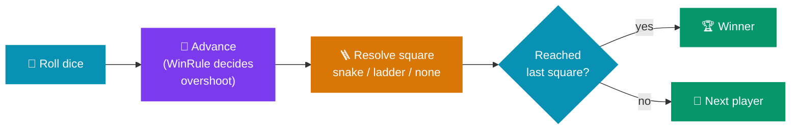
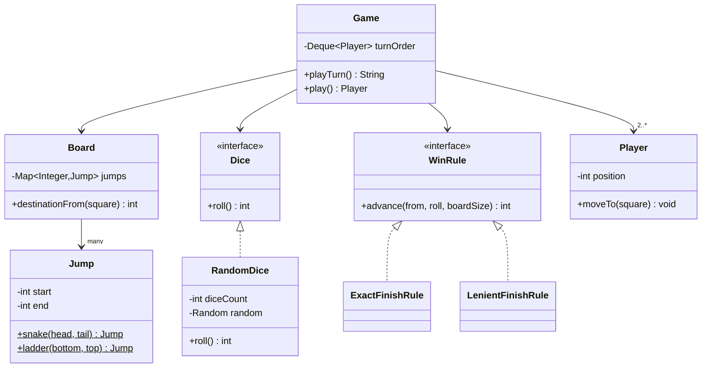
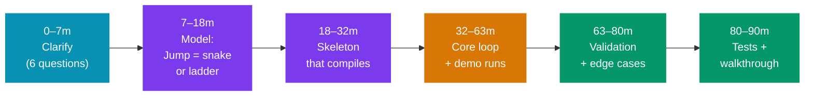

# 🎲 Machine Coding / LLD — Snake & Ladder

> 🎯 **Difficulty:** 🟢 Easy — the warm-up of this collection  
> 🏢 **Asked at:** Zoho, Freshworks, Groww, Meesho, Tekion (screening round), Walmart Global Tech (phone screen)  
> ⏱️ **Format:** Live machine-coding **screen — 60–90 minutes**, working code expected. Shorter than the 2.5-hour machine-coding rounds in this folder.  
> 🧑‍💻 **For:** SDE-2 / experienced backend engineer — clean modelling in a short time, nothing fancy  
> 🥡 **One-liner:** *"You do not lose this one by failing to finish. You lose it by over-engineering a problem that has one real seam (a place that can change) and one real invariant (a rule that must always hold)."*

> 🔥🔥 Very high priority — asked in almost every Tier-1 interview loop &nbsp;·&nbsp; 🔥 High priority — very frequent in Tier-1 interviews &nbsp;·&nbsp; ⚡ Medium priority — commonly asked &nbsp;·&nbsp; 💤 Low priority — good to know, rarely asked

---

## 1. 🧭 What Makes This Problem Tick

Several problems in this folder (01, 02, 03, 08, 09) are 2.5-hour onsite rounds. This one is the **60–90 minute screening round**. The shorter time changes the grading completely. There is no limited shared resource, no pricing model and no allocation policy. The domain is really small, and the interviewer knows it.

So they are not grading clever ideas. They are grading **restraint (not adding extra things) and clean modelling.**

| What they say | What they actually grade |
|---|---|
| "Design Snake & Ladder" | Do you finish? A 60-minute problem left half-built is the strongest possible negative signal. |
| "There are snakes and ladders" | Do you see they are **one concept** (a jump from square A to square B), or do you write two near-identical classes? |
| "Roll a die and move" | Is randomness **injected** so the game is testable, or is `new Random()` buried inside the move loop? |
| "First to 100 wins" | Did you ask about **exact-roll-to-win**? It is the one domain ambiguity here and it changes the move logic. |
| "Add a second die later" | Is `Dice` an interface, or an `int` field on `Game`? |
| *(silently)* | Did you validate the board? A board that nobody can win, or that loops forever, is the real bug in this problem. |
| *(silently)* | Did you add Factory + Singleton + Observer + Command only because you know them? That looks like repeating a textbook. |

> 💡 **Here, a good answer and a bad answer differ only in what you *leave out*.** The playbook's rule ([`00_lld_interview_playbook.md`](./00_lld_interview_playbook.md) §4) is *two seams is usually the right number*. (A seam is a place where the design can change without editing other code.) Snake & Ladder needs about **one**. If you cannot name the requirement a pattern protects against, delete the pattern.



---

## 2. ❓ Problem Statement & Clarifying Questions

**Problem:** Design a Snake & Ladder game. N players take turns. Each player rolls a die and moves their token along a numbered board. Landing on the bottom of a ladder moves the token up. Landing on the head of a snake moves it down. The first player to reach the last square wins.

> 🗣️ **Spend 7 minutes on this, not 15.** In a 90-minute round, the clarifying phase is 8% of the time (playbook §2). That is about six questions with **committed defaults**, not an open discussion. State your position, ask if they object, and move on.

| # | Ask the interviewer | Committed default (state it, move on) |
|---|---|---|
| 1 | **Board size?** | 100 squares, configurable via the `Board` constructor. Players start **off-board on square 0**. |
| 2 | **How many dice? How many faces?** | One six-sided die by default — but behind a `Dice` interface, so 2 dice is a constructor argument, not a rewrite. |
| 3 | **Exact roll to win, or does overshoot count?** | **Exact.** At 97, a roll of 5 forfeits the move. This is *the* domain ambiguity. Ask it directly. Then put it behind a `WinRule`, so the other answer is one class. |
| 4 | **How many players?** | 2 or more, fixed at game start. Turn order is a round-robin queue. |
| 5 | **Can a ladder top be a snake head (chained jumps)?** | **No — rejected at construction.** Chains can cause infinite loops and add nothing interesting. One hop per landing. |
| 6 | **Can a snake head sit on the last square, or a jump endpoint on square 0?** | No. Every endpoint must be a real, non-terminal square (`1..size-1`). A snake head on 100 makes the board unwinnable. |
| 7 | **Three consecutive sixes = turn forfeited?** | Out of scope for v1. It is a house rule, and it needs per-player turn state. Mention it as an extension. |
| 8 | **Persistence / multiplayer over a network?** | In-memory, single JVM, single-threaded. This is a board game where one token moves at a time. **There is no race here.** Saying this clearly is worth more than inventing a race. |

> ⚠️ **Do not invent concurrency.** Candidates who memorised the parking-lot answer go wrong at question 8. Turns are sequential by nature. A `synchronized` keyword in this design is a warning sign, not a good sign. If the interviewer pushes, say: *"if this were a server serving many games, the unit of mutual exclusion is one `Game` instance, and I would confine each game to a single thread rather than lock its internals."*

---

## 3. 📋 Requirements

### ✅ Functional Requirements

| # | Requirement |
|---|---|
| F1 | A configurable **board** of N squares that holds snakes and ladders. |
| F2 | **2+ players**, taking turns in a fixed round-robin order. |
| F3 | A turn = **roll dice → advance → resolve the landing square → check for a win**. |
| F4 | Landing on a **ladder bottom** moves up; landing on a **snake head** moves down. Exactly one hop. |
| F5 | The first player to land on the **last square exactly** wins. Then the game ends. |
| F6 | The board **validates itself at construction** and rejects an impossible configuration. |

### 🛡️ Non-Functional Requirements

| # | Requirement | Why it matters |
|---|---|---|
| N1 | **Testability** — dice injected, so a game outcome is deterministic and assertable. | This is the most valuable non-functional requirement here. It is also the easiest to get wrong. |
| N2 | **Termination** — no board configuration may loop forever. | The one real correctness risk in the problem. |
| N3 | **Extensibility** — dice count and finish rule are swappable without editing `Game`. | The follow-ups are "now two dice" and "now overshoot wins". |
| N4 | **O(1) per move** — a square lookup, not a scan of the snake list. | Easy with a map. A `List<Snake>` scan is the lazy version, and interviewers notice it. |
| N5 | **No shared mutable state** — turns are sequential by definition. | Deliberately *not* thread-safety. Say why. |

---

## 4. 🧱 Core Entities / Use Cases

| Entity | Responsibility | Key attributes |
|---|---|---|
| `Jump` | **One snake or one ladder** — a move from `start` to `end`. A snake is simply a jump where `end < start`. | `start`, `end` |
| `Board` | Owns the board layout: size, the jump map and **all validation**. Answers "where does square X send me?" | `size`, `Map<Integer, Jump>` |
| `Player` | A token: a name and a current square. | `name`, `position` |
| `Dice` (interface) | The only source of randomness. Injected. | — |
| `RandomDice` | N fair dice of F faces. | `diceCount`, `faces`, `Random` |
| `WinRule` (interface) | What a roll past the last square does. | — |
| `ExactFinishRule` / `LenientFinishRule` | Forfeit the move vs. cap at the last square. | — |
| `Game` | The turn engine: a queue of players, one turn at a time. It holds the winner. | `board`, `dice`, `winRule`, `Deque<Player>` |

> 🔑 **The modelling decision you should say clearly:** *"A snake and a ladder are the same object. Both are a jump from one square to another; the only difference is the sign. Two classes here would only be duplicate code. They would not model the domain any better."* That one sentence earns most of the modelling grade on this problem.

### 🔢 Numbers to Remember

| Quantity | Value |
|---|---|
| Squares on the standard board | **100** (10 × 10), typically 9–10 snakes and 8–9 ladders |
| Expected length of a 2-player game | **≈ 30 moves per player** on the §7.7 board (one die, exact finish). This comes from **Markov-chain analysis**. The game is an absorbing Markov chain over 101 states, squares 0–100 (it ends in a state it never leaves). One player alone needs **≈ 42 turns** on average to reach 100. A 2-player game ends when the *first* player finishes, so it is shorter. The demo below finishes in 19 turns each. The variance is large. |
| Cost of one move | **O(1)** — one `HashMap` lookup for the landing square |
| Cost of board construction | **O(N)** in the number of jumps. The endpoint range, duplicate-start and chain checks each take one pass. |
| Memory | **O(J)** for J jumps + O(P) for players. The code never creates objects for the 100 squares. |

---

## 5. 🏗️ Class Diagram



> 🔑 **Cardinality to say while drawing:** one `Game` → one `Board` → many `Jump`; one `Game` → 2..* `Player`. A `Player` does **not** know the board. It only knows its square. Every rule about the board layout lives on `Board`. This is why `Board` can validate itself and `Game` stays a short turn loop.

---

## 6. 🎨 Design Patterns Used — and Why

**This problem needs one pattern. Possibly two. Not five.**

Adding Factory, Singleton, Observer and Command to a board game is the known way to fail here. It looks like you copied patterns from a textbook instead of reading the requirements. In a 90-minute round, it also stops you from finishing. The playbook's test applies: *name the requirement each pattern defends against, or remove it.*

| Pattern | Where | The requirement it defends against | Verdict |
|---|---|---|---|
| **Strategy** ⭐ | `Dice` | "Now play with two dice." A new `Dice` implementation, or a constructor argument. It also makes the game **deterministic in tests**. That is the real benefit. | ✅ Essential |
| **Strategy** | `WinRule` | "Does overshoot win, or must you land exactly?" You asked this in clarification and got an answer. The *other* answer must be one class, not an `if` hidden in `Game`. | ✅ Worth it |
| **Static factory methods** | `Jump.snake()` / `Jump.ladder()` | Direction validation at the only place a `Jump` can be created. This is not the GoF Factory pattern — do not call it that. | ✅ Cheap, honest |
| **Observer** | A move listener for stats / UI | Nothing in the requirements. It is a really good *extension* (§9). But building it in v1 spends your time on a feature nobody asked for. | ⚠️ Mention only |
| **Singleton** on `Board` or `Game` | — | Nothing. There is no global inventory to protect, and it makes the class untestable. | ❌️ Do not |
| **State** on the game | — | The lifecycle has two states, and one boolean can hold it. | ❌️ Do not |

> 💡 **The sentence that earns the point:** *"Snake & Ladder has one thing a product manager might really change — the dice — and one thing I had to ask about, the finish rule. Those are my two interfaces. Everything else here is so small that an extra interface would be a layer I cannot justify."*

---

## 7. 💻 Full Java Implementation

Complete and runnable end to end. You can really finish this in a 90-minute round. The main code is about 300 lines with blank lines, and about 240 without blanks, comments and imports.

### 7.1 Dice — the injected randomness

```java
/** The only source of randomness in the game — injected so tests can make it deterministic. */
public interface Dice {
    int roll();
}
```

```java
import java.util.Random;

/** N fair dice of F faces. The default is the standard single six-sided die. */
public class RandomDice implements Dice {
    private final int diceCount;
    private final int faces;
    private final Random random;

    public RandomDice() {
        this(1, 6, new Random());
    }

    public RandomDice(int diceCount, int faces, Random random) {
        if (diceCount < 1) {
            throw new IllegalArgumentException("Need at least one die, got " + diceCount);
        }
        if (faces < 2) {
            throw new IllegalArgumentException("A die needs at least 2 faces, got " + faces);
        }
        this.diceCount = diceCount;
        this.faces = faces;
        this.random = random;
    }

    @Override
    public int roll() {
        int total = 0;
        for (int i = 0; i < diceCount; i++) {
            total += random.nextInt(faces) + 1;
        }
        return total;
    }
}
```

> 🔎 **Taking `Random` in the constructor is the whole trick.** Production code passes `new Random()`. A test passes `new Random(7)` for a reproducible game, or a `ScriptedDice` for a game where every roll is fixed in advance (§7.9). A `new Random()` hidden inside `roll()` makes the game untestable. That is the single most common defect in submitted solutions to this problem.

### 7.2 Jump — a snake *and* a ladder

```java
/** One snake or one ladder. Immutable, and it validates its own direction. */
public class Jump {
    private final int start;
    private final int end;

    private Jump(int start, int end) {
        this.start = start;
        this.end = end;
    }

    public static Jump snake(int head, int tail) {
        if (tail >= head) {
            throw new IllegalArgumentException("A snake must go down: " + head + " -> " + tail);
        }
        return new Jump(head, tail);
    }

    public static Jump ladder(int bottom, int top) {
        if (top <= bottom) {
            throw new IllegalArgumentException("A ladder must go up: " + bottom + " -> " + top);
        }
        return new Jump(bottom, top);
    }

    public boolean isSnake() {
        return end < start;
    }

    public int getStart() {
        return start;
    }

    public int getEnd() {
        return end;
    }

    @Override
    public String toString() {
        String kind = isSnake() ? "snake" : "ladder";
        return kind + " " + start + "->" + end;
    }
}
```

### 7.3 Board — geometry and *all* validation

```java
import java.util.HashMap;
import java.util.List;
import java.util.Map;

/**
 * The board owns every rule about geometry: how big it is, and where a square
 * teleports you to. All validation happens once, at construction.
 */
public class Board {
    private final int size;
    private final Map<Integer, Jump> jumps = new HashMap<>();

    public Board(int size, List<Jump> jumpList) {
        if (size < 10) {
            throw new IllegalArgumentException("Board needs at least 10 squares, got " + size);
        }
        this.size = size;
        for (Jump jump : jumpList) {
            validateEndpoints(jump);
            Jump clash = jumps.put(jump.getStart(), jump);
            if (clash != null) {
                throw new IllegalArgumentException(
                        "Square " + jump.getStart() + " already starts " + clash);
            }
        }
        validateNoChains();
    }

    /** Endpoints must be real, non-terminal squares: 1 .. size-1. */
    private void validateEndpoints(Jump jump) {
        requireInRange(jump.getStart(), jump);
        requireInRange(jump.getEnd(), jump);
    }

    private void requireInRange(int square, Jump jump) {
        if (square < 1 || square >= size) {
            throw new IllegalArgumentException(
                    "Endpoint " + square + " of " + jump + " must be in 1.." + (size - 1));
        }
    }

    /** A jump landing on the start of another jump would chain — and could loop forever. */
    private void validateNoChains() {
        for (Jump jump : jumps.values()) {
            Jump next = jumps.get(jump.getEnd());
            if (next != null) {
                throw new IllegalArgumentException("Chained jump: " + jump + " lands on " + next);
            }
        }
    }

    /** Resolve one square to its final square. Exactly one hop, because chains are illegal. */
    public int destinationFrom(int square) {
        Jump jump = jumps.get(square);
        if (jump == null) {
            return square;
        }
        return jump.getEnd();
    }

    public Jump jumpAt(int square) {
        return jumps.get(square);
    }

    public int getSize() {
        return size;
    }
}
```

> 💡 **Validating at construction is the most valuable 15 lines in this file.** It catches three separate runtime bugs:
> - a board nobody can win
> - a square used by two jumps
> - an infinite jump chain
>
> All three become one `IllegalArgumentException` at setup, before a single die is rolled. Interviewers notice a **fail-fast constructor** (one that rejects bad input at once). Most candidates never write one here.
>
> ⚠️ **Be honest about the limit.** The range check rejects a snake on the last square. It does not prove that every board can be won. Example: with one die, snake heads on all of 94–99 pass validation, but nobody can ever reach 100. A full check needs a reachability search (BFS over the squares). Mention it; do not build it in 90 minutes.

### 7.4 WinRule — the overshoot seam

```java
/** What happens when a roll would take you past the last square. */
public interface WinRule {
    /** The square landed on before snakes and ladders are applied. */
    int advance(int from, int roll, int boardSize);
}
```

```java
/** Classic rule: you must land on the last square exactly, otherwise you do not move. */
public class ExactFinishRule implements WinRule {
    @Override
    public int advance(int from, int roll, int boardSize) {
        int target = from + roll;
        if (target > boardSize) {
            return from;
        }
        return target;
    }
}
```

```java
/** House rule: any roll that reaches or passes the last square wins. */
public class LenientFinishRule implements WinRule {
    @Override
    public int advance(int from, int roll, int boardSize) {
        return Math.min(from + roll, boardSize);
    }
}
```

### 7.5 Player

```java
/** A token on the board. Starts off-board on square 0. */
public class Player {
    private final String name;
    private int position;

    public Player(String name) {
        if (name == null || name.isBlank()) {
            throw new IllegalArgumentException("Player needs a name");
        }
        this.name = name;
        this.position = 0;
    }

    public void moveTo(int square) {
        this.position = square;
    }

    public String getName() {
        return name;
    }

    public int getPosition() {
        return position;
    }
}
```

### 7.6 Game — the turn engine

```java
import java.util.ArrayDeque;
import java.util.Deque;
import java.util.List;

/**
 * The turn engine. Holds no rules of its own — geometry lives on Board,
 * randomness on Dice, the finish rule on WinRule.
 */
public class Game {
    private final Board board;
    private final Dice dice;
    private final WinRule winRule;
    private final Deque<Player> turnOrder = new ArrayDeque<>();
    private Player winner;
    private int turnsPlayed;

    public Game(Board board, Dice dice, WinRule winRule, List<Player> players) {
        if (players.size() < 2) {
            throw new IllegalArgumentException("Need at least 2 players, got " + players.size());
        }
        this.board = board;
        this.dice = dice;
        this.winRule = winRule;
        this.turnOrder.addAll(players);
    }

    /** Plays exactly one turn and returns a human-readable log line. */
    public String playTurn() {
        if (isOver()) {
            throw new IllegalStateException("Game already won by " + winner.getName());
        }
        Player player = turnOrder.pollFirst();
        int roll = dice.roll();
        int landed = winRule.advance(player.getPosition(), roll, board.getSize());
        Jump jump = board.jumpAt(landed);
        int destination = board.destinationFrom(landed);
        player.moveTo(destination);
        turnsPlayed++;

        StringBuilder log = new StringBuilder();
        log.append(player.getName()).append(" rolled ").append(roll)
           .append(" -> ").append(destination);
        if (jump != null) {
            String kind = jump.isSnake() ? " (snake at " : " (ladder at ";
            log.append(kind).append(landed).append(")");
        }
        if (destination == board.getSize()) {
            winner = player;
            log.append("  *** WINS ***");
        } else {
            turnOrder.addLast(player);
        }
        return log.toString();
    }

    /** Runs until someone wins, printing each turn. Needs a winnable board: validation does not prove that. */
    public Player play() {
        while (!isOver()) {
            System.out.println(playTurn());
        }
        return winner;
    }

    public boolean isOver() {
        return winner != null;
    }

    public Player getWinner() {
        return winner;
    }

    public int getTurnsPlayed() {
        return turnsPlayed;
    }
}
```

> 🔎 **Turn order is an `ArrayDeque`, not an index.**
> - `pollFirst()` / `addLast()` is O(1), and it is easy to see it is a round-robin.
> - The winner is simply *not re-queued*. In the same way, you could drop a player who quits.
>
> An `int currentPlayerIndex` with modulo arithmetic works. But it breaks as soon as a player leaves mid-game.

### 7.7 The standard board

```java
import java.util.List;

/** The 100-square board most people picture: 9 snakes, 8 ladders. */
public final class StandardBoard {
    private StandardBoard() {
    }

    public static Board create() {
        List<Jump> jumps = List.of(
                Jump.ladder(2, 38), Jump.ladder(7, 14), Jump.ladder(8, 31),
                Jump.ladder(15, 26), Jump.ladder(21, 42), Jump.ladder(28, 84),
                Jump.ladder(36, 44), Jump.ladder(51, 67),
                Jump.snake(16, 6), Jump.snake(46, 25), Jump.snake(49, 11),
                Jump.snake(62, 19), Jump.snake(64, 60), Jump.snake(74, 53),
                Jump.snake(89, 68), Jump.snake(92, 88), Jump.snake(95, 75));
        return new Board(100, jumps);
    }
}
```

### 7.8 Demo driver

```java
import java.util.List;
import java.util.Random;

public class SnakeAndLadderDemo {
    public static void main(String[] args) {
        Board board = StandardBoard.create();
        Dice dice = new RandomDice(1, 6, new Random(7));
        Game game = new Game(board, dice, new ExactFinishRule(),
                List.of(new Player("Asha"), new Player("Bhanu")));

        Player winner = game.play();
        System.out.println("Winner: " + winner.getName()
                + " in " + game.getTurnsPlayed() + " total turns");
    }
}
```

**Actual console output** (seed 7 — reproducible, and that is the point):

```
Asha rolled 5 -> 5
Bhanu rolled 3 -> 3
Asha rolled 4 -> 9
Bhanu rolled 5 -> 31 (ladder at 8)
...
Bhanu rolled 6 -> 99
Asha rolled 4 -> 47
Bhanu rolled 4 -> 99
Asha rolled 2 -> 11 (snake at 49)
Bhanu rolled 4 -> 99
Asha rolled 4 -> 26 (ladder at 15)
Bhanu rolled 3 -> 99
Asha rolled 5 -> 31
Bhanu rolled 1 -> 100  *** WINS ***
Winner: Bhanu in 38 total turns
```

### 7.9 🧪 JUnit tests — the differentiator

**Keep the last 10 minutes for this.** The playbook's §6 recipe says three tests are worth more than a fourth feature. On a problem this small, you can write five. The two that matter most:

- **a scripted dice making the whole game deterministic**
- **board validation rejecting an impossible board**

```java
/** Test double: replays a fixed sequence of rolls, then repeats the last one. */
public class ScriptedDice implements Dice {
    private final int[] rolls;
    private int index;

    public ScriptedDice(int... rolls) {
        if (rolls.length == 0) {
            throw new IllegalArgumentException("Need at least one scripted roll");
        }
        this.rolls = rolls;
    }

    @Override
    public int roll() {
        int value = rolls[Math.min(index, rolls.length - 1)];
        index++;
        return value;
    }
}
```

```java
import static org.junit.jupiter.api.Assertions.assertEquals;
import static org.junit.jupiter.api.Assertions.assertFalse;
import static org.junit.jupiter.api.Assertions.assertThrows;
import static org.junit.jupiter.api.Assertions.assertTrue;

import java.util.List;
import org.junit.jupiter.api.Test;

class SnakeAndLadderTest {

    private Board tinyBoard() {
        return new Board(10, List.of(Jump.ladder(3, 8), Jump.snake(7, 2)));
    }

    private Game gameWith(Board board, Dice dice, WinRule rule) {
        return new Game(board, dice, rule, List.of(new Player("A"), new Player("B")));
    }

    /** 1. HAPPY PATH — a scripted dice makes the whole game deterministic and assertable. */
    @Test
    void scriptedDiceProducesADeterministicWinner() {
        // A rolls 3 (ladder 3->8), B rolls 1, A rolls 2 -> square 10.
        Game game = gameWith(tinyBoard(), new ScriptedDice(3, 1, 2), new ExactFinishRule());
        game.playTurn();
        game.playTurn();
        game.playTurn();

        assertTrue(game.isOver());
        assertEquals("A", game.getWinner().getName());
        assertEquals(10, game.getWinner().getPosition());
        assertEquals(3, game.getTurnsPlayed());
    }

    /** 2. THE JUMP — a ladder teleports, a snake bites, a plain square does nothing. */
    @Test
    void ladderTeleportsAndSnakeBites() {
        Board board = tinyBoard();
        assertEquals(8, board.destinationFrom(3));
        assertEquals(2, board.destinationFrom(7));
        assertEquals(5, board.destinationFrom(5));
    }

    /** 3. THE FINISH RULE — the seam that makes overshoot behaviour swappable. */
    @Test
    void exactFinishForfeitsAnOvershootButLenientCapsIt() {
        assertEquals(9, new ExactFinishRule().advance(9, 5, 10));
        assertEquals(10, new ExactFinishRule().advance(9, 1, 10));
        assertEquals(10, new LenientFinishRule().advance(9, 5, 10));

        // Rolling 6 forever on a 10-square board never finishes under the exact rule.
        Game game = gameWith(tinyBoard(), new ScriptedDice(6), new ExactFinishRule());
        game.playTurn();
        game.playTurn();
        game.playTurn();
        game.playTurn();
        assertFalse(game.isOver());
    }

    /** 4. BOARD VALIDATION — a snake head on the winning square makes the board unwinnable. */
    @Test
    void boardRejectsASnakeOnTheWinningSquare() {
        assertThrows(IllegalArgumentException.class,
                () -> new Board(100, List.of(Jump.snake(100, 40))));
        assertThrows(IllegalArgumentException.class,
                () -> new Board(100, List.of(Jump.ladder(60, 100))));
        assertThrows(IllegalArgumentException.class, () -> Jump.ladder(40, 10));
    }

    /** 5. BOARD VALIDATION — a ladder whose top is a snake head would chain. */
    @Test
    void boardRejectsChainedAndDuplicateJumps() {
        assertThrows(IllegalArgumentException.class,
                () -> new Board(100, List.of(Jump.ladder(10, 40), Jump.snake(40, 5))));
        assertThrows(IllegalArgumentException.class,
                () -> new Board(100, List.of(Jump.ladder(10, 40), Jump.snake(10, 5))));
    }
}
```

> 💡 **No `CountDownLatch` here. That is a deliberate answer, not something you forgot.** The playbook's §6 recipe puts a concurrency test second. This is because in most problems, the race is what makes a candidate stand out. Snake & Ladder has no race, because turns are sequential. So the second-most-valuable test is **board validation** instead. Say this to the interviewer. Replacing the recipe's test with the right test shows you understand why the recipe exists.

---

## 8. 🧪 Edge Cases

| # | Edge case | Handling |
|---|---|---|
| E1 | **A ladder whose top is a snake's head** (chained jump) | **Rejected at construction** by `validateNoChains()`. Otherwise `destinationFrom` would need a loop. And a cycle (`10→40`, `40→10`) would hang the game forever. The constructor enforces one hop, so no loop is ever needed. |
| E2 | **A snake head on the last square (100)** | Rejected. Endpoints must be in `1..size-1`. A snake on 100 makes the board **unwinnable**: the snake would send you down at the moment you win. |
| E3 | **A ladder whose top is the last square** | Also rejected by the same range check. It would let a player skip the exact-finish rule. That is a rule change hidden inside board data. |
| E4 | **A jump endpoint on square 0** | Rejected. Square 0 is the off-board start, not a square. A ladder *bottom* on square 1 is fully legal. It is a normal square, and only a roll of 1 reaches it. |
| E5 | **Two jumps starting on the same square** | Rejected. `jumps.put()` returns the previous value, and a non-null return is an error. Without this check, the result would depend on list order. |
| E6 | **Overshooting the last square** | `ExactFinishRule` returns the current square unchanged, so the player forfeits the move. `LenientFinishRule` caps at `size` and wins. Each is one class. The interviewer picks. |
| E7 | **Three consecutive sixes** | Not implemented in v1 (declared out of scope in §2). It needs per-player streak state on the turn loop. See §9. |
| E8 | **Playing a turn after the game is won** | `playTurn()` throws `IllegalStateException`. The winner is never re-queued, so the loop cannot pick them up again either. |
| E9 | **A single player, or zero** | `Game` constructor rejects fewer than 2. |
| E10 | **A board with no snakes and no ladders** | Fully valid. It is an empty jump map. It is useful as a test fixture, and it is the simplest possible proof that the game ends. |

---

## 9. 🚀 Extensions / Follow-ups

| Extension | How to add it |
|---|---|
| **Two or more dice** | Already done: `new RandomDice(2, 6, new Random())`. Nothing in `Game` changes. This is the follow-up they ask most often. You can answer "that is a constructor argument". That answer is the benefit of the `Dice` seam. |
| **Overshoot wins instead** | Swap `ExactFinishRule` → `LenientFinishRule`. Zero edits elsewhere. |
| **Three consecutive sixes = forfeit turn** | Add a streak counter to `Player` (or a small `TurnState`), and have `Game` skip the move on the third six. Note it is a **rule about the turn**, not the board. So it belongs on the turn engine, not on `Dice`. |
| **`GameStatistics` via Observer** | `Game` holds a `List<MoveListener>`; `playTurn()` fires `onMove(player, from, roll, to, jump)`. A `GameStatistics` listener then counts snakes bitten, ladders climbed and the longest single move. `Game` knows nothing about statistics. This is the *right* place for Observer. The right time to add it is after the core works. |
| **N-player turn order** | Already supported. The `ArrayDeque` handles any N. To drop a player, "do not re-queue them", exactly like the winner. |
| **Persistence / resume** | The entire game state is `(board config, player positions, whose turn it is)`. This is a small immutable snapshot. Serialise it to JSON. `Game` gets a constructor that restores the deque order and positions. This is why `Board` is immutable after construction: only the mutable part needs saving. |
| **A UI / networked game** | Now `Game` becomes a server-side object per room, and the concurrency answer from §2 applies. Confine one game to one thread instead of locking its internals. |

---

## 10. ⏱️ 90-Minute Time-Box Plan

> ⚠️ **This plan is deliberately different from the 2.5-hour plans in the other files in this folder.** Snake & Ladder is a screening-round problem. The proportional phase table in [`00_lld_interview_playbook.md`](./00_lld_interview_playbook.md) §2 gives the 90-minute column directly: 7 / 11 / 14 / 31 / 18 / 9 minutes. This plan applies that table with two changes. First, it moves one minute from phase 5 to the tests (17 and 10 minutes). Second, phase 5's time moves from concurrency (which does not exist here) to **board validation**. Board validation is the correctness risk in this problem, so it takes that place.



| Slot | Minutes | Deliverable | Watch-out |
|---|---|---|---|
| 1 | **0–7** | Six clarifying questions with committed defaults. Tell the interviewer your plan. | Do **not** spend 15 minutes here. This is not a 2.5-hour round. All your clarifying time is gone by minute 7. |
| 2 | **7–18** | `Jump` / `Board` / `Player` / `Dice` / `WinRule` / `Game` named, cardinality stated. Say "a snake and a ladder are the same class". | One diagram, about 8 boxes, ten minutes. The diagram is a tool, not the deliverable. |
| 3 | **18–32** | `Dice`, `WinRule`, `Jump`, `Player` written. **Compiles.** | In a 90-minute round, if nothing has compiled by minute 32, you are already behind. You just cannot see it yet. |
| 4 | **32–63** | `Board.destinationFrom`, `Game.playTurn`, `StandardBoard`, `main`. **Run it and watch a game finish.** | This is 35% of the time and the largest single block. A running demo is a clear positive signal. |
| 5 | **63–80** | Board validation (range, duplicate start, chain), overshoot rule, play-after-win guard. Explain the infinite-loop risk as you code. | Do not invent thread-safety instead. Validation *is* this problem's phase 5. |
| 6 | **80–90** | 3–5 JUnit tests, starting with the scripted-dice determinism test. Talk through the extensions. | Protect these ten minutes. Nobody remembers your sixth feature. They remember that you tested. |

> 💡 **If you finish early, do not add features.** (On this problem, you might finish early.) Add tests. Then talk through the extension table in §9. "Two dice is a constructor argument, overshoot is one class, statistics is an Observer" is a stronger ending than a half-built statistics screen.

---

## 11. 🎯 Interview Tips — What Impresses

| # | Tip |
|---|---|
| 1 | **Say early and clearly that the two are one class.** *"A snake and a ladder are one class — a jump with a sign."* This problem exists to test that modelling idea. Saying it in minute 8 sets the tone for everything after. |
| 2 | **Inject the dice, and say why.** *"`Random` comes in through the constructor so a test can make the game deterministic."* That sentence turns a toy into testable software. It is what makes §7.9 possible. |
| 3 | **Ask about exact-roll-to-win.** It is the single domain ambiguity here. Asking it proves you read the requirements, instead of guessing from the title. |
| 4 | **Validate the board in the constructor.** Failing fast on a snake on the last square, or on a chained board, is the one non-obvious correctness idea in the problem. Almost nobody writes it. |
| 5 | **Answer the concurrency question honestly: there is none.** *"Turns are sequential — there is no shared mutable state here. If this were a game server, the unit of isolation is the whole `Game`."* Not inventing a race is a stronger signal than inventing one. |
| 6 | **Do not add extra patterns.** One or two seams. If asked "where would you use a Factory here?", the correct answer is *"I would not — `Jump.snake()` and `Jump.ladder()` are static factory methods, which is a different and cheaper thing."* |
| 7 | **Write the tests.** No file in this folder had a `@Test` before 2026-09-01, and interviewers report the same about candidates. Five tests on a 90-minute problem is possible, and rare. |
| 8 | **Keep `Game` thin.** The turn loop should fit on one screen, because every rule lives elsewhere. If `Game` grows an `if` about snakes, the rule is in the wrong class. |
| 9 | **Show the exact-finish rule in the demo output.** Seeing Bhanu stay on `99` for three turns in a row proves the rule works. It proves it better than describing it. |
| 10 | **Close on restraint.** *"This is a small problem and I built it small. Here is where each follow-up lands."* In a screening round, a clean finish is better than a big one. |

---

> 🥡 *"A snake and a ladder are the same object. Everything else in this problem is a turn loop."*
>
> 🥡 *"There is no race here. The correctness risk is a board that cannot be won or that loops forever. So the validation goes in the constructor. That is this problem's concurrency section."*
>
> 🥡 *"On a 90-minute clock you lose by over-engineering, not by delivering too little. One interface for the dice, one for the finish rule, then tests."*

---
