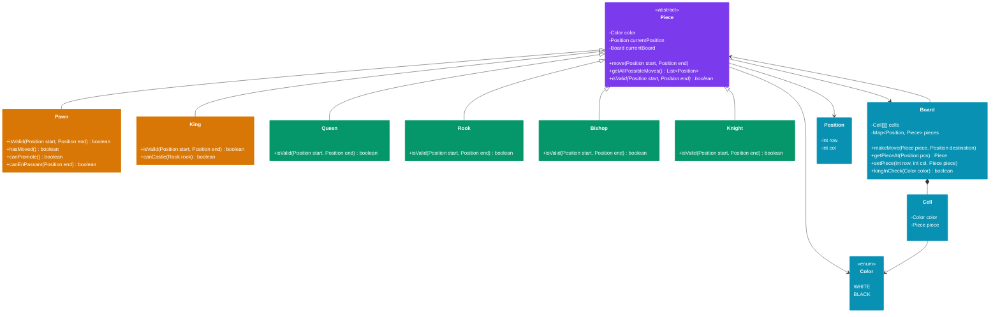
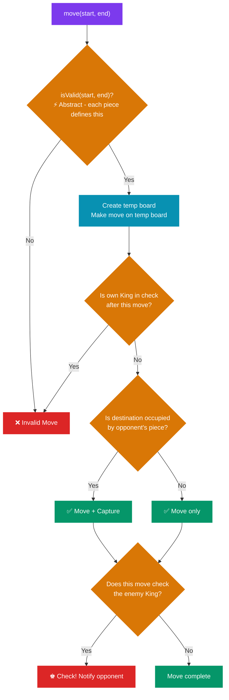
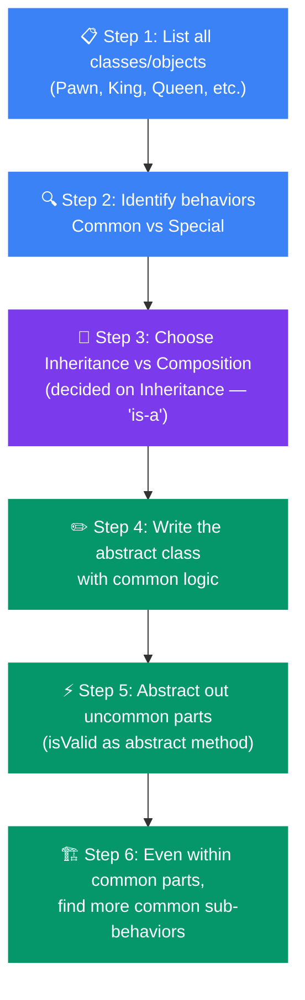
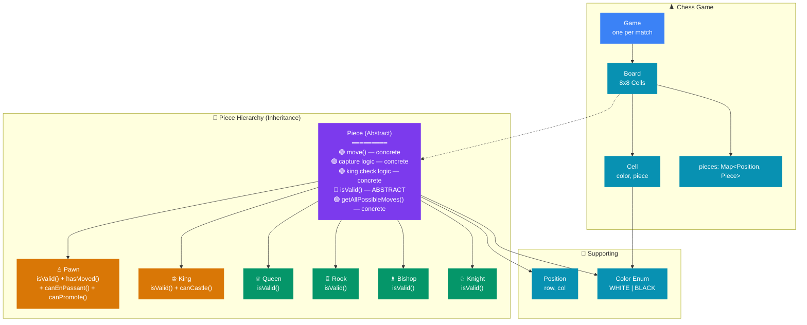

# ♟️ Low Level Design of a Chess App — From Scratch

> ✅ **Code corrected 2026-09-01 — it now compiles.** The code as first written down had
> **11 compile errors**:
>
> - `Board` had no `copy()`.
> - `Piece` had no `getCurrentPosition()`.
> - `Cell` had no `setPiece()`.
> - `Position` had no `equals`/`hashCode`. This is not a compile error. But `Position` is a `Map` key, so a lookup with a new `Position` object always missed.
> - All six piece classes did not implement the abstract methods. Their bodies held only comments.
>
> Now every movement rule is real code. Two rules really depend on game history: en passant
> and castling (castling needs "has the king or rook moved?"). These two methods throw
> `UnsupportedOperationException`. A note in each says *why* the rule belongs on `Game` and
> not on the piece. That reason is itself the
> modelling lesson.
>
> 💬 **This is still a `50_` discussion-grade file.** You cannot build Chess in a 2.5-hour
> machine-coding slot. Do not practise it as a timed practice run. Read it for two things: the
> inheritance-vs-composition decision and the behaviour matrix. The `SlidingPiece` / `Knight`
> split below is the main argument.

> 📺 **Video:** [Low Level Design of Chess](https://www.youtube.com/watch?v=I-iZbOVXwxg)  
> 📋 **Playlist:** [LLD Series by Gaurav Sen](https://www.youtube.com/playlist?list=PLMCXHnjXnTnvQVh7WsgZ8SurU1O2v_UM7)  
> 🎙️ **Speaker:** Gaurav Sen  
> 🎯 **Difficulty:** 🟡 Intermediate  
> 👥 **Target Audience:** SDE-1 to SDE-3 / Software Engineers

---

## 1. 🧭 What This Session Is About

This is a live coding session. Gaurav explains the **Low Level Design (LLD) of a Chess application** step by step. The goal is **not** to build a production-grade chess engine. The goal is to show how to **approach an LLD interview problem** in a clear, step-by-step way:

- identify classes and behaviors
- choose between inheritance and composition
- abstract the common logic
- write clean, readable code

> 💡 *"Low level design is much more focused on the code that you write — making sure the code is maintainable, high quality, readable, and how classes are going to talk to each other."*

---

## 2. 🆚 HLD vs LLD — Setting the Context

Before he starts on chess, Gaurav explains the difference between **High Level Design** and **Low Level Design**:

| Aspect | 🏗️ High Level Design (HLD) | 💻 Low Level Design (LLD) |
|--------|:----:|:----:|
| **Focus** | Different components/services interacting | Code quality, class design, maintainability |
| **Cares about** | Scale, distributed systems, data flow | Readability, extensibility, testability |
| **Example for Chess** | How to handle millions of connections, consistent hashing, thundering herd | How to model chess pieces, move validation, class hierarchy |
| **Tests** | Can your system handle load? | Will your code survive a pull request? |

> 🗣️ *"Think of the ideal LLD interview as a place where you write code and it will survive a pull request — it will be accepted."*

### 🤔 What is LLD NOT?
- ❌️ Not about choosing technology stacks
- ❌️ Not about database schema design
- ❌️ Not about distributed systems architecture
- ✅ It IS about: class models, OOP-based design, working code, coding skills + software design skills

---

## 3. 🧠 The LLD Interview Mindset

Gaurav shares some key points about what interviewers look for:

### 🎯 What Interviewers Test
- Is this person **hands-on with coding**?
- Does this person think about engineering criteria like **throughput, latency, testability**?
- Is the code **extensible** and **maintainable**?
- How well can they **break down software problems** into real software components?

### ⚡ LLD vs Machine Coding
| LLD Round | Machine Coding Round |
|-----------|---------------------|
| Higher-level class design | More real-life, engineering-focused |
| Show thought process & class structure | Solve one specific engineering problem end-to-end |
| Discuss architecture decisions | Write fully working code |
| Example: *"Design a chess app"* | Example: *"Design a cache"* or *"Design a rate limiter"* |

> 🗣️ *"If someone says 'do the low level design of Zomato' — it's a joke. It doesn't really mean anything. But if you say 'design a cache' or 'design an event bus' — you can at least come up with something which makes sense."*

### 📝 The Right Approach — Don't Jump to Code!

Gaurav says this very strongly:

> ⚠️ *"Jumping to the code just like that is a really bad idea. Don't do that."*

Instead, follow this process:


> 💡 *"I'm not staying with the code, thinking and writing code at the same time. I'm thinking FIRST, then writing code."*

---

## 4. ♟️ Step 1: Identify the Chess Pieces (Objects)

The first thing Gaurav does is list all the objects in the system:

| Piece | Symbol |
|-------|:------:|
| Pawn | ♙ |
| Queen | ♕ |
| King | ♔ |
| Knight | ♘ |
| Rook | ♖ |
| Bishop | ♗ |

---

## 5. 🔍 Step 2: Identify Behaviors for Each Piece

Next, Gaurav lists **what each piece can do**. He finds both **common behaviors** and **special/unique behaviors**:

### 📊 Behavior Matrix

| Behavior | ♙ Pawn | ♕ Queen | ♔ King | ♘ Knight | ♖ Rook | ♗ Bishop |
|----------|:------:|:-------:|:------:|:--------:|:------:|:--------:|
| **Move** | ✅ | ✅ | ✅ | ✅ | ✅ | ✅ |
| **Capture** | ✅ | ✅ | ✅ | ✅ | ✅ | ✅ |
| **Double Move** | ✅ (first move only) | ❌️ | ❌️ | ❌️ | ❌️ | ❌️ |
| **En Passant** | ✅ | ❌️ | ❌️ | ❌️ | ❌️ | ❌️ |
| **Promotion** | ✅ (at last rank) | ❌️ | ❌️ | ❌️ | ❌️ | ❌️ |
| **Castling** | ❌️ | ❌️ | ✅ | ❌️ | ❌️ | ❌️ |

### 🟢 Common Behaviors (All pieces share these)
1. **Move** — Move from one square to another
2. **Capture** — Capture an opponent's piece (a function of moving)
3. **Check** — A move can result in checking the enemy king

### 🔴 Special Behaviors (Unique to specific pieces)
- **Pawn:** Double move, en passant, promotion
- **King:** Castling

> 💡 *"Important to note: common behaviors, not exactly same behaviors. Like a dog barks in one way, a different kind of dog barks in a very different way."*

### 🔑 Key Insight: Capture = Part of Move

Gaurav makes it simpler. He notes that `capture` is really just a **side effect of move**. If you move to a square that has an opponent's piece, that piece is captured. In the same way, `check` is also a side effect of a valid move. So the core operations become:

1. **Move** (which may result in a capture and/or check)
2. **Get All Possible Moves** (returns list of valid moves)

---

## 6. 🤔 Step 3: Inheritance vs Composition — The Big Decision

This is where the design work becomes interesting. Gaurav compares two approaches:

### 🔵 Inheritance — "is-a" relationship
```
Rook IS A Piece → inherits all piece behaviors
Pawn IS A Piece → inherits all piece behaviors
```

### 🟣 Composition — "has-a" relationship
```
Pawn HAS A piece (or has capabilities for moving)
Rook HAS something that gives it movement characteristics
```

### 🧠 The Analogy

> 🗣️ *"An animal has teeth — an animal IS a biter. Different ways of thinking. My skeleton does not have me — I have my skeleton."*

### ✅ The Verdict: Inheritance

Gaurav chooses **inheritance** because:
- A Rook **is** a piece. This is much more natural to say than "a Rook has a capability to move".
- All pieces share the **fundamental identity** of being a chess piece
- A piece can move, capture, check the enemy king, and has valid moves. These things ARE what a piece is, at its core.

> 🗣️ *"The way you think is the way in which you speak, and the way you speak to the computer is the way in which you write code. So it's important that you use precise language and the right model of thinking."*

### ⚠️ Why Not Rush Into Inheritance?

Gaurav does not pick inheritance right away. He does this on purpose:

> 🗣️ *"The problem with inheritance or composition is that once you make a commitment, you can be wrong. And once you're wrong you have to backtrack. So it's best to think it through on the whiteboard before you jump into code."*

---

## 7. 🏛️ Architecture Overview



---

## 8. 💻 Code Implementation — Step by Step

### The `Piece` Abstract Class 🧩

This is the **most important class in the design**. It holds all the common move logic. Only `isValid()` stays abstract. Each piece type implements it.

```java
public abstract class Piece {
    Color color;
    Position currentPosition;
    Board currentBoard;

    // Common move logic — same for ALL pieces
    public void move(Position start, Position end) {
        if (isValid(start, end)) {
            // Check if move puts own king in check
            Board tempBoard = currentBoard.copy();
            tempBoard.makeMove(this, end);
            
            if (!tempBoard.kingInCheck(this.color)) {
                // Valid move — execute it
                // Check if opponent's piece was at destination (capture)
                Piece destinationPiece = currentBoard.getPieceAt(end);
                if (destinationPiece != null 
                    && !destinationPiece.getColor().equals(this.color)) {
                    // This is a capture!
                }

                // Make the move on the real board FIRST. makeMove() reads
                // currentPosition to clear the start square, so update it after.
                currentBoard.makeMove(this, end);
                currentPosition = end;
            }
        }
    }

    // Different for EVERY piece — abstract method
    public abstract boolean isValid(Position start, Position end);

    // Get all moves that pass isValid(). These are pseudo-legal: a move that
    // leaves your own king in check is still listed (move() rejects it later).
    // Default: brute-force the 64 squares
    // through isValid(). O(64) is irrelevant here and it means a new piece type
    // only has to implement ONE method — the movement rule.
    public List<Position> getAllPossibleMoves() {
        List<Position> moves = new ArrayList<>();
        for (int r = 0; r < 8; r++) {
            for (int c = 0; c < 8; c++) {
                Position end = new Position(r, c);
                if (!end.equals(currentPosition) && isValid(currentPosition, end)) {
                    moves.add(end);
                }
            }
        }
        return moves;
    }

    public Color getColor() {
        return this.color;
    }

    public Position getCurrentPosition() {
        return this.currentPosition;
    }
}
```

> 🔍 **Key Design Decision:** The `move()` method is **concrete** in the abstract class. The reason: the **flow** of moving is the same for all pieces. It validates, checks for self-check, and handles capture. Only `isValid()` changes per piece type.

---

### The `isValid()` Flow — Common + Specific Logic

Inside `move()`, the validation works in layers:



The `isValid()` method checks the **move patterns specific to each piece**. For example, a rook moves in straight lines and a bishop moves diagonally. Some checks are common to all pieces:

1. ✅ You **can't capture your own piece**. Each piece's `isValid()` checks this by comparing colors (`target.getColor() != color`).
2. ✅ A move **can't put your own king in check**. `move()` checks this with a temporary board.
3. ✅ If your king **is already in check**, you can only make a move that ends the check: move the king, block the checking piece, or capture it. The same temporary-board test covers all three.

---

### The `Board` Class 🎲

The board manages the **state of the game**. That means: where all the pieces are. It also gives methods to change that state.

```java
public class Board {
    private final Cell[][] cells = new Cell[8][8];   // 8x8 matrix of cells
    private final Map<Position, Piece> pieces = new HashMap<>();

    public Board() {
        for (int r = 0; r < 8; r++) {
            for (int c = 0; c < 8; c++) {
                // Dark square when row+col is even: a1 = (0,0) is dark ("light on the right")
                cells[r][c] = new Cell((r + c) % 2 == 0 ? Color.BLACK : Color.WHITE);
            }
        }
    }

    // A shallow copy of the piece map, for "does this move expose my king?".
    // We never mutate the pieces themselves. Caveat: each piece still points
    // at the REAL board (currentBoard), so a real kingInCheck() must pass this
    // copy into the move check, or the pieces will read the real board.
    public Board copy() {
        Board clone = new Board();
        clone.pieces.putAll(this.pieces);
        return clone;
    }

    // Get piece at a position
    public Piece getPieceAt(Position position) {
        return pieces.get(position);
    }

    // Make a move — remove from current, place at destination.
    // Update BOTH views: the map and the cells.
    public void makeMove(Piece piece, Position destination) {
        Position from = piece.getCurrentPosition();
        pieces.remove(from);
        pieces.put(destination, piece);
        cells[from.getRow()][from.getCol()].setPiece(null);
        cells[destination.getRow()][destination.getCol()].setPiece(piece);
    }

    // Set a piece at a specific cell. getPieceAt() reads the map, so the
    // map must be updated too, or the piece is invisible to every isValid().
    public void setPiece(int row, int col, Piece piece) {
        cells[row][col].setPiece(piece);
        pieces.put(new Position(row, col), piece);
    }

    // Check if king of a given color is in check
    public boolean kingInCheck(Color color) {
        // Complex logic — check if any opponent piece
        // can capture the king of this color
        return false;  // Simplified — interviewer unlikely to ask full impl
    }
}
```

### 🔐 Design Choice: Board Controls Cells, Not the Outside World

Someone in the audience asks: *"If board has cells, should outside code directly call cell methods, or go through the board?"*

Gaurav gives a clear answer:

> 🗣️ *"Should a board allow the cells inside it to be manipulated by outside parties? In my personal opinion — NO."*

Two approaches:

```java
// ❌️ Approach 2: Expose cells externally
public Cell getCell(int row, int col) {
    return cells[row][col];  // Outsider can now do anything to this cell
}

// ✅ Approach 1: Board mediates all cell operations
public void setPiece(int row, int col, Piece piece) {
    cells[row][col].setPiece(piece);  // Board maintains control
    // Can add validations here if needed
}
```

> 🗣️ *"Anything that happens inside the board, inside those cells, is the responsibility of the board. I will not allow them to take a cell and do what they want. If I need validations, I'll add them here."*

---

### The `Cell` Class 📍

```java
public class Cell {
    private final Color color;   // White or Black — fixed at construction
    private Piece piece;         // Can be null (empty cell)

    public Cell(Color color) {
        this.color = color;
    }

    public Color getColor() {
        return color;
    }

    public Piece getPiece() {
        return piece;
    }

    public void setPiece(Piece piece) {
        this.piece = piece;
    }
}
```

### The `Color` Enum 🎨

```java
public enum Color {
    WHITE,
    BLACK
}
```

### The `Position` Class 📐

```java
public class Position {
    private final int row;
    private final int col;

    public Position(int row, int col) {
        this.row = row;
        this.col = col;
    }

    public int getRow() { return row; }
    public int getCol() { return col; }

    public boolean onBoard() {
        return row >= 0 && row < 8 && col >= 0 && col < 8;
    }

    // ⚠️ NOT optional. Position is the KEY of Map<Position, Piece>, so without
    // these two, getPieceAt(new Position(0, 0)) returns null forever — every
    // lookup misses because the default equals() is identity.
    @Override
    public boolean equals(Object o) {
        if (this == o) return true;
        if (!(o instanceof Position)) return false;
        Position other = (Position) o;
        return row == other.row && col == other.col;
    }

    @Override
    public int hashCode() {
        return Objects.hash(row, col);
    }
}
```

---

## 9. 🎯 Specific Piece Implementations

### ♙ Pawn — The Most Complex Piece

The Pawn has the most special behaviors:

```java
public class Pawn extends Piece {

    @Override
    public boolean isValid(Position start, Position end) {
        if (!end.onBoard()) return false;

        int dir = (color == Color.WHITE) ? 1 : -1;      // white moves up the board
        int startRank = (color == Color.WHITE) ? 1 : 6;
        int dRow = end.getRow() - start.getRow();
        int dCol = end.getCol() - start.getCol();

        Piece target = currentBoard.getPieceAt(end);

        // Straight push — destination must be empty
        if (dCol == 0 && target == null) {
            if (dRow == dir) return true;
            // Double push, only from the starting rank, and only if unblocked
            if (dRow == 2 * dir && start.getRow() == startRank) {
                return currentBoard.getPieceAt(
                        new Position(start.getRow() + dir, start.getCol())) == null;
            }
        }

        // Diagonal capture — destination must hold an enemy piece
        return Math.abs(dCol) == 1 && dRow == dir
                && target != null && target.getColor() != color;
    }

    // Whether this pawn has ever moved is DERIVED, not stored — a pawn can
    // never move backwards, so being on its starting rank proves it has not moved.
    public boolean hasMoved() {
        int startRank = (color == Color.WHITE) ? 1 : 6;
        return currentPosition.getRow() != startRank;
    }

    public boolean canPromote() {
        int lastRank = (color == Color.WHITE) ? 7 : 0;
        return currentPosition.getRow() == lastRank;
    }

    // En passant needs the OPPONENT'S LAST MOVE, which a Piece cannot see.
    // That is a modelling signal, not an oversight: it belongs on the Game /
    // Board as move history, not on the piece. Left unimplemented deliberately.
    public boolean canEnPassant(Position end) {
        throw new UnsupportedOperationException(
            "needs move history — belongs on Game, not Pawn");
    }
}
```

> 💡 **Smart Design Note:** Gaurav points out that you **don't need a boolean** to track whether a pawn has moved. Just look at its **current position**. If it's on the starting square, it hasn't moved. A pawn can never go backwards, so this check is always correct.

### ♔ King

```java
public class King extends Piece {

    @Override
    public boolean isValid(Position start, Position end) {
        if (!end.onBoard()) return false;
        int dRow = Math.abs(end.getRow() - start.getRow());
        int dCol = Math.abs(end.getCol() - start.getCol());
        if (dRow > 1 || dCol > 1) return false;
        Piece target = currentBoard.getPieceAt(end);
        return target == null || target.getColor() != color;
    }

    // Castling needs: neither piece has moved, the squares between are empty,
    // and the king is not in check nor passes through an attacked square.
    // "Has moved" is state the King alone cannot answer — same modelling point
    // as en passant. It belongs on the Game.
    public boolean canCastle(Rook rook) {
        throw new UnsupportedOperationException(
            "needs move history and attack map — belongs on Game, not King");
    }
}
```

### ♕♖♗♘ Queen, Rook, Bishop, Knight

```java
// Shared by every sliding piece (Queen, Rook, Bishop): the direction is legal
// AND nothing stands between start and end AND the destination is not our own.
abstract class SlidingPiece extends Piece {

    protected abstract boolean directionAllowed(int dRow, int dCol);

    @Override
    public boolean isValid(Position start, Position end) {
        if (!end.onBoard()) return false;
        int dRow = end.getRow() - start.getRow();
        int dCol = end.getCol() - start.getCol();
        if (dRow == 0 && dCol == 0) return false;
        if (!directionAllowed(dRow, dCol)) return false;

        int stepRow = Integer.signum(dRow);
        int stepCol = Integer.signum(dCol);
        int r = start.getRow() + stepRow;
        int c = start.getCol() + stepCol;
        while (r != end.getRow() || c != end.getCol()) {      // path must be clear
            if (currentBoard.getPieceAt(new Position(r, c)) != null) return false;
            r += stepRow;
            c += stepCol;
        }
        Piece target = currentBoard.getPieceAt(end);
        return target == null || target.getColor() != color;
    }
}

public class Rook extends SlidingPiece {
    @Override
    protected boolean directionAllowed(int dRow, int dCol) {
        return dRow == 0 || dCol == 0;
    }
}

public class Bishop extends SlidingPiece {
    @Override
    protected boolean directionAllowed(int dRow, int dCol) {
        // Cell colour needs no special handling — the diagonal math enforces it
        return Math.abs(dRow) == Math.abs(dCol);
    }
}

public class Queen extends SlidingPiece {
    @Override
    protected boolean directionAllowed(int dRow, int dCol) {
        return dRow == 0 || dCol == 0 || Math.abs(dRow) == Math.abs(dCol);
    }
}

// The Knight is NOT a SlidingPiece — it jumps, so it has no path to check.
// This split is Step 6 ("find common sub-behaviours"), still done with inheritance.
public class Knight extends Piece {
    @Override
    public boolean isValid(Position start, Position end) {
        if (!end.onBoard()) return false;
        int dRow = Math.abs(end.getRow() - start.getRow());
        int dCol = Math.abs(end.getCol() - start.getCol());
        if (!((dRow == 2 && dCol == 1) || (dRow == 1 && dCol == 2))) return false;
        Piece target = currentBoard.getPieceAt(end);
        return target == null || target.getColor() != color;
    }
}
```

> 💡 Someone asks about "white bishops on white cells and black bishops on black cells". Gaurav notes: *"You don't need to worry about the color of the cell. Just check the diagonal math from the current position. The color is automatically taken care of."*

---

## 10. 📐 The Design Process — Summary

Gaurav sums up the step-by-step method he used:



> 🗣️ *"What we have done is: we took common behaviors and extracted them. We took special behaviors and extracted them. Even in the common parts, we found things that could be defined in a common way — like capturing and checking."*

---

## 11. 🧩 Design Patterns & Principles Mentioned

### 🏭 Singleton Pattern
- The **Board** should **not** be a Singleton.
  - There is one board *per game*. A chess server runs many concurrent games.
  - A Singleton board would make every game share one position.
  - Make the board a part of the `Game` instance (composition). This also makes it easy to test.
  - "There is only one X in a Y" is a reason to use *composition*. It is never a reason to use a global.

### 🔀 Abstract Class vs Interface
Gaurav first creates `Piece` as an interface. Then he realizes:
- There are **common concrete behaviors** inside `move()`. For example: checking if your own king is in check, and handling captures.
- So an **abstract class** fits better. It can have fields (color, position, board), concrete methods and abstract methods. Since Java 8, an interface can also have concrete `default` methods, but it cannot have instance fields.

> 🗣️ *"Because it has multiple abstract methods I'll call it an interface... wait, we are seeing certain behaviors are common inside a move also. Right — if you capture then you do a certain kind of thing. So maybe I'll make it an abstract class."*

### 🧱 Encapsulation
- Board should **not expose cells** for outside code to change directly
- All interactions with cells should go **through the Board's public methods**
- Then you can add validations later without breaking outside code

---

## 12. 🎤 Q&A Highlights

### ❓ Can I use C++ for LLD interviews?
> 🗣️ Yes, fully. Most principles are **language agnostic** (they work the same in any language). Design patterns, OOP principles, and engineering thinking apply across all OOP languages.

### ❓ Is LLD the same as machine coding?
> 🗣️ Slightly different. Machine coding is closer to real work. You solve one specific engineering problem end-to-end. LLD is about **class design and software architecture**.

### ❓ Do I ever write code in production the same way as in LLD interviews?
> 🗣️ LLD interview gives you 45 min–1.5 hours. In production, you have more time to think through things and write test cases. In LLD, you try to **impress the interviewer** with your thought process. You do not try to write production-ready code.

### ❓ Is it possible to cover all SOLID principles + design patterns + write full code in one interview?
> 🗣️ *"I personally can't do it. The intent of the interview is to find out whether this person is good enough at software architecture — that when they join the team, they're not going to write horrible code."*

### ❓ How to know if the interview expects LLD or HLD?
> 🗣️ **Just ask!** *"Do not waste your time and their time by assuming things. In fact, you will fail the interview because you assumed it."*

### ❓ Do you need to walk the interviewer through design patterns you're using?
> 🗣️ Design patterns are technical terms, so the interviewer should know them. But if they don't (or act like they don't), you can explain. *"The more you explain, the better."*

### ❓ Should Board be a matrix or a map?
> 🗣️ Both work. Using a `Map<Position, Piece>` focuses on behavior. Using a `Cell[][]` matrix is more realistic. In the session, Gaurav showed both. He first used a map. Then he refactored to an 8×8 cell matrix for better modeling.

### ❓ What about functional programming in LLD?
> 🗣️ Most interviewers expect OOP principles. But you can teach them about functional programming approaches. *"The interviewer is usually very open to new technical approaches to the same problem."*

### ❓ How to practice LLD?
> 🗣️ Resources recommended:  
> - **Refactoring Guru** (refactoring.guru) — excellent for design patterns  
> - **GitHub: interview-ready/low-level-design** — has 4 machine coding examples (rate limiter, service orchestrator/load balancer, event bus, cache)

### ❓ Efficiency considerations in LLD?
> 🗣️ *"Am I creating too many objects? Are these going to be network calls? Those are the efficiency considerations in a low level design interview."*

### ❓ Tips for refactoring existing code?
> 🗣️ Two tips:  
> 1. **Write test cases first** before refactoring. They make sure the new code doesn't break old expectations.  
> 2. **Start with the messiest (dirtiest) piece of code** and **draw/design it first** before jumping to code

---

## 13. 📊 Complete Class Relationship Diagram



---

## 14. 🎯 Key Takeaways

| # | Takeaway |
|---|----------|
| 1️⃣ | **Don't jump to code.** First, use the whiteboard to understand the classes, behaviors, and relationships. This saves you from going back and redoing work. |
| 2️⃣ | **Identify common vs special behaviors** before you decide the class design. This tells you what goes in the parent class and what goes in the child classes. |
| 3️⃣ | **"Is-a" vs "Has-a"** matters. Choose the mental model that fits your domain most naturally. A Rook IS a piece, not a Rook HAS a piece. |
| 4️⃣ | **Abstract classes > Interfaces** when the common logic needs shared state (fields) AND some behavior varies. Since Java 8, an interface can hold common logic in `default` methods, but not instance fields. |
| 5️⃣ | **Encapsulate internal state.** Don't expose cells for outside code to change directly. Everything goes through the Board. This is real-world engineering. |
| 6️⃣ | **Write neatly and explain clearly.** In interviews, you're not explaining to yourself. You're explaining to the interviewer. Treat them with respect. |
| 7️⃣ | **LLD principles are language agnostic.** Design patterns, SOLID principles, and OOP concepts apply across Java, C++, Python, Go, etc. |
| 8️⃣ | **Practice is the only shortcut.** Even 10-year experienced engineers struggle with LLD interviews without practice. |

---

> 🥡 *"The way you think is the way in which you speak, and the way you speak to the computer is the way in which you write code."* — Gaurav Sen
