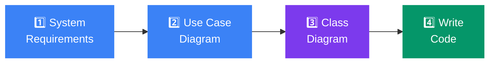
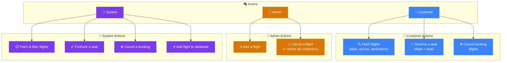
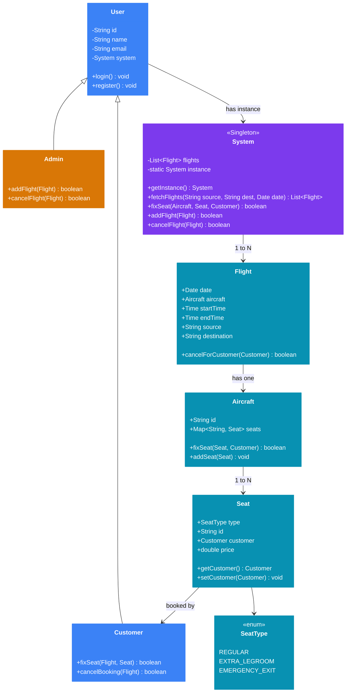
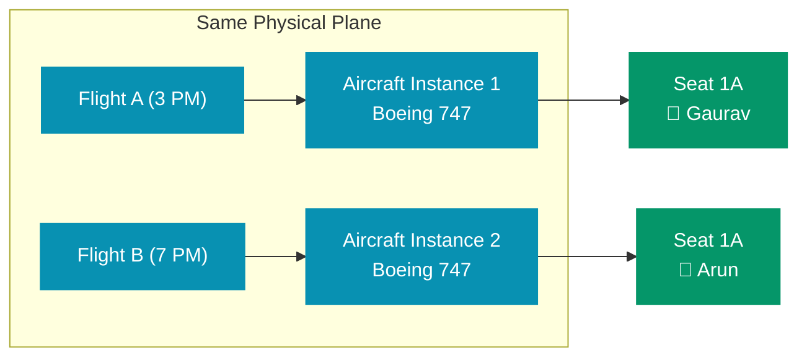
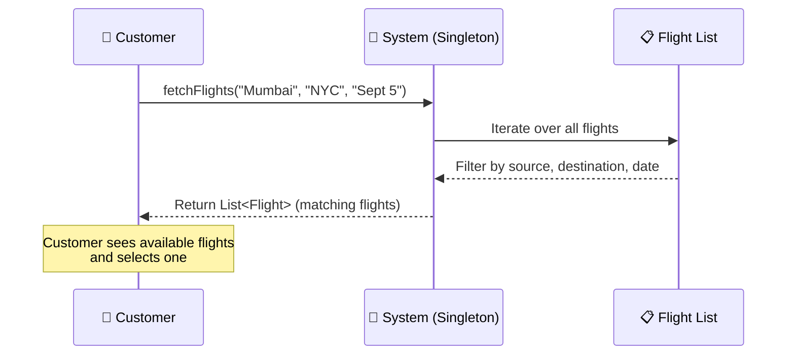
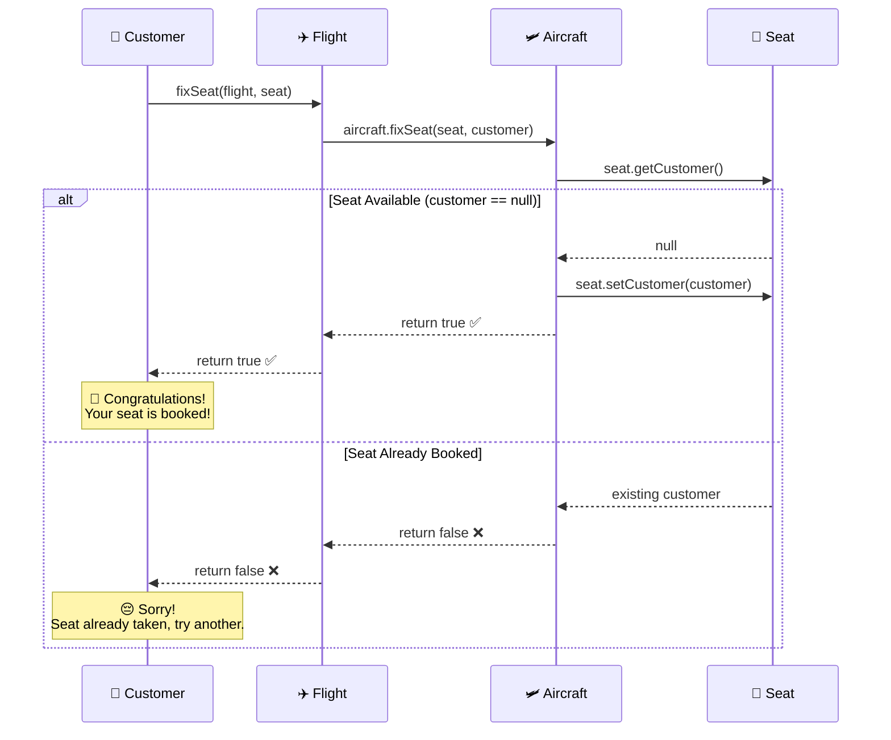
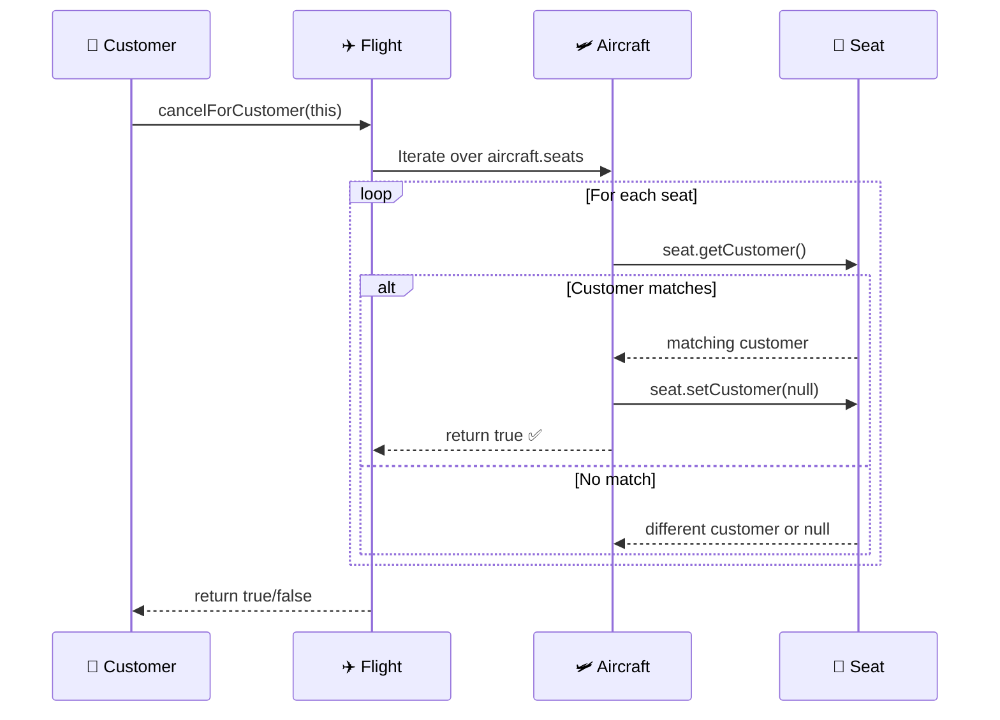
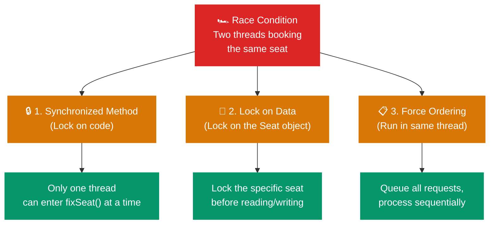
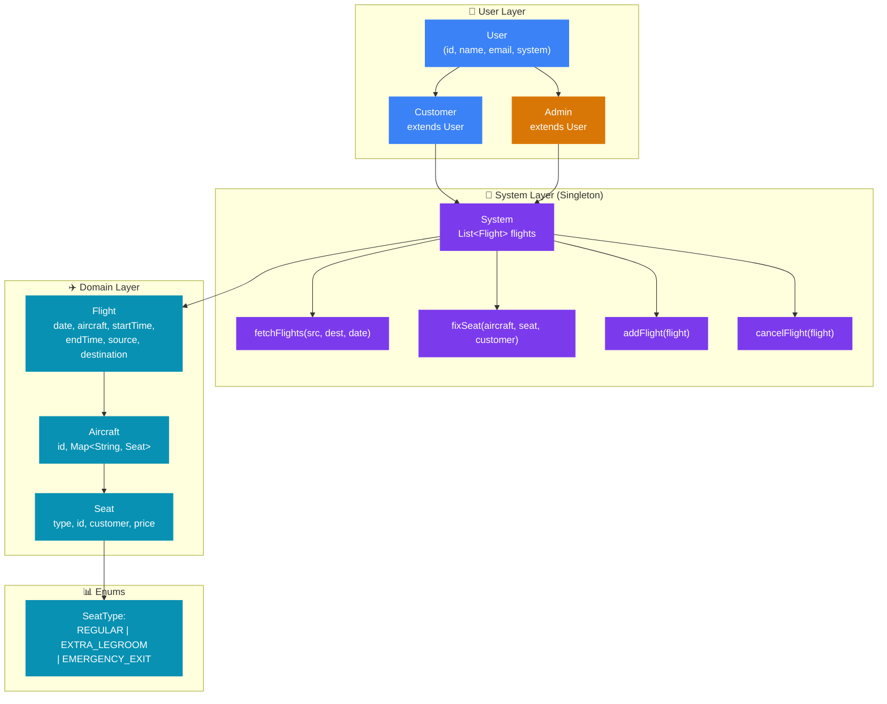

# ✈️ Low Level Design of MakeMyTrip — Flight Booking System

> 📺 **Video:** [LLD of MakeMyTrip](https://www.youtube.com/watch?v=pnkd8mVyTNQ)  
> 📋 **Playlist:** [LLD Series by Gaurav Sen](https://www.youtube.com/playlist?list=PLMCXHnjXnTnvQVh7WsgZ8SurU1O2v_UM7)  
> 🎙️ **Speakers:** Gaurav Sen & Arun Goel (Software Engineer at Atlassian)  
> 🎯 **Difficulty:** 🟡 Intermediate  
> 👥 **Target Audience:** SDE-1 to Senior SDE / Software Engineers  
> 🎬 **Format:** Mock Interview Style (Arun as candidate, Gaurav as interviewer)

---

## 1. 🧭 What This Session Is About

This is a **mock LLD interview**. Arun designs a **MakeMyTrip-like flight booking system**. MakeMyTrip, Booking.com and other travel booking sites use this kind of platform. The system handles **flight search, seat booking, cancellation, and concurrency**. Gaurav plays the interviewer. He pushes Arun to think through edge cases and design decisions.

The session follows a **structured method**: Requirements → Use Case Diagram → Class Diagram → Code. This series uses the same approach in every session.

> 💡 *"This kind of app is a booking app. You can book a ticket in a bus, book a ticket in a train... MakeMyTrip in general wants to handle everything end to end when it comes to your trip."*

The strong point of this design is its **generalizability**: it works for more than one travel type. The same architecture works for flights, buses, trains, and hotels with only small changes.

---

## 2. 🔄 The Structured LLD Approach (Recap)

The speakers use the same proven process again:



> 🗣️ Arun: *"If we had just started to code, we would not have been able to do 50% of what we did. The class diagram helped me quickly write all the functions."*
>
> 🗣️ Gaurav: *"For building the class diagram, you reference the use case diagram. For writing the code, you reference the class diagram."*

---

## 3. 📋 Step 1: Gathering Requirements

Arun starts by listing what **customers** and **admins** can do:

### 👤 Customer Requirements
| # | Requirement | Details |
|---|-------------|---------|
| 1️⃣ | **Search Flights** | By date, source, and destination |
| 2️⃣ | **View Seat Availability** | See which seats are booked and which are free |
| 3️⃣ | **Reserve a Seat** | Book a specific seat on a specific flight |
| 4️⃣ | **Cancel Reservation** | Cancel an existing booking |
| 5️⃣ | **Different Seat Types** | Regular, Extra Legroom, Emergency Exit |

### 🔑 Admin Requirements
| # | Requirement | Details |
|---|-------------|---------|
| 1️⃣ | **Add a Flight** | Add a flight to the schedule |
| 2️⃣ | **Cancel a Flight** | Cancel a flight + generate refunds for all customers |

### 🎯 Scope Simplification

Gaurav guides the interview toward what matters:

> 🗣️ Gaurav: *"Let us assume we don't want to go into too much detail on adding a flight or adding a hotel. We assume flights exist."*

**In scope:** Flight search, seat booking, cancellation, concurrency
**Out of scope:** Admin flows, payment processing, refund logic, hotel/bus specifics

### 🔁 Generalizability Across Travel Types

| Travel Type | What Changes | What Stays the Same |
|:-----------:|:-------------|:--------------------|
| ✈️ **Flights** | Fetch flights | Booking, cancellation, seat selection |
| 🚌 **Buses** | Fetch buses | Same flow, same seat types |
| 🏨 **Hotels** | Fetch hotels → rooms | Same flow, rooms instead of seats |
| 🚆 **Trains** | Multiple destinations per trip | Same booking mechanism |

> 🗣️ Arun: *"Booking a hotel or booking a railway ticket is very, very similar. If we can design this, I feel others could also be designed on similar lines."*

---

## 4. 🎭 Step 2: Use Case Diagram — Identifying Actors

Three actors interact with the system:



### 🔑 Key Insight: System as an API Provider

The system is modeled as a separate actor. It **exposes APIs**, and both customers and admins use them:

> 🗣️ Gaurav: *"You have a system actor who gives a certain number of APIs (behaviors). Then the user or admin can consume those APIs."*

This abstraction works well:
- Customers call `system.fetchFlights()`, `system.fixSeat()`
- Admins call `system.addFlight()`, `system.cancelFlight()`
- The system itself handles the core logic

---

## 5. 🏗️ Step 3: Class Diagram

### 🧠 Design Insight: User → Customer / Admin Inheritance

At first, Arun designs `Customer` and `Admin` as separate classes. Then he notices:

> 🗣️ Arun: *"All these four [id, name, email, system] are redundant. We can make a class User which has all four fields. Both Customer and Admin can extend it."*

**Why not an interface?**

> 🗣️ Gaurav: *"The behaviors are the same — the user comes and logs in, the admin also logs in. So using an interface will not be the right approach. An interface is for when you have the same function but two different implementations."*

### 📊 Complete Class Diagram



### 🔗 Relationships

| Relationship | Type | Explanation |
|:------------:|:----:|-------------|
| System → Flight | **1:N** | One singleton system has many flights |
| Flight → Aircraft | **1:1** (per flight instance) | Each flight uses one aircraft instance |
| Aircraft → Seat | **1:N** | One aircraft has many seats |
| User → System | **N:1** | All users share one singleton system |
| Seat → Customer | **N:1 (nullable)** | A seat is booked by at most one customer; one customer can hold many seats |

---

## 6. 🔍 Key Design Decisions & Discussions

### 1️⃣ Flight vs Aircraft: The Instance Problem 🤔

Gaurav raises a **tricky edge case**. The same physical aircraft (e.g., Boeing 747) may fly multiple flights. What happens then?

```
Flight A (3 PM): Boeing 747, Seat 1A → booked by Gaurav
Flight B (7 PM): Boeing 747, Seat 1A → booked by Arun
```

Say both flights point to the **same** aircraft object. Then booking a seat on one flight would affect the other!

> 🗣️ Gaurav: *"If you have 50 flights for the same aircraft, how do you know which seat to cancel?"*

**Solution:** Each flight gets its **own instance** of Aircraft. This is true even when two instances represent the same physical plane:

> 🗣️ Arun: *"This would be a separate instance, with the same name, same things. Every flight has its own instance of aircraft."*



### 2️⃣ Where Do Seats Live? Aircraft vs Flight

| Option | Pros | Cons |
|--------|------|------|
| **Seats in Aircraft** (chosen ✅) | Matches physical reality, layout belongs to aircraft | Need to access via `flight.aircraft.seats` |
| **Seats in Flight** | Direct access | Aircraft layout gets duplicated |

> 🗣️ Arun: *"An aircraft will have one set of seats... I thought of making it a separate class, so there would be separate seats."*

### 3️⃣ Customer Reference in Seat vs isBooked Boolean

At first, Arun uses a `boolean isBooked` field. Gaurav suggests using the customer field itself:

> 🗣️ Gaurav: *"Maybe instead of isBooked, we just put a Customer field and if it is null then it's not booked."*

**Result:** The `customer` field on `Seat` does two jobs:
- `customer == null` → seat is available
- `customer != null` → seat is booked (and we know by whom)

### 4️⃣ Singleton Pattern for the System

All users (customers + admins) need access to the **same** system with the **same** flight data:

> 🗣️ Arun: *"Everyone should be able to access only one instance of the system. N number of customers should also be able to access the same system."*

**Two Singleton approaches discussed:**
1. **Classic Singleton** — private constructor + `getInstance()` method
2. **Static class** — all methods and data are static

> 🗣️ Gaurav: *"If everything in it is static then there is only one object. All its data members and functions can also be static — it becomes a singleton that way."*

Strictly, an all-static class needs no instance at all. It gives one shared state. But you cannot pass it as an object or make it implement an interface. It is also harder to replace with a mock in tests. The classic singleton keeps those options.

### 5️⃣ Interface vs Abstract Class for User

| Approach | When to Use | Used Here? |
|----------|-------------|:---------:|
| **Interface** | Same method signature, **different** implementations | ❌️ |
| **Abstract Class / Class** | Same data members, **shared** behavior (login, register) | ✅ |

> 🗣️ Gaurav: *"The behaviors are the same — the user logs in, the admin logs in. So an interface here will be in my opinion wrong."*

---

## 7. 💻 Code Implementation

### 🤖 The `System` Class (Singleton)

```java
class System {
    private List<Flight> flights = new ArrayList<>();
    private static System system = null;

    // ========== Singleton ==========
    public static System getInstance() {
        // Not thread-safe: two threads can both see null and create two objects
        if (system == null) {
            system = new System();
        }
        return system;
    }

    // ========== Fetch Flights ==========
    public List<Flight> fetchFlights(String source, String destination, Date date) {
        List<Flight> filteredFlights = new ArrayList<>();
        for (Flight flight : flights) {
            if (flight.date.equals(date)
                && flight.source.equals(source)
                && flight.destination.equals(destination)) {
                filteredFlights.add(flight);
            }
        }
        return filteredFlights;
    }

    // ========== Fix Seat ==========
    public boolean fixSeat(Aircraft aircraft, Seat seat, Customer customer) {
        // Aircraft.fixSeat() checks if the seat is free and books it
        return aircraft.fixSeat(seat, customer);
    }

    // ========== Admin Functions (simplified) ==========
    public boolean addFlight(Flight flight) {
        flights.add(flight);
        return true;
    }

    public boolean cancelFlight(Flight flight) {
        // Cancel all seats, generate refunds
        // ... simplified
        return true;
    }
}
```

> 💡 *"Of course you can optimize this using HashMap and similar things. But here we focus mainly on the structure of the class."*

### ✈️ The `Flight` Class

```java
class Flight {
    public Date date;
    public Aircraft aircraft;
    public Time startTime;
    public Time endTime;
    public String source;
    public String destination;

    public Flight(Date date, Aircraft aircraft, Time startTime,
                  Time endTime, String source, String destination) {
        // Constructor — assign all fields
    }

    // Cancel booking for a specific customer
    public boolean cancelForCustomer(Customer customer) {
        Map<String, Seat> seats = aircraft.seats;
        for (Map.Entry<String, Seat> entry : seats.entrySet()) {
            Seat seat = entry.getValue();
            if (seat.getCustomer() != null
                && seat.getCustomer().equals(customer)) {
                seat.setCustomer(null);  // Free the seat
                return true;  // stops at the first seat; a second seat of this customer stays booked
            }
        }
        return false;  // Customer not found on this flight
    }
}
```

### 🛩️ The `Aircraft` Class

```java
class Aircraft {
    public String id;
    public Map<String, Seat> seats = new HashMap<>();

    // Fix (book) a seat for a customer
    public boolean fixSeat(Seat s, Customer c) {
        if (s.getCustomer() != null) {
            return false;  // Already booked! 🔒
        }
        s.setCustomer(c);
        return true;
    }

    // Add a seat to the aircraft layout
    public void addSeat(Seat seat) {
        seats.put(seat.id, seat);
    }
}
```

### 💺 The `Seat` Class + Enum

```java
enum SeatType {
    REGULAR,
    EXTRA_LEGROOM,
    EMERGENCY_EXIT
}

class Seat {
    public SeatType type;
    public String id;
    public Customer customer;  // null = available
    public double price;

    public Customer getCustomer() {
        return customer;
    }

    public void setCustomer(Customer c) {
        this.customer = c;
    }
}
```

### 👤 The `Customer` Class

```java
class Customer extends User {
    // Fix a seat on a flight
    public boolean fixSeat(Flight flight, Seat seat) {
        boolean isBooked = flight.aircraft.fixSeat(seat, this);
        if (isBooked) {
            return true;   // ✅ Success!
        } else {
            return false;  // ❌️ Seat already taken
        }
    }

    // Cancel a booking on a flight
    public boolean cancelBooking(Flight flight) {
        return flight.cancelForCustomer(this);
    }
}
```

### 👤 The `User` Base Class

```java
class User {
    public String id;
    public String name;
    public String email;
    public System system;  // Singleton reference

    // Common behaviors
    public void login() { /* ... */ }
    public void register() { /* ... */ }
}
```

---

## 8. 🎬 Key Flows Walkthrough

### 🔍 Flow 1: Search Flights



### 💺 Flow 2: Book a Seat



### ❌️ Flow 3: Cancel a Booking



---

## 9. ⚡ Concurrency — The 32-Upvote Question

The most popular audience question:

> ❓ *"A hotel has 10 rooms available. 100 customers selected a room and clicked on payment at the same time. How does the system manage concurrency?"*

### 🏎️ The Race Condition

```
Thread A: seat.getCustomer() → null ✅ → about to set customer...
Thread B: seat.getCustomer() → null ✅ → also about to set customer...
→ Both threads think the seat is free! 💥
```

### 🛡️ Three Solutions

Gaurav explains three concurrency solutions:



> 🗣️ Gaurav: *"You either lock the code through synchronized, or lock the data type by taking a lock on the seat. Or finally, you enforce ordering: force them all to run in the same thread."*

### 🔒 Practical Implementation

```java
// In Aircraft.fixSeat():
public boolean fixSeat(Seat s, Customer c) {
    synchronized (s) {  // Lock the specific seat object
        if (s.getCustomer() != null) {
            return false;  // Already booked
        }
        s.setCustomer(c);
        return true;
    }
}
```

### 🌍 Real-World Approach: Optimistic Locking

> 🗣️ Gaurav: *"In my experience, if you book a flight at a particular price and the price has increased, they just fail the booking. They send you back and say 'do it again.' It's an optimistic kind of locking — very optimistic."*

For flights, **contention is usually low** (few requests fight for the same thing at once). Hundreds of people will not try to book one seat on one flight at the same moment. So optimistic approaches work well.

---

## 10. 🌐 Cross-Data Center Consistency

**Question:** How do you handle booking.com having data centers in the US and UK, both trying to book the same hotel room?

### Solutions Discussed

| Approach | Description |
|----------|-------------|
| **Central database** | Both systems query the same DB — first-come-first-served |
| **Optimistic + Manual resolution** | Accept both, detect conflict later, cancel one + refund |
| **Boolean return** | Frontend handles true/false → show success/failure page |

> 🗣️ Gaurav: *"A lot of us believe these systems have to be extremely complex. A professor at Cornell said you can get to 95% with 5% of the effort. The last 5%? Just let a human handle it."*

### 🧠 The 95/5 Rule

> *"You can solve 95% of the problem with 5% of the effort. The last 5%? Put a human there."*  
> — Gaurav, citing a Cornell professor

This is an important design idea:
- **Don't over-engineer** for edge cases that happen 0.01% of the time
- Use **simple systems** + **human fallback** for rare situations
- E.g., double booking? Call the customer and apologize

---

## 11. 🎤 Q&A Highlights

### ❓ Can we use an Interface instead of a User class?
> 🗣️ Arun: *"When do we use interface? When we have the same function but two different implementations. Here, things are separated — same data members, different functionalities."*
>
> 🗣️ Gaurav: *"The behaviors are the same (login, logout). So an interface here will be wrong. You should have a class being extended."*

### ❓ Why is System a separate actor?
> 🗣️ Gaurav: *"Think in terms of a microservice. Actors don't directly tell the system 'do this exactly for me.' The system exposes one API used by both admin and user."*

### ❓ Should we have a `Booking` class?
> 🗣️ Audience: *"Should booking be a separate class? Book seat should be part of booking service, not customer service."*  
> 🗣️ Arun: *"Yes, we can make it separate. That's a good idea."*

This is a valid point. A `Booking` class could hold:
- Booking ID
- Customer reference
- Flight reference
- List of seats
- Booking timestamp
- Status (confirmed/cancelled)

### ❓ Can we use a Decorator pattern for seats?
> 🗣️ Gaurav: *"In an interview, you do not have time to optimize on everything. What an interviewer looks for is if you are able to think right. There would be pros and cons for each approach."*

### ❓ LLD vs Machine Coding — What's the difference?
> 🗣️ Gaurav: *"In machine coding, yes you want the code to run. Here, it's mostly discussion. The interviewer doesn't care if you have a constructor written — they know you can write one."*

### ❓ How much time should each phase take?

| Phase | Time | What Happens |
|-------|:----:|-------------|
| 🔍 Use Case Diagram | **5-10 min** | Read requirements, list actors & actions |
| 📊 Class Diagram | **25-30 min** | Design classes, discuss trade-offs with interviewer |
| 💻 Code | **15-20 min** | Write key classes & methods (not everything!) |

> 🗣️ Arun: *"The interviewer generally doesn't ask [more questions during coding]. If he had any problem, he would have asked during the class diagram."*

### ❓ How does LLD differ for SDE-1 vs Senior SDE?
> 🗣️ Arun: *"Concurrency would not be asked from SDE-1 or SDE-2. But it will definitely be asked from a Senior Software Engineer. Time complexity optimization also — a senior might be asked to optimize search from linear to O(1) using HashMaps."*

| Concern | SDE-1/SDE-2 | Senior SDE |
|---------|:-----------:|:----------:|
| Class structure | ✅ Required | ✅ Required |
| OOP principles | ✅ Required | ✅ Required |
| Concurrency | ⚠️ **Expected at SDE-2** — see below | ✅ Expected |
| Time/Space optimization | ⚠️ Often asked at SDE-2 | ✅ Expected |
| Latency & Throughput | ❌️ Usually not | ✅ Expected |

> ⚠️ **Do not accept the quote above — it is wrong for SDE-2 interviews in India in 2026.**
> - The last-free-resource race (last seat, last parking spot, last locker) *is* the
>   machine-coding round at Swiggy, Flipkart, PhonePe, Atlassian and Meesho.
> - `04_lld_and_machine_coding/01_parking_lot.md` makes the same point about the race:
>   "Almost every Tekion / Amazon panel asks it."
> - Assume the interviewer will ask you to make the design thread-safe. Mention the race yourself,
>   before they ask.
>
> The quote also fits a different round. It fits a 45–90 minute LLD *discussion*, where
> signatures and diagrams are acceptable. It does not fit a 2–2.5 hour *machine-coding* round,
> where you must deliver code that compiles and runs. Ask which round you are in during
> the first two minutes.

### ❓ Should we design the database too?
> 🗣️ Gaurav: *"Designing the database is a high-level design question — which database to use, what sort of calls. This is not low level, this is high level."*

### ❓ Prices keep changing on MakeMyTrip — how to handle it?
> 🗣️ Gaurav: *"Flight prices change but not every second. This is not a stock price. You don't even need WebSockets — you can directly poll. And if the price changes during booking, they just fail it and send you back."*

### ❓ Can we use an IDE during interviews?
> 🗣️ Arun: *"If you can use any IDE during an interview, that would be awesome. Just ask the interviewer! The IDE helps with auto-complete, red marks, and creating fields automatically."*

---

## 12. 🧠 Interview Tips from This Session

### 📌 Before Coding
| # | Tip |
|---|-----|
| 1 | **Use Case Diagram first.** List all actors and their actions before designing classes. |
| 2 | **Identify redundancy early.** Arun spotted that Customer & Admin share 4 fields → created User base class. |
| 3 | **Discuss scope.** Agree with the interviewer on what to skip (admin flows, payment). |
| 4 | **Think about generalizability.** Flight booking ≈ Bus booking ≈ Hotel booking. |

### 📌 During Class Diagram
| # | Tip |
|---|-----|
| 5 | **Justify your choices.** Abstract class vs Interface — know when to use which. |
| 6 | **Identify relationships.** 1:1, 1:N, N:N — state them explicitly. |
| 7 | **Anticipate edge cases.** Same aircraft, different flights → separate instances. |
| 8 | **Use booleans for success/failure.** Simple, clean, frontend-friendly. |

### 📌 During Coding
| # | Tip |
|---|-----|
| 9 | **Reference your class diagram.** Don't invent new things while coding. |
| 10 | **Skip obvious code.** Constructors, getters/setters — just say "I'm imagining these are there." |
| 11 | **Don't write all functions.** Write only signatures where that is enough. The interviewer won't ask for trivial iterations. |
| 12 | **Mention concurrency.** Even if simple, show you're aware of race conditions. |

### 📌 General
| # | Tip |
|---|-----|
| 13 | **LLD != running code.** The interviewer isn't expecting you to deploy MakeMyTrip. |
| 14 | **Learn OOP, not every pattern.** Start with Singleton, Facade. Others come with practice. |
| 15 | **Practice > Theory.** *"More and more systems — look at, practice yourself."* |

---

## 13. 📊 Complete System Blueprint



---

## 14. 🎯 Key Takeaways

| # | Takeaway |
|---|----------|
| 1️⃣ | **Structured approach saves time.** Use Case → Class Diagram → Code means you think once and code once. You do not go back and redo work. |
| 2️⃣ | **System as API provider.** Model the system as a separate actor that exposes APIs consumed by users and admins. |
| 3️⃣ | **Inheritance over Interface** when data members and behaviors are shared. Use an interface when the signature is the same but the implementations differ. |
| 4️⃣ | **Singleton for shared state.** All users must see the same flight list, so the system has exactly one instance. |
| 5️⃣ | **Separate instances for same physical entity.** Same aircraft on different flights → different Aircraft objects, so one flight's seat state does not mix with another's. |
| 6️⃣ | **Null as availability indicator.** `customer == null` on a Seat means "available" — no need for a separate `isBooked` boolean. |
| 7️⃣ | **Concurrency has 3 solutions:** Synchronized methods, data locks, or forced ordering. Pick based on contention level. |
| 8️⃣ | **Optimistic locking for real-world booking.** Fail fast, show error, let user retry — airlines and hotels do this in practice. |
| 9️⃣ | **The 95/5 Rule.** Solve 95% with simple code. For the last 5%, a human fallback is often the best "algorithm." |
| 🔟 | **LLD interviews are about design, not running code.** Focus on communication, trade-off discussion, and clean class structure. Perfect syntax matters less. |

---

## 15. 📚 Resources Recommended

| Resource | Type | What It Covers |
|----------|------|---------------|
| **[Refactoring Guru](https://refactoring.guru)** | 🌐 Website | Design patterns — excellent textual summaries |
| **[Interview Ready](https://www.interviewready.io)** | 🎓 Course | HLD questions, machine coding, LLD (upcoming) |
| **Singleton Pattern** | 📖 Study | Critical for shared-state systems like booking platforms |
| **Facade Pattern** | 📖 Study | Good for hiding complex subsystem interactions |

---

> 🥡 *"In an interview, you do not have time to optimize on everything. What an interviewer looks for is if you are able to think right — the main stuff. There would be pros and cons for each and every approach."* — Arun Goel
>
> 🥡 *"Expect that you will be having more discussions. The IDE will give you compile errors. If you don't use an IDE, the code will look nice and clean, but actually it doesn't work. The code won't run. So... the intents are different."* — Gaurav Sen
