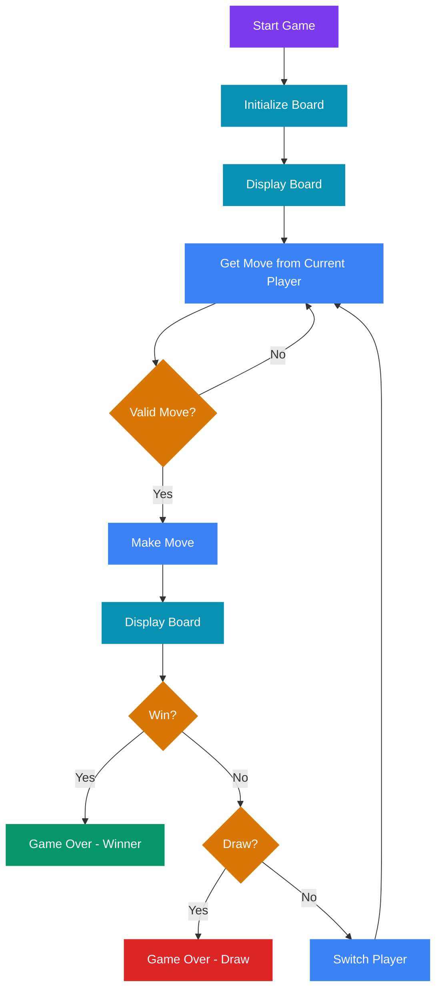

# ⭕ Low Level Design of Tic Tac Toe Game

> 🎯 **Difficulty:** 🟢 Beginner to 🟡 Intermediate  
> 👥 **Target Audience:** SDE-1 to SDE-2 / Software Engineers  
> ⏱️ **Interview Duration:** 45-60 minutes

---

## 1. 🧭 What This Session Is About

This document covers the **Low Level Design (LLD) of a Tic Tac Toe game**. It shows how to solve an LLD interview problem step by step:

- identify the classes
- identify their behaviors
- manage the game state
- write the win detection logic
- write clean, maintainable code

> 💡 *"Low level design focuses on code quality, class design, maintainability, and how classes interact with each other."*

---

## 2. 📋 Requirements Gathering

### Functional Requirements

**1. Game Board**
   - 3x3 grid to place X and O
   - Display current board state
   - Track empty cells

**2. Players**
   - Two players: Player X and Player O
   - Players take turns alternately
   - Each player can make one move per turn

**3. Game Flow**
   - Initialize empty board
   - Players alternate turns
   - Validate moves (cell must be empty and within bounds)
   - Check for win condition after each move
   - Check for draw condition
   - Display game result

**4. Win Conditions**
   - Three in a row (horizontal)
   - Three in a column (vertical)
   - Three in a diagonal (both diagonals)

**5. Game States**
   - `IN_PROGRESS`: Game is ongoing
   - `X_WON`: Player X won
   - `O_WON`: Player O won
   - `DRAW`: Game ended in a draw

### Non-Functional Requirements

1. **Extensibility**: Easy to extend to NxN board
2. **Maintainability**: Clean, readable code
3. **Testability**: Easy to unit test
4. **Performance**: O(1) move validation, O(N) win checking

---

## 3. 🏗️ Class Design

### Core Classes

```
┌─────────────────┐
│     Player      │
├─────────────────┤
│ + symbol: char  │
│ + name: string  │
└─────────────────┘
         ▲
         │
    ┌────┴────┐
    │         │
┌───┴───┐ ┌──┴────┐
│PlayerX│ │PlayerO│
└───────┘ └───────┘

┌─────────────────┐
│      Cell       │
├─────────────────┤
│ + row: int      │
│ + col: int      │
│ + symbol: char  │
│ + isEmpty()     │
└─────────────────┘

┌─────────────────┐
│      Board      │
├─────────────────┤
│ + cells[][]:   │
│   Cell          │
│ + size: int     │
│ + display()     │
│ + isValidMove() │
│ + makeMove()    │
│ + isFull()      │
└─────────────────┘

┌─────────────────┐
│      Game       │
├─────────────────┤
│ + board: Board  │
│ + players: []   │
│ + currentPlayer │
│ + gameState     │
│ + start()       │
│ + playTurn()    │
│ + checkWin()    │
│ + checkDraw()   │
└─────────────────┘
```

---

## 4. 🎯 Step-by-Step Design Process

### Step 1: Identify Core Entities

1. **Player**: Represents a player with a symbol (X or O)
2. **Cell**: Represents a single cell on the board
3. **Board**: Represents the 3x3 game board
4. **Game**: Controls the game flow

### Step 2: Identify Behaviors

#### Player
- Get symbol
- Get name

#### Cell
- Check if empty
- Set symbol
- Get symbol

#### Board
- Display board
- Validate move (check bounds and empty cell)
- Make move
- Check if board is full
- Get cell at position

#### Game
- Initialize game
- Start game
- Play turn
- Check win condition
- Check draw condition
- Switch player
- Get current player

### Step 3: Game State Management

```java
public enum GameState {
    IN_PROGRESS,
    X_WON,
    O_WON,
    DRAW
}
```

### Step 4: Win Detection Strategy

**Approach**: After each move, check:
1. Row of the move
2. Column of the move
3. Diagonals (if move is on diagonal)

**Optimization**: Only check relevant lines instead of all 8 possible lines.

---

## 5. 💻 Implementation Details

### Key Design Decisions

1. **Cell Class**: Keeps position and symbol together, so board operations are cleaner
2. **Enum for Game State**: Type-safe state management
3. **Player Abstraction**: Easy to extend for AI players later
4. **Board Validation**: Centralized validation logic
5. **Win Detection**: After a move, checks only the lines that the move touches

### Algorithm for Win Detection

```
After a move at (row, col):
1. Check if entire row 'row' has same symbol
2. Check if entire column 'col' has same symbol
3. If (row, col) is on main diagonal (row == col), check main diagonal
4. If (row, col) is on anti-diagonal (row + col == size - 1), check anti-diagonal
```

**Time Complexity**: O(N) where N is board size (3 in this case)
**Space Complexity**: O(N²) for board storage

### Java Implementation Details

The Java implementation follows these key patterns:

1. **Enum for Game State**: Type-safe state management using `GameState` enum
2. **Abstract Player Class**: `Player` abstract class with `PlayerX` and `PlayerO` concrete implementations
3. **Cell Encapsulation**: `Cell` class encapsulates position and symbol
4. **Board Validation**: Centralized validation in `Board` class with helper methods for win checking
5. **Game Orchestration**: `Game` class manages the game flow and state transitions

**Key Java Features Used**:
- Enums for type safety
- Abstract classes for polymorphism
- Encapsulation with private fields and public methods
- Exception handling for input validation

---

## 6. 🔄 Game Flow



---

## 7. 🧪 Testing Considerations

### Test Cases

**1. Valid Move**
   - Move to empty cell
   - Move within bounds

**2. Invalid Move**
   - Move to occupied cell
   - Move out of bounds

**3. Win Conditions**
   - Horizontal win (all rows)
   - Vertical win (all columns)
   - Main diagonal win
   - Anti-diagonal win

**4. Draw Condition**
   - Board full with no winner

**5. Game Flow**
   - Player alternation
   - Game state transitions

---

## 8. 🚀 Extensions & Future Enhancements

1. **NxN Board**: Extend to support any board size
2. **AI Player**: Add computer player with minimax algorithm
3. **Multiplayer**: Network-based multiplayer support
4. **Game History**: Track move history and replay
5. **Undo/Redo**: Allow players to undo moves
6. **Statistics**: Track win/loss statistics
7. **Different Symbols**: Allow custom symbols
8. **Time Limits**: Add time constraints per move

---

## 9. 📊 Complexity Analysis

| Operation | Time Complexity | Space Complexity |
|-----------|----------------|------------------|
| Make Move | O(1) | O(1) |
| Validate Move | O(1) | O(1) |
| Check Win | O(N) | O(1) |
| Check Draw | O(N²) (scans every cell; O(1) with a move counter) | O(1) |
| Display Board | O(N²) | O(1) |
| Overall | O(N²) moves | O(N²) |

Where N = board size (3 for standard Tic Tac Toe)

---

## 10. 🎓 Interview Tips

1. **Start with Requirements**: Always clarify requirements first
2. **Think Before Coding**: Draw class diagrams, identify relationships
3. **Ask Questions**: Clarify edge cases (what if player enters invalid input?)
4. **Incremental Development**: Start with basic structure, then add features
5. **Handle Edge Cases**: Invalid moves, game already over, etc.
6. **Code Quality**: Clean code, proper naming, comments where needed
7. **Discuss Trade-offs**: Time vs space, extensibility vs simplicity

---

## 11. 📝 Code Structure

The implementation includes:
- `Player.java`: Abstract Player class
- `PlayerX.java`: Player X implementation
- `PlayerO.java`: Player O implementation
- `Cell.java`: Cell class
- `Board.java`: Board class
- `Game.java`: Game orchestrator
- `GameState.java`: Game state enum
- `Main.java`: Driver code to run the game

---

## 12. 🎮 Usage Example

```java
// Create players
Player playerX = new PlayerX("Alice");
Player playerO = new PlayerO("Bob");

// Create and start game
Game game = new Game(playerX, playerO);
game.start();
```

### Compile and Run

```bash
# The files have no package line, so run from inside the folder
cd system-design/workspace/tic_tac_toe

# Compile all Java files
javac *.java

# Run the game
java Main
```

---

## 13. 📚 References

- [Tic Tac Toe on Wikipedia](https://en.wikipedia.org/wiki/Tic-tac-toe)
- Object-Oriented Design Principles
- Design Patterns: Strategy (for different win detection strategies)

---

