# 🛍️ Design a Product Catalog Platform

> 🧩 **My own design** &nbsp;·&nbsp; 🔥 High Priority &nbsp;·&nbsp; 💬 **12 Questions**  
> **Source:** an original design, written for interview practice.  
> **Asked as:** "design a product catalog / product information service" — common at e-commerce companies (Flipkart, Amazon, Meesho, Myntra, Nike)

---

📊 **Question Count**

| # | Section | Questions |
|---|---|---|
| 1 | Requirements and Defaults | — |
| 2 | Estimation | — |
| 3 | The Design — Split Writes From Reads | — |
| 4 | Deep Dive — Going Live at a Set Time | — |
| 5 | Deep Dive — The Hot Product | — |
| 6 | Deep Dive — Change Events and Rebuilds | — |
| 7 | Trade-offs | — |
| 8 | Interview Q&A | 12 |
| | **Total** | **12** |

> 🔥🔥 Very high priority — asked in almost every Tier-1 interview loop &nbsp;·&nbsp; 🔥 High priority — very frequent in Tier-1 interviews &nbsp;·&nbsp; ⚡ Medium priority — commonly asked &nbsp;·&nbsp; 💤 Low priority — good to know, rarely asked

---

> **Scope.** This file is the whole design in one place. The patterns it uses are taught elsewhere, so
> it links to them instead of repeating them:
> CQRS, outbox and the strangler pattern in
> [`java/17`](https://github.com/vikas9dev/java/blob/main/1_interview_questions/17_Spring_Microservices_Interview_Questions.md);
> caching and CDN in [`iq/01` HLD Q&A](../iq/01_System_Design_HLD_Interview_Questions.md);
> the stateless tier, replicas and cache basics in [`vol_1/ch01`](../01_insider_guide_Alex_Xu/vol_1/ch01_scale_from_zero.md).
>
> **After an interview:** add what the interviewer actually pushed on to §8 as new questions.

---

## 1. 📋 Requirements and Defaults

Say each default aloud. Then the interviewer can correct you early.

**Two kinds of users, and they want different things:**

| Who | How many | What they do | What they need |
|---|---|---|---|
| **Writers** — merchandisers, content teams | a few hundred | Create and edit products, prices per country, images, videos | Validation, a workflow, audit history, no lost edits |
| **Readers** — website, apps, stores, other back-end teams (orders, search, marketing) | millions of end users behind them | Read product pages, search, batch-read for their own systems | Fast reads, high availability, one simple document per product |

**Functional:**
- Edit products, SKUs (one per size and colour), prices per country, and content per language.
- A workflow per marketplace: `DRAFT → APPROVED → SCHEDULED → ACTIVE → RETIRED`.
- **Activate** = a product goes live in one marketplace (country + channel) at a set time, often a launch at 10:00 local time.
- Upload images and videos, and serve them in many sizes.
- Tell other teams when a product changes.

**Non-functional:**
- Read-heavy. Reads must stay fast during a launch.
- Reads can be a few seconds stale. Writes must never be lost.
- Multi-region readers.

**Out of scope:** cart, checkout, payments, recommendations. Price at checkout is **re-checked by the checkout service**. The catalog price is for display.

---

## 2. 🔢 Estimation

Use round numbers, and show the arithmetic.

**Read traffic:**

```
"billions of API calls per month" → say 5 B/month
5 × 10⁹ ÷ 2.6 × 10⁶ s/month  ≈  1,900  →  ~2 K RPS average
launch peak: most traffic lands on a few products in a few minutes → plan for ~10× → ~20 K RPS
```

The usual rule is peak = 2–5× average. A launch is the exception, so plan for 10×.

**Read store size:**

```
1 M products × 50 marketplaces × 3 languages      = 150 M possible documents
only ~20% of products are active in a marketplace  → ~30 M documents
~30 KB per document (content + prices + asset URLs) → 30 M × 30 KB ≈ 900 GB  →  ~1 TB
```

**Write traffic, and the hidden multiplier:**

```
edits: ~5,000 per hour  ≈  1.4 edits/s           (tiny)
but one edit can change up to 50 × 3 = 150 documents
→ normal day: 1.4 × 150 ≈ 200 document writes/s
a country-wide sale: 100 K products × 3 languages = 300 K document writes in one go
```

**Read:write ≈ 1000:1** at the API. But the projection builder (§3) sees **write amplification** of up to 150×. Plan its capacity for the bulk case, not the normal day.

**Assets:** millions of images and videos. They go to S3 and a CDN, and **never pass through the API**.

---

## 3. 🏗️ The Design — Split Writes From Reads

The write side and the read side have opposite needs:
- the write side needs relations, validation and transactions
- the read side needs one fast key lookup at huge scale

So split them. This is **CQRS** (Command Query Responsibility Segregation: separate models for writing and for reading).

```mermaid
graph LR
    T["Ops tools<br/>(plan · prepare · activate)"] --> W["Authoring service"]
    W --> DB["Source of truth<br/>Postgres + outbox"]
    DB --> E["Event stream<br/>ProductChanged"]
    E --> P["Projection builder<br/>per marketplace + language"]
    P --> R["Read store<br/>DynamoDB + OpenSearch"]
    R --> A["Product API<br/>Redis + CDN"]

    classDef primary fill:#7C3AED,stroke:#7C3AED,color:#fff
    classDef secondary fill:#0891B2,stroke:#0891B2,color:#fff
    classDef warn fill:#D97706,stroke:#D97706,color:#fff
    classDef success fill:#059669,stroke:#059669,color:#fff
    class T,W primary
    class DB,R secondary
    class E,P warn
    class A success
```



| Part | What it does | Choice and why |
|---|---|---|
| **Authoring service** | CRUD for products, SKUs, prices, content. Runs the workflow per marketplace | **Postgres**: many relations, validation, transactions, audit history. Optimistic locking (`@Version`), because two merchandisers can edit one product at once |
| **Outbox** | Each change writes the business row **and** an event row in one transaction. A relay publishes the event | No dual-write bug: the event exists exactly when the change committed |
| **Event stream** | Kafka (or SNS → SQS). Key = `productId` | Ordering per product. Other teams subscribe here instead of polling the API |
| **Projection builder** | Builds one **consumer-ready document** per (product, marketplace, language): merged content, display price, asset URLs, only ACTIVE fields | Readers fetch one key, with no joins at read time. Rebuild everything = replay the events |
| **Read store** | **DynamoDB**, key `productId#marketplace#language`. **OpenSearch** for search and filters, fed by the same events | Single-digit-ms key reads at any scale. Global tables for multi-region readers |
| **Product API** | `GET /products/{id}?marketplace=IN&language=en-IN` · `POST /products:batchGet` · list with cursor paging | ETag + `Cache-Control`. Redis for hot keys. CDN in front for public reads |
| **Asset service** | Upload by **S3 pre-signed URL** → S3 event → worker makes sizes and formats → metadata row → CDN URL | Large files never pass through a service |

> A 30 KB document fits DynamoDB's **400 KB item limit** easily. A product with hundreds of SKUs
> and long content in many languages may not. That is one reason the document is per language,
> not one document holding every language.

---

## 4. ⏰ Deep Dive — Going Live at a Set Time

The requirement: a product goes live in India at exactly 10:00 IST, and launch traffic arrives in the same minute.

**The wrong way:** at 10:00, a job builds the documents, writes them, and clears caches. All the heavy work happens in the busiest minute.

**The right way — do the work early, flip a flag at the time:**

1. When the product moves to `SCHEDULED`, the projection builder **builds the document right away**, marked `activeFrom = 10:00 IST`.
2. The API hides a document until `now ≥ activeFrom`. So the launch minute needs only a time check, not a write.
3. Cache it carefully. Before `activeFrom`, cache "not found" for only a few seconds, so the CDN does not keep serving a 404 after 10:00.
4. At `activeFrom`, a scheduler moves the workflow state to `ACTIVE` for the record. Readers do not depend on that write.

**Clocks:** the API servers compare against their own clock. NTP keeps servers within milliseconds of each other, so going live a few milliseconds early on one server does not matter here. If it mattered — a fair-queue drop, for example — a single gate service would decide instead.

---

## 5. 🔥 Deep Dive — The Hot Product

On a launch, most of the 20 K RPS hits one or a few documents. The database cannot take that alone:

```
one 30 KB item, eventually consistent read = ceil(30 / 4) ÷ 2 = 4 RCU
20 K reads/s × 4 RCU = 80 K RCU on ONE item
one DynamoDB partition gives 3,000 RCU   →   ~27× over the limit
```

So the database must almost never see these reads. Use layers, from the outside in:

| Layer | What it does | Typical hit rate on a hot product |
|---|---|---|
| **CDN** | Caches the public product response at the edge, short TTL (for example 30–60 s) | most requests stop here |
| **API in-process cache** | A few seconds of cache inside each API instance | catches the CDN misses |
| **Redis** | Shared cache for hot keys | catches cold API instances |
| **Request coalescing** | On a miss, one request loads the key; the others wait for that result | stops a **cache stampede** (many misses loading the same key at once) |
| **DynamoDB** | The source for the read side | sees a handful of reads per second |

Use **versioned asset URLs** (a content hash in the file name). Then an image can be cached for a year, and a new image is a new URL. You never need to purge it.

---

## 6. 📡 Deep Dive — Change Events and Rebuilds

**Other teams get changes from the event stream, not by polling.**
- Each team has its own consumer group, or its own SQS queue subscribed to an SNS topic.
- Key = `productId`, so all events for one product arrive in order.
- Delivery is at-least-once, so **consumers must be idempotent**: store the last applied `version` per product and skip anything older.

**The event carries a version number and the changed fields.** Consumers that need the full document fetch it from the API. This keeps events small. A big document on every event would also put every consumer behind the slowest one.

**Adding a field for a consumer team:**
- Add it to the projection, and bump `schemaVersion` in the document.
- Changes must be **additive** (only new fields). A breaking change = a new API version.

**Rebuilding all projections** — after a bug, or for a new field across the whole catalog:
- Replay from the source of truth into a **new** table, then switch the API to it.
- Do not rebuild in place. A half-rebuilt table serves a mix of old and new documents.
- At ~200 writes/s on a normal day, a full 30 M-document rebuild needs a separate, higher write rate. Plan it as a batch job.

**Migrating from an old platform** — the **strangler** pattern:
1. Put the new read API in front of the old one.
2. Feed the new read store from the old database by CDC (change data capture) or dual-write.
3. Run **shadow reads**: serve the old answer, compare it with the new one, and log the differences.
4. Move consumers one by one. Keep a way back for each one.

---

## 7. ⚖️ Trade-offs

| Decision | What I chose | What I would choose instead | The condition that flips it |
|---|---|---|---|
| Split write and read models (CQRS) | Separate Postgres write model and DynamoDB read documents | One Postgres database with read replicas and a cache | The catalog is small (say under 100 K products, a few marketplaces) and read traffic is low. Then CQRS is extra moving parts with no gain |
| Read store | DynamoDB, one item per document | Postgres with a JSONB document column | The team runs Postgres well and the read rate fits replicas + cache. You lose global tables, but gain one database to operate |
| Events | Thin event (id + version + changed fields) | Full document in every event | Consumers cannot call the API (another network, strict SLAs). Then they need the full document in the event |
| Go-live | Pre-built document + `activeFrom` check at read time | Build and publish at the go-live time | Launches are rare and small. Then the scheduled job is simpler and fast enough |
| Search | OpenSearch, fed by events | Database queries with indexes | Filters are few and fixed. Then a composite index covers them, and you drop a whole system |

---

## 🔢 Numbers to Remember

- 5 B calls/month ≈ **2 K RPS average** (÷ 2.6 M s/month); plan **~20 K RPS** for a launch
- ~30 M active documents × ~30 KB ≈ **~1 TB** read store
- One edit can touch **50 marketplaces × 3 languages = 150 documents** — that is the write amplification
- DynamoDB: **400 KB** max item · **3,000 RCU / 1,000 WCU** per partition · 1 RCU = one 4 KB strongly consistent read (or two eventually consistent)
- One hot 30 KB item at 20 K reads/s ≈ **80 K RCU** ≈ 27× a partition → the CDN and caches carry launch traffic, not the database

---

## 🗣️ Interview Cheat Sheet

| If they ask… | Hit these |
|---|---|
| "Design a product catalog" | Two user groups with opposite needs → CQRS. Postgres + outbox for writes, one DynamoDB document per (product, marketplace, language) for reads, CDN + Redis in front |
| "How big?" | 2 K RPS average, 20 K on a launch, ~1 TB of documents, 150× write amplification per edit |
| "Product goes live at 10:00?" | Pre-build the document, `activeFrom` check at read time, short TTL on "not found". No heavy work in the launch minute |
| "Hot product?" | The RCU arithmetic, then the layers: CDN → in-process → Redis → coalescing → DynamoDB |
| "Consistency?" | Read side is eventual (seconds). Checkout re-checks the price. The ops tool reads its own writes from Postgres |
| "Other teams need changes?" | Event stream keyed by product, per-team consumer, idempotent on `version` |
| "Why not just Postgres?" | Say when it IS the right answer (§7), then why this scale is different |

---

## ❓ Interview Q&A

1. **Why split the write model from the read model here, and when would you not? 🔥🔥**

<!-- -->
<details>
<summary>💡 Show Answer</summary>

**Answer:**

The two sides have opposite needs:

- **Writers** are a few hundred people. They need relations, validation, a workflow, transactions and history. That is a relational database.
- **Readers** are millions of requests. They need one fast lookup that returns everything for one product in one marketplace and language. That is a key-value read of a pre-built document.

One model cannot serve both well. Joins at read time are slow at 20 K RPS, and a key-value store is a poor place for a workflow with validation.

**When not to:** a small catalog with low traffic. One Postgres database with read replicas and a cache is simpler, and CQRS would add an event stream, a builder and a second store for no gain. Say the numbers that would make you switch.

---

</details>

2. **A hyped product launches and 20 K requests per second hit one product page. What happens? 🔥🔥**

<!-- -->
<details>
<summary>💡 Show Answer</summary>

**Answer:**

First the arithmetic. One 30 KB item read eventually consistent costs 4 RCU. 20 K reads/s × 4 = 80 K RCU on one item. One DynamoDB partition gives 3,000 RCU. So the database cannot take it — the caches must.

Layers, from the outside in:

1. **CDN** with a short TTL (30–60 s). Most requests stop here.
2. **In-process cache** in each API instance, a few seconds long.
3. **Redis** for hot keys shared across instances.
4. **Request coalescing**: on a miss, one request loads the key and the others wait for it. This stops a cache stampede.
5. **DynamoDB** then sees only a few reads per second.

Images use versioned URLs, so they are cached for a long time and never purged.

---

</details>

3. **A product must go live in India at exactly 10:00. How? 🔥🔥**

<!-- -->
<details>
<summary>💡 Show Answer</summary>

**Answer:**

Do the heavy work early, and only check a time at 10:00.

- When the product is scheduled, the builder **pre-builds** its document with `activeFrom = 10:00 IST`.
- The API hides the document until `now ≥ activeFrom`. The launch minute needs no writes.
- Cache "not found" for only a few seconds before the launch, so the CDN does not keep serving a 404 after 10:00.
- A scheduler marks the workflow `ACTIVE` at 10:00 for the record. Readers do not wait for it.

The wrong answer is a job that builds and publishes at 10:00. It puts all the heavy work in the busiest minute.

---

</details>

4. **What consistency do readers get, and where does staleness matter? 🔥**

<!-- -->
<details>
<summary>💡 Show Answer</summary>

**Answer:**

The read side is **eventually consistent**: a change shows up after a few seconds (event lag + cache TTL).

It matters in two places:

- **Price at checkout.** A stale display price is fine for a few seconds. A stale charged price is not. So checkout re-checks the price with the pricing service. It never trusts the catalog document.
- **The ops tool.** A merchandiser who saves an edit and sees the old value thinks the save failed. So the ops tool reads from Postgres (the write side). That gives **read-your-writes** for the person who made the change.

Everywhere else, a few seconds of staleness is fine. Say that as a decision, not as a weakness.

---

</details>

5. **How do other back-end teams find out a product changed? 🔥**

<!-- -->
<details>
<summary>💡 Show Answer</summary>

**Answer:**

They subscribe to the event stream. They do not poll the API.

- Each team has its own consumer group (Kafka), or its own SQS queue on an SNS topic. A slow team then does not slow the others.
- The key is `productId`, so events for one product arrive in order.
- Delivery is at-least-once, so consumers must be **idempotent**: keep the last applied `version` per product and skip older events.
- The event is thin: id, version and changed fields. A team that needs the full document calls the API.

Events come from an **outbox**, so an event exists exactly when the change committed.

---

</details>

6. **A consumer team needs a new field. Later you find a bug in the builder. How do you handle each? 🔥**

<!-- -->
<details>
<summary>💡 Show Answer</summary>

**Answer:**

**New field:** add it to the projection and bump `schemaVersion`. Changes are additive only (new fields). Old consumers ignore what they do not know. A breaking change gets a new API version.

**Builder bug:** rebuild all documents by replaying from the source of truth.

- Rebuild into a **new table**, then switch the API to it. Rebuilding in place serves a mix of good and bad documents for hours.
- A full rebuild is ~30 M documents. Normal traffic is ~200 writes/s, so the rebuild needs its own, higher write rate. Run it as a planned batch job.

---

</details>

7. **The old platform must be replaced without downtime. How do you migrate? 🔥**

<!-- -->
<details>
<summary>💡 Show Answer</summary>

**Answer:**

Use the **strangler** pattern:

1. Put the new read API in front of the old platform.
2. Feed the new read store from the old database by CDC (change data capture) or dual-write.
3. Run **shadow reads**: serve the old answer, build the new one too, and log every difference. Fix the differences until there are none.
4. Move consumers to the new API one at a time, the least critical first.
5. Keep a way back for each consumer until the old platform is switched off.

The shadow-read step is the one most candidates miss. It is how you prove the new system is correct before anyone depends on it.

---

</details>

8. **How do you handle uploading and serving millions of images and videos? ⚡**

<!-- -->
<details>
<summary>💡 Show Answer</summary>

**Answer:**

Keep large files out of your services:

1. The ops tool asks for an **S3 pre-signed URL** and uploads straight to S3.
2. An S3 event starts a worker that makes the sizes and formats (renditions).
3. The worker writes a metadata row (asset id, sizes, URLs).
4. The CDN serves the files. Each URL contains a content hash, so a file can be cached for a year. A new image is a new URL, so you never purge.

---

</details>

9. **How does search and filtering work? ⚡**

<!-- -->
<details>
<summary>💡 Show Answer</summary>

**Answer:**

**OpenSearch**, fed by the same change events as the read store.

- Free-text search, filters (size, colour, price range) and facet counts are what a search engine is built for.
- A key-value store cannot do them, and SQL `LIKE` with many filters is slow at scale.
- The index is eventually consistent, like the rest of the read side.

**When not to:** if filters are few and fixed, a composite database index covers them, and you run one system fewer.

---

</details>

10. **One client sends far more requests than all the others. How do you protect the API? ⚡**

<!-- -->
<details>
<summary>💡 Show Answer</summary>

**Answer:**

- Give each client an **API key**, and rate-limit per key at the gateway (a token bucket — see [`vol_1/ch04`](../01_insider_guide_Alex_Xu/vol_1/ch04_design_a_rate_limiter.md)).
- Offer a **batch endpoint** (`POST /products:batchGet`) for clients that read many products. One call for 100 products is far cheaper than 100 calls.
- For clients that read the whole catalog, offer the event stream or a nightly export instead of the API.
- Watch per-client dashboards, so you see a noisy client before it hurts others.

---

</details>

11. **How do you know the platform is healthy? 🔥**

<!-- -->
<details>
<summary>💡 Show Answer</summary>

**Answer:**

Set SLOs and alert on them:

- **Read API:** for example p99 < 50 ms and 99.95% success. Alert on **SLO burn rate**, not on single spikes.
- **Event lag:** time from a committed edit to the document in the read store. This is the metric unique to CQRS. If it grows, readers see stale products and nobody gets an error.
- **Per-client dashboards:** requests, errors and throttles per API key.
- **Cache hit rate** on the CDN and Redis, especially before a launch.

---

</details>

12. **Why DynamoDB for the read store and not Postgres? 🔥**

<!-- -->
<details>
<summary>💡 Show Answer</summary>

**Answer:**

**For DynamoDB:**
- Every read is one key lookup, which DynamoDB does in single-digit milliseconds at any scale.
- It scales without you managing replicas or connection pools.
- **Global tables** give multi-region reads.

**For Postgres:**
- A JSONB column holds the document just as well.
- If the team already runs Postgres well, and the read rate fits replicas plus a cache, you operate one database instead of two.

**The honest answer:** both work. Name the condition — very high, spiky read traffic and multi-region readers point to DynamoDB; a small team and moderate traffic point to Postgres. Either way the caches carry the launch traffic, not the database (Q2).

---

</details>

---
