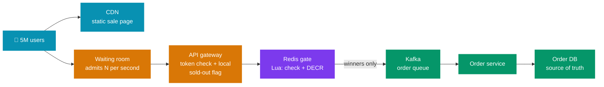

# ⚡ Design a Flash Sale System

> 🧩 **My own design** &nbsp;·&nbsp; 🔥🔥 Very High Priority &nbsp;·&nbsp; 💬 **15 Questions**  
> **Source:** an original design, written for interview practice.  
> **Asked as:** "design a flash sale", "Big Billion Days", "limited-stock drop", "sneaker launch" — common at Indian e-commerce (Flipkart, Amazon, Meesho, Myntra) and at Nike (SNKRS launches)

---

📊 **Question Count**

| # | Section | Questions |
|---|---|---|
| 1 | [Requirements and Defaults ⚡](#1--requirements-and-defaults-) | 1 |
| 2 | [Estimation 🔥](#2--estimation-) | 1 |
| 3 | [The Design — Stop Most Requests Early 🔥🔥](#3-️-the-design--stop-most-requests-early-) | 2 |
| 4 | [Deep Dive — The Hot Stock Row 🔥🔥](#4--deep-dive--the-hot-stock-row-) | 2 |
| 5 | [Deep Dive — The Redis Gate 🔥🔥](#5--deep-dive--the-redis-gate-) | 3 |
| 6 | [Deep Dive — Hold, Pay, Expire 🔥](#6--deep-dive--hold-pay-expire-) | 2 |
| 7 | [Deep Dive — Fairness, Bots and the Waiting Room 🔥](#7--deep-dive--fairness-bots-and-the-waiting-room-) | 2 |
| 8 | [Trade-offs 🔥](#8-️-trade-offs-) | 2 |
| | **Total** | **15** |

> 🔥🔥 Very high priority — asked in almost every Tier-1 interview loop &nbsp;·&nbsp; 🔥 High priority — very frequent in Tier-1 interviews &nbsp;·&nbsp; ⚡ Medium priority — commonly asked &nbsp;·&nbsp; 💤 Low priority — good to know, rarely asked

---

> **Scope.** This file covers only what is **different** in a flash sale. The shared core is taught elsewhere, so
> it links to it instead of repeating it:
> one inventory row, the idempotency key and the conditional `UPDATE` in
> [ch07 §4–§6](../01_insider_guide_Alex_Xu/vol_2/ch07_hotel_reservation_system.md);
> the family map in [ch07 §9](../01_insider_guide_Alex_Xu/vol_2/ch07_hotel_reservation_system.md#9--similar-problems-this-design-solves-);
> the short "how do you stop overselling" answer in the [🎟️ double-booking question of `iq/01`](../iq/01_System_Design_HLD_Interview_Questions.md);
> payment compensation in [`java/17` — Redis `DECRBY` succeeds but payment fails](https://github.com/vikas9dev/java/blob/main/1_interview_questions/17_Spring_Microservices_Interview_Questions.md#6-distributed-data-patterns).
>
> **The one idea of this file:** a flash sale is a hotel booking where **one row gets all the traffic at the same second**. Almost every request must be told "sold out" **without** reaching that row.

---

## 1. 📋 Requirements and Defaults ⚡

Say each default aloud. Then the interviewer can correct you early.

**Functional**

| Requirement | Default I state |
|---|---|
| Sale page with a countdown | Static page from the CDN. The countdown uses **server time**, not the phone's clock |
| Buy button | Opens at a fixed time (12:00:00). One tap = one buy attempt |
| Limit per user | **1 unit per user** per sale |
| Pay | Within **10 minutes** of winning. If not, the unit goes back on sale |
| Result | "You got it" or "Sold out" — fast, and never wrong in the "you got it" direction once paid |

**Non-functional**

| Requirement | Target |
|---|---|
| **No overselling** | Hard rule. Selling 10,001 of 10,000 phones is a business incident |
| Underselling | Allowed for a short time (a unit held by someone who does not pay comes back after 10 min) |
| Spike | Survive ~1.5M requests per second for the first few seconds (§2) |
| Sold-out answer | Under ~200 ms, even at the peak |
| The rest of the site | Must keep working. The sale must not take down search, cart or orders |

**Out of scope (say so):** catalog, search, delivery, returns.

### ❓ Interview Questions

1. **"Design a flash sale." What do you clarify first, and what do you assume? ⚡**

<!-- -->
<details>
<summary>💡 Show Answer</summary>

**Answer:**

I ask four things, because each one changes the design:

1. **How much stock, and how many buyers?** 10,000 units and 5 million users is a 500:1 ratio. That ratio decides how much traffic I must reject early.
2. **Limit per user?** I assume 1. That needs a per-user check, not just a stock check.
3. **Pay now or later?** I assume the user wins a **10-minute hold** and pays after. So stock can come back.
4. **First-come-first-served, or a draw?** I assume first-come. A draw (lottery) is a different, much easier design (§7).

Then I state the hard rule: **no overselling, ever**. Short underselling is fine — a held unit that is not paid comes back.

Finally I say the sale must not hurt the rest of the site. That tells the interviewer I will isolate it.

---

</details>

---

## 2. 🔢 Estimation 🔥

**Assumptions:** 10,000 phones · 5M users waiting at 12:00 · each user taps ~3 times in the first 10 seconds (impatience and retries).

```
Requests at the start  = 5,000,000 users × 3 taps        = 15,000,000 requests
Over the first 10 s    = 15,000,000 ÷ 10 s                = ~1.5M requests/second
Chance to win          = 10,000 ÷ 5,000,000               = 0.2%   (99.8% get "sold out")
```

**What one hot DB row can take:**

```
A conditional UPDATE holds the row lock until COMMIT.
Lock time per buyer    ≈ 1–2 ms   (update + commit to disk)
Buyers per second      ≈ 1 ÷ 0.001–0.002 s               = ~500–1,000 per second
10,000 units           ≈ 10,000 ÷ 1,000 per second       = 10–20 seconds at best
```

So the database can sell the stock — but only if **just the winners** reach it. If 1.5M requests per second queue behind one row lock, the connection pool fills, requests time out, and the whole site slows down.

**What Redis can take:** one Redis node does ~100,000 simple operations per second. A small Lua script is slower — call it ~50,000 per second. So 1.5M per second would need ~30 nodes. That is why §3 adds two more filters in front of Redis: a **local sold-out flag** and a **waiting room**.

**What is small:** 10,000 orders and 10,000 payments. Any database handles that easily.

### ❓ Interview Questions

1. **Walk me through the estimate. Why can't the database just take the traffic? 🔥🔥**

<!-- -->
<details>
<summary>💡 Show Answer</summary>

**Answer:**

5 million users, about 3 taps each in the first 10 seconds. That is 15 million requests in 10 seconds — **about 1.5 million per second**. Only 10,000 can win, so 99.8% of the answers are "sold out".

The problem is not the number of orders. 10,000 orders is tiny. The problem is that **all buyers want the same row** at the same second.

A conditional `UPDATE` holds a row lock until commit, about 1–2 ms. So one row serves about **500–1,000 buyers per second**. Even with only winners, 10,000 units take 10–20 seconds.

If all 1.5 million requests per second hit that row, they queue behind the lock. The connection pool fills up, everything else on that database slows down, and users see timeouts instead of "sold out".

So the design goal is: **answer 99.8% of requests without touching the database row**, and send only the winners to it.

---

</details>

---

## 3. 🏗️ The Design — Stop Most Requests Early 🔥🔥

Each layer answers as many requests as it can, so the next layer sees far fewer.



| Layer | What it stops | Rough load after it |
|---|---|---|
| **CDN** | All page loads. The sale page and countdown are static | 0 page loads on the servers |
| **Waiting room** | Lets in a fixed rate, e.g. 20,000 users per second | ~20,000 per second |
| **Gateway** | Bad or missing tokens; repeat taps (rate limit per user); **everything after sell-out** — each instance keeps a local "sold out" flag | Goes to ~0 a second or two after sell-out |
| **Redis gate** | Everyone after the 10,000th winner, and anyone who already won | 10,000 winners pass |
| **Kafka → Order service → DB** | Nothing. It writes the winners at a steady rate | 10,000 orders, e.g. 2,000 per second → 5 s |

**The flow of one winning tap:**

1. The user waited in the waiting room and got a **signed token**.
2. The gateway checks the token **locally** (signature check, no DB call) and the local sold-out flag.
3. The Redis Lua script checks "did this user already win?" and "is stock > 0?", then decrements. All in one atomic step (§5).
4. The winner's order goes to **Kafka** with an `order_id` (the idempotency key). The user sees "You got it — confirming…" and polls.
5. The order service writes the order and does the **final** conditional `UPDATE` on stock in the DB (§4). The DB is the source of truth; Redis is only a filter.
6. The user gets 10 minutes to pay (§6).

**Isolate it.** Run the sale on its own gateway pool, its own Redis, and its own order-service instances. If the sale breaks, search and normal orders keep working.

### ❓ Interview Questions

1. **Walk me through what happens when a user taps "Buy" at 12:00:00. 🔥🔥**

<!-- -->
<details>
<summary>💡 Show Answer</summary>

**Answer:**

The design is a funnel. Each layer answers as many requests as it can.

1. **CDN** — the sale page is static, so page loads never reach my servers. The countdown uses server time.
2. **Waiting room** — users get a signed token and are let in at a fixed rate, say 20,000 per second.
3. **Gateway** — checks the token signature locally, rate-limits repeat taps per user, and keeps a **local sold-out flag**. After sell-out, the gateway answers "sold out" itself.
4. **Redis gate** — one Lua script checks "already won?" and "stock > 0?" and decrements. It is atomic, so two users cannot take the last unit.
5. **Kafka** — only the ~10,000 winners go here, with an `order_id` as the idempotency key. The user sees "confirming…".
6. **Order service + DB** — writes the order and does the final conditional `UPDATE` on stock. **The DB is the source of truth.**
7. **Payment** — the user has 10 minutes. If they do not pay, the unit goes back.

The result: 1.5M requests per second at the edge become about 10,000 database writes in total.

---

</details>

---

2. **Should the buy call wait for the database (sync), or return at once and confirm later (async)? 🔥**

<!-- -->
<details>
<summary>💡 Show Answer</summary>

**Answer:**

**Async for winners, sync for losers.**

- **Losers (99.8%)** get "sold out" at once, from the gateway or Redis. No database work.
- **Winners** get "You got it — confirming…" at once. The order goes through Kafka, and the client polls (or gets a push) for the final result.

**Why async for winners:**
- The queue lets the order service write at a **steady rate** (e.g. 2,000 per second). The DB never sees the spike.
- If the order service is slow or restarts, the orders wait in Kafka. They are not lost.

**The cost:**
- A user can see "You got it" and then, rarely, "Sorry, it failed". This happens when Redis said yes but the DB said no (§5 Q2). Show "confirming…", not "confirmed", until the DB commits.
- More moving parts: a queue, a consumer, a status the client polls.

**When I would go sync:** small stock and low traffic — a few hundred buyers. Then the DB conditional `UPDATE` alone is enough, and Kafka adds nothing.

---

</details>

---

## 4. 🔥 Deep Dive — The Hot Stock Row 🔥🔥

**The base fix** is the same as the hotel: a conditional `UPDATE` with a row-count check (ch07, the last-room race — [the conditional `UPDATE` fix](../01_insider_guide_Alex_Xu/vol_2/ch07_hotel_reservation_system.md)).

```sql
UPDATE sale_stock
SET    sold = sold + 1
WHERE  sale_id = 42
  AND  sold + 1 <= total;      -- 0 rows affected → sold out
```

**The problem:** every buyer needs the **same row**. Each one waits for the lock. So one row gives ~500–1,000 buys per second (§2), no matter how big the database server is.

**Fix 1 — split the stock into buckets.** 10,000 units become 10 rows of 1,000:

```sql
CREATE TABLE sale_stock_bucket (
    sale_id    BIGINT NOT NULL,
    bucket_no  INT    NOT NULL,       -- 0..9
    total      INT    NOT NULL,       -- 1,000 each
    sold       INT    NOT NULL DEFAULT 0,
    PRIMARY KEY (sale_id, bucket_no)
);
```

- Each buyer picks a **random bucket** and runs the conditional `UPDATE` on it.
- **0 rows affected** → that bucket is empty. Try the next bucket. Only when all 10 are empty is the sale sold out.
- 10 rows = 10 locks = ~10× the throughput.

**Fix 2 — make the DB see only winners.** The Redis gate (§5) and the queue (§3) cut the traffic to ~10,000 writes. Then even one row is enough. Buckets are the extra step when the winners alone are too many for one row (e.g. 1 million units).

**The order transaction** — same order as ch07's ["Order inside `doReserve`"](../01_insider_guide_Alex_Xu/vol_2/ch07_hotel_reservation_system.md): the order row first, the hot stock row last, so the hot lock is held for the shortest time.

```sql
START TRANSACTION;

-- 1. the order first: a duplicate (same order_id) or a second buy (same user) fails here
INSERT INTO sale_order (order_id, sale_id, user_id, status, expires_at)
VALUES (987654, 42, 9001, 'RESERVED', NOW() + INTERVAL 10 MINUTE);
-- PRIMARY KEY (order_id)         → idempotency key
-- UNIQUE (sale_id, user_id)      → one unit per user, enforced by the DB

-- 2. the hot stock row last
UPDATE sale_stock_bucket
SET    sold = sold + 1
WHERE  sale_id = 42 AND bucket_no = 7
  AND  sold + 1 <= total;
-- 0 rows → ROLLBACK and try another bucket

COMMIT;
```

📎 Large Chinese e-commerce sites hit this limit hard on Singles' Day. Alibaba's MySQL fork (AliSQL) added a special mode for hot inventory rows that groups many updates to one row together. You do not need to know it — but "one hot row is a known limit of every row-locking database" is the point to say.

### ❓ Interview Questions

1. **Why is one stock row a bottleneck, and how do you remove it? 🔥🔥**

<!-- -->
<details>
<summary>💡 Show Answer</summary>

**Answer:**

**Why:** the conditional `UPDATE` takes a row lock and holds it until commit, about 1–2 ms. Every buyer needs the same row, so they run **one at a time**. That caps one row at about 500–1,000 buys per second. A bigger server does not help — the limit is the lock, not the CPU.

**Fix 1 — fewer requests reach the row.** Put a Redis gate and a queue in front. Only the ~10,000 winners reach the DB, at a steady rate. For most sales, this alone is enough.

**Fix 2 — more rows.** Split the stock into N buckets, e.g. 10 rows of 1,000. Each buyer picks a random bucket. 10 rows = 10 locks = ~10× the throughput. If a bucket is empty (0 rows affected), try the next one.

**Also:** in the order transaction, insert the order row first and update the stock row last. Then the hot lock is held only for the `UPDATE` and the commit.

I would start with Fix 1, and add buckets only if the winners alone are more than one row can take.

---

</details>

---

2. **With 10 buckets, how do you know the sale is sold out? Can you undersell? ⚡**

<!-- -->
<details>
<summary>💡 Show Answer</summary>

**Answer:**

**Sold out = every bucket is empty.** A buyer whose random bucket is empty tries the others. Only when all return 0 rows is the answer "sold out".

**Trying all 10 is slow at the end**, when most buckets are empty. Two fixes:
- Keep a small "empty buckets" set in Redis or in memory. Skip known-empty buckets.
- When the last bucket empties, set the **sold-out flag** that the gateway reads (§3).

**Underselling can happen for a short time:**
- A buyer tried bucket 3, it was empty, and the flag said sold out — but bucket 8 got a unit back from an expired hold a moment later.
- That unit is not lost. The next buyer finds it, or the reconcile job notices "stock left, flag says sold out" and clears the flag.

**Overselling cannot happen:** each bucket's conditional `UPDATE` stops at its own `total`. Ten correct buckets add up to a correct total.

The trade-off: buckets give throughput but make "how many are left?" a sum of 10 rows. For the UI, show "few left", not an exact count.

---

</details>

---

## 5. 🧮 Deep Dive — The Redis Gate 🔥🔥

Redis answers the 99.8% "sold out" in memory. One Lua script makes the check and the decrement **one atomic step** — Redis runs a script with nothing else in between.

```lua
-- KEYS[1] = stock:{sale42}     KEYS[2] = winners:{sale42}
-- ARGV[1] = userId
if redis.call('SISMEMBER', KEYS[2], ARGV[1]) == 1 then
    return -1                         -- this user already won
end
local left = tonumber(redis.call('GET', KEYS[1]) or '0')
if left <= 0 then
    return 0                          -- sold out
end
redis.call('DECR', KEYS[1])
redis.call('SADD', KEYS[2], ARGV[1])
return 1                              -- winner: send the order to Kafka
```

- **`{sale42}` is a hash tag.** In Redis Cluster, both keys land on the same slot. A Lua script can only touch keys on one slot.
- **Why not plain `DECR`?** `DECR` alone goes below zero, and it cannot check "already won". You would need a second call to undo it — and between the two calls, another request sees the wrong value.
- **Return 0 → set the gateway's local sold-out flag** (e.g. via a Redis pub/sub message, or each gateway polls a `soldout:{sale42}` key every 200 ms).

**Redis is a filter, not the truth.** Two ways Redis and the DB can disagree:

| Case | Cause | Result | Fix |
|---|---|---|---|
| Redis says **yes**, DB says **no** | A failover lost recent `DECR`s, so the new primary shows more stock | More "winners" than stock | The DB conditional `UPDATE` rejects the extras. Those users see "Sorry, it failed". **No oversell** |
| Redis says **no**, DB has stock | An expired hold returned stock to the DB, but the `INCR` to Redis was lost | Short undersell | A reconcile job sets Redis stock from the DB every few seconds |

**Why can a failover lose writes?** Redis copies to its replica **asynchronously**. The primary says OK before the replica has the write. If the primary dies, the newest writes are gone. `WAIT 1 50` (wait for one replica, up to 50 ms) makes this rarer, but not impossible.

**One hot Redis key.** All buyers hit `stock:{sale42}`, which lives on **one** Redis node — ~50,000 scripts per second. If the waiting room lets in more than that, split the stock across keys on different nodes, like the DB buckets: `stock:{sale42:0}` … `stock:{sale42:9}`. Then "already won" cannot be in the same script (different slots). Move that check to a separate `SET NX winner:{sale42}:{userId}` call first, and to the DB's `UNIQUE (sale_id, user_id)` at the end.

### ❓ Interview Questions

1. **Show me the Redis gate. Why a Lua script and not two commands? 🔥🔥**

<!-- -->
<details>
<summary>💡 Show Answer</summary>

**Answer:**

The gate must do three things as **one step**: check the user has not won yet, check stock > 0, and take one unit.

With separate commands — `GET`, then `DECR` — two requests can both read "1 left" between the calls. Both decrement. That is the same check-then-act race as in the database.

A **Lua script runs atomically** in Redis: no other command runs in the middle. So:

1. `SISMEMBER winners` → already won? Return -1.
2. `GET stock` → 0? Return 0 (sold out).
3. `DECR stock` and `SADD winners userId`. Return 1.

Plain `DECR` alone is not enough: it goes below zero and cannot check the user.

**Cluster detail:** both keys use the hash tag `{sale42}`, so they are on the same slot. A script can only use keys from one slot.

A return of 0 also tells the gateways "sold out", so they stop sending traffic to Redis at all.

---

</details>

---

2. **Redis said "you won", but the database says there is no stock. How does that happen, and what do you do? 🔥🔥**

<!-- -->
<details>
<summary>💡 Show Answer</summary>

**Answer:**

**How it happens:** Redis replicates to its replica **asynchronously**. Say the primary does 50 `DECR`s, then dies before the replica gets them. The replica becomes primary with 50 units "too many". So 50 extra users win in Redis.

**Why it is safe:** Redis is only a filter. The order service still runs the **conditional `UPDATE` in the database**, and the DB is the source of truth. The 50 extra orders get 0 rows affected and are rejected. **No overselling.**

**What the user sees:** "You got it — confirming…" and then "Sorry, the last units just went." That is why the UI says "confirming", not "confirmed", until the DB commits.

**Reduce it:**
- `WAIT 1 50` after the script makes Redis wait for one replica. Fewer lost writes, a little more latency.
- After a failover, **reload Redis from the DB** (stock left = total − sold) before reopening the gate.

**The opposite case** — Redis says no but the DB has stock — is a short undersell. A reconcile job fixes it every few seconds.

---

</details>

---

3. **How do you enforce "one unit per user"? 🔥**

<!-- -->
<details>
<summary>💡 Show Answer</summary>

**Answer:**

At **two** layers — a fast one and a correct one.

1. **Fast — Redis.** The Lua script checks a `winners:{sale42}` set before it decrements. A second tap from the same user returns -1 at once. No stock is taken.
2. **Correct — the database.** The order table has `UNIQUE (sale_id, user_id)`. Even if Redis lost the set in a failover, the second order fails on this constraint.

**Also an idempotency key.** Each tap carries an `order_id` made by the client or the gateway. A retry of the **same** tap sends the same `order_id`, which is the primary key — so a network retry never makes a second order. This is a different problem from "two different taps by one user".

**"One per user" is weaker than it sounds.** One person can use many accounts. So also limit by **payment card, phone number and delivery address** at checkout (§7).

**Order inside the transaction:** insert the order first (both constraints fire there), then update the hot stock row.

---

</details>

---

## 6. ⏳ Deep Dive — Hold, Pay, Expire 🔥

Winning gives the user a **hold**, not a sale. The order row is the hold:

| Status | Meaning | Next |
|---|---|---|
| `RESERVED` | Won; `expires_at` = now + 10 min | `PAID` or `EXPIRED` |
| `PAID` | Payment confirmed | Ship |
| `EXPIRED` | Not paid in time; stock returned | — |

**Every change is a compare-and-set**, so it happens only once:

```sql
-- payment success
UPDATE sale_order SET status = 'PAID'
WHERE  order_id = ? AND status = 'RESERVED' AND expires_at > NOW();

-- expiry job (every few seconds)
UPDATE sale_order SET status = 'EXPIRED'
WHERE  order_id = ? AND status = 'RESERVED' AND expires_at <= NOW();
-- 1 row → give the unit back: sold = sold - 1 in its bucket, and INCR in Redis
```

- **Pay outside any lock.** The payment gateway can take minutes (OTP, 3-D Secure). Never hold a row lock across it.
- **Returned stock comes back on sale.** A user who saw "sold out" may win 10 minutes later. Show "sold out — units may come back" instead of a hard "sold out".
- **Remove the user from `winners`** when the hold expires, if the business lets them try again.

### ❓ Interview Questions

1. **A user wins but never pays. What happens to the unit? 🔥🔥**

<!-- -->
<details>
<summary>💡 Show Answer</summary>

**Answer:**

Winning creates an order in status `RESERVED` with `expires_at` = now + 10 minutes. That is a **hold**.

An **expiry job** runs every few seconds:

```sql
UPDATE sale_order SET status = 'EXPIRED'
WHERE order_id = ? AND status = 'RESERVED' AND expires_at <= NOW();
```

If it changes 1 row, the job gives the unit back: `sold - 1` in the stock bucket, and `INCR` on the Redis stock. The compare-and-set means a hold expires **only once**, even if two job instances run.

**Two details:**
- Payment success uses the same pattern: `SET status='PAID' WHERE status='RESERVED' AND expires_at > NOW()`. Payment and expiry cannot both win — the database decides.
- The returned unit goes back on sale. So "sold out" is not final. The UI should say "units may come back".

**Why 10 minutes:** long enough for an OTP and a bank redirect (3–5 minutes in practice), short enough that unpaid stock comes back fast.

---

</details>

---

2. **The payment succeeds, but it arrives after the hold expired. Now what? 🔥**

<!-- -->
<details>
<summary>💡 Show Answer</summary>

**Answer:**

The confirm step is a compare-and-set:

```sql
UPDATE sale_order SET status = 'PAID'
WHERE order_id = ? AND status = 'RESERVED' AND expires_at > NOW();
```

It changes **0 rows**, because the order is already `EXPIRED`. The unit may already be someone else's.

So the system must **refund** the money:
1. Record the late payment with its payment ID (so a retry of the callback does not refund twice — the payment ID is the idempotency key).
2. Call the payment provider's refund API.
3. Tell the user: "Your payment came after the hold ended. It will be refunded."

**Optional, nicer:** if stock is still left, try to make a **new** hold for this user, and attach the payment to it. Only refund if that fails.

**Make it rarer:** give a small grace period. The expiry job expires at `expires_at + 1 minute`, while the UI shows 10 minutes. Late payments in that minute still succeed.

The full compensation flow with Spring is in [`java/17` — Redis `DECRBY` succeeds but payment fails](https://github.com/vikas9dev/java/blob/main/1_interview_questions/17_Spring_Microservices_Interview_Questions.md#6-distributed-data-patterns).

---

</details>

---

## 7. 🤖 Deep Dive — Fairness, Bots and the Waiting Room 🔥

**First-come-first-served is not fair.** It rewards a faster network and a closer location — and above all, **bots**, which tap in milliseconds from many accounts.

**The waiting room** (virtual queue):

1. Before 12:00, users open the sale page and join the waiting room.
2. At 12:00, everyone already waiting gets a **random position**. Arriving at 11:55 or 11:59 gives no advantage — this removes the "refresh at the exact second" race.
3. Users after 12:00 join the back of the line.
4. The room admits users at a fixed rate, e.g. 20,000 per second. Each admitted user gets a **signed token**: `user_id`, `sale_id`, `valid_until`, signed with a server key (HMAC or JWT).
5. The gateway checks the signature **locally** — no database call. No token, no buy.
6. When the sale is sold out, the room tells everyone still waiting. Most users never reach the buy API at all.

**Against bots:**

| Check | Stops |
|---|---|
| CAPTCHA when joining the waiting room | Simple scripts |
| Account age and history (e.g. no accounts made yesterday) | Fresh fake accounts |
| One unit per **card, phone and address**, not just per account | One person with many accounts |
| Rate limit per IP and device fingerprint | One machine sending many requests |

**The other option — a draw (lottery).** Users enter during a window (e.g. 30 minutes). After it closes, the system picks winners at random. Nike's SNKRS app uses draws for its most wanted launches. Speed no longer matters, so bots lose their edge, and there is **no spike** — entries are spread over 30 minutes and are just inserts.

### ❓ Interview Questions

1. **How do you make the sale fair, and how do you stop bots? 🔥**

<!-- -->
<details>
<summary>💡 Show Answer</summary>

**Answer:**

First-come-first-served rewards whoever is fastest — mostly bots and people close to the servers.

**Fairness:**
- A **waiting room** that gives everyone who arrived before 12:00 a **random position** at 12:00. Refreshing at the exact second no longer helps.
- Or a **draw**: users enter for 30 minutes, then winners are picked at random. Speed does not matter at all. Nike's SNKRS uses draws for its biggest launches.

**Bots:**
- CAPTCHA when joining the waiting room.
- Limits per **payment card, phone and address**, not only per account.
- Account age checks, and rate limits per IP and device.

**The trade-off:** a draw is the fairest and the easiest to build — no spike, no hot row. But users lose the "I got it at 12:00" excitement, and the business may want that. So I ask which one the business wants before choosing.

---

</details>

---

2. **How does a waiting room work, and why does it help the backend? 🔥**

<!-- -->
<details>
<summary>💡 Show Answer</summary>

**Answer:**

It turns a **spike into a steady flow**.

1. Users join before the sale starts. The waiting page is static, from the CDN — cheap to serve.
2. At the start, each user gets a position (random for those already waiting).
3. The room admits users at a fixed rate — the rate the backend can take, e.g. 20,000 per second.
4. An admitted user gets a **signed token** (user, sale, expiry, signature). The gateway checks the signature locally, so the check costs no database call.
5. Requests without a valid token are rejected at the gateway.

**Why it helps:**
- Redis and the gateways see 20,000 per second instead of 1.5 million.
- When stock runs out, the room says "sold out" to everyone still waiting. They never reach the buy API.

**Keep the room itself cheap:** the position can be computed from a counter in Redis (`INCR` gives a ticket number), and the client polls a static-like endpoint for "now serving: N". Services like Cloudflare Waiting Room and Queue-it sell this as a product.

---

</details>

---

## 8. ⚖️ Trade-offs 🔥

| Choice | Pick A when… | Pick B when… |
|---|---|---|
| **DB only** vs **Redis gate + DB** | Low traffic: a few thousand buyers. The conditional `UPDATE` alone is enough | Buyers ≫ stock and the spike is large. Redis rejects the losers in memory |
| **One stock row** vs **buckets** | Only winners reach the DB, and they fit in ~1,000 per second | Even the winners are too many for one row (huge stock) |
| **Sync** vs **async (queue) for winners** | Small sale; simpler code | Big sale; the DB must see a steady rate |
| **First-come** vs **draw** | The business wants the 12:00 race | Fairness matters most, or bots are a big problem. Also much simpler |
| **Hold then pay** vs **pay to win** | Normal checkout; payment can take minutes | Very hot items where unpaid holds are costly — but then the payment provider sees the spike |

**What never changes:** the database conditional `UPDATE` is the final check. Every faster layer in front of it is a filter that may be wrong, and the design is safe only because the DB is not.

### ❓ Interview Questions

1. **When would you NOT use a Redis gate, and just use the database? 🔥**

<!-- -->
<details>
<summary>💡 Show Answer</summary>

**Answer:**

When the database can take the real traffic. A Redis gate adds a second store that can disagree with the DB, a reconcile job, failover handling, and a "confirming…" state in the UI.

**DB only is enough when:**
- Buyers are not much more than stock — e.g. 2,000 buyers for 500 units.
- The peak is a few hundred to ~1,000 buys per second — one row can take that (§2).
- Or the stock is split into buckets, and the peak fits N × 1,000.

**Redis is needed when:**
- Buyers ≫ stock (5M for 10,000), so 99.8% must be rejected cheaply.
- The peak is far above what row locks can serve.

Even then, I start with the simplest step: **a local sold-out flag in each gateway**. After sell-out, that alone removes almost all traffic. The Redis gate handles only the first second or two before sell-out.

---

</details>

---

2. **Your interviewer says: "Just pre-decrement stock in Redis and write the orders later in a batch." Is that safe? 🔥**

<!-- -->
<details>
<summary>💡 Show Answer</summary>

**Answer:**

Only if Redis never loses a write — and it can.

**The risk:** Redis replicates asynchronously. If the primary dies, the last decrements are gone. The new primary shows more stock, more users "win", and if no database check follows, you **oversell**.

**What makes it safe:** the batch writer must still run a **conditional** write in the database — `sold + n <= total` with a row-count check — and reject the orders that do not fit. Then Redis can be wrong, and the DB still prevents overselling. The rejected users are told "sorry".

**Also needed:**
- An idempotency key per order, so a batch retry does not insert twice.
- The batch must be durable before you tell the user "you got it" — e.g. the winners go to Kafka, not to an in-memory list.

So the answer is: **Redis for speed, the database for truth.** Never let the fast layer be the only check.

---

</details>

---

## 🔢 Numbers to Remember

| What | Number | How |
|---|---|---|
| Peak requests | **~1.5M per second** | 5M users × 3 taps ÷ 10 s |
| Chance to win | **0.2%** | 10,000 ÷ 5,000,000 |
| One hot DB row | **~500–1,000 buys per second** | 1 ÷ (1–2 ms lock time) |
| 10,000 units through one row | **10–20 s** | 10,000 ÷ 500–1,000 per second |
| One Redis node, Lua gate | **~50,000 per second** | Plain commands ~100,000 per second |
| Waiting-room admit rate | **~20,000 per second** | Set to what Redis and the gateways can take |
| Hold time | **10 minutes** | OTP + bank redirect take 3–5 minutes in practice |

---

## 🗣️ Interview Cheat Sheet

1. **Clarify:** stock vs buyers, limit per user, hold-then-pay, first-come or draw.
2. **Estimate:** 1.5M requests per second, 0.2% win, one row ~1,000 per second → "the DB must see only winners".
3. **Funnel:** CDN → waiting room → gateway (token + local sold-out flag) → Redis Lua gate → Kafka → DB.
4. **DB is the truth:** insert the order first (`PK order_id`, `UNIQUE (sale_id, user_id)`), then the conditional `UPDATE` on stock. Buckets if one row is too slow.
5. **Redis can lie:** failover loses `DECR`s → the DB rejects extras; reconcile Redis from the DB.
6. **Hold:** `RESERVED` 10 min → `PAID` or `EXPIRED` by compare-and-set; late payment → refund.
7. **Fairness:** random position at open, or a draw. Limits per card, phone, address.

---
