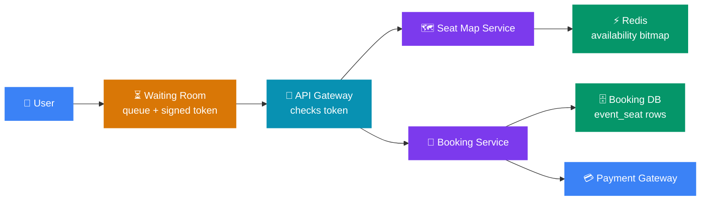

# 🏟️ Design Ticketmaster (Reserved-Seat Event Ticketing)

> 🧩 **My own design** &nbsp;·&nbsp; 🔥🔥 Very High Priority &nbsp;·&nbsp; 💬 **16 Questions**  
> **Source:** an original design, written for interview practice.  
> **Asked as:** "design Ticketmaster / a concert ticket booking system" — mainly at FAANG; also as "design BookMyShow / District" at Indian companies

---

📊 **Question Count**

| # | Section | Questions |
|---|---|---|
| 1 | [Requirements and Defaults ⚡](#1--requirements-and-defaults-) | 1 |
| 2 | [Estimation 🔥](#2--estimation-) | 2 |
| 3 | [The Design 🔥🔥](#3-️-the-design-) | 1 |
| 4 | [Deep Dive — Seat Map Reads 🔥](#4-️-deep-dive--seat-map-reads-) | 3 |
| 5 | [Deep Dive — Holding Many Seats, All or None 🔥🔥](#5--deep-dive--holding-many-seats-all-or-none-) | 3 |
| 6 | [Deep Dive — The Virtual Waiting Room 🔥🔥](#6--deep-dive--the-virtual-waiting-room-) | 2 |
| 7 | [Deep Dive — Pay, Confirm, Expire 🔥🔥](#7--deep-dive--pay-confirm-expire-) | 2 |
| 8 | [Trade-offs 🔥](#8-️-trade-offs-) | 2 |
| | **Total** | **16** |

> 🔥🔥 Very high priority — asked in almost every Tier-1 interview loop &nbsp;·&nbsp; 🔥 High priority — very frequent in Tier-1 interviews &nbsp;·&nbsp; ⚡ Medium priority — commonly asked &nbsp;·&nbsp; 💤 Low priority — good to know, rarely asked

---

> **Scope.** This file covers only what is different at **stadium scale**. The shared core is taught
> elsewhere, so this file links to it instead of repeating it:
> one inventory row per unit, the idempotency key, the safe check-and-update and the ACID database in
> [Vol 2 ch07 Hotel Reservation §4–§6 and §9](../01_insider_guide_Alex_Xu/vol_2/ch07_hotel_reservation_system.md);
> the hold → pay → confirm flow in the 🎟️ double-booking question of
> [`iq/01` HLD Q&A](../iq/01_System_Design_HLD_Interview_Questions.md);
> the classes and seat-locking code in [LLD — BookMyShow](../04_lld_and_machine_coding/08_bookmyshow_seat_booking.md).
>
> **What is new here:** a huge spike at one moment, many users wanting the **same few seats**,
> holding several seats **all or none**, and a waiting room in front of everything.

---

## 1. 📋 Requirements and Defaults ⚡

Say each default aloud. Then the interviewer can correct you early.

**Functional**

| Requirement | Default I state |
|---|---|
| Browse events and see a seat map | Yes. Layout plus live availability |
| Pick exact seats, or ask for "best available" | Both. Max **8 seats per order** |
| Hold the seats while the user pays | Hold for **10 minutes** |
| Pay and get tickets | Payment by an external gateway |
| Out of scope | Resale, dynamic pricing, event search ranking |

**Non-functional**

- **Never sell one seat twice.** Booking needs strong consistency.
- **The seat map may be a few seconds stale.** The hold does the final check.
- **Survive a 100× spike** at the moment sales open.
- **Fair:** a bot must not win just by sending more requests.

**How it differs from a hotel (ch07):** a hotel sells *any one* of many identical rooms (count-based). Here every seat is a separate item with a **status** (item-based, ch07 §9 Family B). And the traffic is not flat — it comes all at once.

### ❓ Interview Questions

1. **What changes in the design when you go from a hotel booking system to Ticketmaster? 🔥**

<!-- -->
<details>
<summary>💡 Show Answer</summary>

**Answer:**

Three things change. The rest stays the same.

1. **Count-based becomes item-based.** A hotel row holds a number: `total_reserved + 1 <= limit`. A seat row holds a **status**: `AVAILABLE → HELD → SOLD`. The user picks exact seats, so I must take **all of them or none**.
2. **Flat traffic becomes one huge spike.** A hotel gets ~3 bookings per second all day. A big concert gets millions of users in the first minute. So I add a **virtual waiting room** in front.
3. **Contention moves to a few rows.** In a hotel, two guests rarely want the last room at the same second. Here thousands want the same front-row seats. So I need short holds and fast failure, not long lock waits.

**What stays the same:** an ACID database as the source of truth, an idempotency key per order, and a check-and-update in one step.

---

</details>

---

## 2. 🔢 Estimation 🔥

**Assumptions for one big concert:**

- Stadium: **60,000 seats**.
- Users who show up when sales open: **2 million**.
- Average order: **3 seats** → about **20,000 orders** sell out the stadium.

**Traffic without a waiting room:**

- 2M users each refresh every ~5 s → 2,000,000 ÷ 5 = **400,000 requests/s**.
- Almost all of them are reads. This is what breaks a normal system.

**Traffic with a waiting room:**

- Let in about **20,000 active shoppers** at a time.
- Each one polls the seat map every ~5 s → 20,000 ÷ 5 = **4,000 map reads/s**. A cache handles this easily.
- 20,000 orders over ~15 minutes → 20,000 ÷ 900 s ≈ **22 successful holds/s**.
- Many holds fail because someone took the seat first. Say **5 tries per success** → ~**110 hold writes/s**.

**Storage for one event:**

- 60,000 seat rows × ~100 bytes = **6 MB**. It fits in memory on any server.
- Availability as a bitmap: 60,000 bits ÷ 8 = **7.5 KB** for the whole stadium.

**The point to say aloud:** the **writes are small** (~100/s). The hard parts are the **read spike** and **many users fighting for the same seats**.

### ❓ Interview Questions

1. **Estimate the load for a 60,000-seat stadium sale. 🔥🔥**

<!-- -->
<details>
<summary>💡 Show Answer</summary>

**Answer:**

I state the assumptions first: 60,000 seats, 2 million users at open, 3 seats per order.

- **Orders:** 60,000 ÷ 3 = **20,000 orders** to sell out.
- **Raw read load:** 2M users refreshing every 5 s = **400,000 requests/s**. No database survives that, so I need a waiting room.
- **With a waiting room:** I let in ~20,000 shoppers. Seat map polls every 5 s = **4,000 reads/s**, served from cache.
- **Writes:** 20,000 orders in ~15 minutes ≈ **22 holds/s**. With ~5 failed tries per success, ~**110 hold writes/s**.
- **Storage:** 60,000 rows × 100 bytes = **6 MB** per event. Availability as a bitmap = **7.5 KB**.

So one database primary handles the writes for one event easily. The design effort goes into the waiting room and the seat-map cache, not into sharding the writes.

---

</details>

2. **The writes are only ~100 per second. Why is this system still hard? 🔥**

<!-- -->
<details>
<summary>💡 Show Answer</summary>

**Answer:**

Because the problem is not the **number** of writes. It is **where** they go and **when**.

1. **Hot rows.** Thousands of users want the same front-row seats. All their writes hit the same few rows at the same second. Each one waits for the row lock. So I keep the hold transaction tiny and fail fast.
2. **The read spike.** 2 million users arrive at the same minute. Without a waiting room that is ~400,000 requests/s, mostly reads. The servers fall over before a single seat is sold.
3. **Fairness.** A bot can send 1,000 requests per second. If the fastest client wins, bots win. So the queue must not reward speed.
4. **Money in the loop.** A seat is held while an external payment runs. Holds can expire mid-payment. I must handle "paid but the hold is gone".

Scale-out alone fixes none of these. Each one needs its own mechanism.

---

</details>

---

## 3. 🏗️ The Design 🔥🔥



**The main table — one row per seat per event:**

```sql
CREATE TABLE event_seat (
    event_id    BIGINT      NOT NULL,
    seat_id     INT         NOT NULL,      -- section + row + number, as one id
    status      VARCHAR(10) NOT NULL,      -- AVAILABLE | HELD | SOLD
    hold_id     BIGINT      NULL,          -- who holds it now
    held_until  TIMESTAMP   NULL,
    order_id    BIGINT      NULL,          -- set when SOLD
    PRIMARY KEY (event_id, seat_id)
);
```

**The flow:**

1. The user joins the **waiting room**. When their turn comes, they get a **signed token**.
2. The **gateway** checks the token on every request. No token, no access.
3. The **seat map service** returns the layout (from a CDN) and live availability (from Redis).
4. The user picks seats. The **booking service** holds them in the DB, all or none (§5).
5. The user pays. The booking service **confirms** the hold with a compare-and-set (§7).
6. A change event updates the Redis bitmap, so other users see the seat as taken.

**Shard by `event_id`.** One event's seats stay on one shard, so a multi-seat hold is a local transaction. 6 MB per event fits on one primary easily.

### ❓ Interview Questions

1. **Walk me through the high-level design of Ticketmaster. 🔥🔥**

<!-- -->
<details>
<summary>💡 Show Answer</summary>

**Answer:**

I split it into the read path and the write path, with a gate in front of both.

1. **Waiting room in front.** At sales open, millions of users join a queue. It lets in a fixed number per minute and gives each one a **signed token**. The gateway rejects requests without a valid token.
2. **Read path — the seat map.** The layout is static, so it comes from a **CDN**. Live availability is a **bitmap in Redis** — 7.5 KB for a 60,000-seat stadium. Clients poll it every few seconds.
3. **Write path — the hold.** One table, `event_seat`, one row per seat per event. A hold is a **conditional `UPDATE`** from `AVAILABLE` to `HELD`, for all requested seats in one transaction. If fewer rows change than seats asked, roll back.
4. **Pay and confirm.** The user pays outside any lock. Then a compare-and-set moves `HELD` to `SOLD`, matched on the `hold_id`.
5. **Expiry.** Holds last 10 minutes. A sweeper and a lazy check in the hold `WHERE` clause free expired seats.

The database is **sharded by `event_id`**, so all seats of one event are on one shard and a hold is a local transaction.

---

</details>

---

## 4. 🗺️ Deep Dive — Seat Map Reads 🔥

The seat map has two parts. They change at very different speeds, so they are stored differently.

| Part | Changes | Stored in | Served by |
|---|---|---|---|
| **Layout** — sections, rows, seat positions, prices | Almost never | Object storage | **CDN**, long TTL |
| **Availability** — which seats are free | Every second | **Redis bitmap**, one bit per seat | Seat map service |

**The availability bitmap:**

- One Redis key per event: `avail:{event_id}`. Bit `seat_id` = 1 means free.
- 60,000 seats = **7.5 KB**. The whole thing goes to the client in one small response.
- It is updated **after** the DB commit — by the booking service or by CDC from the DB.
- A **version number** comes with it. The client asks "give me changes since version 812". The server sends only the changed seats.

**How the client stays up to date:**

| Option | How | Good for |
|---|---|---|
| **Short polling** (every 3–5 s) | Simple GET with the version | ✅ Default. Works with any CDN and load balancer |
| **SSE** (server-sent events) | Server pushes changes | Fewer requests, but one open connection per user |
| **WebSocket** | Two-way connection | Not needed — the client never pushes anything |

**A stale map is fine.** The map may show a seat as free for a few seconds after it is taken. The hold does the final check in the DB, and the user sees "seat just taken, pick another". This is the same rule as the inventory cache in ch07 §7.

### ❓ Interview Questions

1. **How do you serve the seat map to 20,000 active shoppers with live availability? 🔥🔥**

<!-- -->
<details>
<summary>💡 Show Answer</summary>

**Answer:**

I split the map into layout and availability, because they change at different speeds.

- **Layout** — section, row, seat positions, prices. It almost never changes during a sale. I put it in object storage behind a **CDN** with a long TTL. The servers never see these requests.
- **Availability** — a **Redis bitmap**, one bit per seat. 60,000 seats is only **7.5 KB**. It is updated after each DB commit, by the booking service or by CDC.
- **Updates to the client** — short polling every 3–5 s with a version number. The server returns only the seats that changed since that version. 20,000 shoppers ÷ 5 s = **4,000 reads/s**, which a few Redis replicas handle easily.

The DB is never read for the map. It only does the holds. A stale map is acceptable because the hold checks the real status.

---

</details>

2. **The map shows a seat as free, but the hold fails. Is that a bug? 🔥**

<!-- -->
<details>
<summary>💡 Show Answer</summary>

**Answer:**

No. It is expected, and the design is built for it.

- The map comes from a **cache** that lags the DB by a second or two. During a hot sale, a seat can be taken in that gap.
- The **hold** is the real check. It runs `UPDATE … WHERE status = 'AVAILABLE'` in the DB. If someone took the seat first, 0 rows change, and the hold fails.
- The user sees **"This seat was just taken"** and the map refreshes. Good UX also offers the nearest free seats at once.

**It would be a bug** only if the cache were the final check — then two users could both get the seat. So the rule is the same as in ch07: **the cache is for display; the DB decides.**

To make this happen less often: send changes faster (shorter poll, or SSE), and offer **"best available"** so the server picks seats that are really free.

---

</details>

3. **Polling, SSE or WebSocket for live seat updates? 🔥**

<!-- -->
<details>
<summary>💡 Show Answer</summary>

**Answer:**

I start with **short polling** and say when I would switch.

- **Polling every 3–5 s** — a plain GET with a version number. It is stateless, so any server answers it. It works through CDNs and load balancers with no special setup. Cost: 20,000 users = 4,000 requests/s, which is small.
- **SSE** — the server pushes changes on one open HTTP connection. Fewer requests and faster updates. But each user holds a connection open, so the servers must handle 20,000+ long-lived connections, and a deploy drops them all.
- **WebSocket** — two-way. Not needed here: the client never pushes data on this channel. It has the same connection cost as SSE, and more setup.

**When I would switch to SSE:** if users often lose seats because the map is stale, and the product team wants sub-second updates. Polling is the simpler default; the hold check keeps it correct either way.

---

</details>

---

## 5. 🔒 Deep Dive — Holding Many Seats, All or None 🔥🔥

The user picks 4 seats. Either all 4 become `HELD` for this user, or none do.

**The hold — one conditional `UPDATE`:**

```sql
START TRANSACTION;

UPDATE event_seat
SET    status     = 'HELD',
       hold_id    = :holdId,
       held_until = NOW() + INTERVAL 10 MINUTE
WHERE  event_id = :eventId
  AND  seat_id IN (:s1, :s2, :s3, :s4)               -- sorted in the app
  AND  (status = 'AVAILABLE'
        OR (status = 'HELD' AND held_until < NOW()));  -- an expired hold counts as free

-- rows affected must be 4; otherwise ROLLBACK → "some seats were just taken"
COMMIT;
```

- **The row count is the guarantee.** If it is less than 4, one seat was taken. Roll back, and no seat stays held.
- **The expired-hold check** in the `WHERE` frees old holds at once. The hold does not wait for the sweeper (§7).
- **Keep the transaction tiny.** Only this `UPDATE`. No payment call, no other service call, while the locks are held.

**Deadlock risk.** User A holds seats 5 and 6; user B holds 6 and 5. If A locks 5 first and B locks 6 first, they wait for each other.

- **Fix:** always lock in the **same order** — sort the seat ids.
- In MySQL InnoDB, an `IN` list on the primary key is scanned in key order, so the locks are taken in order.
- In PostgreSQL the order is not guaranteed. Lock first with `SELECT … WHERE … ORDER BY seat_id FOR UPDATE`, then update.
- The DB still detects any deadlock and aborts one transaction. Treat that as "seat taken, try again".

**Why not hold in Redis?** It is faster, but Redis is not the source of truth. See Q3.

### ❓ Interview Questions

1. **A user picks 4 seats. How do you hold all 4 or none? 🔥🔥**

<!-- -->
<details>
<summary>💡 Show Answer</summary>

**Answer:**

One conditional `UPDATE` inside one transaction, with a row-count check.

```sql
UPDATE event_seat
SET    status = 'HELD', hold_id = :holdId,
       held_until = NOW() + INTERVAL 10 MINUTE
WHERE  event_id = :eventId
  AND  seat_id IN (:s1, :s2, :s3, :s4)
  AND  (status = 'AVAILABLE' OR (status = 'HELD' AND held_until < NOW()));
```

- The `WHERE` clause is the check. The DB runs it under the row lock, on the latest committed value.
- If **4 rows** change, I commit. The user has all 4 seats.
- If **fewer than 4** change, someone took a seat first. I **roll back**, so none of the 4 stay held. The user sees "some seats were just taken".
- The second condition treats an **expired hold** as free, so I don't wait for a sweeper.

Two rules: the transaction holds only this statement — no payment call inside it — and the seat ids are **sorted**, so two holds cannot deadlock.

---

</details>

2. **Can two users' holds deadlock? How do you prevent it? 🔥**

<!-- -->
<details>
<summary>💡 Show Answer</summary>

**Answer:**

Yes. User A wants seats 5 and 6. User B wants 6 and 5. A locks 5, B locks 6. Now A waits for 6 and B waits for 5. Neither can move.

**Prevention: lock in one global order** — always by `seat_id`, smallest first.

- Then both users try seat 5 first. One gets it; the other **waits** at seat 5 and holds nothing. No cycle can form.
- In **MySQL InnoDB**, an `IN` list on the primary key is scanned in key order, so the `UPDATE` already locks in order. I still sort in the app to be safe.
- In **PostgreSQL** the update order is not guaranteed. I lock first with `SELECT … ORDER BY seat_id FOR UPDATE`, then run the `UPDATE`.

**Backup:** the DB detects a deadlock and aborts one transaction. The app treats that as "seats just taken, try again", the same as a row count below 4. Also set a short **lock wait timeout** (1–2 s), so a hot seat fails fast instead of queuing users.

---

</details>

3. **Why not hold seats in Redis with `SET NX` instead of the database? 🔥🔥**

<!-- -->
<details>
<summary>💡 Show Answer</summary>

**Answer:**

Redis is faster, and some systems do use it as a **first gate**. But it cannot be the **source of truth**.

**How it would work:** one key per seat, `seat:{eventId}:{seatId}`, set with `NX` and a 10-minute TTL. For 4 seats, a **Lua script** checks all 4 keys and sets all 4, so it is all or none. The `{eventId}` hash tag keeps all keys of one event on one cluster slot, so the script can touch them all.

**Why the DB still decides:**

- Redis replication is **asynchronous**. If the primary fails, the new primary may not have the latest holds. Two users can then hold the same seat.
- The TTL is the hold, so it is lost if Redis loses the key. The DB keeps `held_until` durably.
- The final `SOLD` must be in the same store as the order and the payment record.

**My answer:** the DB does the hold. The writes are only ~100/s, which a DB handles easily. Redis is only worth adding if the hold rate grows far beyond that — and even then, the DB **confirm** step must still check the seat.

---

</details>

---

## 6. ⏳ Deep Dive — The Virtual Waiting Room 🔥🔥

Without a gate, 2 million users hit the system in the same minute. The waiting room turns that spike into a **steady flow**.

**How it works:**

1. **Before sales open,** users join a lobby page. It is a static page on the CDN, so it costs almost nothing.
2. **At open time,** every user in the lobby gets a **random position**. Being first in the lobby, or refreshing fastest, gives no advantage.
3. Users who arrive **after** open go to the end of the queue, in arrival order.
4. The queue **admits N users per minute**. N is set so that active shoppers stay at ~20,000.
5. An admitted user gets a **signed token**: `user_id`, `event_id`, `expires_at`, signed with HMAC.
6. The **gateway** checks the token on every booking request. Checking a signature needs no DB call, so it is cheap.

**Storing the queue:** a Redis sorted set per event. Score = position. `ZRANK` tells a user where they are. Admission removes the lowest scores.

**Setting the admission rate:** watch the active shoppers and the hold success rate. If the DB or the seat map slows down, admit fewer. When the event sells out, stop admitting and tell everyone still waiting.

### ❓ Interview Questions

1. **Design the virtual waiting room. 🔥🔥**

<!-- -->
<details>
<summary>💡 Show Answer</summary>

**Answer:**

Its job is to turn a spike of millions into a steady flow that the booking system can handle.

1. **Lobby before open.** Users load a static page from the CDN. No backend cost.
2. **Random order at open.** Everyone in the lobby gets a random position when sales start. So refreshing fast or arriving at 9:59:59 gives no advantage over arriving at 9:50.
3. **Queue in Redis.** A sorted set per event, score = position. The client polls "where am I?" every ~30 s, and `ZRANK` answers it.
4. **Admit at a fixed rate.** For example, 2,000 users per minute, tuned so ~20,000 users shop at once. If the hold success rate drops or latency rises, admit fewer.
5. **Signed token.** An admitted user gets a token with `user_id`, `event_id` and an expiry, signed with HMAC. The gateway checks the signature on every request — no DB call.
6. **Sold out → tell the queue at once**, so people stop waiting.

The trade-off: users wait, but nobody gets an error page, and the DB never sees the spike.

---

</details>

2. **How do you stop bots from buying all the tickets? 🔥**

<!-- -->
<details>
<summary>💡 Show Answer</summary>

**Answer:**

No single fix works. I use layers, and each one makes a bot's job more expensive.

1. **The queue does not reward speed.** Positions are random at open, so 1,000 requests per second do not help.
2. **One position per account.** The token carries the `user_id`. A bot with many tabs still gets one place.
3. **Verified accounts before the sale.** Fans register days earlier, with a phone number or payment card. Ticketmaster calls its version "Verified Fan". Fake accounts become costly.
4. **CAPTCHA** when joining the queue, and again on suspicious behaviour.
5. **Limits:** max 8 tickets per account per event, and limits per payment card.
6. **Rate limits** at the gateway, per account and per IP.
7. **Tickets bound to the buyer** (name, or an app ticket that rotates its barcode), so resale for profit is harder.

The goal is not zero bots. It is making each bot ticket cost more than it earns.

---

</details>

---

## 7. 💳 Deep Dive — Pay, Confirm, Expire 🔥🔥

**Pay outside any lock.** The hold committed already. The user pays with the seat in `HELD` state. No DB lock is held while the payment gateway runs.

**Confirm — a compare-and-set on `hold_id`:**

```sql
UPDATE event_seat
SET    status   = 'SOLD',
       order_id = :orderId
WHERE  event_id = :eventId
  AND  hold_id  = :holdId
  AND  status   = 'HELD';
-- rows affected must equal the number of seats
```

- It matches on **`hold_id`, not on time.** If the hold expired but nobody took the seats, the `hold_id` is still there, so a slightly late payment still succeeds. That is good for the user.
- If someone **re-held** a seat after expiry, its `hold_id` changed. The row count is short, so the confirm fails. Roll back, and **refund** the payment.

**Idempotency:** the order uses the `hold_id` (or an `order_id` made at hold time) as the **idempotency key** to the payment gateway. A retry or a double click never charges twice. The confirm itself is safe to repeat: a second run finds `status = 'SOLD'` and changes 0 rows, so check whether the order already exists before you report a failure.

**Expire — two mechanisms together:**

| Mechanism | What it does | Why it is needed |
|---|---|---|
| **Lazy check** in the hold `WHERE` (§5) | A new hold may take a seat whose `held_until` has passed | Correctness — a seat is free the moment its hold expires |
| **Sweeper** every ~30 s | `UPDATE … SET status='AVAILABLE', hold_id=NULL WHERE status='HELD' AND held_until < NOW() LIMIT 1000` | Display — so the seat map shows the seat as free again |

### ❓ Interview Questions

1. **The payment succeeds, but the hold has already expired. What happens? 🔥🔥**

<!-- -->
<details>
<summary>💡 Show Answer</summary>

**Answer:**

It depends on whether someone else took the seats. The confirm step decides, using a compare-and-set on the `hold_id`:

```sql
UPDATE event_seat SET status = 'SOLD', order_id = :orderId
WHERE  event_id = :eventId AND hold_id = :holdId AND status = 'HELD';
```

- **Nobody took them.** The `hold_id` is still on the rows. The confirm succeeds even though the time passed. The user gets the tickets.
- **Someone re-held them.** The `hold_id` changed, so the row count is short. I roll back and **refund automatically**. The user sees "your hold expired", and I offer other seats.

**To make this rare:**
- Give the payment call a **timeout shorter than the hold** (for example, 3 minutes against 10).
- **Extend the hold once** when payment starts, for example +5 minutes.
- Show a **countdown** so the user knows the time limit.

The payment uses the `hold_id` as its **idempotency key**, so a retry never charges twice.

---

</details>

2. **How do expired holds get released? 🔥**

<!-- -->
<details>
<summary>💡 Show Answer</summary>

**Answer:**

Two mechanisms, because they solve two different problems.

1. **Lazy check — for correctness.** The hold `UPDATE` treats `status = 'HELD' AND held_until < NOW()` as free. So a seat is available to the next user the moment its hold expires. Nothing has to run first.
2. **Sweeper — for the display.** Every ~30 s a job runs `UPDATE … SET status = 'AVAILABLE', hold_id = NULL WHERE status = 'HELD' AND held_until < NOW() LIMIT 1000`. Then it updates the Redis bitmap. Without it, the seat map would keep showing expired seats as taken.

**Why not only the sweeper?** If it is late or down, seats stay blocked and the event looks sold out. The lazy check makes correctness independent of the job.

**Why not only Redis TTL?** A Redis key can expire on time, but if Redis loses it on failover, the DB and Redis disagree. The DB keeps `held_until`, so it stays the source of truth.

The `LIMIT` keeps each sweep short, so it never holds many row locks at once.

---

</details>

---

## 8. ⚖️ Trade-offs 🔥

| Decision | My choice | The alternative | What flips it |
|---|---|---|---|
| Who picks the seats | User picks, plus a **"best available"** button | Server assigns seats only | Very hot sales: assignment removes the fight over the same seats |
| Where the hold lives | **Database** | Redis `SET NX` + Lua | Hold rate far above what one DB primary can take |
| Handling the spike | **Waiting room** | Autoscale only | Small events with no spike — skip the queue |
| Live map updates | **Short polling** | SSE / WebSocket | Users lose seats often because the map is stale |
| Hold length | **10 minutes** | 5 minutes | Sell-out speed matters more than payment success (short holds free seats faster) |
| Sharding | **By `event_id`** | By venue, or no sharding | One event too big for one primary (not the case: 6 MB) |

### ❓ Interview Questions

1. **Should users pick their own seats, or should the system assign them? 🔥**

<!-- -->
<details>
<summary>💡 Show Answer</summary>

**Answer:**

I offer both, and I would push "best available" for the biggest sales.

**User picks:**
- Users like it. Many care about the exact seat.
- But during a hot sale, thousands click the same front-row seats. Most holds fail, and users retry again and again. That adds load and frustration.

**System assigns ("best available"):**
- The user asks for "4 seats, section A, under ₹5,000". The server picks 4 seats that are really free, next to each other.
- No two users fight for the same seat, so almost every hold succeeds on the first try.
- The server can pick from different parts of the section for different users, which spreads the lock load.

**What flips it:** for a small show with low demand, picking is fine and users prefer it. For a stadium sale with millions in the queue, assignment is the fairer and faster default.

---

</details>

2. **How do you shard the booking database? 🔥**

<!-- -->
<details>
<summary>💡 Show Answer</summary>

**Answer:**

**By `event_id`.**

- A hold touches several seats of **one event**. If they are all on one shard, the hold is a normal local transaction. No distributed transaction is needed.
- One event is small: 60,000 rows × 100 bytes = **6 MB**. Its writes are ~100/s. One shard handles that easily.
- Different events go to different shards, so the total load spreads out.

**The risk: a hot event on a shared shard.** A mega concert can slow down the other events on the same shard. Fix: put the biggest events on a **dedicated shard** before the sale. Ticketing knows its big sales in advance, so this is planned, not automatic.

**Why not by venue?** A venue hosts many events over time, so some venues would be far hotter than others. `event_id` spreads the load better.

**Why not by `user_id`?** A hold would then span shards — seats are owned by the event, not by the user.

---

</details>

---

## 🔢 Numbers to Remember

| What | Number | How |
|---|---|---|
| Stadium seats | **60,000** | Assumption |
| Orders to sell out | **20,000** | 60,000 ÷ 3 seats per order |
| Raw read load at open | **400,000 req/s** | 2M users ÷ 5 s refresh |
| Active shoppers let in | **~20,000** | Waiting room target |
| Seat map reads | **4,000/s** | 20,000 ÷ 5 s poll |
| Hold writes | **~110/s** | 22 successes/s × ~5 tries |
| Storage per event | **6 MB** | 60,000 × 100 bytes |
| Availability bitmap | **7.5 KB** | 60,000 bits ÷ 8 |
| Hold length | **10 min** | Default; extend once when payment starts |

---

## 🗣️ Interview Cheat Sheet

1. **Name the difference from a hotel:** item-based seats, all-or-none holds, one huge spike.
2. **Estimate:** 400,000 req/s raw → a waiting room cuts it to ~4,000 reads/s and ~100 writes/s.
3. **Waiting room:** random position at open, fixed admission rate, signed token checked at the gateway.
4. **Seat map:** layout on CDN, availability as a 7.5 KB Redis bitmap, short polling with a version. Stale is fine.
5. **Hold:** one conditional `UPDATE`, rows = seats asked, sorted seat ids, tiny transaction.
6. **Confirm:** compare-and-set on `hold_id`; short row count → refund.
7. **Expire:** lazy check in the hold `WHERE` for correctness, sweeper for the display.
8. **Close with a trade-off:** "For the biggest sales I would push best-available assignment to stop users fighting over the same seats."

---
