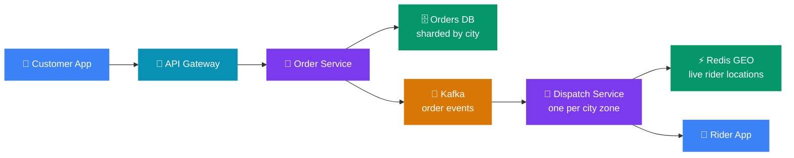
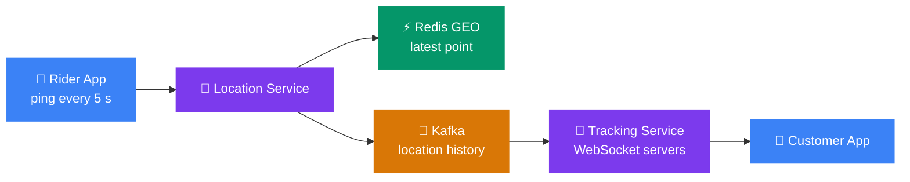

# 🛵 Design Swiggy / Zomato (Food Delivery: Orders, Dispatch, Live Tracking)

> 🧩 **My own design** &nbsp;·&nbsp; 🔥🔥 Very High Priority &nbsp;·&nbsp; 💬 **15 Questions**  
> **Source:** an original design, written for interview practice.  
> **Asked as:** "design Swiggy / Zomato / a food delivery app" — at Swiggy, Zomato, Zepto, Rapido, Flipkart; at FAANG as "design DoorDash / Uber Eats"

---

📊 **Question Count**

| # | Section | Questions |
|---|---|---|
| 1 | [Requirements and Defaults ⚡](#1--requirements-and-defaults-) | 1 |
| 2 | [Estimation 🔥](#2--estimation-) | 2 |
| 3 | [The Design 🔥🔥](#3-️-the-design-) | 1 |
| 4 | [Deep Dive — The Order State Machine 🔥🔥](#4--deep-dive--the-order-state-machine-) | 3 |
| 5 | [Deep Dive — Dispatch and Rider Matching 🔥🔥](#5--deep-dive--dispatch-and-rider-matching-) | 3 |
| 6 | [Deep Dive — Live Tracking and ETA 🔥](#6--deep-dive--live-tracking-and-eta-) | 2 |
| 7 | [Deep Dive — When Things Go Wrong 🔥](#7--deep-dive--when-things-go-wrong-) | 2 |
| 8 | [Trade-offs 🔥](#8-️-trade-offs-) | 1 |
| | **Total** | **15** |

> 🔥🔥 Very high priority — asked in almost every Tier-1 interview loop &nbsp;·&nbsp; 🔥 High priority — very frequent in Tier-1 interviews &nbsp;·&nbsp; ⚡ Medium priority — commonly asked &nbsp;·&nbsp; 💤 Low priority — good to know, rarely asked

---

> **Scope.** This file covers what is **special to food delivery**: an order that moves through
> many owners (customer, restaurant, rider), and the dispatch step that picks a rider. The shared
> parts are taught elsewhere, so this file links to them instead of repeating them:
> geohash, quadtree and Redis `GEOSEARCH` in
> [Vol 2 ch01 Proximity Service](../01_insider_guide_Alex_Xu/vol_2/ch01_proximity_service.md) and the
> 📍 proximity question of [`iq/01` HLD Q&A](../iq/01_System_Design_HLD_Interview_Questions.md);
> WebSocket location fan-out in [Vol 2 ch02 Nearby Friends](../01_insider_guide_Alex_Xu/vol_2/ch02_nearby_friends.md);
> idempotent payments and reconciliation in [Vol 2 ch11 Payment System](../01_insider_guide_Alex_Xu/vol_2/ch11_payment_system.md);
> the raw estimate in [Vol 1 ch02 P14](../01_insider_guide_Alex_Xu/vol_1/ch02_back_of_envelope_estimation.md#p14--food-delivery-swiggy--zomato-order--location-throughput).
> The State pattern code (`@Version`, conditional `UPDATE`, outbox) is in the `java` repo:
> `java/2_design_patterns/18_State_Design_Pattern_in_Java.md` §7–§8.
>
> **What is new here:** two state machines that depend on each other (order and rider), a
> dispatch decision made under time pressure, and an ETA the customer watches live.

---

## 1. 📋 Requirements and Defaults ⚡

Say each default aloud. Then the interviewer can correct you early.

**Functional**

| Requirement | Default I state |
|---|---|
| Browse nearby restaurants and menus | Yes. Within ~7 km of the customer |
| Place an order and pay | Payment by an external gateway. Cash on delivery also allowed |
| Restaurant accepts or rejects the order | Must accept within **3 minutes**, or the order is cancelled and refunded |
| Assign a rider | Automatic. No human dispatcher |
| Live tracking of the rider | Map updates every **~5 s** |
| ETA shown to the customer | Shown at checkout, updated live |
| Out of scope | Search ranking, recommendations, ratings, rider payouts, grocery |

**Non-functional**

- **An order is never lost and never charged twice.** Orders need strong consistency.
- **A rider is never given two orders by mistake.** Assignment must be safe under concurrency.
- **Location data may be a few seconds stale.** It is high volume and low value per point.
- **Survive the dinner peak** — about 3× the daily average, for 2–3 hours.
- **Low latency on browse** (< 200 ms). Dispatch may take tens of seconds; the customer does not wait on it.

**How it differs from Uber:** in Uber the rider (passenger) waits at the pickup point, so you match
on **distance now**. In food delivery the food is **not ready yet**. The best rider is the one who
arrives **when the food is ready**, not the nearest one. This one fact drives the whole dispatch design.

### ❓ Interview Questions

1. **What is different about food delivery compared to a ride-hailing app like Uber? 🔥**

<!-- -->
<details>
<summary>💡 Show Answer</summary>

**Answer:**

Three things are different. Everything else (geo index, live location, WebSockets) is the same.

1. **Three parties, not two.** The order passes through the customer, the restaurant and the rider. Each one can reject or be late. So the order needs a real **state machine** with timeouts at every step.
2. **The pickup is not ready yet.** In Uber the passenger is waiting, so the nearest driver is best. Here the food takes ~15–20 minutes to cook. A rider who arrives too early waits at the restaurant and is wasted. So I dispatch **later** and match on **arrival time vs food-ready time**, not on distance.
3. **Batching is possible.** One rider can carry two orders from the same restaurant, or from two restaurants close together. Uber Pool does this for people, but for food it is far more common.

**What stays the same:** riders' live location in Redis GEO, a geohash/H3 grid for nearby search, and WebSockets for live tracking.

---

</details>

---

## 2. 🔢 Estimation 🔥

**Assumptions** (same as [ch02 P14](../01_insider_guide_Alex_Xu/vol_1/ch02_back_of_envelope_estimation.md#p14--food-delivery-swiggy--zomato-order--location-throughput), so the numbers match):

- **20M DAU**, 20% order once a day → **4M orders/day**.
- **500K riders** online at the dinner peak, each sending a location every **5 s**.
- Average order lifetime (placed → delivered): **~35 minutes**.
- Each user opens ~10 restaurant or menu pages a day.

**Orders (writes):**

- 4M ÷ 86,400 s ≈ **46 orders/s** average.
- Dinner peak at 3× → **~140 orders/s**.

**Rider location (writes):**

- 500K ÷ 5 s = **100,000 location writes/s**.
- This is ~700× the order rate. It decides the storage choice: Redis, not the order DB.

**Active orders at the peak (Little's law: count = rate × time):**

- 140 orders/s × 2,100 s (35 min) ≈ **~300,000 orders in flight**.
- If every customer watches the map, that is 300,000 ÷ 5 s = **~60,000 tracking pushes/s**. This is the upper bound.

**Browse (reads):**

- 20M × 10 ÷ 86,400 ≈ **2,300 reads/s** average, **~7,000/s** at peak. A cache handles this.

**Storage:**

- Orders: 4M × 2 KB = 8 GB/day → **~3 TB/year**. Fits a sharded Postgres/MySQL easily.
- Location history: 100K/s × 86,400 × 50 bytes ≈ **432 GB/day**. Keep it in Kafka/cold storage, not in the order DB.

**The point to say aloud:** orders are **few and valuable** (~140/s, strong consistency). Locations
are **many and cheap** (~100,000/s, last value wins). They go to **different stores**.

### ❓ Interview Questions

1. **Estimate the load for a Swiggy-scale system at the dinner peak. 🔥🔥**

<!-- -->
<details>
<summary>💡 Show Answer</summary>

**Answer:**

I state the assumptions first: 20M DAU, 20% order once a day, 500K riders online at peak, a location ping every 5 s, 35 minutes per order.

- **Orders:** 4M per day ÷ 86,400 ≈ **46/s**. Dinner peak at 3× ≈ **140/s**.
- **Rider locations:** 500K ÷ 5 s = **100,000 writes/s**.
- **Orders in flight:** 140/s × 2,100 s ≈ **300,000** at the same time.
- **Tracking pushes:** at most 300,000 ÷ 5 s ≈ **60,000/s**.
- **Browse:** ~7,000 reads/s at peak, served from cache.
- **Storage:** ~3 TB of orders per year. Location history ~432 GB/day, kept outside the order DB.

So the order database is not the hard part — 140 writes/s is easy for one primary. The hard parts are the **100K/s location stream** and the **dispatch decision** for each order.

---

</details>

2. **Why must the location data and the order data live in different stores? 🔥**

<!-- -->
<details>
<summary>💡 Show Answer</summary>

**Answer:**

Because they have opposite shapes.

| | Orders | Rider locations |
|---|---|---|
| Rate | ~140 writes/s | ~100,000 writes/s |
| Value of one record | High — it is money | Low — the next ping replaces it |
| Consistency | Strong, ACID | Last value wins; a few seconds stale is fine |
| Lifetime | Years (audit, refunds, tax) | Seconds for the live value |

- If I write 100K pings/s into the order DB, every ping is a WAL write and an index update. The DB spends its capacity on throw-away data, and order writes slow down.
- So the **latest** location goes to **Redis GEO** (in memory, one key per city). The **history** goes to **Kafka**, and from there to cold storage for analytics and disputes.
- The order DB only stores the few points that matter: pickup time, delivery time, and the delivery location.

---

</details>

---

## 3. 🏗️ The Design 🔥🔥



**The services:**

| Service | Owns | Store |
|---|---|---|
| Restaurant / Menu | Restaurants, menus, open hours | Postgres + Redis cache + CDN for images |
| Order | The order and its state machine | Postgres, sharded by `city_id` |
| Payment | Payment attempts, refunds | Postgres (see Vol 2 ch11) |
| Location | Latest rider location | Redis GEO, one key per city |
| Dispatch | Which rider gets which order | Reads Redis + rider table; writes the assignment |
| Tracking | Pushes rider location + ETA to the customer | WebSocket servers |

**The main table:**

```sql
CREATE TABLE food_order (
    order_id       BIGINT       PRIMARY KEY,   -- Snowflake id
    city_id        INT          NOT NULL,      -- shard key
    customer_id    BIGINT       NOT NULL,
    restaurant_id  BIGINT       NOT NULL,
    rider_id       BIGINT       NULL,
    status         VARCHAR(20)  NOT NULL,      -- see §4
    version        INT          NOT NULL,      -- for compare-and-set
    ready_at       TIMESTAMP    NULL,          -- restaurant's estimate
    idem_key       VARCHAR(64)  NOT NULL UNIQUE,
    created_at     TIMESTAMP    NOT NULL
);
```

**The flow:**

1. The customer browses restaurants near them (geo index on restaurants, cached).
2. The customer places the order with an **idempotency key**. The order service writes `PLACED` and starts payment.
3. Payment succeeds → `CONFIRMED_BY_PAYMENT`. An event goes to Kafka through the **outbox**.
4. The restaurant tablet gets the order and **accepts** with a ready time (say 18 min) → `ACCEPTED`.
5. The **dispatch service** waits until the right moment (§5), then picks a rider and sends an offer.
6. The rider accepts → `RIDER_ASSIGNED`. Then `PICKED_UP` and `DELIVERED`.
7. During all this, the rider app pings location every 5 s. The tracking service pushes it to the customer.

**Shard by `city_id`.** An order, its restaurant and its rider are always in one city. So every
transaction is local to one shard, and dispatch for a city never has to look at another city.
A very large city (Bengaluru) can be split further into zones.

### ❓ Interview Questions

1. **Walk me through the high-level design of Swiggy. 🔥🔥**

<!-- -->
<details>
<summary>💡 Show Answer</summary>

**Answer:**

I split it into three paths, because they have very different load.

1. **Browse path (read-heavy, ~7,000/s).** Restaurant and menu service, with a geo index on restaurants. Menus are cached in Redis and images come from a CDN. Restaurants rarely move, so this data can be minutes stale.
2. **Order path (few writes, must be correct, ~140/s).** The order service owns one table with a status column. Every change is a **compare-and-set** on the status. Payment uses an idempotency key. Each state change is published to **Kafka** through an **outbox**, so the DB and the event never disagree.
3. **Location path (many writes, ~100,000/s).** Rider apps ping every 5 s. The latest point goes to **Redis GEO**, one key per city. History goes to Kafka.

The **dispatch service** reads order events from Kafka and rider positions from Redis, and picks a rider. The **tracking service** holds WebSocket connections and pushes the rider's position and ETA to the customer.

Everything is **sharded by city**: an order, its restaurant and its rider are always in the same city, so nothing needs a cross-shard transaction.

---

</details>

---

## 4. 🔄 Deep Dive — The Order State Machine 🔥🔥

There are **two machines**, and they depend on each other.

**Order machine:**

```text
PLACED ──pay ok──▶ PAID ──restaurant accepts──▶ ACCEPTED ──rider accepts──▶ RIDER_ASSIGNED
                                                                                │
DELIVERED ◀──drop──── PICKED_UP ◀──rider picks up (needs FOOD_READY)────────────┘

Exits: PLACED ─pay fail─▶ FAILED ·  PAID ─reject / 3 min timeout─▶ CANCELLED (+ refund)
       any state before PICKED_UP ─customer cancel─▶ CANCELLED
```

**Rider machine:** `FREE → OFFERED → GOING_TO_RESTAURANT → AT_RESTAURANT → DELIVERING → FREE`

**The guards between them:**

- The order cannot move to `PICKED_UP` unless the rider is `AT_RESTAURANT`.
- A rider can only be `OFFERED` an order when the rider is `FREE` (or has room for a batched second order).
- When the rider is `DELIVERED`, both machines move: order → `DELIVERED`, rider → `FREE`.

**Each transition is one conditional `UPDATE`:**

```sql
UPDATE food_order
SET    status = 'PICKED_UP', version = version + 1
WHERE  order_id = :id
  AND  status   = 'RIDER_ASSIGNED'
  AND  version  = :expectedVersion;
-- 1 row  → this caller won the transition
-- 0 rows → someone else changed the order first; reload and decide
```

**Every transition publishes an event** through the **outbox**: the event row is written in the
same transaction as the status change, and a relay sends it to Kafka. Consumers (notifications,
tracking, analytics, dispatch) must be **idempotent**, because the relay can send an event twice.

**Every waiting state has a timeout.** A state machine with no timeouts gets stuck orders.

| State | Timeout | What happens |
|---|---|---|
| `PLACED` (waiting for payment) | 15 min | `FAILED` |
| `PAID` (waiting for restaurant) | 3 min | `CANCELLED`, full refund |
| `OFFERED` (waiting for rider) | 20 s | Offer goes to the next rider |
| `ACCEPTED`, no rider found | 10 min | Alert ops; offer customer cancel with refund |

### ❓ Interview Questions

1. **Design the order lifecycle. How do you stop two events from moving an order to two different states? 🔥🔥**

<!-- -->
<details>
<summary>💡 Show Answer</summary>

**Answer:**

I model it as a state machine with a **status** and a **version** column on the order row.

- **States:** `PLACED → PAID → ACCEPTED → RIDER_ASSIGNED → PICKED_UP → DELIVERED`, with exits to `FAILED` and `CANCELLED`.
- **Legal moves are a table in code.** Any move not in the table is rejected, not silently applied.
- **Each move is one conditional `UPDATE`:** `SET status = new, version = version + 1 WHERE id = ? AND status = old AND version = ?`.

**The race:** the customer taps "cancel" at the same second the rider taps "picked up". Both read `RIDER_ASSIGNED`, version 7. Both send an `UPDATE ... WHERE version = 7`. The database applies only one. The other gets **0 rows** and reloads.

- If "picked up" won, the cancel fails with "too late to cancel — food is on the way".
- If "cancel" won, the rider app gets "order cancelled", and the rider is told to leave the food or return it.

No distributed lock is needed. The row is the lock, and the database decides.

---

</details>

2. **The restaurant never responds to an order. What happens? 🔥**

<!-- -->
<details>
<summary>💡 Show Answer</summary>

**Answer:**

The order sits in `PAID` waiting for the restaurant. I need a **timeout** on that state, or the customer waits forever.

1. When the order enters `PAID`, I schedule a timer for **3 minutes**. Options: a delayed message, a Redis sorted set scored by deadline, or a sweeper job that scans `status = 'PAID' AND created_at < now() - 3 min` every 10 s.
2. When the timer fires, I try `UPDATE ... SET status = 'CANCELLED' WHERE id = ? AND status = 'PAID'`.
3. If it updates **1 row**, I cancel, start a **refund** with an idempotency key, and notify the customer.
4. If it updates **0 rows**, the restaurant accepted in the last second. The timer does nothing. This is why the timer must use the same compare-and-set, not a blind update.

Before the timeout, I also nudge: an alert on the restaurant tablet at 1 minute, an automated call at 2 minutes. A timeout is the last step, not the first.

---

</details>

3. **Why use an outbox to publish order events? Why not just send to Kafka after the DB commit? 🔥🔥**

<!-- -->
<details>
<summary>💡 Show Answer</summary>

**Answer:**

Because "write DB, then send to Kafka" is two systems with no shared transaction.

- **Crash after commit, before send:** the order is `ACCEPTED` in the DB, but dispatch never hears about it. No rider is ever assigned. The food goes cold at the restaurant.
- **Send first, then commit fails:** dispatch assigns a rider to an order that does not exist in the DB.

**The outbox fixes this.** In the **same transaction** as the status change, I insert a row into an `outbox` table. A separate relay (a poller, or CDC with Debezium) reads new outbox rows and sends them to Kafka.

- The status change and the event are now **all or nothing**.
- The relay may send an event **twice** (it crashes after sending, before marking it sent). So every consumer is **idempotent** — it keeps the last processed `(order_id, version)` and ignores anything older or equal.

---

</details>

---

## 5. 🛵 Deep Dive — Dispatch and Rider Matching 🔥🔥

Dispatch answers three questions: **when** to look for a rider, **who** the candidates are, and
**which** one gets the order.

**1. When — not at order time.**

- The restaurant says the food is ready in **18 min**. The nearest good rider is **6 min** away.
- If I assign now, the rider waits **12 min** at the restaurant. At the peak that is 12 minutes of a rider doing nothing.
- So I start dispatch at about `ready_at − travel_time − buffer`. Here: 18 − 6 − 2 = **10 minutes after acceptance**.
- The buffer covers riders who decline and the restaurant being faster than it said.

**2. Who — the candidate set.**

- `GEOSEARCH riders:{city} FROMLONLAT <restaurant> BYRADIUS 3 km ASC COUNT 30` → nearby riders.
- Filter: status `FREE`, or `DELIVERING` and close to finishing a nearby drop (a rider who will be free in 3 minutes, 1 km away, beats a free rider 5 km away).
- Straight-line distance is only a filter. The real score uses **road travel time** from a routing service.

**3. Which — the score and the assignment.**

Score each (order, rider) pair. Lower is better:

```text
cost = |rider_arrival_time − food_ready_time|      -- arrive when food is ready
     + w1 × rider_travel_time                       -- do not waste rider time
     − w2 × rider_idle_minutes                      -- be fair to riders who waited long
     + w3 × (extra minutes this adds to another order in the same batch)
```

- **Greedy:** take orders one by one, give each the best free rider. Simple, but an early order can take the rider a later order needed much more.
- **Batched:** collect all orders that are ready to dispatch in a zone over a **short window (~15–30 s)**. Build a cost matrix and solve it as a **minimum-cost assignment** (the Hungarian algorithm, `O(n³)`, or a greedy approximation). This gives a better total.

**Is batched matching fast enough? Check the numbers.**

- Bengaluru ≈ 15% of orders → 140/s × 0.15 ≈ **21 orders/s** at peak.
- A 20 s window → ~420 orders per window for the city.
- Split the city into **~50 zones** → **~8 orders per zone** per window.
- Keep the top **10 riders** per order → a matrix of at most 8 × 80. That solves in well under a millisecond.

**Never give one rider two orders by mistake.** Two zone workers (or a retry) may pick the same rider.

```sql
UPDATE rider
SET    status = 'OFFERED', offered_order_id = :orderId, offer_expires_at = now() + interval '20 seconds'
WHERE  rider_id = :riderId
  AND  status   = 'FREE';
-- 0 rows → another order got this rider first; use the next candidate
```

Then the **offer** goes to the rider app. The rider has **20 s** to accept. Decline or timeout → the
rider goes back to `FREE`, and the order is offered to the next candidate.

### ❓ Interview Questions

1. **How do you assign a rider to an order? 🔥🔥**

<!-- -->
<details>
<summary>💡 Show Answer</summary>

**Answer:**

In three steps: when, who, which.

1. **When.** Not when the order is placed. The food takes ~18 minutes to cook. If I assign at once, the rider waits at the restaurant. I start dispatch at `ready_at − rider travel time − a small buffer`, so the rider arrives when the food is ready.
2. **Who.** I query Redis GEO for riders within ~3 km of the restaurant. I keep riders who are `FREE`, and riders about to finish a drop nearby. Then I get the **road travel time** for each from the routing service, not the straight-line distance.
3. **Which.** I score each pair: how far the arrival time is from the food-ready time, the rider's travel time, and how long the rider has been idle (fairness). I collect orders in a zone over a **~20 s window** and solve a **minimum-cost assignment** for the batch. This beats greedy, where an early order can take the rider a later order needed more.

**Safety:** I reserve the rider with a conditional `UPDATE ... WHERE status = 'FREE'`. Only one order can win the rider. Then I send an offer with a **20 s** timeout. On decline, I try the next candidate.

---

</details>

2. **Greedy assignment vs batched assignment — which would you choose? 🔥**

<!-- -->
<details>
<summary>💡 Show Answer</summary>

**Answer:**

**Batched, with a short window, for busy zones. Greedy for quiet ones.**

**The greedy problem:** order A arrives first and takes rider R, who is 1 km away. Two seconds later order B arrives. R was the **only** rider near B; the next one is 6 km away. A had another rider at 1.5 km. Greedy gave a small gain to A and a large loss to B.

**Batched:** collect the orders of a zone for **15–30 s**, build an order × rider cost matrix, and solve the **minimum total cost**. It sees A and B together, so it gives R to B and the 1.5 km rider to A.

**The cost of batching:** every order waits up to one window before dispatch. That is fine here, because dispatch already starts ~10 minutes before the food is ready. 20 s of that is not visible to the customer.

**What flips it:** in a quiet zone with 1 order per minute, the window holds 0 or 1 orders. Batching adds delay and gains nothing, so I use greedy. The window size can be set per zone from its live order rate.

**Is it fast enough?** ~8 orders per zone per window × top-10 riders each = a tiny matrix. The Hungarian algorithm (`O(n³)`) solves it in well under a millisecond.

---

</details>

3. **Two dispatch workers pick the same rider for two different orders. How do you stop this? 🔥🔥**

<!-- -->
<details>
<summary>💡 Show Answer</summary>

**Answer:**

I make the rider's status the single point of truth, and claim it with a **compare-and-set**.

```sql
UPDATE rider
SET    status = 'OFFERED', offered_order_id = :orderId,
       offer_expires_at = now() + interval '20 seconds'
WHERE  rider_id = :riderId AND status = 'FREE';
```

- Both workers send this. The database applies it **once**. The worker that gets **1 row** owns the rider. The other gets **0 rows** and moves to its next candidate.
- The `offer_expires_at` column means a crashed worker cannot hold a rider forever. A sweeper sets expired `OFFERED` riders back to `FREE`.

**Reducing the clash in the first place:** I give each **zone** one dispatch owner (Kafka partition by `zone_id`, so one consumer handles one zone). Then two workers only fight over riders near a zone border. The `UPDATE` stays as the safety net, because zone ownership moves during a rebalance.

**Why not a Redis lock (`SET rider:42 NX EX 20`)?** It also works and is faster. But the assignment must end up in the database anyway, and then I have two places that can disagree. One conditional `UPDATE` is simpler and correct.

---

</details>

---

## 6. 📍 Deep Dive — Live Tracking and ETA 🔥



**The location write path (100K/s):**

- The rider app sends `(rider_id, lat, lng, timestamp)` every 5 s.
- `GEOADD riders:{city} <lng> <lat> rider:{id}` — note **longitude first**.
- A TTL cannot expire one member of a GEO set. So I also keep `rider:{id}:alive` with a **30 s TTL**. A rider whose alive key is gone is skipped by dispatch.
- The same ping goes to **Kafka**, keyed by `rider_id`, for history and for tracking.

**The tracking push path:**

- This is **much simpler than Nearby Friends.** There, one location goes to many friends. Here, one rider's location goes to **one customer** (or two, with a batched order).
- The tracking service consumes the location topic. It keeps a map `rider_id → customer WebSocket` for active orders only. It pushes the point to that one connection.
- Upper bound: ~60,000 pushes/s at the dinner peak (§2). One WebSocket server handles tens of thousands of connections, so ~10–20 servers are enough, with room to spare.
- If the WebSocket drops, the app falls back to **polling** `GET /orders/{id}/tracking` every 10 s. Tracking is a nice-to-have, so a simple fallback is fine.

**ETA:**

```text
ETA = time until food is ready
    + rider travel time to restaurant (if not yet picked up)
    + handover time at restaurant (~2–3 min)
    + travel time restaurant → customer
```

- **At checkout** I show a range ("30–35 min") from history: this restaurant's real prep times at this hour, plus typical travel time.
- **After pickup** I recompute on each ping from the routing service. I only send a new ETA if it moved by more than a minute, so the number does not jump around.
- A real system learns prep time and travel time with ML models. In the interview I name the inputs and say the model is out of scope.

### ❓ Interview Questions

1. **How does live tracking work, and how is it different from Nearby Friends? 🔥**

<!-- -->
<details>
<summary>💡 Show Answer</summary>

**Answer:**

**Write side:** the rider app pings every 5 s. The location service writes the latest point to **Redis GEO** (`GEOADD riders:{city} lng lat rider:{id}`) and sends the ping to **Kafka**, keyed by `rider_id`. 500K riders ÷ 5 s = 100K writes/s, spread over one Redis key per city.

**Push side:** the tracking service holds a WebSocket per customer with an active order. It consumes the location topic, looks up which customer is waiting for that rider, and pushes the point.

**The difference from Nearby Friends:**
- Nearby Friends is **one-to-many**: each user's location goes to all nearby friends. That needs Redis Pub/Sub channels per user and a big fan-out.
- Food tracking is **one-to-one**: one rider's location goes to one customer (two with a batched order). So a simple lookup `rider_id → connection` is enough. No pub/sub fan-out.

**Scale:** ~300,000 active orders at peak × one push per 5 s = **~60,000 pushes/s** at most. About 10–20 WebSocket servers.

**Fallback:** if the socket drops, the app polls every 10 s. A few seconds of stale map is acceptable.

---

</details>

2. **How do you compute the ETA shown to the customer? 🔥**

<!-- -->
<details>
<summary>💡 Show Answer</summary>

**Answer:**

I split the ETA into parts, because each part has a different source.

1. **Food prep time.** From the restaurant's own history: its real prep times for this kind of order, at this hour, on this day of week. The restaurant's typed estimate is often optimistic.
2. **Rider to restaurant.** Road travel time from the routing service, from the assigned rider's live position. Before a rider is assigned, I use the typical value for that area.
3. **Handover.** ~2–3 minutes for parking and pickup. Also learned per restaurant (a mall restaurant takes longer).
4. **Restaurant to customer.** Road travel time, using live traffic.

**At checkout** I show a **range** ("30–35 min"), because a single number is a promise I will often break.

**After assignment** I recompute on every ping, but only **push a change of more than 1 minute**, so the number does not flicker.

The estimates for prep and travel come from ML models in a real system. In the interview I name the inputs and treat the model as a black box.

---

</details>

---

## 7. 🚨 Deep Dive — When Things Go Wrong 🔥

| Failure | Detection | Response |
|---|---|---|
| Restaurant rejects or times out | Reject event / 3-min timer | `CANCELLED`, refund with idempotency key, notify customer |
| Rider declines or the offer times out | Decline event / 20-s offer expiry | Rider → `FREE`, offer to the next candidate |
| Rider cancels after accepting | Cancel event | Order back to `ACCEPTED`, re-dispatch with **high priority** |
| Rider app goes silent mid-delivery | `rider:{id}:alive` key expired | Alert ops; call the rider; re-dispatch only if no answer in ~5 min |
| Payment succeeded, order write failed | Gateway webhook finds no `PAID` order | Reconciliation job refunds or completes the order (Vol 2 ch11) |
| Customer pays twice (double tap) | Same idempotency key | Second request returns the first order |
| Dispatch service crashes | Kafka consumer rebalance | Another instance takes the zone; state is in the DB, so nothing is lost |
| Dinner peak, too few riders | Unassigned orders pile up in a zone | Widen the search radius, raise the delivery fee, show longer ETAs, and finally stop taking orders in that zone |

**The last row matters most.** When there are not enough riders, **accepting more orders makes
everything worse**: food goes cold, every ETA is broken, and refunds follow. Showing "high demand —
delivery in 55 min" or closing the zone for 15 minutes is **admission control**. It protects the
orders already accepted.

### ❓ Interview Questions

1. **A rider cancels after picking up nothing, 10 minutes before the food is ready. What happens? 🔥**

<!-- -->
<details>
<summary>💡 Show Answer</summary>

**Answer:**

1. The rider app sends a cancel. The rider row moves `GOING_TO_RESTAURANT → FREE` (and the rider's cancellation count goes up, for quality tracking).
2. The order moves `RIDER_ASSIGNED → ACCEPTED` with a compare-and-set, so a late "picked up" event from the same rider cannot also succeed.
3. The order goes back to dispatch with **high priority**. It has already used part of its time, so its cost score is boosted and it is placed at the front of the next zone window.
4. The search radius may be wider than normal, and riders finishing a nearby drop are included.
5. The ETA is recomputed and pushed if it changed by more than a minute. The customer is told only if the delay is real.

The restaurant does not need to know unless the new rider will be late. The food is not ready yet, so 10 minutes is enough time to find someone else.

---

</details>

2. **It is 8 PM on a rainy Saturday. Orders are 2× normal and riders are fewer. What does the system do? 🔥🔥**

<!-- -->
<details>
<summary>💡 Show Answer</summary>

**Answer:**

This is a **supply problem**, not a server problem. More servers do not create riders. So I manage demand and stretch supply.

**Stretch supply:**
- **Batch more:** allow two orders per rider from the same or nearby restaurants.
- **Widen the radius** for candidate riders.
- **Raise rider pay** for the zone (surge incentive) so more riders come online.

**Slow down demand:**
- **Show the real ETA** at checkout ("50–60 min"). Some customers wait or cancel; that is honest and correct.
- **Add a surge or rain fee.**
- **Hide far restaurants** from the listing, so orders are short trips.
- **Last step — admission control:** stop taking orders in the worst zones for 10–15 minutes.

**Why not accept every order?** If I accept more orders than riders can carry, every order is late, food goes cold, and refunds follow. Refusing 10% of orders protects the other 90%.

**On the technical side:** the order write rate doubles to ~280/s — still easy for the DB. Dispatch windows get more orders each, which is exactly when batched matching helps most.

---

</details>

---

## 8. ⚖️ Trade-offs 🔥

| Decision | My choice | The alternative | What flips it |
|---|---|---|---|
| When to dispatch | **Later** — at `ready_at − travel − buffer` | At order time | Very short prep times (cloud kitchens, ~5 min) — then dispatch at once |
| How to match | **Batched**, 15–30 s windows per zone | Greedy, one order at a time | Quiet zones with ~1 order/min — greedy, no window |
| Rider claim | **Conditional `UPDATE`** on the rider row | Redis `SET NX` lock | Claim rate far beyond one DB primary per city |
| Live location store | **Redis GEO**, one key per city | DB with a geo index | Need for exact history queries — that goes to Kafka + cold store anyway |
| Tracking push | **WebSocket**, poll as fallback | Polling only | Small scale, or clients behind proxies that drop sockets |
| Sharding | **By city** (zones inside big cities) | By `order_id` hash | Never for this domain — a hash would split a city's orders and riders apart |
| Order events | **Outbox → Kafka** | Send after commit | Never — the "after commit" gap loses orders |

### ❓ Interview Questions

1. **Why shard by city and not by `order_id`? 🔥**

<!-- -->
<details>
<summary>💡 Show Answer</summary>

**Answer:**

Because every operation in this system is **local to one city**.

- An order, its restaurant, its rider and its customer are always in the same city.
- Dispatch for one order looks at riders **near that restaurant** — never in another city.
- So with a city shard, every transaction (claim a rider, move an order) touches **one shard**. No distributed transaction.

**With `order_id` hashing**, the orders of one city spread across all shards. A dispatch window for a zone would need to read from every shard. Claiming a rider and updating the order could be on two different shards.

**The risk with city sharding: uneven size.** Bengaluru may be 15% of orders; a small town is under 0.1%. Fixes:
- Put the biggest cities on **their own shard**.
- Split a big city into **zones**, and shard by zone if one city becomes too big for one primary.
- Group many small cities onto one shard.

At ~140 orders/s total, even the largest city is ~21 writes/s, so one primary per big city is plenty.

---

</details>

---

## 🔢 Numbers to Remember

| What | Number | How |
|---|---|---|
| Orders per day | **4M** | 20M DAU × 20% |
| Order writes | **~46/s avg, ~140/s peak** | 4M ÷ 86,400; × 3 at dinner |
| Rider location writes | **100,000/s** | 500K riders ÷ 5 s |
| Orders in flight at peak | **~300,000** | 140/s × 2,100 s (Little's law) |
| Tracking pushes | **≤ 60,000/s** | 300,000 ÷ 5 s |
| Browse reads at peak | **~7,000/s** | 20M × 10 ÷ 86,400 × 3 |
| Order storage | **~3 TB/year** | 4M × 2 KB × 365 |
| Restaurant accept timeout | **3 min** | Default |
| Rider offer timeout | **20 s** | Default |
| Dispatch window | **15–30 s** per zone | ~8 orders per zone per window |

---

## 🗣️ Interview Cheat Sheet

1. **Name the difference from Uber:** three parties, and the food is not ready yet — match on arrival time, not distance.
2. **Estimate:** ~140 orders/s at peak (easy), ~100K location pings/s (the real load). Different stores.
3. **Order path:** one row, a status + version, conditional `UPDATE` per move, outbox to Kafka, a timeout on every waiting state.
4. **Dispatch:** start at `ready_at − travel − buffer`; candidates from Redis GEO; score by arrival vs ready time; batch per zone over ~20 s; claim the rider with `WHERE status = 'FREE'`; 20 s offer.
5. **Tracking:** one-to-one push over WebSocket, polling fallback. Simpler than Nearby Friends.
6. **ETA:** prep + to-restaurant + handover + to-customer. Show a range at checkout.
7. **Peak with too few riders:** batch more, widen radius, raise pay, show honest ETAs, close the zone last.
8. **Close with a trade-off:** "I dispatch late rather than early — a rider waiting 12 minutes at a restaurant is the most expensive thing in this system at dinner time."

---
