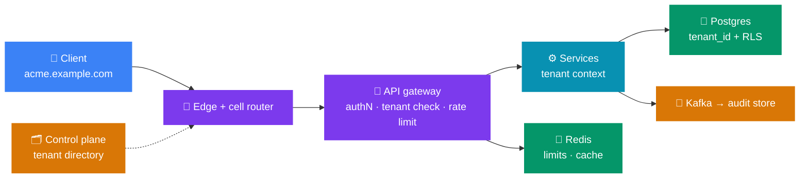
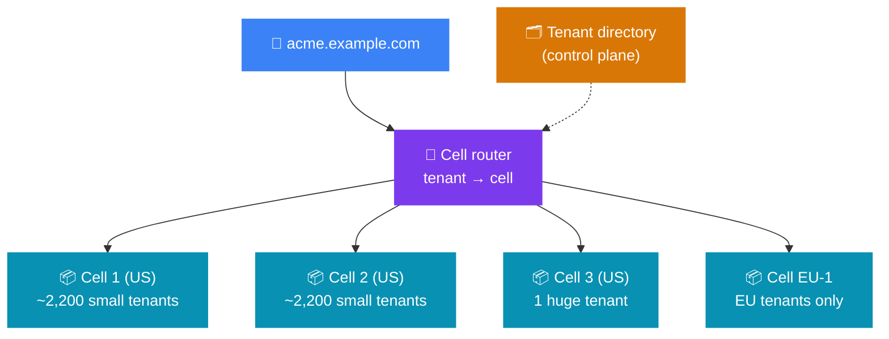

# 🏢 Design a Multi-Tenant SaaS API Platform

---

📊 **Question Count**

| # | Section | Questions |
|---|---|---|
| 1 | [Requirements and Clarifying Questions ⚡](#1--requirements-and-clarifying-questions-) | 2 |
| 2 | [Estimation 🔥](#2--estimation-) | 2 |
| 3 | [High-Level Design 🔥🔥](#3--high-level-design-) | 2 |
| 4 | [Tenant Isolation Models — Silo, Bridge, Pool 🔥🔥](#4--tenant-isolation-models--silo-bridge-pool-) | 3 |
| 5 | [Cell-Based Architecture 🔥🔥](#5--cell-based-architecture-) | 2 |
| 6 | [Tenant Context — Resolve, Carry, Enforce 🔥🔥](#6--tenant-context--resolve-carry-enforce-) | 3 |
| 7 | [Authentication and Authorization per Tenant 🔥](#7--authentication-and-authorization-per-tenant-) | 3 |
| 8 | [Noisy Neighbour — Rate Limits, Quotas, Bulkheads 🔥🔥](#8--noisy-neighbour--rate-limits-quotas-bulkheads-) | 3 |
| 9 | [Data — Sharding, Hot Tenants, Moves, Deletion 🔥](#9--data--sharding-hot-tenants-moves-deletion-) | 3 |
| 10 | [Caching and Per-Tenant Config ⚡](#10--caching-and-per-tenant-config-) | 2 |
| 11 | [Observability, SLOs and the Audit Log 🔥](#11--observability-slos-and-the-audit-log-) | 2 |
| 12 | [AI Agents as API Clients 🔥🔥](#12--ai-agents-as-api-clients-) | 3 |
| 13 | [Bottlenecks, Trade-offs and What I Would Choose 🔥🔥](#13--bottlenecks-trade-offs-and-what-i-would-choose-) | 2 |
| | **Total** | **32** |

> 🔥🔥 Very high priority — asked in almost every Tier-1 interview loop &nbsp;·&nbsp; 🔥 High priority — very frequent in Tier-1 interviews &nbsp;·&nbsp; ⚡ Medium priority — commonly asked &nbsp;·&nbsp; 💤 Low priority — good to know, rarely asked

---

> **Scope.** This file covers what is **special about many tenants on one platform**. The shared parts are taught elsewhere, so this file links to them:
> token bucket and the distributed limiter in [ch04 Rate Limiter](../01_insider_guide_Alex_Xu/vol_1/ch04_design_a_rate_limiter.md) (§3 and §7);
> idempotency keys in [`iq/05` §4](../iq/05_REST_API_Design_Interview_Questions.md#4-error-handling-standards) and [`iq/03` §8](../iq/03_Redis_Interview_Questions.md#8-spring-data-redis-and-real-world-patterns-);
> sharding basics in [`iq/02` §3](../iq/02_Database_Design_and_Internals_Interview_Questions.md#3-database-scaling);
> cache stampede in [`iq/03` §3](../iq/03_Redis_Interview_Questions.md#3-cache-problems-and-solutions-);
> JWT and OAuth2 in [`java/18` §3](https://github.com/vikas9dev/java/blob/main/1_interview_questions/18_Spring_Security_JWT_Interview_Questions.md#3-jwt-deep-dive) and [§5](https://github.com/vikas9dev/java/blob/main/1_interview_questions/18_Spring_Security_JWT_Interview_Questions.md#5-oauth2-basics);
> cells and shuffle sharding on AWS in [`aws/06`](https://github.com/vikas9dev/aws/blob/system_design/system_design/06_reliability_and_dr.md#cell-based-architecture).
>
> **The one idea of this file:** every request carries a tenant. The platform must **never mix two tenants' data**, and it must **never let one tenant use up what the others need**. Everything else is a normal API design.

---

## 🗒️ Cheat Sheet

**Clarifying questions (ask these first):**
1. How many tenants, and how **skewed** are they? (a few huge, many tiny)
2. What isolation do they need? Is "logical" isolation enough, or do some need their own database?
3. Data residency and compliance — EU data stays in the EU? HIPAA, FedRAMP?
4. Who calls the API — admins, end users, machines, AI agents?

**Core components:** edge + cell router → API gateway (authN, tenant check, rate limit) → services (tenant context) → Postgres with `tenant_id` + row-level security → Redis (limits, cache) → Kafka → audit store. A **control plane** owns tenant signup, plans and placement.

**Key insight:** the data is small; the **skew** is the problem. Split for isolation, not for size.

**My choice:** **pool** model (shared tables + `tenant_id` + RLS) **inside cells**. Move the biggest or regulated tenants to a **silo** (own DB or own cell). Placement comes from a **directory**, not a hash.

**Trade-offs to state:**
- Pool is cheap but one bug can leak data → enforce at the database, not only in code.
- Cells limit how many tenants one failure hits, but cost more and make cross-cell work hard.
- Per-tenant metrics labels give detail but explode cardinality → label only the top tenants.

### 🔢 Numbers to Remember

| What | Number | How |
|---|---|---|
| Tenants / users | **20,000 orgs / 50M users** | Assumed |
| Skew | **top 1% = 50% of users** | 200 orgs hold 25M users |
| Average RPS | **~11,600** | 1B calls/day ÷ 86,400 s |
| Peak RPS | **~50,000** | 4 × average, rounded up |
| Biggest tenant at its peak | **~4,600 RPS ≈ 9% of the platform** | 2M users × 40% × 50 calls ÷ 86,400 × 10 burst |
| Cells | **9 cells, ~2,200 tenants each** | 50,000 ÷ 6,000 planned RPS per cell |
| Core OLTP data | **~700 GB** | 225 GB of rows × 3 for indexes |
| Audit log | **300 GB/day, ~110 TB/year raw** | 300M events × 1 KB |
| Rate-limit checks | **100,000/s** | 50,000 RPS × 2 buckets |
| Silo for everyone | **~$600,000/month** | 20,000 DBs × $30 (assumed) |
| 99.99% budget | **4.3 min/month** | 43,200 min × 0.0001 |

---

## 1. 📋 Requirements and Clarifying Questions ⚡

Say each default aloud. Then the interviewer can correct you early.

**Words first.** A **tenant** is one paying customer — a company. Okta calls it an **org**. A tenant has many **users**. One user belongs to one tenant.

**Functional**

| Requirement | Default I state |
|---|---|
| Tenant signup | A new tenant gets a subdomain (`acme.example.com`) in under a minute |
| Management API | Admins create users, groups and apps; assign users to apps |
| End-user API | A user reads their own profile, apps and sessions (`/me`) |
| Machine API | Integrations sync users in bulk (HR system, SCIM) |
| Audit log | Every change is recorded: who, what, when, from where. The tenant can query its own log |
| Plans | Free / Standard / Enterprise, with different limits |

**Non-functional**

| Requirement | Target |
|---|---|
| **Isolation** | Hard rule. One tenant must never see another tenant's data |
| **Fairness** | One tenant must not slow down others (noisy neighbour) |
| Availability | 99.99% — this is identity. If sign-in is down, the customer's staff cannot work |
| Latency | p99 under 200 ms for reads, under 500 ms for writes |
| Residency | EU tenants' data stays in the EU |
| Skew | A few tenants have millions of users. Most have under 1,000 |

**Out of scope (say so):** the sign-in UI, MFA factors, billing.

### ❓ Interview Questions

1. **"Design a multi-tenant SaaS API platform." What do you ask first, and why? ⚡**

<!-- -->
<details>
<summary>💡 Show Answer</summary>

**Answer:**

I ask four things, because each one changes the design:

1. **How many tenants, and how skewed?** 20 tenants and 20,000 tenants need different isolation. If a few tenants are huge, I must plan for them on their own.
2. **What isolation do they need?** If "logical" isolation is fine, I can share tables. If a bank asks for its own database, I need a silo option.
3. **Residency and compliance?** If EU data must stay in the EU, tenants must be **placed** in a region. That pushes me towards cells.
4. **Who calls the API?** Admins, end users, machines and AI agents need different auth and different rate limits.

Then I state two hard rules: **no data leak between tenants, ever**, and **no tenant can starve the others**.

Last, I say what is out of scope: the sign-in UI, MFA and billing. That keeps the round on the platform.

---

</details>

---

2. **Why does tenant skew matter so much? Isn't it enough to know the total traffic? 🔥**

<!-- -->
<details>
<summary>💡 Show Answer</summary>

**Answer:**

No. The total hides the hard part.

Skew changes three decisions:

1. **Placement.** I cannot place tenants by hash. A hash may put two huge tenants on the same shard. I need a **directory** that I control.
2. **Limits.** One global limit is wrong for both ends. A big tenant needs 2,000 RPS. A free tenant needs 50.
3. **Isolation model.** The 19,800 small tenants share tables cheaply. The 200 big ones may need their own database or cell.

So I ask: "How big is the biggest tenant, compared with the whole?" If the answer is over ~5% of a shard, that tenant needs special handling.

---

</details>

---

## 2. 🔢 Estimation 🔥

**Assumptions:** 20,000 tenants · 50M users in total · workforce identity, so people sign in every workday.

**Tenants and skew**

```
Top 1% of tenants      = 200 orgs hold 50% of users      = 25,000,000 users
Average big org        = 25,000,000 ÷ 200                = 125,000 users
The other 19,800 orgs  = 25,000,000 ÷ 19,800             ≈ 1,260 users each (median ~200)
Largest single org     = 2,000,000 users                 = 4% of all users
```

**Traffic**

```
Daily active users     = 50M × 40%                       = 20M
Human calls per day    = 20M × 20 calls                  = 400M   (sign-in, token refresh, profile, app list)
Machine calls per day  = 1.5 × human                     = 600M   (HR sync, SCIM, integrations, agents)
Total per day          = 400M + 600M                     = 1B
Average RPS            = 1,000,000,000 ÷ 86,400 s        ≈ 11,600 RPS
Peak RPS               = 4 × average                     ≈ 46,000 → plan for 50,000 RPS
Peak writes            = 50,000 ÷ 11 (read:write = 10:1) ≈ 4,500 writes/s
```

**The biggest tenant alone**

```
Its daily users        = 2,000,000 × 40%                 = 800,000
Its calls per day      = 800,000 × 50 (human + machine)  = 40M
Its average RPS        = 40,000,000 ÷ 86,400             ≈ 460 RPS
Its 9 AM burst         = 10 × 460                        ≈ 4,600 RPS
Share of platform peak = 4,600 ÷ 50,000                  ≈ 9%   ← one tenant out of 20,000
```

**Storage**

```
User rows              = 50M × 2 KB                      = 100 GB
Group memberships      = 50M × 10 groups × 50 B          = 25 GB
Config (apps, policies)= 20,000 × 5 MB                   = 100 GB
Core OLTP              = 225 GB × 3 for indexes          ≈ 700 GB    ← small
Audit events per day   = 1B calls × 30% are audited      = 300M events
Audit bytes per day    = 300M × 1 KB                     = 300 GB/day
Audit per year         = 300 GB × 365                    ≈ 110 TB raw (~22 TB at 5× compression)
Audit hot (90 days)    = 300 GB × 90                     = 27 TB raw
```

**What this tells me:**
- The core data (~700 GB) fits on one large Postgres. **I split it for isolation and failure scope, not for size.**
- The **audit log** is the big data. It needs its own store (§11).
- The **skew** is the real problem: one tenant can make 9% of the traffic.

### ❓ Interview Questions

1. **Walk me through your estimate. What is the one number that drives the design? 🔥**

<!-- -->
<details>
<summary>💡 Show Answer</summary>

**Answer:**

20,000 tenants, 50 million users. About 40% sign in on a workday, so 20 million daily users.

Each makes about 20 calls a day. Machines (HR sync, integrations, agents) make 1.5 times as many again. That is **1 billion calls a day**.

1 billion ÷ 86,400 seconds is about **11,600 requests per second** on average. Peak is about 4×, so I plan for **50,000 RPS**. Reads are 10× writes, so about 4,500 writes per second at peak.

Storage is small: about 225 GB of rows, maybe 700 GB with indexes. One big database could hold it.

The audit log is large: 300 million events a day at 1 KB is **300 GB a day**, about 110 TB a year raw.

**The number that drives the design is the skew.** The biggest tenant alone makes about 4,600 RPS at its 9 AM peak. That is 9% of the whole platform from one tenant out of 20,000. So the design is about isolation and fairness, not raw size.

---

</details>

---

2. **How do you size a cell or shard, and where does the biggest tenant go? 🔥**

<!-- -->
<details>
<summary>💡 Show Answer</summary>

**Answer:**

I pick a **fixed maximum size** for one cell and load-test it at that size. Say one cell handles **10,000 RPS**. I plan to run it at **60%**, so **6,000 RPS** of planned load. The rest is headroom for bursts and for taking traffic from a failed cell.

```
Cells needed     = 50,000 ÷ 6,000   ≈ 8.3 → 9 cells
Tenants per cell = 20,000 ÷ 9       ≈ 2,200 tenants
```

Now the biggest tenant: **4,600 RPS at peak**. That is **77% of one cell's planned 6,000**. If I put it with 2,000 other tenants, its 9 AM burst uses almost all the headroom.

So I have two choices:
1. Give it a **dedicated cell** (a silo at the cell level). This is the clean answer.
2. Put it in a cell with only small, quiet tenants, and cap it with a hard per-tenant limit.

**Rule I state:** any tenant above ~20% of a cell's planned load gets special placement. A hash cannot do that, so placement comes from a directory (§9).

---

</details>

---

## 3. 🧭 High-Level Design 🔥🔥

**APIs** (the tenant is in the **host**, not in the path):

| Call | Who | Scope |
|---|---|---|
| `POST https://acme.example.com/api/v1/users` | Admin, integration | `users:manage` |
| `GET  /api/v1/users?filter=...&limit=200&after=<cursor>` | Admin | `users:read` |
| `POST /api/v1/groups/{groupId}/users/{userId}` | Admin | `groups:manage` |
| `POST /api/v1/imports` → `202 Accepted` + job id | Integration (bulk) | `users:manage` |
| `GET  /api/v1/me` | End user | `openid profile` |
| `GET  /api/v1/logs?since=...` | Admin, SIEM | `logs:read` |

**Why the tenant goes in the host:**
- The edge can route to the right **cell** from DNS or the `Host` header. It does not need to parse the body or the token.
- Cookies and CORS rules are scoped per tenant for free.
- The token also carries the tenant. The gateway checks that **host tenant = token tenant** (§6).



_Everything right of the router lives inside one **cell** (§5). The control plane sits outside all cells._

**Two planes:**

| | Control plane | Data plane |
|---|---|---|
| What it does | Tenant signup, plans, placement directory, cell setup, tenant moves | Every API request |
| Traffic | Low (a few calls per second) | 50,000 RPS |
| If it fails | No new tenants, no moves. **Existing traffic keeps working** | The tenants in that cell are down |

The data plane must **not** call the control plane on each request. The router keeps a local copy of the directory (20,000 rows is ~2 MB) and refreshes it.

### ❓ Interview Questions

1. **Draw the high-level design and walk one request through it. 🔥🔥**

<!-- -->
<details>
<summary>💡 Show Answer</summary>

**Answer:**

Take `POST https://acme.example.com/api/v1/users` from Acme's HR integration.

1. **Edge + cell router.** DNS sends `acme.example.com` to the edge. The router looks up `acme` in its local copy of the tenant directory and sends the request to **cell 4**.
2. **API gateway** (inside cell 4). It validates the OAuth token: signature, expiry, and that the issuer is Acme's. It checks that the token's tenant equals the host's tenant. Then it checks two rate limits in Redis: Acme's tenant bucket and this client's bucket.
3. **User service.** A filter puts `tenant_id = acme` into a request-scoped context. The service validates the body and opens a transaction.
4. **Postgres.** The transaction sets `app.tenant_id`. Row-level security makes every query see only Acme's rows. The service inserts the user and an **outbox** row in the same transaction.
5. **Kafka → audit store.** A relay publishes the outbox row. The audit store keeps "client X created user Y in Acme at time T".
6. The service returns `201 Created`.

The control plane is not on this path. If it is down, this request still works.

---

</details>

---

2. **Why separate a control plane from the data plane? What goes in each? ⚡**

<!-- -->
<details>
<summary>💡 Show Answer</summary>

**Answer:**

They have different traffic, different risk and different owners.

**Control plane:** tenant signup, the plan and its limits, which cell a tenant lives in, creating new cells, moving tenants. It sees a few calls per second.

**Data plane:** every API request — 50,000 per second at peak.

**Why split them:**
- **Failure.** If the control plane is down, nobody can sign up or move. But all existing tenants keep working. If they were one system, a bug in signup could take down sign-in.
- **Scale.** The data plane scales with traffic. The control plane does not need to.
- **Safety.** Tenant moves and cell changes are risky. Keeping them in one small, careful service makes them easier to review.

**The rule:** the data plane reads control-plane data from a **local copy** (the directory is ~2 MB for 20,000 tenants). It never calls the control plane per request. A new tenant appears in the copy within a few seconds through a push or a short refresh.

---

</details>

---

## 4. 🧩 Tenant Isolation Models — Silo, Bridge, Pool 🔥🔥

There are three ways to store many tenants. The names come from AWS SaaS guidance and are now common in interviews.

| Model | What it means |
|---|---|
| **Silo** | Each tenant has its **own database** (or its own whole stack) |
| **Bridge** | One database, **one schema per tenant** (`acme.users`, `globex.users`) |
| **Pool** | **Shared tables.** Every row has a `tenant_id` column |

**Trade-offs** (numbers from §2: 20,000 tenants, ~2,200 per cell):

| | Silo (DB per tenant) | Bridge (schema per tenant) | Pool (shared tables) |
|---|---|---|---|
| **Cost** | Highest. 20,000 × $30/month (assumed small Multi-AZ DB) = **$600,000/month**, mostly idle | Medium. One DB per cell, but a big catalog | Lowest. Tenants share capacity |
| **Failure scope** | One tenant | All tenants in that DB | All tenants in that DB |
| **Data-leak risk** | Lowest. A wrong query hits only one DB | Low. A wrong `search_path` leaks | **Highest.** One missing `WHERE tenant_id` leaks → enforce with RLS (§6) |
| **Noisy neighbour** | None at the DB level | Shared CPU, I/O and connections | Shared everything → needs limits (§8) |
| **Schema migrations** | 20,000 runs, each one can fail on its own | 2,200 schemas × 2 s = **~73 min per DB** per release | **One run** per DB |
| **Ops** | 20,000 DBs to patch, back up and watch | 2,200 × 40 tables = **88,000 tables** in the Postgres catalog | One DB to run, but it is big |
| **Per-tenant backup/restore** | Easy — restore that DB | Medium — dump one schema | Hard — rows are mixed (§9) |
| **Connections** | A pool per DB per app node → explodes | One pool, but `search_path` per request | One pool |

**When to flip:**
- **Pool → silo** for one tenant when any of these is true:
  - it pays for a dedicated DB (enterprise or regulated);
  - it is too big for a shared shard (§2: >20% of a cell);
  - a contract asks for its own encryption key and its own restore.
- **All silo** when: there are few tenants (say under 100) and all are big, as in B2B banking software. Then the cost is fine and isolation wins.
- **Bridge** is rarely the best answer at 20,000 tenants. The migration time and the catalog size grow with the tenant count. It fits a few hundred mid-size tenants.

**The usual real answer is a hybrid:** pool for the long tail, silo for the few that need it. The code must not care which one a tenant uses. A **routing layer** (the tenant directory) gives each request the right data source.

### ❓ Interview Questions

1. **Compare silo, bridge and pool isolation. Which would you pick for 20,000 tenants? 🔥🔥**

<!-- -->
<details>
<summary>💡 Show Answer</summary>

**Answer:**

**Silo** = a database per tenant. **Bridge** = a schema per tenant in a shared database. **Pool** = shared tables with a `tenant_id` column.

They trade cost against isolation:

- **Silo** has the best isolation. A bad query or a slow tenant hurts only itself. But 20,000 databases at about $30 a month is **$600,000 a month**, and most of them sit idle — the median tenant has ~200 users. Every migration runs 20,000 times.
- **Bridge** shares the server. But each release runs a migration per schema: 2,200 schemas × 2 s is about **73 minutes per database**. And 88,000 tables make the Postgres catalog slow.
- **Pool** is the cheapest. One migration, one connection pool, full sharing of capacity. The risk is a **data leak**: one missing `WHERE tenant_id = ?` shows another tenant's rows.

**For 20,000 tenants I pick pool, inside cells.** I remove its main risk with **row-level security** in Postgres (§6), so a missed clause returns nothing instead of leaking.

Then I add a **silo option** for the few tenants that need it — the biggest ones, or a regulated customer that pays for its own database.

---

</details>

---

2. **A large bank says: "We will sign only if our data is in its own database." How does your design handle that? 🔥🔥**

<!-- -->
<details>
<summary>💡 Show Answer</summary>

**Answer:**

That is the hybrid model. The design must support it **without a code fork**.

1. **Tenant directory.** Each tenant has a row: `tenant_id → cell, data source, model (pool or silo)`. The bank's row points to its own database.
2. **Routing data source.** In Spring I use an `AbstractRoutingDataSource`. Its `determineCurrentLookupKey()` reads the tenant from the context and returns the bank's data source. Every other tenant gets the shared one.
3. **Same schema everywhere.** The silo database has the same tables, including `tenant_id`. RLS still runs. So the code path is identical.
4. **Migrations** run on the shared database and on each silo database. With a few silos that is fine. I track the schema version per database and block a deploy if one is behind.

**What the bank also gets:** its own backup and restore, its own encryption key (KMS), and its own maintenance window.

**What I tell them it costs:** more money, and they move to new versions after the pool, not with it.

**What flips the design:** if *most* customers ask for this, I move to silo for all. Then the directory and routing stay, but I automate database creation in the control plane.

---

</details>

---

3. **Why is schema-per-tenant (bridge) usually a trap at large tenant counts? ⚡**

<!-- -->
<details>
<summary>💡 Show Answer</summary>

**Answer:**

It looks like the middle ground, but its costs grow with the **number of tenants**, not with traffic.

1. **Migrations.** Flyway or Liquibase runs once per schema. 2,200 schemas × 2 s is about **73 minutes** per database per release. If schema 1,400 fails, you are half migrated. The code must then work with two schema versions at once.
2. **Catalog size.** 2,200 schemas × 40 tables = **88,000 tables**, plus their indexes. Postgres keeps metadata for each. Backups, `pg_dump` and planning get slower. Monitoring tools struggle.
3. **Connections.** One pool is shared, but each request must set `search_path` to the tenant's schema. If you forget to reset it, the next request on that connection reads the wrong tenant. That is the same leak risk as pool, in a different place.
4. **No shared queries.** A report across tenants needs a `UNION` over 2,200 schemas.

**When bridge is fine:** a few hundred tenants, each mid-size, where per-tenant restore matters. Above a few thousand tenants, pool + RLS is simpler and cheaper.

---

</details>

---

## 5. 📦 Cell-Based Architecture 🔥🔥

A **cell** is a full, independent copy of the stack: load balancers, app servers, caches, queues and databases. Each cell serves a fixed **set of tenants**. A thin **router** sends each tenant to its cell.



**What cells give you:**

| Benefit | How |
|---|---|
| **Failure scope** | A bad database or a bad deploy hurts one cell — about 1/9 of tenants, not all |
| **Safe deploys** | Roll out to a preview cell, then one production cell, then the rest |
| **Known limits** | Each cell is load-tested at a fixed max size. You scale by **adding cells**, not by growing one |
| **Residency** | An EU cell keeps EU tenants' data in the EU |
| **Big tenants** | A huge tenant gets its own cell (§2) |

**What cells cost:**
- More fixed overhead per cell (each one has its own databases, Redis, Kafka).
- **Cross-cell work is hard.** A global admin report must fan out to every cell.
- **Moving a tenant between cells** is a data migration (§9).
- **The router is shared by all cells.** Keep it very simple: a lookup in a local copy of the directory. No business logic.

**🔎 What Okta has published about its cells** (verified 2026-11-11):
- Okta's architecture is "completely multi-tenant", and customers "share the same underlying environment". "Each Okta environment is called a cell", and a cell holds "all of the infrastructure required to operate an instance of Okta". Cells "can operate independently", which limits "the number of customers impacted by an outage". Inside a cell there is a front-end tier (proxy load balancers, firewalls), an app tier, and database services, on AWS across several availability zones. — [Okta High Availability Architecture whitepaper (Sept 2022)](https://www.okta.com/sites/default/files/2022-09/Okta%20High%20Availability%20Architecture_Whitepaper.pdf)
- Each cell is "a self-contained instance of the entire Okta service". Okta can "roll out code from one node to one cell at a time, or roll back on just one cell". It can add a cell for capacity, or "split a cell to double capacity for tenants on the original cell". If a data center fails, "another cell in a different geography can take ownership of affected accounts within an hour". At the time of writing Okta ran "9 production cells and 2 preview cells", with dedicated cells for Europe and Asia Pacific and one HIPAA and FedRAMP cell. — [Scaling Okta to 50 Billion Users whitepaper (Oct 2021)](https://www.okta.com/sites/default/files/2021-10/scaling-okta-to-50-billion-users.pdf)
- Okta's public status page reports health per cell (for example "US Cell 14", code OK14). — [status.okta.com](https://status.okta.com/)
- **Not verified:** how Okta's router maps an org to a cell, and how data is laid out inside a cell. Do not claim details about those in the round.

### ❓ Interview Questions

1. **What is a cell-based architecture, and why would a multi-tenant identity platform use one? 🔥🔥**

<!-- -->
<details>
<summary>💡 Show Answer</summary>

**Answer:**

A **cell** is a complete copy of the stack — load balancers, app servers, cache, queue and database — that serves a fixed group of tenants. A thin router sends each tenant to its cell. Cells share nothing.

For identity this matters a lot, because sign-in is on the critical path of every customer's workday.

1. **Failure scope.** A bad database, a bad config or a poison request hurts one cell. With 9 cells, that is about 11% of tenants, not 100%.
2. **Safe deploys.** I deploy to a preview cell, then one production cell, watch it, then the rest. A bad release is caught on one cell and rolled back there.
3. **Known limits.** Each cell has a tested max size. I scale by adding cells. I never find a new bottleneck at 2× the size I tested.
4. **Residency and compliance.** An EU cell keeps EU data in the EU. A FedRAMP cell holds only government tenants.

Okta has published that it runs this way. Each Okta environment is a cell with all the infrastructure to run Okta. Cells operate on their own, which limits how many customers an outage hits. Code rolls out one cell at a time.

**The cost:** more fixed overhead, hard cross-cell queries, and tenant moves between cells.

---

</details>

---

2. **How does the cell router work, and how do you stop it from becoming the single point of failure? 🔥**

<!-- -->
<details>
<summary>💡 Show Answer</summary>

**Answer:**

The router does **one thing**: map `tenant → cell`.

**How it maps:**
- The tenant comes from the `Host` header (`acme.example.com`). It can also be done in DNS: `acme.example.com` is a CNAME to `cell-4.example.com`.
- The map is a **directory** owned by the control plane: 20,000 rows, about 2 MB. Each router node keeps a **full local copy** in memory and refreshes it by push or every few seconds.
- I use a directory, not a hash, so I can place big tenants on their own and move tenants (§9).

**How I keep it safe:**
1. **No business logic.** No auth, no rate limits, no body parsing. Less code, fewer bugs.
2. **No call per request.** If the directory service is down, routers keep serving from the last copy.
3. **Many stateless nodes**, in several zones.
4. **Deploy it more slowly** than the cells, and in stages, because it is shared by all.
5. **DNS as a backup.** If the router fails, the CNAME still points each tenant at its cell.

**Unknown tenant** (not in the copy yet): return `404` or ask the directory once. Never send it to a "default" cell — that could mix tenants.

---

</details>

---

## 6. 🧵 Tenant Context — Resolve, Carry, Enforce 🔥🔥

This is the section that stops data leaks. It has three steps.

**1. Resolve** — find the tenant for this request.

| Source | Example | Note |
|---|---|---|
| Host / subdomain | `acme.example.com` → `acme` | Used for routing (§5) |
| Token claim | `iss = https://acme.example.com`, `tid = acme` | Signed, so it cannot be faked |
| API key prefix | `ak_acme_...` → lookup | For machines (§7) |

**Rule:** the gateway takes the tenant from the **host** and from the **token**, and rejects the call with `403` if they differ. A header like `X-Tenant-Id` from the client is **never** trusted on its own.

**2. Carry** — keep it in a request-scoped context.

```java
public final class TenantContext {

    private static final ThreadLocal<String> CURRENT = new ThreadLocal<>();

    private TenantContext() {
    }

    public static void set(String tenantId) {
        CURRENT.set(tenantId);
    }

    public static String require() {
        String tenantId = CURRENT.get();
        if (tenantId == null) {
            throw new IllegalStateException("No tenant in context");
        }
        return tenantId;
    }

    public static void clear() {
        CURRENT.remove();
    }
}
```

A servlet filter (after Spring Security) sets it from the validated token and **clears it in `finally`**. Thread pools reuse threads, so a missing `clear()` gives the next request the old tenant.

**3. Enforce** — at the data layer, so one missed `WHERE` cannot leak.

```sql
ALTER TABLE users ENABLE ROW LEVEL SECURITY;
ALTER TABLE users FORCE ROW LEVEL SECURITY;

CREATE POLICY tenant_isolation ON users
    USING (tenant_id = current_setting('app.tenant_id')::uuid)
    WITH CHECK (tenant_id = current_setting('app.tenant_id')::uuid);
```

At the start of each transaction the app sets the tenant **for that transaction only**:

```java
@Component
public class TenantSession {

    private final JdbcTemplate jdbc;

    public TenantSession(JdbcTemplate jdbc) {
        this.jdbc = jdbc;
    }

    // Call at the start of every @Transactional method (e.g. from an aspect).
    public void bindToTransaction() {
        jdbc.queryForObject(
                "SELECT set_config('app.tenant_id', ?, true)",
                String.class,
                TenantContext.require());
    }
}
```

**Why each part matters:**
- `set_config(..., true)` is the same as `SET LOCAL`. It ends with the transaction. So a pooled connection does **not** carry the tenant to the next borrower.
- `USING` filters reads, updates and deletes. `WITH CHECK` stops inserting a row for another tenant.
- `FORCE` makes RLS apply to the table owner too. Still, the app must connect as a **normal role**: superusers and roles with `BYPASSRLS` skip RLS always.
- If the setting is missing, the cast fails or the filter matches nothing. It **fails closed**.

**Belt and braces:** keep `WHERE tenant_id = ?` in the code too, and start every index with `tenant_id`. RLS is the safety net; the explicit filter keeps plans fast and clear. Hibernate 6 can add the filter for you with a `@TenantId` field and a `CurrentTenantIdentifierResolver`.

### ❓ Interview Questions

1. **You use shared tables. How do you make sure one tenant can never read another tenant's data? 🔥🔥**

<!-- -->
<details>
<summary>💡 Show Answer</summary>

**Answer:**

I use **defence in depth** — several layers, so one mistake is not a leak.

1. **Resolve from trusted sources.** The tenant comes from the signed token, and the gateway checks it matches the host. A client header alone is never trusted.
2. **Carry it in one place.** A filter puts it in a request-scoped `TenantContext` and clears it in `finally`. Code reads it from there, never from request parameters.
3. **Enforce in the database with RLS.** Every tenant table has a policy `tenant_id = current_setting('app.tenant_id')`. Each transaction sets it with `SET LOCAL`. Now a query with a missing `WHERE` returns only this tenant's rows. Inserts for another tenant fail on `WITH CHECK`.
4. **The app connects as a normal role.** Not the owner without `FORCE`, never a superuser or `BYPASSRLS` role.
5. **Tenant in every key.** Cache keys, Kafka message headers, S3 prefixes and search indexes all include the tenant (§10).
6. **Tests.** An integration test creates two tenants and calls every endpoint as tenant A with tenant B's IDs. It must get `404`, not B's data.

The key point: **code review cannot catch every missed clause. The database can.**

---

</details>

---

2. **What can go wrong with Postgres row-level security in a Spring app? 🔥**

<!-- -->
<details>
<summary>💡 Show Answer</summary>

**Answer:**

Five traps:

1. **Session vs transaction setting.** `SET app.tenant_id` (no `LOCAL`) stays on the connection. HikariCP gives that connection to the next request, which then sees the old tenant. Use `SET LOCAL` or `set_config(name, value, true)` inside the transaction.
2. **No transaction.** `SET LOCAL` outside a transaction has no effect. So reads must also run in a transaction, e.g. `@Transactional(readOnly = true)`.
3. **Bypass roles.** The table owner skips RLS unless the table has `FORCE ROW LEVEL SECURITY`. Superusers and `BYPASSRLS` roles always skip it. The app must use a plain role; migrations use a separate owner role.
4. **Slow plans.** The policy adds a filter to every query. If indexes do not start with `tenant_id`, the database scans more. Put `tenant_id` first in the primary key and in indexes.
5. **Missing on new tables.** A new table without a policy is open. Add a CI check: every table with a `tenant_id` column must have RLS enabled and forced.

Also: **cross-tenant jobs** (billing, metrics) need a separate role that is allowed to bypass, used only by those jobs and audited.

---

</details>

---

3. **The tenant is in a ThreadLocal. What breaks with `@Async`, `CompletableFuture` or a Kafka consumer? 🔥**

<!-- -->
<details>
<summary>💡 Show Answer</summary>

**Answer:**

A `ThreadLocal` lives on one thread. Work that moves to another thread loses it.

- **`@Async` and `CompletableFuture.supplyAsync`** run on a pool thread. `TenantContext.require()` there throws — or worse, reads a stale tenant left by an earlier task if someone forgot `clear()`.
- **Fix:** a Spring `TaskDecorator` on the executor. It copies the tenant from the caller thread, sets it on the worker, and clears it in `finally`. Do the same for any custom `Executor`.
- **Kafka consumers** have no HTTP request. Put the tenant in a **message header** when you produce. The listener reads the header and sets the context before it calls the service. A message without a tenant header goes to a dead-letter topic.
- **Scheduled jobs** loop over tenants and set the context per tenant, with `try/finally`.

**Virtual threads (Java 21):** `ThreadLocal` still works per virtual thread, but it is not copied to child threads. `ScopedValue` (final in Java 25) is a cleaner fit: the value is bound for a block of code and cannot leak after it.

The safety net is the same as before: RLS fails closed. A lost tenant gives an error, not another tenant's data.

---

</details>

---

## 7. 🔑 Authentication and Authorization per Tenant 🔥

**Each tenant has its own issuer.** A token from Acme says `iss = https://acme.example.com`. A token from Globex says `iss = https://globex.example.com`. Each issuer has its own signing keys (JWKS).

🔎 Okta works this way: the org authorization server's issuer is `https://{yourOktaDomain}` (the org's own URL), and a custom authorization server's issuer is `https://{yourOktaDomain}/oauth2/{authorizationServerId}`. — [Okta docs: Authorization servers](https://developer.okta.com/docs/concepts/auth-servers/)

**How the resource server validates a token:**

1. Read the tenant from the **host**.
2. Look up **that tenant's** issuer and JWKS URL in the directory.
3. Verify the signature with that tenant's keys, then `exp`, `aud`, and `iss` = the expected issuer.
4. Check scopes for the endpoint.

⚠️ **Never trust `iss` from the token to pick the keys.** An attacker can run their own issuer and sign any token. The allowed issuer comes from the host + directory. In Spring Security, `JwtIssuerAuthenticationManagerResolver` takes a list of **trusted** issuers and builds one `JwtDecoder` per issuer.

**Three kinds of callers:**

| Caller | Token | Example scopes | Notes |
|---|---|---|---|
| **End user** | Authorization Code + PKCE | `openid profile` | Only `/me` endpoints — their own data |
| **Admin** | Authorization Code + admin role | `users:read`, `users:manage` | Roles inside the tenant: super admin, read-only admin, help-desk admin |
| **Machine** | Client Credentials (`private_key_jwt`) or API key | `users:manage` | No user; bound to one tenant |

**Authorization is two checks:** the **scope** says what the *app* may do. The **role** says what the *user* may do. A call needs both. Example: help-desk admin with `users:manage` may reset a password but not delete a super admin.

**API keys for machines.** Prefer OAuth Client Credentials: short-lived tokens, scopes, standard tooling. Offer API keys for simple scripts, with rules:
- Format `ak_<tenant>_<random 32 bytes>`. The prefix finds the row and the tenant fast. It also lets secret scanners spot leaked keys.
- Store only a **hash** (SHA-256 is fine for a 256-bit random key). Show the key once at creation.
- Each key has scopes, an owner, an expiry, and a "last used" time. Admins can revoke it.

### ❓ Interview Questions

1. **Every tenant has its own issuer and signing keys. How does your API validate tokens safely? 🔥🔥**

<!-- -->
<details>
<summary>💡 Show Answer</summary>

**Answer:**

The key rule: **the request decides which issuer is allowed, not the token.**

1. The gateway reads the tenant from the host, e.g. `acme.example.com`.
2. It looks up Acme's issuer (`https://acme.example.com`) and its JWKS URL in the tenant directory.
3. It verifies the token's signature with **Acme's** keys only. Then it checks `exp`, `aud`, and that `iss` equals Acme's issuer.
4. It checks the scopes for the endpoint.

**Why not just read `iss` from the token and fetch those keys?** Because anyone can run an issuer. An attacker signs a token with their own key, sets `iss` to their server, and adds `tid = acme`. If I fetch keys from the token's `iss`, the signature checks out. So the issuer must come from a trusted list.

**Performance:** JWKS keys are cached per issuer (e.g. 1 hour), with a refresh when an unknown `kid` arrives. That keeps validation local — no network call per request. With ~2,200 tenants per cell, the key cache is small.

**In Spring:** `JwtIssuerAuthenticationManagerResolver` with a trusted-issuer check, or a custom `AuthenticationManagerResolver` that picks the decoder by host.

Okta does the same: each org has its own issuer URL, based on the org's domain.

---

</details>

---

2. **How do you separate admin APIs from end-user APIs in a multi-tenant platform? 🔥**

<!-- -->
<details>
<summary>💡 Show Answer</summary>

**Answer:**

Three layers:

1. **Different endpoints.** End users call `/api/v1/me/...` and can touch only their own data. The user ID comes from the token's `sub`, never from the URL. Admins call `/api/v1/users/{id}`.
2. **Scopes on the token** say what the *app* may do: `users:read`, `users:manage`, `logs:read`. An end-user app never gets `users:manage`.
3. **Roles inside the tenant** say what the *person* may do: super admin, org admin, read-only admin, help-desk admin. A call needs the right scope **and** the right role.

**Extra rules for admin calls:**
- **Step-up auth** (fresh MFA) for dangerous actions: delete a user, change a sign-in policy, create an API key.
- **Every admin call is audited** with the actor and the target (§11).
- **Help-desk limits:** a help-desk admin cannot change a super admin. That stops privilege escalation inside the tenant.

**Platform staff** (our support team) are a different issuer entirely. Their access to a tenant is time-boxed, approved, and written to that tenant's audit log, so the customer can see it.

---

</details>

---

3. **API keys or OAuth Client Credentials for machine clients? ⚡**

<!-- -->
<details>
<summary>💡 Show Answer</summary>

**Answer:**

**OAuth Client Credentials is my default.** The machine has a client ID and proves itself with `private_key_jwt` (a signed assertion), not a shared secret. It gets a short-lived token (say 1 hour) with exact scopes.

- ✅ Short life: a leaked token expires soon.
- ✅ Scopes are standard and checked like any other token.
- ✅ No long-lived secret travels on each call.

**API keys** are simpler: one string in a header. Customers like them for scripts. I offer them with guard rails:
- The key looks like `ak_acme_<32 random bytes>`. The prefix finds the tenant and the row; scanners can spot it in a leaked repo.
- I store only a SHA-256 hash. A slow hash like bcrypt is not needed — the key is 256 random bits, not a password.
- Each key has scopes, an expiry, an owner and a last-used time. Admins can revoke it at once.

**When API keys flip to "no":** high-risk scopes (manage admins, read audit logs) require OAuth. And for AI agents I never issue a long-lived key (§12).

---

</details>

---

## 8. 🚦 Noisy Neighbour — Rate Limits, Quotas, Bulkheads 🔥🔥

A **noisy neighbour** is a tenant that uses so much shared capacity that other tenants slow down. In §2 the biggest tenant makes **~4,600 RPS** — 9% of the platform. A bad script at a small tenant can do the same.

**Four tools, from the outside in:**

| Tool | What it limits | Example |
|---|---|---|
| **Rate limit** | Requests per second | Acme: 2,000 RPS on `/api/v1/users*` |
| **Quota** | Total use per day or month | Free plan: 10,000 API calls a day |
| **Concurrency limit** | Requests in flight at once | No tenant uses more than 20% of a node's worker threads |
| **Bulkhead** | Which pool a request can use | Sign-in, admin and bulk work have separate pools |

**Rate limits — three nested buckets** (token bucket, see [ch04 §3 and §7](../01_insider_guide_Alex_Xu/vol_1/ch04_design_a_rate_limiter.md)):

| Bucket | Key | Limit |
|---|---|---|
| Tenant × endpoint group | `rl:{acme}:users` | By plan: Free 50, Standard 500, Enterprise 2,000 RPS |
| Client inside the tenant | `rl:{acme}:client:<clientId>` | Default 50% of the tenant limit — one integration cannot eat it all |
| Agent inside the tenant | `rl:{acme}:agent:<clientId>` | Default 10% (§12) |

- The `{acme}` hash tag puts all of a tenant's keys on **one Redis Cluster slot**, so one Lua script can check two buckets atomically. The cost: a hot tenant is a hot slot. At ~4,600 RPS × 2 checks = ~9,200 ops/s, one Redis node (~50,000 Lua calls/s) is fine.
- Platform total: 50,000 RPS × 2 checks = **100,000 checks/s**, about 11,000 per cell. One Redis primary per cell is enough.
- Return `429` with `Retry-After` and limit headers.

🔎 Okta does this in public. Its limits are **org-scoped buckets per endpoint** (for example `/api/v1/users*`). Responses carry `X-Rate-Limit-Limit`, `X-Rate-Limit-Remaining` and `X-Rate-Limit-Reset`. A request over the limit gets `429`. It also has client-based limits (60 requests per minute per client by default) on the unauthenticated endpoints of the sign-in flow. — [Okta docs: Rate limit best practices](https://developer.okta.com/docs/reference/rl-best-practices/)

**Fair queueing for async work** (bulk imports, exports):

```
Acme submits a 1,000,000-row import. Shared workers do 500 rows/s.
FIFO queue:   a small tenant's 1,000-row import waits 1,000,000 ÷ 500 = 2,000 s ≈ 33 min
Fair queue:   10 tenants have work → each gets 500 ÷ 10 = 50 rows/s
              the small import takes 1,000 ÷ 50 = 20 s
```

One queue per tenant (or per tenant in a Kafka key), and workers take turns across tenants with work (round-robin or weighted by plan). Acme's import still finishes; it just cannot block everyone.

**Bulkheads and priority lanes:**
- **Sign-in and token calls** get their own pods and DB connections. A bulk export must never slow sign-in.
- DB pool of 100 connections per node: e.g. 60 interactive, 30 admin, 10 bulk.
- **Big tenants** get a reserved lane: a dedicated cell, or dedicated pods inside the cell, sized to their contract.

### ❓ Interview Questions

1. **Design per-tenant rate limiting for this platform. Where does it run and how is it keyed? 🔥🔥**

<!-- -->
<details>
<summary>💡 Show Answer</summary>

**Answer:**

**Where:** in the API gateway inside each cell, after authentication. I need the tenant and the client ID from the token first.

**Algorithm:** token bucket in Redis, as one Lua script so check-and-decrement is atomic. It allows short bursts, which fits a 9 AM sign-in wave.

**Keys — nested buckets:**
1. **Tenant × endpoint group** — `rl:{acme}:users`. The limit comes from the plan: 50 / 500 / 2,000 RPS. Sign-in endpoints have their own bucket, so admin scripts cannot use up sign-in capacity.
2. **Client inside the tenant** — `rl:{acme}:client:<id>`, default 50% of the tenant limit. One runaway integration cannot block the tenant's other apps.

The `{acme}` hash tag keeps both keys on one Redis slot, so one script checks both.

**Numbers:** 50,000 RPS × 2 checks = 100,000 Redis calls per second, about 11,000 per cell. One Redis primary per cell can do ~50,000 Lua calls a second.

**Response:** `429 Too Many Requests` with `Retry-After` and `X-RateLimit-*` headers, so good clients back off.

**Layers in front:** a cheap per-IP limit at the edge for unauthenticated traffic, before we spend time on token checks.

---

</details>

---

2. **Rate limits are in place, but one tenant's bulk import still slows everyone. Why, and what else do you add? 🔥**

<!-- -->
<details>
<summary>💡 Show Answer</summary>

**Answer:**

A rate limit counts **requests**. But one request can be cheap or very expensive. A single `POST /imports` with 1 million rows passes the limiter once and then uses workers and the database for half an hour.

So I add three more tools:

1. **Fair queueing for async work.** One queue per tenant. Workers take turns across tenants that have work. With 500 rows/s of worker capacity and 10 busy tenants, each gets 50 rows/s. A small tenant's 1,000-row import takes **20 s** instead of waiting **~33 minutes** behind Acme in a FIFO queue.
2. **Bulkheads.** Separate pools for sign-in, admin calls and bulk jobs — separate pods, threads and DB connections. Bulk work can fill only its own pool.
3. **Concurrency limits per tenant.** No tenant may hold more than ~20% of a node's worker threads or DB connections at once. This also catches slow, expensive queries that a requests-per-second limit misses.

**Cost-based limits** are the next step: give each endpoint a cost (a search costs 10, a read costs 1) and limit cost per second instead of requests.

**For a very big tenant** that keeps hitting these limits: move it to a dedicated cell or a dedicated lane (§2, §5). Then its load is its own problem.

---

</details>

---

3. **Redis is down. Do your rate limits fail open or fail closed? ⚡**

<!-- -->
<details>
<summary>💡 Show Answer</summary>

**Answer:**

For an identity platform I **fail open, but not without limits.**

**Why not fail closed:** if Redis is down and I return `429` to everyone, I have turned a rate-limiter problem into a full sign-in outage for every tenant in the cell. That is worse than letting some extra traffic through.

**Why not fail fully open:** with no limits, one noisy tenant can now overload the database and take down the cell anyway.

**My answer — a local fallback limiter:**
- Each gateway node keeps an **in-memory** token bucket per tenant (e.g. Guava or Bucket4j).
- Its limit is the tenant limit ÷ number of nodes. With 20 nodes and a 2,000 RPS limit, each node allows 100 RPS for Acme.
- It is less exact (traffic is not spread evenly), but it still stops a runaway tenant.

**Also:**
- Short timeouts on Redis calls (a few ms), and a circuit breaker so we stop waiting on a dead Redis.
- Alert on fallback mode. It should be rare.
- Bulkheads and concurrency limits (Q2) still protect the database.

---

</details>

---

## 9. 💾 Data — Sharding, Hot Tenants, Moves, Deletion 🔥

**Table design (pool model).** Every tenant table starts its key with `tenant_id`:

```sql
CREATE TABLE users (
    tenant_id   uuid         NOT NULL,
    user_id     uuid         NOT NULL,
    login       text         NOT NULL,
    status      text         NOT NULL,
    profile     jsonb        NOT NULL,
    created_at  timestamptz  NOT NULL DEFAULT now(),
    PRIMARY KEY (tenant_id, user_id),
    UNIQUE (tenant_id, login)
);
```

- `UNIQUE (tenant_id, login)`: two tenants can both have `alice@example.com`.
- Every index begins with `tenant_id`, so a query for one tenant reads one part of the index.

**Sharding by tenant.** The shard key is `tenant_id`, and the **shard is the cell's database**. All of a tenant's data lives on one shard, so a tenant's queries and transactions never cross shards. (Basics: [`iq/02` §3](../iq/02_Database_Design_and_Internals_Interview_Questions.md#3-database-scaling).)

```
Core data per cell = 700 GB ÷ 9 cells ≈ 80 GB   → one Postgres primary + 2 replicas per cell is plenty
```

**Directory, not hash.** `tenant_id → cell` lives in a table in the control plane. A hash (`hash(tenant) % N`) cannot keep a huge tenant alone, cannot honour residency, and moves many tenants when N changes.

**Hot tenant.** The 2M-user tenant gets its own cell. Inside it, if one database is still too small, I shard **its** data by `hash(user_id)`. That is the only place the code must handle more than one shard per tenant.

**Moving a tenant** (to split a full cell, or to give a big tenant its own):

```
Biggest tenant data  ≈ 4% of 225 GB × 3 (indexes) ≈ 27 GB
Bulk copy            = 27 GB ÷ 100 MB/s            ≈ 270 s ≈ 4.5 min
```

1. **Copy** a snapshot of the tenant's rows to the target cell.
2. **Stream changes** made during the copy (CDC: Postgres logical replication or Debezium), until the lag is near zero.
3. **Freeze writes** for that tenant only — a few seconds. Writes get `503` + `Retry-After`; clients retry.
4. **Verify** row counts and checksums per table.
5. **Flip** the directory entry. Routers pick it up within seconds.
6. **Drop caches** for that tenant on the old cell.
7. Keep the old copy read-only for N days, then delete it.

**Backups.** In a shared database, a backup holds all tenants. Restoring **one** tenant means: restore the snapshot to a side instance, extract that tenant's rows, and merge them back. It is slow and manual. So I also offer a **per-tenant logical export** (e.g. daily) for customers who need fast self-service restore.

**Deletion and GDPR.**
- **One user** asks to be forgotten (GDPR right to erasure). Delete their rows and replace their identity in old audit events with a pseudonym. The law gives one month to respond.
- **A whole tenant leaves.** Delete all rows `WHERE tenant_id = ?` in batches (say 10,000 rows per transaction), so we do not lock the shared tables.
- **Backups still hold the data** (RDS keeps automated backups up to 35 days). The clean fix is **crypto-shredding**: each tenant's data is encrypted with its own data key (envelope encryption with KMS). Deleting the key makes every copy, backups included, unreadable.
- **Residency:** an EU tenant's backups and replicas stay in EU regions too.

### ❓ Interview Questions

1. **How do you shard a multi-tenant database? Why shard by tenant, and why use a directory instead of a hash? 🔥🔥**

<!-- -->
<details>
<summary>💡 Show Answer</summary>

**Answer:**

**Shard key = `tenant_id`.** All of one tenant's data sits on one shard. So every query and every transaction for a tenant stays on one database — no cross-shard joins, no distributed transactions. In my design the shard is simply the cell's database.

The table keys start with `tenant_id`: `PRIMARY KEY (tenant_id, user_id)`, `UNIQUE (tenant_id, login)`. Then two tenants can have the same login, and indexes stay tight per tenant.

**Why a directory and not `hash(tenant) % N`:**
1. **Skew.** The biggest tenant is ~9% of traffic. A hash can put it next to another big tenant. A directory lets me place it alone.
2. **Residency.** An EU tenant must be on an EU shard. A hash does not know about regions.
3. **Moves.** With a hash, adding a shard moves many tenants at once. With a directory I move one tenant at a time, when I choose.

**The cost:** the directory is critical. I keep it small (~2 MB for 20,000 tenants), cache it on every router, and keep serving from the cache if the directory service is down.

**Hot tenant inside its own shard:** if one database is too small for it, I shard that tenant's data by `hash(user_id)`. Only that tenant pays the complexity.

---

</details>

---

2. **Walk me through moving a large tenant from one cell to another with almost no downtime. 🔥**

<!-- -->
<details>
<summary>💡 Show Answer</summary>

**Answer:**

The biggest tenant has about **27 GB** with indexes. At 100 MB/s the copy takes about **4.5 minutes**. Writes do not stop during the copy.

1. **Snapshot copy** of the tenant's rows to the target cell's database.
2. **Change data capture** — Postgres logical replication or Debezium — streams every change made since the snapshot. I wait until the lag is under a second.
3. **Freeze writes for this tenant only.** A few seconds. The gateway returns `503` with `Retry-After`. Reads can keep going from the old cell.
4. **Drain** the last changes and **verify** row counts and checksums per table.
5. **Flip** the directory entry: `acme → cell 7`. Routers pick it up in seconds.
6. **Drop** Acme's cache entries and rate-limit state on the old cell; warm the new cell's caches.
7. **Keep the old copy** read-only for a few days as a rollback path, then delete it.

**Things people often forget:**
- Kafka messages still in flight for Acme on the old cell — drain them first.
- Background jobs scheduled on the old cell.
- The audit log must show the move as a platform event.

**Rollback:** until step 5 nothing has changed for clients. After step 5, roll back by flipping the entry back, if the old copy is kept in sync.

---

</details>

---

3. **A tenant leaves and asks you to delete all their data, including backups. How? 🔥**

<!-- -->
<details>
<summary>💡 Show Answer</summary>

**Answer:**

**Live data:** delete `WHERE tenant_id = ?` table by table, in batches of about 10,000 rows per transaction. One huge `DELETE` would hold locks and fill the WAL, and that slows every other tenant on the shard. A silo tenant is easier: drop its database.

**Other copies:** caches, search indexes, Kafka topics (they expire by retention), S3 exports, and the audit store. The control plane runs a checklist and records each step.

**Backups are the hard part.** A shared-database backup holds every tenant. I cannot edit a backup to remove one tenant. Automated backups can stay up to 35 days.

**The fix is crypto-shredding:**
- Each tenant's sensitive data is encrypted with its **own data key**.
- That key is itself encrypted by a master key in KMS (envelope encryption).
- To delete the tenant, I **destroy its data key**. Every copy — live, replicas, backups — becomes unreadable at once.

**One user** (GDPR right to erasure) is smaller: delete their rows and replace their name in old audit events with a pseudonym, so the audit trail stays complete. GDPR gives one month to respond.

**What I tell the customer:** live data is gone at once; backups become unreadable when the key is destroyed; we give a deletion certificate.

---

</details>

---

## 10. 🧊 Caching and Per-Tenant Config ⚡

**Rule 1: the tenant is part of every cache key.**

```
✅ t:{acme}:user:8f3a...        ❌️ user:8f3a...
✅ t:{acme}:config:v42           ❌️ config
```

A key without the tenant is a data leak waiting to happen: two tenants can have the same `user_id` scheme, or the same login. RLS does not protect a cache.

**What I cache:**

| Data | Where | TTL | Invalidation |
|---|---|---|---|
| **Tenant config** (plan, limits, policies, feature flags, issuer, JWKS URL) | **In-process** (Caffeine) on every node | 30 s + jitter | Pub/sub "config changed" event |
| JWKS signing keys | In-process, per issuer | 1 hour | Refresh on unknown `kid` |
| User profile, group list | Redis | 5 min | Delete on write (cache-aside) |
| Sign-in policies | In-process | 30 s | Pub/sub |

```
Tenant config per cell = 2,200 tenants × 50 KB ≈ 110 MB   → fits in every node's heap
For all 20,000 tenants = 20,000 × 50 KB        ≈ 1 GB     → too big per node; cells keep it small
```

**Cache stampede.** Acme's config entry expires. 200 app nodes miss at the same second. Each one asks the database → 200 identical queries. With per-request misses on a hot key it can be thousands. (Background: [`iq/03` §3](../iq/03_Redis_Interview_Questions.md#3-cache-problems-and-solutions-).)

Fixes:
1. **Single flight per node** — Caffeine's `get(key, loader)` lets one thread load; the others wait for that result.
2. **Jitter the TTL** (30 s ± 5 s) so nodes do not expire together.
3. **Refresh before expiry** (`refreshAfterWrite`) — serve the old value while one thread reloads it.
4. **Push, not pull** for config: on change, publish an event; nodes reload. The TTL is only a backup.

**Fairness in the cache.** One big tenant can fill Redis and push out the small tenants' entries. Watch hit rate per tenant group. For the top tenants, use a separate Redis or a key quota.

### ❓ Interview Questions

1. **How do you cache safely in a multi-tenant system, and how do you stop a cache stampede on a hot tenant's data? 🔥**

<!-- -->
<details>
<summary>💡 Show Answer</summary>

**Answer:**

**Safety first: every key includes the tenant** — `t:{acme}:user:<id>`. RLS protects the database, not the cache. A key like `user:<id>` can return tenant B's data to tenant A if IDs ever clash, or if a bug passes the wrong ID. I build keys in one helper that reads `TenantContext`, so nobody writes a key by hand.

**Stampede:** a hot entry — say Acme's config, read on every request — expires. All 200 app nodes miss at the same moment and all hit the database together.

Four fixes, usually combined:
1. **Single flight:** Caffeine's `get(key, loader)` lets only one thread per node load the value. The rest wait for it. 200 nodes → at most 200 loads, not thousands.
2. **TTL jitter:** 30 s ± 5 s, so nodes expire at different times.
3. **Refresh ahead:** `refreshAfterWrite` reloads in the background and keeps serving the old value.
4. **Event-driven invalidation:** when an admin changes config, publish an event and nodes reload. The TTL is a backup only.

**Also:** a big tenant should not push small tenants out of Redis. I watch hit rate per tenant group and give the top tenants their own cache if needed.

---

</details>

---

2. **Where does per-tenant config live, and how do changes reach every node fast? ⚡**

<!-- -->
<details>
<summary>💡 Show Answer</summary>

**Answer:**

**Source of truth:** a `tenant_config` table in the control plane (plan, limits, feature flags, sign-in policy, issuer and JWKS URL). Each change bumps a **version number**.

**Read path:** each node keeps the config of its cell's tenants **in memory** (Caffeine). That is about 2,200 × 50 KB ≈ 110 MB per node. A request reads config with no network call. That matters, because the gateway needs the limits and the issuer on every single request.

**Change path:**
1. Admin changes a setting → the control plane writes it with version 43.
2. It publishes `config-changed {tenant: acme, version: 43}` on Kafka or Redis pub/sub.
3. Each node reloads Acme's config.
4. Backup: a 30-second TTL, in case an event is lost.

**Rules:**
- **Security changes** (revoke a key, disable a user) must not wait for a TTL. Those are checked against a fast store (Redis) on each call, or pushed with priority.
- **Feature flags per tenant** let me turn on a new feature for one preview tenant, then one cell, then all.

---

</details>

---

## 11. 🔭 Observability, SLOs and the Audit Log 🔥

**The cardinality trap.** "Add `tenant_id` as a metric label" sounds right. Do the maths:

```
Time series = 20,000 tenants × 50 endpoints × 5 status codes × 10 histogram buckets
            = 50,000,000 series   → Prometheus falls over (a few million is already heavy)
Per cell    = 2,200 × 50 × 5 × 10 = 5,500,000 series → still too many
```

**What I do instead:**

| Signal | Tenant detail? | How |
|---|---|---|
| **Metrics** | Only for the **top ~100 tenants**; the rest are `tenant="other"` | Plus a few low-cardinality metrics per tenant (requests, errors, 429s) without endpoint or bucket labels |
| **Logs** | Yes — `tenant_id` in every log line (MDC) | Logs handle high cardinality well |
| **Traces** | Yes — `tenant_id` as a span attribute | Sample more for tenants under investigation |
| **Usage pipeline** | Yes — all tenants | Events → Kafka → OLAP store, for billing and per-tenant dashboards |

**Per-tenant SLOs.** A platform at 99.99% can hide one tenant at 95% — for example, the one cell or the one shard that is sick. So I track:
- the platform SLO (99.99% = **4.3 min/month** of errors: 30 × 1,440 min × 0.0001);
- the **worst tenants** by error rate and p99 — the top-100 metric and the usage pipeline give this;
- per-cell SLOs, because cells are the failure unit.

**Audit log — required for identity.** Customers use it for security reviews, incident response and compliance.

| Field | Example |
|---|---|
| `event_id`, `time` | UUID, UTC timestamp |
| `tenant_id` | `acme` |
| `actor` | user, client, or **agent acting for a user** (§12) |
| `action`, `target` | `user.deactivate`, `user:8f3a` |
| `outcome` | success / denied / failed + reason |
| `request_id`, `ip`, `user_agent` | for tracing back |

**How it is written:**
1. The service writes the change **and** an **outbox** row in the same DB transaction. No change without its event.
2. A relay publishes the outbox to Kafka, key = `tenant_id`.
3. Consumers write to a hot store for 90 days (27 TB, §2), partitioned by tenant and day, and to S3 for long-term storage.
4. **Append-only:** no update or delete API. S3 Object Lock (WORM) for the archive. Optional hash chain: each event stores the hash of the previous one, so a gap or an edit is detectable.
5. Tenants read their own log by API (`GET /api/v1/logs?since=`) and stream it to their SIEM.

### ❓ Interview Questions

1. **Should `tenant_id` be a label on your metrics? 🔥**

<!-- -->
<details>
<summary>💡 Show Answer</summary>

**Answer:**

**Not on all metrics.** It looks harmless but it multiplies.

20,000 tenants × 50 endpoints × 5 status codes × 10 histogram buckets = **50 million time series**. Even per cell it is 5.5 million. A Prometheus server gets heavy at a few million. Memory and query time blow up, and the monitoring system fails exactly when you need it.

**What I do:**
1. **Metrics:** label only the **top ~100 tenants** by name. Everyone else is `tenant="other"`. Plus a few simple per-tenant counters — requests, errors, 429s — with no endpoint or bucket labels.
2. **Logs and traces:** put `tenant_id` everywhere — in the MDC for logs and as a span attribute. Log and trace stores handle high cardinality.
3. **Usage pipeline:** every request event goes to Kafka and an OLAP store. That answers "how is tenant X doing?" for all 20,000 tenants, and it also feeds billing.

**Why it still matters:** a platform-wide 99.99% can hide one tenant at 95%. So I alert on the **worst tenants** and on **per-cell** SLOs, not only on the global number.

---

</details>

---

2. **Design the audit log for an identity platform. 🔥🔥**

<!-- -->
<details>
<summary>💡 Show Answer</summary>

**Answer:**

**What it records:** who did what, to what, when, from where, and the result. Fields: event ID, time, tenant, actor (user, client, or agent acting for a user), action, target, outcome, request ID, IP, user agent.

**Write path — no change without an event:**
1. The service writes the change and an **outbox** row in the **same transaction**. If the change commits, the event exists.
2. A relay publishes outbox rows to Kafka, keyed by `tenant_id` — order is kept per tenant.
3. Consumers write to a hot store (90 days) partitioned by tenant and day, and to S3 for long-term storage.

**Size:** 300 million events a day × 1 KB = **300 GB a day**; 90 days hot is about 27 TB.

**Trust:**
- **Append-only.** No API to update or delete.
- **S3 Object Lock** (write once, read many) for the archive.
- **Hash chain:** each event stores the hash of the previous one per tenant. A missing or edited event breaks the chain.

**Read path:** each tenant queries only its own events by API, and can stream them to its SIEM. Platform staff access to a tenant is also an audit event the tenant can see.

**GDPR:** for an erased user, I replace their name with a pseudonym in old events. The record of *what happened* stays.

---

</details>

---

## 12. 🤖 AI Agents as API Clients 🔥🔥

AI agents now call APIs through **MCP** (Model Context Protocol). An **MCP server** exposes "tools" — for example `list_users`, `deactivate_user` — and each tool calls the platform API. The MCP specification builds its authorization on OAuth 2.1.

**Why agents are different from normal clients:**

| Normal integration | AI agent |
|---|---|
| Fixed code, same calls every run | Picks its calls at run time — can loop, or misread a result |
| Runs as a service account | Usually acts **for a user** |
| Retries are written by a developer | Retries a lot, often after a timeout it did not understand |
| Mistakes are bugs you can fix | Mistakes can come from a prompt injection in the data it reads |

**Design rules:**

1. **Scoped, short-lived, delegated tokens.** The agent gets a token through **OAuth token exchange** (RFC 8693): "agent X, acting for user Alice". The token has narrow scopes (`users:read`, not `users:manage`), a short life (~5 minutes), and an `act` claim that names the agent. It can never do more than Alice can.
2. **Limits per agent.** An agent bucket inside the tenant: default **10% of the tenant limit** (Enterprise: 2,000 × 10% = 200 RPS). Plus a **per-task budget**, e.g. 100 calls and 20 writes, so a loop stops early.
3. **Idempotency keys on every write.** The agent sends `Idempotency-Key`; the server stores `idem:{tenant}:{client}:{key}` → request hash + response, for 24 hours. A retry gets the saved response. Same key with a different body → `422`. (Details: [`iq/05` §4](../iq/05_REST_API_Design_Interview_Questions.md#4-error-handling-standards), [`iq/03` §8](../iq/03_Redis_Interview_Questions.md#8-spring-data-redis-and-real-world-patterns-).)
4. **Dry-run.** `POST /api/v1/users/bulk-deactivate?dryRun=true` returns what *would* change ("37 users, here are 5 of them") and a `planId`. The real call sends the `planId`, so it runs exactly the plan that was shown.
5. **Human approval for risky actions.** Delete, deactivate many users, change a sign-in policy: the API returns `202` + "pending approval". An admin approves in the UI. The agent cannot approve its own request.
6. **Audit every call** with both actors: `actor = agent X`, `on_behalf_of = Alice` (§11). The customer can answer "what did the agent do last Tuesday?".

**The MCP server is not the security boundary.** Tool descriptions can be ignored or tricked. Every rule above is enforced by the **API**, which treats the agent like any other client.

### ❓ Interview Questions

1. **AI agents will call your multi-tenant API through an MCP server. What do you change in the design? 🔥🔥**

<!-- -->
<details>
<summary>💡 Show Answer</summary>

**Answer:**

An agent is a client that picks its own calls at run time. It can loop, retry a lot, or be tricked by text in the data it reads. So I add six things:

1. **Delegated, narrow tokens.** OAuth token exchange gives a token for "agent X acting for Alice": narrow scopes, about 5 minutes of life, and an `act` claim naming the agent. It can never do more than Alice. No long-lived API keys for agents.
2. **Rate limits per agent** inside the tenant — say 10% of the tenant's limit — plus a **per-task budget** (100 calls, 20 writes). A stuck loop hits the budget, not the tenant's whole quota.
3. **Idempotency keys** on all writes, because agents retry after timeouts.
4. **Dry-run** for bulk and risky calls, so the agent (and the user) can see the effect first.
5. **Human approval** for destructive actions — the API returns `202 pending`, and an admin approves.
6. **Audit with both actors** — the agent and the user it acts for.

**Most important:** the MCP server is a thin adapter. **All checks live in the API.** If someone bypasses the MCP server or tricks the model, the API still enforces scopes, limits and approval.

---

</details>

---

2. **An agent calls "create user", times out, and retries. How do you avoid two users? 🔥**

<!-- -->
<details>
<summary>💡 Show Answer</summary>

**Answer:**

With an **idempotency key**. The client sends `Idempotency-Key: <uuid>` on every write. A retry reuses the same key.

**Server side:**
1. Build the key with the tenant: `idem:{acme}:{clientId}:{key}`. Two tenants can never collide.
2. Try to claim it atomically — `SET NX` in Redis with a 24-hour TTL, or an insert into an `idempotency` table with a unique key.
3. **First call:** store "in progress" + a hash of the request body, do the work, then store the response.
4. **Retry while in progress:** return `409` (or wait briefly) so two copies never run at once.
5. **Retry after success:** return the **saved response**. The agent sees the same `201` and the same user ID.
6. **Same key, different body:** `422`. That is a client bug, not a retry.

**Second guard:** a natural unique key — `UNIQUE (tenant_id, login)` — so even a client that forgets the idempotency key cannot create two users with the same login.

**Why it matters more for agents:** an agent does not know if a timed-out call worked. It just tries again. Without idempotency, every timeout risks a duplicate write.

---

</details>

---

3. **Why add dry-run and human approval? Isn't a scoped token enough? ⚡**

<!-- -->
<details>
<summary>💡 Show Answer</summary>

**Answer:**

A scoped token says **what kind** of action is allowed. It does not say whether **this** action is what the user meant.

Example: Alice asks the agent "deactivate the contractors who left". The agent misreads a filter and is about to deactivate 3,000 users instead of 37. Alice's token has `users:manage`, so the call is allowed.

**Dry-run** catches that before it happens:
- `POST /bulk-deactivate?dryRun=true` returns "3,000 users" and a sample, plus a `planId`.
- The agent (or Alice) sees the number is wrong and stops.
- The real call must send the `planId`, so it runs exactly what was shown — not a new, different query.

**Human approval** is for actions that are hard to undo or very wide: deleting users, bulk changes over a threshold, changing a sign-in policy. The API returns `202 pending approval`; an admin approves in the UI. The agent's token cannot approve.

**Cost:** more steps and slower for the agent. So I apply them by **risk**: reads and small writes go straight through; bulk and destructive writes need dry-run or approval. The thresholds are per-tenant config.

---

</details>

---

## 13. 🎯 Bottlenecks, Trade-offs and What I Would Choose 🔥🔥

**Weak points and fixes:**

| Weak point | Why it hurts | Fix |
|---|---|---|
| **Hot tenant** (~9% of traffic) | Fills a cell's headroom at 9 AM | Dedicated cell; per-tenant limits; shard its data by user |
| **Data leak in pool model** | One missed `WHERE` | RLS forced, `SET LOCAL`, tenant in every key, two-tenant tests |
| **Cell router / directory** | Shared by all cells | No logic, local copy, DNS fallback, slow staged deploys |
| **Redis for limits** | Down → no limits or no traffic | Local fallback limiter; short timeouts |
| **Bulk jobs** | One import blocks workers | Per-tenant fair queues, bulkheads |
| **Audit volume** | 300 GB/day | Outbox → Kafka → partitioned store + S3 |
| **Tenant moves** | Risky data migration | CDC copy, short per-tenant write freeze, verify, flip |
| **Metrics cardinality** | 50M series | Top-N tenant labels; detail in logs and traces |

**What I would choose:**
- **Pool + RLS inside cells** for the long tail of tenants.
- **Silo** (own DB or own cell) for the biggest and regulated tenants.
- **Directory-based placement** from day one, even with one cell — moving to it later is painful.
- **Per-tenant token buckets** in Redis, fair queues for async work, bulkheads for sign-in.

**What flips the decision:**

| If… | Then… |
|---|---|
| Fewer than ~100 tenants, all large (B2B banking) | **Silo for all.** Cost is fine; isolation and per-tenant restore win |
| Most customers demand their own DB in the contract | Silo by default; automate DB creation in the control plane |
| A few hundred mid-size tenants that need per-tenant restore | Bridge (schema per tenant) is acceptable |
| One region, small scale, a startup | **One cell.** Keep the tenant directory and `tenant_id` everywhere so you can split later |
| Strict data residency in many countries | More, smaller cells per region; residency becomes the main placement rule |

### ❓ Interview Questions

1. **Summarise your design. What would make you choose differently? 🔥🔥**

<!-- -->
<details>
<summary>💡 Show Answer</summary>

**Answer:**

**My design:** 20,000 tenants, 50,000 RPS at peak, a very skewed tenant mix.

1. **Cells** — 9 independent copies of the stack, ~2,200 tenants each, placed by a **directory**. A failure or a bad deploy hits one cell.
2. **Pool model** inside each cell: shared tables with `tenant_id`, enforced by **Postgres RLS**, so a missed `WHERE` cannot leak.
3. **Silo** for the biggest and regulated tenants — their own DB or their own cell — with the same code path through a routing data source.
4. **Tenant context** from host + signed token, carried in a request-scoped context, in every cache key and Kafka header.
5. **Fairness:** per-tenant and per-client token buckets, fair queues for bulk jobs, bulkheads for sign-in.
6. **Audit** through an outbox, append-only.
7. **Agents** get delegated short tokens, per-agent limits, idempotency, dry-run and approval.

**What flips it:**
- **Few, large tenants** (under ~100) → silo for all; the $30-a-month-per-DB cost no longer matters.
- **Contracts demand own DB** → silo by default.
- **Early-stage startup** → one cell, but keep the directory and `tenant_id` from day one.

---

</details>

---

2. **What is the biggest risk in this design, and how do you watch for it? 🔥**

<!-- -->
<details>
<summary>💡 Show Answer</summary>

**Answer:**

**A cross-tenant data leak.** For an identity company, that is the worst possible incident. It is a trust failure, not just an outage.

**Why it is the top risk:** the pool model puts all tenants in the same tables. The leak can come from many places:
- a missing `WHERE`;
- a cache key without the tenant;
- a stale `ThreadLocal`;
- a Kafka message processed with the wrong tenant;
- a session setting left on a pooled connection.

**How I prevent it:** RLS forced on every tenant table, `SET LOCAL` per transaction, tenant in every key and header, a non-bypass DB role (§6).

**How I watch for it:**
1. **Two-tenant tests** in CI for every endpoint: tenant A with tenant B's IDs must get `404`.
2. **A CI check** that every table with `tenant_id` has RLS enabled and forced.
3. **Runtime check:** before returning a response, assert that every entity's `tenant_id` equals the context tenant; log and block on a mismatch.
4. **Canary tenants:** synthetic tenants that try to read each other's data all day. Any success pages on-call.

The second biggest risk is the **hot tenant** overloading a cell. I watch per-cell headroom and the top-tenant share of traffic, and move a tenant before it reaches ~20% of a cell.

---

</details>

---
