# System Design HLD Interview Questions

**System Design HLD Interview Questions** | Covers design approach, estimation, classic problems, scalability patterns, and storage decisions. Also see: [Spring Microservices](https://github.com/vikas9dev/java/blob/main/1_interview_questions/17_Spring_Microservices_Interview_Questions.md) (Saga, Outbox, Circuit Breaker, CQRS, API Gateway) · [Database Internals](02_Database_Design_and_Internals_Interview_Questions.md) (replication, locking) · [AWS for System Design](https://github.com/vikas9dev/aws/blob/system_design/README.md)

📊 **Question Count by Section**

| # | Section | Questions |
|---|---|---|
| 1 | [HLD Approach and Fundamentals](#hld-approach-and-fundamentals) | 5 |
| 2 | [Storage and Data Decisions](#storage-and-data-decisions) | 7 |
| 3 | [Scalability and Reliability Patterns](#scalability-and-reliability-patterns) | 4 |
| 4 | [Classic Design Problems — Most Asked](#classic-design-problems) | 5 |
| 5 | [Classic Design Problems — Also Asked](#classic-design-problems-also-asked) | 4 |
| | **Total** | **25** |

> 🔥🔥 Very High — asked in almost every Tier-1 loop &nbsp;·&nbsp; 🔥 High — very frequent in Tier-1 interviews &nbsp;·&nbsp; ⚡ Medium — commonly asked &nbsp;·&nbsp; 💤 Low — good to know, rarely asked

---

<a id="hld-approach-and-fundamentals"></a>

## 1. HLD Approach and Fundamentals

1. **🗺️ How do you approach a system design interview? What is the framework? 🔥🔥**

<!-- -->
<details>
<summary>Answer</summary>

**Answer:**

A clear, step-by-step approach shows that you are an experienced engineer. Use this 5-step framework every time:

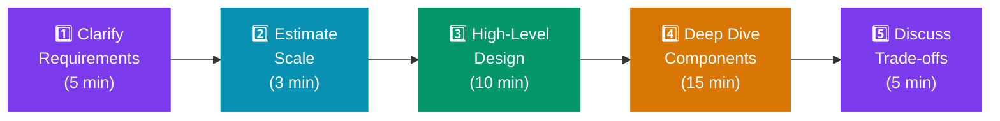

**Step 1 — Clarify requirements (never skip this):**
- Functional: What features are in scope? What are we NOT building?
- Non-functional: Scale (DAU, QPS), latency SLO (the latency target you promise), availability target (99.9% vs 99.99%), consistency vs availability trade-off

**Step 2 — Back-of-envelope estimation:**
- Users: 10M DAU → 10M × 5 requests/day = ~600 QPS average, ~6000 QPS peak (10x)
- Storage: 1M writes/day × 1KB/record = ~1GB/day = ~365GB/year
- Bandwidth: 6000 QPS × 1KB = ~6MB/s read bandwidth

**Step 3 — High-level design:**
- Draw: Client → API Gateway → Services → Databases/Cache
- Pick the right storage for each use case (SQL, NoSQL, blob, cache)
- Keep it simple first. Do not over-engineer.

**Step 4 — Deep dive:**
- The interviewer will choose the topic: "Tell me more about the database schema" or "How does the notification fan-out work?"
- Go deep on the component they ask about. Show that you can think at more than one level of detail.

**Step 5 — Trade-offs:**
- Every design decision has trade-offs. Say them clearly: "I chose this because X, the downside is Y, which is acceptable because Z."

🎯 **Interview Tip:** The biggest mistake candidates make is to start drawing boxes before they clarify requirements. Spend 5 minutes asking questions. It shows you think like a senior engineer, who gathers requirements before coding.

---

</details>

---

2. **⚖️ What is the CAP theorem? Give real-world examples for each category. 🔥🔥**

<!-- -->
<details>
<summary>Answer</summary>

**Answer:**

The **CAP Theorem** (Brewer's Theorem) is about how a system behaves **during a network partition**. When the network splits, a distributed system must choose one of two options:
- return a response that may be stale (**A**), or
- refuse to respond (**C**).

Outside a partition, you get both.

| Property | Definition |
|----------|-----------|
| **C — Consistency** | Every read gets the most recent write or an error |
| **A — Availability** | Every request gets a (non-error) response, but not always the most recent data |
| **P — Partition Tolerance** | The system keeps working when network partitions happen between nodes |

⚠️ **CAP is not a "pick 2 of 3" menu.** That is the most common way to get this wrong.
- In a distributed system, network partitions **will** happen. You cannot choose to give up P.
- So you cannot build a real **"CA"** system. A CA system is a single-node system.
- The only real choice is **CP vs AP during a partition**.

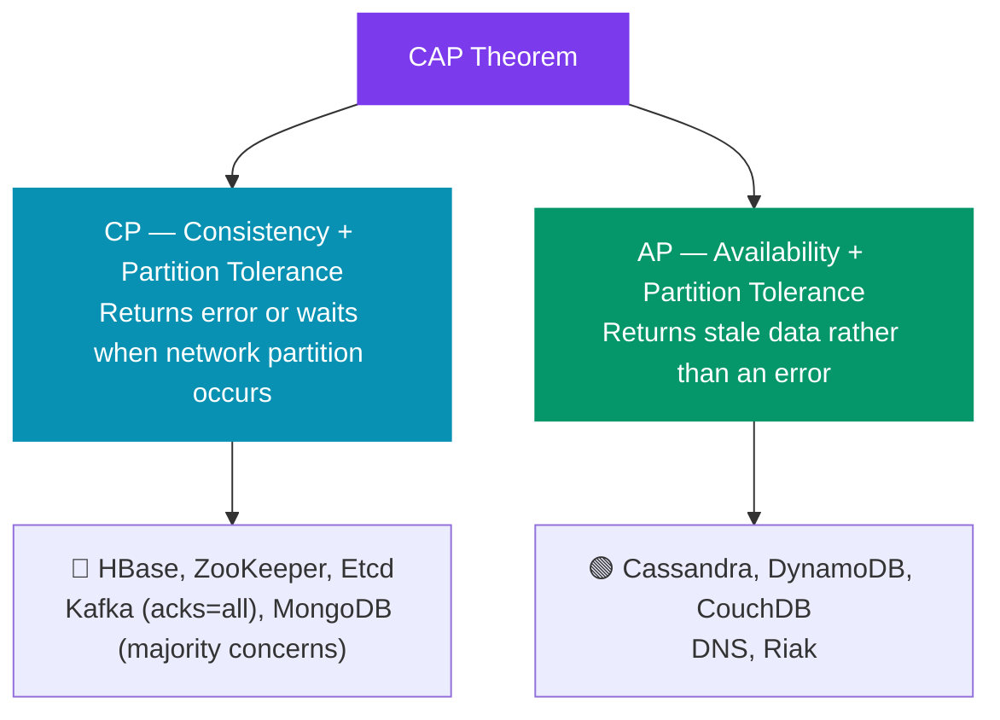

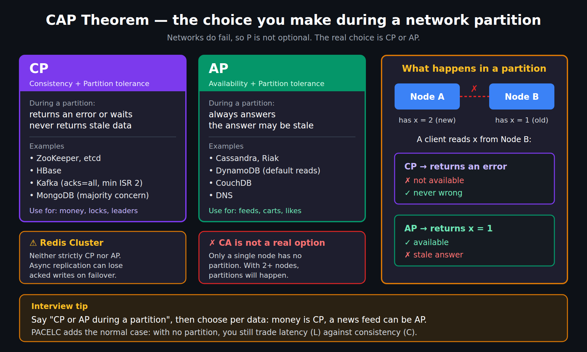

**Two classifications to get right (both are common interview traps):**

- 📨 **Kafka is CP on the write path**, not AP.
  - With `acks=all` + `min.insync.replicas=2`, a partition that loses its followers **rejects** producer writes with `NotEnoughReplicasException`.
  - It does not accept them and fix the differences later. It gives up availability to protect the log.
  - You can change this. `acks=1` gives AP-like behaviour, but then there is a window where data can be lost on leader failover.
  - The real AP switch is `unclean.leader.election.enable=true` (default `false`). It lets an out-of-sync replica become leader, so the partition stays available but loses the writes that replica never got.
- ⚡ **Redis Cluster is *not* CP.**
  - Replication is **asynchronous**. A primary acknowledges a write to the client *before* it replicates it.
  - So a failover inside that window loses the acknowledged write.
  - The Redis docs state it "is not able to guarantee strong consistency."
  - Reading from the primary gives read-your-writes on that node. It does not give linearizability across a failover.
  - It is **not cleanly AP either.** In a partition, a primary on the minority side stops taking writes after `cluster-node-timeout`. So the safe answer is: "Redis Cluster is neither strictly CP nor AP. It is tuned for speed."

**Real-world examples:**

- 🏦 **Banking / Payment system** → Choose **CP for the ledger write path**. It is better to return an error than to post a double payment.
  - Not every banking feature is CP. Brewer's own ATM example picks **availability** with a withdrawal limit, then reconciles later. Say which path you mean.
- 🛒 **Shopping cart / Product catalog** → Choose **AP**. Showing slightly stale inventory is acceptable. Amazon's Dynamo was built on this idea.
- 🌐 **DNS** → **AP**. DNS records may be stale for the TTL duration. You accept eventual consistency to get global availability.
- 🔐 **Leader election (ZooKeeper/etcd)** → **CP**. You'd rather block than elect two leaders.

**PACELC — the correct way to frame it (say this instead of "pick 2 of 3"):**

> **if (P)** artition **then** (**A** or **C**) **else** (**L**atency or **C**onsistency)

🗣️ **Say it:** "**PASS-elk**" (/ˈpæs.ɛlk/) — like "pass" + "elk" (the animal). Daniel Abadi, who named it, gives this pronunciation in his 2012 paper. Do not spell it out letter by letter.

PACELC adds the case that CAP ignores: the **99.9% of the time when there is no partition**. Even when there is no partition, the system pays for consistency with extra latency. The reason: a strongly-consistent read must coordinate across replicas. Classification examples:

| System | PACELC | Reading |
|---|---|---|
| **Cassandra / DynamoDB** | **PA/EL** | Stays available under partition. Gives up consistency for low latency, even when healthy |
| **HBase / etcd / ZooKeeper** | **PC/EC** | Refuses requests under partition. Pays coordination latency for consistency when healthy |
| **MongoDB** | **PA/EC** (depends on read/write concern) | Often listed as available under partition and consistent when healthy. The real behaviour depends on the read and write concern you set |

<details>
<summary><strong>🤔 Doubt: What is latency? (the "L" in PACELC)</strong></summary>

**Latency is the time one request waits from start to finish.** You send a request, and latency is how long it takes until the answer comes back. It is measured in time: ms (milliseconds) or µs (microseconds).

**Example:** you open an app and tap "Show my balance".
- The phone sends the request to the server: network time.
- The server reads the balance from the DB: processing time.
- The answer travels back to the phone: network time again.

If all of this takes 120 ms, the latency of that request is 120 ms.

**Latency vs throughput** (interviews often mix these up):

| | Latency | Throughput |
|---|---|---|
| Question | How long does **one** request take? | How **many** requests per second can we handle? |
| Unit | ms, µs | requests/s (QPS), MB/s |
| Road example | How long one car takes to drive from A to B | How many cars pass a point each minute |

They are different. A wide highway has high throughput, but each car still needs 2 hours (high latency). Caching usually lowers latency. Adding servers usually raises throughput.

**Where the time goes.** Latency is the sum of several waits:
1. **Network:** distance and hops. Light in fiber needs time, so a cross-continent round trip is ~150 ms no matter how fast your code is.
2. **Queueing:** the request waits because the server is busy. This part grows fast under heavy load.
3. **Processing:** your code runs.
4. **Storage:** disk or DB reads. RAM is ~100 ns; an SSD random read is ~100 µs, about 1,000× slower.

The latency table in §1 Q3 (Jeff Dean's numbers) has these values. The main lesson: **memory ≪ SSD ≪ network across the world.** That is why we cache data in memory and put servers close to users (CDN).

**Why PACELC cares.** A strongly consistent read must wait for other replicas to agree. That wait is extra latency on *every* request, even with no partition. So "EL" systems (Cassandra, DynamoDB) answer from one replica fast, and "EC" systems (etcd, ZooKeeper) pay the wait to stay correct.

**How to measure it: use percentiles, not the average.**
- **p50:** half the requests are faster than this. This is the "normal" user.
- **p99:** 99% are faster. This is the slow tail.
- The average hides the slow users. Example: 98 requests take 10 ms and 2 take 5 s. The average is ~110 ms and looks fine, but 2 users waited 5 seconds.
- So in a design round, say: "**p99 latency under 200 ms**", not "average latency 50 ms". (§3 Q2 on observability covers this in more detail.)

**One line for the interview:** *"Latency is how long one request takes end to end. Throughput is how many requests we handle per second. I target p99 latency, because the average hides the slow users."*

---

</details>
<br/>

🎯 **Interview Tip:** Start with the partition framing, not "two of three." Then bring up PACELC yourself: "CAP only describes the partition case; PACELC adds the else-branch, which is where the system spends almost all its time." That one sentence shows you read the research papers, not just a blog post.

---

</details>

---

3. **📏 How do you do back-of-envelope estimation? What numbers should you know? 🔥🔥**

<!-- -->
<details>
<summary>Answer</summary>

**Answer:**

Back-of-envelope estimation (quick, rough math) shows you can reason about scale before you design. Memorize these numbers:

**Data sizes (decimal approximation — this is the estimation shortcut, not the binary truth):**
| Unit | Estimation value | Exact binary | Power of 2 |
|------|------|------|------|
| 1 byte | 8 bits | — | — |
| 1 KB | 10³ bytes | 1,024 | 2¹⁰ |
| 1 MB | 10⁶ bytes | 1,048,576 | 2²⁰ |
| 1 GB | 10⁹ bytes | 1,073,741,824 | 2³⁰ |
| 1 TB | 10¹² bytes | ~1.1 × 10¹² | 2⁴⁰ |
| 1 PB | 10¹⁵ bytes | ~1.1 × 10¹⁵ | 2⁵⁰ |

💡 The powers-of-2 column makes address/ID-space questions easy to solve: 2³¹ ≈ 2.1 billion (where a signed 32-bit `INT` auto-increment ID runs out; `INT UNSIGNED` reaches 2³² ≈ 4.3 billion), 2⁶⁴ ≈ 1.8 × 10¹⁹.

**Latency reference (Jeff Dean's numbers):**
| Operation | Latency |
|-----------|---------|
| L1 cache hit | ~1 ns |
| RAM read | ~100 ns |
| SSD random read | ~100 µs |
| HDD seek | ~10 ms |
| Network round trip (same DC) | ~500 µs |
| Network round trip (cross-continent) | ~150 ms |

**Traffic math:**
- 1 million requests/day = ~12 req/sec
- Peak ≈ **2–5× average** for normal apps. Use ~10× only for spiky traffic (flash sales, live events), and say it is an assumption.
- 1 million req/day × peak 3x = ~36 req/sec
- 10 million DAU × 10 actions = 100M requests/day = ~1200 req/sec average, ~3.6K peak (3×)

**Storage math example (Twitter-like service):**
```
100M daily tweets            ← stated assumption, not a fact
× 280 bytes/tweet text
× 365 days
= ~10TB/year for text alone
+ media = ×100 → ~1PB/year
```

> ⚠️ 100M/day is the assumption *this* walkthrough uses. The public figure people usually quote is ~500M/day (which would make it ~50TB/yr for text). Pick one number, **say it clearly to the interviewer**, and use it for the whole interview. Changing your own earlier assumption later is worse than picking the "wrong" one.

💡 **Pro Tip:** Always say your assumptions to the interviewer: "I'm assuming 10M DAU with 5 write operations each, peak traffic is 10x average..."

🎯 **Interview Tip:** Interviewers do not expect exact numbers. They want to see you reason step by step. Being within 2x of the correct answer is fine. The method is what matters.

---

</details>

---

4. **🔄 What is the difference between consistency models — strong, eventual, and causal? 🔥**

<!-- -->
<details>
<summary>Answer</summary>

**Answer:**

A consistency model defines what a distributed system guarantees about one thing: the order in which readers see writes.

| Model | Guarantee | Latency | Example |
|-------|-----------|---------|---------|
| **Strong / Linearizable** | Every read sees the most recent write immediately, globally | High | Google Spanner, etcd, **Amazon S3** |
| **Sequential** | All operations appear in the same order to all nodes (but not necessarily real-time) | Medium | ZooKeeper client view (writes in one global order; a read can lag unless you call `sync()`) |
| **Causal** | Operations with a cause-and-effect link appear in order. Unrelated ones can appear in any order | Medium | MongoDB (causally consistent sessions) |
| **Eventual** | If no new updates come, all replicas reach the same value in the end | Low | Cassandra, DNS, DynamoDB (default reads) |
| **Read-your-writes** | After a write, the same client always reads its own write | Medium | Session-level guarantee (common in apps) |

⚠️ **S3 is *not* an eventual-consistency example any more.** This answer is almost six years out of date, and AWS-certified candidates often make this mistake.
- Since **December 2020**, S3 provides **strong read-after-write consistency for all object GET, PUT, LIST, and object-metadata operations** (tags, ACLs).
- **Bucket-configuration** changes (for example bucket policy or versioning) are still eventually consistent.
- It costs nothing extra and has no performance penalty.
- The old "eventual consistency for overwrite PUTs and DELETEs" exception is gone.

The best answer mentions both: *"S3 used to be the textbook eventual-consistency example until AWS made it strongly consistent in 2020"*. This is better than either version alone.

🧠 **In Simple Words:**
- **Strong** = "You always see the latest version, guaranteed." Expensive, because it needs coordination.
- **Eventual** = "You'll see the latest version... soon. Maybe seconds later." Cheap, because it needs no coordination.
- **Causal** = "If A caused B, you'll always see A before B." A practical middle option.

🎯 **Interview Tip:** Do not just say "I'll use eventual consistency for performance." Always explain two things:
- **why** it is acceptable for that specific use case, and
- what the worse user experience would look like if replication lag happens.

---

</details>

---

5. **📡 What is consistent hashing and where is it used? 🔥🔥**

<!-- -->
<details>
<summary>Answer</summary>

**Answer:**

**Consistent hashing** is a way to spread keys across nodes. When you add or remove nodes, only a small number of keys move.

**Problem with simple modulo hashing:** Say you have 3 servers and use `server = hash(key) % 3`. Adding a 4th server forces ~75% of all keys to remap. This causes a huge wave of cache misses or a large data migration.

**How consistent hashing solves this:**

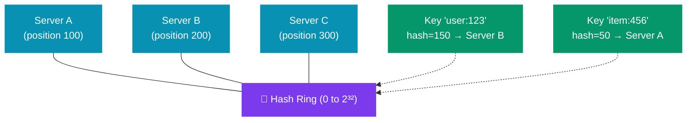

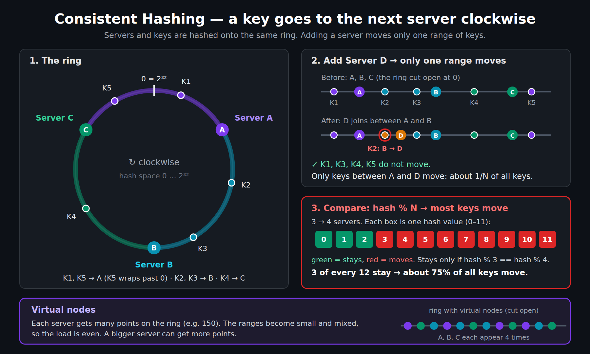

- Place both servers and keys on a hash ring (circular key space 0 → 2³²)
- Each key is assigned to the **first server clockwise from its position** on the ring
- Adding/removing a server only remaps the keys between the new/removed node and its predecessor (the node before it on the ring). This is usually ~K/N keys (K = total keys, N = servers).

**Virtual nodes:** To stop keys from being spread unevenly, each physical server gets multiple virtual nodes on the ring (e.g., 150 virtual nodes per server). This improves load balance. It also handles servers with different capacities.

**Used in:**
- 🟠 **Cassandra** — consistent hashing for token-based data partitioning
- 🔵 **Amazon DynamoDB** — the original Dynamo paper (2007) used a consistent-hashing ring. DynamoDB today hashes the partition key and splits the hash range into partitions
- 🟢 **CDN load balancing** — routing requests to edge servers
- ⚡ **Distributed caches** — Memcached client-side sharding

⚠️ **Redis Cluster is the classic counter-example. It does NOT use consistent hashing.**
- It uses **16384 fixed hash slots**: `slot = CRC16(key) mod 16384`.
- The nodes share an explicit slot→node assignment map with each other by gossip (each node passes what it knows to other nodes).
- In the sharding strategies of [02 — Database §3 Q4](02_Database_Design_and_Internals_Interview_Questions.md#3-database-scaling), that is **directory-based**, not ring-based.
- Redis's own documentation says clearly that Redis Cluster does not use consistent hashing.

> 💡 **Why they chose slots over a ring.** This contrast is a *stronger* answer than just naming the algorithm. The slot is the **migration unit** (the block of data you move as one piece).  
> - Resharding is an explicit, resumable operation: "move slots 0–999 from node A to node B". You can drive it, monitor it, and pause it.  
> - On a ring, a joining node takes over its key ranges at once. The data streams over as a side effect of the join (Cassandra calls this bootstrap). You can watch it, but the unit you move is "whatever range this token owns", not a block you picked. That is harder to plan and to pause.  
> - Fixed slots lose a little flexibility, but they are much easier to operate.

🎯 **Interview Tip:** Consistent hashing appears in "Design a distributed cache" or "Design a key-value store" problems. Say "I'd use consistent hashing for sharding" and explain why (minimal remapping on node changes). This quickly shows system design experience. **But if you list Redis on your résumé, expect "how does Redis Cluster shard?". The expected answer is "16384 slots, CRC16, slots migrate individually." If you answer "consistent hashing ring", it sounds like you never operated it.**

---

</details>

---

<a id="storage-and-data-decisions"></a>

## 2. Storage and Data Decisions

1. **🗄️ How do you choose between SQL and NoSQL for a system? 🔥🔥**

<!-- -->
<details>
<summary>Answer</summary>

**Answer:**

The choice depends on four things: data structure, access patterns, scale, and consistency needs.

| Criteria | Choose SQL (PostgreSQL / MySQL) | Choose NoSQL |
|----------|--------------------------------|-------------|
| **Data model** | Structured, relational, normalized | Flexible schema, documents, key-value |
| **Relationships** | Complex joins, many-to-many | Few joins needed |
| **Consistency** | Strong ACID guarantees needed | Often eventual by default; many offer strong reads (DynamoDB strongly consistent reads — not on GSIs; Cassandra `QUORUM` reads **and** writes, so R + W > N) |
| **Scale** | One tuned node: tens of thousands of mixed QPS; 100k+ simple point reads. Replicas add reads | Millions of QPS by scaling out (DynamoDB, Cassandra) |
| **Query patterns** | Ad-hoc SQL, complex aggregations | Known access patterns (key lookup) |
| **Transactions** | Multi-table ACID transactions | Limited or costly: MongoDB multi-document transactions (4.0+), DynamoDB `TransactWriteItems` (up to 100 items) |

<details>
<summary><strong>🤔 Doubt: What is an ad-hoc query?</strong></summary>

**An ad-hoc query is a question you ask the database on the spot, one you did not plan for when you designed the system.** "Ad hoc" is Latin for "for this purpose": made for this one need, right now.

**Example (loan system):**
- **Planned query:** the app always runs "get loan by `loan_id`". You know this query on day 1, so you design the table and index for it.
- **Ad-hoc query:** a manager suddenly asks: *"How many loans above ₹5 lakh were approved in Pune last month, grouped by branch, for customers older than 40?"*

```sql
SELECT branch, COUNT(*)
FROM loans l
JOIN customers c ON c.id = l.customer_id
WHERE l.amount > 500000
  AND l.status = 'APPROVED'
  AND l.city = 'Pune'
  AND l.approved_at >= '2026-10-01'
  AND c.age > 40
GROUP BY branch;
```

Nobody planned this query. It filters on any columns, joins tables and groups the results.

**Why this matters for SQL vs NoSQL:**

| | SQL (PostgreSQL) | NoSQL (DynamoDB, Cassandra) |
|---|---|---|
| Ad-hoc queries | ✅ Easy. Any filter, join or group-by works. It may be slow without an index, but it works. | ❌️ Hard. You design tables around the queries you know. A new question often needs a new table or index, or a full scan. |

That is why the table above says:
- SQL suits **"ad-hoc SQL, complex aggregations"**: reports, analytics, questions you can't predict.
- NoSQL suits **"known access patterns (key lookup)"**: you know the exact questions in advance, for example "get session by `session_id`".

**One line for the interview:** *"If the business will keep asking new questions of the data, I want SQL. If I know every access pattern up front and need massive scale, NoSQL fits."*

---

</details>
<br/>

**Practical decision guide:**

```
Is the data relational with complex joins?      → SQL
Is data access pattern known + key-based?       → NoSQL (DynamoDB / Cassandra)
Do you need full-text search?                   → Elasticsearch
Do you need sub-millisecond caching?            → Redis
Do you need time-series data?                   → InfluxDB / TimescaleDB
Do you need graph relationships?                → Neo4j
Is it large binary/blob data?                   → S3 / Blob storage
```

**Common production pattern — polyglot persistence:**

| Data Type | Storage | Why |
|-----------|---------|-----|
| Core business entities (loans, users, orders) | PostgreSQL | ACID, complex queries |
| Session / tokens | Redis | Sub-ms, TTL-based expiry |
| Search / full-text | Elasticsearch | Inverted index, relevance scoring |
| Audit logs / events | Cassandra / DynamoDB | Append-only, time-series, massive scale |
| Media files | S3 | Cheap, durable blob storage |
| Analytics | Redshift / BigQuery | Columnar, petabyte-scale aggregations |

🎯 **Interview Tip:** Never say "I'd use NoSQL because it scales better."
- With read replicas, connection pooling, and query optimization, SQL scales well up to large workloads.
- The right answer is always about access patterns, data model fit, and consistency needs.

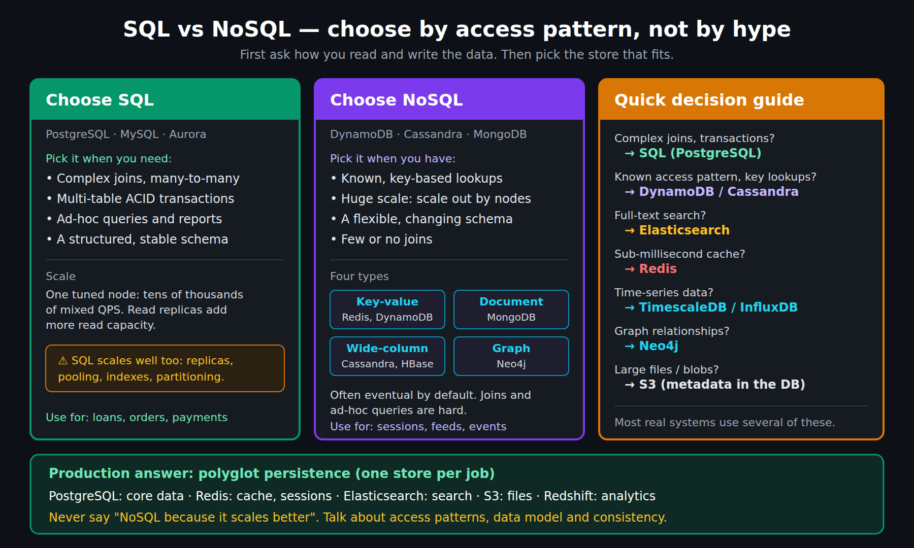

---

</details>

---

2. **⚡ How would you design a caching layer? Where do you put the caches? 🔥🔥**

<!-- -->
<details>
<summary>Answer</summary>

**Answer:**

**Where to cache:**

| Level | What | Example |
|-------|------|---------|
| **Client/Browser** | Static assets, API responses (Cache-Control headers) | CDN, browser cache |
| **CDN** | Static files, API responses near user | CloudFront, Cloudflare |
| **API Gateway** | Response caching for GET endpoints | AWS API Gateway cache |
| **Application** | In-process cache (short-lived, local) | Caffeine, Guava Cache |
| **Distributed cache** | Shared across instances (session, computed results) | Redis, Memcached |
| **Database** | Query result cache, buffer pool | MySQL InnoDB buffer pool (the query cache was removed in 8.0), PostgreSQL shared_buffers |

📖 **Story — one product page, through all six levels:**

Priya in Mumbai opens a shopping app during a big sale. She taps a phone, product `123`. Follow her request from the top of the table to the bottom. Each level stops some requests, so fewer requests reach the next level.


| # | Level | What happens to Priya's request | What it saves |
|---|---|---|---|
| 1 | **Browser / app** | The product photos, logo and JS files are already on her phone from yesterday. They have a long `max-age` and a version in the file name (`app.v42.js`). Nothing goes over the network for them. | The whole trip, for static files |
| 2 | **CDN** | `GET /products/123` is the same for every user, so the Mumbai edge has it cached for **30 s**. Lakhs of users in Mumbai get it from the edge. The origin sees about **one request per 30 s** from that edge. | Almost all public read traffic |
| 3 | **API Gateway** | Her app also asks for the category menu. The gateway caches that `GET` for 5 minutes. (If a CDN already caches it, you often skip this level. Two caches on the same response add little.) | Requests that skip the CDN |
| 4 | **Application (Caffeine)** | Her "add to cart" call reaches one app server. It needs the GST rules and feature flags. Each server keeps them **in its own memory** for 10 s. A lookup takes nanoseconds, with no network hop. | A Redis call on every request |
| 5 | **Distributed cache (Redis)** | Her **cart and login session** live in Redis. Her next request may go to a different app server, and that server must see the same cart. Product details are also here (cache-aside, 1-hour TTL, the code below). One Redis call is about 0.5–1 ms. | Shared state, and most DB reads |
| 6 | **Database** | A product that is not in Redis is read from PostgreSQL. Even then, the hot rows are usually already in `shared_buffers` (RAM), so the disk is rarely touched. | Disk reads |

**Then the seller drops the price from ₹20,000 to ₹18,000.** This is where the caching strategies come in (§2 Q3 has the details):

1. The app **writes the new price to PostgreSQL first**. The DB is the source of truth.
2. Then it **deletes** `product:123` from Redis. It does not update the key (see "Why delete instead of update?" in [03 — Redis §2 Q1](03_Redis_Interview_Questions.md#2-caching-patterns-)). The next read loads ₹18,000 from the DB.
3. The **Caffeine** copies on each app server expire on their own within 10 s.
4. The **CDN** copy expires within 30 s. So Priya may see ₹20,000 for up to 30 s. That is fine for a page she is only looking at.
5. At **checkout**, the order service reads the price from the DB, never from a cache. A stale page is OK. A stale charge is not (see §2 Q5).

**What is never cached at a shared level:** "My orders" and "My account". They are different for every user. They can sit in Redis under a key per user (`orders:{userId}`), but never in the CDN or the gateway. Otherwise one user could see another user's data.

💡 **The lesson:** each level is closer to the user and faster, but harder to invalidate. So the **shared, public, can-be-a-bit-old** data goes to the outer levels (browser, CDN). **Per-user or must-be-fresh** data stays in the inner levels (Redis, DB), where one `DEL` fixes it.

🎯 **Interview Tip:** Name the levels from the user inwards, and say what you put at each one. Shared, public data that can be a little old goes to the outer levels (browser, CDN). Per-user or must-be-fresh data stays in Redis or the DB. Then say how you keep it correct: that is §2 Q3.

---

</details>

---

3. **🔄 What are the caching strategies (cache-aside, write-through, write-behind)? How do you keep the cache correct? 🔥🔥**

<!-- -->
<details>
<summary>Answer</summary>

> 📚 **Studied in depth in the Redis note.** This answer is the short HLD version — what you say in a design round. The full answers (with code) live in [03 — Redis](03_Redis_Interview_Questions.md). Study them **once**, there.

**Answer:** A caching strategy answers two questions: **who loads the cache on a read**, and **what happens to the cache on a write**.

- **Cache-aside is the default.** The app reads the cache. On a miss, it reads the DB and puts the value in the cache with a TTL.
- **On a write: update the DB first, then *delete* the cache key.** Do not update the key. A delete carries no value, so it can never write an old one.
- **Write-through** keeps the cache fresh after every write, but every write is slower. **Write-behind** writes the cache now and the DB later. It is fast, but you can lose data if the cache dies. Use it only when you are asked about extreme write load.
- **Set an eviction policy.** Redis's default `maxmemory-policy` is `noeviction`, so a full cache rejects writes. For a cache, pick `allkeys-lru` or `allkeys-lfu`.
- **Name the three classic failures and one fix each:**
  - **stampede** (one hot key expires) → a lock so only one caller reloads it;
  - **penetration** (keys that do not exist) → cache the "not found" for a short TTL, or a Bloom filter;
  - **avalanche** (many keys expire together, or the whole cache goes down) → TTL jitter, plus a highly available cache.

| Topic | Full answer in the Redis note |
|---|---|
| Cache-aside, and why delete instead of update (step by step) | [03 — §2 Q1 Cache-Aside](03_Redis_Interview_Questions.md#2-caching-patterns-) |
| Write-through · write-behind · read-through · side-by-side comparison | [03 — §2 Q2–Q6](03_Redis_Interview_Questions.md#2-caching-patterns-) |
| Stampede · penetration · avalanche · keeping cache and DB consistent (double delete, CDC) | [03 — §3 Q1–Q5](03_Redis_Interview_Questions.md#3-cache-problems-and-solutions-) |
| Eviction policies (`noeviction`, approximate LRU, `allkeys-*` vs `volatile-*`) | [03 — §4](03_Redis_Interview_Questions.md#4-eviction-policies-) |

🎯 **Interview Tip:** Cache-aside is the default answer. Say "DB first, then delete the key" before anyone asks. Mention write-through only when the cache must stay fresh after writes, and write-behind only for extreme write load.

---

</details>

---

4. **🌐 How does CDN work and when would you use one? 🔥**

<!-- -->
<details>
<summary>Answer</summary>

**Answer:**

A **CDN (Content Delivery Network)** is a network of edge servers spread across many locations. They cache content close to users. This reduces latency and origin server load.

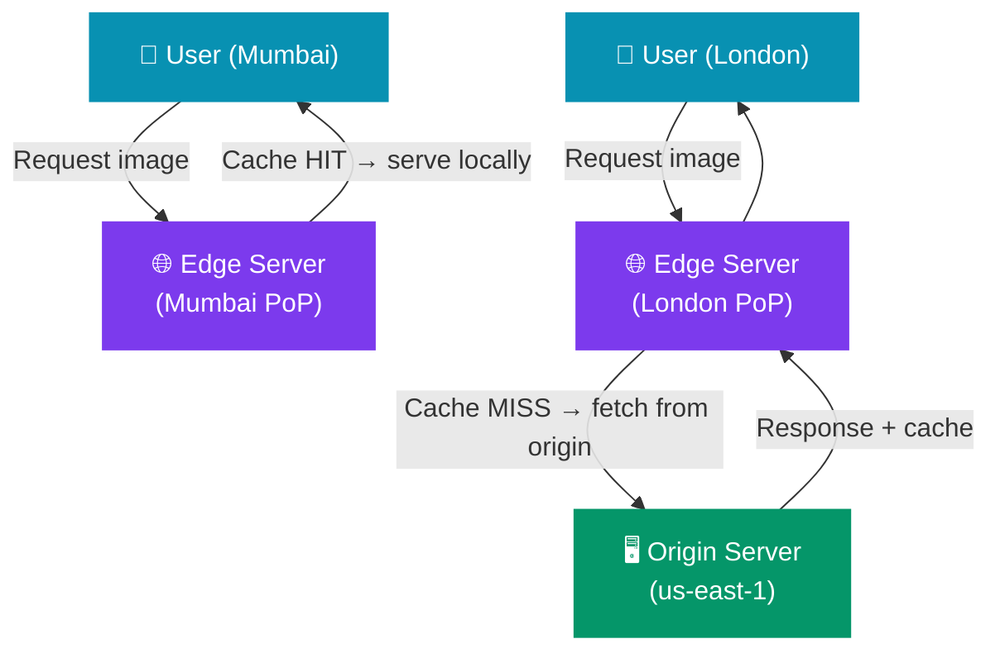

**Cache HIT vs MISS:**
- **HIT** — the edge has the content cached → serve it immediately. Edge work takes a few ms; the user still pays the network trip to the nearest edge (often 10–50 ms). No origin call.
- **MISS** — the first request for this content → the edge fetches it from origin, caches it, and serves it.

**What to put behind a CDN:**
- ✅ Static assets: images, CSS, JS, fonts
- ✅ API responses that are read-heavy and change rarely (product catalog, public data)
- ✅ Video / media streaming
- ❌️ Personalized API responses (never cache user-specific data without careful cache-key design)
- ❌️ Write requests

**CDN cache invalidation:**
- TTL-based: `Cache-Control: max-age=86400` (cache 24 hours)
  - `max-age` also caches in the **browser**, and you cannot purge a browser. To set a long CDN TTL but a short browser TTL, use `s-maxage` (shared caches only), e.g. `Cache-Control: max-age=60, s-maxage=86400`.
- Versioned URLs: `style.v2.css` — the old version stays cached, the new version is fetched fresh
- Explicit purge: `aws cloudfront create-invalidation --distribution-id <ID> --paths "/images/*"` — slow on CloudFront, because it must reach every edge location. Only the first 1,000 paths each month are free (a `*` wildcard counts as one path). Avoid it in hot paths. (Fastly and Cloudflare purge much faster, often in seconds. So "purge is slow" is a CloudFront fact, not a rule for every CDN.)

**Services:** AWS CloudFront, Cloudflare, Akamai, Fastly

🎯 **Interview Tip:** A CDN is the easiest performance optimization with the highest ROI (return on investment). Mention it early in any system design with images, videos, or global users. It can reduce origin load by 80-95% for media-heavy apps.

---

</details>

---

5. **🌐 Can a CDN cache dynamic content like product prices? Isn't a CDN only for static content? 🔥**

<!-- -->
<details>
<summary>Answer</summary>

> 📍 **Where this comes up — a real hiring-challenge MCQ that tests exactly this:**
>
> *"A platform experiences a traffic surge of 100,000 requests/second during a flash sale. Its architecture uses Redis for caching and a CDN in front of the origin server. Product prices must stay fresh within 30 seconds. Which caching strategy best minimizes origin hits while meeting the freshness requirement?"*
>
> - A) Use Redis with a write-through cache policy and set CDN TTL to 5 minutes, invalidating CDN on every price update  
> - **B) Set CDN cache TTL to 30 seconds for product pages and use Redis as a fallback for cache misses ✅**  
> - C) Cache prices in Redis with a 30-second TTL and bypass CDN for price-related endpoints  
> - D) Cache prices only at the CDN layer with a 30-second TTL and disable Redis for price lookups
>
> **B is correct:** a 30s CDN TTL keeps staleness within the SLA. The CDN also absorbs the flood of reads at the edge. Redis catches CDN misses before they reach origin.  
> **A is the trap.** Per-update CDN invalidation is too slow/expensive at flash-sale write rates. And a 5-min TTL risks breaking the 30s freshness SLA.  
> The obvious question is *"why is a price in a CDN at all? CDNs are for static content"*. The rest of this answer deals with it.

**Answer:** "CDNs are only for static content" is an old way of thinking. Modern CDNs (CloudFront, Cloudflare, Fastly, Akamai) cache **dynamic API responses** too.
- What the CDN caches is the **HTTP response**, e.g. `GET /products/123/price → {"price":499}`.
- The edge node holds it for a short TTL. It sends the same response to everyone who hits that edge.
- The price is not "stored in the CDN" like a database row. It is a short-lived cached response.

**The real test of cacheability is NOT static-vs-dynamic.** It is these three properties:

| Cacheable at the edge if… | Why |
|---|---|
| **Shared** — same response for many users | One cached copy serves everyone (personalization kills the hit rate) |
| **Staleness-tolerant** — OK to be slightly old | Caching a mutable value means **staleness = TTL** |
| **Read-heavy** — same hot keys requested repeatedly | High hit rate is what makes caching worth it |

🔥 **Worked example (flash-sale product price):**
- A displayed price is the same for all users.
- It is requested ~100k×/s for a few hot SKUs.
- It is OK for it to be a few seconds stale.

Edge-caching it with **TTL = 30s** keeps staleness within the freshness SLA. It also turns 100k req/s into roughly **one origin fetch per SKU per 30s per edge**. That is the "minimize origin hits" win.

⚠️ **"Staleness = TTL" is true only for one cache layer.** Here a CDN miss falls back to Redis. If Redis also has its own TTL and is not updated on each price write, the worst case is **CDN TTL + Redis TTL**. That can break the 30 s limit. So update or delete the Redis key on every price write, and let only the CDN TTL decide staleness.

⚠️ **Important warning:** a CDN-cached price is fine for **display reads**. But **never** treat it as the source of truth at **checkout / payment**. Billing must call the authoritative pricing/order service. If not, a stale edge copy could charge the wrong amount. Staleness with a fixed upper limit is OK for "what the page shows," not for "what we charge."

🚫 **When NOT to edge-cache:** personalized responses (logged-in user discounts). The response is different for each user, so the hit rate drops sharply. Cache only the non-personalized part. Or use `Vary` headers / edge logic to separate it.

<details>
<summary><strong>🤔 Doubt: Master data (reference data) is the same for all users. Why do many systems keep it in Redis and not on a CDN?</strong></summary>

**Short answer:** a CDN and Redis are **not alternatives**. They sit in different places, so they help different readers.

```
Browser ──► CDN (edge) ──► API Gateway ──► App servers ──► Redis ──► DB
            ▲ helps only                                   ▲ helps every caller,
              browser → server reads                         including server → server
```

**1. Ask who reads the data.** In most backends, master data (country codes, product types, document categories, config tables) is read **by other services**, not by the browser. For example, a loan service looks up a document category while it handles a request. That is a **server-to-server** call inside the data centre. A CDN is not on that path, so it **cannot** cache it. Redis can.

**2. If the browser also reads it, compare the two:**

| | Redis | CDN |
|---|---|---|
| Serves backend callers | ✅ Yes | ❌️ No — not on that path |
| Data changes (admin edits a value) | ✅ Delete the key, and the next read is fresh at once | ⚠️ Wait for the TTL, or run a purge (slow on some CDNs, often paid) |
| Requests that need a login | ✅ No problem | ⚠️ CDNs do not cache requests with an `Authorization` header by default. You need careful cache-key rules, and one mistake can show one customer's data to another |
| Multi-tenant data (each client company has its own values) | ✅ Put the tenant in the key | ⚠️ The tenant must be part of the CDN cache key too — easy to get wrong |
| Private or regulated data | ✅ Stays inside your network | ⚠️ Copies sit on a third-party edge |
| Latency for far-away users | Normal network trip to your servers | ✅ Lower — served from a nearby edge |
| Traffic it saves | DB reads | Requests to your servers — a big win only at high traffic |

**3. When a CDN *is* the right choice for shared data:** when the data is **public** (no login), the **same for everyone**, OK to be a little old, and **read a lot**. A product catalogue or prices on a shopping site fit (this question). Internal reference data behind a login, for a few thousand staff users, usually does not.

**4. A better fix for browser reads of master data:** cache in the **browser**, not on the edge.
- Send `Cache-Control: private, max-age=3600` plus an `ETag`. Each browser keeps its own copy. Nothing is shared between users, so there is no leak risk.
- Or load the dropdown lists once at login and keep them in the app.
- On the server side, a small in-memory cache (Caffeine) in front of Redis saves the network hop for very hot values.

**5. But the UI loads dropdowns from the browser. Can a CDN cache those?** Yes, if you design for it.

A CDN caches by a **cache key**, usually the path plus the query string. Filters and a tenant ID in the URL are fine. Each different value is just a separate cached copy:

```
/master/loan-purposes?tenant=bankA&lang=en   → copy 1
/master/loan-purposes?tenant=bankB&lang=en   → copy 2
```

The real dangers:

| Danger | Why it hurts | Fix |
|---|---|---|
| The tenant comes from the **login token**, not the URL | The URL is the same for every tenant, so the CDN builds one key and serves bank A's data to bank B | Put the tenant **in the URL**, or in a header that is part of the cache key |
| The CDN does not check the login | Anyone with the URL gets the cached response | Only cache data that is safe to show without a login |
| Too many filter combinations (`?search=…`, `?page=7`) | Thousands of keys, each used once, so the hit rate falls to near zero | Cache only a few fixed combinations (tenant × language) |

**The clean design: versioned static files.**
1. When master data changes, the backend writes one JSON file per tenant to S3, at a new version: `/master/bankA/v43/dropdowns.json`.
2. After login, the app asks the API (with the login) for the current version: "bankA → v43".
3. The app downloads the file from the CDN with `Cache-Control: max-age=31536000, immutable`.

A change creates a **new URL**, so there is never a stale copy to purge.

**Is it worth it?** The browser cache already makes **repeat** loads instant. A CDN adds a faster **first** load for each user, which matters with many users far from your servers on slow networks. For a few thousand staff users close to the servers, browser caching gives most of the benefit with less risk.

**One line for the interview:** *"A CDN only sits in front of browser traffic. Master data is mostly read service-to-service, so Redis is the right layer: shared, instantly invalidated and private. For the UI I'd cache it in the browser with `Cache-Control: private` and an ETag, not on a CDN, because it needs a login and differs per tenant."*

---

</details>
<br/>

🎯 **Interview Tip:** Say *"cacheability is about shared + staleness-tolerant, not static vs dynamic"*. Add the checkout warning. Together, these show real system-design depth beyond "CDN = images."

---

</details>

---

6. **🔁 What is event-driven architecture and what are its trade-offs? 🔥**

<!-- -->
<details>
<summary>Answer</summary>

**Answer:**

In **event-driven architecture (EDA)**, services communicate by publishing and consuming events asynchronously. They do not make direct synchronous API calls.

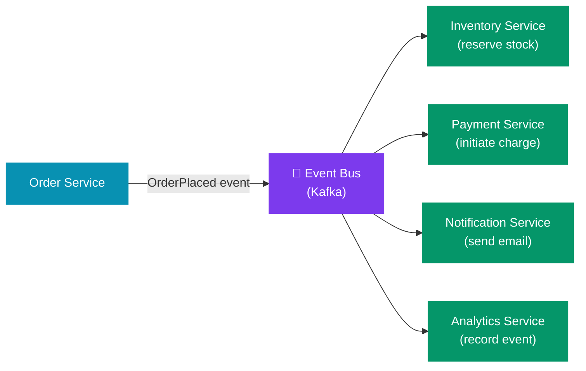

**Benefits:**
- ✅ **Loose coupling** — Order Service doesn't know Payment Service exists. You can add analytics with no change to Order Service.
- ✅ **Independent scaling** — each consumer scales based on its own processing needs
- ✅ **Resilience** — if Notification Service is down, messages queue up in Kafka. Notification Service processes them when it recovers (as long as it is back within the retention period).
- ✅ **Event replay** — Kafka keeps events. New services can replay history to build their state — but only **within the retention period** (default 7 days). Older history needs longer or tiered retention.
  - ⚠️ A **compacted** topic does *not* keep history. It keeps only the latest value per key. So it can rebuild **current state** (the latest balance per account), but it cannot replay every past event.

**Challenges:**
- ❌️ **Eventual consistency** — consumers process asynchronously. The system reaches a consistent state only eventually.
- ❌️ **Debugging complexity** — tracing a request across async events requires distributed tracing (X-Ray, Jaeger)
- ❌️ **Message ordering** — guaranteed only within a Kafka partition. Cross-partition ordering requires careful design.
  - Even inside one partition, retries can reorder messages unless the producer is **idempotent** (`enable.idempotence=true`, the default since Kafka 3.0). Without it, keep `max.in.flight.requests.per.connection=1`.
- ❌️ **Schema evolution** — event schema changes must be backward-compatible (use Avro + Schema Registry)

🎯 **Interview Tip:** Base it on a domain you know.
- Loan-application state changes (submitted → under_review → approved → disbursed) are a textbook EDA fit.
- Each transition *would* publish an event.
- Downstream consumers (notification, audit, analytics) react without coupling to the core loan service.

Present it as a design argument you can defend: *"here is why this domain suits EDA, and here is what it would cost us"*. Do not present it as a system you have shipped, unless you have. And remember the follow-up: **that publish is a dual write** unless you route it through an outbox ([17 — Outbox](https://github.com/vikas9dev/java/blob/main/1_interview_questions/17_Spring_Microservices_Interview_Questions.md#6-distributed-data-patterns)).

---

</details>

---

7. **📁 How do you handle large file uploads (KYC documents, videos)? Where do files go and how do they get there? 🔥**

<!-- -->
<details>
<summary>Answer</summary>

**Answer:** Split the file from its data. The **bytes** go to object storage (S3). The **metadata** goes to the database: owner, key, size, type, status. Never store the file as a BLOB in the database. BLOBs make the DB large, backups slow and replicas heavy. The client sends the bytes **straight to S3**, so the app servers never carry them.

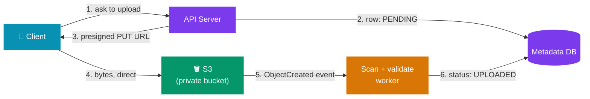

**The flow, step by step:**
1. **Presigned PUT URL.** The API checks who the user is. It writes a `PENDING` row and returns a URL signed for **one object key** with a short expiry (for example, 15 minutes).
2. **Multipart upload for big files.** One S3 `PUT` can be at most 5 GB. Above about 100 MB, use multipart upload. Each part is 5 MiB to 5 GiB (the last part can be smaller), and one upload has at most 10,000 parts. Parts upload in parallel.
3. **Resume on failure.** The client keeps the `uploadId`. After a crash it calls `ListParts` and sends only the missing parts. Add a lifecycle rule `AbortIncompleteMultipartUpload`. If not, parts of failed uploads stay in the bucket and you pay for them.
4. **Confirm.** An S3 event notification (or a client callback that the server checks with `HeadObject`) tells the backend the object exists. Do not trust the client's word alone.
5. **Scan before use.** A worker runs a virus scan, checks the real file type and the size. Only then does the row move `PENDING → UPLOADED`. Until then, no other service may read the file.

**Downloads:** keep the bucket **private** (Block Public Access on). Return a **presigned GET URL** with a short expiry, created only after an access check. Put a CDN in front for public media, such as videos.

**Extra rules for KYC documents (PAN, Aadhaar, bank statements):**
- **Encryption at rest with SSE-KMS.** Every read then needs KMS permission too, and each key use shows up in CloudTrail.
- **Access logging.** Turn on CloudTrail data events or S3 server access logs. You can then answer "who opened this customer's PAN card?"
- **Retention.** Keep files for the period the regulator requires. Use S3 Object Lock if no one may delete them early. Use lifecycle rules to move old files to cheaper storage classes.

⚠️ **A presigned `PUT` does not limit the file size.** To enforce a limit, use a presigned `POST` with a `content-length-range` condition. Or check the size in the worker and reject large files.

🎯 **Interview Tip:** Say three things in this order. *"Bytes in S3, metadata in the DB. Client uploads direct with a presigned URL, multipart if big. The file is usable only after an event confirms it and a scan passes."* For the deep versions, see [ch14 — Design YouTube](../01_insider_guide_Alex_Xu/vol_1/ch14_design_youtube.md) (upload, presigned URL, multipart) and [ch15 — Design Google Drive](../01_insider_guide_Alex_Xu/vol_1/ch15_design_google_drive.md) (block servers, upload and download flows).

---

</details>

---

<a id="scalability-and-reliability-patterns"></a>

## 3. Scalability and Reliability Patterns

| Pattern | HLD angle — what to say in the design round | Full answer |
|---|---|---|
| 🔄 **Saga** | "When one user action changes data in several services, I use a saga of local transactions with compensations. I orchestrate long flows like payments, because 2PC blocks and does not fit microservices." | [17 — Saga](https://github.com/vikas9dev/java/blob/main/1_interview_questions/17_Spring_Microservices_Interview_Questions.md#6-distributed-data-patterns) |
| 📤 **Outbox / dual write** | "Any arrow that says 'save, then publish' is a dual write. So I write the event to an outbox table in the same transaction, and make every consumer idempotent." | [17 — Outbox](https://github.com/vikas9dev/java/blob/main/1_interview_questions/17_Spring_Microservices_Interview_Questions.md#6-distributed-data-patterns) |
| 🛡️ **Circuit breaker** | "On every synchronous call between services I put a timeout, a circuit breaker and a bulkhead. So one slow dependency fails fast and does not use up the caller's threads." | [17 — Circuit Breaker](https://github.com/vikas9dev/java/blob/main/1_interview_questions/17_Spring_Microservices_Interview_Questions.md#5-resilience-patterns) |
| 📦 **CQRS** | "When reads and writes have very different shapes or scale, I split them into separate models. I name the sync mechanism and its lag up front." | [17 — CQRS](https://github.com/vikas9dev/java/blob/main/1_interview_questions/17_Spring_Microservices_Interview_Questions.md#6-distributed-data-patterns) |
| ⚡ **API gateway** | "The gateway is the single entry for north-south traffic. It does rate limiting, auth and routing once. I put cheap rate limiting before costly auth, with a per-IP limit as well." | [17 — Gateway](https://github.com/vikas9dev/java/blob/main/1_interview_questions/17_Spring_Microservices_Interview_Questions.md#3-api-gateway) · [17 — gateway vs proxy vs LB](https://github.com/vikas9dev/java/blob/main/1_interview_questions/17_Spring_Microservices_Interview_Questions.md#3-api-gateway) |

1. **🎟️ How do you stop double booking / overselling (last seat, last item in a flash sale)? 🔥🔥**

<!-- -->
<details>
<summary>Answer</summary>

**Answer:**

**The bug is "check, then act".** Two requests read "1 left" at the same time. Both pass the check. Both write. You sell one item twice.

```
T1: SELECT stock → 1      T2: SELECT stock → 1
T1: stock = 0, commit     T2: stock = 0, commit   ❌️ two orders, one item
```

The fix is always the same idea: **the check and the write must be one atomic step.** In a design round, your job is to pick *where* that step happens. The locking details live in other files (links below).

**The default answer — a conditional `UPDATE` with a row-count check:**

```sql
UPDATE inventory
SET    stock = stock - 1
WHERE  item_id = ?
  AND  stock > 0;
-- rows affected = 1 → you got the item
-- rows affected = 0 → sold out, reject
```

The `WHERE` clause is the check, and the database runs it under a row lock. **Never ignore the row count.** That number is the whole guarantee.

> ⚠️ **This holds at READ COMMITTED** (the Postgres default) and in MySQL InnoDB. There, the second buyer waits for the lock, then re-checks `stock > 0` on the new row. Under Postgres **REPEATABLE READ or SERIALIZABLE**, the second `UPDATE` does not re-check. It fails with a serialization error (`could not serialize access due to concurrent update`), so the app must retry it.

**Pick the approach by contention and by the shape of the checkout:**

| Approach | Best when | Main cost |
|---|---|---|
| ✅ Conditional `UPDATE` | Almost always — the default | A very hot row still serializes all buyers |
| Optimistic lock (`@Version`) | Low contention, edit-style updates | Most writes fail and retry in a flash sale |
| Pessimistic lock (`SELECT … FOR UPDATE`) | High contention, very short transactions | Lock waits, deadlocks, lower throughput |
| `UNIQUE (show_id, seat_id)` constraint | Named items: seats, rooms, slots | Only works when each item has its own row |
| Redis gate + DB as source of truth | Flash sale, huge traffic for few items | Two stores to reconcile; Redis can lose writes on failover |
| Hold with a TTL | Any flow with a payment step | Needs expiry handling (sweeper or lazy check) |
| Distributed lock alone | ❌️ Not for correctness | Lease can expire while you still work |

**The booking flow (BookMyShow, hotels, flights) — hold → pay → confirm:**


1. **Hold.** One atomic step moves the seats from `AVAILABLE` to `HELD`. It stores a `hold_id` and an expiry time (for example, 10 minutes). For many seats, hold all or none.
2. **Pay.** The user pays outside any database lock. Never call a payment gateway while you hold a row lock.
3. **Confirm.** Use a compare-and-set: `UPDATE … SET status='BOOKED' WHERE status='HELD' AND hold_id=? AND expires_at > now()`. The `expires_at` check matters when expiry is lazy: an old hold may still say `HELD` because no sweeper has run yet. If 0 rows change, the hold expired. Refund the payment, or try to re-hold.
4. **Expire.** A sweeper job, or a lazy check on read, returns old holds to `AVAILABLE`.

**Flash sale — put a fast gate in front of the database:**

- 100k users want 1,000 items. Most of them must be told "sold out" without touching the database.
- Redis `DECR` (or a Lua check-and-decrement) is atomic. It rejects the losers in memory. Only the winners go to an order queue.
  - ⚠️ Plain `DECR` rejects nobody by itself. It happily goes to −1, −2… You must check the result: `≥ 0` → winner, `< 0` → sold out. The Lua version checks before it decrements, so the counter never goes below zero.
- ⚠️ Redis is **not** the source of truth. Redis replication is async, so a failover can lose recent decrements. The database conditional `UPDATE` still runs as the final check. A job reconciles the two stores.

**Why a distributed lock is not enough:**

- A Redis lock has a lease (TTL). A long GC pause can outlive it. Then a second client gets the lock, and two clients "own" it at once.
- The real fix is a **fencing token**: a number that goes up with every lock grant. The storage rejects writes with an older token. A plain Redis lock does not give you one.
- So use a lock to *avoid duplicate work*. Keep the correctness check in the database.

> 💡 **Same user clicks twice** is a different problem. Fix it with an **idempotency key**, not with stock logic. That is a unique id per request, backed by a unique constraint.

📚 **Go deeper (the mechanisms):**

- [02 — Optimistic vs pessimistic locking](02_Database_Design_and_Internals_Interview_Questions.md#2-transactions-and-concurrency)
- [13 — `@Version` in Hibernate](https://github.com/vikas9dev/java/blob/main/1_interview_questions/13_Hibernate_Interview_Questions.md#5-advanced-hibernate-and-jpa-patterns) · [13 — Optimistic vs pessimistic: when to use which](https://github.com/vikas9dev/java/blob/main/1_interview_questions/13_Hibernate_Interview_Questions.md#5-advanced-hibernate-and-jpa-patterns)
- [17 — Flash sale: Redis `DECRBY` succeeds but payment fails](https://github.com/vikas9dev/java/blob/main/1_interview_questions/17_Spring_Microservices_Interview_Questions.md#6-distributed-data-patterns)
- [03 — Redis distributed lock and its pitfalls](03_Redis_Interview_Questions.md#7-distributed-locking-and-transactions-)
- [Alex Xu Vol 2 Ch 7 — Hotel Reservation](../01_insider_guide_Alex_Xu/vol_2/ch07_hotel_reservation_system.md) · [LLD — BookMyShow seat locking](../04_lld_and_machine_coding/08_bookmyshow_seat_booking.md)

🎯 **Interview Tip:** Show the race in two lines first. Then give the conditional `UPDATE` with the row-count check — most interviewers want exactly that. Then scale it. For a checkout: "I hold with a TTL and confirm with compare-and-set." For a flash sale: "I put Redis in front, but the database stays the source of truth." End with the lock trap: "A lock can expire while I still hold it. So I never trust it alone for money or stock."

---

</details>

---

2. **📈 How do you know your system is healthy? What do you measure and alert on (SLIs, SLOs, error budgets)? 🔥🔥**

<!-- -->
<details>
<summary>Answer</summary>

**Answer:** "Healthy" must be a number that the user feels. It is not "CPU looks fine". You pick a few user-facing numbers, set a target for each, and alert only when users are hurt.

**Three words, three jobs:**

| Term | Full form | What it is | Example |
|---|---|---|---|
| **SLI** | Service Level Indicator | A measured number: good events ÷ valid events | % of `POST /orders` that return non-5xx in under 300 ms |
| **SLO** | Service Level Objective | Your internal target for an SLI, over a time window | 99.9% of those requests are good, over 30 days |
| **SLA** | Service Level Agreement | A contract with a customer, with a penalty (refund, credits) | 99.5% monthly, or the customer gets credits |

The SLA is looser than the SLO. The gap gives you time to fix things before you owe money.

**What to measure — pick the frame by what you are looking at:**

- **Four golden signals** (Google SRE book): **latency, traffic, errors, saturation**. Saturation = how full a resource is (queue depth, thread pool, connection pool).
- **RED** — **R**ate, **E**rrors, **D**uration. Use it for every request-driven *service*.
- **USE** — **U**tilization, **S**aturation, **E**rrors. Use it for every *resource* (CPU, disk, DB connection pool).

**Latency: use percentiles, never the average.**

- p99 = the 99th percentile. 99% of requests are faster than this value.
- An average hides the slow tail. If 98 requests take 10 ms and 2 take 5 s, the average is about 110 ms. It looks fine, but 2% of users wait 5 s.
- One page load often makes many backend calls. So a "rare" p99 delay hits many users.
- ⚠️ **You cannot average percentiles across hosts.** The mean of each host's p99 is not the fleet's p99. Store **histograms** (bucket counts), add the buckets from all hosts, then compute p99. In Prometheus: sum the `_bucket` series, then call `histogram_quantile()`. A Prometheus *summary* computes quantiles per instance, so you cannot combine them.

**Error budget — the SLO turned into minutes:**

- Budget = 100% − SLO. For 99.9% over 30 days: 30 × 24 × 60 = 43,200 min, and 0.1% of that = **43.2 min** of "bad" time.
- 99.95% → 21.6 min. 99.99% → 4.32 min. Each extra nine costs much more work.
- **Budget left** → ship features, run experiments.
- **Budget spent** → freeze risky releases. Only reliability fixes and urgent security fixes go out until the budget recovers. Product and on-call agree this policy *before* an incident, not during it.

**Alert on symptoms and burn rate, not causes:**

- A **symptom** is what the user feels: errors, slow responses. A **cause** is a guess about why: "CPU at 90%", "one pod restarted".
- Cause alerts fire when users are fine, and they miss new failure types. Too many false pages cause **alert fatigue**: on-call stops trusting the pager.
- Put causes on dashboards for debugging. Page a human only on SLO symptoms.
- **Burn rate** = how fast you spend the budget. Burn rate 1 spends exactly the whole budget in 30 days.
- A common page rule (Google SRE Workbook): burn rate **14.4 over 1 hour**. That uses 2% of the 30-day budget in one hour. A slow burn (for example, burn rate 1 over 3 days) opens a ticket, not a page.
- Add a short window too (for example, 5 minutes) so the alert stops soon after the problem is fixed.

**Metrics vs logs vs traces — the three tools of observability:**

| Tool | Answers | Cost / limit |
|---|---|---|
| **Metrics** | *Is* something wrong? Trends, alerts, SLOs | Cheap. Keep labels low-cardinality — never a user id as a label |
| **Logs** | *What* happened in this one request? | Expensive at volume. Use structured (JSON) logs |
| **Traces** | *Where* did the time go across services? | Usually sampled. One span per hop |

- The glue is a **trace ID** (also called a correlation ID). The first service creates it. Every hop passes it on in a header (W3C `traceparent` in OpenTelemetry). Every log line prints it.
- Flow in an incident: a metric alert fires → a trace shows the slow hop → the logs for that trace ID show the error.

> ⚠️ **Thread-pool trap:** in Java, MDC (Mapped Diagnostic Context) is thread-local. When work moves to another thread pool, the trace ID is lost unless you copy it to the new thread.

**What to show at the end of a design round — "3 metrics + 1 alert":**

1. **Availability SLI** on the main write path: % of non-5xx `POST /orders`. SLO 99.9%.
2. **Latency SLI**: p99 of the same endpoint, from histograms. SLO under 300 ms.
3. **Saturation** of the bottleneck you named in the design: Kafka consumer lag, DB connection-pool use, or queue depth.
4. **One alert:** page when the error-budget burn rate on (1) is above 14.4 over 1 hour.

🎯 **Interview Tip:** Do not list tools first ("Prometheus and Grafana"). Start with the user: "My SLI is successful checkouts under 300 ms, and my SLO is 99.9% over 30 days. That gives a 43-minute monthly budget." Then say: "I page on burn rate, not on CPU." Close with the trace ID that joins metrics, traces and logs. This shows you run systems, not only draw them.

---

</details>

---

3. **🌍 How do you design for a region failure? Active-passive vs active-active, RPO and RTO. 🔥**

<!-- -->
<details>
<summary>Answer</summary>

**Answer:**

Start with two numbers. The business sets them, not the engineer.

| Term | Full form | Question it answers | Example |
|---|---|---|---|
| **RPO** | Recovery Point Objective | How much data can we lose? | RPO 5 min = up to the last 5 minutes of writes may be gone |
| **RTO** | Recovery Time Objective | How long can we be down? | RTO 30 min = service is back within 30 minutes |

RPO is about **data**. RTO is about **time**. A product catalog may accept RPO 1 hour. A payment ledger wants RPO 0.

**The DR (Disaster Recovery) ladder — each step costs more and recovers faster:**

| Strategy | What runs in the second region | RPO / RTO (rough) | Cost |
|---|---|---|---|
| Backup and restore | Only backups (snapshots copied across) | Hours / hours | Lowest |
| Pilot light | Data is replicated; app servers are off | Minutes / tens of minutes | Low |
| Warm standby | A small, working copy of the full stack | Seconds–minutes / minutes | Medium |
| Active-active (multi-site) | Full stack, serving live traffic | Near zero / near zero | Highest (2× infra + conflict handling) |

**Active-passive (pilot light or warm standby):**

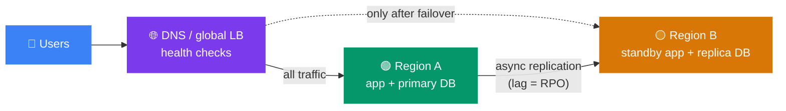

⚠️ **Async replication means RPO > 0.** Region A acknowledges a write *before* Region B has it. If Region A dies inside that lag, the failover **loses writes the client was told succeeded**. This is the same trap as Redis failover in the [CAP answer](#hld-approach-and-fundamentals) (§1 Q2), just at region scale.

**RPO 0 needs synchronous replication — and you pay in latency.** Each commit must wait for the far region to confirm. Say the cross-region round trip is 50 ms. Then every commit takes at least 50 ms more. If the far region is down, writes must stop or the RPO 0 promise breaks. That is a CP choice.

**Active-active — the hard part is write conflicts.** Two regions can change the same row at the same time. Pick one of these:

- ✅ **Home region per user (partitioned ownership).** Each user or account has one home region. Only that region writes their data. Other regions forward writes there or serve reads only. So write conflicts cannot happen.
- ⚠️ **CRDT (Conflict-free Replicated Data Type) or last-writer-wins (LWW).** Both regions accept writes and merge later. Fine for likes, carts or view counters.
- ❌️ **LWW is wrong for money.** A balance is ₹1,000. Region A approves a ₹800 debit. Region B approves another ₹800 debit at the same time. LWW keeps one write and drops the other. The balance shows ₹200, but ₹1,600 went out. Also, LWW trusts clocks, and clocks in two regions are never in perfect sync. A rule like "balance ≥ 0" needs one writer to check it.

💡 **Fintech angle:** a ledger usually stays **single-writer** per account or partition. You can spread accounts across regions (each account has one home). But one account never takes writes in two regions at once.

**Moving traffic — DNS and global load balancers:**

- DNS failover: a health check marks Region A down, and DNS starts to answer with Region B's address.
- ⚠️ **DNS TTL warning.** Resolvers and clients cache the old answer until the TTL ends. Some clients cache longer than the TTL. So keep the TTL low (for example, 60 s), and expect a tail of traffic to still hit the dead region.
- An anycast global load balancer (a fixed IP announced from many places) avoids most of the DNS caching delay.

**Split brain — who decides to fail over?**

- Region B may only *think* Region A is dead. The real problem may be the network between them. If both regions now accept writes, you have two primaries and the data splits.
- So **fence the old primary**: block its writes (revoke credentials, stop the app, or make the DB read-only) before you promote the new one.
- Many teams keep **region failover as a human decision**, with a runbook and one button. Automatic failover inside a region is normal. Automatic failover across regions can flap on a short network glitch.
- If you automate it, use a witness in a third location, so the decision needs a majority.

**Concrete AWS options:**

| Need | Service |
|---|---|
| Relational DB, one writer region, read replicas in others | **Aurora Global Database** — storage-level async replication, lag usually under 1 s; you promote a secondary region on failover |
| Key-value, writes in many regions | **DynamoDB global tables** — multi-region writes; by default async with last-writer-wins on conflict |
| Send traffic away from a failed region | **Route 53** health checks + failover routing |

**Test your failover.** A DR plan that nobody has run does not work. Run **game days**: fail a region on purpose (in staging first, then in production during a quiet hour). Measure the real RPO and RTO. Fix the runbook steps that broke. Then run it again.

🎯 **Interview Tip:** Start by asking for the RPO and RTO. They pick the strategy for you. Then say: "Async replication means RPO is not zero. For RPO 0 I need sync replication and I pay the round-trip on every commit." For active-active, say "home region per user". Say why last-writer-wins is wrong for money. End with split brain and game days. Those two points show you have thought about a real failover, not just drawn a second box.

---

</details>

---

4. **🧯 Traffic is 10× what you planned for. How does the system protect itself (backpressure, load shedding, graceful degradation)? 🔥**

<!-- -->
<details>
<summary>Answer</summary>

**Answer:** The goal is not to serve all 10×. The goal is to **keep serving the capacity you have**, with good latency. Say "no" quickly to the rest. A system with no overload control does worse: it slows down for everyone, and then it crashes.

**Three different tools — do not mix them up:**

| Tool | Who decides | Based on what | Answer it gives |
|---|---|---|---|
| **Rate limiting** | Gateway, per client | A fixed quota per user / IP / API key | `429 Too Many Requests` |
| **Load shedding** | The overloaded server itself | Its own state: in-flight requests, queue depth, latency | `503 Service Unavailable` |
| **Backpressure** | The slow consumer | "I can take N more" — the producer must slow down | No error — the producer waits or pulls less |

💡 **Why rate limiting is not enough:** a 10× spike usually comes from **many real users**, each under their own limit. The per-client rate limiter lets all of them through. Only load shedding looks at the server's total load. (Rate limiter design: [§4 Q2](#classic-design-problems).)

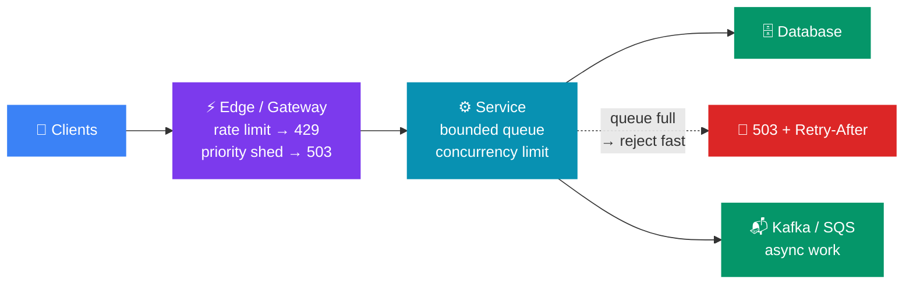

**1. Bounded queues — an unbounded queue only hides the overload:**
- With an unbounded queue, extra requests wait instead of failing. Latency grows first.
- Example: 10,000 queued requests at 1,000 req/s is a **10-second wait**. The client times out after 2 s, but the server still does the work. All of it is wasted.
- Then memory runs out → `OutOfMemoryError` → the instance dies. Its traffic moves to the other instances, and they fail too.
- A **bounded** queue (plus a cap on in-flight requests) rejects early, while the service still works for the requests it accepted.
- Also drop a request that already waited longer than the caller's timeout. Nobody is waiting for that answer.

**2. Shed early and cheaply:**
- Reject **before** the expensive work: before auth calls, JSON parsing, DB queries. A rejection at the edge costs almost nothing. A rejection after 3 DB calls costs as much as success.
- **Shed by priority, not at random.** Tag each route at the gateway. Keep checkout and payments. Drop recommendations, analytics and "people also bought" first.
- Return `503` (server overloaded) or `429` (this client sent too much), with a `Retry-After` header — seconds or an HTTP date. Clients must respect it.

**3. Timeouts and retries — the classic way to turn 10× into 30×:**
- Every call needs a **timeout**. Pass the remaining time (the deadline) down the call chain. Then lower layers stop work the caller has given up on.
- Retries use **exponential backoff + jitter**, so retries do not all arrive at the same moment.
- Retries **multiply across layers**: 3 tries at each of 3 layers = 27 calls on the database. Retry at one layer only, and cap retries with a **retry budget** (for example, at most 10% of traffic).
- Full answer with numbers: [17 — Retry, retry storm, retry budget](https://github.com/vikas9dev/java/blob/main/1_interview_questions/17_Spring_Microservices_Interview_Questions.md#5-resilience-patterns). Add a circuit breaker so callers stop calling a dependency that keeps failing (see the §3 table above).

**4. Graceful degradation — give a smaller answer, not an error:**
- **Serve stale data.** Show the cached product page or price, even after its TTL ends (stale-if-error), when the source is overloaded.
- **Turn features off with flags** (kill switches): hide reviews, recommendations, live counts. The core flow keeps its capacity.
- **Simpler fallbacks.** Show a static "top sellers" list instead of a personalised one.
- Decide **before the incident** which features are "core" and which can go. You cannot decide this well at 2 AM.

**5. Queue-based load leveling — for work that can wait:**
- Put async work (emails, reports, ledger exports) on Kafka or SQS. Consumers **pull** at the speed they can handle. This is backpressure built in.
- The spike becomes consumer lag, not an outage. Watch the lag and the queue's size/retention limits.
- This does not work for a user waiting on a synchronous response.

**6. Autoscaling — useful, but not the first answer:**
- New instances need minutes. First the metric must cross its threshold. Then the VM or pod starts. Then the app warms up (JVM, connection pools, caches).
- A spike does its damage in seconds. So shedding and degradation must protect the system **while** autoscaling catches up.
- Autoscaling the app tier can also just move the bottleneck to the database, which does not scale as fast.

🎯 **Interview Tip:** Start with the split: *"Rate limiting is per client. Load shedding is per server. Backpressure slows the producer."* Then give the order of defence. Shed early by priority, bounded queues, timeouts with a retry budget, degrade features, then autoscale. Saying "just autoscale" as the first answer is the common weak answer.

---

</details>

---

<a id="classic-design-problems"></a>

## 4. Classic Design Problems — Most Asked

1. **🔗 Design a URL Shortener (like bit.ly). 🔥🔥**

<!-- -->
<details>
<summary>Answer</summary>

**Answer:**

**Requirements clarification:**
- Functional: shorten URL, redirect to original URL, (optional: analytics, custom aliases, expiry)
- Non-functional: 100M URLs/day write, 10:1 read:write ratio → 1B redirects/day, p99 redirect latency < 10ms, HA

**Estimation:**
- 100M URLs/day → ~1200 writes/sec, ~12000 reads/sec
- Row size: long URL ~100 B + shortId, userId, `created_at`, `expires_at`, index overhead → use **~500 B/row**
- Storage: 100M × 500 B = **50 GB/day → ~18 TB/year**. That is too much for one node over a few years, so plan for **sharding by shortId**.
- Short URL length: 7 characters from a 62-symbol alphabet `[a-z, A-Z, 0-9]` = 62⁷ = **~3.5 trillion** codes. At 100M/day = 36.5B/year, that lasts **~95 years**. So 7 characters is enough.

> ⚠️ **Do not say "100 B per row".** That is the long URL alone. It gives 3.6 TB/year and the wrong conclusion ("one DB is enough"). An interviewer checks this number first. Give the per-row breakdown, not a round number.

**High-Level Design:**

**① Write path — `POST /shorten` creates a Base62 ID and saves the mapping:**

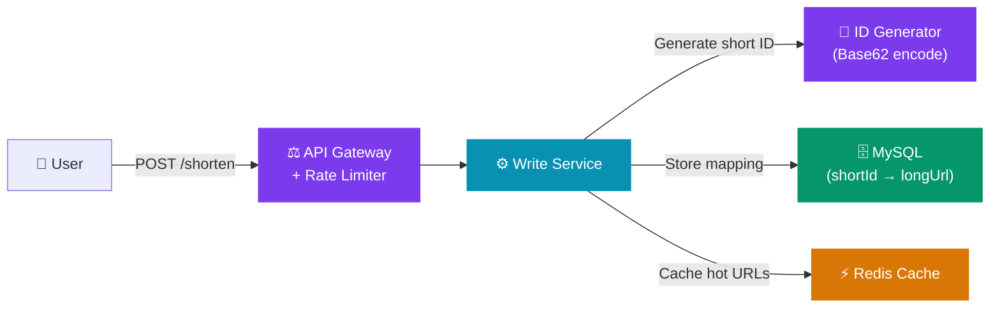

**② Read path — `GET /{shortId}` checks the cache first, and goes to the DB only on a miss:**

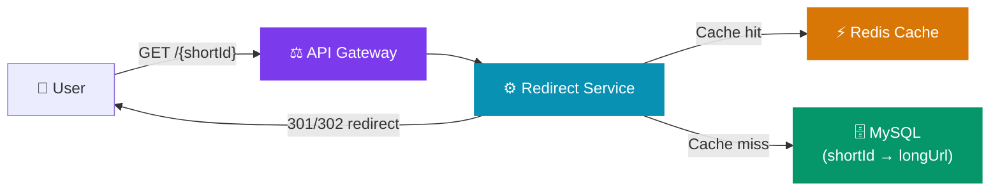

> 🗄️ MySQL and ⚡ Redis are the **same** two stores in both diagrams. Reads are ~10:1 vs writes in this estimate. That is why the read path gets its own service and a cache in front.

**Key decisions:**

**Short ID generation:**
- Option 1: MD5(longUrl) → take the first 7 chars. Problem: collisions. You can't guarantee uniqueness.
- ✅ Option 2: Auto-increment ID → Base62 encode. Simple, unique, no collision. Index the alphabet as `a=0 … z=25, A=26 … Z=51, 0=52 … 9=61`. Then `1000000` → `"emjc"`. *(The digits are 4, 12, 9, 2. Encode them with the ordering you declared, and stay consistent.)*
- Option 3: Distributed ID (Snowflake). Needed only at very large scale. ⚠️ A 64-bit Snowflake ID is **~11 Base62 characters**, not 7 (62¹⁰ ≈ 8.4 × 10¹⁷ is too small for today's IDs). So choosing it breaks the 7-character requirement above. Mention this trade-off yourself.

⚠️ **Option 2 brings two problems. Do not present it without the fixes.** Raise both yourself. If you don't, the interviewer will ask:

1. **Sequential IDs are enumerable** (anyone can list them one by one). `emjc → emjd → emje…` lets anyone crawl every URL in the system. That is a real privacy leak for a bit.ly-type service. Private links are not secret if anyone can step through every ID. **Fix:** encode the counter through a **keyed permutation** (a small Feistel cipher or format-preserving encryption), or use **random IDs** with a uniqueness check on insert.
   - ⚠️ "Multiply by a large coprime modulo 62⁷" only *looks* random. It is linear, so a few known (ID, code) pairs are enough to reverse it. It hides the order. It does not protect privacy.
2. **A single global counter is a contention point and a SPOF** (single point of failure) as soon as the DB is sharded. **Fix:** a **ticket/range server** gives each app node a block of 10,000 IDs at a time. The node goes to the counter only once per 10k new IDs, not once per request. If a node crashes, only one block is wasted.

> 💡 That second fix is also the real reason Option 3 exists. **Snowflake** removes the shared counter completely. It uses a self-contained 64-bit layout: `1 sign bit | 41 bits timestamp | 10 bits machineId | 12 bits sequence`. So every node creates IDs on its own, with no shared counter.  
> The only coordination left is handing out **unique machine IDs** once at startup. The original Twitter version used ZooKeeper for that. The IDs also stay roughly sorted by time. Its cost is **clock-skew sensitivity**: it breaks when the clocks on different machines do not agree. If a node's clock jumps backwards, the node must wait, or it will create duplicate IDs.

> ✅ **My final answer — say this on the whiteboard:**  
> 1. Each app node takes a **block of 10,000 IDs** from a range server (or a DB sequence with a large step). No call per request, and no single hot counter.  
> 2. The node passes each ID through a **keyed permutation** (a small Feistel cipher), so codes look random and cannot be stepped through.  
> 3. It **Base62-encodes** the result into **7 characters** (62⁷ ≈ 3.5 trillion, ~95 years at 100M/day).  
> 4. A **`UNIQUE` index on `shortId`** stays as a safety net. Custom aliases use the same column.  
>
> Mention Snowflake only as the alternative: no range server, but **~11 characters**, so it breaks the 7-character goal.

**301 vs 302 redirect:**
- `301 Permanent` → the browser caches the redirect. This reduces server load, but repeat clicks from the same browser never reach us, so the click counts are too low.
- ✅ `302 Temporary` → the browser always calls our server. This enables analytics (click count, geo, referrer).
- Not a hard rule: bit.ly itself returns 301. A 301 with a short `Cache-Control: max-age` still counts most clicks. Say which one you pick and why.

**Deep dive — handling scale:**
- 🔄 **Read-heavy** (10:1): Add a Redis cache for hot URLs. Most redirects are served from the cache, so the DB gets very little load.
- 📦 **Custom aliases**: Store them in the same table, with a unique constraint on shortId.
- ⏰ **Expiry**: Add an `expires_at` column, and a background job to delete expired records.
  - The job alone is not enough: a link stays live until the job runs. So the redirect path also checks `expires_at`, and the cache TTL is never later than `expires_at`.
- 📊 **Analytics**: Make it async. Write click events to Kafka → a consumer updates the analytics table.

🎯 **Interview Tip:** The 301 vs 302 decision is a classic follow-up. Always raise it yourself, before you are asked. It shows you think about the product effects (analytics) of technical choices.

---

</details>

---

2. **⏱️ Design a Rate Limiter. 🔥🔥**

<!-- -->
<details>
<summary>Answer</summary>

**Answer:**

**Requirements:** Limit requests per user/IP. Support multiple rules (100 req/min per user, 1000 req/min per IP). Low latency (about 1 ms added — one same-DC Redis round trip is ~0.5 ms). Distributed — it works across multiple API gateway nodes.

**Algorithms:**

| Algorithm | How it works | Pros | Cons |
|-----------|-------------|------|------|
| **Token Bucket** | Bucket fills at fixed rate; each request consumes a token | ✅ Allows bursts up to bucket size | Slightly complex state |
| **Leaking Bucket** | Queue-based; requests processed at fixed rate | Smooth output | A burst fills the queue with old requests; when the queue is full, new requests are dropped |
| **Fixed Window Counter** | Count requests in fixed time window (e.g., 1-minute) | Simple | Boundary problem — 2x burst at window edge |
| **Sliding Window Log** | Store timestamp of each request, count in rolling window | Accurate | High memory (stores all timestamps) |
| ✅ **Sliding Window Counter** | Hybrid: fixed window + rolling weight calculation | Accurate, memory-efficient | Slight approximation |

**Distributed implementation with Redis:**

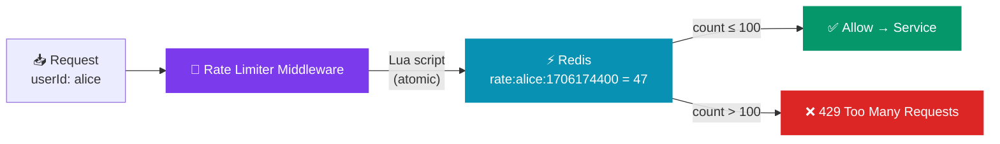

**Redis implementation (Fixed Window) — and the bug in the naive version:**

```
# ❌️ NAIVE — do not ship this
key   = "rate:{userId}:{current_window_timestamp}"
count = INCR key
if count == 1: EXPIRE key 60      # ← two separate round-trips
if count > limit: return 429
```

⚠️ `INCR` is atomic. **`INCR` *then* `EXPIRE` is not.** Something can fail between the two commands:

- the client crashes,
- the connection drops, or
- the pod is killed.

Then the key exists **with no TTL**. With the window timestamp in the key, the next window uses a new key, so the user is *not* blocked. But the old key **never expires**, and these orphan keys pile up until Redis runs out of memory.
- If the key has **no window part** (for example `rate:{userId}`), the bug is worse. The count never resets, so that user is rate-limited **forever**. This is the single best-known bug in hand-written Redis rate limiters. Interviewers commonly check for it.

```lua
-- ✅ Lua script — INCR + conditional EXPIRE evaluated atomically in one round-trip
-- KEYS[1] = rate key, ARGV[1] = window seconds, ARGV[2] = limit
local count = redis.call('INCR', KEYS[1])
if count == 1 then
    redis.call('EXPIRE', KEYS[1], ARGV[1])
end
if count > tonumber(ARGV[2]) then
    return 0    -- reject → 429
end
return 1        -- allow
```

> 💡 The non-Lua option is `SET key 0 EX 60 NX` (create-with-TTL only if absent), then `INCR`. The *same* command creates the key and the TTL, so a crash cannot leave a key without one.  
> ⚠️ But there is still a race. Suppose the key exists with 1 ms of TTL left. `SET NX` does nothing, the key expires, and then `INCR` creates a **new key with no TTL**. Use the Lua script. `MULTI`/`EXEC` closes this gap only if Redis freezes the clock during the transaction, and that depends on the Redis version. Lua is the answer that is safe everywhere.

**Sliding Window Counter (the ✅ choice in the table) — also one Lua script:**

The idea: keep one counter per window. Weight the previous window by how much of it still overlaps the last 60 seconds.

```
estimate = previous_count × (1 − elapsed / window) + current_count
```

Example: limit 100/min, 15 s into the current minute, previous minute had 80, current has 30.
`80 × 0.75 + 30 = 90` → the request is allowed. At 40 in the current minute, `60 + 40 = 100` → rejected.

```lua
-- ✅ Sliding window counter — read, decide and increment in ONE atomic step
-- KEYS[1] = current window key   e.g. rate:{alice}:1706174400
-- KEYS[2] = previous window key  e.g. rate:{alice}:1706174340
-- ARGV[1] = limit, ARGV[2] = window seconds, ARGV[3] = seconds elapsed in the current window
local curr   = tonumber(redis.call('GET', KEYS[1]) or '0')
local prev   = tonumber(redis.call('GET', KEYS[2]) or '0')
local window = tonumber(ARGV[2])
local weight = (window - tonumber(ARGV[3])) / window

if prev * weight + curr >= tonumber(ARGV[1]) then
    return 0                                -- reject → 429 (a rejected call is not counted)
end

redis.call('INCR', KEYS[1])
redis.call('EXPIRE', KEYS[1], window * 2)   -- it is still needed as "previous" in the next window
return 1                                    -- allow
```

- **Why one script:** two `GET`s, a decision and an `INCR` from the client would be check-then-act. Two gateway nodes could both read 99 and both allow. Inside Lua, Redis runs the whole script with no other command in between.
- **Why `>=`:** the estimate counts requests *before* this one. Allowing at 99 makes it 100, which is still within the limit.
- **Memory:** 2 small counters per user, not one entry per request like the sliding window log.
- **The approximation:** it assumes the previous window's requests were spread evenly. Cloudflare reported this estimate is very close to exact counts in real traffic. That is why it is the usual choice.
- **Redis Cluster:** both keys must be in the **same hash slot**, or the script fails with `CROSSSLOT`. The `{alice}` part is a **hash tag**: only the text inside `{}` is hashed, so both keys land on the same node.
- **Clock:** `ARGV[3]` comes from the gateway's clock. Keep gateway nodes on NTP. A skew of a few hundred ms only shifts the weight a little.
  - Follow-up: *"Why not use Redis's clock?"* You can. Call `redis.call('TIME')` inside the script and build the window keys there. Then all gateways share one clock. Since Redis 5, scripts replicate their effects, not the script, so reading the time inside a script is safe.

**Where it runs, and what happens when Redis is down:**

| Question | Answer |
|---|---|
| Where does the limiter run? | In the **API gateway** (or a shared middleware), before the request reaches any service. One place, one config. |
| Redis is down or slow | **Fail open** for normal APIs: allow the request and log it. A broken limiter must not become a full outage. Set a short Redis timeout (a few ms) so a slow Redis does not slow every request. |
| …but some APIs must fail closed | **Login, OTP and payment-initiation** endpoints. For these, an attacker would love the limiter to be off. Reject, or fall back to a strict local limit. |
| Fallback | A **local in-memory limiter** in each gateway node, set to `limit ÷ number of nodes`. It is rough, but it still stops a flood. |
| Hot key (one huge client) | All of its requests hit one Redis key, so one shard. Rare at 100/min limits. For very large clients, keep a local token bucket and sync it to Redis in batches. |

**Response headers (good practice):**
```
X-RateLimit-Limit:     100          # ceiling for this window
X-RateLimit-Remaining: 53           # requests left (0 when you send a 429)
X-RateLimit-Reset:     1706174460   # unix ts when the window resets
Retry-After:           13           # 429 only — SECONDS until reset, not the current count
```

🎯 **Interview Tip:** *"`INCR` is atomic, but `INCR`+`EXPIRE` is two round-trips — wrap them in a Lua script so a crash between them can't strand a key without a TTL."* Say that sentence before anyone asks. That is the whole point of the question. Then say the second one: *"If Redis is down, I fail open for normal APIs and fail closed for login and OTP."* The same Lua trick also works for multi-rule limits (per user + per IP + per endpoint). Check all rules atomically in one round-trip.

---

</details>

---

3. **💬 Design a Chat System (like WhatsApp). 🔥🔥**

<!-- -->
<details>
<summary>Answer</summary>

**Answer:**

**Requirements:** 1:1 chat and small groups. Online presence (online / last seen). Sent, delivered and read receipts. A user who is offline gets the messages when they come back. Text only. 50M DAU.

**Estimation (state your assumptions first):**

| Item | Calculation | Result |
|---|---|---|
| Messages per day | 50M DAU × 40 messages | **2B / day** |
| Write QPS (average) | 2B ÷ 86,400 s | **~23k / s** (peak ×3 ≈ 70k / s) |
| Storage per day | 2B × 100 bytes | **~200 GB / day** (~73 TB / year, before replication) |
| Open connections at peak | assume 20% of DAU online | **~10M** WebSockets |
| Chat servers | 10M ÷ ~100k connections per server | **~100 servers** (⚠️ unverified — the per-server number depends on tuning; measure it) |

**Step 1 — pick the connection type.** The server must push messages to the client. Plain HTTP request/response cannot do that.

| Option | How it works | Problem for chat |
|---|---|---|
| **Short polling** | Client asks "anything new?" every few seconds | Most calls return nothing. Wastes server and battery |
| **Long polling** | Server holds the request open until a message arrives or a timeout | The sender's message may land on a different server than the one holding the poll. The server also cannot tell if the client has left |
| **SSE** (Server-Sent Events) | One-way stream, server → client, over HTTP | One-way only. The client still needs separate HTTP calls to send |
| **WebSocket** ✅ | Starts as HTTP, then `Upgrade` → a full two-way connection on port 80/443 | Stateful. The server must remember who is connected to it |

**Step 2 — stateful chat servers + a connection registry.** Each client keeps one WebSocket to one chat server. So you must know *which* server holds a user. Store it in Redis: `conn:{userId} → chat-server-7`. Write it on connect. Delete it on disconnect. Login, profile and history stay on normal **stateless** HTTP services.

**Step 3 — message flow when the receiver is on another server:**

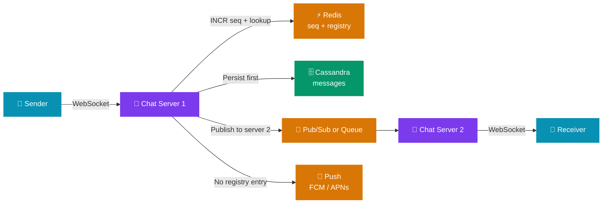

1. Server 1 gets a sequence number for the chat. Then it **saves the message first**. Then it acks the sender (✓ sent).
2. It looks up the receiver in the registry. It publishes to server 2's channel (Redis Pub/Sub, or a Kafka topic per server).
3. Server 2 pushes it down the receiver's WebSocket. The receiver's device acks (✓✓ delivered).
4. Redis Pub/Sub does not store messages. If server 2 misses one, nothing is lost: the message is already in the DB. The client catches up on its next sync.
   - A client that stays connected never reconnects, so "next sync" could be hours away. Fix: the client checks for **gaps in `seq`**. If it gets 1043 after 1041, it asks for 1042 at once. A slow periodic sync catches the rest.

**Key design decisions:**

**Per-chat ordering — use a server sequence, not the wall clock:**
- Server clocks drift, and two messages can have the same millisecond. So `created_at` cannot order messages.
- Give each chat its own counter: `INCR seq:{chatId}` in Redis. Order only matters *inside one chat*, so a global ID is not needed.
- A Snowflake-style global ID also works. It is harder to build than a per-chat counter.
- ⚠️ Follow-up: *"Redis fails over and loses some `INCR`s. Now two messages get the same seq."* Redis replication is async, so this can happen. Fixes:
  - make `(chat_id, seq)` the primary key in the message store, so a reused seq fails the insert and the server retries with a new one;
  - or, on failover, start the counter again from `MAX(seq)` in the store.

**Message storage — wide-column store (Cassandra / HBase):**
- Write-heavy, huge volume, simple access ("last 50 messages of chat X"). No joins needed.
- Partition key `(chat_id, time_bucket)`, clustering key `message_id DESC`. The bucket stops one busy chat from making one huge partition.
- Users, profiles and group membership stay in a relational DB.

**Offline delivery + push:**
- No registry entry → the user is offline → send a push notification (FCM / APNs).
- Each device stores the last `message_id` it has, per chat. On reconnect it asks: "give me everything after N". This also makes multi-device work.

**Read receipts — store a pointer, not a flag per message:**
- Keep `last_delivered_seq` and `last_read_seq` per (user, chat). "Read up to 1042" covers every earlier message in one write.

**Presence — heartbeat with a TTL:**
- The client sends a heartbeat every few seconds (5 s in Alex Xu). The server sets `presence:{userId}` with a TTL (30 s in the book).
- No heartbeat → the key expires → the user shows offline. A short network drop in a lift does not flip the status.
- Send presence changes only to friends who have the chat open. In big groups, fetch presence on demand. Otherwise one status change becomes thousands of events.

**Group fan-out (small groups):**
- Store the message **once**, keyed by `chat_id`. Then deliver it to each member: online members via the registry, offline members via push.
- Fan-out cost grows with group size. That is why chat apps limit group size (the book uses 100 members).
- Alex Xu does it differently: he copies each message into every member's **sync queue** (an inbox per user). That makes "what's new for me?" one read, but it costs N writes per message. Store-once costs one write, but a reconnecting user must check each of their chats. Both are valid. Know which one you chose and why.

⚠️ **Delivery is at-least-once, so the client must dedupe.** Retries and reconnects can deliver the same message twice.
- The sender attaches a `client_msg_id` (UUID). The server ignores a second send with the same ID. A network retry then does not create two messages.
- The receiver drops any `message_id` it already has.

🎯 **Interview Tip:** Interviewers check three things: (1) you choose **WebSocket** and explain why long polling fails, (2) you show the **cross-server hop** through the connection registry, and (3) you order by a **per-chat sequence**, not by timestamp. Also mention the offline path (push + sync from the last `message_id`). Candidates often forget it. For depth, see [Alex Xu Ch 12 — Design a Chat System](../01_insider_guide_Alex_Xu/vol_1/ch12_design_a_chat_system.md).

---

</details>

---

4. **🔔 Design a Notification System (Email, SMS, Push). 🔥🔥**

<!-- -->
<details>
<summary>Answer</summary>

**Answer:**

**Requirements:** Support email, SMS, push notifications. 10M users, 1M notifications/day. Delivery at least once. Support retries. Users can set preferences (opt-out per channel).

**① Ingest & routing — an event comes in, preferences are checked, then it fans out to a per-channel router:**

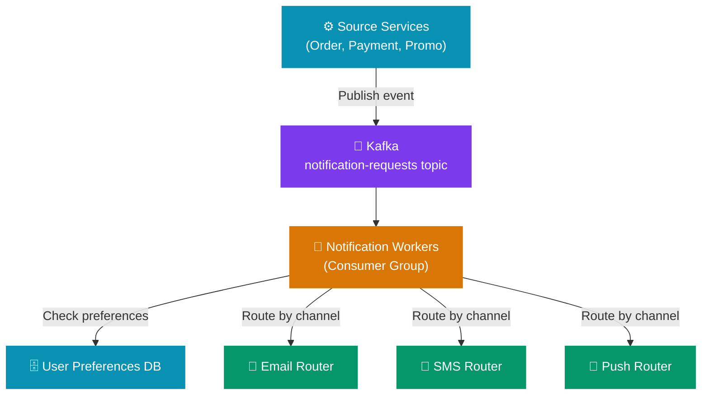

**② Delivery & tracking — each router passes the message to its provider; status comes back via webhook:**

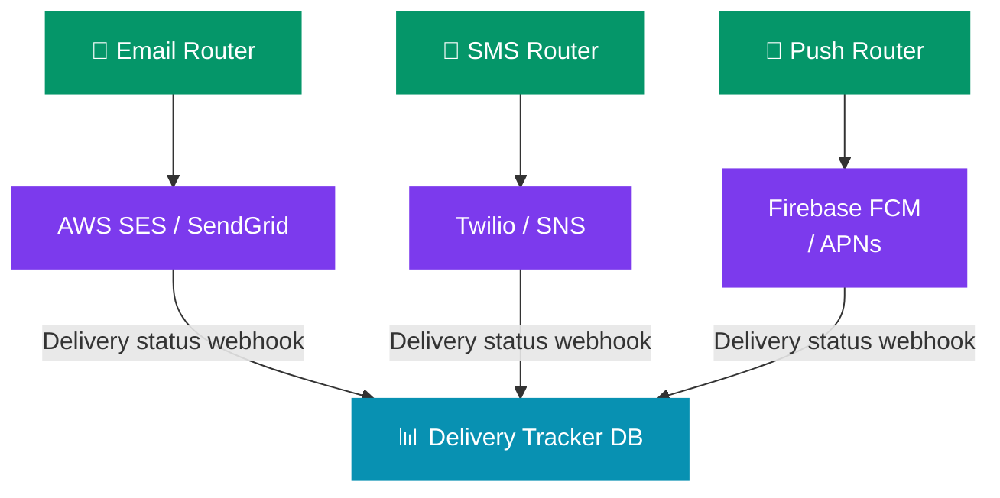

> The 🟢 routers connect the two diagrams. The split there is also the real design boundary:
>
> - everything left of it is **your** infrastructure;
> - everything right of it is a **third-party provider**. You must retry calls to it and check its results against your own records.

**Key design decisions:**

**Decoupling with Kafka:**
- Source services publish to Kafka. They don't know about notification channels. Adding WhatsApp later needs no change to source services.
- After the router, each channel gets **its own topic** (`email-out`, `sms-out`, `push-out`) with its own consumer group. Then each channel scales on its own, and a slow SMS provider cannot hold up email.
  - ⚠️ Separate consumer groups on the **one shared** topic would not work. Every group reads *every* event, so each channel would see all traffic.

**Idempotency (at-least-once delivery → deduplicated sends):**
- Add a `notification_id` (UUID) to each event.
- Before sending, check Redis/DB: "Was `notification_id` already sent?"
- Record delivery in DB after send → skip if already delivered.

⚠️ Do not call this "exactly-once". Check → send → record has two gaps:
- Two workers can both pass the check at the same time. Claim the ID first with an atomic insert (`UNIQUE` key or `SET NX`), then send.
- If the worker crashes after the send but before the record, the retry sends again.
- So the honest claim is **"deduplicated, at most a rare duplicate"**. True once-only needs the provider to accept your idempotency key.

**Retry with exponential backoff — *and jitter*:**
```
Attempt 1: immediate
Attempt 2: +30s  ± random(0–30s)
Attempt 3: +2m   ± random(0–2m)
Attempt 4: +10m  ± random(0–10m)
After 4 failures → Dead Letter Queue for manual review
```

⚠️ **Never leave out the jitter.** Without it, every request that failed in the same outage retries at *exactly* +30s, all together. This is a synchronised retry storm. It hits the dependency at the exact moment it is trying to recover, and makes it fail again. It is the same failure mode as cache avalanche, at a worse moment. A random delay spreads the retries across the interval.

**User preference enforcement:**
- Store per-user, per-channel, per-category preferences in a fast-read store (Redis or DynamoDB).
- Check the preference before routing. Never send to opted-out channels.

**Rate limiting per provider:**
- AWS SES: throttle email sending to stay within account limits.
- Use a token bucket per provider to avoid being rate-limited by third parties.

🎯 **Interview Tip:** Mention **template management** as a follow-up. Templates are stored in the DB. The server fills them with user-specific variables before sending. This avoids hardcoded notification content and supports i18n (multiple languages).

---

</details>

---

5. **💳 Design a Payment Processing System. 🔥🔥**

<!-- -->
<details>
<summary>Answer</summary>

**Answer:**

**Requirements:** Process payments between users and merchants. Support credit card, UPI, wallet. Idempotent — no double charges. ACID guarantees. Audit trail. 99.99% availability.

**① Synchronous charge path — idempotency check, provider call, ACID write, webhook back:**

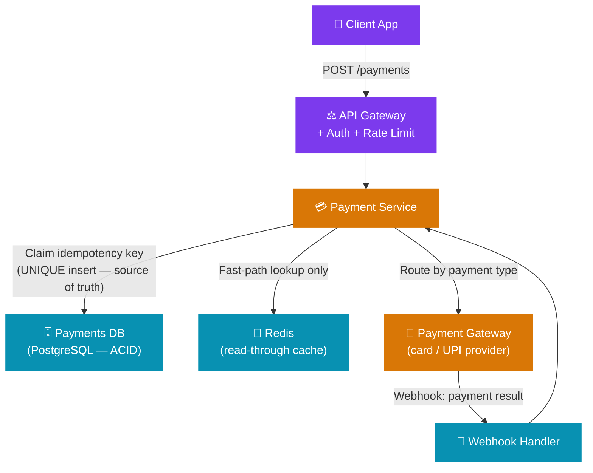

**② Asynchronous fan-out — one event, three independent consumers:**

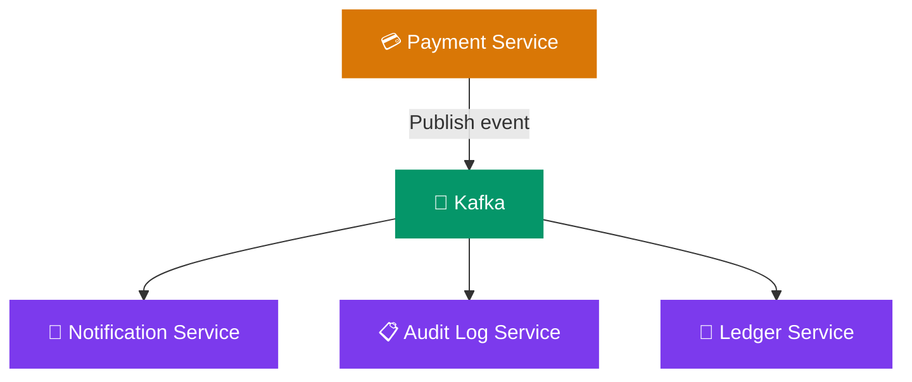

> 💳 Payment Service is the link between the two. Diagram ① is on the **request's critical path**: it must be fast and idempotent. Diagram ② is **off** that path on purpose. So a slow ledger or email service can never make the charge fail.
>
> ⚠️ Note that the arrow from ① into ② is a **dual write**. The Postgres commit and the Kafka publish are two systems with no shared transaction. So the ledger can silently miss a payment. Route it through a transactional outbox ([17 — Outbox](https://github.com/vikas9dev/java/blob/main/1_interview_questions/17_Spring_Microservices_Interview_Questions.md#6-distributed-data-patterns)). On a payments question, this follow-up is almost certain to come.

**Critical design concerns:**

**Idempotency — the durable version (this is the senior answer):**
- Client sends a unique `Idempotency-Key` header with every request.
- Payment Service `INSERT`s `(idempotency_key, status=IN_PROGRESS)` into the **payments DB**, with a `UNIQUE` constraint on `idempotency_key`. It does this **before** calling the gateway, in the same transaction that reserves the payment row.
- ⚠️ **Commit that row before the gateway call.** If the transaction stays open during the call, Postgres makes the duplicate `INSERT` **wait** on the open row instead of failing. Never hold a DB transaction open across a network call.
- A duplicate request violates the unique constraint. That violation **is** the concurrency guard. The second request catches it and returns the original `payment_id`, instead of charging again.
  - If the first request is still `IN_PROGRESS`, there is no final result yet. Return `409 Conflict` (or the pending status), and the client polls.
- Redis is a valid **read-through fast path** in front of that table. It is never the record itself.

⚠️ **Why "store `idempotency_key → payment_id` in Redis" is a real design defect, not a small detail.** The defect is Redis as the *record*, not the 24h window. Expect this exact question in a payments interview:

| Failure | What happens |
|---|---|
| **Durability** | Redis is not the source of truth. Eviction under `maxmemory`, an async-replication failover, or a restart without persistence loses the key → **double charge**. |
| **Concurrency** | "check Redis → call gateway → write Redis" is **check-then-act**. Two requests with the same key arrive at the same time. Both see a miss and both charge. A `UNIQUE` constraint has no such gap; a `GET` followed by a `SET` does. |
| **TTL semantics** | A key window of about 24h is normal (Stripe uses it). It is safe only when the payment itself has a durable `UNIQUE` key in the DB. Then a retry at hour 25 is still caught there. With Redis as the only record, the hour-25 retry is a brand-new payment and **double-charges**. |

**Payment state machine:**
```
INITIATED → PROCESSING → SUCCESS
                      ↘ FAILED
                      ↘ TIMED_OUT → (Reconciliation job determines final state)
```

**Double-entry bookkeeping (Ledger):**
```sql
-- Every payment creates TWO ledger entries
INSERT INTO ledger (account_id, amount, type) VALUES ('user_wallet', -500, 'DEBIT');
INSERT INTO ledger (account_id, amount, type) VALUES ('merchant_account', +500, 'CREDIT');
-- Both in the same DB transaction — atomically
```

⚠️ The ledger gets payments from Kafka (diagram ②), and Kafka delivers **at least once**. So the ledger consumer needs its own dedupe, for example `UNIQUE (payment_id, entry_type)`. Otherwise a redelivered event posts the entries twice.

**Handling payment gateway timeouts:**
- If the gateway call times out, payment state = `TIMED_OUT`
- A reconciliation job runs every 5 minutes. It asks the gateway API for the final status of timed-out payments.
- It updates the local state to match (never assume failure on timeout)

**Strong consistency:** Use PostgreSQL with `SELECT FOR UPDATE` to prevent race conditions on wallet balance updates.

🎯 **Interview Tip:** The reconciliation pattern for timeout handling is what separates senior engineers from juniors on this question. Always mention it. It is a real-world problem that every payment team faces.

---

</details>

---

<a id="classic-design-problems-also-asked"></a>

## 5. Classic Design Problems — Also Asked

1. **📰 Design a Social Media Feed (like Twitter / Instagram timeline). 🔥**

<!-- -->
<details>
<summary>Answer</summary>

**Answer:**

**Requirements:** Users can post and see a personalized feed of people they follow. 300M MAU, 500M tweets/day. Celebrities have 10M+ followers. Read-heavy (100:1 read:write ratio).

**The core problem — fan-out:**

| Approach | How | Pros | Cons |
|----------|-----|------|------|
| **Fan-out on Write (Push)** | On post, pre-compute feed for all followers | O(1) read | O(followers) write; expensive for celebrities (10M+ fan-out) |
| **Fan-out on Read (Pull)** | On read, fetch posts from all followees | O(1) write | O(followees) read; slow for users following 1000 people |
| **Hybrid** ✅ | Push for normal users, Pull for celebrities | Balanced | More complex logic |

**Hybrid approach (Twitter's approach):**
1. A normal user posts → fan-out to followers' feed caches (Redis timeline cache).
2. A celebrity posts → NOT pushed. Instead, when a user reads their feed, the service fetches celebrity posts separately and merges them.
3. The feed cache stores post IDs (not content). The service looks up the actual post data when rendering.

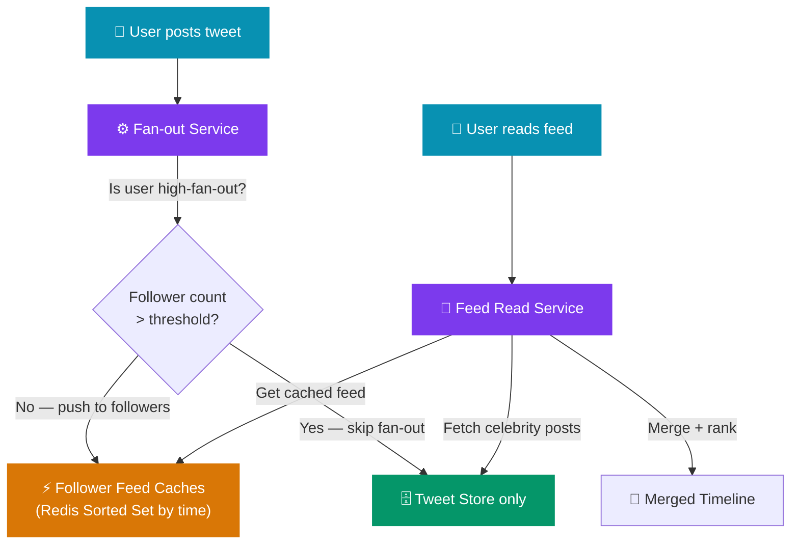

**Picking the threshold — this is the real design decision, so don't be vague about it:**

A cutoff of "10M followers" is far too high to be useful. Almost no account reaches it. Fan-out-on-write already costs too much long before that: a single post at 500k followers means 500k cache writes. The threshold is a **tunable setting**, not a constant. Interviewers ask about it specifically:

- Derive it from a budget, not a guess: *"one post must not cost more than N cache writes / M ms of fan-out work"*. The follower count that reaches that budget **is** your threshold. That is usually orders of magnitude below 10M.
- Make it **dynamic**. Recompute it per account, and let it change with load. During a traffic spike, you can lower the threshold and move more accounts onto the pull path.
- Say the number is a starting point that you would tune from production fan-out latency. Then you have answered the follow-up before it is asked.

🎯 **Interview Tip:** The celebrity / high-follower problem is the core of this question. Interviewers expect you to spot it and propose the hybrid solution. Bonus: mention that a separate ranking service applies feed ranking (ML-based relevance scoring) after the feed is assembled.

---

</details>

---

2. **📍 Design a Proximity Service (nearby restaurants / delivery partners). 🔥**

<!-- -->
<details>
<summary>Answer</summary>

**Answer:**

**Requirements:** Given a user's location and a radius (1–20 km), return nearby restaurants. Also find free delivery partners near a restaurant. Results in under ~200 ms.

**First, split the data into two kinds. They need different designs:**

| | Restaurants (places) | Delivery partners (drivers) |
|---|---|---|
| How often they move | Almost never. Changes can show up the next day | Every few seconds |
| Load | Read-heavy (many searches, few writes) | Write-heavy (constant location updates) |
| Where to keep them | A geo index + read replicas + cache | **Redis** in memory. Only the latest point matters |

**Estimation (assumptions):**
- Search: 100M DAU × 5 searches ÷ 86,400 s ≈ **~5,800 QPS**.
- Drivers: 500k online partners × 1 update every 5 s = **100k writes / s**. A normal DB index should not take this load.

**Why a plain lat/lng query is slow:**

```sql
SELECT id FROM restaurant
WHERE lat BETWEEN :lat1 AND :lat2
  AND lng BETWEEN :lng1 AND :lng2;
```

- A B-tree index can use a range on **one** column well. Each index alone returns a long strip of the map, not a small box.
- The DB must then intersect two huge result sets. With a composite `(lat, lng)` index, only the `lat` range uses the index.
- The fix: map 2D points to a **1D key** that keeps close points close. Geohash does this.

**Geohash** — split the world into a grid, again and again. Interleave the longitude and latitude bits, then encode them in base32. A **longer string = a smaller cell**. Places that share a prefix are in the same cell.

| Geohash length | Cell size (approx., at the equator) | Good for radius |
|---|---|---|
| 4 | 39.1 km × 19.5 km | 5–20 km |
| 5 | 4.9 km × 4.9 km | 1–2 km |
| 6 | 1.2 km × 609.4 m | 0.5 km |
| 7 | 152.9 m × 152.4 m | very short range |

⚠️ **Boundary problem.** Two places 50 m apart can sit in different cells. Near the equator or the prime meridian, they may share no prefix at all. **Fix:** always search the user's cell **plus its 8 neighbours**. Then filter by the real distance.

**Other geo indexes — one line each:**
- **Quadtree** — an in-memory tree. A node splits into 4 when it holds more than N places (100 in Alex Xu). Dense city areas get small cells, empty areas get big ones. The tree must be rebuilt on server start.
- **Google S2** — maps the sphere onto a Hilbert curve. Good for geofencing, with flexible cell sizes. Hard to explain in an interview.
- **Uber H3** — hexagon cells, 16 resolutions. All 6 neighbours are at the same distance. Good for surge pricing and demand heatmaps.

**Live driver location — Redis GEO, not the DB:**

```text
GEOADD drivers:blr 77.5946 12.9716 driver:42
GEOSEARCH drivers:blr FROMLONLAT 77.6000 12.9700
          BYRADIUS 3 km ASC COUNT 20 WITHDIST
```

- A GEO set is a **sorted set**. The score is a 52-bit geohash, so a radius search is fast.
- Note the order: **longitude first**, then latitude.
- `GEORADIUS` is **deprecated since Redis 6.2**. Use `GEOSEARCH` instead.
- Keep one key per city (or per region). This spreads 100k writes / s across keys and shards.
  - ⚠️ But one key lives on one shard, and Redis runs commands on one thread. So the busiest city (Bangalore) is still a hot key. Split a hot city by **geohash prefix** (for example `drivers:blr:tdr1`, `drivers:blr:tdr4`). Then a radius search reads the few keys whose cells touch the circle.
- Send each update to Kafka too, if you need trip history. Write it to the DB from there, not on every ping.

⚠️ **A TTL cannot expire one member of a GEO set.** Redis TTL works on whole keys only. To drop drivers who stop sending updates:
- keep `driver:{id}:alive` with a TTL of ~30 s, and skip drivers whose key is gone, **or**
- keep a second sorted set `drivers:blr:seen` (score = last update time). Remove old members with `ZREMRANGEBYSCORE`.

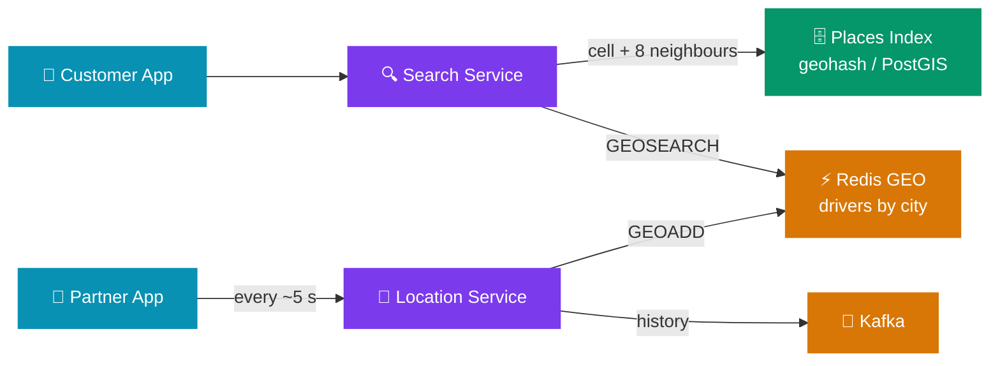

**Ready-made alternatives for the places index:**

| Option | How | When |
|---|---|---|
| **PostGIS** | `geography` column + GiST index + `ST_DWithin` | You already run PostgreSQL. Simple to start |
| **Elasticsearch** | `geo_point` field + `geo_distance` query | You also need text search ("biryani near me") |
| **Own geohash column** | B-tree index on `geohash` + prefix query | Any SQL DB. Easy to explain |

💡 The places index is small (about 1.71 GB for a quadtree over 200M businesses, in Alex Xu). It fits on one server. So scale reads with **read replicas**, not shards.

🎯 **Interview Tip:** First say that places and drivers are **two different problems**: a read-heavy static index and a write-heavy moving cache. Then explain how geohash works and fix the boundary problem with 8 neighbours. Do not just say "use PostGIS" — the interviewer wants to see how the index works. For depth, see [Alex Xu Vol 2 Ch 1 — Proximity Service](../01_insider_guide_Alex_Xu/vol_2/ch01_proximity_service.md) and [Ch 2 — Nearby Friends](../01_insider_guide_Alex_Xu/vol_2/ch02_nearby_friends.md).

---

</details>

---

3. **🔍 Design a Search Autocomplete / Typeahead System. 🔥**

<!-- -->
<details>
<summary>Answer</summary>

**Answer:**

**Requirements:** Return the top 5 autocomplete suggestions as the user types. ~10M DAU, 1 search/user/day, 10 req/search = 100M req/day → ~1200 QPS, peak ~3.6K QPS (assume 3× average). Latency < 100ms.

**High-Level Design:**

```mermaid
graph LR
    USER["👤 User<br/>types 'pay...'"] --> AG["⚖️ API Gateway"]
    AG --> TS["🔍 Typeahead Service"]
    TS -->|"Cache hit (Redis)"| RC["⚡ Redis<br/>Sorted Set<br/>key: 'pay' → [(paypal,99),(payment,85)...]"]
    TS -->|"Cache miss"| TRIE["🌲 Trie Service<br/>(in-memory or distributed)"]
    TRIE --> DB["🗄️ Prefix Store<br/>(Elasticsearch / MySQL)"]

    classDef purple fill:#7C3AED,stroke:#7C3AED,color:#fff
    classDef cyan fill:#0891B2,stroke:#0891B2,color:#fff
    classDef green fill:#059669,stroke:#059669,color:#fff
    classDef orange fill:#D97706,stroke:#D97706,color:#fff

    class USER purple
    class AG,TS purple
    class RC orange
    class TRIE cyan
    class DB green
```

**Data structure — Trie with popularity scores:**
- Each Trie node stores: the character, a children map, and the top-K (5) suggestions for its subtree, with their frequency scores.
- Top-5 is pre-computed at each node → lookup is O(prefix length): walk down to the prefix node, then read its list. No subtree traversal is needed at query time.

**Building and updating the Trie:**
- Batch job: aggregate search logs → compute popularity scores → rebuild the Trie every hour.
- Push the updated Trie to a distributed cache (Redis) or a distributed Trie service.
- Sampling: log only 1 in 1000 searches into the aggregation pipeline. This cuts write amplification (too many writes caused by each search). The Trie itself is still updated only by the batch rebuild, never per search.

**Redis Sorted Set approach (simpler alternative):**
```
Key: "search:pay"
Members: [(paypal, 9900), (payment, 8500), (payoneer, 7200)]
Command: ZRANGE search:pay 0 4 REV  → top 5 by score  (ZREVRANGE is deprecated since Redis 6.2)
```

**CDN/Edge caching:**
- Cache responses for common prefixes at the CDN edge. (Assume most traffic hits a small set of common prefixes. State the number as your assumption, for example "80% of traffic hits the top 1,000 prefixes".)
- TTL: 5 minutes. Stale suggestions for rare queries are acceptable.

🎯 **Interview Tip:** When asked "how do you keep it fresh?", explain the batch rebuild + sampling trade-off. Don't try to update the Trie in real-time. At scale, the write amplification is too high.

---

</details>

---

4. **⏰ Design a distributed job scheduler (delayed and recurring jobs, e.g. EMI reminders). 🔥**

<!-- -->
<details>
<summary>Answer</summary>

**Answer:**

**Requirements:**
- Schedule a **one-time** job ("send a reminder 3 days before the EMI date") or a **recurring** job (cron, e.g. "every day at 9 AM").
- A job must **never be lost**, even if a node crashes.
- A job should run **once**. In practice the system gives **at-least-once**, so jobs must be idempotent.
- Firing within a few seconds of the due time is enough. This is not a hard real-time system.

**Estimate (state the assumptions):**
- 10M active loans × 3 reminders per EMI cycle ≈ 30M jobs/month ≈ **1M jobs/day**.
- Average: 1M ÷ 86,400 s ≈ **12 jobs/s**. But reminders bunch up, e.g. all in 9–10 AM: 1M ÷ 3,600 ≈ **280 jobs/s** peak.
- Storage: 1M rows/day × ~500 B ≈ **500 MB/day**. Keep 30 days ≈ **15 GB**. One Postgres node handles this.

```mermaid
graph LR
    API["📥 Job API<br/>create / cancel"] --> DB["🗄️ jobs table<br/>index on next_run_at"]
    W["⚙️ Workers<br/>poll + claim"] -->|"SKIP LOCKED<br/>or lease"| DB
    W --> T["🎯 Target<br/>SMS / email service"]
    W -->|"attempts used up"| DLQ["☠️ Dead-letter<br/>status = DEAD"]
    R["🧹 Reaper<br/>expired leases"] --> DB

    classDef purple fill:#7C3AED,stroke:#7C3AED,color:#fff
    classDef cyan fill:#0891B2,stroke:#0891B2,color:#fff
    classDef green fill:#059669,stroke:#059669,color:#fff
    classDef amber fill:#D97706,stroke:#D97706,color:#fff
    classDef red fill:#DC2626,stroke:#DC2626,color:#fff

    class API,W purple
    class DB cyan
    class T green
    class R amber
    class DLQ red
```

**① Storage — a durable table, not memory.** Columns: `id`, `payload`, `next_run_at`, `status` (PENDING / RUNNING / DONE / DEAD), `attempts`, `owner`, `lease_until`, `cron_expr`. Add an index on `next_run_at` (in Postgres, a partial index `WHERE status = 'PENDING'` keeps it small).

**② How do workers find due jobs?**

| Option | How it works | Use it when |
|---|---|---|
| ✅ **DB polling** | Every 1–5 s: `WHERE next_run_at <= now()` | Default. Durable, simple, easy to debug |
| **Timing wheel** | In-memory ring of time slots; O(1) add (Kafka and Netty use it internally) | Many short timers inside one process. Not durable — rebuild from the DB after a restart |
| **Redis sorted set** | `ZADD` with score = run time, then `ZRANGEBYSCORE 0 now` | Lower latency. Claim must be atomic: only the worker whose `ZREM` returns 1 runs it |
| **Delay queue** | SQS `DelaySeconds` | Only short delays — SQS allows **at most 15 minutes** |

**③ Many workers, no double run — claim the row atomically:**

```sql
UPDATE jobs
SET status = 'RUNNING',
    owner = :worker_id,
    lease_until = now() + interval '5 minutes'
WHERE id IN (
    SELECT id
    FROM jobs
    WHERE status = 'PENDING' AND next_run_at <= now()
    ORDER BY next_run_at
    LIMIT 100
    FOR UPDATE SKIP LOCKED
)
RETURNING id, payload;
```

- `SKIP LOCKED` (Postgres 9.5+, MySQL 8.0+) makes each worker skip rows another worker has locked. Workers do not block each other.
- The **lease** (`owner` + `lease_until`) covers crashes. If a worker dies, a reaper moves `RUNNING` rows with `lease_until < now()` back to `PENDING`.
- On completion: `UPDATE … SET status = 'DONE' WHERE id = :id AND owner = :worker_id`. A slow worker whose lease already expired updates 0 rows, so it cannot overwrite the new owner.
- Use the **DB's `now()`**, not each worker's clock. Then clock skew between workers does not matter.

**④ At-least-once, so the job must be idempotent.** A worker can send the SMS and crash before it marks the row DONE. The reaper then runs it again. So the target must dedupe: a unique key such as `(loan_id, emi_due_date, reminder_type)`, or an idempotency key sent to the SMS provider.

**⑤ Failure handling:**

| Case | What happens |
|---|---|
| Job throws an error | `attempts++`, `next_run_at = now() + base × 2^attempts` (+ random jitter), back to PENDING |
| Attempts reach the max (e.g. 5) | `status = DEAD` (dead-letter). Alert, and allow a manual re-run |
| Worker crashes mid-job | Lease expires → reaper resets it → it runs again (see ④) |
| Scheduler down for 1 hour | On restart, all overdue rows are due at once. Drain them in batches. Decide per job: run late, or skip if stale (a reminder after the due date is useless) |

**⑥ Recurring jobs.** Keep one row per schedule. After a run **succeeds**, compute the next time from the cron expression and set `next_run_at`, in the same transaction that marks this run done.
- Compute it from the **scheduled** time, not from `now()`. Otherwise small delays add up and the job drifts.
- If several runs were missed, run **once** and jump to the next future time. Quartz calls this a *misfire policy*.
- Store the time zone with the cron expression. "9 AM" means 9 AM IST, not 9 AM UTC.

**⑦ Scaling past one DB.** Partition jobs by `hash(job_id) % N`. Each worker group polls only its own partitions. Also partition the table **by day** on `next_run_at`, so you can drop old days quickly instead of running big `DELETE`s.

**⑧ Or use an existing tool:**
- **Quartz (clustered mode)** — nodes share one database through the JDBC JobStore. A DB lock makes sure only one node fires each trigger. Node clocks must be in sync (use NTP). Good fit for a Spring Boot service.
- **AWS EventBridge Scheduler** — managed one-time (`at()`), `rate()` and `cron()` schedules, with a retry policy and an SQS dead-letter queue.
- ⚠️ **Kafka is not a delay queue.** A consumer reads a partition in offset order. It cannot hold one message until 9 AM without also blocking every message behind it.

🎯 **Interview Tip:** Start with *"a jobs table with an index on `next_run_at`, and workers that claim rows with `FOR UPDATE SKIP LOCKED`."* Then say the two senior points before anyone asks. First: *"Delivery is at-least-once, so every job must be idempotent."* Second: *"A lease with an owner token handles a crashed worker."* Finish with *"for a normal service I would use Quartz clustered or EventBridge Scheduler, not build this."*

---

</details>

---
