# Database Design and Internals Interview Questions

**Database Design and Internals Interview Questions** | Covers indexing, query optimization, ACID, transaction isolation, scaling, connection pooling, schema design, and NoSQL trade-offs. Also see: [SQL Interview Questions](https://github.com/vikas9dev/java/blob/main/1_interview_questions/14_Most_Asked_SQL_Interview_Questions.md) · [Hibernate Interview Questions](https://github.com/vikas9dev/java/blob/main/1_interview_questions/13_Hibernate_Interview_Questions.md)

📊 **Question Count by Section**

| # | Section | Questions |
|---|---|---|
| 0 | [Storage Fundamentals](#0-storage-fundamentals--how-postgresql-stores-data-on-disk) | ref |
| 1 | [Indexing and Query Optimization](#1-indexing-and-query-optimization) | 6 |
| 2 | [Transactions and Concurrency](#2-transactions-and-concurrency) | 4 |
| 3 | [Database Scaling](#3-database-scaling) | 4 |
| 4 | [Connection Pooling and Performance](#4-connection-pooling-and-performance) | 3 |
| 5 | [Schema Design and Migrations](#5-schema-design-and-migrations) | 6 |
| 6 | [NoSQL and Distributed Concepts](#6-nosql-and-distributed-concepts) | 7 |
| | **Total** | **30** |
| 🎥 | [Recommended Video](#-recommended-video) | — |

> 🔥🔥 Very High — asked in almost every Tier-1 loop &nbsp;·&nbsp; 🔥 High — very frequent in Tier-1 interviews &nbsp;·&nbsp; ⚡ Medium — commonly asked &nbsp;·&nbsp; 💤 Low — good to know, rarely asked

---

## 0. Storage Fundamentals — How PostgreSQL Stores Data on Disk

> Read this before the Q&A. Every concept in this file builds on how a database physically stores and reads data. This includes B-tree indexes, EXPLAIN ANALYZE output, covering indexes, partitioning and connection pooling. If you understand this part, you will understand the answers, not just memorise them. **Examples use PostgreSQL** (the main DB for interviews). MySQL differences are noted where they matter.

### 1. 🗂️ Storage Hierarchy — Table → File → Pages → Rows

**PostgreSQL** stores each table and each index as its own separate file. The file name is an internal OID (Object Identifier — an auto-assigned number):

```
/var/lib/postgresql/data/base/16384/    ← database directory (OID = 16384 for "app_db")
│
├── 16385                   ← employee table data (heap file)
│     Page 0  [bytes      0 –  8,191]
│       ├── Row: Alice,   38, Delhi
│       ├── Row: Bob,     22, Mumbai
│       └── Row: Charlie, 55, Pune
│     Page 1  [bytes  8,192 – 16,383]
│       ├── Row: Diana,   31, Delhi
│       ├── Row: Eve,     47, Bangalore
│       └── Row: Frank,   22, Mumbai
│     Page 2  [bytes 16,384 – 24,575]
│       ├── Row: Grace,   60, Chennai
│       └── Row: Hank,    31, Pune
│
├── 16386                   ← employee_pkey index (primary key B-tree)
├── 16387                   ← idx_age index (secondary B-tree)
│
├── 16388                   ← users table data
└── 16389                   ← users_pkey index
```

To find which OID maps to which table or index:
```sql
SELECT relname, relfilenode
FROM pg_class
WHERE relname IN ('employee', 'employee_pkey', 'idx_age');

-- relname       | relfilenode
-- employee      | 16385
-- employee_pkey | 16386
-- idx_age       | 16387
```

<details>
<summary><strong>🤔 Doubt: Inside data/base/ I see 1, 4, 5, 16384 — which is my database and how do I navigate to my tables? 🛠️</strong></summary>

On Docker, open a bash shell inside the postgres container:
```bash
docker exec -it postgres-db bash
cd /
cd /var/lib/postgresql/data/base/
```

**Step 1 — 🗂️ Understand what each directory is**

PostgreSQL keeps all OIDs below `16384` for its own internal system objects (system tables, built-in types, functions). The first user-created object always gets OID `16384` or higher:

```
/var/lib/postgresql/data/base/
├── 1      ← template1   (PostgreSQL internal system DB)
├── 4      ← template0   (PostgreSQL internal system DB)
├── 5      ← postgres    (default postgres DB)
└── 16384  ← first user-created database → navigate here
```

**Step 2 — 🔍 Confirm with a query (don't guess)**

```sql
SELECT oid, datname FROM pg_database;

--  oid  | datname
-- ------+------------
--     1 | template1
--     4 | template0
--     5 | postgres
-- 16384 | your_db_name   ← directory name matches oid exactly
```

**Step 3 — 🔢 Find your table file numbers**

```sql
SELECT relname, relfilenode, relkind
FROM pg_class
WHERE relname IN ('emp', 'student', 'emp_pkey');

-- relname   | relfilenode | relkind
-- emp       |       16390 | r   (r = regular table / heap)
-- student   |       16396 | r
-- emp_pkey  |       16391 | i   (i = index)
```

Why is there a gap between `16384` (database OID) and `16390` (emp table)? The OID counter is shared by the whole cluster. Every new object takes the next free number. A `CREATE TABLE` also uses OIDs for other objects: the table's row type, its array type, and often a TOAST table with its index.

**Step 4 — 🧭 Navigate and inspect**

```bash
cd /var/lib/postgresql/data/base/16384

ls -lh 16390 16396          # confirm files exist, check sizes
strings 16390               # see readable row data inside the binary file (apt-get install -y binutils)
wc -c < 16390               # file size ÷ 8192 = number of pages
```

**Step 5 — 💡 Prove your data is literally in the file**

```sql
INSERT INTO emp VALUES (99, 'HELLOWORLD123', 50000);
```
```bash
strings 16390 | grep HELLOWORLD123
# Output: HELLOWORLD123  ← physically sitting in that file on disk
```

---

</details>
<br/>

<details>
<summary><strong>🤔 Doubt: My emp table has 1 row but wc -c shows 8192 bytes — why does 1 row = a full 8 KB page? 🛠️</strong></summary>

`wc -c < 16390` returns `8192`. This means the file has **exactly 1 page**, not many. The math is:

```
8192 bytes ÷ 8192 bytes/page = 1 page
```

PostgreSQL's minimum allocation unit is one full page (8 KB). A brand-new empty table is 0 bytes. The first insert adds one 8 KB page, so a table with 1 row uses 8 KB on disk. The single row takes up ~50 bytes. The rest of the page is free space for future inserts:

```
Page 0 (8,192 bytes total)
┌──────────────────────────────────────────┐
│ Page Header          24 bytes            │
│ Line Pointer 1        4 bytes            │
├──────────────────────────────────────────┤
│                                          │
│   FREE SPACE       ~8,114 bytes          │
│   (room for ~150 more rows)              │
│                                          │
├──────────────────────────────────────────┤
│ Row: 1 | ABC | 200.0    ~50 bytes        │
└──────────────────────────────────────────┘
```

> 🧮 `8,114 ÷ (50-byte row + 4-byte line pointer) ≈ 150`. **Always add the line pointer.** Every row costs 4 bytes at the top of the page, plus its own bytes at the bottom.

The file grows to 16 KB (2 pages) only when enough rows fill this first page. At this ~50-byte width, that is ~150 rows. ⚠️ Don't reuse this number for the ~110-byte table in §6 below. There the answer is ~74 rows/page. **Rows per page depends on row width. It is not a constant.**

**👁️ Viewing the raw content when `strings` is unavailable:**

```bash
# xxd shows hex + ASCII side by side — find your row data in the ASCII column
xxd 16390 | head -60

# Output (last column is ASCII — look for your values):
# 00001f80: 0000 0000 0000 0000 0000 0000 0000 0000  ................
# 00001fc0: 0001 0000 0000 0000 c9 01 00 00 4142 4300  .........ABC.
#                                              ^^^^ "ABC" visible here
```

```bash
# Or filter to only printable characters
cat 16390 | tr -cd '[:print:]' | tr -s ' '
# Output will include: ABC  and your numeric values buried in binary noise
```

---

</details>
<br/>

**📌 Key rules:**
- Each table is a separate file on disk. Each index is also its own separate file. They never share files.
- Pages are logical divisions **inside** a file. They are not separate files. One file contains many pages.
- The DB never reads a single row from disk. It always reads a full **page (8 KB in PostgreSQL)** at a time.
- As you insert rows and pages fill up, the file grows. The DB does not create a new file for each page.

> ⚠️ **MySQL difference:** In MySQL (InnoDB), the table data AND all its indexes share a single `employee.ibd` file. In PostgreSQL, each index gets its own separate file. Also, MySQL page size = **16 KB**; PostgreSQL = **8 KB**.

---

### 2. 📄 The Page — The Fundamental Unit of I/O

A **page** is the smallest chunk the DB reads from or writes to disk. Default size: **8 KB in PostgreSQL** (16 KB in MySQL InnoDB).

Think of the file as a notebook. The notebook is one physical object on disk. Pages are numbered sections inside it. You don't get a new notebook every time you fill a page. The file just grows.

```
┌──────────────────────────────────────────┐  ← 8,192 bytes (8 KB) in PostgreSQL
│  Page Header (24 bytes)                  │
│  (LSN, checksum, free space pointers,    │
│   prune XID — no tuple count)            │
├──────────────────────────────────────────┤
│  Line Pointer 1 → byte offset 200        │  ← PostgreSQL calls these "line pointers"
│  Line Pointer 2 → byte offset 320        │     (same concept as MySQL slot directory)
│  Line Pointer 3 → byte offset 440        │     acts as TOC for rows on this page
├──────────────────────────────────────────┤
│  (free space — grows inward)             │
├──────────────────────────────────────────┤
│  Row 3 data  (Hank,  31, Pune)           │  ← rows stored from bottom upward
│  Row 2 data  (Grace, 60, Chennai)        │
│  Row 1 data  (Alice, 38, Delhi)          │
└──────────────────────────────────────────┘
```

**Line pointers are a Table of Contents for rows on that page.** It is the same idea as a book's TOC. Look up line pointer 2 → get byte offset 320 → jump directly to that row. The DB does not need to scan byte by byte.

> 📌 **Page layout rules:**  
> - Line pointers grow **downward** from the top.  
> - Rows grow **upward** from the bottom.  
> - Free space is in the **middle**, shrinking from both sides.

> ⚠️ **MySQL difference:** MySQL calls these a "slot directory". It places it at the **bottom** of the page, growing upward. PostgreSQL places line pointers at the **top**, right after the header. Same concept, different position.

When you delete a row in PostgreSQL, the row is not removed. PostgreSQL only sets the row's `xmax` to the deleting transaction ID. After that transaction commits, the bytes stay as a "dead tuple". Later, page pruning or `VACUUM` marks the line pointer as dead and frees the space.

> ⚠️ **Don't say "MySQL has no equivalent of VACUUM".** It does, and the follow-up question will catch you.  
> - InnoDB runs **purge threads**. They remove delete-marked records and reclaim undo-log pages.  
> - A long-running transaction **stalls purge**, exactly the way it stalls autovacuum.  
> - InnoDB's bloat metric is `History list length`. PG's is `n_dead_tup`.  
>
> The real difference is **where the old versions live**, not whether cleanup exists:
>
> | | 🐘 PostgreSQL | 🐬 MySQL InnoDB |
> |---|---|---|
> | Old row versions stored in | The **heap itself**, beside live rows | A separate **undo tablespace** |
> | Cleanup process | `VACUUM` / autovacuum | **Purge threads** |
> | Symptom when cleanup stalls | Table + index **bloat** | Undo tablespace growth, slow secondary-index reads |
>
> PG keeps dead versions in the table. So bloat directly adds to the pages every scan must read. This is why VACUUM feels far more *visible* in PostgreSQL. It is also why people often make the wrong claim about MySQL.

---

### 3. 📈 Page Fill Cycle — How Pages Grow As Data Is Inserted

Both PostgreSQL and MySQL fill pages as rows are inserted, then allocate new pages automatically.

Inside each page:
- **Line pointers** grow downward from the top (shown left).
- **Row data** grows upward from the bottom (shown right).
- Free space is in the middle, shrinking from both sides:

```
Start: employee table is empty, Page 0 allocated

Insert Alice   → Page 0: [LP1][              free              ][ Alice ]
Insert Bob     → Page 0: [LP1][LP2][          free          ][ Bob ][ Alice ]
Insert Charlie → Page 0: [LP1][LP2][LP3][     free      ][ Charlie ][ Bob ][ Alice ]

Page 0 fills up → Page 1 automatically allocated (file grows by 8 KB)

Insert Diana   → Page 1: [LP1][              free              ][ Diana ]
Insert Eve     → Page 1: [LP1][LP2][          free          ][ Eve ][ Diana ]
Insert Frank   → Page 1: [LP1][LP2][LP3][     free      ][ Frank ][ Eve ][ Diana ]

Page 1 fills up → Page 2 automatically allocated

Insert Grace   → Page 2: [LP1][              free              ][ Grace ]
Insert Hank    → Page 2: [LP1][LP2][          free          ][ Hank ][ Grace ]  ← current page
```

> LP = Line Pointer (4 bytes each; it holds the row's byte offset). Each new row adds a line pointer at the top and its data at the bottom. Free space = the gap between them.

**PostgreSQL default fill factor = 100%** for heap (table) pages. Pages fill completely. For indexes, the default fill factor is **90%**. It leaves 10% free, so future inserts can go near existing keys without splitting the index page.

> ⚠️ **MySQL difference:** InnoDB keeps **1/16 (≈6.25%)** of each B-tree page free for future in-place growth. This is a built-in rule of the clustered index. It leaves room for rows that grow on UPDATE. PostgreSQL works differently. An UPDATE writes a new row version (dead tuple in the old location, live tuple in the new location). It does not update in place. So the heap needs no reserved space.
>
> 🚩 **Don't say the ~6% comes from `innodb_fill_factor`.** That variable **defaults to 100**. It applies only to *sorted index builds* (`CREATE INDEX`, `ALTER TABLE`, bulk load), not to normal inserts. The number is similar, but the mechanism is different. If you name the variable, you will get a follow-up question you cannot answer. (MySQL's own docs note that even at `innodb_fill_factor=100`, 1/16 of clustered-index page space is still left free.)

<details>
<summary><strong>🤔 Doubt: InnoDB only reserves ~6% free per page for in-place UPDATEs. What happens when a row grows past that — e.g. a VARCHAR(256) updated from a few chars to near-full?</strong></summary>

The 6% is **extra room for in-place growth, not a guarantee**. Two *different* mechanisms start, depending on **what overflows**. Don't mix them up.

**Case 1 — the row grows, page free space runs out → 📄 page split**

This is the case in the question. A `VARCHAR(256)` held a few chars. An UPDATE makes it much longer. Now the leaf page has no room.

- InnoDB first tries an **in-place** update. If the grown row still fits in the page's free space (the 6% + any other free space) → done, cheap.
- If it **doesn't fit**, InnoDB can't keep it there. In InnoDB the **table *is* the clustered-index B-tree**. So the leaf page goes through a **page split**:
  - InnoDB allocates a new 16 KB page.
  - ~half the rows move to it.
  - The grown row goes where it fits.

Results of a split (the real cost):
- More pages for the same data → lower page fill, **fragmentation**.
- Clustered index no longer maps neatly to physical order → range scans touch more pages.
- `OPTIMIZE TABLE` (rebuild) is what later cleans this up.

> ✅ So "6% wasn't enough" doesn't corrupt anything. It **falls back to a page split**. You pay extra write cost + fragmentation, but the data stays correct.

**Case 2 — the column is too big to fit a row in the page → 🗄️ off-page (overflow) storage**

InnoDB has a rule: **at least 2 rows must fit per 16 KB page** (~8 KB max usable per row). Large variable-length columns can push a row past that. Then InnoDB moves those columns to separate **overflow page chains**. It leaves a pointer in the row:

| Row format | What stays inline |
|---|---|
| `COMPACT` / `REDUNDANT` (older) | first **768 bytes** of the column + a **20-byte** pointer to overflow pages |
| `DYNAMIC` / `COMPRESSED` (`DYNAMIC` is the default since 5.7.9) | just the **20-byte** pointer; full value lives off-page |

**Applying it to `VARCHAR(256)` specifically:**

A 256-char value is small. Even at utf8mb4 (4 bytes/char) it is ~1 KB, well under the ~8 KB row limit. So growing a single `VARCHAR(256)` to full will **not** cause off-page overflow by itself.

What it *can* cause is **Case 1 — a page split**. This happens if the page was already full and the extra ~1 KB doesn't fit.

Off-page storage (Case 2) matters only with **wide rows**. That means many large `VARCHAR`/`TEXT`/`BLOB` columns together push the row past ~8 KB.

> 📌 **One-liner:**  
> - Page free space runs out → **page split** (B-tree reorganization).  
> - A single row/column is too big for the page → **overflow pages** (20-byte pointer + off-page chain).  
>
> The 6% fill factor only delays the first one.

---

</details>
<br/>

---

### 4. ✏️ How UPDATE Works at the Page Level

PostgreSQL never updates a row **in place**. Every `UPDATE` writes a **new row version** and marks the old one as dead. This is the base of **MVCC (Multi-Version Concurrency Control)**.

```
Before UPDATE:
Page 3:
┌────────────────────────────────────────────────────┐
│ LP1 → offset 400    LP2 → offset 320               │  ← line pointers (top)
├────────────────────────────────────────────────────┤
│                   free space                        │
├────────────────────────────────────────────────────┤
│ Row 2: Bob   | age=22 | xmin=50  xmax=0            │  ← live
│ Row 1: Alice | age=38 | xmin=40  xmax=0            │  ← live
└────────────────────────────────────────────────────┘

UPDATE users SET age = 39 WHERE name = 'Alice';   -- txid = 101

After UPDATE:
Page 3:
┌────────────────────────────────────────────────────┐
│ LP1 → offset 400    LP2 → offset 320    LP3 → offset 240 │
├────────────────────────────────────────────────────┤
│                 free space (shrunk)                 │
├────────────────────────────────────────────────────┤
│ Row 3: Alice | age=39 | xmin=101 xmax=0            │  ← ✅ new live version
│ Row 2: Bob   | age=22 | xmin=50  xmax=0            │  ← ✅ live
│ Row 1: Alice | age=38 | xmin=40  xmax=101          │  ← ❌️ dead tuple (superseded)
└────────────────────────────────────────────────────┘
```

- `xmax=101` on Row 1 means: transaction 101 replaced this row. A reader whose snapshot started **after** txid 101 commits sees Row 3 (age=39). Readers that started before txid 101 still see Row 1 (age=38). No locking is needed.
- Row 1 is now a **dead tuple**. It uses space but current readers cannot see it.
- **LP1 is kept on purpose.** Other transactions that started before txid=101 may still need to read the old version of Alice (age=38) through LP1. Removing LP1 right away would break their MVCC snapshot. LP1 is freed only after `VACUUM` confirms that no active transaction holds a snapshot older than `xmax=101`.
- `VACUUM` runs from time to time. It reclaims dead tuple space and marks LP1 as reusable for the next insert.

**🔥 HOT Update (Heap Only Tuple):**
PostgreSQL does a HOT update when two things are true: the new row version fits on the **same page**, and **no indexed columns changed**. The new tuple is reachable through the *existing* line pointer. So **no new index entry is written**. This saves a lot of write work.

Take the **same update** as above (`age = 39`), but now assume **`age` is not indexed**. The difference from the plain MVCC update is at the **line-pointer** layer, not in the tuple bytes. It happens in **two stages**. Most explanations get this part wrong:

**Stage 1 — immediately after the UPDATE (the HOT chain):**

```
HOT UPDATE users SET age = 39 WHERE name = 'Alice';   -- txid=101, age NOT indexed, new version fits same page

Page 3 (right after the update):
┌────────────────────────────────────────────────────────────────┐
│ LP1 → offset 400    LP2 → offset 320    LP3 → offset 240        │  ← LP1 STILL points at old Alice
├────────────────────────────────────────────────────────────────┤
│                     free space (shrunk)                         │
├────────────────────────────────────────────────────────────────┤
│ Row 3: Alice | age=39 | xmin=101 xmax=0            │  ← ✅ new live version (HOT-chain tail)
│ Row 2: Bob   | age=22 | xmin=50  xmax=0            │  ← ✅ live
│ Row 1: Alice | age=38 | xmin=40  xmax=101          │  ← ❌️ dead, and its t_ctid → (3,3) = the chain link
└────────────────────────────────────────────────────────────────┘
```

A reader follows index → `LP1` → old Alice → **`t_ctid` forward-pointer** → `LP3` → new Alice. The chain lives in the **old tuple's header**, not in the line pointer.

**Stage 2 — after page pruning (this is what creates the REDIRECT):**

```
Page 3 (after a page prune — any later read of a full-ish page can trigger it):
┌────────────────────────────────────────────────────────────────┐
│ LP1 → REDIRECT → LP3    LP2 → offset 320    LP3 → offset 240    │  ← NOW LP1 is a redirect
├────────────────────────────────────────────────────────────────┤
│  (old Alice's bytes reclaimed as free space)                    │
└────────────────────────────────────────────────────────────────┘
```

- **The index never changes** in either stage. It still points at ctid `(3,1)` = `LP1`. The entry point (`LP1`) does not move, so the index doesn't even know an update happened. **This is why no new index entry is needed.**
- ⚠️ **Order matters:** **pruning is what *creates* the `REDIRECT`**. It removes the dead tuple that `LP1` used to point at. It is wrong to say "the update makes LP1 a redirect". That happens one step later. Before pruning, `LP1` still points at the old tuple. Later, once the whole chain is dead, `VACUUM` frees the redirect slot itself.
- **Compare with the plain (non-HOT) update above:** there the index needs a **brand-new entry** pointing at `LP3`'s ctid `(3,3)`. HOT removes exactly that extra index write.
- **Both conditions are required.** The new version must fit on the **same page** AND **no indexed column** may change. If you update an indexed column → a new index entry cannot be avoided → it is not a HOT update. (PG 16+ exception: if only BRIN-indexed columns change, the update can still be HOT.)

> ⚠️ **MySQL InnoDB difference:** MySQL updates rows **in place**. The old row bytes go to the undo log first (for rollback). Then the row is overwritten. So dead versions pile up in the **undo tablespace**, not in the table. **Purge threads** (not VACUUM) clean them up. The cost: InnoDB leaves **1/16 (≈6.25%)** of each B-tree page free, to make room for rows that grow on UPDATE. PostgreSQL needs no such reserved space, because it always writes a new version.

---

### 5. 🏗️ How ALTER TABLE Works at the Page Level (ADD / DROP COLUMN)

Most engineers think `ALTER TABLE` always rewrites every row. It doesn't. The behaviour depends on the operation and the DB version.

**DROP COLUMN — metadata-only, no rows touched (PostgreSQL)**

PostgreSQL marks the column as dropped in the system catalog (`pg_attribute.attisdropped = true`). The bytes of the dropped column **still physically exist in every row on disk**. Queries just cannot see them.

```
Row before DROP COLUMN age:
[ id=1 | name='Alice' | age=38 | city='Delhi' ]   ← 4 values on disk

After ALTER TABLE users DROP COLUMN age:
  Catalog: pg_attribute → age.attisdropped = true

Row on disk (unchanged):
[ id=1 | name='Alice' | age=38 | city='Delhi' ]
                          ↑
               invisible to queries — space wasted until reclaimed
```

Space is reclaimed only when:
- A row is later `UPDATE`d. The new version won't include the dropped column.
- You run `VACUUM FULL` or `CLUSTER`. This rewrites the entire table.

> ⚠️ **MySQL difference (DROP COLUMN) — depends on version, *not* always metadata-only:** PostgreSQL DROP COLUMN is instant in **every** version. MySQL added this only recently:
>
> | MySQL version | DROP COLUMN behavior |  
> |---|---|  
> | **< 8.0.29** | ❌️ **Full table rebuild** (`ALGORITHM=INPLACE, rebuild=yes` or `COPY`) — rewrites every row, rebuilds all indexes. The *opposite* of PostgreSQL. |  
> | **≥ 8.0.29** (Apr 2022) | ✅ **`ALGORITHM=INSTANT`** — metadata-only, instant, rows not rewritten. Now similar to PostgreSQL. |
>
> Note that ADD and DROP arrived at different times inside MySQL:  
> - Instant **ADD COLUMN** arrived in 8.0.12 (end-of-row only).  
> - Instant **DROP COLUMN** (and add-in-any-position) arrived only in **8.0.29**.  
>
> Even with INSTANT DROP, the dropped column's bytes physically stay in existing rows until an `OPTIMIZE TABLE` rebuild. Also, MySQL's instant operations count against an internal row-version limit. When you reach it, MySQL **forces** a rebuild. PostgreSQL has no such limit. Before 8.0.29, use `pt-online-schema-change` / `gh-ost` to drop a column on a large table without a locking rebuild.

**ADD COLUMN — depends on DB version and whether a DEFAULT is specified**

| Operation | PostgreSQL | MySQL InnoDB |
|-----------|------------|--------------|
| `ADD COLUMN col INT NULL` | ✅ Metadata-only (instant) | ✅ Instant (8.0.12+) |
| `ADD COLUMN col INT DEFAULT 0` | ✅ Metadata-only (PG 11+) | ✅ Instant (8.0.12+) |
| `ADD COLUMN col INT DEFAULT 0` | ❌️ Full table rewrite (PG < 11) | ❌️ Rebuild (MySQL < 8.0.12) |
| `ADD COLUMN col INT NOT NULL` (no default) | ❌️ Errors on a non-empty table ("contains null values") | ✅ Instant (8.0.12+), old rows get the implicit default 0 |
| `ALTER COLUMN` — change type | ❌️ Full rewrite in most cases (widening `varchar(n)`, or `varchar` → `text`, is metadata-only) | ❌️ Rebuild in most cases (some `VARCHAR` widening is in-place) |

**PostgreSQL 11+ ADD COLUMN with DEFAULT — how it avoids a rewrite:**

The default value is stored in the catalog, not in each row. Sometimes a row that is read has no physical value for the new column (its stored `natts` is less than the new column count). Then PostgreSQL adds the catalog default at read time. The row is physically changed only the next time it is `UPDATE`d.

```
ALTER TABLE users ADD COLUMN score INT DEFAULT 100;
-- PG 11+: instant. Zero rows touched on disk.

Row on disk:  [ id=1 | name='Alice' | age=38 ]         ← unchanged
When read:    [ id=1 | name='Alice' | age=38 | score=100 ]  ← 100 injected from catalog
When updated: [ id=1 | name='Alice' | age=38 | score=100 ]  ← now physically written
```

**When a full table rewrite IS required — what happens:**

1. The DB creates a new hidden copy of the table, with all rows rewritten to the new schema
2. It locks the table the whole time (or uses online DDL to make the lock time shorter)
3. It rebuilds all indexes on the new copy
4. It atomically swaps in the new table and drops the old one

On a 50M row table this can take **30–60 minutes** and lock the table the whole time. This is exactly why the **Expand-Contract migration pattern** exists (see §5 Q3 — safe migrations in production). §5 Q3 also has the full 300M-row walkthrough. 🎥 [Add a Column to 300M Rows With Zero Downtime](https://www.youtube.com/shorts/GLjRyZTU2ms)

> ⚠️ **MySQL difference:** In the past, MySQL needed a full rebuild for most `ALTER TABLE` operations. MySQL 8.0.12 added "Instant DDL" for adding columns, similar to PostgreSQL 11+. For anything Instant DDL does not cover, use `pt-online-schema-change` (Percona) or `gh-ost` (GitHub). They avoid table locks on large tables.

---

### 6. 📏 Row Width Controls Rows Per Page

The number of rows that fit in one page depends only on row size:

```
Table A — 5 narrow columns (id INT, name VARCHAR(50), age INT, city VARCHAR(50), status CHAR(1))
  Approx row size : ~110 bytes
  Rows per page   : 8,192 / 110 ≈ 74 rows  (PostgreSQL, 8 KB page)

Table B — 30 wide columns (mix of INT, VARCHAR(255), DECIMAL(18,4), TIMESTAMP, TEXT...)
  Approx row size : ~1,200 bytes
  Rows per page   : 8,192 / 1,200 ≈ 6 rows  (PostgreSQL, 8 KB page)
```

For 10,000 rows:

```
Table A (5 cols):   10,000 / 74  ≈  136 pages
Table B (30 cols):  10,000 / 6   ≈ 1,667 pages
```

A full table scan on Table B reads **12× more pages** from disk than Table A. Both tables hold the same 10,000 rows. More pages = more I/O = slower query.

This is the real reason `SELECT *` on wide tables is expensive. It is also why covering indexes work so well. A covering index stores only a few narrow columns, not the full row.

---

### 7. 🔎 How a SELECT Without Index Works (Full Table Scan)

Sometimes no index can serve a query's `WHERE` clause. Then the database does a **Sequential Scan (Seq Scan)**:
- It reads every page in the table file, from start to finish.
- It checks every row.
- It filters rows as it reads them.

```
SELECT * FROM users WHERE age = 31;
-- No index on age → Seq Scan

Step 1: Read Page 0 from disk (or shared buffers if cached)
  → LP1 → Row 1: Alice,   age=38 → 38 ≠ 31 → skip
  → LP2 → Row 2: Bob,     age=22 → 22 ≠ 31 → skip
  → LP3 → Row 3: Charlie, age=55 → 55 ≠ 31 → skip

Step 2: Read Page 1
  → LP1 → Row 4: Diana, age=31 → ✅ match → add to result set
  → LP2 → Row 5: Eve,   age=47 → 47 ≠ 31 → skip
  → LP3 → Row 6: Frank, age=22 → 22 ≠ 31 → skip

Step 3: Read Page 2
  → LP1 → Row 7: Grace, age=60 → 60 ≠ 31 → skip
  → LP2 → Row 8: Hank,  age=31 → ✅ match → add to result set

Total: 3 pages read · 8 rows checked · 2 rows returned
```

Take a table with 1 million rows (~13,514 pages for a narrow table):
→ 13,514 page reads. Each one can be a disk I/O if the page is not in shared buffers.

**✅ When Seq Scan is actually the right choice:**
The query planner does not always prefer an index. It uses table statistics to estimate the cost:

| Situation | Why Seq Scan wins |
|-----------|------------------|
| Small table (< ~100 pages) | Index lookup + heap fetch costs more than just reading all pages |
| Low-selectivity filter (`WHERE status = 'ACTIVE'` on 90% active rows) | Index still visits most pages. Sequential reads get better OS prefetch |
| `SELECT *` with no filter | Must read all rows anyway — index adds no value |

```sql
-- ⚠️ Must be EXPLAIN ANALYZE — "Rows Removed by Filter" is an execution-time
--    counter. Plain EXPLAIN never runs the query, so it can never print it.
EXPLAIN ANALYZE SELECT * FROM users WHERE age = 31;

-- Seq Scan on users  (cost=0.00..26014.00 rows=2 width=110)
--                    (actual time=0.028..385.114 rows=2 loops=1)
--   Filter: (age = 31)
--   Rows Removed by Filter: 999998   ← 1M rows scanned to find 2
-- Execution Time: 385.2 ms
```

> 💡 **Where `26014.00` comes from** (learn to work it out. This shows you really read plans and do not just match patterns):
> `pages × seq_page_cost + rows × cpu_tuple_cost + rows × cpu_operator_cost`
> = `13,514 × 1.0 + 1,000,000 × 0.01 + 1,000,000 × 0.0025` = **26,014**.
> Cost numbers have no real unit. They are set so that "one sequential page read = 1.0". They are **not** milliseconds.

You fix this exact output by adding `CREATE INDEX idx_age ON users(age)`. The plan switches from `Seq Scan` to `Index Scan`. Page reads drop from ~13,500 to ~4.

---

### 8. 🧠 Shared Buffers — Pages Cached in RAM

PostgreSQL does not read from disk on every query. **Shared Buffers** (`shared_buffers` config) is an in-memory cache. It holds recently accessed pages.

```
Query: SELECT * FROM employee WHERE id = 4

First execution:
  Page 1 not in shared buffers → read from disk → load into shared buffers → return row
  Cost: disk I/O  (~1–10 ms)

Second execution (or any query touching the same page):
  Page 1 already in shared buffers → return row directly from RAM
  Cost: memory access  (~100 ns) — roughly 10,000–100,000× faster
```

```
Shared Buffers (RAM — recommended: 25% of total RAM, e.g. 4 GB on 16 GB server)
├── Page 0 of employee  (hot — recently accessed)
├── Page 2 of employee  (hot)
├── Page 0 of users     (warm)
└── Page 4 of orders    (cold — evicted when space needed for hotter pages)
```

> ⚠️ **MySQL equivalent:** `innodb_buffer_pool_size` (recommended: 70–80% of RAM for a dedicated DB server). MySQL manages the OS cache differently from PostgreSQL.

> **Postgres**: recommended: 25% of total RAM

This is why every indexing and tuning technique tries to **read as few pages as possible**:
- Fewer pages = higher chance they are in shared buffers = served from RAM
- A full scan of 1,667 pages may push many useful pages out of the cache
- An indexed query that reads 3–4 pages hardly changes the cache

---

### 9. 🔍 How Indexes Fit Into This Picture

In PostgreSQL, each index is a **separate file** next to the table's heap file. The table and its indexes never share a file.

So if you create 3 indexes on a table, you get **4 physical files** — 1 heap + 3 index files:

```
/var/lib/postgresql/data/base/16384/
├── 16385   ← emp table (heap file)
├── 16386   ← idx_esal  (B-tree index)
├── 16387   ← idx_age   (B-tree index)
└── 16388   ← idx_dept  (B-tree index)
```

Each relation can have extra **forks** (extra files for the same relation) on disk. But ⚠️ **heaps and indexes do not get the same set:**

| Fork | Filename | Purpose | Heap? | B-tree index? |
|---|---|---|:---:|:---:|
| Main | `16385` | Actual data / index pages | ✅ | ✅ |
| FSM | `16385_fsm` | Free Space Map — tracks free space for INSERT reuse | ✅ | ✅ |
| VM | `16385_vm` | Visibility Map — tracks pages where all tuples are visible to every transaction | ✅ | ❌️ **never** |

**Indexes have no visibility map.** The VM belongs to the *heap*. Visibility is a property of *tuples*, and tuples live in the heap.

This is exactly why an **Index-Only Scan still has to check the table's VM** (see §1 Q4). The index itself cannot tell you if an entry's row is visible to your snapshot.

So the maximum is **heap (3 forks) + 3 indexes × 2 forks = 9 files**, not 12. The interview-level answer is **4 files** — one per relation. Add the fork detail only if the interviewer asks deeper questions.

> 💡 Quick formula: `max_files = 3 + (2 × index_count)`. Two indexes → 3 relations at the interview level, **7 files** at the fork level.

> ⚠️ **MySQL difference:** InnoDB stores the table heap + ALL its indexes in a **single `.ibd` file**. PostgreSQL keeps every index in its own separate file.

**⚡ Critical PostgreSQL difference — no clustered index:**
- The table heap file stores rows in **insertion order**, not sorted by primary key
- The primary key index (`employee_pkey`) is just a regular B-tree. It points to rows in the heap via `ctid` (page number, line pointer number)
- ALL indexes in PostgreSQL point to heap rows via `ctid`

```
idx_age leaf entry:  [ age=31 | ctid=(1,1) ]
                               ↓
                     Page 1, Line Pointer 1 of the heap file → Diana's row
```

> ⚠️ **MySQL difference (critical for interviews):** In MySQL InnoDB, the **table IS the clustered B-tree** sorted by primary key. The table and primary key index are the same structure. Secondary indexes store the primary key value (not ctid). So they need a second lookup into the primary key B-tree. PostgreSQL has no clustered index — the heap is always separate from all indexes.

Each **node in a B-tree = one page** in the index file. To find a value, you walk down the index and read one page per level:

```
Read root page of idx_age     → 1 page read  (which internal node?)
Read internal node page       → 1 page read  (which leaf?)
Read leaf page                → 1 page read  (get ctid)
Read heap page (employee)     → 1 page read  (fetch actual row via ctid)

Total: 4 page reads for this 3-level tree
```

Compare this to a full heap scan of 1,667 pages for the same table. The B-tree's height grows only logarithmically. A 100-row index may have just 1 level. A 100-million-row index usually has only 3–4 levels, so about 4–5 page reads. This is what makes indexes so fast.

---

<details>
<summary><strong>🤔 Doubt: Where does a VIEW fit in the storage hierarchy — does it have pages and files like a base table?</strong></summary>

**Base table** (what `emp` and `dept_budget` are) → physical storage exists:

```
/var/lib/postgresql/data/base/16384/
├── 16385    ← emp heap file (pages, rows)
├── 16386    ← emp_pkey index file
├── 16388    ← dept_budget heap file
```

**Regular VIEW** → no storage at all:

```sql
CREATE VIEW eng_emp AS
  SELECT * FROM emp WHERE dept = 'Engineering';
```

There is no file for `eng_emp` on disk. A view is just a named query stored in the PostgreSQL catalog (`pg_views`).

When you `SELECT * FROM eng_emp`, PostgreSQL **expands** it into the query behind it. This happens in the rewrite stage, after parsing and before planning. The rule for it is stored in `pg_rewrite`. It then runs that query against the base table `emp`. All page reads, buffer cache hits and index walks happen on the base table, not the view.

**Materialized VIEW** → has physical storage (the exception):

```sql
CREATE MATERIALIZED VIEW mv_dept_avg_sal AS
  SELECT dept, AVG(esal) FROM emp GROUP BY dept;
```

This **does** create a heap file on disk. The file holds a fixed snapshot of the data. It sits in the storage hierarchy exactly like a base table. But it does not auto-update. You call `REFRESH MATERIALIZED VIEW mv_dept_avg_sal` to rebuild it.

| Object | Physical file? | Pages on disk? | Updates automatically? |
|---|---|---|---|
| Base table | ✅ Yes | ✅ Yes | ✅ Yes (on every INSERT/UPDATE/DELETE) |
| Regular VIEW | ❌️ No | ❌️ No | N/A — just a query alias |
| Materialized VIEW | ✅ Yes | ✅ Yes | ❌️ No — manual `REFRESH` required |

---

</details>
<br/>

## 📋 Base Tables — Used Throughout §1 Q1 – §2 Q4

All examples in §1 Q1 – §2 Q4 use the same two tables. Learn them once. Every concept uses this same data.

```sql
CREATE TABLE emp (
    id    INT            PRIMARY KEY,
    name  VARCHAR(50)    NOT NULL,
    age   INT            NOT NULL,
    dept  VARCHAR(30)    NOT NULL,
    esal  DECIMAL(10,2)  NOT NULL
);

INSERT INTO emp VALUES
(1, 'Alice',   38, 'Engineering',  60000.00),
(2, 'Bob',     22, 'Sales',        30000.00),
(3, 'Charlie', 55, 'Engineering',  90000.00),
(4, 'Diana',   31, 'HR',           45000.00),
(5, 'Eve',     47, 'Engineering',  75000.00),
(6, 'Frank',   22, 'Sales',        32000.00),
(7, 'Grace',   60, 'Management',  120000.00),
(8, 'Hank',    31, 'HR',           48000.00);

-- Second table — used for join / N+1 examples (§1 Q5)
CREATE TABLE dept_budget (
    dept    VARCHAR(30)    PRIMARY KEY,
    budget  DECIMAL(12,2)  NOT NULL
);

INSERT INTO dept_budget VALUES
('Engineering', 500000.00),
('Sales',       200000.00),
('HR',          150000.00),
('Management',  300000.00);
```

**emp — at a glance:**

| id | name    | age | dept        | esal      |
|----|---------|-----|-------------|-----------|
| 1  | Alice   | 38  | Engineering | 60,000.00 |
| 2  | Bob     | 22  | Sales       | 30,000.00 |
| 3  | Charlie | 55  | Engineering | 90,000.00 |
| 4  | Diana   | 31  | HR          | 45,000.00 |
| 5  | Eve     | 47  | Engineering | 75,000.00 |
| 6  | Frank   | 22  | Sales       | 32,000.00 |
| 7  | Grace   | 60  | Management  | 120,000.00|
| 8  | Hank    | 31  | HR          | 48,000.00 |

> 💡 These are the same Alice–Hank rows used in the Storage Fundamentals section — no new data to memorise.

---

## 1. Indexing and Query Optimization

1. **🌲 How does a B-tree index work internally? 🔥🔥**

<!-- -->
<details>
<summary>Answer</summary>

**Answer:**

A **B-tree (Balanced Tree)** is the default index structure in MySQL (InnoDB) and PostgreSQL. It stores index keys in a balanced tree. All leaf nodes are at the same depth.

When you run:

```sql
CREATE INDEX idx_esal ON emp(esal);
```

The DB does these steps:
1. It reads all rows.
2. It takes out `(esal, row_pointer)` pairs.
3. It sorts them by `esal`.
4. It builds this B+ tree:

<details>
<summary><strong>🤔 Doubt: Why is the root key 60000 — is it because Alice was inserted first?</strong></summary>

No. Insertion order does not matter. The **sorted split point** decides the root key.

The DB sorts all 8 salaries first:

```
30000, 32000, 45000, 48000, | 60000, 75000, 90000, 120000
        LEFT half (4)        |        RIGHT half (4)
```

Root key = **first value of the right half** = `60000`. It divides the two subtrees.

**General rule:** the key stored in any internal node (including root) = the **first (smallest) key of its right child subtree**.

| Node | Right child's first key |
|---|---|
| Root `[60000]` | L3 first key = 60000 (Alice) |
| Right Internal `[90000]` | L4 first key = 90000 (Charlie) |
| Left Internal `[45000]` | L2 first key = 45000 (Diana) |

Suppose you inserted Alice last instead of first. The B+ tree would look **identical**. The index is always rebuilt from sorted values.

---

</details>
<br/>

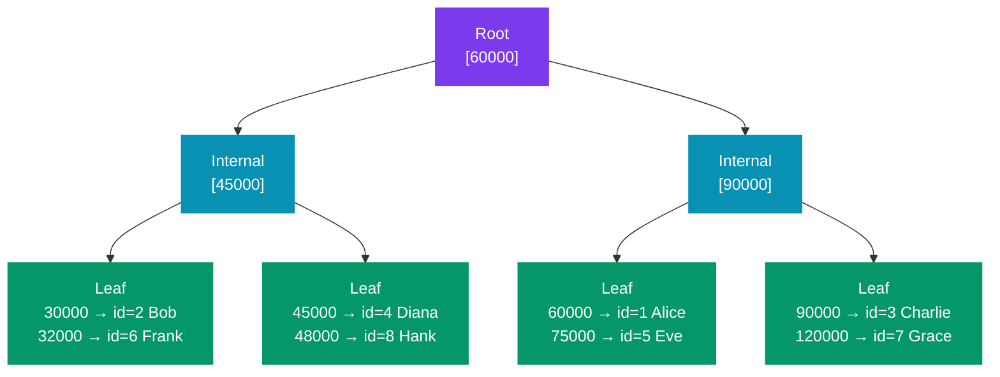

> 💡 Leaf nodes are **linked left → right** in sorted esal order (the graph above does not show this). This chain makes range scans fast. The scan does not need to go back to the root.

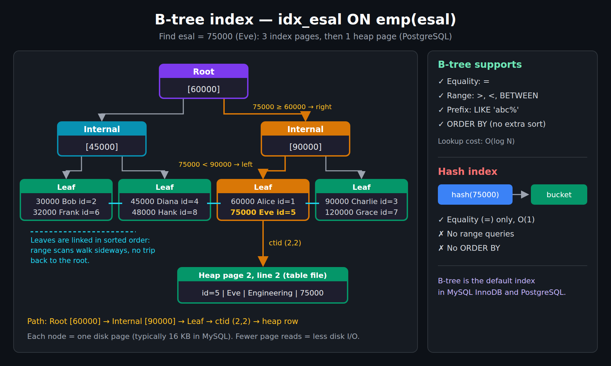

**Key properties:**
- 🌳 **Balanced** — all leaf nodes are at the same depth. This gives O(log N) lookup for any value.
- 🔗 **Leaf nodes linked** — leaf nodes are linked in order (the B+ tree variant that most DBs use). This makes range scans fast, with no trip back to the root.
- 📄 **Pages** — each node is one disk page (typically 16KB in MySQL). Goal: fewer page reads = less disk I/O.

**How a query uses the index** *(PostgreSQL — heap-organised):*

```sql
SELECT * FROM emp WHERE esal = 75000;  -- find Eve
```
1. Start at root `[60000]` — 75000 > 60000 → follow **RIGHT** pointer.
2. Read internal node `[90000]` — 75000 < 90000 → follow **LEFT** pointer.
3. Read leaf — find entry `(75000 → ctid (2,2))`. Eve found.
4. Follow the `ctid` **straight into the heap** (the table file): page 2, line pointer 2 → the full row. **This path does not use the primary key at any step.**

**B-tree vs Hash index:**
- **B-tree** supports: equality (`=`), range (`>`, `<`, `BETWEEN`), prefix (`LIKE 'abc%'`), ordering (`ORDER BY`)
- **Hash index** supports: equality (`=`) only — O(1) lookup, but no range queries

**⚠️ 🐘 vs 🐬 — keep this difference clear. Both engines use B-trees. But what a leaf *points at* is completely different:**

| | 🐘 **PostgreSQL** (heap-organised) | 🐬 **MySQL InnoDB** (clustered/index-organised) |
|---|---|---|
| Where the row physically lives | A **separate heap file**, in insertion order | **Inside the primary-key B-tree's leaf pages** — the table *is* the PK index |
| What a **PK index** leaf holds | key + `ctid` — it is *just another index* | The **entire row** — there is no separate table |
| What a **secondary index** leaf holds | key + **`ctid`** (page number, line-pointer number) | key + the **primary key value** |
| Cost of a secondary-index lookup | 1 B-tree walk **→ heap page**. One hop. | 1 B-tree walk → get PK → **a second full B-tree walk** of the PK tree |
| The name for that extra step | *(does not exist)* | **Bookmark lookup** |
| Cost of changing a PK value | Fairly cheap — PK is just an index | Expensive — **physically moves the row**, and the PK value stored in every secondary index becomes out of date |

📌 **The two one-liners to keep apart:**
- 🐘 **PG:** index → `ctid` → **straight to the heap**. *The PK plays no role.*
- 🐬 **InnoDB:** secondary → **PK value** → *second walk* of the PK B-tree → row.

💡 Each design gains one thing and loses one thing. That is why neither is "better":
- **InnoDB's clustered layout** makes **PK range scans** sequential (rows are physically in PK order). But it adds cost to every secondary lookup.
- **PG's heap** makes **all indexes equal-cost**. But no index ever returns rows in physical order. That is why PG has `CLUSTER`. The separate heap is also why index-only scans must check the visibility map.

🎯 **Interview Tip:** Know the "index cardinality" concept:
- High cardinality (many distinct values, e.g., `user_id`) makes indexes efficient.
- Low cardinality (few distinct values, e.g., `status` with 3 values) makes full table scans faster than index + random I/O.

<details>
<summary><strong>🤔 Doubt: How does this map to a real table — full walkthrough?</strong></summary>

> 🐘 **This entire walkthrough is PostgreSQL.** Everything below (heap, `ctid`, "no PK involved") describes a heap-organised table. The **InnoDB version of the exact same query** is a separate block at the end. Keep them apart while you read. Mixing them up is the most common mistake people make when they learn this topic.

**Setup:**

```sql
-- Base table emp (8 rows — see Base Tables section above)
CREATE INDEX idx_esal ON emp(esal);
```

**Rows in the heap (stored in insertion order, not sorted by esal):**

| id | name    | age | dept        | esal      | `ctid` (page, line pointer) |
|----|---------|-----|-------------|-----------|-------------------|
| 1  | Alice   | 38  | Engineering | 60000.00  | `(1,1)`    |
| 2  | Bob     | 22  | Sales       | 30000.00  | `(1,2)`    |
| 3  | Charlie | 55  | Engineering | 90000.00  | `(1,3)`    |
| 4  | Diana   | 31  | HR          | 45000.00  | `(2,1)`    |
| 5  | Eve     | 47  | Engineering | 75000.00  | `(2,2)`    |
| 6  | Frank   | 22  | Sales       | 32000.00  | `(2,3)`    |
| 7  | Grace   | 60  | Management  | 120000.00 | `(3,1)`    |
| 8  | Hank    | 31  | HR          | 48000.00  | `(3,2)`    |

The table has **no ordering**. Rows stay where they were inserted. Without an index, finding `esal = 75000` means reading all 8 rows.

> 📎 Pages are numbered from 1 here only to make it easy to read. **In real PostgreSQL, `ctid` block numbers are 0-based.** The first heap page is `(0,1)`. Run `SELECT ctid, * FROM emp;` to see the actual values.

**What `CREATE INDEX idx_esal ON emp(esal)` builds:**

The DB reads all rows and takes out `(esal, row_pointer)` pairs. It sorts them by esal and builds this B+ tree:

```
                     ┌──────────┐
                     │   Root   │
                     │ [60000]  │
                     └──────────┘
                    /            \
      ┌──────────────────┐   ┌──────────┐
      │     Internal     │   │ Internal │
      │     [45000]      │   │  [90000] │
      └──────────────────┘   └──────────┘
         /           \          /        \
 ┌────────────┐ ┌────────────┐ ┌────────────┐ ┌─────────────┐
 │    Leaf    │→│    Leaf    │→│    Leaf    │→│    Leaf     │
 │ 30000      │ │ 45000      │ │ 60000      │ │  90000      │
 │ 32000      │ │ 48000      │ │ 75000      │ │ 120000      │
 │ id=2, id=6 │ │ id=4, id=8 │ │ id=1, id=5 │ │ id=3, id=7  │
 └────────────┘ └────────────┘ └────────────┘ └─────────────┘
 (Bob, Frank)  (Diana, Hank)  (Alice, Eve)  (Charlie, Grace)
```

- **Internal nodes** — hold keys only. They are used for routing. No row data here.
- **Leaf nodes** — hold `(esal value, ctid)`. 🐘 In PostgreSQL that pointer is a **physical address**: `(page number, line pointer)`. This is true for *every* index, primary key included. (The `id=…` labels in the diagram above only show which row each entry points to. The index does **not** store `id`.)
- **Leaf nodes are linked** left → right in sorted order (the `→` arrows). This makes range scans possible.

**Query 1 — Equality: `WHERE esal = 48000`** *(🐘 PostgreSQL)*

```
1. Read Root  → key [60000]:  48000 < 60000  → go LEFT child
2. Read Internal → key [45000]:  48000 ≥ 45000 → go RIGHT child
3. Read Leaf  → entry (48000, ctid=(3,2)) — FOUND

4. Follow the ctid straight into the heap:
   (3,2) → heap page 3, line pointer 2 → Hank, 31, HR, 48000
   ↑ ONE hop. The primary key is never consulted.
```

It takes **3 page reads** to find 1 row in 8 total. At 1 million rows the tree is ~4 levels deep. That is still just 4 reads.

<details>
<summary><strong>🤔 Doubt: Are those "3 page reads" in the table file? And if the row sits on one page, why isn't it just 1 read?</strong></summary>

Many people get this wrong. The "3 page reads" are **not** in the table. They are in the **index file**. The full cost is **3 index-file reads + 1 table-file read**:

| Step | Which file | Why a page read happens |
|------|-----------|-------------------------|
| 1. Read **root** node | 📂 Index file | The root node *is* a page on disk. Its keys (`[60000]`) + child pointers exist only on that page. You must load it into memory to compare. |
| 2. Read **internal** node | 📂 Index file | The root's pointer gives only a *page number*. The internal node is not in memory until you read its page. |
| 3. Read **leaf** node | 📂 Index file | The leaf holds `(esal, ctid)`. Another page, another read. |
| 4. Fetch the **row** | 🗄️ Table (heap) file | The ctid → `(page, line-pointer)` → one heap page read → the actual row. |

So:
- The index traversal **finds the row's address** (3 reads through the tree).
- Only **then** does the single heap read **fetch the row** (the "1 page read" you were picturing).
- These are two different files.

**Why do index nodes cost reads at all if the key is "already on the node"?** Because the node lives on disk.
- The whole index is an on-disk structure of 8 KB pages, exactly like the heap.
- The CPU can only compare keys that are in memory. So the DB must load each node from disk first.
- *The key is on the node — that is exactly why you must read that node's page.*
- (In practice the root + upper levels are almost always cached in `shared_buffers`. So those are RAM reads, not physical disk seeks. Usually only the colder leaf pages cause real I/O.)

**Key point — this is why a tiny table ignores the index.** On 8 rows the whole heap is **1 page**:
- **Seq Scan:** read 1 heap page, done.
- **Index Scan:** ~3 index pages + 1 heap page = ~4 reads → *slower.*

That is exactly why `EXPLAIN` shows `Seq Scan` on small tables (see §1 Q3, Reason 1). The 3-level tree here is only an example. A real 8-row index fits in a single page. The log(N) walk only wins when the heap has many pages, so that scanning all of them costs far more than ~4 index hops.

---

</details>
<br/>

<details>
<summary><strong>🤔 Doubt: At 1M rows the tree is ~4 levels → "4 reads". Does that mean only 1 internal node is read?</strong></summary>

No. The key is to separate **levels** from **nodes per level**:

> **Page reads through the index = the tree's depth (number of levels).** You read exactly **one node (one page) per level**. It does not matter how many nodes that level holds.

A "4 levels deep" tree means:

```
Level 1:  root        ← read 1 node
Level 2:  internal    ← read 1 node   ┐  TWO internal levels,
Level 3:  internal    ← read 1 node   ┘  not one
Level 4:  leaf        ← read 1 node
```

So it's **root + 2 internal + leaf = 4 index-page reads** (+ 1 heap read for the row).
- You read *one internal node per internal level*. A 4-level tree has two of them.
- Each level contains thousands/millions of internal nodes total.
- But your search path touches only the **single** node it routes through.

**Why is a 1M-row tree only ~3–4 levels at all? Fanout** (the number of children per node). An 8 KB index page holds *hundreds* of entries. A key + child pointer is ~20–40 bytes → ~200–400 per page. So each level multiplies the number of reachable entries by a few hundred:

```
Root      → ~300 children
Level 2   → 300 × 300      ≈ 90,000
Level 3   → 300 × 90,000   ≈ 27,000,000   ← already past 1M
```

In practice **3 levels covers ~1M rows**. The "~4" in this doc is a safe round number. Depth grows **logarithmically**, so even billions of rows stay at ~4–5 levels. This is the main reason B-trees are the default index.

> ⚠️ "Still just 4 reads" counts **index levels** only. Fetching the row adds **1 heap read** (~4 index + 1 heap). Also, root + upper internal pages are nearly always cached in `shared_buffers`. So *physical* disk reads are usually fewer: just the cold leaf page + heap page.

---

</details>
<br/>

**Query 2 — Range: `WHERE esal BETWEEN 45000 AND 75000`** *(🐘 PostgreSQL)*

```
1. Traverse tree to the leaf containing esal=45000  (same 3 reads as above)
2. Walk the linked leaf chain rightward:
   Leaf [45000,48000] → next leaf [60000,75000] → next leaf [90000,...] ← 90000 > 75000, STOP

3. Collected ctids → then one heap fetch each:
   45000 → ctid (2,1)  (Diana)
   48000 → ctid (3,2)  (Hank)
   60000 → ctid (1,1)  (Alice)
   75000 → ctid (2,2)  (Eve)
```

No need to go back to the root. The linked leaves are already sorted. The DB just scans forward until it leaves the range. This is why B-tree indexes are efficient for `BETWEEN`, `>`, `<`, and `ORDER BY`.

> ⚠️ Note the ctids land on pages 2, 3, 1, 2. They are **sorted by key, but scattered on disk**. This random order explains two things:
> - The planner switches to a Seq Scan once enough rows match (§1 Q3, Reason 2).
> - PG offers a **Bitmap Heap Scan**: collect all ctids first, sort them into physical page order, *then* fetch each page once.

**🐬 The same query on MySQL InnoDB — a different second hop**

> Everything above was PostgreSQL. Read this block **separately**, not as a continuation. Same B-tree, same three index-page reads. **Only the last step is different.**

In InnoDB the **primary key index IS the table**. Its leaf nodes store the full row. So there is no heap and no `ctid` to point at:

```
Primary key (clustered) index leaf:  [ id=8 | Hank | 31 | HR | 48000 ]  ← the ROW itself
Secondary index (idx_esal) leaf:     [ esal=48000 | id=8 ]              ← esal + PK VALUE
```

`WHERE esal = 48000` therefore costs **two full B-tree walks:**

```
1. Walk idx_esal   → root → internal → leaf → (esal=48000, id=8)
                                               ↑ a PK VALUE, not an address

2. Walk the PK B-tree with id=8 → root → internal → leaf → the row
   ↑ THE SECOND WALK — this is the "bookmark lookup"
```

**Side by side, one line each:**

| Engine | Path for `WHERE esal = 48000` |
|---|---|
| 🐘 PostgreSQL | `idx_esal` → **`ctid (3,2)`** → heap page 3 · **one hop, no PK** |
| 🐬 InnoDB | `idx_esal` → **`id=8`** → **walk the PK B-tree again** → row · **two tree walks** |

A **covering index** removes the second step on *both* engines. Suppose the secondary index already carries every column the query needs. Then:
- InnoDB skips the bookmark lookup.
- PG skips the heap fetch (an Index-Only Scan, subject to the visibility map — see §1 Q4).

> 🧠 **Memory tip if you keep mixing these up:** *Postgres points at a **place**; InnoDB points at a **key**.* A place you can go to directly (one hop). A key you have to look up (a second search).

---

</details>
<br/>

---

</details>

---

2. **📊 What types of indexes exist and when do you use each? 🔥🔥**

<!-- -->
<details>
<summary>Answer</summary>

**Answer:**

| Index Type | Description | Example | Use Case |
|-----------|-------------|---------|---------|
| **B-tree** (default) | Balanced tree, sorted. Supports equality, range, ORDER BY | `CREATE INDEX idx_esal ON emp (esal);` | Most query patterns |
| **Hash** | O(1) exact match. No range support | `CREATE INDEX idx_dept_h ON emp USING HASH (dept);` | Memory tables, exact-match caches |
| **Composite (multi-column)** | Index on (col1, col2, col3). **Equality columns first, range columns last** (not "most selective first" — see below) | `CREATE INDEX idx_dept_esal ON emp (dept, esal);` | Queries filtering on multiple columns |
| **Covering** | Index includes all columns needed by a query | `CREATE INDEX idx_dept_covering ON emp (dept, id, esal);` | Avoid table row fetch — "index-only scan" |
| **Partial** | Index on a subset of rows (PostgreSQL: `WHERE status = 'ACTIVE'`) | `CREATE INDEX idx_eng ON emp (esal) WHERE dept = 'Engineering';` | Index only rows you actually query |
| **Full-text** | Inverted index for text search | `CREATE INDEX idx_ft ON docs USING GIN (to_tsvector('english', body));` | Document search with `@@ to_tsquery(...)` (MySQL: `FULLTEXT` index + `MATCH...AGAINST`) |
| **Spatial (GIS)** | R-tree for geometry/geo data | `CREATE INDEX idx_geo ON places USING GIST (location);` | Location queries, proximity search |
| **Expression** | Index on `LOWER(email)` or `(year * 100 + month)` | `CREATE INDEX idx_lname ON emp (LOWER(name));` | Queries with functions on columns |

**Composite index — left-prefix rule:**

```sql
CREATE INDEX idx_dept_esal ON emp (dept, esal);
```

This index is useful for:
```sql
WHERE dept = 'Engineering'                              -- ✅ leftmost column only
WHERE dept = 'Engineering' AND esal > 50000            -- ✅ both columns
WHERE esal > 50000                                     -- ⚠️ skips leftmost — cannot SEEK
```

🧠 **The phone-book example:** a directory sorted by (surname, given name) lets you find "Smith", and "Smith, John". It does not help you find everyone named "John". You would read every page. That is the leftmost prefix.

> ⚠️ **The third line is usually taught as "❌️ full scan". That claims too much.**
> - Skipping the leading column means the index **cannot be *seeked*** (you cannot jump straight to a key). It does not mean the index can never be *used*.
> - PostgreSQL may still do a **full index scan** (read every leaf, filter on `esal`) when the index is much narrower than the heap.
> - **PG 18 added B-tree skip scan.** **MySQL 8.0.13+** has index skip scan too. It works only when the query reads just index columns and has a range condition on the later column.
>
> The safe way to say it: *"it cannot seek on the leftmost column, so it usually falls back to a sequential scan."*

**🎚️ Column ORDER — the rule that really decides (and the myth that doesn't):**

The common advice "put the most selective column first" is **wrong as a primary rule**. Two rules really decide, in this order:

1. **Leftmost-prefix must match the query's `WHERE`.** If the query can't enter the index, the index is useless, whatever its selectivity.
2. **Equality columns before range columns.** A range predicate (`>`, `<`, `BETWEEN`, `LIKE 'x%'`) **stops the seek**. Every column after it in the key can only be a filter, never a seek boundary.

```sql
-- Query: WHERE status = 'ACTIVE' AND created_at > '2026-01-01'
CREATE INDEX idx_ok  ON loans (status, created_at);   -- ✅ seek status, then RANGE-scan created_at
CREATE INDEX idx_bad ON loans (created_at, status);   -- ❌️ range first → status is only a Filter
```

`idx_ok` wins **even if `created_at` is far more selective than `status`**.
- Selectivity is only a **tie-breaker**. It decides between columns that play the same role (both equality, both in the predicate).
- It is never the main rule.
- §1 Q3's *Index Cond vs Filter* discussion is the same idea, seen in the plan output.

**Covering index example:**
```sql
-- Query: needs id, esal — both can come from the index, no heap fetch needed
SELECT id, esal FROM emp WHERE dept = 'Engineering';

-- Without covering index: scan idx_dept for dept, then fetch each row for esal
CREATE INDEX idx_dept ON emp (dept);

-- With covering index: index has all needed columns → Index Only Scan
CREATE INDEX idx_dept_covering ON emp (dept, id, esal);
-- PostgreSQL: "Index Only Scan" — skips the heap for all-visible pages → fewer page reads
```

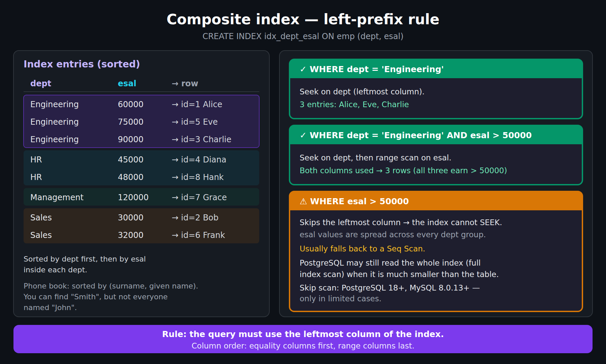

**Partial index example:**
```sql
-- Only 3 of 8 rows are in Engineering — index just those rows
CREATE INDEX idx_eng_esal ON emp (esal) WHERE dept = 'Engineering';
-- Queries: WHERE dept = 'Engineering' AND esal > 60000 → tiny index scan
```

<details>
<summary><strong>🤔 Doubt: How is a partial index maintained when rows are inserted/updated to enter or leave the predicate?</strong></summary>

The DB checks the `WHERE dept = 'Engineering'` predicate again on **every write**. This decides if the row belongs in the index:

| Write | Effect on `idx_eng_esal` |
|-------|--------------------------|
| INSERT row with `dept='Engineering'` | Predicate true → entry **added** |
| INSERT row with `dept='Sales'` | Predicate false → **no** entry (the space-saving point) |
| UPDATE `'Engineering'` → `'Sales'` | No longer qualifies → entry **removed** |
| UPDATE `'Sales'` → `'Engineering'` | Now qualifies → entry **added** |

So a row moves in and out of the index based only on the predicate. Three details:

**1. The predicate column ≠ the indexed column.** The key here is `esal`, but the predicate is on `dept`. Postgres still tracks `dept` as a column this index depends on. That is why changing `dept` triggers index maintenance, even though `dept` isn't the sorted key.

**2. "Remove + insert" is MVCC, not in-place editing.**
- An `UPDATE` writes a **new tuple version** (new ctid).
- If it qualifies, a new index entry points at the new ctid.
- The old entry becomes a **dead pointer**. It stays until `VACUUM` reclaims it.
- "Removed" = marked dead, cleaned later. It is not gone at once.

**3. HOT-update interaction.** A **HOT (Heap-Only Tuple)** update skips index maintenance entirely. But this happens only if **no indexed-or-predicate column changed** *and* the new tuple fits on the same page.
- Changing `dept` touches this index's predicate → no HOT.
- Changing `esal` touches its key → no HOT.
- You'd only get HOT here by updating an unrelated column (e.g. `age`) on the same page.

---

</details>
<br/>

**Expression index example:**
```sql
CREATE INDEX ON emp (LOWER(name));
-- Enables: WHERE LOWER(name) = 'alice'  → uses index
-- Without this, LOWER(name) bypasses any regular idx on name
```

**When NOT to add an index:**
- ❌️ Low-cardinality columns (`dept` with 4 values) — full scan is faster
- ❌️ Columns rarely used in WHERE/JOIN/ORDER BY
- ❌️ Tables with very heavy writes and few reads — index maintenance overhead
- ❌️ Small tables — full scan is trivially fast anyway

🎯 **Interview Tip:** A query on `WHERE LOWER(name) = 'alice'` will NOT use a plain index on `name`. The function prevents index use. Fix: create an expression index `CREATE INDEX ON emp (LOWER(name))`.

> 💡 **An expression index is not the only fix, and often not the best one.** Any function around an indexed column stops the seek. But if the function is just a *date truncation*, **rewrite the predicate as a range**. Then the existing plain index works unchanged:
>
> ```sql
> -- ❌️ YEAR() wraps the column → no seek on idx(joining_date)
> SELECT * FROM emp WHERE YEAR(joining_date) = 2021;
>
> -- ✅ half-open range → plain B-tree index on joining_date seeks normally
> SELECT * FROM emp WHERE joining_date >= '2021-01-01' AND joining_date < '2022-01-01';
> ```
>
> Prefer the rewrite:
> - It adds no index to maintain.
> - It works for *any* date window, not just whole years.
>
> Use an expression index only when you cannot write the transformation as a range (`LOWER(email)`, `(year * 100 + month)`).
>
> Use a **half-open** range (`>= … < …`), not `BETWEEN '2021-01-01' AND '2021-12-31'`. The `BETWEEN` form silently drops rows on a `TIMESTAMP` column. For example, `2021-12-31 14:00` falls outside the closed upper bound.

---

</details>

---

3. **🔍 How do you use EXPLAIN / EXPLAIN ANALYZE to optimize a query? 🔥🔥**

<!-- -->
<details>
<summary>Answer</summary>

**Answer:**

`EXPLAIN` shows the **query execution plan**: how the database plans to run a query. `EXPLAIN ANALYZE` actually runs the query and shows real execution times.

**Step 1 — no index (Seq Scan):**
```sql
EXPLAIN ANALYZE
SELECT * FROM emp WHERE dept = 'Engineering' ORDER BY esal DESC;
```

```
QUERY PLAN                                                                                          |
----------------------------------------------------------------------------------------------------+
Sort  (cost=14.01..14.02 rows=2 width=220) (actual time=0.031..0.032 rows=3 loops=1)                |
  Sort Key: esal DESC                                                                               |
  Sort Method: quicksort  Memory: 25kB                                                              |
  ->  Seq Scan on emp  (cost=0.00..14.00 rows=2 width=220) (actual time=0.010..0.012 rows=3 loops=1)|
        Filter: ((dept)::text = 'Engineering'::text)                                                |
        Rows Removed by Filter: 5                                                                   |
Planning Time: 0.276 ms                                                                             |
Execution Time: 0.048 ms                                                                            |
```

<details>
<summary><strong>🤔 Doubt: I created the index but EXPLAIN still shows Seq Scan — why?</strong></summary>

The PostgreSQL planner is **cost-based**. It picks the plan with the lowest estimated cost, not the one that uses an index. For tiny tables it almost always prefers Seq Scan.

**Reason 1 — Table is too small (most common)**

With 8 rows, the entire table fits in a single page. Reading that one page sequentially costs less than:
1. Reading the index file (another page)
2. Following `ctid` pointers back to the heap (random I/O)

The planner correctly chooses Seq Scan. The index **will** be used once the table grows to thousands of rows.

**Reason 2 — Low selectivity**

`dept = 'Engineering'` matches 3 out of 8 rows (37.5%). When a large share of rows match, random index jumps cost more than one straight sequential read. The planner avoids the index on purpose.

**Reason 3 — Stale statistics**

The planner depends on column statistics that `ANALYZE` collects. If statistics are out of date (e.g. after a bulk insert), it may get row counts wrong and pick the wrong plan.

```sql
ANALYZE emp;   -- recomputes statistics → planner re-evaluates
```

**Reason 4 — `random_page_cost` too high**

PostgreSQL defaults to `random_page_cost = 4.0` (it assumes a spinning disk). On SSDs, random I/O is nearly as fast as sequential. A lower value makes the planner more willing to use indexes:

```sql
SET random_page_cost = 1.1;  -- SSD-appropriate value
```

**Force index for testing (never in production):**

```sql
SET enable_seqscan = off;
EXPLAIN ANALYZE SELECT * FROM emp WHERE dept = 'Engineering' ORDER BY esal DESC;
-- Now shows Index Scan — confirms the index is valid and usable
SET enable_seqscan = on;   -- always reset after testing
```

**Summary:**

| Root cause | Fix |
|---|---|
| Table too small | No fix needed — the planner starts using the index as the table grows |
| Stale statistics | `ANALYZE tablename` |
| High `random_page_cost` on SSD | `SET random_page_cost = 1.1` |
| Low selectivity (many rows match) | Add a more selective index or accept Seq Scan |

---

</details>
<br/>

**Step 2 — add composite index, re-run:**
```sql
CREATE INDEX idx_dept_esal ON emp (dept, esal DESC);

-- EXPLAIN ANALYZE now shows (on a table with many pages — on the 8-row demo
-- table the planner still picks Seq Scan, see the Doubt above):
-- Index Scan using idx_dept_esal on emp  (cost=0.14..0.20 rows=3)
--   (actual time=0.010..0.014 rows=3)   ← Seq Scan gone, Sort node gone
```

The Sort node disappears because the index already delivers rows in `esal DESC` order.

**Warning signs to look for:**

| Indicator | Problem | Fix |
|-----------|---------|-----|
| `Seq Scan` on large table | No usable index | Add index on filtered columns |
| `Rows Removed by Filter: N` | Index not selective | Better composite or partial index |
| High `cost` nodes | Expensive operations | Rewrite query, add index |
| `Sort` node | Sorting in memory/disk | Index on ORDER BY column |
| `Hash Join` with large hash | Large join, possibly missing index | Index on join column |
| `actual rows` >> `estimated rows` | Stale statistics | Run `ANALYZE tablename` |

**🔗 The three join nodes — the most common `EXPLAIN` follow-up question**

*"The plan shows a Hash Join. Why didn't the planner use a Nested Loop?"* You need to know all three, and the kind of input each one wants:

| Join node | How it works | Planner picks it when | Cost shape |
|---|---|---|---|
| **Nested Loop** | For each row of the outer input, probe the inner input | Outer side is **small** *and* the inner side has an **index on the join key** | `O(outer × index_lookup)` — very slow if the outer estimate is wrong |
| **Hash Join** | Build a hash table from the smaller side, then stream the larger side through it | **Large, unsorted, equi-join** (`=` only) | `O(build + probe)` — one pass each; ⚠️ **`=` only**, never for `<`/`>`/range joins |
| **Merge Join** | Advance two **sorted** streams in lockstep | Both inputs already sorted on the join key (index scans, or an earlier `ORDER BY`) | `O(n + m)` if sorted; add sort cost if not |

```
-- Small outer, indexed inner → Nested Loop is right, not a bug:
Nested Loop  (cost=0.29..16.34 rows=3)
  ->  Seq Scan on dept_budget       (rows=4)             ← tiny outer
  ->  Index Scan using idx_dept on emp  (rows=1 loops=4) ← 4 index probes total
```

⚠️ **The failure modes. This is what the question really tests:**
- **Nested Loop with a bad estimate** is the classic production failure.
  - The planner thought the outer side was 10 rows. It was 500,000.
  - The plan silently became 500,000 index probes.
  - Symptom: `rows=10` vs `actual rows=500000` on the outer node.
- **Hash Join spilling to disk.** The hash table must fit in **`work_mem` × `hash_mem_multiplier`** (4 MB × 2.0 = 8 MB by default since PG 15).
  - Past that, PG splits it into disk batches. Look for `Batches: 8  Memory Usage: 4096kB` (`Batches: 1` = it stayed in RAM).
  - The fix is more `work_mem` **per operation**, or fewer rows reaching the join.
  - `work_mem` is not a global budget. A complex plan can use it many times, per node *and* per parallel worker.
- The planner rarely chooses **Merge Join** unless an index already gives the sorted order. Otherwise the explicit `Sort` node usually makes Hash Join cheaper.
- 🐬 **MySQL:** in the past, only Nested Loop (`Block Nested-Loop`). **Hash join arrived in 8.0.18**, and there is still no merge join. So "why not a merge join?" is a PostgreSQL question.

**MySQL EXPLAIN columns:**

| Column | What to check |
|--------|--------------|
| `type` | `ALL` = full scan (bad), `ref`/`range`/`eq_ref` = index use (good) |
| `key` | Which index is being used (`NULL` = no index) |
| `rows` | Estimated rows examined — lower is better |
| `Extra` | `Using filesort` (expensive sort), `Using index` (covering index — good) |

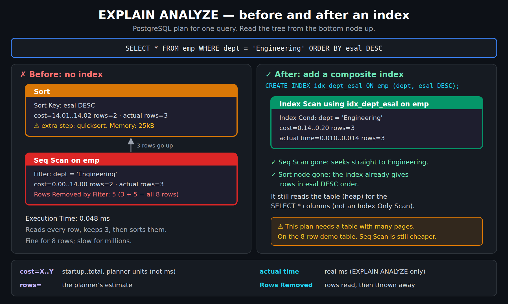

🎯 **Interview Tip:** Always run `EXPLAIN ANALYZE` (not just `EXPLAIN`) on production queries before you release them. Use a realistic data set. When statistics are stale, the estimated plan can be very different from the actual plan. Add this to your PR checklist for any query on tables with > 100K rows.

<details>
<summary><strong>🤔 Doubt: What is the difference between EXPLAIN and EXPLAIN ANALYZE — with a concrete example?</strong></summary>

**`EXPLAIN`** — plans the query, never runs it. Shows **estimated** costs only.

```sql
EXPLAIN SELECT * FROM emp WHERE age = 31;
```
```
Seq Scan on emp  (cost=0.00..1.10 rows=1 width=118)
                   ↑           ↑      ↑        ↑
              startup       total  estimated  avg row
                cost        cost    rows      bytes
```

- `cost=0.00..1.10` — planner's estimate of work (in planner cost units, not milliseconds)
- `rows=1` — planner guesses 1 row will match (stats are stale here; the table has never been `ANALYZE`d)
- **No query ran. No real data.** It takes microseconds. There is **no `actual time` and no `Rows Removed by Filter` line**, because nothing ran.

**`EXPLAIN ANALYZE`** — actually runs the query, then shows plan + real timings side by side.

```sql
EXPLAIN ANALYZE SELECT * FROM emp WHERE age = 31;
```
```
Seq Scan on emp  (cost=0.00..1.10 rows=1 width=118)
                 (actual time=0.021..0.025 rows=2 loops=1)
                  ↑                       ↑
           real wall-clock time      actual rows returned

Filter: (age = 31)
Rows Removed by Filter: 6

Planning Time: 0.08 ms
Execution Time: 0.04 ms
```

- `actual time=0.021..0.025` — real ms: 0.021ms to first row, 0.025ms total
- `rows=2` — 2 rows actually matched (Diana and Hank, both age 31 — the planner estimated 1)
- `Rows Removed by Filter: 6` — the node read the other 6 of the 8 `emp` rows and threw them away. **2 matched + 6 removed = 8 = the whole table.**
  - These two numbers must always add up to the rows the node actually read.
  - If they don't, you are reading a plan from a different query than you think.
- **Query actually ran** — never use `EXPLAIN ANALYZE` on `UPDATE`/`DELETE` in production unless you wrap it in a transaction you will rollback

**Side-by-side comparison:**

| | `EXPLAIN` | `EXPLAIN ANALYZE` |
|---|---|---|
| Runs the query? | ❌️ No | ✅ Yes |
| Shows estimated plan? | ✅ | ✅ |
| Shows actual time / rows? | ❌️ | ✅ |
| Safe on prod? | ✅ Always | ⚠️ Safe for `SELECT` only |
| Use case | Quick plan check | Diagnosing actual slow queries |

**When estimates differ from actuals — stale statistics:**

Say the planner says `rows=5` but actual is `rows=48000`. Then the planner chooses the wrong plan because its data is wrong. Fix:

```sql
ANALYZE emp;   -- recomputes column statistics for the planner
-- or
VACUUM ANALYZE emp;  -- reclaims dead tuples + updates statistics
```

---

</details>
<br/>

---

</details>

---

4. **🔢 What is a covering index and what is an index-only scan? 🔥**

<!-- -->
<details>
<summary>Answer</summary>

**Answer:**

A **covering index** is an index that has every column a query needs. So the database can answer the query fully from the index. It does not need to read the actual table rows.

**Why it matters:**
- Regular index lookup: read index page → get row pointer → read table page (random I/O — possibly thousands of disk reads)
- Index-only scan: read index page → done (no table access)

**Example:**

```sql
-- Query: employee IDs and salaries for Engineering dept
SELECT id, esal FROM emp WHERE dept = 'Engineering';

-- Without covering index: index on dept → fetch each row to get esal
CREATE INDEX idx_dept ON emp (dept);
-- Plan: Index Scan on idx_dept → heap fetch for esal on each row

-- With covering index: index already has id and esal → no heap fetch
CREATE INDEX idx_dept_covering ON emp (dept, id, esal);
-- Plan: Index Only Scan — esal and id are in the index → 0 table reads (if all pages are all-visible)
```

**PostgreSQL visibility map:** In PostgreSQL, an Index Only Scan skips the heap only for pages marked all-visible in the visibility map. All-visible means every tuple on the page is visible to all transactions. For other pages it still reads the heap. `EXPLAIN ANALYZE` shows these as `Heap Fetches: N`. After many writes/deletes, run `VACUUM`. It updates the visibility map and makes index-only scans possible again.

**When to use covering indexes:**
- ✅ High-frequency read queries on large tables
- ✅ Report queries that SELECT specific columns from a large filtered result set
- ✅ APIs with predictable, fixed query patterns

**Trade-off:**
- ❌️ Wider indexes = more storage, slower writes (the database must update the index on every write to a covered column)
- ❌️ Too many covering indexes hurt write-heavy tables — add them only for busy read paths

🎯 **Interview Tip:** The `INCLUDE` clause exists in **PostgreSQL 11+** (and SQL Server). It lets you add non-key columns to an index only for covering. It does not change the index sort order: `CREATE INDEX idx_dept ON emp (dept) INCLUDE (id, esal);` ⚠️ MySQL/InnoDB has **no `INCLUDE`**. There, you make the composite key wider instead. InnoDB gets part of this without extra work, because every secondary index already carries the primary key.

<details>
<summary><strong>🤔 Doubt: What is the difference between INCLUDE and listing all columns as key columns?</strong></summary>

```sql
-- Option A — INCLUDE (non-key columns)
CREATE INDEX idx_dept ON emp (dept) INCLUDE (id, esal);

-- Option B — composite key (all columns as key columns)
CREATE INDEX idx_dept_covering ON emp (dept, id, esal);
```

**How the B-tree stores them differently:**

| | Option A — INCLUDE | Option B — Composite key |
|---|---|---|
| Key columns | `dept` only | `dept`, `id`, `esal` |
| Internal nodes store | `dept` only | `dept` + `id` + `esal` |
| Leaf nodes store | `dept` + `id` + `esal` | `dept` + `id` + `esal` |
| Sort order | By `dept` only | By `dept`, then `id`, then `esal` |

**What Option A (INCLUDE) can do:**

- ✅ `WHERE dept = 'Engineering'` → Index Scan
- ✅ `SELECT id, esal WHERE dept = 'Engineering'` → Index-Only Scan (no heap fetch)
- ⚠️ `WHERE dept = 'Engineering' AND id = 5` — `id` is not a key, so it can't be an **Index Cond** (no B-tree seek by `id`).
  - The index seeks `dept='Engineering'`. Then the database applies `id = 5` as a **Filter** over only those matching entries.
  - This is *not* a Seq Scan of the table. In an **Index-Only Scan**, the value comes from the `INCLUDE` payload, so no heap fetch is needed to test it. In a plain **Index Scan**, PostgreSQL fetches each heap row first and then tests `id = 5`.
  - Fine when `dept` matches a few rows. Costly when it matches millions.
- ❌️ `ORDER BY esal` — `esal` is not ordered in the index

**What Option B (composite key) can do:**

- ✅ `WHERE dept = 'Engineering'` → Index Scan
- ✅ `SELECT id, esal WHERE dept = 'Engineering'` → Index-Only Scan
- ✅ `WHERE dept = 'Engineering' AND id = 5` — both are key columns, index used
- ✅ `ORDER BY dept, id` — index already sorted this way, no Sort node in plan
- ❌️ `ORDER BY esal` alone — `esal` is the 3rd key. The index can use it only after `dept` and `id` are fixed

**Why use INCLUDE at all, then?**

Because internal nodes are **smaller**. In Option A, internal nodes store only `dept`. So:
- more keys fit in one page,
- the tree has fewer levels,
- traversal is faster.

When `id` and `esal` are wide columns, this difference is large on big tables.

**Simple rule:**
- Use `INCLUDE` when you only need columns for **projection** (SELECT) — not for filtering or sorting.
- Use composite key when you need columns for **filtering** (`WHERE`) or **ordering** (`ORDER BY`).

---

</details>
<br/>

---

</details>

---

5. **❓ What is the N+1 query problem and how do you fix it at the database level? 🔥🔥**

<!-- -->
<details>
<summary>Answer</summary>

**Answer:**

The **N+1 problem** happens like this:
- You fetch a list of N entities (1 query).
- Then you run 1 more query per entity to fetch its associated data.
- The result is N+1 database queries in total, instead of 1 or 2.

**Entity relationship:**

```java
@Entity
public class Emp {
    @Id private Integer id;
    private String name;
    private Integer age;
    private String dept;
    private BigDecimal esal;

    @ManyToOne(fetch = FetchType.LAZY)
    @JoinColumn(name = "dept", referencedColumnName = "dept",
                insertable = false, updatable = false)
    private DeptBudget deptBudget;
}

@Entity
public class DeptBudget {
    @Id private String dept;
    private BigDecimal budget;
}
```

**The N+1 scenario:**

```java
// Bad: N+1 problem
List<Emp> employees = empRepository.findAll();            // Query 1 gives 8 employees
for (Emp emp : employees) {
    // Lazy loading: a query fires the first time each DISTINCT dept is touched
    System.out.println(emp.getDeptBudget().getBudget());  // Queries 2 – 5
}
// Total: 1 + 4 = 5 queries — one per DISTINCT dept, not one per employee.
```

⚠️ **Be exact about the "N". An interviewer who knows Hibernate well asks this follow-up.**

`N` is the number of **distinct association keys touched**, not the number of parent rows.
- `deptBudget` is a `@ManyToOne` to an entity with only **4** ids.
- Once `DeptBudget#Engineering` is loaded, it stays in the **persistence context (first-level cache)**, keyed by `(DeptBudget, "Engineering")`.
- The other two Engineering employees find it in that cache and run **no** query.

| Scenario | Queries |
|---|---|
| 8 employees, 4 distinct depts (our table) | 1 + **4** = 5 |
| 10,000 employees, still 4 distinct depts | 1 + **4** = 5 — *not* 10,001 |
| 10,000 employees, `@OneToMany List<Payment>` per employee | 1 + **10,000** = 10,001 ✅ the textbook shape |
| 10,000 employees, `@ManyToOne` with a distinct FK each | 1 + **10,000** = 10,001 |

📌 **So `N+1 = 1 + N-parents` is true only when the association is in practice unique per parent.** That means a `@OneToMany` collection, or a `@ManyToOne` whose FK differs on every row.
- With a low-cardinality FK (few distinct values), the child table's size limits the damage.
- It is still an N+1. It is still one round trip per key, and the four fixes below still fix it.
- But don't quote the too-large number. The interviewer will ask you to justify it.

**Fix 1 — JOIN FETCH (JPQL):**
```java
@Query("SELECT e FROM Emp e JOIN FETCH e.deptBudget")
List<Emp> findAllWithDeptBudget();
// Single query: SELECT e.*, d.* FROM emp e JOIN dept_budget d ON e.dept = d.dept
// ⚠️ JOIN FETCH is an INNER join: an employee with no dept_budget row is dropped.
//    Use LEFT JOIN FETCH to keep them.
```

**Fix 2 — @EntityGraph (Spring Data JPA):**
```java
@EntityGraph(attributePaths = {"deptBudget"})
List<Emp> findAll();
// Hibernate adds a LEFT OUTER JOIN fetch automatically — no JPQL needed
```

**Fix 3 — Batch fetching (@BatchSize):**
```java
// For a @ManyToOne, put @BatchSize on the TARGET entity class.
// On the @ManyToOne field itself, Hibernate ignores it.
@Entity
@BatchSize(size = 10)
public class DeptBudget {
    @Id private String dept;
    private BigDecimal budget;
}
// Hibernate: SELECT * FROM dept_budget WHERE dept IN ('Engineering', 'Sales', 'HR', 'Management')
// (Hibernate 6.2+ on PostgreSQL sends the same keys as one array: WHERE dept = any (?))
```

(For a `@OneToMany` collection, `@BatchSize` goes on the collection field.)

<details>
<summary><strong>🤔 Doubt: Does batch size = 10 mean max 10 unique dept values per IN query — and the rest go in the next batch?</strong></summary>

Yes, exactly. `@BatchSize(size = 10)` means at most 10 **unloaded association keys** go into one `IN (...)` query. What counts is **unloaded unique foreign key values**, not rows.

**With the base table (8 employees, 4 distinct depts, batch size 10):**

All 4 depts fit in one batch → 1 query:
```sql
SELECT * FROM dept_budget WHERE dept IN ('Engineering', 'Sales', 'HR', 'Management');
```

**With 25 employees, 25 distinct depts, batch size 10:**

```sql
-- Batch 1
SELECT * FROM dept_budget WHERE dept IN (dept1, dept2, ..., dept10);   -- 10
-- Batch 2
SELECT * FROM dept_budget WHERE dept IN (dept11, dept12, ..., dept20); -- 10
-- Batch 3
SELECT * FROM dept_budget WHERE dept IN (dept21, dept22, ..., dept25); -- 5
-- Total: 3 queries instead of 25
```

**How to pick the right size:**

Set `@BatchSize` equal to, or a bit larger than, the most distinct association values you expect in one request. For `dept_budget` (4 depts), even `size = 5` covers it. For associations where the number of distinct values is hard to predict, a common safe default is `size = 20` or `size = 50`.

**Key distinction vs JOIN FETCH:**

| | JOIN FETCH | @BatchSize |
|---|---|---|
| Fetch timing | Eager — loads everything upfront in one JOIN | Lazy — loads only when first touched |
| Query count | Always 1 query | 1 batch `IN` query per N keys accessed |
| Memory | All associations loaded even if never used | Loads only what's actually accessed |
| Best for | Small result sets, association always needed | Large collections, association not always needed |

---

</details>
<br/>

**Fix 4 — DTO projection (most efficient for read-only):**
```java
@Query("SELECT new com.example.EmpSummaryDTO(e.name, e.esal, d.budget) " +
       "FROM Emp e JOIN e.deptBudget d")
List<EmpSummaryDTO> findEmpSummaries();
// Single query, returns only name/esal/budget — no entity hydration overhead
```

**Detection in Spring Boot:**

Add this to `application.yml` to log all SQL and catch N+1 in development:
```yaml
spring.jpa.show-sql: true
logging.level.org.hibernate.SQL: DEBUG
logging.level.org.hibernate.type.descriptor.sql: TRACE   # Hibernate 5 — bind values
logging.level.org.hibernate.orm.jdbc.bind: TRACE          # Hibernate 6 — bind values
```

Or use **Hypersistence Optimizer** / **Sniffy** for automated N+1 detection in tests.

🎯 **Interview Tip:** The N+1 problem is one of the most common Hibernate interview topics. Know all four fixes, and explain when each one fits:
- JOIN FETCH for small result sets
- @EntityGraph for the same effect on a Spring Data method, without writing JPQL
- @BatchSize for lazy associations with many entities
- DTO projection for read-only reports

---

</details>

---

6. **💡 What is the read/write trade-off of database indexes? 🔥**

<!-- -->
<details>
<summary>Answer</summary>

**Answer:**

Every index makes reads faster. The cost is slower writes and more storage.

**Impact of indexes on writes:**

| Operation | Without Index | With Index (per index) |
|-----------|--------------|----------------------|
| `INSERT` | Write one row | Write row + update index B-tree |
| `UPDATE` (indexed column) | Update row | Update row + update old + new index entries |
| `DELETE` | Mark row deleted | PG: no index work now, `VACUUM` removes the entry later. InnoDB: delete-mark the entry, purge removes it later |

**Rough rule (not a measured number):** Each extra index adds real work to every write. People often quote ~10-20% per index. The true cost depends on the index type, row size and workload, so measure it on your own system.

**When indexes hurt more than help:**
```sql
-- Bulk-loading employees (e.g., annual salary import):
-- Without indexes: fast (just append rows to emp)
-- With idx_dept_esal + idx_eng_esal: 2 B-tree updates per row → slower

-- Pattern: drop secondary indexes → bulk insert → recreate (PostgreSQL)
DROP INDEX idx_dept_esal, idx_eng_esal;
COPY emp FROM '/path/emp_import.csv' WITH (FORMAT csv, HEADER true);
CREATE INDEX idx_dept_esal ON emp (dept, esal);
CREATE INDEX idx_eng_esal  ON emp (esal) WHERE dept = 'Engineering';
```

```sql
-- 🐬 MySQL InnoDB equivalent
-- ⚠️ NOT `ALTER TABLE ... DISABLE KEYS` — MySQL documents that as MyISAM-only;
--    on InnoDB it is a silent no-op (you get a "storage engine doesn't support" note).
SET autocommit = 0;
SET unique_checks = 0;      -- skip per-row uniqueness validation
SET foreign_key_checks = 0; -- skip per-row FK validation
-- (drop secondary indexes explicitly if you want to skip their maintenance too)
LOAD DATA INFILE '/path/emp_import.csv' INTO TABLE emp;
COMMIT;
SET unique_checks = 1;
SET foreign_key_checks = 1;
-- then recreate the secondary indexes
```

**Unused indexes are pure overhead:**
```sql
-- PostgreSQL: find indexes on emp that have never been scanned
-- ⚠️ Column names matter: pg_stat_user_indexes exposes relname / indexrelname.
--    `tablename` / `indexname` belong to the pg_indexes VIEW — using them here
--    throws: ERROR: column "indexname" does not exist
SELECT relname AS table_name, indexrelname AS index_name, idx_scan
FROM pg_stat_user_indexes
WHERE relname = 'emp' AND idx_scan = 0 AND indexrelname NOT LIKE '%pkey%';
-- Any index with idx_scan = 0 since last stats reset is a candidate for removal
-- (check pg_stat_reset time first — a recently reset counter proves nothing)
```

**🧹 Fragmentation and rebuilds — the maintenance half of the trade-off:**

Many `UPDATE`/`DELETE` statements leave index pages partly empty. This is called bloat. The same logical rows then spread over more pages, so every scan does more I/O. A rebuild packs the rows into fewer pages again. No single statement works on every engine. Each engine writes it differently:

```sql
-- 🐘 PostgreSQL — REINDEX locks writes; CONCURRENTLY (PG 12+) does not
REINDEX TABLE emp;
REINDEX INDEX CONCURRENTLY idx_dept_esal;   -- preferred in production

-- 🐬 MySQL / InnoDB — no true "rebuild index"; both recreate the whole table
OPTIMIZE TABLE emp;
ALTER TABLE emp ENGINE = InnoDB;            -- the documented null-rebuild idiom

-- 🪟 SQL Server (T-SQL) only — does not exist in MySQL or PostgreSQL
ALTER INDEX idx_dept_esal ON emp REBUILD;
```

⚠️ Do not present routine reindexing as standard practice.
- On PostgreSQL, **autovacuum** handles normal bloat.
- A scheduled `REINDEX` is a sign that autovacuum is badly tuned. It is not good maintenance.
- Rebuild after a *bulk* delete or a mass update, not on a cron.

🎯 **Interview Tip:**
- For a write-heavy table (e.g., an audit log or event stream), keep indexes to a minimum. Keep just the primary key and one or two critical read paths.
- For a read-heavy table (e.g., employee profiles, product catalog), add covering indexes freely.
- The right number of indexes depends fully on your read/write ratio.

---

</details>

---

## 2. Transactions and Concurrency

1. **⚛️ What are ACID properties? Give a real-world example for each. 🔥🔥**

<!-- -->
<details>
<summary>Answer</summary>

**Answer:**

**ACID** makes sure the database processes transactions reliably:

| Property | Definition | Real-world example |
|----------|-----------|-------------------|
| **⚛️ A — Atomicity** | All operations in a transaction succeed, or none do. No partial state. | Salary transfer: debit Alice AND credit Bob. If the credit fails, the debit is rolled back. |
| **✅ C — Consistency** | A transaction moves the DB from one valid state to another. All constraints stay true. | esal cannot go negative. If a deduction would break a CHECK constraint, the transaction fails. |
| **🔒 I — Isolation** | Concurrent transactions run as if they ran one after another. Other transactions cannot see half-done states. | Two managers update Eve's salary at the same time. Only one wins. Neither sees the other's partial state. |
| **💾 D — Durability** | Once a transaction is committed, it persists even if the system crashes immediately after. | Committed salary update survives a server crash. WAL (Write-Ahead Log) ensures this. |

**Concrete example — salary transfer between Alice (id=1) and Bob (id=2):**

```sql
BEGIN;

UPDATE emp SET esal = esal - 5000 WHERE id = 1;  -- debit Alice  (60000 → 55000)
UPDATE emp SET esal = esal + 5000 WHERE id = 2;  -- credit Bob   (30000 → 35000)

COMMIT;
-- ⚛️  Atomicity: if the second UPDATE fails, the first is automatically rolled back.
--     Alice never loses ₹5000 without Bob receiving it.
```

```sql
-- What isolation gives you during this transfer:
-- Another session reading emp while the transfer is in-flight
-- sees either (Alice=60000, Bob=30000) or (Alice=55000, Bob=35000)
-- — never the intermediate half-committed state.
```

**⏪ Atomicity implementation — undo log:**
- Before MySQL changes data, it writes the before-image (the old values) to the undo log.
- If the transaction rolls back, the undo log restores the old values.

**💾 Durability implementation — WAL (Write-Ahead Log):**
- Before the DB changes data pages, it writes the change to the WAL (redo log) on disk.
- The server may crash before the data page is flushed. Even then, the WAL can replay the change on recovery.
- `innodb_flush_log_at_trx_commit=1` makes sure every commit is fsync'd to disk (full durability).

**✅ Consistency — enforced by:**
- Database constraints: `NOT NULL`, `UNIQUE`, `CHECK`, `FOREIGN KEY`
- Application-level invariants enforced within transactions

🎯 **Interview Tip:**
- People often call the "C" in ACID the weakest guarantee. It depends on how well you define constraints.
- In practice, the two properties that do the real work are Atomicity (no partial state) and Durability (survived commit = survives crash).
- Be ready to explain WAL if asked "how does the DB ensure durability?"

---

</details>

---

2. **🔒 Explain transaction isolation levels and the anomalies each prevents. 🔥🔥**

<!-- -->
<details>
<summary>Answer</summary>

**Answer:**

Isolation levels control how much of one transaction's changes concurrent transactions can see. Higher isolation = fewer anomalies but more locking/overhead.

**Isolation anomalies — with emp table examples:**

| Anomaly | Description | emp example |
|---------|-------------|-------------|
| **🤢 Dirty Read** | Read uncommitted data from another transaction that may still roll back | Txn B is updating Bob's esal and has not committed. Txn A reads that value. Txn B rolls back — Txn A used a value that never existed. |
| **🔁 Non-repeatable Read** | Reading the same row twice in a transaction gives different values (another transaction updated it) | Txn A reads Eve's esal = 75000. Txn B commits an update to 80000. Txn A re-reads: 80000 — different! |
| **👻 Phantom Read** | Re-executing a range query returns different rows (another transaction inserted/deleted rows matching the range) | Txn A counts `WHERE dept = 'Engineering'` → 3 rows. Txn B inserts a 9th employee in Engineering and commits. Txn A re-runs the same query → 4 rows — phantom row appeared! |

**Isolation levels and what they prevent:**

| Level | Dirty Read | Non-repeatable Read | Phantom Read | Default in |
|-------|-----------|--------------------|--------------|----|
| **READ UNCOMMITTED** | ❌️ Possible | ❌️ Possible | ❌️ Possible | (rarely used) |
| **READ COMMITTED** | ✅ Prevented | ❌️ Possible | ❌️ Possible | PostgreSQL, Oracle |
| **REPEATABLE READ** | ✅ Prevented | ✅ Prevented | ❌️ Possible (in theory) | MySQL InnoDB |
| **SERIALIZABLE** | ✅ Prevented | ✅ Prevented | ✅ Prevented | SQL standard (not the default in PG or MySQL) |

📝 **Note:** MySQL InnoDB REPEATABLE READ also prevents most phantom reads. Plain reads use the MVCC snapshot, and locking reads use gap locks. One edge case: after a plain read, an `UPDATE` can still change rows that another transaction inserted and committed. After that, those rows show up in your later reads. PostgreSQL REPEATABLE READ prevents them too — its snapshot never shows rows committed after the snapshot was taken (at the first query). Both are stronger than the SQL standard requires.

**🔄 MVCC (Multi-Version Concurrency Control):**
- PostgreSQL and MySQL use MVCC for READ COMMITTED and REPEATABLE READ.
- Each transaction sees a **snapshot** of the database at a point in time. For REPEATABLE READ, the snapshot is taken at the first query in the transaction, not at `BEGIN`. For READ COMMITTED, each statement gets a new snapshot.
- Reads don't block writes, and writes don't block reads. This gives high concurrency.

**🌿 Spring `@Transactional` isolation:**
```java
@Transactional(isolation = Isolation.REPEATABLE_READ)
public BigDecimal checkAndAdjustSalary(Integer empId) {
    Emp emp = empRepository.findById(empId).orElseThrow();  // read 1: esal = 75000 (Eve)
    // ... business logic that takes time ...
    Emp empAgain = empRepository.findById(empId).orElseThrow();  // read 2
    // With REPEATABLE_READ: emp.esal == empAgain.esal guaranteed (same snapshot)
    // With READ_COMMITTED: another manager's committed update would be visible here
    return empAgain.getEsal();
}
```

**👥 The fourth anomaly the standard table doesn't list — WRITE SKEW.**

The senior follow-up to this whole question is: *"PostgreSQL REPEATABLE READ is really snapshot isolation. What does snapshot isolation fail to prevent?"*

Answer: **write skew**.
- You cannot see it in the three-anomaly table above.
- Each transaction reads a fully consistent snapshot and writes a **different row**.
- Nothing is dirty, nothing is non-repeatable, no phantom is read back.
- But the **invariant across rows** (a rule that involves many rows) still breaks.

The standard example is the on-call doctor rule: *at least one doctor must remain on call*. Two doctors are on call:

```
Txn A:  SELECT count(*) FROM doctors WHERE on_call = true;  -- sees 2 → "safe to leave"
Txn B:  SELECT count(*) FROM doctors WHERE on_call = true;  -- sees 2 → "safe to leave"
Txn A:  UPDATE doctors SET on_call = false WHERE id = 1;    -- different row
Txn B:  UPDATE doctors SET on_call = false WHERE id = 2;    -- different row
COMMIT; COMMIT;   →  0 doctors on call. Invariant violated, no conflict detected.
```

The fintech version of this is very common:
- Two concurrent disbursements each check *"total exposure + this loan ≤ credit limit"* against the same snapshot.
- Each writes its own row.
- Together they go over the limit.

<details>
<summary><strong>🤔 Doubt: What is the actual problem statement behind these two examples?</strong></summary>

Both examples above show only their SQL. Here is the full problem for each. It is the same anomaly in two domains.

**① The on-call doctors (the textbook case)**

> A hospital requires that **at least one doctor is on call at all times**. A doctor may take themselves off shift from the app. The app must refuse if they would be the last one remaining. The table is `doctors(id, name, on_call boolean)`.
>
> **Precondition: Alice (id 1) and Bob (id 2) are both on call — so `count(*) WHERE on_call = true` is 2.**
>
> Alice and Bob each press *"go off call"* at the same instant, on two connections.

*"Two on call"* is the **precondition, not an output**. It is exactly what makes both guard checks pass.
- Each transaction reads its own consistent snapshot showing `2`.
- Each concludes *"I am not the last one, it is safe to leave"*.
- Each then updates a **different row**.
- There is no write-write conflict for the database to detect.
- `count(on_call) >= 1` is a predicate **across rows**, and MVCC is not watching it.

Both commit. Nobody is on call.

**② The credit limit (the fintech shape)**

> A borrower has a **credit limit of ₹10L** and **current outstanding exposure of ₹7L**. The disbursement rule is `total exposure + new loan <= credit limit`. Two disbursement requests for **₹2L each** arrive concurrently for the same borrower.
>
> Both read exposure = ₹7L, both compute `7 + 2 = 9 <= 10` → approved, and each inserts **its own loan row**.

Final exposure is **₹11L**, over the limit. But both guard checks passed correctly.

**They are the same bug**

| | Doctors | Credit limit |
|---|---|---|
| Invariant | `count(on_call) >= 1` | `sum(loans) <= limit` |
| Both read | the same aggregate (`2`) | the same aggregate (`₹7L`) |
| Each writes | a **different** doctor row | a **different** loan row |
| DB sees | no conflict — different rows | no conflict — different rows |
| What breaks | an invariant **across rows** | an invariant **across rows** |

**The credit-limit case in code (the three fixes below, applied)**

The unsafe version. Note that nothing here *looks wrong*. The guard is present and correct:

```java
@Service
public class DisbursementService {

    @Transactional   // READ_COMMITTED (PostgreSQL default)
    public void disburse(Long borrowerId, BigDecimal amount) {

        BigDecimal exposure = loanRepo.totalExposure(borrowerId);   // ← aggregate READ across rows
        BigDecimal limit    = borrowerRepo.creditLimit(borrowerId);

        if (exposure.add(amount).compareTo(limit) > 0) {            // ← DECIDE
            throw new CreditLimitExceededException(borrowerId);
        }
        loanRepo.save(new Loan(borrowerId, amount));                // ← WRITE ITS OWN ROW
    }
}
```

Two concurrent calls both read ₹7L. Both pass the guard. Both insert **different** loan rows. No write-write conflict exists for the database to detect.

**① `SERIALIZABLE` — and the retry loop you must add**

```java
@Transactional(isolation = Isolation.SERIALIZABLE)
public void disburse(Long borrowerId, BigDecimal amount) {
    // ... body unchanged ...
}
```

Under PostgreSQL SSI, both transactions still pass the guard and both insert. PG then aborts one with `SQLSTATE 40001` (`could not serialize access due to read/write dependencies`). This often happens at commit, but it can also happen at an earlier write.

SSI is **optimistic**:
- It takes no blocking locks. Its predicate (SIRead) locks never make another transaction wait.
- It tracks dependencies and aborts a transaction afterwards.

So this alone does not prevent the anomaly. It turns the anomaly into a **user-visible 500**. The isolation level gives you *detection*. The retry gives you *correctness*:

```java
@Service
public class DisbursementFacade {

    private final DisbursementService service;

    @Retryable(
        retryFor    = PessimisticLockingFailureException.class,    // covers SQLSTATE 40001 on Spring 5 and 6
        maxAttempts = 4,
        backoff     = @Backoff(delay = 50, multiplier = 2, random = true))
    public void disburseWithRetry(Long borrowerId, BigDecimal amount) {
        service.disburse(borrowerId, amount);
    }

    @Recover
    public void giveUp(PessimisticLockingFailureException e, Long borrowerId, BigDecimal amount) {
        throw new ServiceBusyException("retry budget exhausted for borrower " + borrowerId, e);
    }
}
```

⚠️ **`@Retryable` must sit OUTSIDE the `@Transactional` boundary — a different bean.**
- Do not put both annotations on one method. Spring Retry's default advice order (`@EnableRetry`, `order = LOWEST_PRECEDENCE - 1`) does run the retry outside the transaction. But that depends only on advice order. If the order changes, the retry runs *inside* a transaction that is already going to fail (see the `@Retryable` placement Doubt under §2 Q4).
- Catch `PessimisticLockingFailureException`, not `DataAccessException`. The broad catch silently retries real constraint violations. (Spring 6.0.3 deprecated the narrower `CannotSerializeTransactionException`, and the default translator may throw only the parent.)
- Use **jittered** backoff (`random = true`, a random delay). Without it, the aborted transactions retry at the same moment and collide again.
- Always provide `@Recover`. Without it, a retry loop has no planned exit when all retries fail.

**② Materialise the conflict — `SELECT … FOR UPDATE` on the row they BOTH read**

```java
public interface BorrowerRepository extends JpaRepository<Borrower, Long> {

    @Lock(LockModeType.PESSIMISTIC_WRITE)                    // → SELECT ... FOR UPDATE
    @Query("select b from Borrower b where b.id = :id")
    Borrower lockForLimitCheck(@Param("id") Long id);
}
```

```java
@Transactional   // plain READ_COMMITTED is enough now — the lock does the work
public void disburse(Long borrowerId, BigDecimal amount) {

    Borrower borrower = borrowerRepo.lockForLimitCheck(borrowerId);   // ← serialisation point
    //  ^^ the PARENT row — NOT the loan row. This is the whole trick.

    BigDecimal exposure = loanRepo.totalExposure(borrowerId);
    if (exposure.add(amount).compareTo(borrower.getCreditLimit()) > 0) {
        throw new CreditLimitExceededException(borrowerId);
    }
    loanRepo.save(new Loan(borrowerId, amount));
}
```

The second caller **blocks** at `lockForLimitCheck` until the first commits. Then it reads the exposure after the commit and correctly rejects the request. No retry is needed. The conflict became a lock wait, not an abort.

```java
// ❌️ USELESS against write skew — each txn locks a DIFFERENT row, so they never contend
Loan mine = loanRepo.lockMyRow(newLoanId);
```

⚠️ People often get two properties of `FOR UPDATE` wrong:
1. It blocks other `FOR UPDATE`/writes on those rows. But **plain snapshot reads ignore it**. In PostgreSQL MVCC, writers never block readers.
2. The lock must be on something **shared**. If no such row exists, you *create* one (a per-borrower `exposure` summary row, or a sentinel). Its only job is to give the transactions something to compete for.

That is what "materialise" means. You create a real row that the transactions must compete for. Without it, the conflict is only logical.

Cost: this serialises all disbursements **for that borrower**.
- That is fine, because per-borrower concurrency is low.
- But it becomes a hot spot if the invariant is global. One company-wide limit row serialises the entire system.

**③ A DB constraint — only if the invariant fits one row**

```sql
ALTER TABLE borrowers
  ADD CONSTRAINT exposure_within_limit
  CHECK (outstanding_exposure <= credit_limit);
```

This works **only** if you also keep a running `outstanding_exposure` column on the borrower row. The reason: a `CHECK` can see nothing but the row being written.

```java
@Modifying
@Query("""
       update Borrower b
          set b.outstandingExposure = b.outstandingExposure + :amount
        where b.id = :id
       """)
int addExposure(@Param("id") Long id, @Param("amount") BigDecimal amount);
```

The `UPDATE` now targets the **same row** for both transactions.
- Ordinary row locking serialises them.
- The `CHECK` rejects the loser atomically with a `DataIntegrityViolationException`.

Note what this really did: it **converted a cross-row invariant into a single-row one**. That is the only way a `CHECK` can ever apply.

🚫 **`@Version` cannot fix any of this.**
- Optimistic locking guards *one row against concurrent edits*.
- Write skew involves **no concurrent edit to the same row** — that is its definition.
- So `@Version` on `Loan` sees no conflict and lets both through.

This is the single most common wrong answer to the question.

🎯 **The pattern to spot in code review: read an aggregate → decide → write your own row.**

</details>

**Three fixes (know all three — they are the real answer):**

| Fix | How | Cost |
|---|---|---|
| **`SERIALIZABLE`** (PG: **SSI** — Serializable Snapshot Isolation) | PG tracks read/write dependencies (**predicate locks**) and aborts one transaction with `ERROR: could not serialize access due to read/write dependencies` | ⚠️ **You must implement a retry loop** — serialization failures are normal, not exceptional |
| **Materialise the conflict** | Lock the row all parties read: `SELECT … FOR UPDATE` on the parent/limit row, or a summary row | Serialises that key — simple and predictable |
| **A DB constraint** | Push the invariant into a `CHECK` / `EXCLUDE` constraint the DB enforces atomically | Only works when the invariant fits one row |

📌 A common view is *"SERIALIZABLE is rarely used, too expensive"*. That is the **default** view, not a rule for every case.
- On PostgreSQL, SSI is optimistic (no blocking locks, just tracking + aborts).
- It is a good choice for a low-volume, high-risk path like limit checks, **if you wrap it in a retry**.

🎯 **Interview Tip:**
- In most Spring Boot applications, `READ_COMMITTED` (PostgreSQL default) is enough.
- Use `REPEATABLE_READ` only when you need consistent reads across multiple queries in the same transaction.
- `SERIALIZABLE` costs the most and needs retry handling. But use it (or an explicit lock) as soon as the invariant spans **multiple rows**.
- That is exactly the case `@Version` on a single entity cannot protect. Optimistic locking guards *one row against concurrent edits*, not *an invariant across rows*.

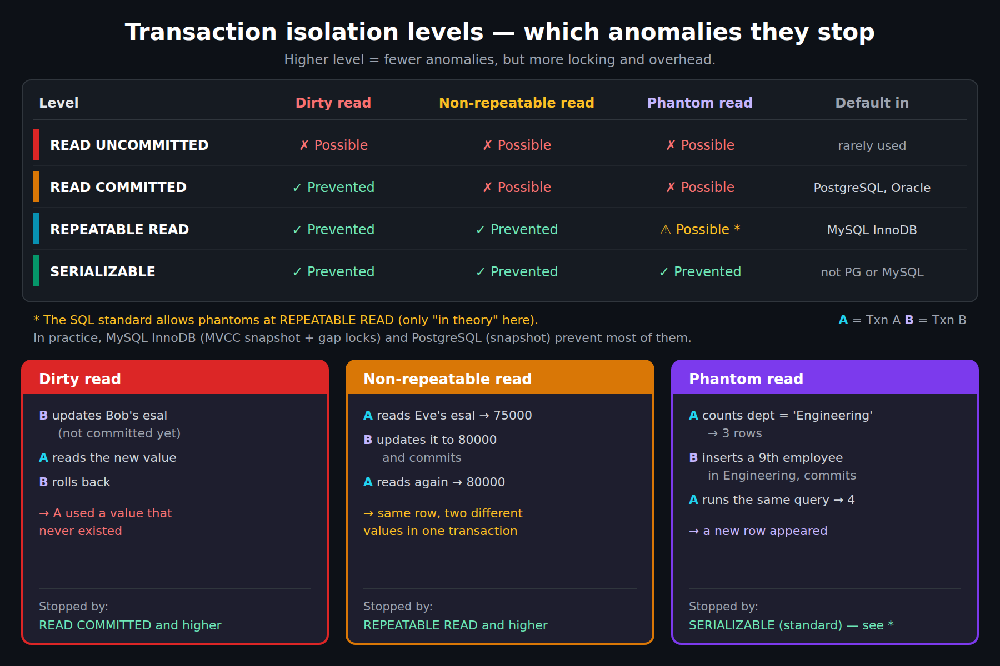

---

</details>

---

3. **🤼 What is optimistic locking vs pessimistic locking? 🔥🔥**

<!-- -->
<details>
<summary>Answer</summary>

**Answer:**

Both prevent lost updates (two transactions overwriting each other's changes). They use different strategies:

| Aspect | Optimistic Locking | Pessimistic Locking |
|--------|-------------------|---------------------|
| **Strategy** | Assume no conflict — check on commit | Assume conflict — lock on read |
| **Lock held** | None (just a version check) | From read until transaction end |
| **Conflict handling** | Rollback + retry if version changed | Wait (blocked) until lock released |
| **Throughput** | ✅ High (no blocking) | Low (contention) |
| **Best for** | Low-conflict scenarios | High-conflict scenarios |
| **Implementation** | `@Version` column | `SELECT FOR UPDATE` |

**Optimistic locking with JPA `@Version`:**
```java
@Entity
public class Emp {
    @Id
    private Integer id;

    private BigDecimal esal;

    @Version           // JPA adds this to the UPDATE WHERE clause
    private Long version;
    // ... other fields
}

// Two managers both read Eve's record (id=5): version=3, esal=75000
// Manager 1 updates: UPDATE emp SET esal=80000, version=4 WHERE id=5 AND version=3
//   → succeeds, version is now 4
// Manager 2 tries: UPDATE emp SET esal=85000, version=4 WHERE id=5 AND version=3
//   → 0 rows affected → JPA throws OptimisticLockException → retry or 409 Conflict
```

**Pessimistic locking with `SELECT FOR UPDATE`:**
```java
@Lock(LockModeType.PESSIMISTIC_WRITE)
@Query("SELECT e FROM Emp e WHERE e.id = :id")
Optional<Emp> findByIdForUpdate(@Param("id") Integer id);

// SQL: SELECT * FROM emp WHERE id=5 FOR UPDATE
// Manager 2 is blocked at this line until Manager 1 commits/rolls back
```

**⏭️ `FOR UPDATE` has three waiting modes — not just "block".** Interviewers almost always ask this follow-up. `SKIP LOCKED` is the one that makes a whole design pattern possible:

| Variant | Behaviour when the row is already locked | Use it for |
|---|---|---|
| `FOR UPDATE` | **Waits** until the lock is free or a timeout fires (PG `lock_timeout`, off by default; MySQL `innodb_lock_wait_timeout`, 50 s) | Default — you really need *that* row |
| `FOR UPDATE NOWAIT` | **Fails immediately** — `ERROR: could not obtain lock on row` | Fail-fast APIs: return 409 rather than tie up a request thread |
| `FOR UPDATE SKIP LOCKED` | **Silently skips** locked rows and returns the rest | 🏆 **Database-as-a-job-queue** |

```sql
-- The canonical worker-queue claim: N workers, zero contention, no double-processing.
-- Each worker gets a DISJOINT batch because locked rows are invisible to the others.
UPDATE jobs SET status = 'PROCESSING', claimed_by = :workerId
WHERE id IN (
    SELECT id FROM jobs
    WHERE status = 'PENDING'
    ORDER BY created_at
    LIMIT 10
    FOR UPDATE SKIP LOCKED     -- ← without this, all workers queue on the same oldest row
)
RETURNING *;
```

⚠️ `SKIP LOCKED` gives you a **non-deterministic subset** on purpose.
- It is correct for work queues (any row will do).
- It is wrong wherever you need *this specific row* or an exact count.

Both are supported in **PostgreSQL 9.5+** and **MySQL 8.0+**. The claim query above is PostgreSQL syntax: MySQL has no `RETURNING` and no `LIMIT` inside an `IN (subquery)`. In JPA:
- `LockModeType.PESSIMISTIC_WRITE` + `jakarta.persistence.lock.timeout = 0` maps to `NOWAIT`.
- `SKIP LOCKED` has no portable JPA mapping — use a native query.

**When to use each:**
- ✅ **Optimistic** — employee profile updates. Multiple HR agents rarely edit the same employee at the same time. Low-contention scenarios.
- ✅ **Pessimistic** — salary adjustments that must not proceed on stale data. Any scenario where conflict is frequent or bad data has serious results.

🎯 **Interview Tip:**
- Spring's `@Transactional` doesn't give you optimistic locking by default. You need `@Version` on the entity.
- Without it, concurrent updates silently cause **lost updates**.
- For a payment system, always use optimistic or pessimistic locking on balance updates.

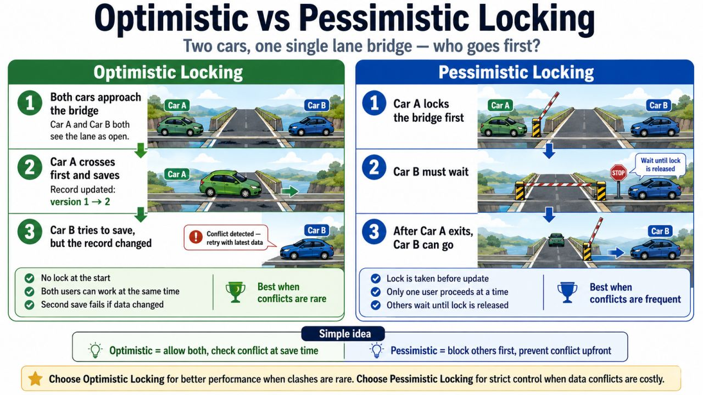

<details>
<summary><strong>🤔 Doubt: Does @Version mean I need to create a version column in the DB table?</strong></summary>

Yes — you need both the annotation in the entity **and** the physical column in the database.

```java
@Entity
public class Emp {
    @Id
    private Integer id;

    private BigDecimal esal;

    @Version
    private Long version;   // must exist as a column in the table
}
```

```sql
ALTER TABLE emp ADD COLUMN version BIGINT DEFAULT 0;
```

Hibernate manages the column automatically — you never set it yourself:

| Operation | What Hibernate does |
|---|---|
| `SELECT` | Reads current `version` value |
| `UPDATE` | Appends `AND version = 3` to WHERE clause |
| Conflict | 0 rows affected → throws `OptimisticLockException` |
| Success | Increments `version` to 4 in the same UPDATE |

**Things worth knowing:**
- Column name doesn't have to be `version` — `@Version` works on any column name
- Supported types: `int`, `Integer`, `long`, `Long`, `short`, `Short`, `Timestamp`
- Prefer `Long` over `Timestamp` — clocks can skew on distributed systems
- If the DB column is missing, Hibernate fails **at startup** under `ddl-auto=validate`. It throws `org.hibernate.tool.schema.spi.SchemaManagementException` — *"Schema-validation: missing column [version] in table [emp]"*. (There is no `SchemaValidationException` type in Hibernate. If you name the wrong class, the interviewer notices quickly.)

---

</details>
<br/>

<details>
<summary><strong>🤔 Doubt: SELECT * FROM emp WHERE id=5 FOR UPDATE — does it lock the row or the entire table?</strong></summary>

**Only the matching row** — `id = 5` acquires an exclusive lock on exactly 1 row.

PostgreSQL acquires two locks at the same time:

| Lock | Level | Type | Blocks |
|---|---|---|---|
| `ROW SHARE` | Table | Weak | Only `EXCLUSIVE` / `ACCESS EXCLUSIVE` locks — e.g. `DROP TABLE`, `TRUNCATE`, most `ALTER TABLE` |
| `FOR UPDATE` | Row (id=5 only) | Exclusive | `UPDATE` / `DELETE` and every other row lock (`FOR UPDATE`, `FOR NO KEY UPDATE`, `FOR SHARE`, `FOR KEY SHARE`) on same row |

Other transactions doing a plain `SELECT` on id=5 still succeed. MVCC gives them the last committed version. Only transactions that try to **lock or modify** id=5 will wait.

**The dangerous edge case — no index on the filter column:**

```sql
-- id is PRIMARY KEY → index exists → locks 1 row ✅
SELECT * FROM emp WHERE id = 5 FOR UPDATE;

-- dept has no index → full table scan required
SELECT * FROM emp WHERE dept = 'Engineering' FOR UPDATE;
```

| DB | Behaviour with no index on filter column |
|---|---|
| **PostgreSQL** | Still locks only matching rows — row locks applied after seq scan filters |
| **MySQL InnoDB** | Locks every scanned row + gap locks → can effectively lock the **entire table** |

So in MySQL, `FOR UPDATE` on an unindexed column in a high-concurrency table is dangerous. It can block all writes to the table.

**Simple rule:**

| Filter column | Rows locked |
|---|---|
| Unique indexed (PK) | Exactly 1 row |
| Non-unique indexed | N matching rows |
| Not indexed (PostgreSQL) | N matching rows (safe) |
| Not indexed (MySQL) | All scanned rows — avoid |

---

</details>
<br/>

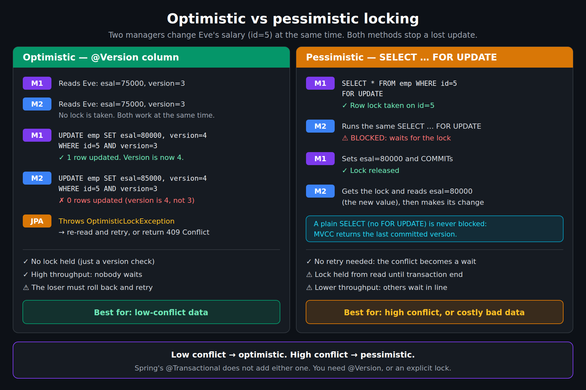

---

</details>

---

4. **🔄 What is a deadlock in a database? How do you detect and prevent it? 🔥**

<!-- -->
<details>
<summary>Answer</summary>

**Answer:**

A **deadlock** happens when two or more transactions each hold a lock that the other needs. Neither can move forward, so they wait forever.

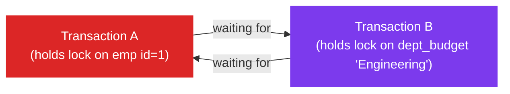

**💥 Classic deadlock scenario (emp + dept_budget):**
```
Transaction A: UPDATE emp          WHERE id=1           (locks Alice's row)
Transaction B: UPDATE dept_budget  WHERE dept='Engineering'  (locks Engineering budget)
Transaction A: UPDATE dept_budget  WHERE dept='Engineering'  → WAIT (blocked by B)
Transaction B: UPDATE emp          WHERE id=1               → WAIT (blocked by A)
→ DEADLOCK — each holds what the other needs
```

**🔍 Detection:** Most databases use a **waits-for graph** (a graph of which transaction waits for which).
- The DB looks for a cycle (A waits for B, and B waits for A).
- When it finds one, it picks a victim and rolls back that one transaction.
- 🐬 InnoDB picks the transaction that changed fewer rows (the smaller undo log).
- 🐘 PostgreSQL rolls back the transaction that ran the deadlock check. That is usually the one whose `deadlock_timeout` (default 1 s) ran out first.
- The other transaction can then continue.

**MySQL deadlock info:**
```sql
SHOW ENGINE INNODB STATUS;  -- shows last deadlock + victim transaction
```

**🛡️ Prevention strategies:**

1. **Consistent lock ordering** — all transactions always acquire locks in the same order:
   ```java
   // Rule: always lock dept_budget BEFORE emp in any transaction touching both tables
   // Transaction A and B must both follow: lock dept_budget first, then emp row
   // This eliminates the circular wait → no deadlock possible
   ```

2. **Keep transactions short** — release locks as fast as you can. Don't hold locks while you make external API calls.

3. **Use lower isolation levels** — READ COMMITTED uses less locking than SERIALIZABLE.

4. **Use optimistic locking** — no row locks held while the user works → far fewer deadlocks. The final `UPDATE` still takes row locks, so two transactions that update several rows in opposite order can still deadlock.

5. **Retry on deadlock — you must add this yourself. Nothing retries automatically.** Catch the exception that Spring translates, and run the work again in a **fresh** transaction:
   ```java
   // Retry must wrap the transaction, not sit inside it —
   // the deadlock victim's transaction is already rolled back and unusable.
   @Retryable(retryFor = DeadlockLoserDataAccessException.class,
              maxAttempts = 3,
              backoff = @Backoff(delay = 50, multiplier = 2))
   public void processPayment(Long loanId) {
       paymentTxService.processPaymentInTx(loanId);   // separate bean → new @Transactional
   }
   ```

🎯 **Interview Tip:** In Spring Boot + JPA, **nothing retries a deadlock for you.**
- ⚠️ The DB picks a victim and rolls that transaction back.
- Spring translates the driver error into `DeadlockLoserDataAccessException` / `CannotAcquireLockException`. The exception goes up to your caller.
- Retry is **fully opt-in**: it happens only if you add it. You add `@Retryable` or a `RetryTemplate`, as in strategy 5 above.
- The retry must wrap a *new* transaction. The failed one is already dead. So `@Retryable` has to sit **outside** the `@Transactional` boundary, not inside it.
- Turn on SQL logging to find code paths that are likely to deadlock.
- The most common cause: transaction A locks tables in one order (emp, dept_budget). Transaction B locks them in reverse (dept_budget, emp).
- Fix: enforce consistent ordering. Every transaction that touches both tables must lock them in the same order.

<details>
<summary><strong>🤔 Doubt: Does `@Retryable` go inside or outside the `@Transactional` boundary?</strong></summary>

**Outside — always.** The retry must wrap the transaction. It must never sit inside it.

```java
// ✅ CORRECT — two beans. Retry on the outer, transaction on the inner.
@Service
public class PaymentService {

    private final PaymentTxService paymentTxService;   // separate bean → real proxy

    @Retryable(retryFor = DeadlockLoserDataAccessException.class,
               maxAttempts = 3,
               backoff = @Backoff(delay = 50, multiplier = 2))
    public void processPayment(Long loanId) {
        paymentTxService.processPaymentInTx(loanId);   // each attempt = a NEW transaction
    }
}

@Service
public class PaymentTxService {

    @Transactional
    public void processPaymentInTx(Long loanId) {
        // ... the work that can deadlock
    }
}
```

```java
// ⚠️ FRAGILE — both on one method. Spring Retry's default order puts the retry OUTSIDE,
// but only by advice order. If the retry ends up INSIDE, every attempt after the first is doomed.
@Transactional
@Retryable(retryFor = DeadlockLoserDataAccessException.class, maxAttempts = 3)
public void processPayment(Long loanId) {
    // ... the work that can deadlock
}
```

**💥 Two reasons a retry that runs *inside* the transaction cannot work:**

| # | Reason | What actually happens |
|---|---|---|
| 1 | **The victim transaction is already dead** | The DB chose it, rolled it back and released its locks. All this happened *before* the exception reached your code. There is no transaction left to retry *in*. |
| 2 | **The transaction is marked rollback-only** | Attempts 2 and 3 may run, but Spring's `TransactionStatus` is still `rollbackOnly`. So the commit at the end throws `UnexpectedRollbackException`. Work that "succeeds" is still thrown away. |

So a retry inside the transaction uses up your attempts on a dead transaction. Then it fails anyway. And it fails with a *different* exception, which is more confusing than the one you were retrying.

> 🔑 **The hook:** *the retry must live longer than the thing that died.* A retry inside the transaction dies with it.

**⚠️ The third trap — self-invocation.** Splitting the code into two *methods* is not enough. It must be two **beans**. Both `@Transactional` and `@Retryable` work through proxies. So an internal `this.` call skips the proxy completely:

```java
// ❌️ Still broken — same bean. The this-call never crosses a proxy,
//    so @Transactional does not start a new transaction at all.
@Retryable(retryFor = DeadlockLoserDataAccessException.class)
public void processPayment(Long loanId) {
    processPaymentInTx(loanId);        // self-invocation → annotation ignored
}

@Transactional
public void processPaymentInTx(Long loanId) { /* ... */ }
```

You have three fixes:
- Inject a **separate bean** (as in the ✅ example).
- Self-inject the proxy.
- Use `TransactionTemplate` directly inside the retried method.

**🎯 Which exception to retry on — the hierarchy trap:**

```
DataAccessException
 └─ ConcurrencyFailureException
     ├─ OptimisticLockingFailureException
     └─ PessimisticLockingFailureException
         ├─ CannotAcquireLockException              ← lock timeout
         ├─ CannotSerializeTransactionException     ← SERIALIZABLE / SSI failure (SQLSTATE 40001)
         └─ DeadlockLoserDataAccessException        ← deadlock victim (PG 40P01, MySQL 1213)
```

⚠️ `DeadlockLoserDataAccessException` is a **sibling** of `CannotAcquireLockException`, **not a subclass**. With `JdbcTemplate` on Spring 5, `retryFor = CannotAcquireLockException.class` will **not** catch a deadlock. Through JPA/Hibernate (Spring 5 and 6), it does: Hibernate raises `LockAcquisitionException` for a PostgreSQL deadlock, and Spring turns that into `CannotAcquireLockException`. The exact type depends on the access path. Retry on `PessimisticLockingFailureException` to catch the whole family. Or list the specific types.

⚠️ **Spring 6.0.3+:** `CannotSerializeTransactionException` and `DeadlockLoserDataAccessException` are **deprecated**. The default SQLSTATE-based translation now throws `PessimisticLockingFailureException` (or `CannotAcquireLockException`) instead. So on Spring 6, `retryFor = PessimisticLockingFailureException.class` is the safe choice. The examples above that name `DeadlockLoserDataAccessException` work on Spring 5.

**🔄 The same rule applies to optimistic locking.** `OptimisticLockException` / `ObjectOptimisticLockingFailureException` is thrown at **flush/commit** time, that is, as the transaction is ending. So its retry must also sit outside the boundary, on a fresh transaction. The two reasons are exactly the same.

🎯 **Interview line:** *"The retry has to sit outside the transaction, on a separate bean. The database already rolled back the deadlock victim's transaction before my code saw the exception. And Spring has it marked rollback-only. So retrying inside it can't commit. Each attempt needs a brand-new transaction, which means crossing the proxy again."*

---

</details>
<br/>

---

</details>

---

## 3. Database Scaling

1. **⚡ What is database partitioning and what are the types? 🔥🔥**

<!-- -->
<details>
<summary>Answer</summary>

**Answer:**

**Partitioning** splits a large table into smaller physical pieces. To the user, it still looks like one logical table. Sharding splits data across servers. Partitioning usually happens on a single server.

**Types of partitioning:**

> Mnemonic: R-H-L-C (Range, Hash, List, Composite).

**1. 📅 Range partitioning** — by value ranges (PostgreSQL — the main syntax for interviews):
```sql
-- Parent declares the strategy only — NO inline partition list in PostgreSQL
CREATE TABLE loan_applications (
    id          BIGINT,
    created_at  DATE,
    amount      DECIMAL
) PARTITION BY RANGE (created_at);

-- Each partition is a SEPARATE table. FROM is inclusive, TO is exclusive.
CREATE TABLE loan_applications_2025 PARTITION OF loan_applications
    FOR VALUES FROM ('2025-01-01') TO ('2026-01-01');
CREATE TABLE loan_applications_2026 PARTITION OF loan_applications
    FOR VALUES FROM ('2026-01-01') TO ('2027-01-01');
CREATE TABLE loan_applications_2027 PARTITION OF loan_applications
    FOR VALUES FROM ('2027-01-01') TO ('2028-01-01');

-- Catch-all for any date outside the defined ranges (the "future" safety net)
-- ⚠️ DEFAULT partitions require PostgreSQL 11+ (declarative partitioning itself is PG 10+).
CREATE TABLE loan_applications_default PARTITION OF loan_applications DEFAULT;
```
✅ Great for time-series data. You can drop an old partition instantly (`DROP TABLE loan_applications_2025`, or `ALTER TABLE … DETACH PARTITION` to archive it). This replaces an expensive `DELETE`. The `DEFAULT` partition makes sure no insert ever fails because a range is missing.

<details>
<summary><strong>🤔 Doubt: Can we add new partitions after the table is already created?</strong></summary>

Yes. In PostgreSQL, the method depends on one thing: did you create a `DEFAULT` catch-all partition?

**Without a DEFAULT partition — just create the next one (instant):**

```sql
-- Partitions exist for 2025–2027, no DEFAULT.
-- Before 2028 data arrives, add the next partition:
CREATE TABLE loan_applications_2028 PARTITION OF loan_applications
    FOR VALUES FROM ('2028-01-01') TO ('2029-01-01');
```

This is instant (just metadata). But a `created_at = 2028-01-01` row may arrive **before** you run this. Then PostgreSQL rejects it:
```
ERROR: no partition of relation "loan_applications" found for row
```

**With a DEFAULT partition — detach, create, re-attach (the safe production pattern):**

⚠️ **To be exact:** you *can* run a bare `CREATE TABLE … PARTITION OF …` while a `DEFAULT` exists.
- PostgreSQL takes an `ACCESS EXCLUSIVE` lock on the default partition and **scans it**.
- It raises an error only if it finds rows that would belong in the new range:

```
ERROR: updated partition constraint for default partition "loan_applications_default"
       would be violated by some row
```

So there are two cases:
- **Default is empty (or holds nothing in 2028)** → the plain `CREATE` succeeds. The cost is the scan, plus the `ACCESS EXCLUSIVE` lock held while the scan runs. This is very small on an empty default, and slow on a huge one.
- **Default already holds 2028 rows** → the `CREATE` fails. You need the detach/create/re-attach steps to move those rows:
```sql
-- 1. Detach the default (brief ACCESS EXCLUSIVE lock)
ALTER TABLE loan_applications DETACH PARTITION loan_applications_default;

-- 2. Create the new explicit partition for 2028
CREATE TABLE loan_applications_2028 PARTITION OF loan_applications
    FOR VALUES FROM ('2028-01-01') TO ('2029-01-01');

-- 3. Re-attach the default — PG SCANS it to verify no row belongs in 2028
ALTER TABLE loan_applications ATTACH PARTITION loan_applications_default DEFAULT;
```

⚠️ The **scan on re-attach** (step 3) is the cost. PostgreSQL must check that the default holds no rows that now belong in the 2028 range. On a large default partition, this is expensive. That is the real reason to **define partitions ahead of time**, instead of depending on the default. For example, a scheduled job can create next year's partition in advance.

**Partition management operations at a glance (PostgreSQL):**

| Operation | SQL | Notes |
|---|---|---|
| Add new partition | `CREATE TABLE … PARTITION OF … FOR VALUES FROM (…) TO (…)` | Instant when no overlapping DEFAULT exists |
| Drop old partition | `DROP TABLE loan_applications_2025` | Instant — drops the partition table + all its data |
| Archive (don't drop) | `ALTER TABLE … DETACH PARTITION loan_applications_2025` | Becomes a standalone table you can move to cold storage |
| Carve out of DEFAULT | `DETACH` default → `CREATE` partition → `ATTACH` default | Re-attach scans the default (the cost above) |

**🐬 MySQL equivalent (only if the interviewer asks about MySQL):** MySQL defines partitions **inline** on the table with `VALUES LESS THAN`. It uses a `MAXVALUE` catch-all instead of `DEFAULT`:
```sql
-- MySQL inline syntax
PARTITION BY RANGE (YEAR(created_at)) (
    PARTITION p2025 VALUES LESS THAN (2026),
    PARTITION p_future VALUES LESS THAN MAXVALUE   -- catch-all
);
-- Add ahead of time: ALTER TABLE … ADD PARTITION (only without a MAXVALUE catch-all)
-- Carve out of MAXVALUE: ALTER TABLE … REORGANIZE PARTITION p_future INTO (p2028 …, p_future …)
-- A row for an undefined range before you add it → ERROR 1526: Table has no partition for value 2028
```
The idea is the same: split a catch-all to make room for a new range. The mechanism is different: PG `DETACH`/`ATTACH` vs MySQL `REORGANIZE`.

---

</details>
<br/>

<details>
<summary><strong>🤔 Doubt: How do I actually test this and SEE the routing + pruning work? 🛠️</strong></summary>

Insert rows from several years, plus a couple outside the defined ranges. Then watch where each row goes and how queries get pruned.

**1. Insert — you write to the PARENT; PG routes to the right child:**
```sql
INSERT INTO loan_applications (id, created_at, amount) VALUES
    (1, '2025-03-15', 10000),   -- → loan_applications_2025
    (2, '2025-11-30', 25000),   -- → loan_applications_2025
    (3, '2026-01-01', 50000),   -- → loan_applications_2026 (FROM is inclusive)
    (4, '2026-07-20', 75000),   -- → loan_applications_2026
    (5, '2027-12-31', 99000),   -- → loan_applications_2027
    (6, '2030-05-10', 12000),   -- → loan_applications_default (no 2030 partition)
    (7, '2020-01-01',  8000);   -- → loan_applications_default (before earliest range)
```

**2. Prove physical separation — `tableoid::regclass` shows the real child table per row:**
```sql
SELECT id, created_at, amount, tableoid::regclass AS lives_in_partition
FROM loan_applications ORDER BY id;
-- ids 1,2 → _2025 | 3,4 → _2026 | 5 → _2027 | 6,7 → _default
```

**3. Query a child directly — the data really is split:**
```sql
SELECT * FROM loan_applications_2026;      -- only ids 3, 4
SELECT * FROM loan_applications_default;   -- only ids 6, 7
SELECT count(*) FROM loan_applications;    -- 7 (parent = union of all children)
```

**4. See PARTITION PRUNING — the key lesson — with `EXPLAIN`:**
```sql
-- WITH the partition key → scans ONLY loan_applications_2026
EXPLAIN (ANALYZE, COSTS OFF)
SELECT * FROM loan_applications
WHERE created_at >= '2026-01-01' AND created_at < '2027-01-01';

-- WITHOUT the partition key → Append over EVERY partition (no pruning)
EXPLAIN (ANALYZE, COSTS OFF)
SELECT * FROM loan_applications WHERE amount > 20000;
```
The first plan names only `loan_applications_2026`. The second shows an `Append` that scans all children. 👉 **Pruning only happens when you filter on the partition key (`created_at`)**. This is the #1 interviewer follow-up ("when does partitioning NOT help?").

**5. The "no catch-all" rejection (matches the earlier Doubt):**
```sql
ALTER TABLE loan_applications DETACH PARTITION loan_applications_default;
INSERT INTO loan_applications VALUES (8, '2031-01-01', 5000);
-- ERROR: no partition of relation "loan_applications" found for row
ALTER TABLE loan_applications ATTACH PARTITION loan_applications_default DEFAULT;  -- restore
```

**6. Drop = instant retention (vs an expensive `DELETE`):**
```sql
DROP TABLE loan_applications_2025;       -- removes that year's data instantly
SELECT count(*) FROM loan_applications;  -- now 5 (ids 1,2 gone)
```

💡 To show the "before pruning" case, turn pruning off: `SET enable_partition_pruning = off;`. Then run step 4's first query again. Now even the date-filtered query scans every partition.

---

</details>
<br/>

**2. #️⃣ Hash partitioning** — by hash of a key:
```sql
CREATE TABLE events (id BIGINT, user_id BIGINT) PARTITION BY HASH (user_id);
-- Declare each bucket via MODULUS / REMAINDER (8 partitions → 0..7)
CREATE TABLE events_p0 PARTITION OF events FOR VALUES WITH (MODULUS 8, REMAINDER 0);
CREATE TABLE events_p1 PARTITION OF events FOR VALUES WITH (MODULUS 8, REMAINDER 1);
-- … through events_p7
```
✅ Even distribution. Good for user/tenant data. ❌️ Range queries cross all partitions.

**3. 📋 List partitioning** — by specific values:
```sql
CREATE TABLE loans (id BIGINT, status TEXT) PARTITION BY LIST (status);
CREATE TABLE loans_active PARTITION OF loans FOR VALUES IN ('ACTIVE', 'PENDING');
CREATE TABLE loans_closed PARTITION OF loans FOR VALUES IN ('CLOSED', 'REJECTED');
```
✅ For queries that filter on status, the DB skips unrelated partitions instantly.

**4. 🧩 Composite (sub-)partitioning** — a partition that is itself partitioned. For example: Range by year, then Hash by user_id inside each year. In PostgreSQL you make a partition `PARTITION BY` again:
```sql
CREATE TABLE loan_applications (
    id BIGINT, user_id BIGINT, created_at DATE, amount DECIMAL
) PARTITION BY RANGE (created_at);

-- The 2026 partition is itself hash-partitioned by user_id
CREATE TABLE loan_applications_2026 PARTITION OF loan_applications
    FOR VALUES FROM ('2026-01-01') TO ('2027-01-01')
    PARTITION BY HASH (user_id);

CREATE TABLE loan_applications_2026_h0 PARTITION OF loan_applications_2026
    FOR VALUES WITH (MODULUS 4, REMAINDER 0);
-- … h1..h3. A row with created_at=2026, user_id=101 lands in:
--   loan_applications_2026 → sub-partition hash(101) % 4
```
✅ Combines time-based pruning (Range) with even write distribution (Hash). Useful when one year's partition is still too large for one node or file.

**✂️ Partition pruning:**
When a query has the partition key in its `WHERE` clause, the DB scans only the matching partitions:
```sql
-- Only reads the loan_applications_2026 partition — ignores all others
SELECT * FROM loan_applications
WHERE created_at >= '2026-01-01' AND created_at < '2027-01-01';
```

**⚖️ Partitioning vs Sharding:**
- **Partitioning** = splits data within one server. The application does not see it.
- **Sharding** = splits data across multiple servers. The application must send each request to the correct shard.

🎯 **Interview Tip:** In fintech, partitioning by `created_at` year/month is extremely common for transaction and audit tables. It makes the retention policy (drop old partition) very simple. It also gives excellent query performance for time-range queries.

<details>
<summary><strong>🤔 Doubt: If an index already avoids a full scan, why partition at all? What's the REAL biggest advantage?</strong></summary>

Partition pruning is real. (A query on the partition key scans only the matching child.) But it is **not** the strongest argument, and an interviewer will quickly question it:

> "An index on `created_at` would also find the 2026 rows without scanning the whole table. So why partition?"

On **read performance alone**, partitioning is only a little better than a well-indexed single table. It gives smaller indexes per partition and better cache locality. But the gain is not large. If pruning is your only answer, you lose that argument.

**🏆 The real biggest advantage is data lifecycle / retention.** Deleting old data:

| | Single table | Partitioned |
|---|---|---|
| Drop a year of data | `DELETE … WHERE created_at < '2025-01-01'` → scans + deletes millions of rows, floods WAL, holds locks, **bloats** the table, then needs `VACUUM`. Minutes–hours. | `DROP TABLE loan_applications_2024` → instant metadata op. No scan, no WAL flood, no bloat. |

For audit/transaction tables with a rolling retention window, **that** is why you partition.

**⚠️ The trap to mention before you are asked:** pruning **only** works when the query filters on the **partition key**.
- If you query by `amount` or `status` (not `created_at`), PG scans **every** partition through an `Append`.
- That can be worse than one indexed table.
- So pick the partition key to match your main query pattern + retention pattern.

**🎙️ How to say it in the interview — three wins, in this order:**
1. **Cheap retention** — drop a partition vs an expensive `DELETE` (lead with this).
2. **Pruning** — for queries that filter on the partition key.
3. **Smaller per-partition indexes + faster per-partition `VACUUM`/maintenance**.

…then name the limit: pruning needs the partition key in the `WHERE` clause.

---

</details>
<br/>

---

</details>

---

2. **📈 What are the strategies for scaling a relational database? 🔥🔥**

<!-- -->
<details>
<summary>Answer</summary>

**Answer:**

Database scaling goes in steps. Use up the cheaper options before you try the expensive ones:

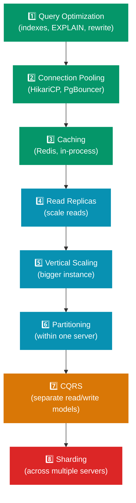

| Strategy | Addresses | Complexity |
|----------|-----------|-----------|
| Query optimization + indexing | Slow queries | Low |
| Connection pooling | Connection overhead | Low |
| Application caching (Redis) | Read load | Low-Medium |
| Read replicas (async replication) | Read scale | Medium |
| Vertical scaling (larger instance) | CPU/RAM/IOPS limits | Low (but expensive) |
| Partitioning | Large table sizes | Medium |
| CQRS (separate read model) | Divergent read/write requirements | High |
| Sharding | Write scale, storage limits | Very High |

**📖 Read replica pattern (most common first step):**

> ⚠️ **The trap interviewers set here:** *"So `@Transactional(readOnly = true)` sends the query to the replica?"* — **No.**
> - `readOnly = true` is a **hint**, not a router.
> - It sets Hibernate's flush mode to `MANUAL` (skips dirty-checking). It may also call `Connection.setReadOnly(true)`.
> - It has **no idea a replica exists**.
> - There is also no `spring.datasource.read.*` property. Spring Boot binds nothing like that.
> - **You** must set up the routing yourself.

**Option A — `AbstractRoutingDataSource` (the standard Spring answer):**

```java
public class RoutingDataSource extends AbstractRoutingDataSource {
    @Override
    protected Object determineCurrentLookupKey() {
        // readOnly=true becomes a routing KEY only because you read it here
        return TransactionSynchronizationManager.isCurrentTransactionReadOnly()
                ? "replica" : "primary";
    }
}

@Bean
public DataSource dataSource(DataSource primary, DataSource replica) {
    RoutingDataSource routing = new RoutingDataSource();
    routing.setTargetDataSources(Map.of("primary", primary, "replica", replica));
    routing.setDefaultTargetDataSource(primary);
    // ⚠️ MANDATORY: without this, Spring acquires the connection BEFORE the
    // transaction's readOnly flag is set — every query lands on the primary.
    return new LazyConnectionDataSourceProxy(routing);
}
```

You declare the two `DataSource` beans yourself. There is no built-in "read URL":

```properties
app.datasource.primary.url=jdbc:postgresql://primary-rds:5432/db
app.datasource.replica.url=jdbc:postgresql://replica-rds:5432/db
```

**Option B — driver-level target selection (no Spring code):**

```properties
# pgJDBC picks a host by role; RDS/Aurora also expose a reader endpoint
spring.datasource.url=jdbc:postgresql://replica-1:5432,replica-2:5432/db?targetServerType=preferSecondary&loadBalanceHosts=true
```

⚠️ With either option, a read sent to a replica can read **stale data** (replication lag). That is why "read-your-writes" traffic must always go to the primary (see §3 Q3).

🎯 **Interview Tip:** Most engineers forget this answer: **connection pooling** is often the first thing to fix.
- An untuned connection pool causes database performance problems that look like slow queries.
- Examples: too many connections, too few connections, wrong timeouts.
- HikariCP defaults are not always right for your workload.

---

</details>

---

3. **🔁 What is database replication and what are the types? 🔥**

<!-- -->
<details>
<summary>Answer</summary>

**Answer:**

**Replication** copies data from one database server (primary) to one or more others (replicas/secondaries).

| Type | How | Consistency | Use case |
|------|-----|-------------|---------|
| **Synchronous** | Primary waits for replica to confirm write before committing | ✅ Strong (no data loss on failover) | RDS Multi-AZ, financial data |
| **Asynchronous** | Primary commits immediately; replica catches up | ⚠️ Eventual (replication lag = potential data loss) | ✅ Read replicas (scale reads) |
| **Semi-synchronous** | Primary waits for at least one replica | Middle ground | MySQL semi-sync |

**⏱️ Replication lag:**
- In async replication, replicas may be milliseconds to seconds behind the primary.
- Problem: a user updates their profile (written to primary). Then they refresh right away (read from replica). They may see old data.
- Fix: **read-your-writes**. Right after a write, send reads from the same session to the primary. Or add a short wait before sending them to the replica.

**📡 Replication modes:**

| Mode | Description |
|------|-------------|
| **Statement-based** | Replicates SQL statements. Compact. But non-deterministic functions (`SYSDATE()`, `UUID()`) can give different results on the replica. |
| **Row-based** | Replicates the actual row changes. Larger log, but safe and consistent. |
| **Mixed** | Uses statement-based by default. Switches to row-based for non-deterministic operations. |

**🚨 Failover:**
- **Manual** — DBA promotes a replica to primary. Downtime window: minutes.
- **Automatic** — AWS RDS Multi-AZ, Patroni for PostgreSQL, MySQL Group Replication.

⚠️ **Know which RDS Multi-AZ you mean — the two have very different failover windows:**

| AWS offering | Topology | Documented failover |
|---|---|---|
| **Multi-AZ DB *instance*** (the classic one) | 1 primary + 1 **standby** (no reads served) | **typically 60–120 seconds** |
| **Multi-AZ DB *cluster*** | 1 writer + **2 readable standbys**, semi-sync | **typically under 35 seconds** |

A common mistake is to quote "~30 seconds" for the classic instance deployment. That number belongs to the cluster deployment.

Failover time is also **not** only the promotion. The slowest part is usually:
- DNS propagation of the endpoint CNAME.
- Your JDBC driver's cached DNS/socket state.

Set the JVM's `networkaddress.cache.ttl` low (RDS docs say no more than 60 seconds). If you don't, the app can keep connecting to the dead host long after AWS has finished.

🎯 **Interview Tip:** Replication lag is one of the most common production bugs in read-replica setups.
- Always expose replica lag as a metric (`seconds_behind_master` in MySQL, `pg_stat_replication` in PostgreSQL).
- Alert if it goes above your SLO.
- Applications that read from replicas must handle eventual consistency correctly.

---

</details>

---

4. **🔀 What is database sharding? When should you actually use it? 🔥**

<!-- -->
<details>
<summary>Answer</summary>

**Answer:**

**Sharding** splits data horizontally across multiple independent database servers (shards). Each shard holds a subset of rows. Together they hold the full dataset.

**When to actually use sharding:**
- ✅ Write throughput is more than a single server can handle (for example, tens of thousands of writes per second, sustained)
- ✅ The dataset is so large that it does not fit on one server, even with partitioning + compression
- ✅ You have already used up read replicas, caching, partitioning, and vertical scaling
- ❌️ Don't shard just because you read about it. A well-tuned PostgreSQL handles billions of rows

**Sharding strategies — how a row finds its shard:**

| Strategy | How | Pros | Cons |
|----------|-----|------|------|
| **Range-based** | Shard by key range (A-M → Shard 1, N-Z → Shard 2) | Simple; range queries stay on one shard | Hotspots if data is not spread evenly (e.g. all new rows land on the last range) |
| **Hash-based** | `shard = hash(key) % num_shards` | Even spread | Range queries hit every shard; changing `num_shards` moves most keys (~75% going from 3 to 4) |
| **Consistent hashing** | Keys and shards on a hash ring | Adding or removing a shard moves only ~1/N of the keys | A little more complex |
| **Directory-based** | A lookup table maps key → shard | Flexible; you can move any key | The lookup table is an extra hop and must be highly available |
| **Geographic** | Shard by user region | Data stays near users; helps with data-residency rules | Regions grow unevenly |

**⚠️ Sharding challenges:**

| Challenge | Description | Mitigation |
|-----------|-------------|-----------|
| **Cross-shard queries** | A JOIN across shards needs scatter-gather: query all shards, then merge | **Co-locate** related rows with one shard key (shard by `tenant_id` or `user_id`, so a user's orders and payments sit together); **copy small reference tables** (countries, products) to every shard; denormalize; a CQRS read model. Scatter-gather is fine for rare admin queries, slow for hot paths |
| **Cross-shard transactions** | No native ACID across shards | Saga pattern, two-phase commit, accept eventual consistency |
| **Re-sharding** | Adding a new shard requires data migration | The standard answer: create **many fixed logical shards** (e.g. 1,024) at the start and map them to a few physical servers. Adding a server moves whole logical shards, and the key → shard formula never changes (Redis Cluster slots work this way). Or consistent hashing, which moves ~1/N of the keys |
| **Hot shards** | One shard gets much more load than the others (e.g. a celebrity user) | **Salt the hot key**: write to `key#0` … `key#9` on different shards, then read all ten and merge; give the hot entity its own shard; a cache in front for read-heavy hot keys; a composite shard key |
| **Operational complexity** | Schema changes across N shards, backup, monitoring | Tooling (Vitess for MySQL, Citus for PostgreSQL) |

**🗝️ Shard key selection:**
```
Good shard key:
✅ High cardinality (many distinct values)
✅ Even distribution
✅ Not a hot key (celebrity user problem)
✅ Appears in most queries (avoids scatter-gather)

Example: user_id (random UUID or hash) for a user-centric app
         loan_id for a loan-centric app
         tenant_id for a multi-tenant SaaS
```

**🔧 Managed sharding tools:**
- **Vitess** (MySQL) — YouTube's open-source sharding layer. Used at GitHub, Slack.
- **Citus** (PostgreSQL extension) — distributed PostgreSQL.
- **Amazon Aurora PostgreSQL Limitless Database** — managed sharding on AWS.

🎯 **Interview Tip:** Think of most product companies up to ~$100M revenue. For them, one setup handles the load:
- a well-tuned PostgreSQL on a large RDS instance (db.r6g.4xlarge = 128GB RAM)
- read replicas
- good indexing
- Redis caching

Sharding is the last option to try. Use Knuth's line "premature optimization is the root of all evil" — premature sharding is one example. Then explain that you would use up the other options first.

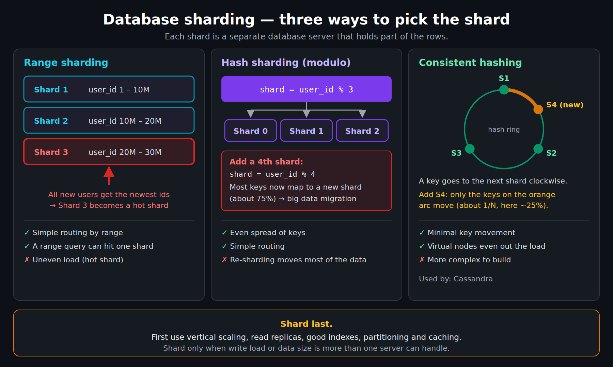

---

</details>

---

## 4. Connection Pooling and Performance

1. **🔌 What is a database connection pool? How does HikariCP work? 🔥🔥**

<!-- -->
<details>
<summary>Answer</summary>

**Answer:**

Opening a database connection is expensive (TCP handshake + auth + SSL = 20-100ms). A **connection pool** keeps a set of connections that are already open. Requests reuse them.

**How HikariCP works:**

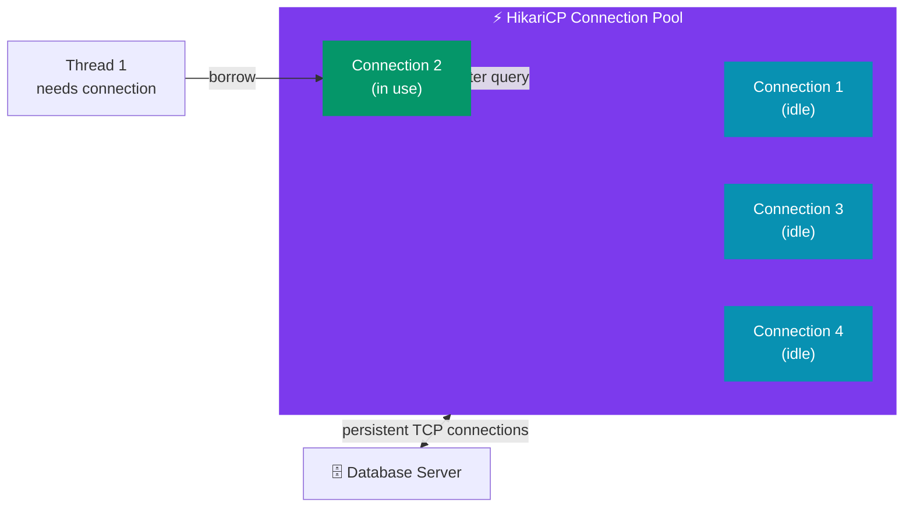

**HikariCP is the Spring Boot default (since 2.0) — key configuration:**

```yaml
spring:
  datasource:
    hikari:
      maximum-pool-size: 10      # max connections to DB
      minimum-idle: 5            # keep at least 5 idle connections warm
      connection-timeout: 30000  # 30s max wait for a connection (throw if exceeded)
      idle-timeout: 600000       # 10min idle → close connection
      max-lifetime: 1800000      # 30min max connection lifetime (prevent stale connections)
      keepalive-time: 60000      # ping idle connections every 60s to prevent firewall timeouts
      pool-name: HikariPool-LoanService
```

**⚖️ Sizing the pool correctly:**

❌️ **Common mistake:** setting `maximum-pool-size=100` thinking more = better.

✅ **The PostgreSQL-wiki formula (quoted by HikariCP's *About Pool Sizing*):**
```
connections = (core_count × 2) + effective_spindle_count
```

> ⚠️ **`core_count` is the DATABASE SERVER's cores — not the app instance's vCPUs.** People misquote this line more than any other line in connection-pool tuning.  
> - The formula describes how many concurrent queries the **DB** can actually serve.  
> - It counts 2 per core, to cover I/O waits. It adds one per independent disk that can seek in parallel.  
> - It says nothing about how many threads your Spring Boot pod runs.  
> - The same PostgreSQL wiki text (which HikariCP quotes) adds a second rule: **exclude HT/SMT threads** (hyper-threads). A 4-core / 8-thread DB server counts as `core_count = 4`, not 8.

```
# DB server: db.m6g.xlarge = 4 physical cores, EBS gp3 (SSD → effective_spindle_count ≈ 1)
total_connection_budget = (4 × 2) + 1 = ~9 connections   ← for the WHOLE application tier

# Now divide that budget across app replicas:
3 replicas → maximum-pool-size ≈ 3 each   (3 × 3 = 9 ≤ budget)
```

- 🚫 **Wrong derivation:** "my pod has 4 vCPU → pool = 4 × 2 + 1 = 10." The pod's core count does not matter. Ten pods sized that way give 100 connections. The DB can usefully serve only ~9.
- ✅ **Right derivation:** size the **total** from the DB server. Then divide it by the replica count. On SSD/EBS, `effective_spindle_count` is ~1, because there is no parallel seeking to use. It only grows on multi-disk RAID arrays.
- 📉 Treat the result as a **starting point**. Then measure:
  - If `hikaricp.connections.pending` stays at 0 and DB CPU is idle, you are fine.
  - If queries queue, the fix is usually faster queries or shorter transactions. It is **not** a bigger pool.

Too many connections cause **context switching overhead** on the DB server. They also cause **lock contention**. Past a certain point, throughput goes *down*, not up. PostgreSQL's default `max_connections=100` is a hard limit. All app instances share it.

**🔗 For microservices:** 3 replicas, each with pool size 10 → 30 total connections to DB. Make sure DB `max_connections` ≥ total expected connections across all instances + some spare room.

This math stops working quickly: **20 pods × pool 10 = 200 connections against `max_connections=100`**. At that point, the answer is not a bigger `max_connections`. The answer is a **server-side pooler** (see the PgBouncer block below).

**🧵 PgBouncer — when the pool arithmetic stops working:**

PostgreSQL forks a **backend process per connection** (~5–10 MB each). So you cannot simply raise `max_connections` to 2,000. **PgBouncer** (or `pgcat`/RDS Proxy) sits between the app and PG. It multiplexes (shares) thousands of client connections over a small server pool:

| Pool mode | Server connection held for | Safe to use? |
|---|---|---|
| **Session** | the whole client session | Safest — but gives almost no multiplexing |
| **Transaction** | one transaction | ✅ The useful mode — the one you actually deploy |
| **Statement** | one statement | Breaks multi-statement transactions — avoid |

⚠️ **The cost of transaction mode** (the follow-up they will ask): between transactions, PgBouncer gives a server connection to a different client. So anything with **session state breaks**:
- server-side prepared statements (set `prepareThreshold=0` on the JDBC URL, or use PgBouncer 1.21+, which can track them)
- session-level `SET`
- `LISTEN/NOTIFY`
- session-scoped advisory locks
- temp tables

**📊 Connection pool monitoring (Spring Boot Actuator):**
```yaml
management.metrics.enable.hikaricp: true
# Exposes: hikaricp.connections.active, .idle, .pending, .timeout
```

Alert on: `hikaricp.connections.pending > 0` for more than 10 seconds. It means the pool is too small or the queries are too slow.

🎯 **Interview Tip:** Connection pool exhaustion (no free connections left) is one of the most common production incidents in Java microservices. Symptoms:
- `Connection is not available, request timed out after 30000ms` in logs
- high latency
- API timeouts

Always show pool metrics in Grafana. Alert on pending connections.

---

</details>

---

2. **🐢 What causes slow queries and what is your approach to fixing them? 🔥**

<!-- -->
<details>
<summary>Answer</summary>

**Answer:**

**🐛 Common causes of slow queries:**

| Cause | Symptom | Fix |
|-------|---------|-----|
| **Missing index** | Full table scan (`Seq Scan` in EXPLAIN) | Add appropriate index |
| **Wrong index chosen** | Index used but high row estimates | Analyze table statistics: `ANALYZE tablename` |
| **Stale statistics** | Estimated rows ≠ actual rows in EXPLAIN ANALYZE | `ANALYZE` / `VACUUM ANALYZE` |
| **N+1 queries** | Many small queries instead of one join | `JOIN FETCH`, `@EntityGraph`, DTO projection |
| **Unbounded query** | `SELECT *` without `LIMIT` on large table | Always paginate + add `LIMIT` |
| **Deep `OFFSET` pagination** | Page 5,000 is 100× slower than page 1 | **Keyset (seek) pagination** — see below |
| **Large IN clause** | `WHERE id IN (1000 values)` | Batch into smaller chunks or use temp table |
| **Implicit type cast** | `WHERE varchar_col = 123` — a **VARCHAR column compared to a number** | Quote the literal (`= '123'`); or fix the column type |
| **Lock contention** | Query waits behind another transaction | Reduce lock scope, use MVCC reads |
| **Cartesian product** | Missing JOIN condition → every row × every row | Add proper JOIN predicate |

> ⚠️ **Get the implicit-cast example the right way round.** People often tell this one backwards.  
> - `WHERE user_id = '123'` where `user_id` is an **INT** is *harmless*. The DB converts the literal to an integer once, and uses the index. This is true in both PG and MySQL.  
> - The index-killer is the **reverse**: a `VARCHAR` column compared to a bare number.  
>   - MySQL then casts the **column** (every row) to a double, so it cannot use any index.  
>   - PostgreSQL simply errors (`operator does not exist: character varying = integer`).  
>
> ✅ Rule: it only hurts when the **column**, not the literal, is the side that must be converted.

**📄 Deep pagination — why `OFFSET` degrades and what replaces it:**

```sql
-- 🚫 OFFSET still READS AND DISCARDS every skipped row
SELECT * FROM loans ORDER BY created_at DESC, id DESC LIMIT 20 OFFSET 100000;
-- → reads 100,020 rows to return 20. Page 1 is instant; page 5,000 is not.

-- ✅ Keyset / "seek" pagination — carry the last row's sort key forward
SELECT * FROM loans
WHERE (created_at, id) < (:lastCreatedAt, :lastId)   -- row-value comparison
ORDER BY created_at DESC, id DESC
LIMIT 20;
-- → an index seek straight to the right leaf. Page 5,000 costs the same as page 1.
```

- Needs an index matching the `ORDER BY` — `CREATE INDEX ON loans (created_at DESC, id DESC)`.
- The tiebreaker column (`id`) is **mandatory**. Without a unique last column, the sort order is not complete. Rows that share a `created_at` then get skipped or repeated across pages.
- ⚠️ **`LIMIT` without `ORDER BY` returns any N rows, in no fixed order.**
  - The engine may return whatever the access path produced first.
  - The set can change between runs. A plan change or a new index silently changes "page 1".
  - This is why unordered pagination *loses and repeats rows* across pages. It does not only change their order.
  - Always pair `LIMIT` with a deterministic `ORDER BY` that ends in a unique tiebreaker.
- ⚠️ The cost: **no random access to "page 5,000"**, and no total count. Keyset gives you *next/previous*. That is what infinite-scroll and cursor-based APIs actually need. Keep `OFFSET` only where users really jump to any page number in a small result set.

**🧭 Systematic approach:**

```bash
# 1. Find slow queries (PostgreSQL pg_stat_statements)
SELECT query, mean_exec_time, calls, total_exec_time
FROM pg_stat_statements
ORDER BY mean_exec_time DESC
LIMIT 20;

# 2. EXPLAIN ANALYZE the top culprits
EXPLAIN (ANALYZE, BUFFERS, FORMAT TEXT) <slow query>;
# BUFFERS shows how many disk/cache pages were hit

# 3. Identify the problem node (highest actual time in the plan)
# 4. Fix: add index / rewrite query / update statistics
# 5. Verify with EXPLAIN ANALYZE again
```

**🐬 MySQL slow query log:**
```ini
# my.cnf
slow_query_log = 1
slow_query_log_file = /var/log/mysql/slow.log
long_query_time = 1    # log queries taking > 1 second
log_queries_not_using_indexes = 1
```

🎯 **Interview Tip:** Enable `pg_stat_statements` (PostgreSQL) or `performance_schema` (MySQL) in production. They track query performance over time, without sampling. Check them first to find slow queries. Do not start with one-off EXPLAIN runs.

---

</details>

---

3. **💡 What is the difference between `TRUNCATE` and `DELETE`? 💤**

<!-- -->
<details>
<summary>Answer</summary>

**Answer:**

| Feature | DELETE | TRUNCATE |
|---------|--------|---------|
| **What it does** | Removes rows matching WHERE (or all rows if no WHERE) | Removes ALL rows from the table |
| **WHERE clause** | ✅ Supports `WHERE` filter | ❌️ Always removes all rows |
| **Transactional** | ✅ Part of transaction, can rollback | ⚠️ In PostgreSQL: transactional. In MySQL: auto-commit (implicit commit) |
| **Triggers** | ✅ Fires `DELETE` triggers | ❌️ Does NOT fire `DELETE` triggers (🐘 PostgreSQL has separate `ON TRUNCATE` triggers) |
| **Speed** | Slow for large tables (row-by-row; logs every row — WAL in PostgreSQL, undo + redo log in MySQL) | ✅ Very fast (deallocates data pages) |
| **Auto-increment reset** | ❌️ Counter not reset | ⚠️ **Engine-dependent** — 🐬 MySQL: ✅ resets. 🐘 PostgreSQL: ❌️ **does NOT** reset the sequence unless you write `TRUNCATE … RESTART IDENTITY` |
| **Foreign keys** | Checked per row | ❌️ Fails if another table's FK references it. 🐘 PostgreSQL allows it with `CASCADE`, or if all those tables are truncated in the same command. 🐬 MySQL always fails (only self-references are allowed) |

**🎯 When to use each:**

```sql
-- DELETE: partial removal or when triggers/FK checks needed
DELETE FROM audit_logs WHERE created_at < '2024-01-01';

-- TRUNCATE: clear entire table (test reset, data purge, staging cleanup)
TRUNCATE TABLE temp_calculations;  -- instant, no undo log overhead
```

**🐘 PostgreSQL TRUNCATE details:**
```sql
-- TRUNCATE in a transaction (PostgreSQL supports this)
BEGIN;
TRUNCATE TABLE loan_staging;
INSERT INTO loan_staging SELECT * FROM loans WHERE status = 'PENDING';
COMMIT;

-- TRUNCATE with CASCADE (also truncates referencing tables)
TRUNCATE TABLE users CASCADE;   -- also truncates loans, documents that FK reference users

-- ⚠️ Sequences are NOT reset by default in PostgreSQL — you must ask:
TRUNCATE TABLE users RESTART IDENTITY;   -- id starts from 1 again
TRUNCATE TABLE users;                    -- rows gone, but the next id continues where it left off
```

🎯 **Interview Tip:** In production, prefer `TRUNCATE` over `DELETE` to clear whole tables in batch jobs or test setup. It is many times faster, because it does not write per-row undo log entries. But be careful: in MySQL, `TRUNCATE` causes an implicit commit. You cannot roll it back.

---

</details>

---

## 5. Schema Design and Migrations

1. **🧱 Walk through normalizing a table from 1NF to 3NF — and what does BCNF add? 🔥**

<!-- -->
<details>
<summary>Answer</summary>

**Answer:**

The method is to **fix one anomaly per step**. Start from a single wide table. Each normal form assumes the previous one is already met.

**❌️ Starting point — unnormalized (0NF):** one row per order, with all products packed into one cell.

| order_id | customer_name | customer_zip | products |
|---|---|---|---|
| 1001 | Alice | 10001 | `"P-50:Keyboard:1200, P-90:Mouse:500"` |

`products` has a repeating group. One cell holds many facts, so you cannot query it.

**1️⃣ 1NF — atomic values, no repeating groups.**
**Rule:** every cell holds a single atomic value; one row per fact; a primary key exists.

Split the product list into one row per product. The PK becomes the composite `(order_id, product_id)`.

| order_id | product_id | product_name | unit_price | qty | customer_name | customer_zip |
|---|---|---|---|---|---|---|
| 1001 | P-50 | Keyboard | 1200 | 1 | Alice | 10001 |
| 1001 | P-90 | Mouse | 500 | 2 | Alice | 10001 |

✅ Atomic now, but with lots of duplication. The next two steps fix that.

**2️⃣ 2NF — no partial dependency on a composite key.**
**Rule:** every non-key column must depend on the **whole** PK, not just part of it. *(Only relevant when the PK is composite — a single-column PK is automatically 2NF.)*

In the 1NF table, with PK `(order_id, product_id)`:
- ❌️ `product_name`, `unit_price` depend only on `product_id` (half the key) → **partial dependency**
- ❌️ `customer_name`, `customer_zip` depend only on `order_id` (the other half) → **partial dependency**
- ✅ `qty` depends on the **whole** key — a given product in a given order has one quantity.

Move each partially-dependent group into the table it really belongs to. **`orders`** (PK `order_id`):

| order_id | customer_name | customer_zip |
|---|---|---|
| 1001 | Alice | 10001 |

**`products`** (PK `product_id`) — each product stored **once**, not once per order line:

| product_id | product_name | unit_price |
|---|---|---|
| P-50 | Keyboard | 1200 |
| P-90 | Mouse | 500 |

**`order_items`** (PK `order_id, product_id`) — only `qty`, which truly depends on the whole key:

| order_id | product_id | qty |
|---|---|---|
| 1001 | P-50 | 1 |
| 1001 | P-90 | 2 |

**Anomaly fixed:** renaming a product is now a single-row update in `products`, not one per order line.

**3️⃣ 3NF — no transitive dependency.**
**Rule:** non-key columns depend on *the key, the whole key, and nothing but the key.* No non-key column should depend on **another non-key column**.

Suppose we also stored `city` and `state` on the customer. Then `customer_zip → city → state`. `city` depends on `customer_zip` (a non-key column), not directly on the key. This is a **transitive dependency**. ❌️ Pre-3NF `customers`:

| customer_id | customer_name | customer_zip | city | state |
|---|---|---|---|---|
| C-1 | Alice | 10001 | New York | NY |
| C-2 | Bob | 10001 | New York | NY |

`New York / NY` is repeated for every customer in zip `10001`. Move the zip → city/state fact into its own table. ✅ **`customers`**:

| customer_id | customer_name | customer_zip |
|---|---|---|
| C-1 | Alice | 10001 |
| C-2 | Bob | 10001 |

✅ **`zip_codes`** (PK `zip`) — each zip's city/state stored **once**:

| zip | city | state |
|---|---|---|
| 10001 | New York | NY |

**Anomaly fixed:** a zip's city is no longer repeated for every customer. Also, two rows can no longer disagree on which city `10001` is.

**🔑 What BCNF adds (the "3.5NF" bit):**

BCNF makes one rule stricter: **every determinant must be a candidate key.** (A *determinant* is any set of columns that functionally determines another column.)

3NF allows one case that BCNF does not allow: a non-key column that determines **part of a candidate key**.

Standard example: a `tutoring` table. A student takes a subject from a teacher. The rule is **each teacher teaches exactly one subject** (so `teacher → subject`). Candidate keys are `(student, subject)` and `(student, teacher)`. Every column is part of *some* key.

❌️ **`tutoring`** — looks fine, but watch `teacher → subject`:

| student | subject | teacher |
|---|---|---|
| Alice | Math | Mr. Lee |
| Bob | Math | Mr. Lee |
| Alice | Physics | Ms. Ray |

- It **passes 3NF**. There is no *non-key* column at all, because `subject` and `teacher` are each part of a candidate key. So the 3NF rule finds nothing wrong.
- But `teacher` is a **determinant that is not a candidate key**. `Mr. Lee` alone decides `subject = Math`. This is a **BCNF violation**:
  - The fact "Mr. Lee teaches Math" repeats on every row he appears in (update anomaly).
  - You can't record a teacher's subject until a student enrolls (insert anomaly).

Decompose so each determinant is a key. ✅ **`teaches`** (PK `teacher`):

| teacher | subject |
|---|---|
| Mr. Lee | Math |
| Ms. Ray | Physics |

✅ **`enrollment`** (PK `student, teacher`):

| student | teacher |
|---|---|
| Alice | Mr. Lee |
| Bob | Mr. Lee |
| Alice | Ms. Ray |

In practice, **3NF is the working target** for OLTP schemas. BCNF only matters when you have overlapping composite candidate keys, which is rare. Knowing the difference is what shows senior-level knowledge.

🎯 **Interview Tip:** Memory hook — *"1NF: atomic. 2NF: whole key. 3NF: nothing but the key. BCNF: every determinant is a key."* If asked to normalize a table on a whiteboard, name the **anomaly** each step removes (insert/update/delete anomaly). That shows you understand *why*, not just the definitions.

---

</details>

---

2. **🏗️ What is database normalization and when do you intentionally denormalize? 🔥**

<!-- -->
<details>
<summary>Answer</summary>

**Answer:**

**Normalization** organizes data to reduce duplicate data and improve integrity. The main normal forms are below. The previous question works through them with a concrete example.

| Form | Rule | Example violation |
|------|------|-------------------|
| **1NF** | Atomic values (no repeating groups, no arrays) | `phone = "9876543210, 8765432109"` in one column |
| **2NF** | Every non-key column must depend on the whole primary key, not just part of it. | In a composite PK (order_id, product_id), `product_name` depends only on `product_id` |
| **3NF** | No transitive dependencies (non-key columns depend only on PK) | `zip_code → city → state` — city/state should be in a separate table |
| **BCNF** | Every determinant is a candidate key | Stricter version of 3NF |

**✍️ Normalized schema (3NF) — good for writes:**
```sql
loans (id, user_id, product_id, amount, status)
users (id, name, email, address_id)
loan_products (id, name, interest_rate, tenure_months)
addresses (id, street, city, pincode)
```

**📖 Intentional denormalization — good for reads:**

Denormalize when: read performance is critical, data rarely changes, joins are expensive.

```sql
-- Denormalized loan_summary table (for dashboard queries)
loan_summary (
    loan_id, amount, status, created_at,
    user_name,           -- copied from users table
    user_email,          -- copied
    product_name,        -- copied from loan_products
    interest_rate        -- copied
)
-- No JOINs needed for dashboard queries — single table scan
```

**🔄 Patterns for managed denormalization:**
- **CQRS read model** — maintain a separate denormalized read store updated via events
- **Materialized views** — DB manages the denormalized copy and refreshes it
- **Application-level caching** — cache denormalized DTOs in Redis

🎯 **Interview Tip:** The simple rule: normalize for OLTP (transactional systems, like your Spring Boot APIs). Denormalize for OLAP (analytical queries, dashboards, reports). A mixed workload benefits from CQRS: a separate normalized write model and a denormalized read model.

<details>
<summary><strong>🤔 Doubt: What do OLTP and OLAP stand for?</strong></summary>

- **OLTP** = **On**Line **T**ransaction **P**rocessing
- **OLAP** = **On**Line **A**nalytical **P**rocessing

| | OLTP | OLAP |
|---|---|---|
| Purpose | Day-to-day transactions (your Spring Boot APIs) | Analytics, reporting, dashboards |
| Operations | Many small reads/writes (`INSERT`/`UPDATE`) | Few, heavy aggregate reads (`GROUP BY`, `SUM`) |
| Data model | **Normalized** (3NF) | **Denormalized** (star/snowflake schema) |
| Example | "Place a loan application" | "Total loans disbursed per region last quarter" |
| Optimized for | Low-latency writes, integrity | Read-heavy scans over large volumes |

That's why the rule is **normalize for OLTP, denormalize for OLAP**. The write side wants no duplicate data. The analytics side accepts duplicate data to get fewer joins.

---

</details>
<br/>

<details>
<summary><strong>🤔 Doubt: What are the patterns for *managed* denormalization, and how does each stop the copy from drifting?</strong></summary>

The moment you denormalize, the same fact lives in two places. **Managed** denormalization means an explicit, reliable mechanism keeps the copy in sync. The opposite is to update the copy by hand and hope it stays correct.

**❌️ The anti-pattern first — dual-write.** In your application service, after `UPDATE users …` you also `UPDATE loan_summary …` in the same method:

```java
userRepo.save(user);          // write #1 → users table
summaryRepo.save(summary);    // write #2 → denormalized copy
```

These are two separate writes. Whether they are safe depends fully on **where** they go:

- **Across two datastores** (DB + Redis, or DB + Kafka) → there is **no shared transaction**. If the app crashes between the writes, or the second write fails, the copy is silently wrong. **That is the partial-failure drift**.
- **Inside one DB transaction** (two tables, same database) → atomicity **does** hold. The two writes commit or roll back together, so partial-failure drift **does not** happen here. But it is still fragile in three other ways:

**1. It couples the copy's maintenance to the business write (the "trigger error" point).**
Suppose the second write throws, or a trigger/constraint on `loan_summary` throws. Then the **whole transaction rolls back**, including the perfectly valid `users` write.
- A bug in your denormalized-copy logic now blocks the core business operation.
- A table that exists only to make reports easy can now stop loan creation.
- That's an availability/coupling failure, not drift.

**2. It hurts performance and makes deadlocks more likely (the "slow second table" point).**
- The second write makes the transaction longer, so locks are **held longer** → more contention.
- Each transaction touches two tables. Two transactions that lock them in opposite orders can **deadlock**.
- A slow or heavily-indexed summary table slows down every write to the base table.

**3. The long-term drift risk is a code-coverage problem — and no transaction protects you from it.**
Atomicity only guarantees that the two writes you *wrote together* commit together. It does nothing for a write path where a developer **forgot** the second write. Examples:
- a bulk `UPDATE`
- an admin script
- a Flyway data migration
- a different microservice
- a `@Modifying` bulk query that bypasses the entity

Each of those silently makes the copy drift. The transaction can't help, because it never had a second write to make atomic. This is the real long-term reason dual-write fails.

This is exactly the "update both at the same time" approach. Avoid it as the *primary* sync mechanism. The managed patterns below fix this. They give the copy **a single writer**, or let the DB own it. So "every write path must remember the copy" becomes simply "every write emits one event."

**The three managed patterns:**

| Pattern | Where the copy lives | Sync mechanism | How drift is controlled |
|---|---|---|---|
| **CQRS read model** | Separate denormalized read store (own table / Elasticsearch / Redis) | Write model emits a **domain event** (or CDC via Debezium) on every change; a consumer projects it into the read model | Every write is an event; the projector is the *single* writer of the read model → it converges. Eventually consistent, not instantly. |
| **Materialized view** | A DB-managed heap (physical snapshot) | `REFRESH MATERIALIZED VIEW` — scheduled (cron) or triggered | The DB owns the copy; you only choose the **refresh cadence**. Between refreshes it's stale-but-consistent, never partially updated. |
| **Application-level cache** | Redis / in-memory (denormalized DTO) | Populate on read; invalidate/evict on write | **TTL** bounds staleness; **cache invalidation** on write keeps it fresh. Drift is bounded by TTL even if an invalidation is missed. |

**1️⃣ CQRS read model — event-driven, the most robust.**
The normalized write model is the source of truth.
- Every state change publishes an event (`LoanUpdated`).
- A projector consumes it and rebuilds the denormalized row.
- The projector is the **only** writer of the read model, so there's no dual-write race.

Pair it with the **transactional outbox**. The event is written in the same transaction as the business change, and a relay sends it to Kafka separately. So an event is never lost on crash. This is the drift-proof version.

```
Write side (3NF)  --event-->  Outbox table  --relay-->  Kafka  --project-->  Read model (denormalized)
   source of truth              (same txn)                                    single writer → converges
```

**2️⃣ Materialized view — let the database own the copy.**
Best when the denormalization is a pure aggregation/join that you can write in SQL. Some staleness must also be acceptable (dashboards, reports).

```sql
CREATE MATERIALIZED VIEW mv_loan_summary AS
  SELECT l.id, l.amount, l.status, u.name AS user_name, p.name AS product_name
  FROM loans l JOIN users u ON … JOIN loan_products p ON …;

REFRESH MATERIALIZED VIEW CONCURRENTLY mv_loan_summary;  -- CONCURRENTLY needs a UNIQUE index; avoids read lock
```

PostgreSQL does **not** auto-refresh. You schedule it (pg_cron / a job) or trigger it after bulk loads. You choose between refresh cost and how stale the data can be.

**3️⃣ Application-level caching — cheapest, weakest guarantee.**
Cache the built denormalized DTO in Redis. Use two drift controls together:
- a **TTL** — the copy fixes itself within N seconds, even if you forget to invalidate
- **explicit invalidation** on write (`DEL loan:{id}` after updating the loan)

TTL is the backup protection. Invalidation is what keeps the data fresh.

🎯 **Interview framing:** if asked "how do you keep the denormalized copy consistent?":
- Lead with **CQRS + transactional outbox** (strongest — event-driven, single writer).
- Offer **materialized views** when you can write the copy as SQL and staleness is fine.
- Offer **Redis cache with TTL** for hot read paths.
- Call out **dual-write as the trap**. Across two datastores it drifts on partial failure (no shared transaction). Inside one DB it still drifts when some write path forgets the second write.

---

</details>
<br/>

---

</details>

---

3. **📋 How do you handle database migrations safely in production? 🔥🔥**

<!-- -->
<details>
<summary>Answer</summary>

**Answer:**

**Flyway** and **Liquibase** are the standard tools. They keep schema changes under version control and apply them in order.

**Flyway migration file naming:**
```
V1__create_loans_table.sql
V2__add_status_index.sql
V3__add_credit_score_column.sql
```

**Safe migration patterns — the Expand-Contract (parallel change) pattern:**

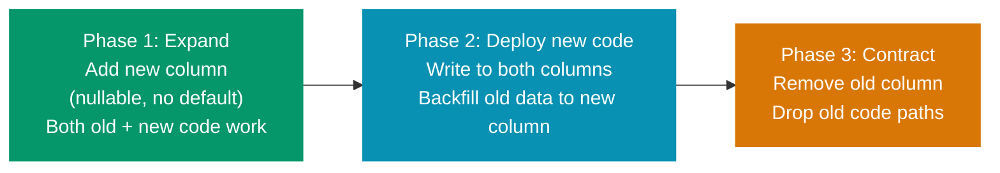

**⚠️ High-risk migrations and how to handle them safely:**

```sql
-- 🚫 DANGEROUS: Adding NOT NULL without default on large table
-- Old MySQL (< 8.0.12): rebuilds the whole table. PostgreSQL: errors (see the doubt below)
ALTER TABLE loans ADD COLUMN credit_bureau_score INT NOT NULL;

-- ✅ SAFE: Three-step approach
-- Step 1: Add nullable column (instant in PostgreSQL, fast in MySQL)
ALTER TABLE loans ADD COLUMN credit_bureau_score INT;

-- Step 2: Backfill in batches to avoid a long lock + huge WAL burst.
-- ⚠️ PostgreSQL has NO `UPDATE ... LIMIT` — that is a MySQL-only extension.
--    The PG idiom is a LIMITed subquery feeding the UPDATE:
UPDATE loans SET credit_bureau_score = 0
WHERE id IN (
    SELECT id FROM loans
    WHERE credit_bureau_score IS NULL
    ORDER BY id
    LIMIT 10000
    FOR UPDATE SKIP LOCKED     -- optional: lets parallel backfill workers not collide
);
-- Repeat (commit between batches) until 0 rows are affected.

-- 🐬 MySQL only — here the LIMIT clause is legal directly on the UPDATE:
-- UPDATE loans SET credit_bureau_score = 0 WHERE credit_bureau_score IS NULL LIMIT 10000;

-- Step 3: Add NOT NULL constraint + default (after backfill)
ALTER TABLE loans ALTER COLUMN credit_bureau_score SET NOT NULL;
ALTER TABLE loans ALTER COLUMN credit_bureau_score SET DEFAULT 0;
```

<details>
<summary><strong>🤔 Doubt: The comment says the NOT NULL add rebuilds the table in old MySQL — what does that exact statement do in PostgreSQL?</strong></summary>

In PostgreSQL, that exact statement behaves **differently from MySQL. It doesn't lock and rewrite. It fails at once.**

```sql
ALTER TABLE loans ADD COLUMN credit_bureau_score INT NOT NULL;
-- PostgreSQL:  ERROR: column "credit_bureau_score" of relation "loans" contains null values
```

PostgreSQL refuses to run it on a non-empty table:
- There is no value to put in existing rows.
- Existing rows would get `NULL`, but `NOT NULL` forbids it.
- So it errors at once, instead of locking the table.

MySQL is the less strict one. It **accepts** the statement and silently uses an implicit default (`0` for `INT`) for existing rows. In older versions, this cost a full table rebuild + lock. That is the danger the comment describes.

**The three cases side by side:**

| Statement | PostgreSQL | MySQL (InnoDB) |
|---|---|---|
| `ADD COLUMN x INT NOT NULL` (no default) | ❌️ **Errors** — "contains null values" | ⚠️ Succeeds via implicit default. Instant on 8.0.12+; before that, a table rebuild (online DDL since 5.6 still allows concurrent writes) |
| `ADD COLUMN x INT NOT NULL DEFAULT 0` | ✅ **Instant (PG 11+)** — default stored in catalog, no row rewrite · ❌️ full rewrite + `ACCESS EXCLUSIVE` lock on **PG < 11** | ✅ Instant (8.0.12+) · ❌️ rebuild (< 8.0.12) |
| `ADD COLUMN x INT` (nullable) | ✅ Instant, metadata-only | ✅ Instant (8.0.12+) |

So on **PostgreSQL 11+**, people usually use the quick fix `ADD COLUMN ... NOT NULL DEFAULT 0`. It is instant. PG stores the default in the catalog (`attmissingval`) and adds it on read, instead of writing every row.

The trap is **PG < 11**. There, the same `DEFAULT` causes a full table rewrite under `ACCESS EXCLUSIVE`. It locks the table for the whole rebuild — exactly the MySQL-style danger.

**Why the safe three-step pattern is still better:**
- nullable → batched backfill → `SET NOT NULL` works on every version, and avoids long locks on *both* engines.
- The PG 11+ instant-default path does not help when the real default must be **computed per row** (e.g. `credit_bureau_score` fetched from another table). A catalog default is a single constant, so you must backfill anyway.

> ⚠️ Do not confuse this with adding a NOT NULL constraint to an **existing** column (`SET NOT NULL`). That one must scan all rows to validate. For a **brand-new** column with no default, there is no value to check. It just errors.

---

</details>
<br/>

<details>
<summary><strong>🤔 Doubt: "Add a NOT NULL column to a 300M-row table with zero downtime" — what is the full step-by-step answer?</strong></summary>

🎥 **Watch:** [Add a Column to 300M Rows With Zero Downtime](https://www.youtube.com/shorts/GLjRyZTU2ms) (YouTube Short)

The three-step pattern above is the core. At 300M rows, the interviewer wants to hear **four extra traps**. Each one causes an outage even when the SQL looks "instant".

**The full plan (PostgreSQL):**

| Step | What you run | Why |
|---|---|---|
| **0. App first** | Deploy code that accepts `NULL` in the new column, and writes it for **new** rows | The backfill then only has to cover old rows. No row is missed. |
| **1. Add the column** | `SET lock_timeout = '2s';` then `ALTER TABLE loans ADD COLUMN risk_band INT;` — retry on timeout | Metadata-only, but it still needs a short `ACCESS EXCLUSIVE` lock (trap 1) |
| **2. Backfill** | Batches of 5k–10k rows by **primary-key range**, commit each batch, pause, watch replica lag | One giant `UPDATE` = long locks, WAL burst, replicas fall behind (trap 2) |
| **3. Vacuum** | Let autovacuum keep up, or run `VACUUM` between chunks | Every PG `UPDATE` leaves a dead row version — 300M of them (trap 3) |
| **4. Enforce NOT NULL** | `CHECK (risk_band IS NOT NULL) NOT VALID` → `VALIDATE CONSTRAINT` → `SET NOT NULL` → drop the check | Plain `SET NOT NULL` scans 300M rows under a full lock (trap 4) |
| **5. Index (if needed)** | `CREATE INDEX CONCURRENTLY` | Does not block writes |

**Trap 1 — the lock queue.** "Instant" `ADD COLUMN` still needs an `ACCESS EXCLUSIVE` lock for a few milliseconds. Suppose a long report query is running. The `ALTER` waits for it. **Every new query on `loans` then waits behind the `ALTER`.** The table looks down, even though the DDL itself is fast. The fix is `lock_timeout`: the `ALTER` gives up after 2 s, the queue clears, and you retry.

**Trap 2 — batch by key range, not by `IS NULL`.** `WHERE risk_band IS NULL LIMIT 10000` has no index on the new column. Each batch scans further into the table to find nulls, so later batches get slower. Walk the primary key instead:

```sql
UPDATE loans SET risk_band = 0
WHERE id >= :start AND id < :start + 10000
  AND risk_band IS NULL;
-- next batch: :start += 10000, until :start > max(id)
```

**Trap 3 — table bloat.** PostgreSQL never updates a row in place. Each `UPDATE` writes a new row version and leaves the old one dead. 300M updates can nearly double the table size until vacuum cleans it. Slow batches give autovacuum time to keep up.

**Trap 4 — `SET NOT NULL` without a long lock:**

```sql
ALTER TABLE loans ADD CONSTRAINT loans_risk_band_nn
    CHECK (risk_band IS NOT NULL) NOT VALID;          -- instant, checks only new writes
ALTER TABLE loans VALIDATE CONSTRAINT loans_risk_band_nn;  -- scans, but reads + writes continue
ALTER TABLE loans ALTER COLUMN risk_band SET NOT NULL;     -- PG 12+: skips the scan, uses the valid check
ALTER TABLE loans DROP CONSTRAINT loans_risk_band_nn;
```

`VALIDATE CONSTRAINT` takes only a `SHARE UPDATE EXCLUSIVE` lock, so normal traffic keeps running during the long scan.

**🐬 MySQL version of the same answer:**
- **8.0.12+:** `ALTER TABLE loans ADD COLUMN risk_band INT, ALGORITHM=INSTANT;` — metadata-only. It still needs a metadata lock, so the same queue trap applies. Set `lock_wait_timeout` low and retry.
- **When INSTANT is not possible** (old version, type change): use **gh-ost** or **pt-online-schema-change**. Both build a shadow copy of the table with the new schema, copy rows in chunks, keep it in sync (gh-ost reads the binlog; pt-osc uses triggers), and then swap the tables with a short rename.

💡 **Interview line:** *"Adding the column is the easy part — it's metadata-only. The risk is around it: the DDL lock queuing behind a long query, so I set a lock timeout and retry. Then a throttled backfill by primary-key range, watching replica lag. And NOT NULL goes in through a `NOT VALID` check plus `VALIDATE`, so nothing holds a full-table lock while 300M rows are scanned."*

---

</details>
<br/>

**🚀 Creating large indexes safely:**
```sql
-- 🚫 DANGEROUS (PostgreSQL): blocks all writes (INSERT/UPDATE/DELETE) for the whole build; reads still work
CREATE INDEX idx_loans_status ON loans (status);

-- ✅ SAFE (PostgreSQL): Create concurrently — does not block writes
CREATE INDEX CONCURRENTLY idx_loans_status ON loans (status);
-- Takes longer but allows reads and writes during index build
```

**⚙️ Flyway Spring Boot config:**
```yaml
spring:
  flyway:
    enabled: true
    locations: classpath:db/migration
    baseline-on-migrate: false
    validate-on-migrate: true   # fail fast if checksum mismatch
    out-of-order: false         # enforce strict version ordering
```

<details>
<summary><strong>🤔 Doubt: If Flyway owns the schema, what does JPA's <code>@Index</code> annotation actually do?</strong></summary>

**Nothing. It is documentation.** Answer this trap *before* the interviewer asks about it. The natural answer to *"how do you apply indexing in Spring Data JPA?"* is `@Index`. That answer fails on the first follow-up.

`@Table(indexes = @Index(...))` is read **only by Hibernate's schema generator**, i.e. `spring.jpa.hibernate.ddl-auto=create` / `create-drop` / `update`.
- Under `validate` or `none`, it emits **no DDL at all**.
- `ddl-auto=validate` does not help either. It checks **tables and columns**, never indexes. So a missing index does not even fail startup.

**Two traps inside the annotation**, for the case where Hibernate *does* own the schema (prototypes, `@DataJpaTest` against an embedded DB):

1. **`columnList` should use database column names, not entity field names.** That is what the JPA spec says. Under Spring Boot's default naming strategy (`CamelCaseToUnderscoresNamingStrategy` in Boot 3; `SpringPhysicalNamingStrategy` before), the field `createdAt` maps to the column **`created_at`**. Hibernate 6.3+ also passes each `columnList` name through that naming strategy. So `columnList = "createdAt"` becomes `created_at` and happens to work. Do not rely on it: with an explicit `@Column(name = ...)` or another JPA provider, it points at a column that does not exist. Write the real column name.
2. **Never declare `@Column(unique = true)` and `@Index(..., unique = true)` on the same column.** Hibernate emits a unique **constraint** for the first and a unique **index** for the second. That is two DDL objects enforcing one rule. It doubles the write cost of every `INSERT` and `UPDATE` on that table. Pick one. `@Column(unique = true)` is the usual choice.

✅ **The annotation compiling proves nothing — verify the index exists and is used:**

```sql
SHOW INDEX FROM users;                           -- MySQL
SELECT indexname FROM pg_indexes WHERE tablename = 'users';  -- PostgreSQL
EXPLAIN ANALYZE SELECT * FROM users
    WHERE status = 'ACTIVE' ORDER BY created_at; -- confirm Index Scan, not Seq Scan
```

---

</details>
<br/>

---

</details>

---

4. **🔑 What is a surrogate key vs a natural key? When do you use each? ⚡**

<!-- -->
<details>
<summary>Answer</summary>

**Answer:**

| Aspect | Natural Key | Surrogate Key |
|--------|------------|---------------|
| **Definition** | A key from the business domain | An artificial key created for the DB (auto-increment, UUID) |
| **Example** | `aadhar_number`, `pan_card`, `email` | `id BIGINT IDENTITY`, `id UUID` |
| **Stability** | ❌️ May change (email can be updated) | ✅ Never changes |
| **Size** | Variable (string) | ✅ Compact (4-8 bytes) |
| **Joins** | ❌️ Large string joins → more I/O | ✅ Integer joins → fast |
| **Readability** | ✅ Self-descriptive | ❌️ Meaningless number |
| **Uniqueness** | Depends on source data | ✅ Guaranteed by DB |

**Best practice — use surrogate key as PK, natural key as UNIQUE constraint:**
```sql
CREATE TABLE users (
    id            BIGINT GENERATED ALWAYS AS IDENTITY PRIMARY KEY,  -- surrogate key
    aadhar_number VARCHAR(12)  UNIQUE,       -- natural key (unique, but not PK)
    pan_card      VARCHAR(10)  UNIQUE,
    email         VARCHAR(255) UNIQUE,
    name          VARCHAR(100) NOT NULL
);
-- PostgreSQL: `GENERATED ALWAYS AS IDENTITY` is the SQL-standard auto-increment
-- (preferred over the older `BIGSERIAL`). MySQL equivalent: `BIGINT AUTO_INCREMENT`.
```

**🔢 Auto-increment (`IDENTITY` / `BIGSERIAL`; MySQL `AUTO_INCREMENT`) vs UUID as surrogate key:**

| | Auto-increment (BIGINT) | UUID (`uuid` type / VARCHAR) |
|--|------------------------|----------------------|
| **Size** | 8 bytes | 16 bytes (binary) / 36 bytes (string) |
| **Insert performance** | ✅ Sequential → optimal B-tree appends | ❌️ Random (v4) → B-tree fragmentation |
| **Distribution** | ❌️ Single sequence → shard hotspot | ✅ Random → even shard distribution |
| **Guessability** | ❌️ IDs are predictable | ✅ Not guessable (security) |
| **Best for** | Single-server, ordered tables | Distributed systems, external APIs |

For distributed/sharded systems → use UUIDs or ULIDs. ULID = Universally Unique Lexicographically Sortable Identifier. It is like a UUID with a timestamp prefix, so it sorts in order. **UUIDv7** (RFC 9562, 2024) does the same inside the standard UUID format.

🎯 **Interview Tip:** In APIs, expose surrogate keys only through opaque external IDs (UUID or encoded form). Opaque means the ID tells an outsider nothing. Never expose sequential integer IDs outside. They're enumerable: an attacker can try id=1, 2, 3... to scrape all resources. Use UUID or Base62-encoded ULID as the external identifier. Keep BIGINT inside for join performance.

---

</details>

---

5. **🗑️ What is a soft delete and when should you use it? 🔥**

<!-- -->
<details>
<summary>Answer</summary>

**Answer:**

A **soft delete** marks a record as deleted with a flag or a timestamp. It does not physically remove the row. The row stays in the database, and queries filter it out.

**Schema:**
```sql
ALTER TABLE loans ADD COLUMN deleted_at TIMESTAMP NULL;
ALTER TABLE loans ADD COLUMN deleted_by BIGINT NULL;

-- Soft delete
UPDATE loans SET deleted_at = NOW(), deleted_by = :userId WHERE id = :id;

-- Every query must filter deleted records
SELECT * FROM loans WHERE deleted_at IS NULL AND status = 'ACTIVE';
```

**🌿 Spring Data JPA integration with `@SQLDelete` + `@SQLRestriction`:**
```java
@Entity
@SQLDelete(sql = "UPDATE loans SET deleted_at = NOW() WHERE id = ?")
@SQLRestriction("deleted_at IS NULL")   // Hibernate 6.3+ replacement for @Where
public class Loan {
    @Id
    private Long id;
    private Timestamp deletedAt;
}

// loanRepository.delete(loan) now issues UPDATE instead of DELETE
// loanRepository.findAll() automatically appends WHERE deleted_at IS NULL
```

> ⚠️ **`@Where` is deprecated as of Hibernate ORM 6.3.** Use **`@SQLRestriction`** instead (and `@WhereJoinTable` → `@SQLJoinTableRestriction`). Spring Boot 3.2 ships Hibernate 6.3+, so `@Where` will compile with a deprecation warning. Naming the current annotation is an easy way to show that you work on a recent stack.

**✅ When to use soft deletes:**
- ✅ Audit/compliance requirement — keep the history of all records
- ✅ Financial records — transactions, loan applications must never be permanently deleted
- ✅ User-facing "undo" — let users recover items they deleted by mistake
- ❌️ Log/event tables — append-only by design; soft deletes add no value

**⚠️ Problems with soft deletes (and fixes):**

| Problem | Fix |
|---------|-----|
| `UNIQUE` constraint on `email` fails when re-registering a soft-deleted user | Partial unique index: `CREATE UNIQUE INDEX ON users(email) WHERE deleted_at IS NULL` |
| Every query needs `WHERE deleted_at IS NULL` — easy to forget | Use `@SQLRestriction` at entity level (Hibernate 6.3+; `@Where` before that) or a base repository that always filters |
| Index on `status` scans through deleted rows | Partial index: `CREATE INDEX ON loans(status) WHERE deleted_at IS NULL` |
| Table bloat from accumulating deleted rows | Periodic archival job: move old deleted rows to a cold archive table |
| Cascading — parent soft-delete must propagate to children | Handle in service layer; no DB-level cascade for soft deletes |

🎯 **Interview Tip:** In fintech, soft deletes are almost always required for audit compliance. Regulatory bodies require a full history of all records. The most common production bug: a new query forgets `WHERE deleted_at IS NULL` and gets back deleted records. `@SQLRestriction` prevents this at the ORM level. But it doesn't help for native queries.

<details>
<summary><strong>🤔 Doubt: `is_deleted` (boolean) vs `deleted_at` (timestamp) — which is more used?</strong></summary>

Prefer **`deleted_at` (nullable timestamp)** + **`deleted_by`**.

- A boolean only answers *"is it deleted?"*.
- A timestamp answers *"is it deleted, **and when**?"* in one column.
- You almost always end up needing the *when*: retention/purge jobs, "deleted in last 30 days", audit trails.

| | `is_deleted` (boolean) | `deleted_at` (timestamp) |
|---|---|---|
| Carries the deletion time | ❌️ No (need a 2nd column) | ✅ Yes — `IS NULL` = live |
| Pairs with `deleted_by` audit | Not matching | ✅ Matching pair (`_on` + `_by`) |
| Indexing | Plain index on bit | ✅ **Partial index** `WHERE deleted_at IS NULL` (better) |
| Verdict | Only if you truly never need the time | ✅ **Default choice** |

💡 **Match your existing audit-column convention.** Your tables may already carry `created_on / created_by / updated_on / updated_by`. Then name it **`deleted_on / deleted_by`** so the names match. A boolean `is_deleted` would break the consistent `_on` + `_by` pattern. Do not keep *both* a boolean and a timestamp. It is redundant, and the two can get out of sync.

---

</details>
<br/>

---

</details>

---

6. **📊 How do you design an audit log table? 🔥**

<!-- -->
<details>
<summary>Answer</summary>

**Answer:**

An audit log records **who changed what, when, and what changed**. You need it for compliance, debugging, and forensics (investigating what happened after an incident).

**🏗️ Pattern 1: Dedicated audit table per entity**
```sql
CREATE TABLE loan_audit (
    id          BIGINT GENERATED ALWAYS AS IDENTITY,  -- ⚠️ PG 17+ only; on PG < 17 use BIGSERIAL
    loan_id     BIGINT NOT NULL,
    action      VARCHAR(10) NOT NULL CHECK (action IN ('CREATE','UPDATE','DELETE')),
    changed_by  BIGINT NOT NULL,
    changed_at  TIMESTAMP NOT NULL DEFAULT CURRENT_TIMESTAMP,
    old_values  JSONB,                       -- JSONB > JSON in PG: binary, indexable
    new_values  JSONB,
    ip_address  VARCHAR(45),
    PRIMARY KEY (id, changed_at)             -- ⚠️ PK must include the partition key
) PARTITION BY RANGE (changed_at);

-- Partitions are separate tables (FROM inclusive, TO exclusive)
CREATE TABLE loan_audit_2025 PARTITION OF loan_audit
    FOR VALUES FROM ('2025-01-01') TO ('2026-01-01');
CREATE TABLE loan_audit_2026 PARTITION OF loan_audit
    FOR VALUES FROM ('2026-01-01') TO ('2027-01-01');

-- Indexes are SEPARATE statements in PG (no inline INDEX in CREATE TABLE).
-- Declared on the parent, they cascade to every partition automatically.
CREATE INDEX idx_loan_audit_loan_id    ON loan_audit (loan_id);
CREATE INDEX idx_loan_audit_changed_at ON loan_audit (changed_at);
```

> ⚠️ **PG partitioning trap:**  
> - On a partitioned table, any `PRIMARY KEY` / `UNIQUE` constraint **must contain every partition-key column**. So the PK here is `(id, changed_at)`, not `id` alone.  
> - For `action`, PG has no inline `ENUM(...)`. Use a `CHECK` constraint (shown) or a separate `CREATE TYPE action_t AS ENUM (...)`.  
> - MySQL equivalent: `id BIGINT AUTO_INCREMENT`, inline `ENUM`, inline `INDEX`, and `PARTITION BY RANGE (YEAR(changed_at)) (… VALUES LESS THAN …)`. MySQL has the same PK rule, so the PK is still `(id, changed_at)`. `YEAR()` needs a `DATETIME` column; for a `TIMESTAMP` column, MySQL allows only `UNIX_TIMESTAMP()`.

**🗂️ Pattern 2: Generic audit table (all entities in one table)**
```sql
CREATE TABLE audit_log (
    id          BIGINT GENERATED ALWAYS AS IDENTITY PRIMARY KEY,
    entity_type VARCHAR(50)  NOT NULL,   -- 'LOAN', 'USER', 'PAYMENT'
    entity_id   BIGINT       NOT NULL,
    action      VARCHAR(20)  NOT NULL,
    changed_by  BIGINT       NOT NULL,
    changed_at  TIMESTAMP    NOT NULL,
    old_values  JSONB,
    new_values  JSONB
);

-- Indexes declared separately (not partitioned here, so id alone can be the PK)
CREATE INDEX idx_audit_entity     ON audit_log (entity_type, entity_id);
CREATE INDEX idx_audit_changed_at ON audit_log (changed_at);
```

<details>
<summary><strong>🤔 Doubt: Why <code>JSONB</code> over plain <code>JSON</code> for old_values / new_values?</strong></summary>

**`JSONB` stores JSON in a parsed *binary* form. `JSON` stores the raw text as it is.** Every other difference comes from this:

| | `JSON` (text) | `JSONB` (binary) |
|---|---|---|
| Storage | Exact input string (whitespace, key order, duplicate keys preserved) | Parsed binary — whitespace stripped, keys deduped, no order kept |
| Query into keys | ❌️ Re-parses the string every access | ✅ Fields addressable directly (`->`, `->>`, `@>`) |
| **Indexable** | ❌️ Not usefully | ✅ **GIN index** on the whole doc or a specific key |
| Write cost | Slightly cheaper (no parse) | Slightly higher (parse on insert) |

For an audit table, you almost always want to **query by what changed**. For example, "find every row where `new_values` set `status = 'CLOSED'`":

```sql
-- Needs JSONB — containment operator, GIN-indexable
SELECT * FROM audit_log WHERE new_values @> '{"status": "CLOSED"}';
CREATE INDEX idx_audit_newvals ON audit_log USING GIN (new_values);
```

With plain `JSON`, the `@>` operator does not exist at all. Other key lookups (`->>`) re-parse the text on every row. `JSONB` has only two real costs:

- a slightly slower insert
- it does not keep key order/whitespace

Neither matters for audit snapshots.

> 💡 A `CLOB` / `TEXT` column is even worse. It is a plain string with **no** JSON operators or indexing at all. Simple rule in PostgreSQL: **default to `JSONB`**. Use `JSON` only if you must keep the original document byte-for-byte (rare).

---

</details>
<br/>

**⚙️ Implementation approaches:**

**Option A — Hibernate Envers (zero boilerplate):**
```java
@Entity
@Audited   // Hibernate Envers auto-generates loan_AUD table
public class Loan {
    @Id private Long id;
    private BigDecimal amount;
    private String status;
}
// Envers creates loan_AUD: id, REV (revision #), REVTYPE (0=ADD,1=MOD,2=DEL), + all columns
// Query: AuditReader.createQuery().forRevisionsOfEntity(Loan.class, ...)
```

**Option B — Spring AOP for custom audit:**
```java
@Aspect
@Component
public class AuditAspect {
    @AfterReturning(pointcut = "@annotation(Auditable)", returning = "result")
    public void logAudit(JoinPoint joinPoint, Object result) {
        // extract principal, timestamp, entity → save to audit_log
    }
}
```

**🔑 Key design decisions:**

| Decision | Trade-off |
|----------|-----------|
| **`JSONB` for old/new values** | ✅ Flexible — no schema changes when the entity changes. **It is still queryable/indexable** (`@>` containment + a GIN index, as shown above). ❌️ Costs a parse on write, loses key order, and each row carries its own key names. *(Plain `JSON` — the text type — is the one you can't usefully index. That is exactly why `JSONB` is the choice.)* |
| **Synchronous write (same transaction)** | ✅ Audit entry guaranteed if business transaction commits. ❌️ Slightly slower. Required for financial compliance. |
| **Async write (Kafka / @Async)** | ✅ No latency impact. ❌️ Possible audit loss on crash. Acceptable for non-critical audit. |
| **Partition by month** | ✅ Fast time-range queries, easy old-data archival. Required for high-write audit tables. |

🎯 **Interview Tip:** "How would you track every change to a loan record?" is a classic fintech interview question. Answer in this order:

1. Start with Hibernate Envers (fastest to implement, full history).
2. Then mention the JSON snapshot pattern for custom control.
3. State the compliance requirement: audit writes must be in the same transaction as the business write. Async audit loses entries on crash.

<details>
<summary><strong>🤔 Doubt: With <code>PARTITION BY RANGE (changed_at)</code>, does a query only hit the relevant partition?</strong></summary>

Yes. This is called **partition pruning** (skipping partitions that cannot match). *But it works only when the `WHERE` filters on the partition key (`changed_at`)*:

| Query | What happens |
|---|---|
| `WHERE changed_at >= '2025-03-01' AND changed_at < '2025-04-01'` | ✅ Planner **prunes** to just `loan_audit_2025` |
| `WHERE loan_id = 42` (no `changed_at` filter) | ❌️ No pruning — must consult **all partitions** (each via its local `loan_id` index) |

⚠️ **Three things that cause mistakes:**

1. **"All partitions" ≠ "full table scan."** PostgreSQL has **no global indexes**. Every index is per-partition. Without a `changed_at` filter, a `loan_id` lookup becomes N local index scans (one per partition). It is not one giant seq scan. But the cost still grows with the partition count. That is *why* pruning matters.
2. **Wrapping the key in a function stops pruning.** Compare the **bare** column to constants:
   ```sql
   WHERE changed_at >= '2025-06-01' AND changed_at < '2025-07-01'   -- ✅ prunes
   WHERE date_trunc('month', changed_at) = '2025-06-01'             -- ❌️ may NOT prune
   WHERE EXTRACT(YEAR FROM changed_at) = 2025                        -- ❌️ may NOT prune
   ```
3. **Plan-time vs run-time pruning.** Literal constants prune at **plan time** (fewer partitions show in `EXPLAIN`). Values from bind parameters or joins prune at **run time** (PG 11+). Bind parameters prune at executor start: the plan shows `Subplans Removed: N`. Join values prune during execution: `EXPLAIN ANALYZE` marks those partitions `(never executed)`.

✅ **Verify with `EXPLAIN`:** if the plan lists only `loan_audit_2025`, pruning worked.

---

</details>
<br/>

---

</details>

---

## 6. NoSQL and Distributed Concepts

1. **🌐 What is the CAP theorem? How does it apply in practice? 🔥🔥**

<!-- -->
<details>
<summary>Answer</summary>

**Answer:**

The **CAP theorem** says a distributed data store can guarantee at most **2 of 3** properties at the same time:

| Property | Definition |
|----------|-----------|
| **C — Consistency** | Every read returns the most recent write (or an error) |
| **A — Availability** | Every request receives a non-error response (may not be the latest data) |
| **P — Partition Tolerance** | The system keeps operating even when network partitions (message loss) occur between nodes |

**The key point:** In any real distributed system, network partitions WILL happen. So **P is not optional**. The real choice is this: when a partition occurs, do you choose **Consistency** or **Availability**?

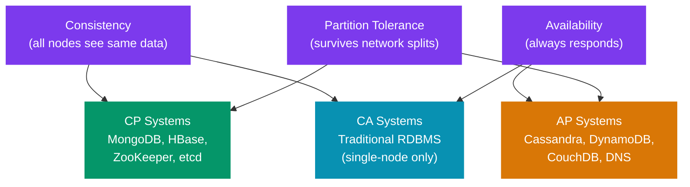

**🟢 CP — Consistency + Partition Tolerance:**
- On partition: return an error instead of serving possibly stale data
- Examples: ZooKeeper, etcd, MongoDB (primary-only writes), HBase
- Use when: banking, distributed locking, leader election — stale data = wrong result

**🟠 AP — Availability + Partition Tolerance:**
- On partition: return the best available (possibly stale) data
- Examples: Cassandra, DynamoDB (default), CouchDB, DNS
- Use when: social feeds, product catalog, shopping cart — brief staleness is acceptable

**🔹 "CA" systems:** These only make sense for single-node deployments (no partition). Once you distribute, you must choose CP or AP during partitions.

🎯 **Interview Tip:** Don't say "we chose CA." In a distributed system, partitions cannot be avoided. When one occurs, you always choose between CP and AP. The business question is: "Which failure mode is worse — serving stale data, or refusing to serve at all?" For payment balances: CP. For a news feed: AP.

---

</details>

---

2. **⚖️ What is BASE and how does it contrast with ACID? 🔥🔥**

<!-- -->
<details>
<summary>Answer</summary>

**Answer:**

**BASE** (Basically Available, Soft state, Eventually consistent) is the consistency model used by most NoSQL and distributed databases. Its idea is the opposite of ACID.

| Property | ACID | BASE |
|----------|------|------|
| **Consistency** | Strong — every read reflects the latest committed write | Eventual — reads may return stale data temporarily |
| **On failure/partition** | Prefers correctness — may reject operations to avoid serving stale data | Prefers availability — continues serving best-available (possibly stale) data |
| **State** | Hard state — committed = permanent and immediately visible | Soft state — system may be in transition between states |
| **Transactions** | Full multi-row ACID with rollback | Limited — often single-item only (DynamoDB `TransactWriteItems`: up to 100 items, one region) |
| **System type** | Traditional RDBMS (PostgreSQL, MySQL) | Cassandra, DynamoDB, CouchDB |

**🔒 ACID example (PostgreSQL — fund transfer):**
```sql
BEGIN;
UPDATE accounts SET balance = balance - 1000 WHERE user_id = 1;
UPDATE accounts SET balance = balance + 1000 WHERE user_id = 2;
COMMIT;
-- Atomic: both updates succeed or both roll back
-- Any concurrent read sees either both or neither — never an intermediate state
```

**🔓 BASE example (DynamoDB — eventual consistency):**
```
Write goes to the partition's leader replica → acknowledged to client
Other replicas (in other AZs of the same region) → updated asynchronously (usually < 1 s)
An eventually consistent read may hit a lagging replica and return the old value
→ "Eventually consistent" — converges once all replicas receive the write
(DynamoDB also offers strongly consistent reads, at 2× the read cost)
```

**🎛️ Tunable consistency in Cassandra:**
```
CONSISTENCY ONE    → read from 1 replica (fastest, possibly stale)
CONSISTENCY QUORUM → read from majority of replicas (balanced)
CONSISTENCY ALL    → read from all replicas (strongest, slowest)
```

**✅ When to use each:**
- ✅ ACID — financial balances, inventory counts, order records (correctness over speed)
- ✅ BASE — user sessions, social feeds, product catalog, counters (speed over perfect consistency)

🎯 **Interview Tip:** In system design rounds, ACID vs BASE is a core trade-off decision. State your choice clearly. "For the payment ledger I'd use PostgreSQL with ACID transactions because showing a wrong balance is unacceptable. For the notification feed I'd use DynamoDB because eventual consistency is fine and I need the write throughput." Most real systems use both.

---

</details>

---

3. **🗄️ SQL vs NoSQL — when do you choose each? 🔥🔥**

<!-- -->
<details>
<summary>Answer</summary>

**Answer:**

| Aspect | SQL (RDBMS) | NoSQL |
|--------|-------------|-------|
| **Schema** | Fixed schema — migrations required to change | Flexible / schema-less |
| **Consistency** | Strong ACID | Eventual (mostly); MongoDB 4+ supports multi-doc ACID |
| **Scaling** | Vertical + read replicas; horizontal sharding is hard | Horizontal sharding built-in |
| **Query flexibility** | Rich SQL — JOINs, aggregations, window functions | Limited; denormalized model, no JOINs |
| **Transactions** | Full multi-row, multi-table ACID | Limited (single document / row atomic) |
| **Maturity** | Decades of battle-tested tooling | Varies by system |

**📦 NoSQL types and when to use each:**

| Type | Examples | Best use case |
|------|----------|--------------|
| **Document** | MongoDB, Couchbase, Amazon DocumentDB, Firestore, CouchDB, RavenDB | User profiles, product catalogs, CMS — flexible, nested data |
| **Key-Value** | Redis, DynamoDB, Memcached, Valkey, Riak KV, etcd, Aerospike | Sessions, caches, carts, leaderboards — fast O(1) lookups |
| **Wide-Column** | Cassandra, ScyllaDB, HBase, Google Bigtable, Amazon Keyspaces | Time-series, IoT sensor data, activity logs — massive write throughput |
| **Graph** | Neo4j, Amazon Neptune, ArangoDB, JanusGraph, TigerGraph, Dgraph | Social networks, fraud detection, recommendations — relationship queries |

**🧭 Decision framework:**

```
Need complex JOINs across entities?           → SQL
Need ACID across multiple rows/tables?        → SQL
Schema is well-defined and stable?            → SQL

Need >100K writes/sec?                        → NoSQL (Cassandra / DynamoDB)
Access pattern is key-value or document?      → NoSQL
Schema evolves frequently or is flexible?     → NoSQL (Document DB)
Need global distribution with low latency?    → NoSQL (DynamoDB Global Tables)
```

```
PostgreSQL  → loan records, accounts, transactions (ACID + complex queries)
Redis       → sessions, rate limiting, distributed locks (key-value, sub-ms)
MongoDB     → KYC documents, application metadata (flexible schema)
DynamoDB    → audit events, notification log (high-volume append-only)
```

🎯 **Interview Tip:** Never say "NoSQL scales better." A well-tuned PostgreSQL on a large instance with read replicas handles hundreds of millions of rows. The right answer is:

- SQL when you need relational integrity and complex queries.
- NoSQL when you need write throughput, flexible schema, or global distribution.

Name the specific NoSQL type for the use case (not just "NoSQL"). This shows real depth.

---

</details>

---

4. **🔀 What is MVCC and how does it enable concurrent reads and writes without locking? 🔥🔥**

<!-- -->
<details>
<summary>Answer</summary>

**Answer:**

**MVCC (Multi-Version Concurrency Control)** is the mechanism PostgreSQL and MySQL (InnoDB) use so that concurrent reads and writes do not block each other. Instead of locking rows, each transaction works on its own **snapshot** of the data.

**⚙️ How it works:**

In PostgreSQL, each row version has hidden metadata columns:
- `xmin` — transaction ID that created this row version
- `xmax` — transaction ID that deleted/updated this row version (0 if still current)

When a transaction **reads** a row, it only sees versions where `xmin ≤ snapshot_txid` and `xmax = 0` (or `xmax > snapshot_txid`). This is simplified. The real check also asks whether `xmin`/`xmax` committed, and whether they were still running when the snapshot was taken.

> ⚠️ **InnoDB is different.** It has no `xmin`/`xmax`. Each row stores `DB_TRX_ID` (the last transaction that wrote it) and `DB_ROLL_PTR` (a pointer to the older version in the **undo log**). Old versions live in the undo log, not in the table.

When a transaction **updates** a row, it:
1. Creates a **new row version** with its transaction ID as `xmin`
2. Sets `xmax` on the old version to mark it as replaced
3. Does NOT overwrite in place

```
T1 starts (txid=100), REPEATABLE READ — one snapshot for the whole transaction
T2 starts (txid=101), updates row X: amount 500 → 600, commits

Row X in storage:
  Version A: amount=500, xmin=50, xmax=101   ← old version (superseded by T2)
  Version B: amount=600, xmin=101, xmax=0    ← current version

T1 reads row X:
  T1's snapshot was taken at txid=100 → T101 is after snapshot
  T1 sees Version A: amount=500 (consistent with its snapshot — no dirty read)
  (Under READ COMMITTED, each statement takes a new snapshot → T1 would see 600)

T3 starts after T2 commits (txid=102):
  T3 sees Version B: amount=600 (T101 is now committed and before snapshot)
```

**✅ Benefits:**
- ✅ Readers never block writers; writers never block readers
- ✅ Long-running reports don't block OLTP transactions
- ✅ Enables REPEATABLE READ without taking read locks

**❌️ Downsides:**
- ❌️ **Dead row versions (table bloat)** — old versions accumulate until `VACUUM` runs
- ❌️ **Long-running transactions** — an open transaction holds back VACUUM (all versions after it must be kept). This causes bloat with no limit
- ❌️ **Transaction ID wraparound** — PostgreSQL uses 32-bit txids. You must run `VACUUM FREEZE` regularly to prevent wraparound (near XID exhaustion, PostgreSQL refuses new write transactions until VACUUM runs; reads still work)

**📊 Monitoring in PostgreSQL:**
```sql
-- Check dead tuples (bloat indicator)
SELECT relname, n_live_tup, n_dead_tup,
       round(100.0 * n_dead_tup / nullif(n_live_tup + n_dead_tup, 0), 1) AS dead_pct
FROM pg_stat_user_tables
ORDER BY n_dead_tup DESC;
-- Alert if dead_pct > 10%

-- Check for long-running transactions blocking VACUUM
-- (xact_start = transaction age; this also finds 'idle in transaction' sessions)
SELECT pid, state, now() - xact_start AS xact_age, query
FROM pg_stat_activity
WHERE xact_start < now() - interval '5 minutes'
ORDER BY xact_start;
```

🎯 **Interview Tip:** MVCC is the reason PostgreSQL gets high read concurrency without locking. The downside is table bloat from dead rows. It is one of the most common PostgreSQL production issues. The root cause is often a forgotten long-running transaction (idle-in-transaction). It stops autovacuum from cleaning up dead versions. Set `idle_in_transaction_session_timeout` to auto-kill abandoned transactions.

---

</details>

---

5. **📝 What is the Write-Ahead Log (WAL) and how does it ensure durability? 🔥**

<!-- -->
<details>
<summary>Answer</summary>

**Answer:**

The **Write-Ahead Log (WAL)** is the mechanism that guarantees durability (the "D" in ACID).

- Before any data page is modified on disk, the database first writes the change sequentially to the WAL.
- If the server crashes, the database replays the WAL on startup. This recovers all committed changes.

**🤔 Why WAL is needed:**
- Writing data pages randomly across disk is slow (random I/O)
- The WAL is a sequential append-only file — sequential writes are 10-100x faster
- Data pages can be written to disk later, in the background (checkpoints). Durability comes from the WAL, not from immediate page flushes

**🌊 WAL write flow:**

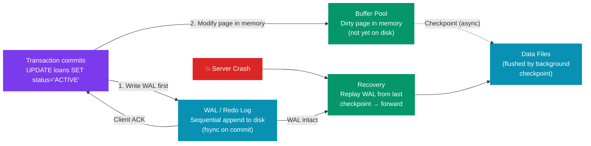

**MySQL InnoDB — `innodb_flush_log_at_trx_commit` (critical production setting):**

| Value | Behaviour | Risk |
|-------|-----------|------|
| `1` (default) | fsync WAL on every commit | ✅ Full durability — zero data loss |
| `2` | Write to OS buffer cache on commit; fsync every second | ⚠️ Up to 1s data loss on OS crash |
| `0` | Write + fsync every second | ❌️ Up to 1s data loss on DB crash |

**Never set to `0` or `2` in production for financial data.**

<details>
<summary><strong>🤔 Doubt: What does "fsync" actually mean — isn't a write already a write to disk?</strong></summary>

No. A file write happens in **two separate steps**. Only the second one is durable:

1. **`write()`** copies the bytes into the kernel's **page cache** (RAM) and returns immediately. The file *looks* updated. But a power cut at this point loses those bytes.
2. **`fsync(fd)`** tells the kernel to push that file's cached data down to the storage device. It **blocks until the device confirms**. Only after it returns does the data survive a power loss.

```
write()  → OS page cache (RAM)          ← lost on power cut
fsync()  → page cache → disk (SSD/EBS)  ← survives power cut
```

`fsync` is the expensive step because it waits on the device. This is exactly what `innodb_flush_log_at_trx_commit` controls. Every value *writes* the redo log. What changes is **when it is fsynced**:

| Value | Log `write()` | Log `fsync()` | Survives MySQL crash? | Survives OS crash / power loss? |
|---|---|---|---|---|
| **1** | every commit | **every commit** | ✅ | ✅ |
| **2** | every commit | once per second | ✅ bytes already sit in the OS page cache | ❌️ up to ~1 s lost |
| **0** | once per second | once per second | ❌️ up to ~1 s lost | ❌️ |

- **Why `2` survives a MySQL crash:** when the mysqld process dies, the kernel's page cache is not wiped. The OS still flushes those bytes. Only an OS crash or power cut loses them.
- **`1` is the only value where `COMMIT OK` means "on disk".** The client does not get an acknowledgement until the fsync returns. Memory hook: **1 = one fsync per commit.**
- **This is also why the WAL is not "cheaper because it stays in memory."** It is fsynced like everything else. Otherwise durability means nothing. It is cheaper because it is **one sequential append** instead of scattered random writes to data pages.

</details>

**📡 WAL beyond durability:**
- **Streaming replication** — WAL segments are shipped to replicas in real time (PostgreSQL / MySQL binlog)
- **Logical replication / CDC** (change data capture) — tools like Debezium decode WAL entries to capture every row change as events → Kafka
- **Point-in-time recovery (PITR)** — archive all WAL segments → restore DB to any second in history

🎯 **Interview Tip:** If asked "how does the DB survive a crash?", the full answer is: WAL + checkpoints.

- Every committed change is in the WAL before the client gets an ACK.
- Checkpoints flush dirty pages to disk at regular intervals.
- On crash: replay WAL from the last checkpoint forward.

Also mention CDC via WAL decoding. It is the base of change data capture pipelines (Debezium → Kafka).

---

</details>

---

6. **🔵 What is consistent hashing and why is it used in distributed systems? 🔥**

<!-- -->
<details>
<summary>Answer</summary>

**Answer:**

**Consistent hashing** spreads data across nodes. When nodes are added or removed, only a small fraction of keys must be remapped — not all data.

**❌️ The problem with naive modulo hashing:**
```
shard = hash(key) % N     // N = number of nodes

// Add 1 node: N changes from 4 → 5
// hash(key) % 4 ≠ hash(key) % 5 for ~80% of keys
// → catastrophic: 80% of all data must migrate to a different node
```

**✅ Consistent hashing solution:**

Place both nodes and keys on a virtual **hash ring** (0 to 2³²). Each key goes to the **first node clockwise** from its position on the ring.

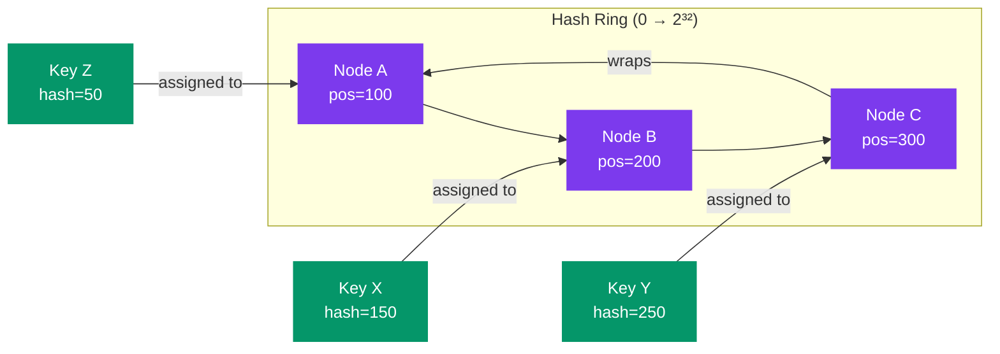

**➕ Adding a node:** Only keys between the new node and its predecessor are moved — approximately `1/N` of total keys.

**➖ Removing a node:** Only that node's keys are moved to its successor — `1/N` of total keys.

**🔵 Virtual nodes (vnodes):**
Each physical node gets multiple positions on the ring (e.g., 150 virtual positions). This gives even distribution even with few physical nodes. It also allows gradual capacity changes (a larger node gets more virtual positions).

**🌍 Real-world usage:**

| System | How it uses consistent hashing |
|--------|-------------------------------|
| **Cassandra** | Partitions rows across nodes by partition key hash; each node owns a token range |
| **DynamoDB** | The 2007 Dynamo paper used a consistent-hashing ring. Today's DynamoDB uses a partition map instead (2022 paper) |
| **CDN** | Route user requests to the edge node most likely to have the cached content |

**🚩 The counter-example worth knowing — Redis Cluster does NOT use consistent hashing.**

Redis's own docs say it directly: *"Redis Cluster does not use consistent hashing, but a different form of sharding where every key is conceptually part of what we call a hash slot."*

| | Consistent hashing (Cassandra) | Hash slots (Redis Cluster) |
|---|---|---|
| Key → location | `hash(key)` → **first node clockwise** on a ring | `CRC16(key) mod 16384` → a **fixed slot number** |
| Number of buckets | Effectively continuous (2³² ring positions) | Exactly **16,384**, forever |
| Node ownership | Implicit — derived from ring adjacency | Explicit — an **admin/`CLUSTER` command assigns slot ranges to nodes** |
| Resharding | Adding a node steals whatever range falls next to it | You **deliberately migrate slots** (`CLUSTER SETSLOT … MIGRATING/IMPORTING`) |

Both reach the same *goal*: adding a node moves only ~`1/N` of the keys instead of ~80%. But they use different mechanisms. A slot map is a **fixed indirection layer** (a fixed lookup table between key and node), not a ring. Most candidates treat the two as the same. So if you name this correctly, the interviewer trusts your answer more.

🎯 **Interview Tip:** When asked "how does Cassandra distribute data?", the answer is consistent hashing + virtual nodes (vnodes). The key point vs naive modulo: only `1/N` keys move when the cluster changes, not all keys. Always mention vnodes. They solve the uneven distribution problem that occurs with few physical nodes. If they follow up with Redis Cluster, do **not** say "same thing". Say "hash slots, 16,384 of them, explicitly mapped."

---

</details>

---

7. **🔗 Two-phase commit vs Saga — how do you handle distributed transactions? 🔥🔥**

<!-- -->
<details>
<summary>Answer</summary>

**Answer:**

When a transaction spans multiple services or databases, a single ACID transaction is not possible. Two patterns handle this:

**🔗 Pattern 1: Two-Phase Commit (2PC)**

A coordinator controls all participants in two phases:

1. **Prepare:** Coordinator asks all participants "Can you commit?" Each locks its resources and votes Yes/No.
2. **Commit/Rollback:** If all say Yes → Commit. If any says No → Rollback.

```
Coordinator → Wallet Service:   "Prepare: debit ₹10,000 from user 1"  → "Yes, prepared"
Coordinator → Payment Service:  "Prepare: create payment record"        → "Yes, prepared"
Coordinator → both:             "COMMIT"
```

**⚠️ Problems with 2PC:**
- ❌️ **Blocking** — if the coordinator crashes between Prepare and Commit, participants hold locks with no time limit
- ❌️ **Tight coupling** — all participants must be available simultaneously
- ❌️ **Performance** — two network round trips, with locks held the whole time
- ✅ Strong consistency — used in: XA transactions, Google Spanner (with Paxos replacing single coordinator)

**🎭 Pattern 2: Saga Pattern** (preferred for microservices)

Break the distributed transaction into a sequence of local transactions. If a step fails, **compensating transactions** undo the previous steps.


**🎬 Choreography vs Orchestration Saga:**

| | Choreography | Orchestration |
|--|--|--|
| **How** | Each service emits and listens to domain events | Central orchestrator commands each step |
| **Coupling** | Loose — services don't know each other | Orchestrator knows all steps |
| **Observability** | Hard to trace the full flow | Easy to monitor in one place |
| **Tools** | Kafka events | Spring State Machine, Temporal, Netflix Conductor |

**⚖️ Saga trade-offs:**
- ✅ No distributed locks; no coordinator single-point-of-failure
- ✅ Each service can be deployed on its own
- ❌️ **Eventual consistency only** — intermediate states are visible to concurrent reads
- ❌️ Compensating transactions can themselves fail — need idempotency + retry

**📮 Making Saga reliable — the Outbox Pattern:**
```java
// In the same local DB transaction:
@Transactional
public void debitWallet(Long userId, BigDecimal amount) {
    walletRepository.debit(userId, amount);          // business write
    outboxRepository.save(new WalletDebitedEvent()); // event write — same transaction
}
// Separate outbox relay reads events and publishes to Kafka
// Guarantees at-least-once delivery without dual-write inconsistency
```

🎯 **Interview Tip:** 2PC is rarely used in modern microservices — use Saga instead. The three requirements for a reliable Saga:

1. Every local transaction must be **idempotent** (safe to retry on failure/duplicate event).
2. Compensating transactions must also be idempotent.
3. Use the **Outbox Pattern** to guarantee event delivery. Never publish to Kafka inside a `@Transactional` method without it. The DB commit and the Kafka publish are two separate systems, and they can get out of sync after a crash.

---

</details>

---

## 🎥 Recommended Video

- **[Consistent Hashing ~ Key Concepts in System Design](https://www.youtube.com/watch?v=Nq_07Nhz2WM)** (Gaurav Sen) — explains why naive `hash(key) % N` breaks on node add/remove, then builds the ring and virtual nodes. Goes well with the **sharding** section above.
- **2PC and Saga** — distributed transactions: 2PC's blocking/coordinator-failure trade-off vs. Saga's compensating transactions and orchestration vs. choreography.
  - **[The Saga Pattern in Microservices (EDA — part 2)](https://www.youtube.com/watch?v=C0rGwyJkDTU)** — orchestration vs. choreography.
  - **[Saga Design Pattern for managing Distributed Transactions](https://www.youtube.com/watch?v=Z4Ug7NL2VAk)** (Defog Tech) — fundamentals + compensating-transaction mechanics.
  - **[Baeldung — Two-Phase Commit vs Saga Pattern](https://www.baeldung.com/cs/two-phase-commit-vs-saga-pattern)** — covers the 2PC blocking / coordinator-failure part that the videos cover only briefly.
- **[Add a Column to 300M Rows With Zero Downtime](https://www.youtube.com/shorts/GLjRyZTU2ms)** (YouTube Short) — a short take on adding a column to a huge live table. Goes with **§5 Q3** (safe migrations) and its 300M-row doubt.

---
