# Redis Interview Questions

**Redis Interview Questions** | A full guide to Redis data structures, caching patterns, persistence, high availability, distributed locking, and Spring Data Redis. Also see: [Spring Core](https://github.com/vikas9dev/java/blob/main/1_interview_questions/09_Spring_Core_Interview_Questions.md) | [Microservices](https://github.com/vikas9dev/java/blob/main/1_interview_questions/17_Spring_Microservices_Interview_Questions.md)

📊 **Question Count by Section**

| # | Section | Questions |
|---|---|---|
| 1 | [Redis Fundamentals](#redis-fundamentals) 🔥 | 5 |
| 2 | [Caching Patterns](#caching-patterns) 🔥 | 8 |
| 3 | [Cache Problems and Solutions](#cache-problems-and-solutions) 🔥🔥 | 8 |
| 4 | [Eviction Policies](#eviction-policies) 🔥 | 6 |
| 5 | [Redis Persistence](#redis-persistence) 🔥 | 5 |
| 6 | [Redis High Availability, Operations and Security](#redis-high-availability) 🔥 | 7 |
| 7 | [Distributed Locking and Transactions](#distributed-locking-and-transactions) 🔥🔥 | 6 |
| 8 | [Spring Data Redis and Real-World Patterns](#spring-data-redis-and-real-world-patterns) 🔥 | 6 |
| 9 | [Optional — Rarely Asked](#optional-rarely-asked) (Pub/Sub, Streams, env config, Redis versions) 💤 Optional | 6 |
| | **Total** | **57** |

> 🔥🔥 Very High — asked in almost every Tier-1 loop &nbsp;·&nbsp; 🔥 High — very frequent in Tier-1 interviews &nbsp;·&nbsp; ⚡ Medium — commonly asked &nbsp;·&nbsp; 💤 Low — good to know, rarely asked

<details>
<summary><strong>⚡ Quick: redis-cli commands 🛠️</strong></summary>

| Task | Command | Note |
|---|---|---|
| **Keys** — list | `SCAN 0` | Repeat `SCAN <cursor>` until cursor = `0` |
| | `SCAN 0 MATCH user:*` | Filter by pattern |
| | `KEYS *` | ⚠️ Local only — blocks Redis |
| | `DBSIZE` | Key count in current db |
| **DBs** — list | `INFO keyspace` | Only dbs that have keys |
| | `CONFIG GET databases` | Total count (default 16) |
| | `SELECT 3` | Switch db — prompt shows `[3]` |
| **Inspect** a key | `TYPE k` → `GET` / `HGETALL` / `LRANGE k 0 -1` / `SMEMBERS` / `ZRANGE k 0 -1` | Read command depends on type |
| | `TTL k` | `-1` no expiry · `-2` no key |
| **Delete** | `DEL k` | One key |
| | `FLUSHDB` | All keys in **current** db |
| | `FLUSHALL` | ⚠️ All keys in **every** db |

💡 Dbs 0–15 always exist, so you can't create or drop one. You **use** one with `SELECT n` and then write a key. You **empty** it with `FLUSHDB`. To change the count, set `databases 32` in `redis.conf` and restart. **Redis Cluster supports only db 0**, so production systems separate data with key prefixes (`loan:123`).

---

</details>
<br/>

<a id="redis-fundamentals"></a>

## 1. Redis Fundamentals 🔥

1. **🔍 What is Redis and why is it single-threaded with I/O multiplexing? 🔥🔥**

<!-- -->
<details>
<summary>Answer</summary>

**Answer:**

Redis (**Re**mote **Di**ctionary **S**erver) is an open-source, in-memory data structure store. People use it as a database, cache, message broker, and streaming engine. It keeps all data in RAM. This is why it gives sub-millisecond response times.

<details>
<br/>
<summary><strong>🤔 Doubt: But RAM is small — how can Redis store so much data?</strong></summary>

Redis is built around this limit. It is a **cache, not a database**. The source of truth is still MySQL/Postgres. Redis holds only the **hot working set** (the ~20% of data that serves ~80% of traffic).

| Aspect | Detail |
|--------|--------|
| Typical instance size | 8 GB – 64 GB RAM — enough for most caching workloads |
| You don't store everything | Only frequently accessed data lives in Redis; cold data stays in the DB |
| When RAM fills up | Redis applies an **eviction policy** to free space automatically |

**Eviction policies** (configured via `maxmemory-policy`):

| Policy | Behaviour |
|--------|-----------|
| `allkeys-lru` | Evicts least recently used keys across all keys |
| `allkeys-lfu` | Evicts least frequently used keys across all keys |
| `noeviction` | Rejects new writes when full — default, bad for caching |

**For very large datasets — Redis Cluster** splits data across multiple nodes. Each node owns a part of the 16,384 hash slots:

```
Node 1 → slots 0–5460      (e.g. 32 GB RAM)
Node 2 → slots 5461–10922  (e.g. 32 GB RAM)
Node 3 → slots 10923–16383 (e.g. 32 GB RAM)
                             Total ≈ 96 GB
```

> **Mental model:** Redis is a fast layer in front of your database. It does not replace it.

---

</details>
<br/>

<br/>

🧠 **Why Single-Threaded?**

Redis uses a **single-threaded event loop** to process commands. This is a design choice made on purpose:

| 🎯 Aspect | 📝 Explanation |
|---|---|
| **No locks needed** | One thread means zero contention — no mutexes, no deadlocks, no context switching overhead |
| **CPU is not the bottleneck** | For in-memory operations, the bottleneck is network I/O, not CPU |
| **Simpler code** | Atomic command execution without complex concurrency primitives |
| **Predictable latency** | No thread scheduling variance |

⚠️ **Important Clarification (Redis 6+):** Redis can use **I/O threads** for network I/O. They are off by default (`io-threads 1`). In Redis 6 and 7 they write responses. They also read client requests only with `io-threads-do-reads yes`. But **command execution is still single-threaded**. This is called **threaded I/O**.

> **Redis 8.0 update:** Redis 8.0 reworked I/O threading. The I/O threads now also read requests and parse the protocol. You no longer need `io-threads-do-reads`. Commands still run on the main thread.

💡 **I/O Multiplexing Explained:**

Redis uses `epoll` (Linux) / `kqueue` (macOS) to watch thousands of client connections on a single thread. It does not block on one client. Instead, it:

1. Registers all client sockets with the OS kernel
2. The kernel notifies Redis when any socket has data ready
3. Redis processes ready sockets one by one (non-blocking)

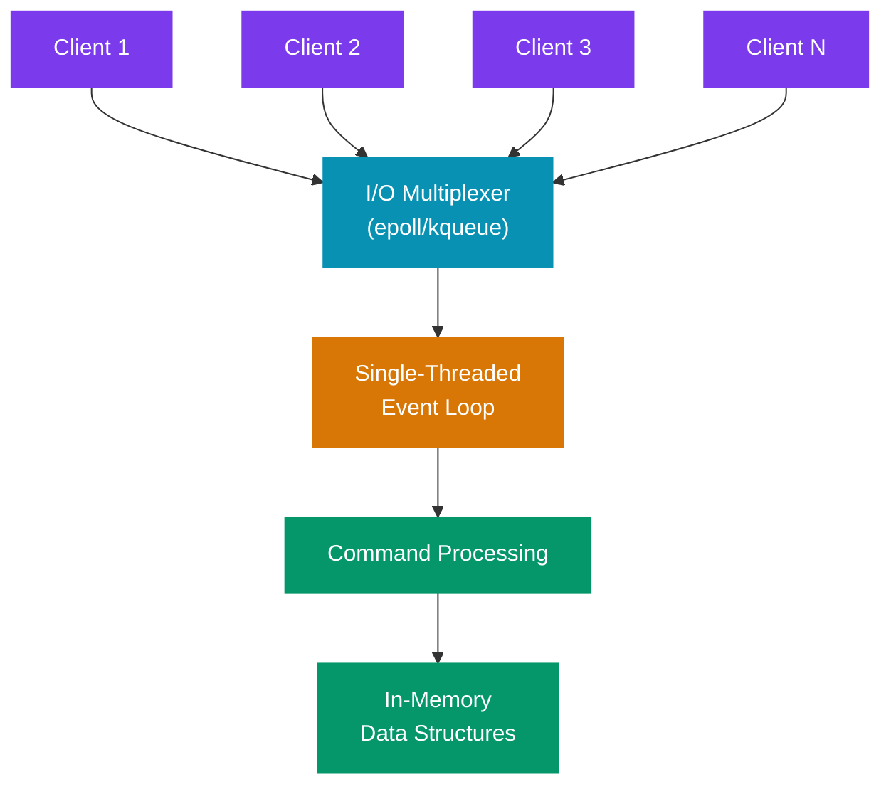

📝 **Key Takeaway for Interviews:** Redis runs commands on a single thread. Still, it can handle 100K+ operations/second. Two reasons:

- In-memory operations take nanoseconds.
- I/O multiplexing removes the need for thread-per-connection.

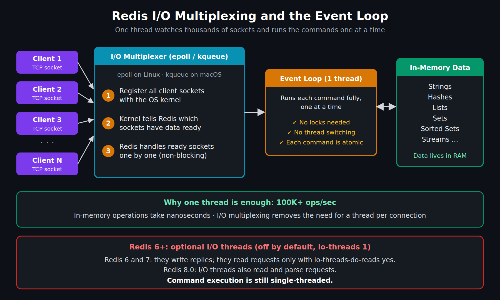

🎥 **Watch (in this order):**

1. [Event Loops Internals And How Redis Handles Multiple Connects on a Single Thread](https://www.youtube.com/watch?v=U2IFZ_hw91o) — Arpit Bhayani, *Redis Internals*. The concept: how the kernel reports ready sockets to one thread.
2. [Implementing Event Loops | Redis Internals](https://www.youtube.com/watch?v=SMmLVHgE4pM) — Arpit Bhayani. Builds the event loop in code with `epoll`.
3. [Why is Redis INSANELY Fast?](https://www.youtube.com/watch?v=KRwpzG7l4a0) — ByteMonk, ~9 min. Short overview: RAM, single thread + multiplexing, compact data structures.

---

</details>

---

2. **📦 What are the core data structures in Redis and their use cases? 🔥🔥**

<!-- -->
<details>
<summary>Answer</summary>

**Answer:**

Redis supports many data structures. Each one is optimized for specific access patterns:

| 🏗️ Data Structure | 📝 Description | 🎯 Use Cases |
|---|---|---|
| **String** | Binary-safe string, max 512 MB. Can store text, integers, serialized JSON, or binary data | Caching, counters (`INCR`), session tokens, distributed locks (`SET key val NX PX ms` — not `SETNX`, which cannot set a TTL in the same atomic step) |
| **Hash** | Map of field-value pairs (like a mini document) | User profiles, product details, configuration — any object with fields |
| **List** | Ordered list of strings (insertion order). Stored as a quicklist — a linked list of listpack nodes. Since Redis 7.2 a small list is a single listpack | Message queues, activity feeds, recent items, task queues (`LPUSH`/`RPOP`) |
| **Set** | Unordered collection of unique strings | Tags, unique visitors, set operations (union/intersection for recommendations) |
| **Sorted Set (ZSet)** | Set with a score per element, ordered by score | Leaderboards, rate limiters, priority queues, time-series indexes |
| **Stream** | Append-only log (like Kafka topic) with consumer groups | Event sourcing, message streaming, audit logs |
| **HyperLogLog** | Probabilistic structure for cardinality estimation (~0.81% error, up to ~12 KB; small sets use a sparse, smaller encoding) | Unique visitor counting, unique search queries |
| **Bitmap** | String treated as a bit array | Feature flags, daily active users, bloom filter building blocks |
| **Geospatial** | Longitude/latitude storage with radius queries | Nearby search, delivery tracking, location-based services |

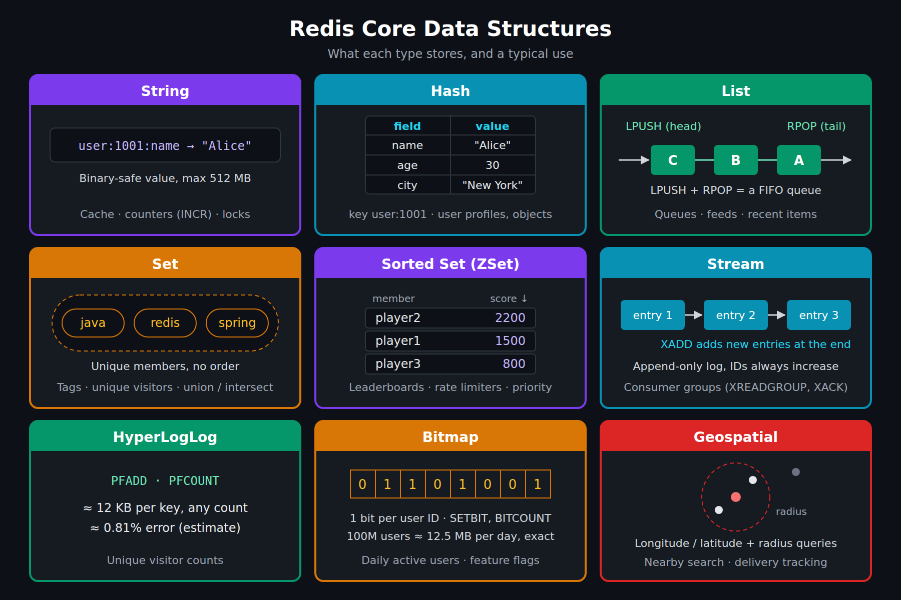

🔑 **Common Commands by Data Structure:**

**String**
| Command | Description |
|---------|-------------|
| `SET user:1001:name "Alice"` | Stores "Alice" at key `user:1001:name`. Uses the `entity:id:field` naming convention. No expiry — the key stays until you delete it. |
| `GET user:1001:name` | Retrieves value at `user:1001:name`. Returns `"Alice"`. Returns `nil` if key doesn't exist. |
| `INCR page:views:homepage` | Atomically increments the integer at `page:views:homepage` by 1. Creates the key with value 1 if it does not exist. Thread-safe — a good fit for counters. |
| `SETEX session:abc123 3600 "user_data"` | Stores `"user_data"` with TTL of 3600 seconds (1 hour). The key deletes itself when it expires — good for session management. Same as `SET session:abc123 "user_data" EX 3600`. |

**Hash**
| Command | Description |
|---------|-------------|
| `HSET user:1001 name "Alice" age 30 city "New York"` | Sets multiple fields on the hash at key `user:1001`. Stores structured object data without serialization. |
| `HGET user:1001 name` | Retrieves a single field `name` from the hash. Returns `"Alice"`. |
| `HGETALL user:1001` | Returns all field-value pairs of the hash as a flat list. |

**List**
| Command | Description |
|---------|-------------|
| `LPUSH queue:emails "email1" "email2"` | Pushes elements to the head (left) of the list. Inserts in reverse order — `email2` becomes the front. |
| `RPOP queue:emails` | Removes and returns the tail (right) element. Combined with `LPUSH`, implements a FIFO queue. |
| `LRANGE queue:emails 0 -1` | Returns all elements from index 0 to last (`-1`). Use for inspecting the full list. |

**Set**
| Command | Description |
|---------|-------------|
| `SADD tags:article:42 "java" "redis" "spring"` | Adds unique members to the set. Duplicates are ignored automatically. |
| `SMEMBERS tags:article:42` | Returns all members of the set. Order is not guaranteed. |
| `SINTER tags:article:42 tags:article:55` | Returns the intersection of two sets — members common to both articles. Useful for recommendations. |

**Sorted Set**
| Command | Description |
|---------|-------------|
| `ZADD leaderboard 1500 "player1" 2200 "player2"` | Adds members with scores. Members are automatically sorted by score in ascending order. |
| `ZREVRANGE leaderboard 0 9 WITHSCORES` | Returns top 10 members in descending score order, with their scores. This is the usual leaderboard query. |
| `ZRANK leaderboard "player1"` | Returns the 0-based rank of `player1` in ascending order. Use `ZREVRANK` for descending rank. |

**HyperLogLog**
| Command | Description |
|---------|-------------|
| `PFADD unique:visitors:2026-03-21 "user1" "user2" "user3"` | Adds elements to the HyperLogLog. Tracks unique items with ~0.81% error rate using very little memory (~12 KB max). |
| `PFCOUNT unique:visitors:2026-03-21` | Returns the approximate count of unique elements added. A good fit for unique visitor counts at scale. |

🎯 **Use case → data structure (quick recall):**

Interviewers usually give the problem, not the type name. Cover the right two columns and practise naming the structure from the problem.

| Problem | Structure | Key commands | Why this one |
|---|---|---|---|
| Game leaderboard: top 10 + a player's rank | Sorted Set | `ZADD`, `ZREVRANGE`, `ZREVRANK` | Kept sorted by score. Rank lookup is O(log N) |
| Sliding-window rate limiter | Sorted Set | `ZADD`, `ZREMRANGEBYSCORE`, `ZCARD` | Score = request timestamp. Drop old entries, count the rest |
| Run a job at a future time (delayed queue) | Sorted Set | `ZADD`, `ZRANGEBYSCORE` | Score = run-at time. Poll for scores ≤ now (full answer: §8 Q6) |
| Page-view counter | String | `INCR` | Atomic increment. No read-then-write race |
| Session token that expires | String | `SET … EX` | The TTL deletes the key by itself |
| Distributed lock | String | `SET key val NX PX <ms>` | `NX` takes the lock, `PX` frees it if the holder crashes. Both in one atomic command |
| User profile, update one field | Hash | `HSET`, `HGET` | Change one field without rewriting a JSON blob |
| Shopping cart (product → quantity) | Hash | `HINCRBY`, `HGETALL` | One key per cart, one field per product |
| FIFO job queue | List | `LPUSH` + `RPOP` (or blocking `BRPOP`) | Push at one end, pop at the other |
| Last 10 activities of a user | List | `LPUSH` + `LTRIM key 0 9` | Keeps only the newest 10 |
| Tags on an article, common tags of two articles | Set | `SADD`, `SINTER` | Unique members + set operations |
| "Has this user liked the post?" (exact) | Set | `SISMEMBER` | O(1) membership check |
| Unique visitors per day, 100M users, ~1% error OK | HyperLogLog | `PFADD`, `PFCOUNT` | ~12 KB per key, whatever the count. A Set would need GBs |
| Did user N log in today? Daily active users | Bitmap | `SETBIT`, `GETBIT`, `BITCOUNT` | 1 bit per user ID: 100M users ≈ 12.5 MB per day, exact |
| Restaurants within 3 km | Geospatial | `GEOADD`, `GEOSEARCH` | Radius query on longitude/latitude, nearest first |
| Event log read by several consumer groups | Stream | `XADD`, `XREADGROUP`, `XACK` | Append-only log with consumer groups and acks |

💡 **Decision rule — ask what the problem needs:**

- Ordered by a number (score, time, rank) → **Sorted Set**
- An object with fields → **Hash**
- FIFO / newest-N → **List**
- Uniqueness or set maths → **Set**
- Count of uniques, approximate is fine → **HyperLogLog**
- Yes/no per numeric ID → **Bitmap**
- Location → **Geospatial**
- A log that consumers read and acknowledge → **Stream**
- Anything else (a value, a counter, a lock) → **String**

✅ **Interview Tip:** Always mention use cases with each data structure. Interviewers want to see that you know *when* to use each one, not just what they are.

---

</details>

---

3. **⚔️ How does Redis compare to Memcached? When would you choose one over the other? ⚡**

<!-- -->
<details>
<summary>Answer</summary>

**Answer:**

Both are in-memory caching solutions. But Redis has many more features:

| 🎯 Feature | 🔴 Redis | 🔵 Memcached |
|---|---|---|
| **Data Structures** | Strings, Hashes, Lists, Sets, Sorted Sets, Streams, HyperLogLog, Bitmaps, Geospatial | Strings only |
| **Persistence** | RDB snapshots + AOF | None (pure cache) - restart wipes everything |
| **Replication** | Master–replica replication (called "slave" before Redis 5.0) | None built-in |
| **High Availability** | Sentinel + Cluster | Requires external tools |
| **Pub/Sub** | Built-in | Not available |
| **Lua Scripting** | Supported (atomic execution) | Not available |
| **Transactions** | MULTI/EXEC/WATCH | CAS (Compare-and-Swap) only |
| **Max Value Size** | 512 MB | 1 MB (default) |
| **Threading** | Single-threaded execution + I/O threads (v6+) | Multi-threaded |
| **Memory Efficiency** | Higher overhead per key | More memory-efficient for simple key-value |
| **Eviction Policies** | 8 policies in Redis 7 (LRU, LFU, TTL-based, random). Redis 8.6 added two `lrm` policies, so 10 now | LRU only |
| **Cluster Mode** | Hash slot-based sharding (16384 slots) | Client-side consistent hashing |

🧠 **When to Choose Memcached Over Redis:**

- Simple key-value caching with very high throughput, where you need multi-threaded performance
- Memory efficiency is critical (millions of small string values)
- No need for persistence, pub/sub, or complex data structures
- Legacy systems already using Memcached

🧠 **When to Choose Redis (Most Cases):**

- Need data structures beyond strings
- Need persistence (even as a safety net)
- Need pub/sub, streams, or Lua scripting
- Need built-in replication and high availability
- Need sorted sets for leaderboards, rate limiting, etc.

💡 **Interview Answer:** "In almost all modern applications, Redis is the default choice. It can do everything Memcached can do, and more. Memcached only wins in rare cases, where multi-threaded raw throughput for simple strings matters more than features."

💭 **Doubts**

<details>
<br/>
<summary><strong>🤔 Doubt: What is Sentinel vs Cluster in Redis High Availability?</strong></summary>

These are two separate Redis HA mechanisms:

**Sentinel — guards a single master**
```
         ┌─────────────┐
         │  Sentinel 1 │
         └──────┬──────┘
                │ monitors
    ┌───────────▼───────────┐
    │        Master         │  ← handles all writes
    └───────────┬───────────┘
                │ replicates
    ┌───────────▼───────────┐
    │        Replica        │  ← can handle reads (if the client sends them here)
    └───────────────────────┘
```
- Sentinels **monitor** the master continuously
- If master dies → Sentinels **vote** and **auto-promote** a replica to master
- Clients ask Sentinel "who is the current master?". So the client always connects to the right node
- **Solves:** automatic failover with no manual intervention
- **Limitation:** still one master. The dataset size is limited to one server's RAM

**Cluster — shards data across multiple masters**
```
Master 1          Master 2          Master 3
slots 0–5460      slots 5461–10922  slots 10923–16383
    │                  │                  │
Replica 1          Replica 2          Replica 3
```
- Data split across masters using **16,384 hash slots**
- Each master has its own replica for failover
- **Solves:** horizontal scaling — dataset larger than one server's RAM

**When to use which:**

| Situation | Use |
|-----------|-----|
| Data fits in one server's RAM, just need failover | **Sentinel** |
| Dataset too large for one server's RAM | **Cluster** |
| Simple setup, small team | **Sentinel** |
| High write throughput beyond one master | **Cluster** |

> **Simple way to remember:** Sentinel = HA for one master. Cluster = HA + sharding across many masters.

---

</details>
<br/>

<details>
<br/>
<summary><strong>🤔 Doubt: What is Lua Scripting in Redis?</strong></summary>

Lua is a small scripting language. In Redis, it lets you run **multiple commands atomically as a single unit** on the server side.

**The problem it solves:**

Without Lua, the client sends commands one by one. Another client can run its commands in between. Here only 1 item is left in stock:
```
Client A: GET stock        → returns 1 → "in stock, I can sell"
                           ← Client B: GET stock → 1, DECR stock → 0  (race!)
Client A: DECR stock       → now -1 (oversold: A's check was already stale)
```

**With Lua — runs as one atomic unit, no interruption possible:**
```lua
-- Decrement stock only if > 0 (a missing key counts as out of stock)
local stock = tonumber(redis.call('GET', KEYS[1]))
if stock and stock > 0 then
    return redis.call('DECR', KEYS[1])
else
    return -1  -- out of stock
end
```

Called from Java. Use `StringRedisTemplate`, not the default `RedisTemplate`. The default one stores values with the JDK serializer. Then `GET` returns JDK bytes, `tonumber` returns `nil`, and the script always says "out of stock".
```java
String script = "local stock = tonumber(redis.call('GET', KEYS[1])) " +
                "if stock and stock > 0 then " +
                "  return redis.call('DECR', KEYS[1]) " +
                "else return -1 end";

stringRedisTemplate.execute(   // StringRedisTemplate: values stored as plain strings
    new DefaultRedisScript<>(script, Long.class),
    List.of("product:42:stock")
);
```

**Key properties:**

| Property | Detail |
|----------|--------|
| **Atomic** | Entire script runs without interruption — no race conditions |
| **No network roundtrips** | All commands execute server-side in one call |
| **Single-threaded** | Redis won't process other commands while script runs |
| **Replicated** | Script is replicated to replicas as a single unit |

> **When to use:** Anywhere you need read-then-write atomicity. For example: stock decrement, rate limiting, conditional updates, distributed lock release.

---

</details>
<br/>

<details>
<br/>
<summary><strong>🤔 Doubt: What are MULTI/EXEC/WATCH and CAS in Redis?</strong></summary>

**MULTI/EXEC — Redis transaction block**

```
MULTI          ← start transaction (queue begins)
SET key1 "a"   ← queued, not executed yet
INCR counter   ← queued
SET key2 "b"   ← queued
EXEC           ← now all 3 execute atomically in order
```
- Commands between `MULTI` and `EXEC` are **queued**, not run immediately
- `EXEC` runs all of them as one atomic batch. No other client can run commands in between
- `DISCARD` cancels the queued transaction
- ⚠️ **There is no rollback.** Two kinds of error behave differently:
  - **Runtime error** (for example `INCR` on a string value): only that one command fails. The other queued commands still run.
  - **Queue-time error** (unknown command, wrong number of arguments): `EXEC` returns `EXECABORT` and **nothing** runs.

**WATCH — adds conditional execution (the CAS part)**

```
WATCH balance        ← "tell me if this key changes"
val = GET balance    ← read current value
MULTI
  SET balance <val - 100>
EXEC                 ← returns nil if balance was modified by someone else since WATCH
```
- If another client changes any `WATCH`ed key before `EXEC` → the transaction **aborts** (returns nil)
- Your code retries the whole thing

**CAS (Compare-and-Swap) — the concept**

> "Check the value, and only apply the change if it hasn't been modified since I checked."

`WATCH + MULTI/EXEC` is how Redis implements CAS. This is **optimistic locking**: it assumes no conflict, but it detects a conflict and retries if one happened.

| | MULTI/EXEC | WATCH + MULTI/EXEC |
|---|---|---|
| **What it does** | Batch execute atomically | Batch execute only if watched keys unchanged |
| **On conflict** | N/A | Aborts — you retry |
| **Type** | Atomic batch | Optimistic locking / CAS |

---

</details>
<br/>

<details>
<br/>
<summary><strong>🤔 Doubt: What is Hash slot-based sharding vs Client-side consistent hashing?</strong></summary>

**Redis Cluster — Hash slot-based sharding (server-side)**

Redis divides the keyspace into **16,384 fixed slots**. Every key maps to a slot with this formula:
```
slot = CRC16(key) % 16384
```
**Hash tags:** if the key has `{...}`, Redis hashes only the part inside the braces. So `{user:42}:cart` and `{user:42}:orders` land in the same slot. You need this for multi-key commands (`MGET`, `MULTI`, Lua), because in a cluster all their keys must be in one slot.

Redis spreads these slots across the master nodes:
```
Node 1 → slots 0–5460
Node 2 → slots 5461–10922
Node 3 → slots 10923–16383
```
- The **cluster itself** knows which node owns which slot
- The client asks any node. If it is the wrong node, the client is redirected automatically (`MOVED` response — the slot has a new owner for good)
- While a slot is being moved, a node may reply `ASK` instead. It means "try the other node for this one request only". The client does not update its slot map
- Adding/removing nodes means moving slots between nodes, not rehashing all keys

**Memcached — Client-side consistent hashing**

Memcached has **no cluster built-in**. The **client library** decides which server to use:
```
server = consistentHash(key) → Server 2
```
- No server-to-server coordination — servers don't know about each other
- If a node is added/removed, the client recalculates. Only a small part of the keys move (that's the "consistent" part)
- If the client library is misconfigured, or different clients use different logic → data goes to the wrong server

**Key difference:**

| | Redis Cluster | Memcached |
|---|---|---|
| **Who routes** | Server (cluster handles it) | Client library |
| **Servers aware of each other** | ✅ Yes | ❌️ No |
| **Built-in failover** | ✅ Yes | ❌️ No |
| **Rebalancing on node change** | Slot migration (server-side) | Client recalculates hash ring |

> **Simple way to remember:** Redis Cluster puts the routing logic on the server side. Memcached puts all the logic in the client.

---

</details>
<br/>

---

</details>

---

4. **🚀 How does Redis achieve sub-millisecond latency? ⚡**

<!-- -->
<details>
<summary>Answer</summary>

**Answer:**

🧠 **Internal Encoding Optimizations:**

Redis automatically picks the most memory-efficient encoding, based on data size:

```properties
# Small hash (≤ 128 fields, values ≤ 64 bytes) → ziplist (contiguous memory)
# Large hash → hashtable

# List → quicklist since Redis 3.2 (linked list of ziplist/listpack nodes)
# Redis 7.2+: a small list → a single listpack; it becomes a quicklist when it grows

# Small set of integers (≤ 512 members, set-max-intset-entries) → intset (sorted integer array)
# Large set → hashtable

# Small sorted set (≤ 128 members, values ≤ 64 bytes) → ziplist
# Large sorted set → skiplist + hashtable
```

⚠️ **Version note — `ziplist` is the old name.**

- Redis **7.0 replaced ziplist with `listpack`** as the compact encoding for hashes, sorted sets, and quicklist nodes.
- Listpack removes the field that stored the *previous* entry's length (`prevlen`). Each entry now stores only its own length. The `prevlen` field made ziplist open to cascading updates (one insert could force many entries to be rewritten, one after another).
- The config keys were renamed `hash-max-ziplist-entries` → **`hash-max-listpack-entries`**. The old names still work as aliases.
- `OBJECT ENCODING` now reports `listpack`.
- Redis **7.2** also uses listpack for small non-integer sets.

Say "listpack" in a 2026 interview. Mention ziplist as what it replaced.

📝 **Typical Latencies:**

| Operation | Latency |
|---|---|
| `GET` / `SET` | 0.1 - 0.5 ms |
| `HGET` / `HSET` | 0.1 - 0.5 ms |
| `LPUSH` / `RPOP` | 0.1 - 0.5 ms |
| `ZADD` / `ZRANGE` | 0.2 - 1.0 ms |
| Pipeline (100 commands) | 1 - 2 ms total |

⚠️ **What Can Cause High Latency:**

- `KEYS *` command on large datasets (O(N) — **never use in production**)
- Large `SORT` operations
- Lua scripts that run too long
- `BGSAVE` fork on large datasets (copy-on-write overhead)
- Network latency (use connection pooling and pipelining)
- Slow log: use `SLOWLOG GET` to identify slow commands

---

</details>

---

5. **🔗 What is Redis pipelining and how does it improve performance? ⚡**

<!-- -->
<details>
<summary>Answer</summary>

**Answer:**

Redis pipelining works like this:

- The client sends **multiple commands to the server without waiting for individual replies**.
- Then it reads all replies at once.

This greatly reduces the time lost on network round trips (RTT — the time for a request to reach the server and its reply to come back).

🧠 **Without Pipelining (Request-Response):**

```
Client → SET key1 "val1"    → Server
Client ← OK                 ← Server    (RTT ~0.5ms)
Client → SET key2 "val2"    → Server
Client ← OK                 ← Server    (RTT ~0.5ms)
Client → SET key3 "val3"    → Server
Client ← OK                 ← Server    (RTT ~0.5ms)
# Total: 3 × RTT = ~1.5ms for 3 commands
```

🧠 **With Pipelining:**

```
Client → SET key1 "val1"    → Server
Client → SET key2 "val2"    →   (no wait)
Client → SET key3 "val3"    →   (no wait)
Client ← OK                 ← Server
Client ← OK                 ← Server
Client ← OK                 ← Server
# Total: 1 × RTT = ~0.5ms for 3 commands
```

📝 **Performance Comparison:**

| 📊 Metric | Without Pipeline | With Pipeline (100 cmds) |
|---|---|---|
| Network round trips | 100 | 1 |
| Time for 100 commands | ~50ms | ~1–2ms |
| Throughput (one client) | ~2K ops/sec | ~50K–100K ops/sec |

> These numbers assume ~0.5 ms RTT and one client. 100 commands in 1–2 ms is 50K–100K ops/sec. Many clients together reach higher totals.

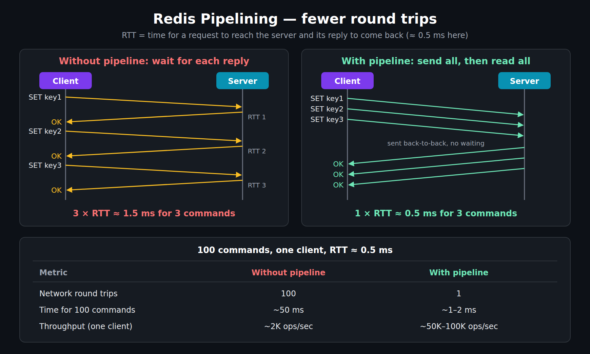

**Java Example with Jedis:**

```java
try (Jedis jedis = jedisPool.getResource()) {
    Pipeline pipeline = jedis.pipelined();

    // Send all commands without waiting
    for (int i = 0; i < 1000; i++) {
        pipeline.set("key:" + i, "value:" + i);
    }

    // Execute all at once and get responses
    List<Object> responses = pipeline.syncAndReturnAll();
    System.out.println("Pipelined " + responses.size() + " commands");
}
```

**Java Example with Lettuce (Async):**

```java
RedisAsyncCommands<String, String> async = connection.async();
async.setAutoFlushCommands(false); // disable auto-flush

List<RedisFuture<String>> futures = new ArrayList<>();
for (int i = 0; i < 1000; i++) {
    futures.add(async.set("key:" + i, "value:" + i));
}

async.flushCommands(); // send all at once
// Wait for all futures to complete
LettuceFutures.awaitAll(5, TimeUnit.SECONDS,
    futures.toArray(new RedisFuture[0]));
```

⚠️ **Limits:**

- Pipeline commands are **not atomic**. Another client's commands can interleave (run in between them).
- If you need atomicity, use `MULTI/EXEC` transactions or Lua scripts.
- Don't pipeline too many commands at once, because memory builds up on the server. Send them in batches of 1000-10000.
- The server returns pipeline responses in the **same order** as the client sent the commands.

---

</details>

---

<a id="caching-patterns"></a>

## 2. Caching Patterns 🔥

1. **🔄 What is the Cache-Aside (Lazy Loading) pattern? How does it work? 🔥🔥**

<!-- -->
<details>
<summary>Answer</summary>

**Answer:**

> 💡 **In one line:** Load on demand and cache what you fetch. The app fills the cache **only when data is actually requested**, never in advance.

Cache-Aside (also called **Lazy Loading**) is the most commonly used caching pattern.

- The **application code** reads from and writes to both the cache and the database.
- The cache sits "aside". It is not in the direct data path.

🧠 **How It Works:**

**Read Path:**
1. Application checks the cache first
2. If cache **hit** → return cached data
3. If cache **miss** → read from database → store in cache → return data

**Write Path:**
1. Write to the database
2. Invalidate (delete) the cache entry

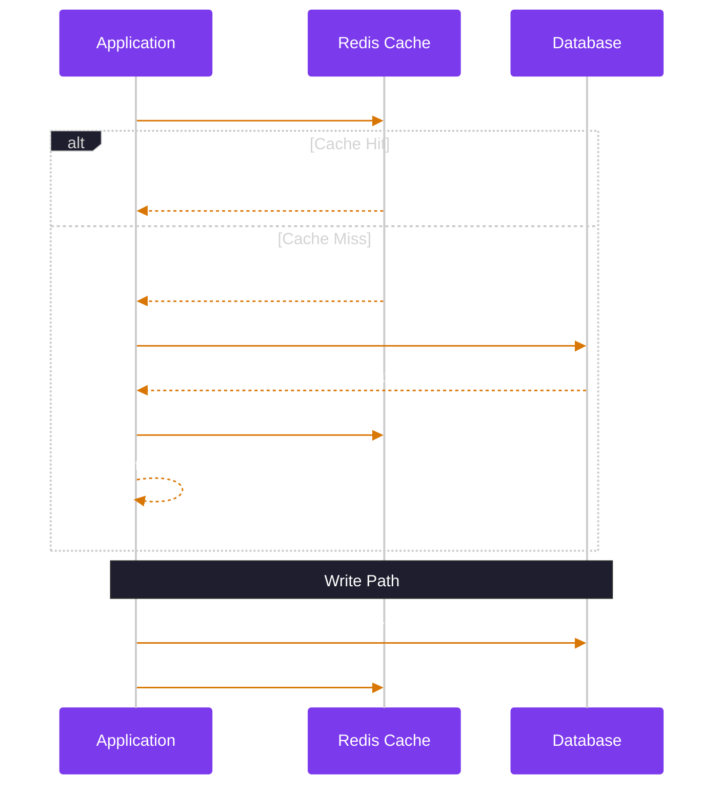

**Java Implementation — Approach 1: `@Cacheable` (Spring annotation-driven)**

> This is what you built in the pre-requisite ([10_Redis_Cache_with_Spring_Data_JPA.md](https://github.com/vikas9dev/java/blob/main/3_spring/02_spring_data_jpa/10_Redis_Cache_with_Spring_Data_JPA.md)). Spring implements Cache-Aside for you, internally.

**Pre-requisite setup required** (from `AppConfig`):
- `@EnableCaching` on the main class
- `RedisCacheManager` bean with `GenericJackson2JsonRedisSerializer` and TTL configured

```java
// application.properties
// spring.cache.type=redis   ← tells Spring to use Redis as cache provider

@Service
public class EmployeeServiceImpl implements IEmployeeService {

    @Autowired
    private EmployeeRepository employeeRepository;

    // READ — Cache-Aside: Spring checks cache first, falls back to DB on miss,
    //        then stores the result in cache automatically.
    //        Key in Redis: "employees::1", "employees::2", etc.
    @Override
    @Cacheable(value = "employees", key = "#empId")
    public Employee getOneEmployee(Integer empId) {
        return employeeRepository.findById(empId)
                .orElseThrow(() -> new ResourceNotFoundException("Employee Not Found"));
    }

    // WRITE — update DB first, then EVICT the cache entry (delete-on-write).
    //         See "Why Invalidate (Delete) Instead of Update?" at the end of this answer.
    @Override
    @CacheEvict(value = "employees", key = "#empId")
    public Employee updateEmployee(Integer empId, Employee e) {
        // ⚠️ Do NOT call this.getOneEmployee(empId) here — a self-invocation bypasses the
        //    Spring proxy, so @Cacheable would never apply. Go to the repository directly.
        Employee employee = employeeRepository.findById(empId)
                .orElseThrow(() -> new ResourceNotFoundException("Employee Not Found"));
        employee.setEmpName(e.getEmpName());
        employee.setEmpSal(e.getEmpSal());
        return employeeRepository.save(employee);
    }

    // DELETE — remove from DB, then evict cache entry
    @Override
    @CacheEvict(value = "employees", key = "#empId")
    public void deleteEmployee(Integer empId) {
        Employee employee = employeeRepository.findById(empId)
                .orElseThrow(() -> new ResourceNotFoundException("Employee Not Found"));
        employeeRepository.delete(employee);
    }

    // Save — cache with DB-generated id from the returned object.
    // Note: @CachePut on save is a Write-Through step (see Q2). Pure Cache-Aside
    // would not cache here; it would wait for the first read.
    @Override
    @CachePut(value = "employees", key = "#result.id")
    public Employee saveEmployee(Employee e) {
        return employeeRepository.save(e);
    }
}
```

<details>
<summary><strong>🤔 Doubt: How do <code>value</code> and <code>key</code> in <code>@Cacheable</code> map to the method and its parameter?</strong></summary>

```java
@Cacheable(value = "employees", key = "#empId")
public Employee getOneEmployee(Integer empId) { ... }
```

The two attributes do different jobs:

| Attribute | What it is | Linked to the method? |
|---|---|---|
| `value` | The **cache name**. A fixed string. | No — just a label that groups entries |
| `key` | A **SpEL expression**, evaluated on every call | Yes — it reads the method's arguments |

**1. `value` = the cache name**
- `value` is an alias of `cacheNames`. `@Cacheable(cacheNames = "employees")` is the same.
- `RedisCacheManager` creates one cache per name. Each name can have its own TTL through `RedisCacheConfiguration`.

**2. `key` = which entry inside that cache**
- `#` means "a variable". `#empId` means "the method parameter named `empId`".
- On `getOneEmployee(1)`, the proxy evaluates `#empId`, gets `1`, and uses it as the key.

**How does Spring know the parameter name?** Java does not keep parameter names in the bytecode by default.
- Spring reads them only if the code was compiled with the `-parameters` flag.
- The Spring Boot Gradle and Maven plugins turn this flag on for you.
- Since Spring 6.1 there is no fallback. Without the flag, `#empId` resolves to null, and the call fails at runtime.
- To avoid needing names, refer to the argument by its position: `#p0` or `#a0` (the first argument).

**3. The final Redis key**

```
cacheName + "::" + key   →   "employees::1"
```

- `::` is the default separator (`CacheKeyPrefix.simple()`).
- The key object is turned into a string first. Here `1` becomes `"1"`.

**4. Other expressions you will see**

| Expression | Meaning |
|---|---|
| `#emp.id` | A field of a parameter object |
| `#p0`, `#a0` | The first argument, by position |
| `#root.methodName` | The method name |
| `#result` | The return value. Allowed in `@CachePut` and in `unless`, **not** in the `key` of `@Cacheable`. Spring builds that key **before** the method runs, to look in the cache. |

This is why `saveEmployee` uses `@CachePut(key = "#result.id")`: the DB creates the ID, so it exists only in the return value.

💡 **Interview line:** "`value` is the cache name. `key` is a SpEL expression over the method's arguments. Redis stores the entry as `cacheName::key`, for example `employees::1`."

---

</details>
<br/>

**Verify in redis-cli** (the keys you'll see after a `GET /api/v1/employee/1` call):

```bash
127.0.0.1:6379> KEYS *
# 1) "employees::1"

127.0.0.1:6379> GET employees::1
# "{\"@class\":\"org.example.Employee\",\"id\":1,\"empName\":\"SAM\",\"empSal\":200.0}"

127.0.0.1:6379> TTL employees::1
# (integer) 42   ← seconds remaining out of 60s configured in RedisCacheManager
```

**Approach 2: Manual `RedisTemplate` (how Cache-Aside works inside)**

> This shows what Spring does internally. Use it when you need full control: custom TTL per key, conditional caching, or non-standard key structures.

> ⚠️ **Mixing `RedisTemplate` writes with `@Cacheable` reads.** It works only if both use the same bytes:  
> - The template must use `StringRedisSerializer` for **keys**. The default JDK serializer adds bytes in front, so `employees::1` would be a different key.  
> - The template must use the **same value serializer** as the `RedisCacheManager` (here `GenericJackson2JsonRedisSerializer`). If not, `@Cacheable` cannot read the value.

```java
@Service
@RequiredArgsConstructor   // Lombok: generates the constructor for the final fields
public class EmployeeService {

    private final RedisTemplate<String, Employee> redisTemplate;
    private final EmployeeRepository employeeRepository;

    private static final Duration CACHE_TTL = Duration.ofSeconds(60); // same as RedisCacheManager config

    // READ — manual Cache-Aside
    public Employee getOneEmployee(Integer empId) {
        String cacheKey = "employees::" + empId; // match Spring's key format

        // Step 1: Check cache
        Employee cached = redisTemplate.opsForValue().get(cacheKey);
        if (cached != null) {
            return cached; // Cache hit — no DB call
        }

        // Step 2: Cache miss — load from DB
        Employee employee = employeeRepository.findById(empId)
                .orElseThrow(() -> new ResourceNotFoundException("Employee Not Found"));

        // Step 3: Populate cache with TTL
        redisTemplate.opsForValue().set(cacheKey, employee, CACHE_TTL);

        return employee;
    }

    // WRITE — update DB, then invalidate cache
    public Employee updateEmployee(Integer empId, Employee e) {
        Employee employee = employeeRepository.findById(empId)
                .orElseThrow(() -> new ResourceNotFoundException("Employee Not Found"));

        employee.setEmpName(e.getEmpName());
        employee.setEmpSal(e.getEmpSal());
        employeeRepository.save(employee);

        // Invalidate so next read repopulates with fresh data
        redisTemplate.delete("employees::" + empId);

        return employee;
    }
}
```

**`@Cacheable` vs manual `RedisTemplate` — when to use which:**

| | `@Cacheable` | Manual `RedisTemplate` |
|---|---|---|
| **Code verbosity** | Minimal — just annotation | Explicit cache logic in every method |
| **TTL control** | Global (set in `RedisCacheManager`) | Per-key TTL possible |
| **Conditional caching** | `condition` / `unless` SpEL expressions | Full Java logic |
| **Non-standard keys** | Limited | Any key structure |
| **Recommended for** | Standard CRUD caching | Complex caching logic, rate limiting, counters |

| ✅ Advantages | ⚠️ Disadvantages |
|---|---|
| Only requested data is cached (no wasted memory) | First request is always a cache miss (cold start) |
| Cache failure doesn't break the app (falls back to DB) | Stale data possible if DB is updated outside the app |
| Simple to implement | Application code manages both cache and DB |
| Works with any database | Extra latency on cache miss (DB + cache write) |

🔑 **Why Invalidate (Delete) Instead of Update?**

On a write, deleting the cache key is better than updating it, because:
- It avoids race conditions when two concurrent writes try to update the cache
- It is simpler and more reliable
- The next read fills the cache again with fresh data, on its own

<details>
<summary><strong>🤔 Doubt: Why delete instead of update? Show me step by step.</strong></summary>

**Short answer:** an update puts a *value* into the cache, and that value can be old. A delete puts *nothing* into the cache, so it can never be old.

**The setup:**
- The DB has `user:42` with salary ₹40k. The cache has the same.
- Two requests arrive at almost the same time:
  - **Request A:** set salary to ₹50k
  - **Request B:** set salary to ₹60k (the later one, so the correct final value is ₹60k)

**Way 1 — UPDATE the cache (`setex`), and how it breaks:**

| Time | What happens | DB | Cache |
|---|---|---|---|
| t1 | A writes the DB | 50k | 40k |
| t2 | B writes the DB | **60k** | 40k |
| t3 | B sets the cache | 60k | 60k |
| t4 | A sets the cache (A was slow: a GC pause or slow network) | 60k | **50k** ❌️ |

The DB says 60k but the cache says 50k. Every reader now gets the **wrong salary for up to 1 hour** (the TTL). Nobody gets an error, so nobody notices.

The cause: A's cache write arrived *after* B's, but it carried an *older* value. With `set`, the **order** of the cache writes decides the final value, and over a network you can't control that order.

**Way 2 — DELETE the cache key, and why it is safe:**

| Time | What happens | DB | Cache |
|---|---|---|---|
| t1 | A writes the DB | 50k | 40k |
| t2 | B writes the DB | **60k** | 40k |
| t3 | B deletes the key | 60k | (empty) |
| t4 | A deletes the key (slow again) | 60k | (empty) ✅ |
| t5 | The next reader misses the cache and loads from the DB | 60k | **60k** ✅ |

Now the order does not matter. Delete-then-delete leaves the cache empty either way:
- **Idempotent:** doing it twice gives the same result as doing it once.
- **Order-independent:** A-then-B and B-then-A end in the same state.

An empty cache is never *wrong*; it is only *empty*. The next read fills it from the DB, which is the source of truth. **The cost:** one extra cache miss after each write.

**The one race that is still possible:**

| Time | What happens | DB | Cache |
|---|---|---|---|
| t1 | Reader C misses the cache and reads the DB | 50k | (empty) |
| t2 | Writer B writes 60k to the DB and deletes the key (nothing to delete) | 60k | (empty) |
| t3 | Reader C, slow, puts the old 50k into the cache | 60k | **50k** ❌️ |

This is rare. For it to happen, a *read* must take longer than a *DB write*, and reads are usually much faster.
- **Why it is still OK:** the **short TTL** limits how long the wrong value can live.
- **If you need more:** a "delayed double delete" (delete again about 1 s after the write), or store a version number with the value.

**An everyday picture:** a shop has a notice board (the cache) and a master price book (the DB).
- **Update:** two staff members each write a new price on the board. Whoever writes *last* wins, even if their price is the old one.
- **Delete:** each staff member just *erases* the board. The next customer who asks makes someone check the master book. Erasing twice is harmless, and the book is always right.

**One line for the interview:** *"I delete instead of update because a delete carries no value, so it can't write an old one. Two deletes in any order leave the same empty state, and the next read loads the truth from the DB. The cost is one extra cache miss."*

---

</details>
<br/>

> 💡 **`@CacheEvict` vs `@CachePut`.** `@CachePut` *overwrites* the entry instead of deleting it.  
> - This looks good, because the data stays in the cache (the next read is not a miss).  
> - But it brings back the exact write-write race that delete-on-write avoids. Two concurrent updates can reach the cache in the opposite order to the DB.  
> - Use `@CacheEvict` as the default.  
> - Use `@CachePut` only for single-writer or write-serialised entities (only one write at a time), and only where a cache miss on the next read is really expensive.

---

</details>

---

2. **✍️ What is the Write-Through caching pattern? 🔥🔥**

<!-- -->
<details>
<summary>Answer</summary>

**Answer:**

> 💡 **In one line:** Every write updates the cache and the DB together. So reads are usually fresh.

In the Write-Through pattern, **every write goes to both the cache and the database synchronously** (one after the other, in sequence).

Cache-Aside fills the cache only on reads. Write-Through is different: it keeps the cache up to date on every write, before anyone reads.

🧠 **How It Works:**

1. Application writes to the database
2. The app **synchronously** updates the cache with the new value
3. The operation completes only after both writes succeed
4. Reads find data in cache right after a write (until the entry expires or is evicted)

```
Write: App → DB → Cache (both updated synchronously)
Read:  App → Cache (a hit after a write; DB fallback only after TTL expiry or eviction)
```

**Contrast with Cache-Aside:**

| | Cache-Aside | Write-Through |
|---|---|---|
| Cache populated on | Read (miss) | Write |
| Write path | DB only | DB + Cache |
| Read path | Cache → DB fallback | Cache first; DB only after expiry/eviction |
| First read | Always a miss | A hit, if a write came first and the entry has not expired |

**Java Implementation — `@CachePut` (Spring annotation-driven)**

> `@CachePut` is Write-Through built into Spring. It **always** executes the method AND updates the cache, even if the data was already cached. This is the key difference from `@Cacheable`, which skips the method on a cache hit.

```java
@Service
public class EmployeeServiceImpl implements IEmployeeService {

    @Autowired
    private EmployeeRepository employeeRepository;

    // WRITE-THROUGH on save — DB write first, then cache populated with DB-generated id
    @Override
    @CachePut(value = "employees", key = "#result.id")
    public Employee saveEmployee(Employee e) {
        return employeeRepository.save(e); // cache updated with returned (saved) object
    }

    // WRITE-THROUGH on update — DB write first, then cache overwritten with fresh data
    @Override
    @CachePut(value = "employees", key = "#empId")
    public Employee updateEmployee(Integer empId, Employee e) {
        Employee employee = employeeRepository.findById(empId)
                .orElseThrow(() -> new ResourceNotFoundException("Employee Not Found"));
        employee.setEmpName(e.getEmpName());
        employee.setEmpSal(e.getEmpSal());
        return employeeRepository.save(employee); // cache entry "employees::1" overwritten
    }

    // READ — a cache hit after any save/update, until TTL expiry or eviction
    @Override
    @Cacheable(value = "employees", key = "#empId")
    public Employee getOneEmployee(Integer empId) {
        return employeeRepository.findById(empId)
                .orElseThrow(() -> new ResourceNotFoundException("Employee Not Found"));
    }
}
```

**Verify in redis-cli.** After `POST /api/v1/employee`, the cache is filled right away (no read needed first):

```bash
# After POST (save) — cache already has the entry
127.0.0.1:6379> KEYS *
# 1) "employees::1"

127.0.0.1:6379> GET employees::1
# "{\"@class\":\"org.example.Employee\",\"id\":1,\"empName\":\"SAM\",\"empSal\":200.0}"

# After PUT (update) — cache entry overwritten with fresh data immediately
127.0.0.1:6379> GET employees::1
# "{\"@class\":\"org.example.Employee\",\"id\":1,\"empName\":\"SAM UPDATED\",\"empSal\":999.0}"
```

**`@CachePut` vs `@Cacheable` — the core difference:**

```
@Cacheable  → Check cache first. If hit, SKIP method. If miss, run method + store result.
@CachePut   → ALWAYS run method. ALWAYS update cache with result. Never skips.
```

**Java Implementation — Manual `RedisTemplate` (how Write-Through works inside)**

```java
@Service
@RequiredArgsConstructor   // Lombok: generates the constructor for the final fields
public class EmployeeService {

    private final RedisTemplate<String, Employee> redisTemplate;
    private final EmployeeRepository employeeRepository;

    private static final Duration CACHE_TTL = Duration.ofSeconds(60);

    // WRITE-THROUGH on save — write DB first, then populate cache immediately
    public Employee saveEmployee(Employee e) {
        Employee saved = employeeRepository.save(e); // DB write

        // Synchronously write to cache — no delay
        redisTemplate.opsForValue().set("employees::" + saved.getId(), saved, CACHE_TTL);

        return saved;
    }

    // WRITE-THROUGH on update — DB first, then overwrite cache with fresh value
    public Employee updateEmployee(Integer empId, Employee e) {
        Employee employee = employeeRepository.findById(empId)
                .orElseThrow(() -> new ResourceNotFoundException("Employee Not Found"));

        employee.setEmpName(e.getEmpName());
        employee.setEmpSal(e.getEmpSal());
        Employee updated = employeeRepository.save(employee); // DB write

        // Overwrite cache — not delete, so the next read is a hit (until TTL expiry)
        redisTemplate.opsForValue().set("employees::" + empId, updated, CACHE_TTL);

        return updated;
    }

    // READ — a cache hit after save/update, until TTL expiry or eviction
    public Employee getOneEmployee(Integer empId) {
        Employee cached = redisTemplate.opsForValue().get("employees::" + empId);
        if (cached != null) {
            return cached; // hit after a write (until TTL expiry)
        }

        // Fallback only on first ever fetch or after TTL expiry
        Employee employee = employeeRepository.findById(empId)
                .orElseThrow(() -> new ResourceNotFoundException("Employee Not Found"));
        redisTemplate.opsForValue().set("employees::" + empId, employee, CACHE_TTL);
        return employee;
    }
}
```

| ✅ Advantages | ⚠️ Disadvantages |
|---|---|
| Cache is usually in step with the DB | Higher write latency (two writes per operation) |
| Little stale data (only when a cache write fails) | Every write hits the DB even if data is rarely read |
| Simple read path (mostly cache hits) | Wastes cache space for data that may never be read |
| Data loss risk is minimal | Cache and DB can still be inconsistent if cache write fails after DB write |

💡 **Best Used When:** the workload is read-heavy, data consistency is critical, and you can accept slightly higher write latency.

> ⚠️ **Same race as in Q1.** Write-Through overwrites the cache (`@CachePut` / `set`). So two concurrent updates can reach the cache in the opposite order to the DB. The cache then keeps the older value until the TTL ends. For consistency-critical data, use it only when writes to one entity are serialised (single writer, or a row lock / optimistic version check). Otherwise use `@CacheEvict` (delete-on-write) from Q1.

---

</details>

---

3. **⏳ What is the Write-Behind (Write-Back) caching pattern? ⚡**

<!-- -->
<details>
<summary>Answer</summary>

**Answer:**

> 💡 **In one line:** Write to the cache instantly and sync to the DB in the background. You give up consistency to get speed.

In the Write-Behind pattern, the application writes to the cache first. Then a background worker **in the application** writes to the database **asynchronously**, after a delay. (Redis itself never writes to your database.) This separates the write operation from the database, so write latency drops a lot.

🧠 **How It Works:**

1. Application writes data to the cache
2. The app returns to the caller at once (fast response)
3. A background worker in the app batches and writes to the database asynchronously
4. Multiple writes to the same key can be coalesced (merged, so only the last value goes to the DB)

```
Write: App → Cache (immediate ack) → Background → DB (async, batched)
Read:  App → Cache
```

**Java Implementation — cache write + `@Async` DB flush**

> Spring has no single annotation for Write-Behind. There is no `@WriteBack`. The closest approach:  
> 1. Write to the cache immediately. The code below uses `redisTemplate.set(...)`.  
> 2. Then trigger an async DB flush with `@Async`.  
>
> This imitates the Write-Behind behaviour.

```java
@Service
public class EmployeeServiceImpl implements IEmployeeService {

    @Autowired
    private EmployeeRepository employeeRepository;

    @Autowired
    private RedisTemplate<String, Employee> redisTemplate;

    // ⚠️ The async flusher MUST live in a different bean. Calling an @Async method
    //    on `this` is a self-invocation — it skips the proxy, so the "background"
    //    write would actually run synchronously on the caller's thread and this
    //    would silently degrade into Write-Through.
    @Autowired
    private EmployeeDbFlusher dbFlusher;

    private static final Duration CACHE_TTL = Duration.ofSeconds(60);

    // Step 1 — Write to cache immediately (fast ack to caller)
    public Employee updateEmployee(Integer empId, Employee e) {
        Employee employee = employeeRepository.findById(empId)
                .orElseThrow(() -> new ResourceNotFoundException("Employee Not Found"));

        employee.setEmpName(e.getEmpName());
        employee.setEmpSal(e.getEmpSal());

        // Write to cache first — instant response
        redisTemplate.opsForValue().set("employees::" + empId, employee, CACHE_TTL);

        // Trigger async DB write via the proxy — caller doesn't wait for this
        dbFlusher.flushToDatabase(employee);

        return employee;
    }

    // READ — from cache (written before DB, so fresh until TTL expiry)
    // ⚠️ Works only if redisTemplate uses StringRedisSerializer for keys and the
    //    same value serializer as the RedisCacheManager (see Q1, Approach 2).
    @Cacheable(value = "employees", key = "#empId")
    public Employee getOneEmployee(Integer empId) {
        return employeeRepository.findById(empId)
                .orElseThrow(() -> new ResourceNotFoundException("Employee Not Found"));
    }
}

// Step 2 — Background async flush to DB, in its own bean so @Async is honoured
@Component
public class EmployeeDbFlusher {

    @Autowired
    private EmployeeRepository employeeRepository;

    @Async
    public void flushToDatabase(Employee employee) {
        employeeRepository.save(employee); // DB write happens on a background thread
    }
}
```

**Java Implementation — Manual `RedisTemplate` + `@Scheduled` batch flush**

> This is the classic Write-Behind pattern. Collect writes in a queue, then flush them to the DB in batches every N seconds. It reduces DB load, because it coalesces (merges) many updates to the same employee into a single write.

```java
@Service
@RequiredArgsConstructor   // Lombok: generates the constructor for the final fields
public class EmployeeWriteBehindService {

    private final RedisTemplate<String, Employee> redisTemplate;
    private final EmployeeRepository employeeRepository;

    // In-memory queue of pending DB writes (empId → latest Employee state)
    private final ConcurrentHashMap<Integer, Employee> pendingWrites = new ConcurrentHashMap<>();

    private static final Duration CACHE_TTL = Duration.ofSeconds(60);

    // Step 1 — Write to cache immediately, queue for async DB write
    public Employee updateEmployee(Integer empId, Employee e) {
        Employee employee = employeeRepository.findById(empId)
                .orElseThrow(() -> new ResourceNotFoundException("Employee Not Found"));

        employee.setEmpName(e.getEmpName());
        employee.setEmpSal(e.getEmpSal());

        // Cache write — instant
        redisTemplate.opsForValue().set("employees::" + empId, employee, CACHE_TTL);

        // Queue for DB flush — coalesces rapid updates (only latest state written)
        pendingWrites.put(empId, employee);

        return employee; // returns immediately without waiting for DB
    }

    // Step 2 — Background scheduler flushes queue to DB every 5 seconds
    @Scheduled(fixedDelay = 5000)
    public void flushToDatabase() {
        // ⚠️ copy-then-clear() is NOT atomic — any write landing between the two
        //    statements is silently dropped after the caller was told it succeeded.
        //    Drain with a CAS remove instead: if the value changed in the meantime,
        //    remove(key, value) fails and the newer state simply stays queued.
        List<Employee> batch = new ArrayList<>();
        for (Map.Entry<Integer, Employee> entry : new ArrayList<>(pendingWrites.entrySet())) {
            if (pendingWrites.remove(entry.getKey(), entry.getValue())) {
                batch.add(entry.getValue());
            }
        }

        if (batch.isEmpty()) {
            return;
        }

        employeeRepository.saveAll(batch); // single batch write to DB
        // e.g. if employee 1 was updated 10 times in 5s → only 1 DB write, not 10
    }
}
```

<details>
<summary><strong>🤔 Doubt: Why loop over <code>new ArrayList&lt;&gt;(pendingWrites.entrySet())</code> and not over <code>pendingWrites.entrySet()</code> directly?</strong></summary>

**Short answer:** the copy is not needed. `pendingWrites` is a `ConcurrentHashMap`, so the direct loop is also safe. The copy is a defensive habit.

| Concern | `HashMap` | `ConcurrentHashMap` |
|---|---|---|
| Remove inside a for-each loop | ❌ `ConcurrentModificationException` | ✅ Allowed |
| Another thread calls `put` during the loop | ❌ CME, or a broken map | ✅ Allowed |
| Kind of iterator | fail-fast | **weakly consistent**: never throws, may or may not show changes made during the loop |

**The CAS still works without the copy:**
- For each entry, the `ConcurrentHashMap` iterator gives an entry object that holds the value **as it was at that moment**.
- If `updateEmployee` puts a newer value during the flush, `entry.getValue()` is still the old one.
- So `remove(key, oldValue)` returns `false`, and the newer value stays queued for the next flush.

**What the copy changes:**
1. **A fixed snapshot.** The copy holds only the entries that existed when the flush started. The direct loop may also pick up entries added while it runs. No write is lost either way: an entry is flushed now or in the next run.
2. **Cost.** One extra list of size N on every flush. Small, but it buys nothing.
3. **Habit from `HashMap`.** With a plain `HashMap` you need a copy (or `iterator.remove()`) to remove inside the loop.

⚠️ **The part that matters is the two-argument `remove(key, value)`, not the copy.** A plain `remove(key)` or `iterator.remove()` deletes the key without checking the value. A newer update that arrived during the flush would then be lost.

💡 **Interview line:** "`ConcurrentHashMap` iterators are weakly consistent, so I can remove while I loop, with no copy. Correctness comes from `remove(key, value)`: a value updated during the flush fails that check and stays queued."

---

</details>
<br/>

| ✅ Advantages | ⚠️ Disadvantages |
|---|---|
| Very low write latency (cache only) | **Risk of data loss** if the app (or its queue) crashes before the DB write |
| Reduces DB load through batching and coalescing | Complex to implement correctly |
| Good for write-heavy workloads | Temporary inconsistency between cache and DB |
| Can handle sudden write spikes | Harder to debug failures |

⚠️ **Data Loss Risk:** In the code above, the queue of pending DB writes lives in the app's memory. If the app crashes before the background worker flushes it, recent writes are lost. Redis AOF does not help here, because Redis does not hold that queue. To reduce this risk, keep the queue in a durable place (for example a Redis Stream with AOF on, or a Kafka topic) or use a write-ahead log.

<details>
<summary><strong>🤔 Doubt: If the queue moves from memory to Kafka, how much latency do we still gain?</strong></summary>

**Short answer:** Kafka does not reduce latency. It reduces **data loss**, and you pay a few milliseconds for it. The latency gain of write-behind comes from not writing to the DB on the request path.

**Rough cost of each step** (typical numbers inside one AWS region, healthy cluster; measure your own before quoting them):

| Step on the request path | Typical p50 | Typical p99 | Survives an app crash? |
|---|---|---|---|
| `ConcurrentHashMap.put` (the code above) | < 1 µs | < 1 µs | ❌ No |
| Redis `SET` (the cache write) | ~0.5–1 ms | ~2–5 ms | — |
| Redis Stream `XADD`, AOF `everysec` | ~0.5–1 ms | ~2–5 ms | ⚠️ Mostly: up to ~1 s of writes can be lost if Redis crashes |
| Kafka `send().get()`, `acks=all` | ~2–5 ms | ~10–30 ms | ✅ Yes, once replicated to the in-sync replicas |
| Direct DB `UPDATE` + commit (RDS) | ~2–10 ms | ~20–100+ ms under load | ✅ Yes |

So for **one write on a quiet system**, Kafka and the DB cost about the same. On average latency alone, you gain almost nothing.

**Where the real gain is — p99 under load, not p50:**
1. **Steady latency during spikes.** Kafka only appends to a log, so the cost per write stays flat. A DB under a write spike slows down: row locks, index updates, connection-pool waits. A direct DB write can go from 5 ms to 200 ms. A Kafka write stays near 5 ms.
2. **Less DB load.** The consumer reads in batches, merges the updates per employee, and calls `saveAll`. 10 updates to employee 1 become 1 DB write. This is the same coalescing as the map, but now it survives a crash.
3. **The DB can be down.** Writes are still accepted. The consumer catches up when the DB comes back.

**Two traps:**
- **Async send without waiting gives back the latency, and also the risk.** `kafkaTemplate.send(...)` without `.get()` returns in microseconds. But the record first sits in the producer's memory buffer (`linger.ms`, `batch.size`). If the app crashes before the buffer is sent, the write is lost — the same problem as the map. Durability means waiting for the ack.
- **The example still reads from the DB.** `updateEmployee` calls `employeeRepository.findById()` first. So each request still makes a DB round trip, and write-behind only removes the DB *write*. In a true write-behind path, you read from the cache, or the update carries the full new state.

**How to make the Kafka version correct:**
- **Key by `empId`.** All updates to one employee then go to the same partition, so they stay in order.
- **Make the consumer's DB write idempotent**, for example an upsert or a version check. Kafka delivers at least once, so the same update can come twice.
- **Commit the offset after the DB write**, never before. If you commit first and then crash, that update is lost.

💡 **Interview line:** "Moving the write-behind queue from memory to Kafka is about durability, not speed. A Kafka write with `acks=all` costs about as much as a DB write: a few ms. The win is a flat p99 during spikes, batched DB writes, and accepting writes while the DB is down."

---

</details>
<br/>

🎯 **Real-World Use Cases — Why Write-Behind, not Write-Through?**

| Use Case | Why Write-Behind wins over Write-Through |
|---|---|
| **Analytics counters** (page views, click counts) | A popular page gets 10,000 hits/min. Write-Through = 10,000 DB writes/min. Write-Behind = one DB write every 5s with the latest count. DB load drops by 99%. |
| **Gaming leaderboard score updates** | A player's score updates every few seconds during a game session. Write-Through writes every score to DB, which is wasteful. Write-Behind coalesces all in-game updates and writes only the final score to DB. |
| **IoT sensor data ingestion** | Sensors emit readings every second. Write-Through would overwhelm the DB. Write-Behind batches thousands of readings into a single bulk insert. |
| **Session updates in high-traffic apps** | A user's session (last seen, cart state) updates on every click. Write-Through adds DB latency to every click. Write-Behind makes clicks feel instant. The DB is updated later, in the background. |

**The core trade-off in one sentence:**

> Write-Through gives better consistency, but the cost is higher write latency. Write-Behind guarantees speed, but you risk data loss. Use it only when **losing a few seconds of writes is acceptable**.

---

</details>

---

4. **📖 What is the Read-Through caching pattern? ⚡**

<!-- -->
<details>
<summary>Answer</summary>

**Answer:**

In the Read-Through pattern, the **cache itself** loads data from the database on a cache miss. The application talks only to the cache. For reads, it never talks to the database directly.

🧠 **How It Works:**

1. Application requests data from the cache
2. If cache **hit** → return cached data
3. If cache **miss** → the **cache layer** loads from the database, stores the result, and returns it

```
Read:  App → Cache → (on miss) → Cache loads from DB → Cache returns to App
Write: Typically paired with Write-Through or Write-Behind
```

> 💡 **In one line:** The app talks only to the cache. On a miss, the cache fetches from the DB, not the app.

The key difference from Cache-Aside: in Read-Through, the **cache layer** runs the DB loading logic. The application code does not.

⚠️ **Common Interview Trap — `@Cacheable` is NOT Read-Through:**

> `@Cacheable` looks like Read-Through, but it is really **Cache-Aside** (Lazy Loading).
> - The DB fallback logic still lives in your service method.
> - Spring only hides it behind an annotation.
> - True Read-Through needs a cache library with a built-in `CacheLoader` (like Caffeine).
> - There, the **cache itself** calls the DB. The application does not see this at all.

| | Cache-Aside (`@Cacheable`) | True Read-Through (Caffeine `LoadingCache`) |
|---|---|---|
| Who loads on miss? | Your service method (hidden by annotation) | Cache library's built-in loader |
| App knows about DB? | Yes — fallback logic in method body | No — app only calls `cache.get(key)` |
| Spring Redis support | ✅ Native | ❌️ Not built into Spring Redis |

**Java Implementation — Caffeine `LoadingCache` (true Read-Through):**

```java
// build.gradle
// implementation 'com.github.ben-manes.caffeine:caffeine'

@Configuration
public class ReadThroughCacheConfig {

    @Bean
    public LoadingCache<Integer, Employee> employeeCache(EmployeeRepository employeeRepository) {
        return Caffeine.newBuilder()
            .maximumSize(10_000)
            .expireAfterWrite(Duration.ofSeconds(60)) // same TTL as RedisCacheManager config
            .build(empId -> {
                // CacheLoader — called automatically by Caffeine on every cache miss
                // Application code never sees this — it only calls cache.get(empId)
                return employeeRepository.findById(empId)
                        .orElseThrow(() -> new ResourceNotFoundException("Employee Not Found"));
            });
    }
}

@Service
@RequiredArgsConstructor   // Lombok: generates the constructor for the final field
public class EmployeeService {

    private final LoadingCache<Integer, Employee> employeeCache;

    // Application only talks to cache — zero DB logic here
    // On miss: Caffeine calls the CacheLoader above transparently
    // On hit:  returns cached Employee instantly
    public Employee getOneEmployee(Integer empId) {
        return employeeCache.get(empId); // that's it — no if/else, no DB call
    }
}
```

**Why the app code is so clean:**
- You declare all the miss-handling logic (`findById`, exception) once, in the `CacheLoader`, at config time.
- Every `cache.get()` call anywhere in the app uses it automatically.
- You do not copy-paste miss logic across services.

| ✅ Advantages | ⚠️ Disadvantages |
|---|---|
| Cleaner application code (no cache miss logic) | Cache layer is more complex |
| Consistent caching behavior across the app | Tight coupling between cache and data source |
| Easy to swap cache implementations | Less flexibility in handling misses differently |

💡 **Read-Through vs Cache-Aside:**

| Aspect | Cache-Aside | Read-Through |
|---|---|---|
| Who loads on miss? | Application code | Cache layer |
| Application complexity | Higher | Lower |
| Cache library coupling | Low | High |
| Flexibility | More control per call | Uniform behavior |

---

</details>

---

5. **🌡️ What are cache warming strategies and when should you use them? ⚡**

<!-- -->
<details>
<summary>Answer</summary>

**Answer:**

Cache warming (pre-loading) means **filling the cache with data before users ask for it**. This removes cold-start cache misses. Those misses can cause a spike in database load.

🧠 **Why Cache Warming?**

After a deployment, cache restart, or Redis failover, the cache is empty. Without warming, the first requests all go to the database at the same time. This is a **thundering herd**. It can overload the database.

🔑 **Cache Warming Strategies:**

| 🎯 Strategy | 📝 Description | 🔧 When to Use |
|---|---|---|
| **Startup Preload** | Load hot data into cache when application starts | Small, well-known hot dataset |
| **Scheduled Refresh** | Periodically refresh cache in background | Data that changes at known intervals |
| **Event-Driven** | Populate cache when data changes (CDC, events) | Event-driven architectures — see below ↓ |
| **Shadow Traffic** | Replay production read traffic against new cache | Major cache migrations |
| **Lazy + TTL Stagger** | Let cache fill naturally but with staggered TTLs | Large datasets where full preload is not practical |

<details>
<br/>
<summary><strong>🤔 Doubt: What is CDC (Change Data Capture)?</strong></summary>

**CDC = Change Data Capture**

CDC is a technique that **watches your database transaction log** (binlog in MySQL, WAL in Postgres). It fires an event every time a row is inserted, updated, or deleted. It does this without touching your application code.

**In the context of cache invalidation:**

```
MySQL DB → Debezium (CDC tool) → Kafka topic → Your app listens → Updates Redis cache
```

Without CDC, your app calls `redisTemplate.set(...)` by hand after every save. With CDC, the pipeline detects the DB change on its own. Then it invalidates or updates the cache. This works even if a **different service, a migration script, or a DBA directly** changed the DB.

**Why it matters:**

| Scenario | Without CDC | With CDC |
|---|---|---|
| Another microservice updates DB | Cache goes stale — no one tells Redis | CDC detects change → cache updated automatically |
| DBA runs a direct SQL update | Cache stale for full TTL duration | CDC fires event → cache invalidated |
| DB migration script runs | Stale data served until TTL expires | CDC fires → fresh data immediately |

**Most popular CDC tool:** Debezium — works with MySQL, Postgres, MongoDB and publishes change events to Kafka.

---

</details>
<br/>

**Java Implementation — Startup Preload:**

**Approach 1: `@EventListener` (annotation-based — preferred)**

```java
@Component
public class CacheWarmer {

    @Autowired
    private EmployeeRepository employeeRepository;

    @Autowired
    private RedisTemplate<String, Employee> redisTemplate;

    // Fires after the context is ready, just before readiness becomes ACCEPTING_TRAFFIC
    @EventListener(ApplicationReadyEvent.class)
    public void warmCache() {
        // Load the first 100 employees on startup. (PageRequest gives the first 100 rows,
        // not the most accessed. For real hot keys, query IDs from access stats.)
        List<Employee> hotEmployees = employeeRepository.findAll(PageRequest.of(0, 100)).getContent();

        hotEmployees.forEach(emp -> {
            redisTemplate.opsForValue().set("employees::" + emp.getId(), emp, Duration.ofSeconds(60));
        });
    }
}
```

**Approach 2: `ApplicationRunner` (programmatic — interface-based)**

```java
@Component
public class CacheWarmer implements ApplicationRunner {

    @Autowired
    private EmployeeRepository employeeRepository;

    @Autowired
    private RedisTemplate<String, Employee> redisTemplate;

    @Override
    public void run(ApplicationArguments args) {
        List<Employee> hotEmployees = employeeRepository.findAll(PageRequest.of(0, 100)).getContent();

        hotEmployees.forEach(emp -> {
            redisTemplate.opsForValue().set("employees::" + emp.getId(), emp, Duration.ofSeconds(60));
        });
    }
}
```

| | `@EventListener(ApplicationReadyEvent)` | `ApplicationRunner` |
|---|---|---|
| Style | Annotation-based | Interface-based |
| Fires after | Full context ready + server started + all runners done | Context ready + server started (runs just before `ApplicationReadyEvent`) |
| Preferred | ✅ Yes — the usual choice; fires last | When you need args from command line |

> ⚠️ **Neither one blocks traffic by itself.** Both run before readiness turns `ACCEPTING_TRAFFIC`. But that only helps if Kubernetes uses the **readiness probe** (`/actuator/health/readiness`). The probe is what keeps traffic away until warming ends. Without it, the server port is already open and requests can arrive during warming.

**Scheduled Refresh — `@Scheduled` (annotation-based):**

```java
@Component
@EnableScheduling // or add on @SpringBootApplication class
public class CacheRefresher {

    @Autowired
    private EmployeeRepository employeeRepository;

    @Autowired
    private RedisTemplate<String, Employee> redisTemplate;

    private static final Duration BASE_TTL = Duration.ofMinutes(5);

    // Refresh the first 100 employees every 4 minutes — shorter than the 5-minute TTL,
    // so each entry is rewritten before it expires.
    @Scheduled(fixedRate = 240_000)
    public void refreshEmployeeCache() {
        List<Employee> employees = employeeRepository.findAll(PageRequest.of(0, 100)).getContent();

        employees.forEach(emp -> {
            // TTL = 5 min + 0–30 s jitter, so the keys do not all expire at the same moment
            long jitterSeconds = ThreadLocalRandom.current().nextLong(0, 31);
            Duration ttl = BASE_TTL.plusSeconds(jitterSeconds);
            redisTemplate.opsForValue().set("employees::" + emp.getId(), emp, ttl);
        });
    }
}
```

> 🔑 **Rule: refresh interval < TTL.** If the job runs every 5 minutes but the TTL is 60 seconds, each entry is dead for about 4 of every 5 minutes. The refresh then does almost nothing.

⚠️ **Pitfalls:**

- Don't preload too much. It wastes memory and slows startup
- Stagger TTLs to avoid mass expiration (cache avalanche)
- Monitor cache hit ratios to check that warming works
- Consider lazy warming for datasets too large to preload

---

</details>

---

6. **📊 Can you compare all the major caching patterns side by side? 🔥**

<!-- -->
<details>
<summary>Answer</summary>

**Answer:**

Here is a full comparison of the four main caching patterns:

| 🎯 Aspect | 🔄 Cache-Aside (Lazy Loading) | 📖 Read-Through | ✍️ Write-Through | ⏳ Write-Behind |
|---|---|---|---|---|
| **Who manages cache?** | Application code | Cache layer | Application (in this note's code) | Application (in this note's code) |
| **Read flow** | App → Cache → (miss) → DB → Cache | App → Cache → (miss) → Cache loads DB | App → Cache (hit, unless expired/evicted) | App → Cache (hit, unless expired/evicted) |
| **Write flow** | App → DB → Invalidate Cache | Paired with Write-Through/Behind | App → DB → Cache (sync) | App → Cache → DB (async) |
| **Consistency** | Eventual (stale possible) | Eventual | Close to strong (sync write, but not atomic) | Eventual (async write) |
| **Write latency** | DB write time | Depends on write strategy | Higher (two sync writes) | Very low (cache only) |
| **Read latency (miss)** | DB + cache write | DB + cache write | Rare (only after expiry/eviction) | Rare (only after expiry/eviction) |
| **Data loss risk** | None | None | None | **Yes** (if the app's queue is lost before flush) |
| **Complexity** | Low | Medium | Medium | High |
| **Best for** | General purpose, read-heavy | Clean code, uniform caching | Consistency-critical reads | Write-heavy, analytics |

> **Note on "Who manages cache?"** Textbooks often say the *cache layer* does Write-Through and Write-Behind. That form exists: a caching library with a writer (for example a JCache `CacheWriter`), or a Redis-side tool such as RedisGears write-behind. But Redis itself never writes to your DB. This note teaches the **app-managed** form (Q2, Q3), because that is what a Spring service with Redis does.

✍️ **Write flow — Write-Through vs Write-Behind, point by point**

**Write-Through (Q2) — steps:**

1. App writes the new value to the **DB** and commits.
2. App writes the same value to the **cache** (`@CachePut` / `set`).
3. Only then does the caller get "OK".

**Write-Behind (Q3) — steps:**

1. App writes the new value to the **cache**.
2. App puts the key in a **pending queue**.
3. The caller gets "OK" right away.
4. A background worker flushes the queue to the **DB** every few seconds, in one batch.

**How they differ on the write side:**

- 🕒 **When the caller gets "OK":** Write-Through waits for DB + cache. Write-Behind waits for the cache only, so it is much faster.
- 📌 **Source of truth:** In Write-Through the DB always has the latest value. In Write-Behind the **cache** has it, and the DB is a few seconds behind.
- 🔢 **DB load:** Write-Through does one DB write per update. Write-Behind **coalesces** many updates to one key into one write, and sends them as a batch.
- ❌️ **DB write fails:** Write-Through returns an error, and the cache is not touched, because the DB goes first. Write-Behind has already told the caller "OK". So it must retry in the background, then move the item to a dead-letter store and raise an alert.
- ❌️ **Cache write fails:** Write-Through has a new DB value and an old cache value, so the cache is stale until the TTL ends. Evict the key to fix it. In Write-Behind the write is lost, so reject the request.
- 💥 **App crashes:** Write-Through loses nothing, because the DB has already committed. Write-Behind loses every write still in the in-memory queue. Keep the queue in a durable place (Redis Stream with AOF, or Kafka), and flush it on shutdown (`@PreDestroy`).
- 🏁 **Two writes to one key at the same time:** Write-Through can leave the **older** value in the cache (see the race in Q2). Write-Behind keeps only the latest value in its queue, so the last write wins.
- 🔁 **Retries must be safe:** In Write-Behind a batch can be sent twice after a failure. So the DB write must be an **idempotent upsert** (`saveAll` by id, not a blind insert).
- 🔗 **Order between entities:** Write-Behind can flush a child row before its parent row. A foreign key then fails. Flush in dependency order, or flush related rows together.
- 👀 **Other readers of the DB** (reports, other services): with Write-Through they see new data at once. With Write-Behind they see old data until the next flush.

💡 **Simple rule:** Use Write-Through when the DB must be correct at all times (balances, orders). Use Write-Behind when you can lose a few seconds of writes in a crash, in exchange for speed (scores, counters, sensor data).

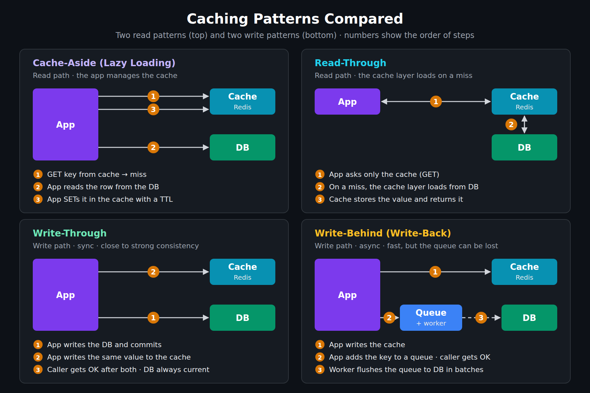

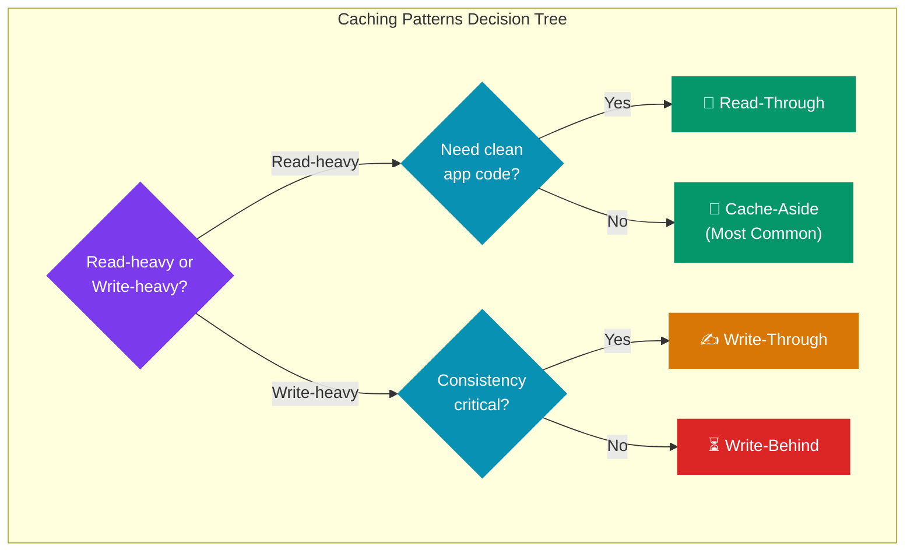

🧠 **In Practice:**

Most real-world systems use **Cache-Aside** because:
- It's the simplest to implement
- Application has full control
- If the cache fails, the app falls back to the DB and keeps working
- Spring's `@Cacheable` annotation implements this pattern

💡 **Common Combination:** Cache-Aside for reads + Write-Through/Write-Behind for writes, depending on consistency requirements.

🧠 **How to remember — read the name**

The **first word** is the operation (read or write). The **second word** says where the cache sits, or when the DB is written:

| Word | Picture | Meaning |
|---|---|---|
| **Aside** | Cache sits *beside* the app, not in the path | The **app** does all the work: check cache → DB → fill cache |
| **Through** | Data passes *through* the cache, in the same request | Cache and DB are both handled **now**, before "OK" |
| **Behind** | The DB walks *behind* the cache | Cache now, DB **later** |

```
Who loads on a READ miss?      When is the DB written on a WRITE?
Aside   → the app              Through → now (sync)
Through → the cache            Behind  → later (async)
```

> **Aside = App does it. Through = Together, now. Behind = DB comes later.**

The trade-offs come from the names:

- **Behind** → the DB is behind → a crash can lose data, but writes are fastest.
- **Through** → both stores are updated together → slower writes, safe data.
- **Aside** → the app is in control → simplest, and it is what `@Cacheable` does.

⚠️ "Write-Through" does not say which store goes first. In this note (Q2) it is **DB first**, then cache. So a failed cache write leaves only a stale cache, not lost data.

---

</details>

---

7. **⚡ What is on-heap (local) caching with Caffeine and when do you choose it over Redis? 🔥🔥**

<!-- -->
<details>
<summary>Answer</summary>

**Answer:**

**Caffeine** is a high-performance, in-process (on-heap) cache library for Java. Unlike Redis, it lives inside the JVM. So there is no network call, no serialization cost, and the latency is under one microsecond.

**Setup:**

```xml
<dependency>
    <groupId>com.github.ben-manes.caffeine</groupId>
    <artifactId>caffeine</artifactId>
</dependency>
<!-- Spring Boot auto-wires Caffeine when spring-boot-starter-cache is present -->
```

```java
@Bean
public CacheManager cacheManager() {
    CaffeineCache employeeCache = new CaffeineCache("employees",
        Caffeine.newBuilder()
            .maximumSize(1000)                    // max entries
            .expireAfterWrite(10, TimeUnit.MINUTES)
            .recordStats()                         // expose hit/miss via Actuator
            .build());
    SimpleCacheManager manager = new SimpleCacheManager();
    manager.setCaches(List.of(employeeCache));
    return manager;
}

// Usage — same Spring annotations work with any CacheManager
@Cacheable("employees")
public Employee getById(Long id) { ... }

@CacheEvict("employees")
public void deleteById(Long id) { ... }
```

**Caffeine vs Redis — when to use which:**

| Dimension | Caffeine (on-heap) | Redis (distributed) |
|---|---|---|
| **Latency** | ~100ns (in-memory) | ~0.5–2ms (network) |
| **Shared across pods** | ❌️ Each pod has its own copy | ✅ One copy for all pods |
| **Consistency** | ⚠️ Stale data across pods (fix → §2 Q8) | Shared — all pods see the same value. Still only eventually consistent with the DB |
| **Survives restart** | ❌️ Lost on pod restart | ✅ Persistent (with RDB/AOF) |
| **Best for** | Reference data, config, small lookup tables | Session data, rate limits, shared state |
| **Cost** | Zero (no infra) | Redis cluster cost + ops |

**Two-level (L1 + L2) caching pattern:**

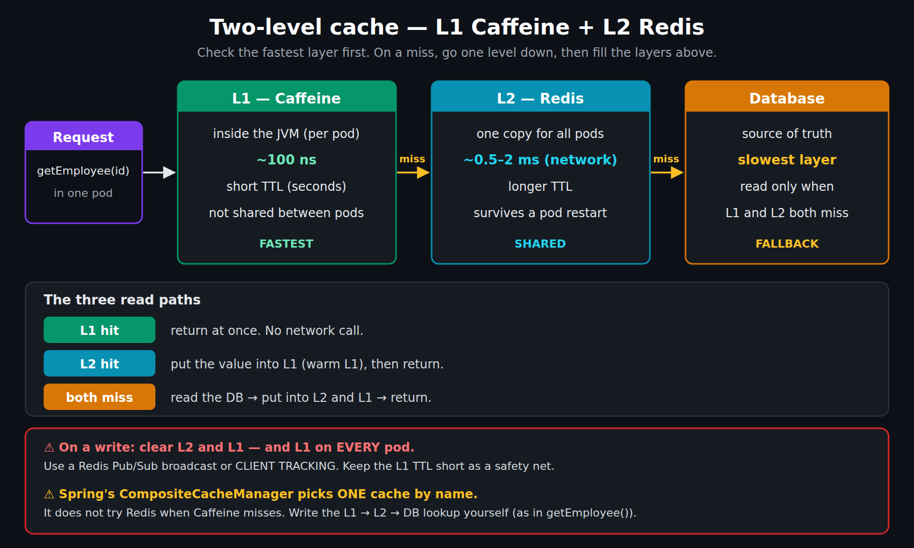

```java
// L1: Caffeine (fast, per-pod, small TTL)  — com.github.benmanes.caffeine.cache.Cache
// L2: Redis (shared, larger TTL)           — Spring org.springframework.cache.Cache
// On cache miss: L1 miss → L2 hit → populate L1 → return
// On write: invalidate L2 and L1 — and L1 on EVERY pod (see below)

public Employee getEmployee(Long id) {
    Employee emp = caffeineCache.getIfPresent(id); // L1 check
    if (emp != null) {
        return emp;
    }

    // Spring Cache.get(key) returns a ValueWrapper, not Employee.
    // get(key, Type) unwraps and casts for you.
    emp = redisCache.get(id, Employee.class);      // L2 check
    if (emp != null) {
        caffeineCache.put(id, emp);               // warm L1
        return emp;
    }

    emp = employeeRepo.findById(id).orElseThrow();// DB fallback
    redisCache.put(id, emp);
    caffeineCache.put(id, emp);
    return emp;
}
```

⚠️ **The L1 trap — other pods.** `caffeineCache.invalidate(id)` clears L1 **only on the pod that did the write**. The other pods keep the old value until their L1 TTL ends. Two fixes:

- **Broadcast invalidation:** publish the key on a Redis Pub/Sub channel. Every pod listens and calls `invalidate(id)`.
- **Redis client-side caching** (`CLIENT TRACKING`): Redis itself tells each client which keys changed → see §2 Q8.

Keep the L1 TTL short (seconds) in both cases, as a safety net.

**Common Caffeine eviction policies:**

| Policy | Method | Use case |
|---|---|---|
| Size-based | `maximumSize(1000)` | Bounded memory usage |
| Time-based (write) | `expireAfterWrite(10, MINUTES)` | Freshness guarantee |
| Time-based (access) | `expireAfterAccess(5, MINUTES)` | Evict unused entries |
| Reference-based | `softValues()` / `weakValues()` | Soft: GC evicts under memory pressure. Weak: GC evicts once nothing else references the value |

🔑 **Interview one-liner:** "Caffeine for hot, read-heavy, per-pod data where microsecond latency matters — reference tables, config lookups. Redis when data must be consistent across all pods or survive a restart. In high-scale systems, combine both as L1+L2, with cross-pod invalidation for L1."

---

</details>

---

8. **🛰️ How does Redis client-side caching (`CLIENT TRACKING`) keep a local L1 cache fresh across pods? 🔥**

<!-- -->
<details>
<summary>Answer</summary>

**Answer:**

> 💡 **In one line:** The Redis server remembers what each client read. When that data changes, the server sends the client an "invalidate" message, so the client drops its local copy.

🧠 **The problem it solves**

You use Caffeine as L1 in front of Redis (Q7). Pod A updates employee 7 and clears its own L1. Pods B and C still hold the old value in their L1. Without help, they serve stale data until their L1 TTL ends.

🔑 **How `CLIENT TRACKING` works (Redis 6+)**

| Mode | Command | What the server does |
|---|---|---|
| **Default** | `CLIENT TRACKING ON` | Remembers every key this client read. When a key changes, it sends one invalidation message, then forgets the key (the client must read it again to be tracked again) |
| **Broadcasting** | `CLIENT TRACKING ON BCAST PREFIX employees::` | Remembers nothing per key. It sends an invalidation for **every** change to a key with that prefix, even keys this client never read |
| **Opt-in** | `CLIENT TRACKING ON OPTIN` | Tracks a read only if the client sent `CLIENT CACHING yes` just before it |
| **Opt-out** | `CLIENT TRACKING ON OPTOUT` | Tracks every read, except one after `CLIENT CACHING no` |

**Protocol detail:**

- **RESP3:** the invalidation arrives as a **push message** on the same connection.
- **RESP2:** has no push messages. You open a second connection, `SUBSCRIBE __redis__:invalidate`, and point tracking at it with `CLIENT TRACKING ON REDIRECT <client-id>`.

⚠️ **Costs and traps**

| Item | Detail |
|---|---|
| **Server memory** | Default mode keeps a tracking table: key → clients that read it. `tracking-table-max-keys` caps it. When the table is full, Redis evicts entries and sends invalidations for them, so clients drop data early |
| **BCAST trade-off** | No table on the server, but more messages. A client gets invalidations for keys it never cached |
| **Reconnect** | While the connection is down, invalidations are lost. On reconnect, **flush the whole L1**. This is the standard rule |
| **Read/invalidate race** | With RESP2 redirect, the invalidation and the read reply use two connections and can arrive out of order. Clients guard against this (for example, mark the key "loading" before the read). With RESP3 on one connection this race does not happen |
| **Keep a TTL** | Still set a short L1 TTL as a safety net |

☕ **Java support** (check your client version — these APIs are still changing):

- **Lettuce:** `ClientSideCaching.enable(...)` returns a `CacheFrontend<K, V>`.
- **Jedis 5.x:** pass a `CacheConfig` when you build the client (RESP3 only).
- Spring Data Redis does not expose it through `RedisTemplate` or `@Cacheable`. You use the driver directly.

```java
// Lettuce — check your client version; the API is marked experimental in some versions
StatefulRedisConnection<String, String> connection = redisClient.connect();
Map<String, String> localCache = new ConcurrentHashMap<>();

CacheFrontend<String, String> frontend = ClientSideCaching.enable(
        CacheAccessor.forMap(localCache),
        connection,
        TrackingArgs.Builder.enabled());   // CLIENT TRACKING ON (default mode)

String value = frontend.get("employees::7");   // 1st call → Redis; next calls → localCache
// When any client changes employees::7, Redis pushes an invalidation
// and Lettuce removes it from localCache.
```

**`CLIENT TRACKING` vs manual Pub/Sub invalidation:**

| | `CLIENT TRACKING` | Manual Pub/Sub broadcast |
|---|---|---|
| **Who sends the invalidation** | Redis server, on any write to the key | Your app, after its own write |
| **Catches writes by other apps / `redis-cli`** | ✅ Yes | ❌️ No — only writers that publish |
| **Works with a Caffeine L1 + `@Cacheable`** | Needs the driver's own cache (not Spring Cache) | ✅ Easy — listener calls `invalidate(key)` |
| **Delivery** | Lost while disconnected → flush L1 on reconnect | Lost while disconnected (Pub/Sub is fire-and-forget) → same rule |

🔑 **Interview one-liner:** "An L1 cache goes stale on other pods. Redis 6 client-side caching fixes that: with `CLIENT TRACKING`, the server remembers what each client read and pushes an invalidation when it changes. BCAST mode trades server memory for more messages. Because messages are lost on disconnect, the client flushes its whole local cache on reconnect."

---

</details>

---

<a id="cache-problems-and-solutions"></a>

## 3. Cache Problems and Solutions 🔥🔥

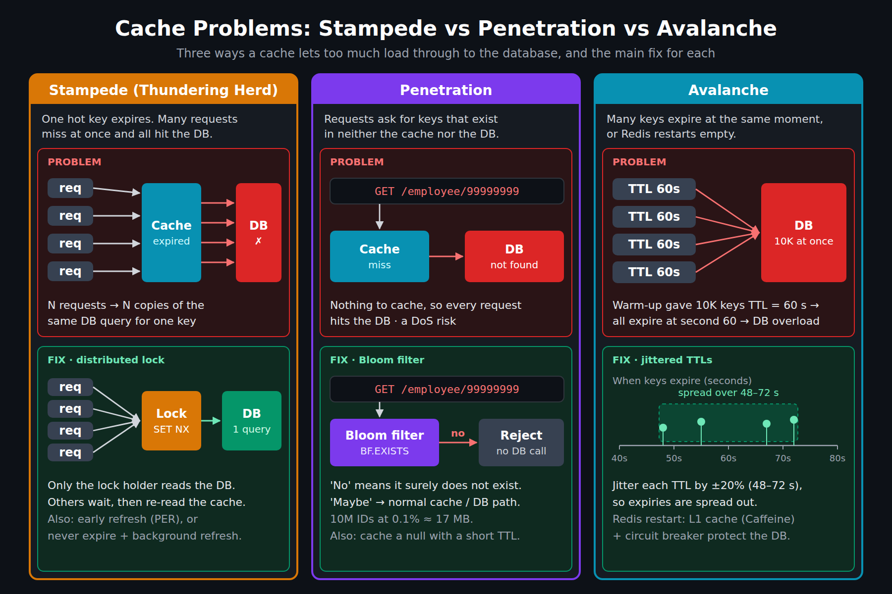

1. **⚡ What is Cache Stampede (Thundering Herd) and how do you prevent it? 🔥🔥**

<!-- -->
<details>
<summary>Answer</summary>

**Answer:**

Cache Stampede (also called **Thundering Herd** or **Dog-Piling**) happens when a **popular cache key expires**. Then **hundreds of concurrent requests** miss the cache at the same time. They all hit the database at once to rebuild the same data.

**⚠️ The Problem:**

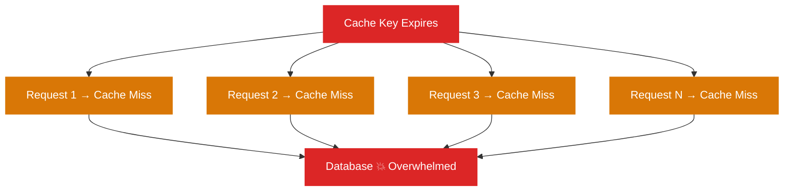

**✅ The Solution (Distributed Locking):**

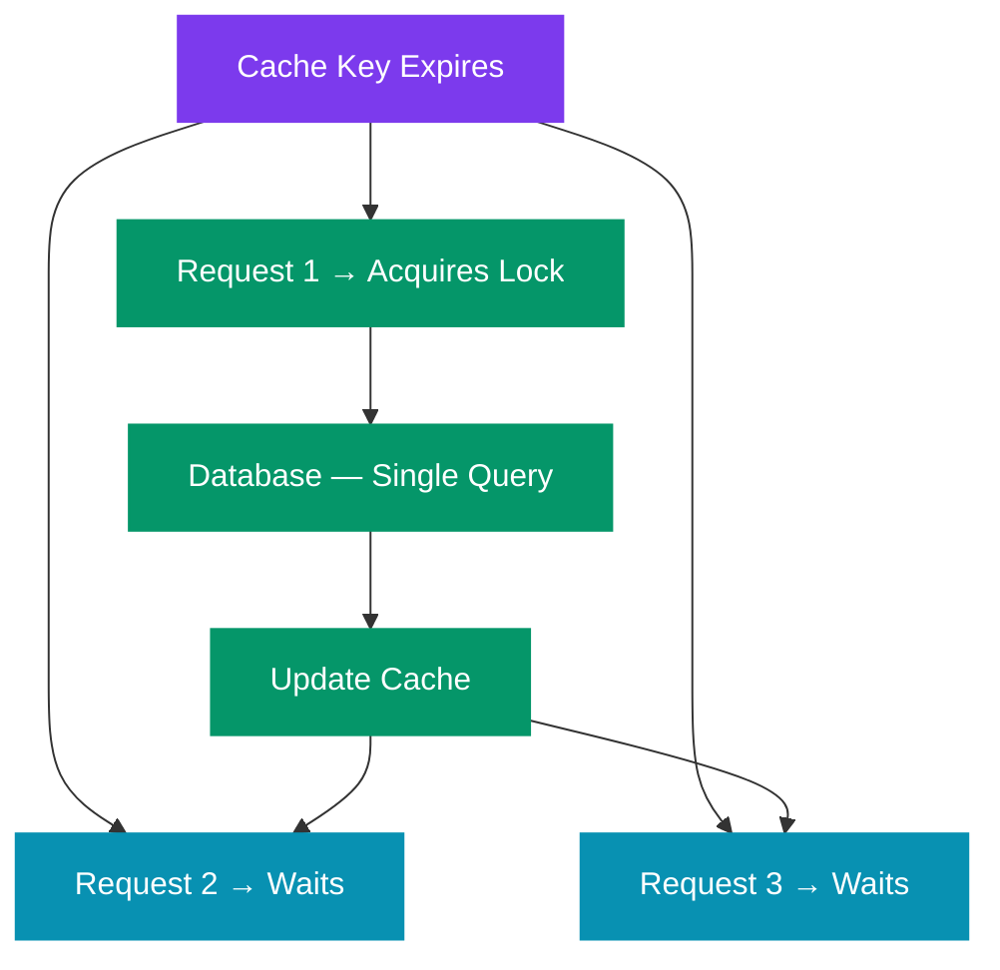

🔑 **Solutions:**

**Solution 1: Distributed Locking (Most Common)**

When a cache key expires, all concurrent requests get a cache miss at the same time. Distributed locking makes sure that **only the first request acquires the lock and queries the database**. Every other request does one of two things:
- it blocks (Redisson), or
- it sleeps and retries (SETNX).

The winning thread writes the fresh data back to Redis and releases the lock. The waiting threads then find the data in the cache on their retry. They never touch the database.

The key detail is the **double-checked locking pattern**:
- After you acquire the lock, check the cache *again* before you query the DB.
- Why: another thread may have already filled it while you were waiting for the lock.
- Without this check, all the threads that queued for the lock would go to the DB one after another. That is still a stampede, just slower.

There are two ways to implement it:
- **Redisson** — a production-grade distributed lock. It renews the lock lease automatically. It uses Lua scripts to stay atomic.
- **manual SETNX** (`setIfAbsent` on `RedisTemplate`) — simpler, but you must write the retry loop yourself.

**Programmatic (`RedisTemplate` + Redisson lock):**

In `build.gradle`: `implementation 'org.redisson:redisson-spring-boot-starter:3.27.0'`

```java
@Service
public class EmployeeServiceImpl implements IEmployeeService {

    @Autowired
    private EmployeeRepository employeeRepository;

    @Autowired
    private RedissonClient redisson; // Redisson provides distributed lock out of the box

    @Autowired
    private RedisTemplate<String, Employee> redisTemplate;

    private static final Duration CACHE_TTL = Duration.ofSeconds(60);

    public Employee getOneEmployee(Integer empId) {
        String cacheKey = "employees::" + empId;
        String lockKey  = "lock:employees::" + empId;

        // Step 1: Try cache first
        Employee cached = redisTemplate.opsForValue().get(cacheKey);
        if (cached != null) {
            return cached; // Cache hit — no lock needed
        }

        // Step 2: Cache miss — acquire distributed lock
        RLock lock = redisson.getLock(lockKey);
        boolean acquired = false;
        try {
            // ⚠️ Use the waitTime-only overload. Passing an explicit leaseTime
            //    (e.g. lock.lock(10, SECONDS)) DISABLES the watchdog — if the DB query
            //    outlives 10s the lock expires while you still hold it and the
            //    stampede returns. Without leaseTime, Redisson's watchdog renews the
            //    default 30s lease every 10s for as long as this thread is alive.
            acquired = lock.tryLock(5, TimeUnit.SECONDS);

            // Step 3: Double-check cache (another thread may have populated it while we waited)
            cached = redisTemplate.opsForValue().get(cacheKey);
            if (cached != null) {
                return cached;
            }

            // Step 4: Normally only the lock holder reaches here — one DB query.
            //         But a thread that timed out (acquired == false) also reaches here:
            //         it goes to the DB anyway rather than failing the request.
            //         Worst case: a few extra DB hits.
            Employee employee = employeeRepository.findById(empId)
                    .orElseThrow(() -> new ResourceNotFoundException("Employee Not Found"));

            redisTemplate.opsForValue().set(cacheKey, employee, CACHE_TTL);
            return employee;

        } catch (InterruptedException ex) {
            Thread.currentThread().interrupt();
            throw new IllegalStateException("Interrupted while waiting for cache lock", ex);
        } finally {
            // Only unlock what we actually own — Redisson enforces this internally
            if (acquired && lock.isHeldByCurrentThread()) {
                lock.unlock();
            }
        }
    }
}
```

**Annotation-based (`@Cacheable` + Redisson lock):**

`@Cacheable` already handles step 1 (try the cache) and the final cache write. The method body runs **only on a cache miss**, so the lock goes inside it. The class has the same fields as above, plus an injected `CacheManager cacheManager`:

```java
@Cacheable(value = "employees", key = "#empId", sync = true) // sync = one loader per JVM
public Employee getOneEmployee(Integer empId) {
    RLock lock = redisson.getLock("lock:employees::" + empId);
    boolean acquired = false;
    try {
        acquired = lock.tryLock(5, TimeUnit.SECONDS); // no leaseTime → watchdog stays on

        // Double-check: a thread on ANOTHER pod may have filled the cache meanwhile
        Employee cached = cacheManager.getCache("employees").get(empId, Employee.class);
        if (cached != null) {
            return cached;
        }

        return employeeRepository.findById(empId)
                .orElseThrow(() -> new ResourceNotFoundException("Employee Not Found"));
        // @Cacheable writes the returned value to Redis (key "employees::<empId>")
    } catch (InterruptedException ex) {
        Thread.currentThread().interrupt();
        throw new IllegalStateException("Interrupted while waiting for cache lock", ex);
    } finally {
        if (acquired && lock.isHeldByCurrentThread()) {
            lock.unlock();
        }
    }
}
```

| Layer | What it stops |
|---|---|
| `sync = true` | Many threads in **one pod** → only one runs the method. It is a **local** lock, not a Redis lock. |
| Redisson lock | One thread from **each pod** → only one of them goes to the DB |

- 💡 With only `sync = true`, N pods can still send N DB queries at once. That is often fine for a few pods. Add Redisson when the DB query is expensive or there are many pods.
- ⚠️ `sync = true` does not work together with `unless`. Spring rejects that combination.
- ⚠️ Call this method from **another bean**. A call from inside the same class skips the Spring proxy, so `@Cacheable` and `sync` do nothing.

**Manual `RedisTemplate` (SETNX-based lock — no Redisson):**

```java
// Release script — compare-and-delete so we can never delete someone else's lock
private static final RedisScript<Long> RELEASE = RedisScript.of(
    "if redis.call('GET', KEYS[1]) == ARGV[1] then return redis.call('DEL', KEYS[1]) else return 0 end",
    Long.class);

private static final int MAX_ATTEMPTS = 5;

// Lock values are plain strings — use a String-serialized template for them,
// separate from the Employee-serialized template used for the cached value.
@Autowired
private StringRedisTemplate lockTemplate;

public Employee getOneEmployeeWithLock(Integer empId) {
    String cacheKey = "employees::" + empId;
    String lockKey  = "lock:employees::" + empId;

    // ⚠️ Bounded retry loop — NOT recursion. Recursive retry under a real stampede
    //    (the exact scenario this code exists to solve) blows the stack.
    for (int attempt = 0; attempt < MAX_ATTEMPTS; attempt++) {
        Employee cached = redisTemplate.opsForValue().get(cacheKey);
        if (cached != null) {
            return cached;
        }

        // ⚠️ Owner token, not the literal "locked" — a bare DEL on release can delete
        //    a lock that already expired and was re-acquired by another thread.
        String token = UUID.randomUUID().toString();

        // SETNX = SET if Not eXists — atomic lock acquisition
        Boolean acquired = lockTemplate.opsForValue()
                .setIfAbsent(lockKey, token, Duration.ofSeconds(10));

        if (Boolean.TRUE.equals(acquired)) {
            try {
                cached = redisTemplate.opsForValue().get(cacheKey); // double-check
                if (cached != null) {
                    return cached;
                }

                Employee employee = employeeRepository.findById(empId)
                        .orElseThrow(() -> new ResourceNotFoundException("Employee Not Found"));

                redisTemplate.opsForValue().set(cacheKey, employee, CACHE_TTL);
                return employee;
            } finally {
                // Compare-and-delete, not a bare delete(lockKey)
                lockTemplate.execute(RELEASE, List.of(lockKey), token);
            }
        }

        // Another thread holds the lock — back off with jitter, then re-check the cache
        try {
            Thread.sleep(50L + ThreadLocalRandom.current().nextLong(100));
        } catch (InterruptedException ex) {
            Thread.currentThread().interrupt();
            throw new IllegalStateException("Interrupted while waiting for cache lock", ex);
        }
    }

    // Gave up waiting — degrade to a direct DB read rather than failing the request
    return employeeRepository.findById(empId)
            .orElseThrow(() -> new ResourceNotFoundException("Employee Not Found"));
}
```

> ⚠️ **The lock above must follow §7's rules, not break them.** Owner token + Lua compare-and-delete is exactly what §7 Q1 requires. A bare `SET lockKey "locked"` released with `redisTemplate.delete(lockKey)` is the version §7 labels **DANGEROUS**. This is the same file, so the same rules apply here.

**Solution 2: Probabilistic Early Expiration (PER)**

PER does not let the key expire and then rush to rebuild it. Instead, it refreshes the cache early, while the key is **still alive but close to expiry**. It works like this:
- Every request checks the remaining TTL.
- A probabilistic formula gives an `expiryGap` value. The formula multiplies the rebuild time by the logarithm of a random number. The gap does not depend on the TTL. But as the TTL shrinks, more random gaps are larger than it, so an early refresh **becomes more likely**.
- When the remaining TTL falls below this gap, the request starts a background DB refresh with `CompletableFuture.runAsync()`.
- The request then *immediately returns the still-valid cached value* to the caller. There is no waiting and no locking.

The `beta` parameter controls how early the refresh starts:
- `beta = 1.0` is the baseline.
- A higher value starts the refresh earlier. This is better for very popular keys.
- A lower value refreshes later. This gives less DB load for moderately popular keys.

The math is probabilistic. So each concurrent request picks its own gap value on its own. This **spreads the refresh load** across many requests over time. The load does not all arrive at the exact moment of expiry. No locks and no waiting threads.

> ⚠️ **PER only protects a key that is still in the cache.** It cannot help on a cold miss. If the key is gone (first request, eviction, or a Redis restart), every request takes the cache-miss path below. They all hit the DB together, so the stampede still happens. Combine PER with the lock from Solution 1 on the miss path.
>
> ⚠️ **Pass a dedicated executor to `runAsync`.** Without one, it uses the common `ForkJoinPool`. That pool is small (CPU cores − 1) and is meant for CPU work. Blocking DB calls there can starve parallel streams and other async code in the whole JVM.

```java
@Service
public class EmployeeService {

    @Autowired
    private EmployeeRepository employeeRepository;

    @Autowired
    private RedisTemplate<String, Employee> redisTemplate;

    // Dedicated pool for blocking DB refreshes — NOT the common ForkJoinPool
    private final ExecutorService refreshExecutor = Executors.newFixedThreadPool(4);

    private static final Duration CACHE_TTL = Duration.ofSeconds(60);

    public Employee getOneEmployee(Integer empId) {
        String cacheKey = "employees::" + empId;

        Employee cached = redisTemplate.opsForValue().get(cacheKey);
        Long ttl = redisTemplate.getExpire(cacheKey, TimeUnit.SECONDS);

        if (cached != null && ttl != null) {
            // expiryGap is random and does not depend on TTL. As TTL decreases,
            // more gaps exceed it → probability of early refresh increases
            double beta = 1.0;   // tuning parameter (higher = more aggressive refresh)
            double delta = 10.0; // rebuild-time scale in seconds (XFetch uses the measured DB rebuild time)
            double expiryGap = -delta * beta * Math.log(Math.random());

            if (ttl < expiryGap) { // within early-refresh threshold
                // ⚠️ No dedup: several requests can pass this check together and each
                //    start a refresh. It is a few extra DB reads, not a herd.
                // Refresh in background — current request still gets cached value (no wait)
                CompletableFuture.runAsync(() -> {
                    Employee fresh = employeeRepository.findById(empId).orElse(null);
                    if (fresh != null) {
                        redisTemplate.opsForValue().set(cacheKey, fresh, CACHE_TTL);
                    }
                }, refreshExecutor); // blocking DB I/O → dedicated executor
            }
            return cached; // always return current cached value immediately
        }

        // Cache miss — load from DB (⚠️ no lock here: a cold miss can still stampede)
        Employee employee = employeeRepository.findById(empId)
                .orElseThrow(() -> new ResourceNotFoundException("Employee Not Found"));
        redisTemplate.opsForValue().set(cacheKey, employee, CACHE_TTL);
        return employee;
    }
}
```

**Solution 3: Never Expire + Background Refresh (`@Scheduled`)**

Use this for a **small, known set of very hot keys** (e.g. top-100 products, homepage data, popular employee profiles). You remove the stampede by never letting the key expire at all.
- The app writes the cache entry *without* a TTL (`set(key, value)` — no duration argument). So Redis keeps it forever.
- A `@Scheduled` background job runs on a fixed interval. The interval is a little shorter than what the TTL *would* have been.
- The job overwrites the key with fresh DB data before it can go stale.

The result is **almost no cache misses** for these hot keys. A user request nearly always finds a valid entry.

> ⚠️ **Not truly zero.** A key can still disappear in two cases:
> - **Eviction.** Under an `allkeys-*` policy, Redis can evict a key with no TTL when memory is full.
> - **Restart.** If Redis restarts without persistence, all keys are gone until the next job run.
>
> In both cases, requests miss until the job runs again. Keep a normal cache-miss path (with a lock) as a backup.

The cost is a short **stale window** equal to the job interval (e.g. data can be up to 50 seconds old). This is fine for non-real-time data like product listings or dashboards.

This approach only works when you can list the hot keys in advance. It does not fit general user-specific keys or unbounded key spaces.

```java
@Component
public class EmployeeCacheRefresher {

    @Autowired
    private EmployeeRepository employeeRepository;

    @Autowired
    private RedisTemplate<String, Employee> redisTemplate;

    // Refresh the first 100 employees every 50 seconds. The keys have no TTL,
    // so this job is the only thing that makes them fresh (max staleness ≈ 50s)
    @Scheduled(fixedRate = 50_000)
    public void refreshHotEmployees() {
        List<Employee> hotEmployees = employeeRepository.findAll(PageRequest.of(0, 100)).getContent();
        hotEmployees.forEach(emp ->
            // Persist = no TTL — key never expires, only refreshed by this job
            redisTemplate.opsForValue().set("employees::" + emp.getId(), emp)
        );
    }
}
```

| 🎯 Solution | ✅ Pros | ⚠️ Cons |
|---|---|---|
| **Locking** | Usually one DB hit (a waiter that times out also reads the DB) | Adds latency for waiting threads |
| **Probabilistic Early Expiration** | No locks, no waiting | Occasional extra DB reads (no dedup of refreshes) |
| **Background Refresh** | Almost no cache misses (eviction or restart can still remove keys) | Stale data during refresh interval |
| **Stale-While-Revalidate** | After a soft expiry, serves the old value instantly and refreshes it async (one refresher) | Brief period of stale data |

---

</details>

---

2. **🛡️ What is Cache Penetration and how do you solve it with Bloom Filters? 🔥🔥**

<!-- -->
<details>
<summary>Answer</summary>

**Answer:**

> 💡 **In one line:** Requests for data that does not exist skip the cache fully and flood the DB. Block them before they reach the cache.

Cache Penetration happens when requests keep asking for data that **does not exist** in the cache or the database. The data does not exist, so it is never cached. So every request goes through to the database.

🧠 **Example:** An attacker sends millions of requests for `GET /api/v1/employee/99999999`. This employee ID does not exist. Each request misses the cache and hits the database. This can cause a denial-of-service.

🔑 **Solutions:**

**Solution 1: Cache Null Values**

**Annotation-based (`@Cacheable` without `unless` — preferred):**

```java
@Service
public class EmployeeServiceImpl implements IEmployeeService {

    @Autowired
    private EmployeeRepository employeeRepository;

    // Null caching must be allowed in the cache config (it is by default)
    // No `unless` clause here, so a null result IS cached (cache penetration fix).
    // Adding unless = "#result == null" would stop nulls from being cached.
    @Cacheable(value = "employees", key = "#empId")
    public Employee getOneEmployee(Integer empId) {
        // Returns null if not found — Spring caches the null under "employees::99999999"
        // Next request for same ID → cache hit → null returned → DB never hit again
        return employeeRepository.findById(empId).orElse(null);
    }
}
```

> ⚠️ Make sure null caching is on. It is on by default: `RedisCacheConfiguration` allows nulls unless you call `disableCachingNullValues()`, and in Spring Boot the property is `spring.cache.redis.cache-null-values` (default `true`). If you use `unless = "#result == null"` on `@Cacheable`, nulls are NOT cached. Remove it for this fix to work.
>
> ⚠️ **The null entry gets the same TTL as real entries.** There is no separate null TTL in the annotation. And `RedisCacheConfiguration` has **no TTL by default** — entries live forever unless you set `entryTtl(...)`. So without `entryTtl`, a cached null stays forever, even after the employee is created. Two fixes:
> - Always set `entryTtl(...)` on the cache config, and evict the key when you create the entity.
> - For a shorter TTL only for nulls, use a per-entry TTL with `RedisCacheWriter.TtlFunction`. It can return a short TTL when the value is null. This exists from Spring Data Redis 3.2 — check your version.
>
> If you need a separate null TTL on an older version, use the manual approach below.

**Manual `RedisTemplate` (null marker approach):**

```java
@Service
public class EmployeeService {

    @Autowired
    private EmployeeRepository employeeRepository;

    @Autowired
    private StringRedisTemplate stringRedisTemplate; // for null marker

    @Autowired
    private RedisTemplate<String, Employee> redisTemplate;

    private static final String NULL_MARKER = "NULL";
    private static final Duration NULL_TTL   = Duration.ofSeconds(30); // shorter than CACHE_TTL — don't pollute cache
    private static final Duration CACHE_TTL  = Duration.ofSeconds(60);

    public Employee getOneEmployee(Integer empId) {
        String cacheKey = "employees::" + empId;

        // Check for null marker first
        String nullMarker = stringRedisTemplate.opsForValue().get(cacheKey + ":null");
        if (NULL_MARKER.equals(nullMarker)) {
            return null; // Known non-existent — skip DB entirely
        }

        Employee cached = redisTemplate.opsForValue().get(cacheKey);
        if (cached != null) return cached;

        // Cache miss — query DB
        Employee employee = employeeRepository.findById(empId).orElse(null);

        if (employee == null) {
            // Cache null marker with SHORT TTL — prevents repeated DB hits
            stringRedisTemplate.opsForValue().set(cacheKey + ":null", NULL_MARKER, NULL_TTL);
            return null;
        }

        redisTemplate.opsForValue().set(cacheKey, employee, CACHE_TTL);
        return employee;
    }

    // On insert, delete the null marker. Otherwise the new employee
    // stays "not found" until NULL_TTL runs out.
    public Employee createEmployee(Employee e) {
        Employee saved = employeeRepository.save(e);
        stringRedisTemplate.delete("employees::" + saved.getId() + ":null");
        return saved;
    }
}
```

**Solution 2: Bloom Filter (Recommended for Large Scale)**

A Bloom Filter is a probabilistic data structure that uses very little memory. It can tell you:
- **Definitely NOT in set** → 100% accurate *only if every insert reached the filter* — skip cache AND DB entirely
- **Probably in set** → small false positive rate — proceed to cache/DB

<details>
<br/>
<summary><strong>🤔 Doubt: How does a Bloom Filter work internally?</strong></summary>

A Bloom Filter is a **fixed-size bit array** (all bits start at `0`) combined with **multiple hash functions**.

**Adding an element (`BF.ADD`):**

When you add employee ID `101`, each hash function maps it to a position in the bit array and sets that bit to `1`:

```
Hash1(101) → position 3  → bit[3] = 1
Hash2(101) → position 7  → bit[7] = 1
Hash3(101) → position 12 → bit[12] = 1

Bit array: [0, 0, 0, 1, 0, 0, 0, 1, 0, 0, 0, 0, 1, 0, ...]
                     ↑           ↑              ↑
                     pos 3       pos 7          pos 12
```

**Checking existence (`BF.EXISTS`):**

When you check if employee ID `99999999` exists, the same hash functions run:

```
Hash1(99999999) → position 5  → bit[5] = 0  ← ZERO found → STOP
```

If **any** bit is `0` → element **definitely NOT in set** → block the request immediately, never touch cache or DB.

If **all** bits are `1` → element **probably in set** → proceed to cache/DB.

**Why "probably"? — False Positives:**

```
Hash1(99999) → position 3  → bit[3] = 1  (set by employee 101)
Hash2(99999) → position 7  → bit[7] = 1  (set by employee 202)
Hash3(99999) → position 12 → bit[12] = 1 (set by employee 303)
```

All bits are `1`, but *different* employees set them, not `99999`. The filter says "probably exists". This is a **false positive**. The request reaches the DB, finds nothing, and returns 404. This is a small cost.

**There are NO false negatives** — if an element was added, its bits are always `1`. A `0` proves for sure that the element is not in the set.

> ⚠️ **"No false negatives" is true only if every insert reaches the filter.** In a real system, some inserts can miss it:
> - Another service writes rows to the same table and never calls `BF.ADD`.
> - A request arrives during startup, before the initial load has added all IDs.
> - The `BF.ADD` call fails after the DB commit.
>
> In each case, the filter says "definitely not" for a row that exists. That is a false negative, and a real user gets a 404.
>
> ⚠️ **A standard Bloom filter cannot delete.** Clearing bits could clear bits that other elements share. So a deleted employee stays "probably exists" forever, and the filter slowly fills with dead IDs. Two fixes:
> - **Rebuild it on a schedule** from the DB (build a new key, then swap it in with `RENAME`).
> - **Use a Cuckoo filter** (`CF.ADD` / `CF.EXISTS` / `CF.DEL`). It supports delete, with a similar false-positive rate.

**Memory efficiency:**

| Dataset | False Positive Rate | Memory |
|---|---|---|
| 1 million IDs | 1% | ~1.2 MB |
| 10 million IDs | 1% | ~12 MB |
| 10 million IDs | 0.1% | ~17 MB |

Compare this with caching 10 million null values in Redis. Each null entry still needs about 50–70 bytes of key overhead (the same per-key overhead as in the §4 memory estimate) → **500–700 MB** vs **17 MB**.

**Why store the Bloom Filter in Redis (not in-memory)?**

| | In-memory (Guava `BloomFilter`) | Redis (`BF.ADD/EXISTS`) |
|---|---|---|
| Scope | Single JVM only | Shared across all app instances |
| Survives restart | ❌️ Lost on app restart | ✅ Persisted in Redis |
| Multiple pods/instances | ❌️ Each has its own filter | ✅ All pods share one filter |
| Use in production | Dev/single-instance only | ✅ Production-ready |

> 📌 **Where do the `BF.*` commands come from?** Up to Redis 7.x, they come from the RedisBloom module (shipped in Redis Stack). From **Redis 8**, Bloom and Cuckoo filters are built into Redis Open Source, so no module is needed. **Valkey** does not include them. It uses the separate `valkey-bloom` module.

---

</details>
<br/>

<br/>

```java
// build.gradle
// implementation 'com.google.guava:guava:33.0.0-jre'  ← Guava BloomFilter (in-memory)
// OR use BF.ADD / BF.EXISTS for a distributed bloom filter
//    (built into Redis 8+; Redis Stack / RedisBloom on 7.x; valkey-bloom on Valkey)

@Component
public class EmployeeBloomFilter {

    private static final String BLOOM_KEY = "bf:employees";

    @Autowired
    private RedisTemplate<String, String> stringRedisTemplate;

    @Autowired
    private EmployeeRepository employeeRepository;

    // Populate bloom filter on startup with all existing employee IDs
    @EventListener(ApplicationReadyEvent.class)
    public void initialize() {
        // ⚠️ You MUST reserve the filter before adding. BF.ADD on a non-existent key
        //    auto-creates one with the module DEFAULTS (capacity 100, error rate 0.01).
        //    Pushing 1M IDs into a capacity-100 filter forces repeated sub-filter
        //    scaling: ~14 sub-filters, more memory, and every lookup checks each one.
        //    BF.RESERVE errors if the key already exists — swallow that on restart.
        try {
            stringRedisTemplate.execute((RedisCallback<Object>) conn ->
                conn.execute("BF.RESERVE", BLOOM_KEY.getBytes(),
                        "0.01".getBytes(),      // error rate  = 1%
                        "1000000".getBytes())   // capacity    = 1M elements
            );
        } catch (RedisSystemException alreadyExists) {
            // filter survived a restart — nothing to do
        }

        List<Integer> allIds = employeeRepository.findAllIds(); // SELECT id FROM employee
        // ⚠️ One round trip per ID. For 1M IDs, use BF.MADD in batches (or a pipeline).
        allIds.forEach(id ->
            stringRedisTemplate.opsForValue().getOperations()
                .execute((RedisCallback<Object>) conn ->
                    conn.execute("BF.ADD", BLOOM_KEY.getBytes(), String.valueOf(id).getBytes())
                )
        );
    }

    // ⚠️ Do NOT read BF.EXISTS through conn.execute(...). Lettuce does not know the
    //    command, so it returns the reply as raw bytes, never as 1L — the check is
    //    always false. A Lua script with a declared Long result type is decoded correctly.
    private static final RedisScript<Long> BF_EXISTS = RedisScript.of(
            "return redis.call('BF.EXISTS', KEYS[1], ARGV[1])", Long.class);

    public boolean mightExist(Integer empId) {
        // BF.EXISTS returns 1 (probably exists) or 0 (definitely not)
        // Args go through the template's value serializer — it must be a String serializer
        Long result = stringRedisTemplate.execute(
                BF_EXISTS,
                List.of(BLOOM_KEY),
                String.valueOf(empId));
        return Long.valueOf(1L).equals(result);
    }

    // Call this when a new employee is saved — keep bloom filter in sync
    public void add(Integer empId) {
        stringRedisTemplate.execute((RedisCallback<Object>) conn ->
            conn.execute("BF.ADD", BLOOM_KEY.getBytes(), String.valueOf(empId).getBytes())
        );
    }
}

@Service
public class EmployeeServiceImpl implements IEmployeeService {

    @Autowired
    private EmployeeRepository employeeRepository;

    @Autowired
    private RedisTemplate<String, Employee> redisTemplate;

    @Autowired
    private EmployeeBloomFilter bloomFilter;

    private static final Duration CACHE_TTL = Duration.ofSeconds(60);

    public Employee getOneEmployee(Integer empId) {
        // Step 1: Bloom Filter — O(1) check, no DB, no cache
        if (!bloomFilter.mightExist(empId)) {
            throw new ResourceNotFoundException("Employee Not Found"); // definitely doesn't exist
        }

        // Step 2: Check cache
        String cacheKey = "employees::" + empId;
        Employee cached = redisTemplate.opsForValue().get(cacheKey);
        if (cached != null) return cached;

        // Step 3: Cache miss — load from DB (bloom filter said "probably exists")
        Employee employee = employeeRepository.findById(empId)
                .orElseThrow(() -> new ResourceNotFoundException("Employee Not Found"));

        redisTemplate.opsForValue().set(cacheKey, employee, CACHE_TTL);
        return employee;
    }

    // ⚠️ No @CachePut here. @CachePut writes through RedisCacheManager's serializer,
    //    but getOneEmployee reads with redisTemplate. The two serializers can differ, so
    //    the read may fail to deserialize (see the shadow-key warning in Q3).
    //    Write with the same redisTemplate that reads.
    @Override
    public Employee saveEmployee(Employee e) {
        Employee saved = employeeRepository.save(e);
        bloomFilter.add(saved.getId()); // keep bloom filter in sync on every new save
        redisTemplate.opsForValue().set("employees::" + saved.getId(), saved, CACHE_TTL);
        return saved;
    }
}
```

**Verify in redis-cli:**

```bash
# After startup — bloom filter key exists
127.0.0.1:6379> EXISTS bf:employees
# (integer) 1

# Check if employee 1 probably exists
127.0.0.1:6379> BF.EXISTS bf:employees 1
# (integer) 1  ← probably exists → proceed to cache/DB

# Check a non-existent employee
127.0.0.1:6379> BF.EXISTS bf:employees 99999999
# (integer) 0  ← definitely not → blocked immediately, DB never hit
```

| 🎯 Solution | ✅ Pros | ⚠️ Cons |
|---|---|---|
| **Cache Null Values** | Simple to implement | Wastes cache memory for non-existent keys |
| **Bloom Filter** | O(1) lookup, space-efficient | Small false positive rate, needs maintenance |
| **Input Validation** | Blocks obviously invalid requests early | Can't catch all invalid patterns |

📝 **Bloom Filter Math:**
- 1 million elements, 1% false positive rate = ~1.2 MB memory
- 10 million elements, 0.1% false positive rate = ~17 MB memory
- Much more efficient than caching millions of null values

---

</details>

---

3. **🌊 What is Cache Avalanche and how do you prevent it? 🔥🔥**

<!-- -->
<details>
<summary>Answer</summary>

> 💡 **In one line:** Thousands of cache keys expire at the same moment. The DB is overloaded by the sudden load.

**Answer:**

Cache Avalanche happens when a **large number of cache keys expire at the same time**. This causes a huge spike in database queries. It can happen when:

1. Many keys were set with the **same TTL** during a cache warmup
2. The Redis server **restarts** and all cached data is lost at once
3. A **scheduled job** refreshes many keys at the same time, and they all get the same TTL

🧠 **Example:** During startup, you warm the cache (fill it in advance) with 10K employee entries. All of them have `TTL = 60 seconds`. Exactly 60 seconds later, all 10K keys expire at the same time → 10K DB queries hit at once → DB collapses.

**Cache Stampede vs Cache Avalanche — the difference:**

| | Cache Stampede | Cache Avalanche |
|---|---|---|
| Scope | **One** popular key expires | **Many** keys expire at the same time |
| Cause | TTL expiry of a single hot key | Many TTLs expire at once, or Redis restarts |
| DB impact | Burst of duplicate queries for one item | Very many queries across many items |
| Fix | Locking / PER on that key | Jitter TTLs / Multi-layer cache |

🔑 **Solutions:**

**Solution 1: Jittered TTLs (Most Important — stops the avalanche at its cause)**

Add a random offset to TTL values. Then keys expire at different times.

> **Why it works:**
> - If all 10K employees are cached with exactly `TTL = 60s`, they all expire at second 60.
> - Add a random ±20% offset. Now they spread across 48s–72s.
> - The DB sees a slow, steady flow of expiries instead of one sudden burst.
> - This is the **cheapest fix**. One line of code removes causes #1 and #3 (mass expiry at the same moment).
> - It does **not** help with cause #2. After a Redis restart, the cache is empty, so every key misses at once, jitter or not. Solutions 2 and 3 cover that case.

```java
@Service
public class EmployeeService {

    @Autowired
    private EmployeeRepository employeeRepository;

    @Autowired
    private RedisTemplate<String, Employee> redisTemplate;

    private static final long BASE_TTL_SECONDS = 60;

    public Employee getOneEmployee(Integer empId) {
        String cacheKey = "employees::" + empId;

        Employee cached = redisTemplate.opsForValue().get(cacheKey);
        if (cached != null) return cached;

        Employee employee = employeeRepository.findById(empId)
                .orElseThrow(() -> new ResourceNotFoundException("Employee Not Found"));

        // Add ±20% jitter → TTL = 48s–72s (random per key)
        // 10K employees cached together → expire spread across 24-second window, not all at once
        redisTemplate.opsForValue().set(cacheKey, employee, jitteredTtl(BASE_TTL_SECONDS));
        return employee;
    }

    private Duration jitteredTtl(long baseSeconds) {
        long jitter = ThreadLocalRandom.current()
                .nextLong(-baseSeconds / 5, baseSeconds / 5 + 1); // ±20% (upper bound is exclusive)
        return Duration.ofSeconds(baseSeconds + jitter);
    }
}
```

**Also apply jitter during cache warmup.** This is where avalanche most commonly starts:

```java
@EventListener(ApplicationReadyEvent.class)
public void warmCache() {
    // 100 rows here to keep it short; the same code covers the 10K case above
    List<Employee> employees = employeeRepository.findAll(PageRequest.of(0, 100)).getContent();

    employees.forEach(emp -> {
        // Each employee gets a different TTL — no mass expiry
        redisTemplate.opsForValue().set("employees::" + emp.getId(), emp, jitteredTtl(60));
    });
}
```

**Solution 2: Multi-Layer Caching (L1 + L2 — handles Redis failure)**

- L1: Local cache (Caffeine) — very fast, small
- L2: Redis — distributed, larger
- L3: Database — source of truth

> **Why it works:**
> - If Redis crashes, a pure Cache-Aside app hits the DB for **every** request instantly.
> - Put a local L1 cache (Caffeine) in front of Redis. Then the app serves requests from JVM memory, even when Redis is down.
> - The L1 is a short-term buffer. It can't hold data forever (small size, short TTL).
> - But it gives Redis enough time to recover, and the DB is not overloaded.
> - Even a 5-second L1 TTL can handle thousands of requests during a short Redis outage.
> - ⚠️ **Limits.** A 5-second L1 only covers the first 5 seconds. A Redis restart takes longer, and when Redis comes back it is empty (cold). After the first 5 seconds, L1 misses go to the DB. So the Redis call must be wrapped in try/catch with a DB fallback (see the code). Pair L1 with the circuit breaker in Solution 3 to protect the DB.

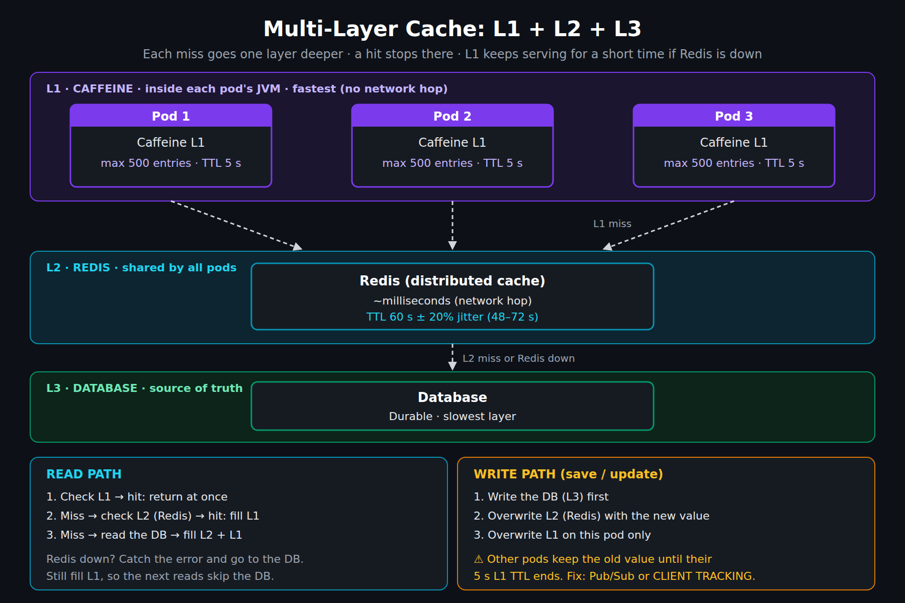

```java
// build.gradle
// implementation 'com.github.ben-manes.caffeine:caffeine'

@Service
public class EmployeeMultiLayerService {

    // L1: JVM-local cache — small, very fast (no network hop), short TTL
    private final Cache<String, Employee> localCache = Caffeine.newBuilder()
            .maximumSize(500)                        // only hot 500 employees in memory
            .expireAfterWrite(Duration.ofSeconds(5)) // short TTL — stale data acceptable briefly
            .build();

    @Autowired
    private RedisTemplate<String, Employee> redisTemplate; // L2

    @Autowired
    private EmployeeRepository employeeRepository;         // L3

    // READ — L1 → L2 → L3
    public Employee getOneEmployee(Integer empId) {
        String cacheKey = "employees::" + empId;

        // L1: Check JVM-local cache (no network, ~nanoseconds)
        Employee local = localCache.getIfPresent(cacheKey);
        if (local != null) return local; // served without touching Redis or DB

        // L2: Check Redis (~milliseconds)
        // If Redis is down, the call throws. Catch it and fall through to the DB,
        // otherwise every L1 miss becomes an error instead of a DB read.
        Employee redis = null;
        try {
            redis = redisTemplate.opsForValue().get(cacheKey);
        } catch (RedisConnectionFailureException ex) {
            // Redis unavailable — treat as a cache miss
        }
        if (redis != null) {
            localCache.put(cacheKey, redis); // populate L1 for next requests
            return redis;
        }

        // L3: DB fallback — reached on full cache miss OR when Redis is down
        Employee employee = employeeRepository.findById(empId)
                .orElseThrow(() -> new ResourceNotFoundException("Employee Not Found"));

        try {
            redisTemplate.opsForValue().set(cacheKey, employee, jitteredTtl(60)); // L2 with jitter
        } catch (RedisConnectionFailureException ex) {
            // Redis unavailable — skip L2, still fill L1
        }
        localCache.put(cacheKey, employee);                                     // L1
        return employee;
    }

    // SAVE — write to DB first, then populate both L1 and L2
    public Employee saveEmployee(Employee e) {
        Employee saved = employeeRepository.save(e); // L3 write
        String cacheKey = "employees::" + saved.getId();

        redisTemplate.opsForValue().set(cacheKey, saved, jitteredTtl(60)); // L2
        localCache.put(cacheKey, saved);                                     // L1
        // next read for this employee hits L1 instantly — no DB or Redis needed
        return saved;
    }

    // UPDATE — write to DB first, then overwrite both L1 and L2 with fresh data
    public Employee updateEmployee(Integer empId, Employee e) {
        Employee employee = employeeRepository.findById(empId)
                .orElseThrow(() -> new ResourceNotFoundException("Employee Not Found"));

        employee.setEmpName(e.getEmpName());
        employee.setEmpSal(e.getEmpSal());
        Employee updated = employeeRepository.save(employee); // L3 write

        String cacheKey = "employees::" + empId;
        redisTemplate.opsForValue().set(cacheKey, updated, jitteredTtl(60)); // L2 overwrite
        localCache.put(cacheKey, updated);                                     // L1 overwrite
        return updated;
    }

    // DELETE — remove from DB, then evict from both L1 and L2
    public void deleteEmployee(Integer empId) {
        Employee employee = employeeRepository.findById(empId)
                .orElseThrow(() -> new ResourceNotFoundException("Employee Not Found"));

        employeeRepository.delete(employee);             // L3 delete

        String cacheKey = "employees::" + empId;
        redisTemplate.delete(cacheKey);                  // L2 evict
        localCache.invalidate(cacheKey);                 // L1 evict
        // gone from Redis and from THIS pod's L1; other pods' L1 copies can live up to 5s
    }

    private Duration jitteredTtl(long baseSeconds) {
        long jitter = ThreadLocalRandom.current()
                .nextLong(-baseSeconds / 5, baseSeconds / 5 + 1); // ±20% (upper bound is exclusive)
        return Duration.ofSeconds(baseSeconds + jitter);
    }
}
```

**Solution 3: Circuit Breaker on Database (the final safety layer)**

> **Why it works:**
> - Jitter and multi-layer caching *prevent* avalanche.
> - But an avalanche can still happen. For example, Redis restarts unexpectedly and L1 is empty too. Then the DB gets a huge load.
> - A Circuit Breaker detects when the DB has problems (high error rate or latency). Then it **opens** the circuit.
> - After that, new requests get a fallback response immediately. They do not add more load to a DB that is already overloaded.
> - This gives the DB time to recover. Once it is stable, the circuit closes and normal traffic resumes.
> - It works like an electrical fuse. It cuts off the load before the whole system fails.
>
> **Resilience4j** is the standard library for this in Spring Boot.

```java
// build.gradle
// implementation 'io.github.resilience4j:resilience4j-spring-boot3'

// application.yml
// resilience4j.circuitbreaker.instances.employeeDb:
//   slidingWindowSize: 10           ← evaluate last 10 calls
//   failureRateThreshold: 50        ← open circuit if ≥50% fail
//   waitDurationInOpenState: 10s    ← stay open for 10s, then try half-open
//   permittedNumberOfCallsInHalfOpenState: 3
//   ignoreExceptions: com.example.ResourceNotFoundException  ← "not found" is not a DB failure;
//                                                              without this it counts toward opening

@Service
public class EmployeeServiceImpl implements IEmployeeService {

    @Autowired
    private EmployeeRepository employeeRepository;

    @Autowired
    private RedisTemplate<String, Employee> redisTemplate;

    private static final Duration CACHE_TTL = Duration.ofSeconds(60);

    // ⚠️ "Serve stale on circuit-open" needs a DELIBERATE second copy. An expired key
    //    simply does not exist — there is no lingering stale value to read. And the
    //    @Cacheable entry is written by RedisCacheManager's serializer under the
    //    "employees::" namespace; reading it back through a differently-configured
    //    redisTemplate will not deserialize. So maintain an explicit shadow key with a
    //    LONG TTL (10× the main TTL) — it outlives the main entry, but it still expires.
    private static final String SHADOW_PREFIX = "shadow:employees::";
    private static final Duration SHADOW_TTL = CACHE_TTL.multipliedBy(10); // 10 minutes

    @Cacheable(value = "employees", key = "#empId")
    @CircuitBreaker(name = "employeeDb", fallbackMethod = "fallbackGetEmployee")
    public Employee getOneEmployee(Integer empId) {
        Employee employee = employeeRepository.findById(empId)
                .orElseThrow(() -> new ResourceNotFoundException("Employee Not Found"));

        // Shadow copy with a long TTL — the last-known-good value, only ever read on fallback
        redisTemplate.opsForValue().set(SHADOW_PREFIX + empId, employee, SHADOW_TTL);
        return employee;
    }

    // Resilience4j calls the fallback for ANY matching exception, even an ignored one.
    // This overload is the closest type match for "not found", so it keeps the 404.
    public Employee fallbackGetEmployee(Integer empId, ResourceNotFoundException e) {
        throw e;
    }

    // Called when circuit is OPEN or DB throws exception
    // Serves the last-known-good value if available, otherwise a safe default
    public Employee fallbackGetEmployee(Integer empId, Throwable t) {
        Employee stale = redisTemplate.opsForValue().get(SHADOW_PREFIX + empId);
        if (stale != null) {
            return stale; // serve stale — better than an error
        }
        // No stale data — throw meaningful error instead of raw DB exception
        throw new ServiceUnavailableException("Employee service temporarily unavailable, please retry");
    }
}
```

> ⚠️ **The cost is memory.** That is why the shadow key has a TTL (`SHADOW_TTL`, 10× the main TTL). A shadow key with **no** TTL is never evicted under `noeviction` or a `volatile-*` policy. Only an `allkeys-*` policy would free it. The trade-off: during an outage longer than `SHADOW_TTL`, the fallback has nothing to serve and returns the error.

| 🎯 Solution | 📝 When to apply | ✅ Prevents |
|---|---|---|
| **Jittered TTLs** | Always — apply on every `set()` call | Mass simultaneous expiry |
| **Multi-layer cache (L1 + Redis)** | High-traffic services | Redis restart/failure causing DB flood |
| **Circuit Breaker** | Any cache with a DB behind it | DB collapse when cache is fully empty |
| **Redis HA (Sentinel/Cluster)** | Production setup | Full cache loss from single Redis node failure |
| **Background Refresh (`@Scheduled`)** | Small known hot key sets | Expiry-driven avalanche on hot data |

⚠️ **Priority order:** Apply them in this order:
1. Jitter first (prevents it).
2. Then Multi-layer (survives Redis failure).
3. Then Circuit Breaker (limits damage if it still happens).

---

</details>

---

4. **🔥 What is the Hot Key problem in Redis and how do you solve it? 🔥**

<!-- -->
<details>
<summary>Answer</summary>

**Answer:**

A Hot Key problem happens when a **single Redis key gets far more requests than other keys**. The one Redis node that holds that key becomes a bottleneck. In Redis Cluster, each key lives on one specific node. So a hot key means one node is overloaded while others are idle.

> 💡 **In one line:** One Redis key is too popular. It overloads the single node that owns it, while all other nodes are idle.

🧠 **Examples of Hot Keys:**
- A viral employee profile page (`employees::1` — CEO profile hit by everyone at login)
- A flash sale event (`sale:blackfriday2026`)
- A global config key read by every request (`config:featureflags`)
- A leaderboard top entry (`leaderboard:top1`)

🔑 **Solutions:**

**Solution 1: Local Caching (L1 Cache)**

> **Why it works:**
> - The cause of the hot key problem is too many requests hitting the **same Redis node**.
> - The simplest fix: stop those requests from reaching Redis at all.
> - A JVM-local cache (Caffeine) serves the hot key from memory. There is no network call and no Redis node overload.
> - Each app pod has its own L1. So a hot key reaches Redis only about once per pod per L1 TTL, not once per request.
> - The cost is a short window of stale data (L1 TTL = 5–10s). This is acceptable for most hot data, like config or popular profiles.

```java
// @Cacheable is NOT used here — it only manages Redis (L2).
// For Hot Key, we need L1 control too, so we manage all 3 layers manually.

@Service
public class EmployeeServiceImpl implements IEmployeeService {

    // L1: JVM-local cache — absorbs hot key reads before they reach Redis
    private final Cache<String, Employee> localCache = Caffeine.newBuilder()
            .maximumSize(1_000)
            .expireAfterWrite(Duration.ofSeconds(10)) // short TTL — stale acceptable for hot data
            .build();

    @Autowired
    private RedisTemplate<String, Employee> redisTemplate;

    @Autowired
    private EmployeeRepository employeeRepository;

    private static final Duration CACHE_TTL = Duration.ofSeconds(60);

    public Employee getOneEmployee(Integer empId) {
        String cacheKey = "employees::" + empId;

        // L1: served from JVM memory — zero Redis calls for hot keys
        Employee local = localCache.getIfPresent(cacheKey);
        if (local != null) return local;

        // L2: Redis
        Employee redis = redisTemplate.opsForValue().get(cacheKey);
        if (redis != null) {
            localCache.put(cacheKey, redis);
            return redis;
        }

        // L3: DB fallback
        Employee employee = employeeRepository.findById(empId)
                .orElseThrow(() -> new ResourceNotFoundException("Employee Not Found"));

        redisTemplate.opsForValue().set(cacheKey, employee, CACHE_TTL);
        localCache.put(cacheKey, employee);
        return employee;
    }
}
```

> ⚠️ **`@Cacheable` vs manual `RedisTemplate` — do not mix on the same method:**
>
> | | `@Cacheable` on method | Manual `RedisTemplate` inside method |  
> |---|---|---|  
> | How it works | Spring proxy intercepts the call — **method body never runs on cache hit** | You write explicit check/set logic inside the method body |  
> | L1 support | ❌️ No — only manages Redis (L2) | ✅ Full control over L1 + L2 |  
> | Use when | Standard caching — Redis only | Hot Key, custom TTL per key, multi-layer cache |
>
> Suppose you put both on the same method. If Redis has the data, `@Cacheable` returns it before the method body runs. So the L1 `localCache.getIfPresent()` check **never executes**. Remove `@Cacheable` any time you need L1 control.

**Solution 2: Key Replication (Spread the hot key across multiple Redis nodes)**

> **Why it works:**
> - In Redis Cluster, `employees::1` always maps to the **same hash slot** on the **same node**. The number of nodes does not matter.
> - 100K requests/sec for that one key = 100K requests/sec on one node.
> - Key replication creates N copies of the data under different key names (`employees::1:replica:0` … `employees::1:replica:9`).
> - They have different names, so they hash to **different slots**, which are usually on different nodes. (This is not guaranteed: two copies can land on the same node.)
> - Reads go to a random replica. So the load spreads evenly.
> - The write cost is N Redis writes per update. This is acceptable, because writes are rare compared to reads.

```java
@Service
public class EmployeeHotKeyService {

    @Autowired
    private RedisTemplate<String, Employee> redisTemplate;

    @Autowired
    private EmployeeRepository employeeRepository;

    private static final int REPLICA_COUNT = 10;
    private static final Duration CACHE_TTL = Duration.ofSeconds(60);

    // Hot employee IDs — identified via redis-cli --hotkeys (needs an LFU policy) or access tracking
    // Only these get replica treatment; regular employees use normal single-key path
    private static final Set<Integer> HOT_EMPLOYEE_IDS = Set.of(1, 2, 3); // e.g. CEO, CTO, CFO

    // READ — hot employees → random replica; regular employees → original key only
    public Employee getOneEmployee(Integer empId) {
        String cacheKey = "employees::" + empId;

        if (HOT_EMPLOYEE_IDS.contains(empId)) {
            // Hot key: pick random replica → spreads load across up to 10 Redis nodes
            int randomReplica = ThreadLocalRandom.current().nextInt(REPLICA_COUNT);
            String replicaKey = cacheKey + ":replica:" + randomReplica;

            Employee cached = redisTemplate.opsForValue().get(replicaKey);
            if (cached != null) return cached;

            // Fallback to original key (replica may not be populated yet)
            cached = redisTemplate.opsForValue().get(cacheKey);
            if (cached != null) return cached;

            // DB fallback — populate all replicas
            Employee employee = employeeRepository.findById(empId)
                    .orElseThrow(() -> new ResourceNotFoundException("Employee Not Found"));
            populateReplicas(empId, employee);
            return employee;

        } else {
            // Regular employee: normal single-key Cache-Aside
            Employee cached = redisTemplate.opsForValue().get(cacheKey);
            if (cached != null) return cached;

            Employee employee = employeeRepository.findById(empId)
                    .orElseThrow(() -> new ResourceNotFoundException("Employee Not Found"));
            redisTemplate.opsForValue().set(cacheKey, employee, CACHE_TTL); // single key only
            return employee;
        }
    }

    // WRITE — hot employees → update all replicas; regular employees → single key update
    public Employee updateEmployee(Integer empId, Employee e) {
        Employee employee = employeeRepository.findById(empId)
                .orElseThrow(() -> new ResourceNotFoundException("Employee Not Found"));

        employee.setEmpName(e.getEmpName());
        employee.setEmpSal(e.getEmpSal());
        Employee updated = employeeRepository.save(employee); // DB write always the same

        if (HOT_EMPLOYEE_IDS.contains(empId)) {
            // Hot employee: write amplification — 1 DB write → 10+1 Redis writes
            populateReplicas(empId, updated);
        } else {
            // Regular employee: single Redis write
            redisTemplate.opsForValue().set("employees::" + empId, updated, CACHE_TTL);
        }
        return updated;
    }

    // Populate original + all 10 replica keys — only for hot employees
    private void populateReplicas(Integer empId, Employee employee) {
        redisTemplate.opsForValue().set("employees::" + empId, employee, CACHE_TTL);
        for (int i = 0; i < REPLICA_COUNT; i++) {
            redisTemplate.opsForValue().set(
                "employees::" + empId + ":replica:" + i, employee, CACHE_TTL
            );
        }
        // employees::1           → node A (original)
        // employees::1:replica:0 → node C  ─┐
        // employees::1:replica:1 → node F   ├─ load spread across nodes (copies may share one)
        // ...                               ─┘
    }
}
```

**Solution 3: Redis Read Replicas (`REPLICA_PREFERRED`)**

> **Why it works:**
> - This is a built-in Redis feature. It needs zero application code changes, only a small config change.
> - In a Redis Sentinel or Cluster setup, each master has replica nodes that hold identical data.
> - By default, Lettuce (Spring's Redis client) sends all reads to the master.
> - Setting `read-from: REPLICA_PREFERRED` tells Lettuce to send read commands to replicas instead. The master is then free for writes only.
> - For a hot key like `employees::1` with 3 replicas, reads are spread across all 3. That gives about 3x the read capacity.

```yaml
# application.yml — no Java code change needed
spring:
  data:
    redis:
      sentinel:
        master: mymaster
        nodes:
          - sentinel1:26379
          - sentinel2:26379
          - sentinel3:26379
      lettuce:
        read-from: REPLICA_PREFERRED  # reads go to replicas, writes go to master
```

> ⚠️ **Two version facts to get right on a whiteboard.**
> 1. The prefix is **`spring.data.redis.*`**. Spring Boot **3.0** moved `spring.redis.*` → `spring.data.redis.*`. The old keys are still in the metadata, but they are marked deprecated at **level `error`**. So on Boot 3.x they simply do not bind. The app silently uses `localhost:6379` instead. It ignores every Sentinel/Cluster/pool setting.
> 2. **`lettuce.read-from` only became a first-class property in Spring Boot 3.5** (verified: absent from `spring-configuration-metadata.json` in 3.1–3.4, present in 3.5.0+). On Boot 3.0–3.4 this YAML key is ignored. You must set it in code:
>
> ```java
> @Bean
> LettuceClientConfigurationBuilderCustomizer readFromReplica() {
>     return builder -> builder.readFrom(ReadFrom.REPLICA_PREFERRED);
> }
> ```

```
Before (read-from: MASTER):              After (read-from: REPLICA_PREFERRED):

All reads → Master node                  Reads → Replica 1 ─┐
           (overloaded)                  Reads → Replica 2  ├─ load balanced
                                         Reads → Replica 3 ─┘
                                         Writes → Master only
```

> ⚠️ **Replication lag:** Replicas sync from master asynchronously. So there is a short window (~milliseconds) after a write when a replica may return slightly stale data. For most read use cases (employee profiles, config, listings) this is acceptable.

| 🎯 Solution | ✅ Pros | ⚠️ Cons |
|---|---|---|
| **Local cache (L1)** | Removes network calls | Stale data for short period |
| **Key replication** | Distributes load across nodes | Write amplification |
| **Read replicas** | Built-in Redis feature | Replication lag |
| **Rate limiting** | Prevents abuse | May reject legitimate requests |

💡 **Detection:** Use `redis-cli --hotkeys` or `OBJECT FREQ <key>` to identify hot keys. Both need an LFU `maxmemory-policy`.

---

</details>

---

5. **🔗 How do you maintain cache consistency with the database? 🔥**

<!-- -->
<details>
<summary>Answer</summary>

**Answer:**

Cache consistency is one of the hardest problems in distributed systems. The challenge is simple to state. After a database write, the cache must show the new state. But the cache and the DB are two separate systems. So there is always a short time window when they do not match.

🔑 **Common Strategies:**

**Strategy 1: Cache Invalidation (Delete) — Recommended**

**Annotation-based (`@CacheEvict`):**

```java
@Service
public class EmployeeServiceImpl implements IEmployeeService {

    @Autowired
    private EmployeeRepository employeeRepository;

    // Write to DB first (method executes), then Spring deletes the cache entry
    @CacheEvict(value = "employees", key = "#empId")
    public Employee updateEmployee(Integer empId, Employee e) {
        Employee employee = employeeRepository.findById(empId)
                .orElseThrow(() -> new ResourceNotFoundException("Employee Not Found"));
        employee.setEmpName(e.getEmpName());
        employee.setEmpSal(e.getEmpSal());
        return employeeRepository.save(employee); // cache evicted after this returns
    }
}
```

**Manual `RedisTemplate`:**

```java
public Employee updateEmployee(Integer empId, Employee e) {
    Employee employee = employeeRepository.findById(empId)
            .orElseThrow(() -> new ResourceNotFoundException("Employee Not Found"));
    employee.setEmpName(e.getEmpName());
    employee.setEmpSal(e.getEmpSal());
    employeeRepository.save(employee);              // Step 1: DB write
    redisTemplate.delete("employees::" + empId);    // Step 2: invalidate cache
    // Next read for this empId will be a cache miss → fetches fresh from DB → repopulates
    return employee;
}
```

⚠️ **Race Condition Problem:**

```
Thread B: Cache miss → reads DB (empSal = 100, the old value)
Thread A: DB write (empSal = 200)
Thread A: Delete cache key
Thread B: Sets cache (empSal = 100) ← stale: the DB now has 200
```

**Strategy 2: Double Deletion (reduces race condition window)**

```java
public Employee updateEmployee(Integer empId, Employee e) {
    // First delete — removes any stale value before DB write
    redisTemplate.delete("employees::" + empId);

    Employee employee = employeeRepository.findById(empId)
            .orElseThrow(() -> new ResourceNotFoundException("Employee Not Found"));
    employee.setEmpName(e.getEmpName());
    employee.setEmpSal(e.getEmpSal());
    employeeRepository.save(employee); // DB write

    // Delayed second delete — catches Thread B that read stale DB and is about to SET cache
    CompletableFuture.delayedExecutor(500, TimeUnit.MILLISECONDS)
        .execute(() -> redisTemplate.delete("employees::" + empId));

    return employee;
}
```

**Strategy 3: Change Data Capture (CDC) — Best for Microservices**

Use Debezium to stream database changes to Redis:

```
DB Write → Binlog/WAL → Debezium → Kafka → Consumer → Update Redis
```

```java
// Kafka consumer listening to Debezium change events for the employee table
@KafkaListener(topics = "dbserver1.public.employee")
public void handleEmployeeChange(ConsumerRecord<String, String> record) throws JsonProcessingException {
    // Tombstone: after a delete, Debezium also sends a record with a null value
    // (tombstones.on.delete=true by default). Skip it — the delete event (op "d")
    // just before it already evicted the key. Without this guard, readValue(null) throws.
    if (record.value() == null) {
        return;
    }

    EmployeeChangeEvent event = objectMapper.readValue(record.value(),
            EmployeeChangeEvent.class);

    String cacheKey = "employees::" + event.getId();

    if ("d".equals(event.getOp())) {
        // DELETE operation — evict from cache
        redisTemplate.delete(cacheKey);
    } else {
        // INSERT or UPDATE — refresh cache with latest DB state
        Employee employee = mapToEmployee(event.getAfter());
        redisTemplate.opsForValue().set(cacheKey, employee, Duration.ofSeconds(60));
    }
    // Works even if another microservice or DBA updated the DB directly —
    // CDC fires regardless of who made the change
}
```

| 🎯 Strategy | Consistency | Complexity | Latency |
|---|---|---|---|
| **Invalidate after write** | Eventual (~ms) | Low | Low |
| **Double deletion** | Better eventual | Medium | Medium |
| **CDC (Debezium + Kafka)** | Eventual (~seconds) | High | Higher |
| **Write-through** | Close to strong (sync, not atomic) | Medium | Higher write latency |
| **TTL-based** | Eventual (up to TTL) | Lowest | None |

📝 **Practical Advice:**

- For most applications: **Invalidate after DB write + short TTL** is enough
- For financial/critical data: **Write-through** or **no cache** (consistency > performance)
- For microservices: **CDC** removes direct cache coupling between services
- Always set a **TTL as a backup**, even when you also invalidate keys yourself

---

</details>

---

6. **🔍 How do you diagnose a sudden drop in cache hit rate? 🔥**

<!-- -->
<details>
<summary>Answer</summary>

**Answer:**

A sudden drop in cache hit rate is one of the most harmful production incidents. Latency goes up everywhere, and there is no clear code change behind it. The key is to know where to look first.

🔑 **Step 1 — Confirm the drop via Redis metrics**

Redis exposes hit/miss stats via `INFO stats`:

```
keyspace_hits:8421000
keyspace_misses:1250000
hit_rate = 8421000 / (8421000 + 1250000) ≈ 87%
```

A warmed cache usually has a 90–99% hit rate. Anything below 80% is a sign of a problem.

🔑 **Step 2 — Use latency as the first clue**

Two endpoints may return the same payload but have a 40x latency gap. This almost never means "same thing, different syntax." It means **one path uses a hot cache and the other does not.**

| Signal | What it means |
|---|---|
| 8ms vs 340ms on equivalent endpoints | Cache hit vs cache miss — different cache paths |
| Latency spike across all endpoints simultaneously | Eviction storm or avalanche — most keys expired at once |
| Latency spike on one service only | That service's key design or TTL changed |
| Gradual creep vs sudden cliff | Gradual = growing key cardinality; sudden = a code change broke the hot path |

🔑 **Step 3 — Identify the root cause**

| Root Cause | Symptom | Fix |
|---|---|---|
| **Key cardinality explosion** | Hit rate drops after an endpoint merge or refactor | Normalize cache key before lookup; strip non-functional params |
| **Cache avalanche** | All latency spikes at once, at a predictable time | Stagger TTLs with jitter |
| **Memory eviction** | `evicted_keys` metric rising in `INFO stats` | Increase `maxmemory`; review eviction policy |
| **Cold start after restart** | Gradual recovery over minutes | Pre-warm on deploy |
| **Hot key traffic shift** | Hit rate drops on specific keys, not all | Hot key sharding or local in-process cache |

🔑 **Step 4 — Monitor key cardinality per route**

```bash
# Count keys matching a pattern (non-blocking SCAN, never KEYS *)
redis-cli --scan --pattern "product:*" | wc -l

# Healthy: one key per product ID → low cardinality, high reuse
# Broken:
#   product:99
#   product:99:utm=email
#   product:99:ref=homepage
#   product:99:sort=popular
# → Same resource, 4 different keys → 4x more misses
```

📝 **Fix — Bring back one standard identity per request**

Hit rate depends on key locality. Key locality means how many callers end up on the same small set of hot keys. To bring it back:

1. **Remove non-functional query params** before you build the cache key (UTM, ref, sort — if they don't change the response)
2. **Normalize the URL at the edge** — redirect `/products?id=99` → `/products/99` at the reverse proxy
3. **Explicit cache key in code** — build `product:{id}` from the resource ID, not from the raw request URL

---

</details>

---

7. **🔑 What is cache key cardinality and how does query parameter variation cause cache miss storms? ⚡**

<!-- -->
<details>
<summary>Answer</summary>

**Answer:**

**Cache key cardinality** = the number of unique cache keys in your system.

- Low cardinality (few keys, each reused many times) = high hit rate.
- High cardinality (many keys, each rarely reused) = low hit rate.

🧠 **The Core Problem**

A cache works as a reuse layer only when many callers end up on the same hot keys. Sometimes one resource maps to hundreds of keys that mean the same thing. When that happens, the cache stops being a reuse layer. It becomes random storage.

**Example:**

```
# Low cardinality — all requests for product 99 share one standard key
GET /products/99                      → cache key: product:99          ← hot, always a hit

# High cardinality — same resource, 4 different keys
GET /products?id=99                   → product?id=99                  ← cold
GET /products?id=99&ref=home          → product?id=99&ref=home         ← cold
GET /products?id=99&utm=email         → product?id=99&utm=email        ← cold
GET /products?id=99&sort=popular      → product?id=99&sort=popular     ← cold
```

The response may be the same for all four. But the cache treats them as different objects. 4x more keys → 4x fewer reuses per key → hit rate falls sharply.

⚠️ **How this happens in practice**

The most common cause is merging two endpoints or changing URL routing:

```
Before:  GET /products/{id}       → standard URL, stable cache key, high reuse
After:   GET /products?id={id}    → all traffic shifts here
                                     + tracking params (?utm, ?ref) further fragment the key space
                                     → cache hit rate drops overnight
```

🔑 **Fix — Standard Resource Identity**

Every resource should have one standard identity in the cache. It should not matter how the request was made:

```java
// Bad — cache key derived from raw URL (all params included)
@Cacheable(key = "#request.queryString")
public Product getProduct(HttpServletRequest request) { ... }

// Good — standard key based on resource ID only
@Cacheable(key = "#productId")
public Product getProduct(Long productId, String utm, String ref) { ... }
// utm and ref are ignored for caching — always resolves to product:{id}
```

**At the edge (CDN / reverse proxy):**

```nginx
# Nginx: build the cache key from the meaningful args only
# UTM and ref don't change the product response, so leave them out.
# ⚠️ Do NOT use plain "$scheme$host$uri" — it drops the whole query string,
#    including id, so every product would share ONE cache entry.
proxy_cache_key "$scheme$host$uri?id=$arg_id";  # only the id arg is part of the key
```

| Layer | Normalize what | How |
|---|---|---|
| **CDN (CloudFront, Nginx)** | Strip tracking params | Cache key policy — exclude UTM, ref, sort |
| **Reverse proxy** | Normalize URL shape | Rewrite `/products?id=X` → `/products/X` |
| **Application** | Standard cache key | Derive key from resource ID, not request URL |
| **Monitoring** | Key cardinality per route | `SCAN` + pattern count; alert on cardinality spikes |

In Spring, you do the same thing with a **`KeyGenerator`** bean (or `@Cacheable(keyGenerator = ...)`). It adds the tenant from the request context to the front of the key. So no caller can forget it.

📌 **Interview one-liner:** *"Cache hit rate depends on key locality — how many callers end up on the same hot keys. Query parameter fragmentation makes key cardinality grow very fast. This turns a reuse layer into random storage. Fix it by normalizing to one standard key before the cache lookup."*

---

</details>

8. **💥 Redis goes down in production. What happens, and how do you handle it? 🔥🔥**

<!-- -->
<details>
<summary>Answer</summary>

**Answer:**

This is a common system-design question. Answer in three steps: **what breaks → limit the damage → recover**. Most weak answers stop at "requests go to the DB and get a bit slower". That misses the real danger.

**Step 1 — First ask: what does Redis hold?**

| Redis holds | What is lost when Redis dies |
|---|---|
| Only cache data (Cache-Aside, Read-Through, Write-Through) | **Nothing.** The DB is the source of truth. You lose speed and you lose the DB's protection. |
| A Write-Behind queue | Writes not yet flushed to the DB are **really lost** (see [§2](#caching-patterns)). |
| State that exists only in Redis (sessions, locks, …) | Depends on the data — see Step 4. |

In Cache-Aside, writes always go to the DB. Redis is never on the write path. So "writes will now go to the DB" is not a change.

**Step 2 — The real danger is DB load, not latency**

- With a **95% hit ratio**, the DB sees only 5% of reads. It was sized for that.
- When Redis dies, the DB suddenly gets 100% of reads. That is **20× its normal read load**.
- The connection pool fills, queries queue, requests time out. The DB can stop working, and then **every** service that uses it is down.
- Healthy numbers, for scale: Redis ≈ 0.2–1 ms, an indexed DB query ≈ 1–10 ms. One slower request is not the problem. 20× the requests is.


**Step 3 — Contain: protect the app first, then the DB**

1. ⏱️ **Fail fast on Redis.** Lettuce's default command timeout is **60 s**. If you never set it, every request thread waits on a dead Redis. The thread pool fills and the app goes down *before* the DB is even touched. Set a short timeout, for example `spring.data.redis.timeout: 200ms`.
2. 🧯 **A cache error must not fail the request.** Spring's default `SimpleCacheErrorHandler` **rethrows**. So a `@Cacheable` method throws when Redis is down, even though the DB is fine. Register a handler that logs and continues. A failed `get` then acts like a cache miss:

```java
@Configuration
@EnableCaching
public class CacheConfig implements CachingConfigurer {

    @Override
    public CacheErrorHandler errorHandler() {
        // Spring 5.3.16+: log the Redis error, then carry on as a cache miss
        return new LoggingCacheErrorHandler();
    }
}
```

3. 🧠 **L1 in-process cache (Caffeine)** in front of Redis, so hot keys are still served from JVM memory — Q3 Solution 2 above.
4. 🤝 **Request coalescing** — only one DB call per key, the others wait for it — Q1 above.
5. 🔌 **Circuit breaker + load shedding on the DB** — rate-limit DB calls, turn off non-critical features, serve stale L1 data — Q3 Solution 3 above.
6. 🏰 **High availability, so the outage is short.** Replicas with **Sentinel** or **Redis Cluster**, or **ElastiCache Multi-AZ** with automatic failover (see [§6](#redis-high-availability)). Replication is **asynchronous**, so writes acknowledged just before a failover can be lost. That is fine for a cache. It matters for locks (Step 4).

💡 **Multi-region failover is not the first answer.** Cross-region replication for a cache is rare and costly. Start with HA inside one region. Talk about other regions only if the interviewer asks about a whole-region failure.

**Step 4 — Data that lives only in Redis**

| Data | What happens when Redis dies | Safety net |
|---|---|---|
| Sessions | Users are logged out | Accept it, or use stateless JWT / a DB session store |
| Rate-limit counters | Counters reset | Decide **fail-open** (allow traffic) or **fail-closed** (block) for each limit |
| Distributed locks | Two workers can hold "the same" lock → **double processing** (e.g. a double payout) | The DB enforces correctness: unique constraint, `@Version` column, or fencing token ([§7](#distributed-locking-and-transactions)) |
| Idempotency keys | A retry is processed twice | Also store the key in the DB with a unique constraint |
| OTPs | User must ask for a new OTP | Usually acceptable |
| Write-Behind queue | Unflushed writes are lost | Use a durable queue (Kafka, or a Redis Stream with AOF) |

📌 **Rule:** Redis is the **fast path**. The DB is what keeps the data **correct**.

**Step 5 — Recover**

- 💾 **Persistence ([§5](#redis-persistence)).** RDB loses every write since the last snapshot. AOF with `everysec` loses about 1 s (up to ~2 s in the worst case). Persistence only helps if the **same node** comes back with its disk. If the node is gone, you need a replica. Keys whose TTL passed while Redis was down are dropped on load.
- ⚠️ **The stale-data trap.** During the outage, writes went to the DB, but the cache deletes (`@CacheEvict`, `DEL`) failed. With `LoggingCacheErrorHandler` they fail **silently**. Redis then reloads an old snapshot and serves **old values until their TTL expires**. Fixes:
  - Flush the cache on recovery if the outage may have missed deletes. This is safe because it is only a cache.
  - Keep TTLs short, so stale data has an upper time limit.
  - Store a version number with the value and reject older versions.
- ⚠️ **But a flush also deletes locks and sessions** if they share the instance. Keep cache data and state data in **separate Redis instances**.
- 🧊 **Cold cache.** After a flush or a fresh node, every key is a miss again. Warm the hot keys gradually ([§2](#caching-patterns) cache warming), and keep coalescing and jittered TTLs on.

📌 **Interview one-liner:** *"If Redis is a pure cache, no data is lost — the DB is the source of truth. The danger is load: at a 95% hit ratio the DB suddenly takes 20× its reads and can stop working. So I fail fast on Redis with a short timeout. I treat cache errors as misses and add a Caffeine L1. I coalesce requests and put a circuit breaker on the DB. HA with automatic failover keeps the outage short. Anything that lives only in Redis — locks, idempotency keys — must also be enforced by the DB. On recovery I flush keys that may be stale and warm the cache gradually."*

---

</details>

---

<a id="eviction-policies"></a>

## 4. Eviction Policies 🔥

1. **📈 What are LRU, LFU, and TTL-based eviction? How do they compare? 🔥**

<!-- -->
<details>
<summary>Answer</summary>

**Answer:**

When Redis reaches its `maxmemory` limit, it must **evict** (remove) existing keys to make room for new data. The eviction policy decides *which* keys to remove.

🔑 **Three Main Approaches:**

**LRU (Least Recently Used):**
- Evicts the key that was **accessed least recently**
- Assumption: recently accessed data will likely be accessed again
- Good for general-purpose caching

**LFU (Least Frequently Used):**
- Evicts the key that was **accessed least often** (lowest access count)
- Assumption: frequently accessed data is more important than recently accessed data
- Better for workloads where popularity differs between keys (e.g., some items are always popular)

**TTL-based:**
- Evicts keys that are **closest to expiration**
- Only applies to keys that have an explicit TTL set
- Good when you want time-sensitive data to be evicted first

| 🎯 Policy | 📝 Evicts Based On | ✅ Best For | ⚠️ Weakness |
|---|---|---|---|
| **LRU** | Least recently accessed | General caching, session data | A key accessed once recently beats a frequently used but slightly older key |
| **LFU** | Least frequently accessed | Content with varying popularity | New keys start with low frequency and may be evicted too early (Redis reduces this — see below) |
| **TTL** | Nearest expiration time | Time-sensitive data (sessions, tokens) | Requires all keys to have TTL set |

🧠 **LRU vs LFU Visual Example:**

```
Key A: accessed 1000 times, last access: 5 minutes ago
Key B: accessed 2 times, last access: 1 second ago

LRU evicts: Key A (older access) ← WRONG choice for popular content
LFU evicts: Key B (lower frequency) ← BETTER choice
```

💡 **Redis LRU is Approximate:** Redis doesn't keep a true LRU linked list (too expensive). Instead, it picks a few random keys as a sample. You set the sample size with `maxmemory-samples` (default 5). Redis then evicts the least recently used key in the sample. More samples = more accurate but slower.

```properties
# Redis configuration
maxmemory-samples 10    # Higher = more accurate LRU, slightly slower
```

📝 **LFU Counter in Redis:**

Redis LFU uses a logarithmic counter (8-bit) with a decay mechanism:
- Counter increases logarithmically (not linearly). This stops the counter from reaching its maximum too soon (saturation).
- Counter decays (goes down) over time. So Redis in the end evicts keys that were popular in the past but are not popular now.
- Configurable via `lfu-log-factor` and `lfu-decay-time`
- A new key does **not** start at 0. Redis gives it an initial counter of **5** (`LFU_INIT_VAL`). So a brand-new key is not the first one evicted before it gets a chance to be used.

---

</details>

---

2. **⚙️ What are all the Redis eviction policies and when should you use each one? 🔥🔥**

<!-- -->
<details>
<summary>Answer</summary>

**Answer:**

Redis 7 provides **8 eviction policies** configured via the `maxmemory-policy` setting. (Redis 8.6 adds two more: `allkeys-lrm` and `volatile-lrm`.)

| 🎯 Policy | 📝 Description | 🔧 Key Space | 🎯 Best Use Case |
|---|---|---|---|
| **`noeviction`** | Returns error on write when memory is full | — | When data loss is unacceptable (e.g., using Redis as primary DB) |
| **`allkeys-lru`** | Evicts least recently used from **all** keys | All keys | **General-purpose caching (most common)** |
| **`volatile-lru`** | Evicts least recently used from keys **with TTL** | Only keys with TTL | Mix of persistent + cached data |
| **`allkeys-lfu`** | Evicts least frequently used from **all** keys | All keys | Content with varying popularity (CDN, product catalog) |
| **`volatile-lfu`** | Evicts least frequently used from keys **with TTL** | Only keys with TTL | Mix of persistent + popularity-based cached data |
| **`allkeys-random`** | Evicts random key from **all** keys | All keys | When all keys have equal importance |
| **`volatile-random`** | Evicts random key from keys **with TTL** | Only keys with TTL | Rarely used |
| **`volatile-ttl`** | Evicts keys with the **shortest remaining TTL** | Only keys with TTL | When urgency of expiration matters |

⚠️ **Important:** `volatile-*` policies only evict keys that have an `EXPIRE` / TTL set. If no keys have a TTL, Redis acts like `noeviction` and returns errors.

🧠 **Decision Guide:**

**① Pure-cache Redis — every key is disposable, so `allkeys-*`:**

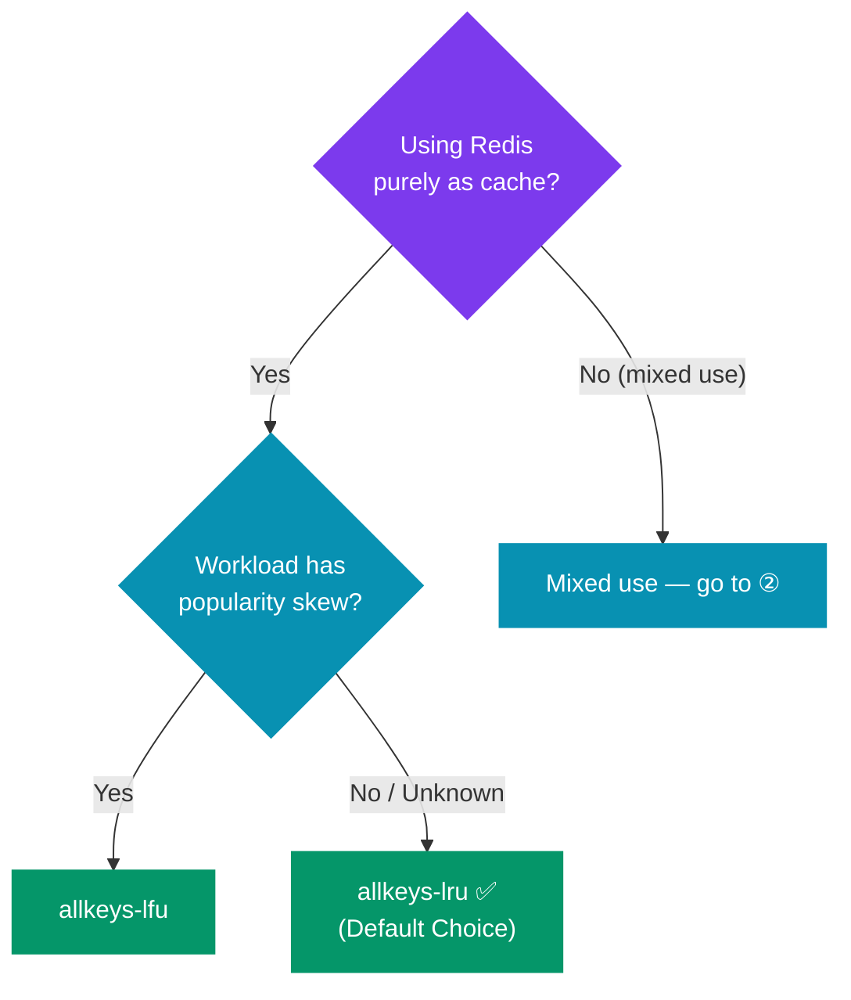

**② Mixed use (cache + durable data) — only TTL'd keys may be evicted:**

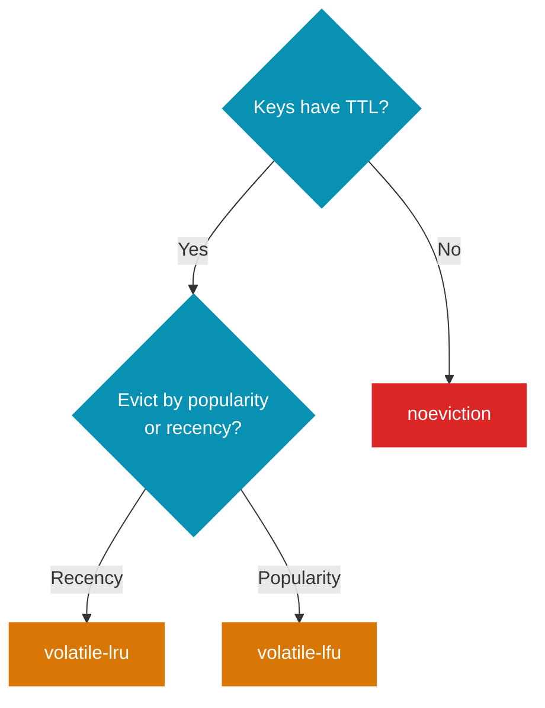

> The first question in ① is the only real decision: *"is losing any key acceptable?"*  
> - If yes, use an `allkeys-*` policy (①).  
> - If no, only keys with a TTL may be evicted. Use a `volatile-*` policy (②).  
> - If no key has a TTL, the fallback is `noeviction`. Writes then fail with a clear error.

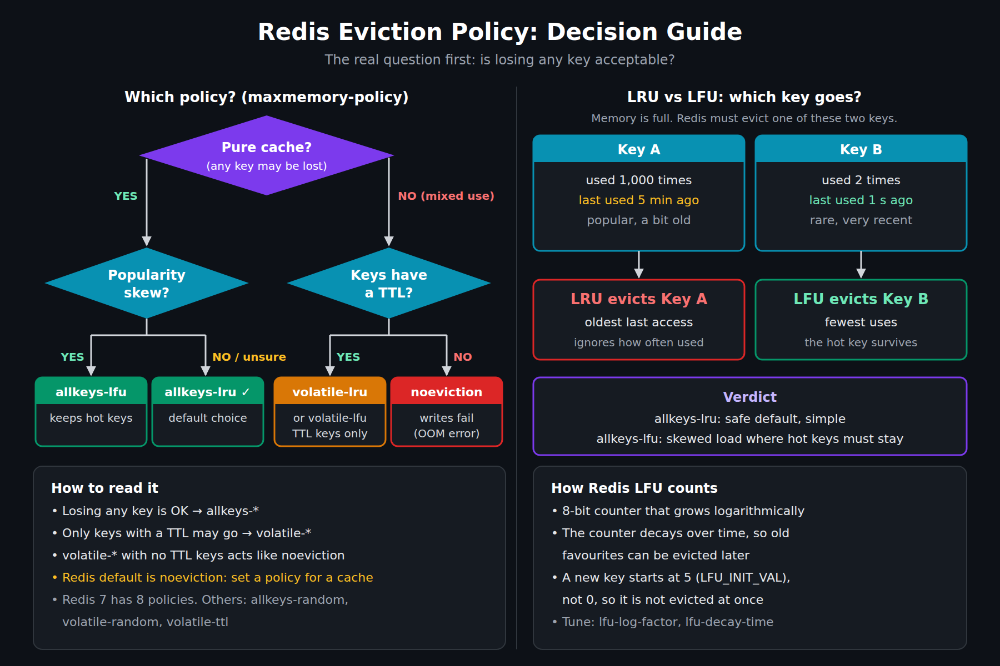

**Configuration Example:**

```properties
# redis.conf
maxmemory 2gb
maxmemory-policy allkeys-lru
maxmemory-samples 10
```

📝 **Interview Tip:** The default policy in Redis is `noeviction`. For caching, you must set `allkeys-lru` or `allkeys-lfu` yourself.

---

</details>

---

3. **🎯 How do you choose the right eviction policy for your application? ⚡**

<!-- -->
<details>
<summary>Answer</summary>

**Answer:**

The right eviction policy depends on three things: your **data access patterns**, **data sensitivity**, and **Redis usage model**.

🔑 **Decision Matrix:**

| 🎯 Scenario | 📝 Recommended Policy | 💡 Reasoning |
|---|---|---|
| General-purpose web app cache | `allkeys-lru` | Most accessed data stays cached |
| E-commerce product catalog | `allkeys-lfu` | Popular products should stay cached |
| Session store + cache mixed | `volatile-lru` | Sessions have TTL; persistent data is protected |
| Rate limiter (counters with TTL) | `noeviction` (separate instance) | An evicted counter resets to 0, so the limiter lets traffic through (fails open). Keep rate-limit state on its own `noeviction` instance, not on a shared cache |
| Redis as primary database | `noeviction` | Never lose data silently |
| CDN or content cache | `allkeys-lfu` | Frequently accessed content stays |
| Random access pattern | `allkeys-random` | No predictable access pattern |
| Feature flags + temp cache | `volatile-lru` | Flags persist; temp data can be evicted |

🧠 **Practical Tips:**

1. **Start with `allkeys-lru`** — it works well for 90% of caching use cases
2. **Switch to `allkeys-lfu`** if you notice frequently-accessed keys being evicted
3. **Use `volatile-*`** only when mixing persistent and cached data in the same Redis instance
4. **Monitor evictions** with `INFO stats` → `evicted_keys` metric
5. **Consider `maxmemory-samples` 10.** The default 5 is usually good enough. 10 is closer to true LRU, at a small CPU cost

```properties
# Monitor eviction metrics
redis-cli INFO stats | grep evicted_keys
redis-cli INFO memory | grep maxmemory

# Check current policy
redis-cli CONFIG GET maxmemory-policy
```

✅ **Simple rule:**

- If Redis is used **only** as a cache → use `allkeys-*` policies.
- If Redis stores both cache and persistent data → use `volatile-*` policies. This protects keys without a TTL.

---

</details>

---

4. **💾 How do you configure maxmemory and what happens when it's reached? ⚡**

<!-- -->
<details>
<summary>Answer</summary>

**Answer:**

`maxmemory` sets the maximum memory Redis can use to store data. When Redis reaches this limit, it applies the configured eviction policy.

**Configuration:**

```properties
# redis.conf — Static configuration
maxmemory 2gb
maxmemory-policy allkeys-lru
maxmemory-samples 10

# Runtime configuration (no restart needed)
# redis-cli
CONFIG SET maxmemory 2147483648
CONFIG SET maxmemory-policy allkeys-lfu
```

🔑 **What Happens When maxmemory Is Reached:**

| 🎯 Policy | 📝 Behavior |
|---|---|
| `noeviction` | Returns `OOM` error for write commands. Reads still work. |
| `allkeys-*` | Evicts keys per policy, then processes the write command |
| `volatile-*` | Evicts only keys with a TTL. If no such key is left, it returns the same `OOM` error as `noeviction` |

**Memory Overhead to Consider:**

```properties
# Redis memory is NOT just your data:
# 1. Key overhead: ~70 bytes per key (metadata)
# 2. Value encoding overhead varies by type
# 3. Buffer memory for clients (output buffers)
# 4. Replication buffer
# 5. AOF rewrite buffer
# 6. Fragmentation (allocator overhead)

# Check actual memory usage
redis-cli INFO memory
```

| 📊 Metric | 📝 Description |
|---|---|
| `used_memory` | Total bytes allocated by Redis allocator |
| `used_memory_rss` | Total bytes as seen by OS (includes fragmentation) |
| `used_memory_peak` | Peak memory usage |
| `mem_fragmentation_ratio` | RSS / used_memory (>1.5 = significant fragmentation) |
| `maxmemory` | Configured memory limit |

⚠️ **Best Practices:**

- Set `maxmemory` to **no more than 75% of available RAM**. Leave room for fork (BGSAVE), the OS, and buffers
- On a 16 GB server: `maxmemory 10gb` (leaves 6 GB for overhead)
- Always set `maxmemory` in production. Without it, Redis grows until the OS kills it (OOM kill)
- Monitor the `evicted_keys` metric. A high eviction rate means you need more memory or fewer keys

💡 **Interview Tip:** You may be asked "What happens when Redis runs out of memory?" The answer depends on the eviction policy. With `noeviction`, writes fail. With an `allkeys-*` policy, Redis evicts keys to make room. With a `volatile-*` policy, Redis evicts only keys that have a TTL. If none are left, writes fail with `OOM`, just like `noeviction`.

<details>
<summary><strong>🤔 Doubt: <code>used_memory</code> is 4 GB, but the process uses 7 GB of RAM. Why, and how do you fix it?</strong></summary>

**Short answer:** this is **memory fragmentation**. The ratio is 7 / 4 = **1.75**, above the 1.5 alarm line. Redis freed the memory, but the allocator cannot give it back to the OS, or cannot reuse it for new values.

**Why it happens — the allocator, not Redis:**
- Redis uses **jemalloc** (the default allocator on Linux). jemalloc hands out memory in fixed **size classes** (8, 16, 32, 48 … bytes) inside larger pages.
- **Many deletes or expiries** leave holes on those pages. A page goes back to the OS only when it is **completely** empty. One live value keeps the whole page.
- **Values that change size** (a string that grows, a hash that gets new fields) move to a bigger size class. The old slot becomes a hole.
- **A big delete after a peak** (for example a bulk load, then a `FLUSH` of part of the data) leaves RSS near the peak, while `used_memory` drops.

**How to read the numbers:**

| Ratio (`mem_fragmentation_ratio`) | Meaning | Action |
|---|---|---|
| ~1.0–1.5 | Normal | Nothing |
| > 1.5 | Fragmentation is wasting RAM | Turn on active defrag (below) |
| < 1.0 | Part of Redis is **swapped** to disk. Latency will be very bad | Add RAM or lower `maxmemory` now |

⚠️ When `used_memory` is small (a few MB), the ratio looks high even when nothing is wrong. Look at it only on a loaded instance. Since Redis 5.0, `INFO memory` also reports `allocator_frag_ratio` and `mem_fragmentation_bytes`, which show the waste more precisely.

**How to fix it:**
1. **Turn on active defragmentation** (Redis 4.0+, needs jemalloc):

    ```properties
    activedefrag yes
    active-defrag-ignore-bytes 100mb      # do nothing below 100 MB of waste
    active-defrag-threshold-lower 10      # start at 10% fragmentation
    active-defrag-threshold-upper 100     # use the most CPU at 100%
    active-defrag-cycle-min 1             # min % CPU for defrag
    active-defrag-cycle-max 25            # max % CPU for defrag
    ```

    Redis moves live values into fresh memory, in small steps on the main thread, so empty pages can go back to the OS. It costs some CPU, which the `cycle-*` limits cap. It is safe to switch on at runtime: `CONFIG SET activedefrag yes`.
2. **`MEMORY PURGE`** asks jemalloc to return already-free pages to the OS. It helps after a big delete, but it does not move live values.
3. **Last step: restart behind a failover.** Restart a replica (it loads the data into fresh memory), promote it, then do the same to the old master. Never restart the only copy.

**Tools to find the cause:**

| Command | What it tells you |
|---|---|
| `INFO memory` | `used_memory`, `used_memory_rss`, `mem_fragmentation_ratio`, `used_memory_peak` |
| `MEMORY DOCTOR` | A plain-text report of memory problems, for example "high fragmentation" or "peak much higher than now" |
| `MEMORY STATS` | Where the memory goes: dataset, overhead, client buffers, replication backlog |
| `MEMORY USAGE <key>` | Bytes used by one key (with `SAMPLES` for big collections) |

💡 **Interview line:** "RSS bigger than `used_memory` is fragmentation. jemalloc cannot return a page while one value still lives on it. Above a ratio of 1.5, I turn on `activedefrag`. Below 1.0, Redis is swapping, and that is the urgent case."

---

</details>
<br/>

---

</details>

---

5. **⏰ How does Redis actually delete an expired key — and why doesn't memory drop the moment a TTL fires? 🔥🔥**

<!-- -->
<details>
<summary>Answer</summary>

**Answer:**

> 💡 **In one line:** A key past its TTL is **not** deleted on time. Redis removes it in one of two ways: **lazily** on the next access, or through a **probabilistic active-expire cycle** in `serverCron`. Nothing is scheduled per key.

Setting a TTL does **not** register a timer. Redis stores the expiry timestamp in a per-database `expires` dictionary. It then frees the key through two independent mechanisms.

🔑 **Mechanism 1 — Lazy (passive) expiration**

Every command that touches a key first runs an internal `expireIfNeeded()` check. If the key is past its TTL, Redis deletes it *at that moment*. It then acts as if the key never existed (`GET` returns nil). This is cheap and exact. But this way never frees a key that no one accesses again.

🔑 **Mechanism 2 — Active expiration cycle**

`serverCron` runs **`hz` times per second (default `hz 10`)**. Inside it, Redis runs a sampling loop per database:

1. Check **20 keys** from the `expires` dict. Before Redis 6.0 these were picked at random. Since 6.0, Redis walks the dict step by step with a cursor, so each run continues where the last one stopped.
2. Delete the ones that have expired
3. If **more than ~10%** of the checked keys were expired (**25%** before Redis 6.0), repeat at once. The keyspace probably has many stale keys
4. Otherwise stop, and try again on the next cron tick

The cycle has a time limit. So it cannot block the single thread that runs commands for too long. There are two versions of the cycle:

| Cycle | When it runs | Time budget |
|---|---|---|
| **Slow cycle** | Inside `serverCron`, `hz` times per second | Capped at about 25% of CPU time |
| **Fast cycle** | From `beforeSleep`, before Redis waits for new events | About 1 ms per run |

`active-expire-effort` (1–10, default 1) tunes both. A higher value checks more keys per loop and allows more CPU, so expired keys are freed sooner.

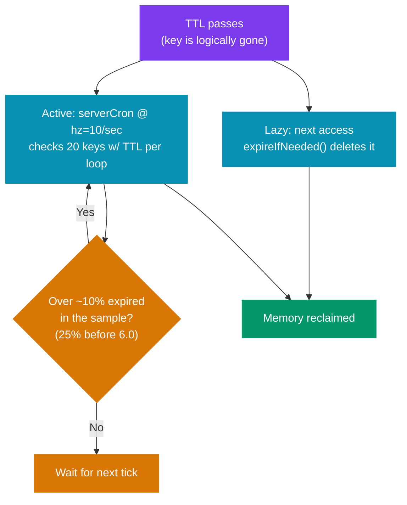

🧠 **Three things this explains that nothing else does:**

| Observation | Explanation |
|---|---|
| `used_memory` doesn't drop at TTL time | The key is still physically in RAM until lazy access or an active-cycle sample happens to pick it. With a large keyspace of untouched keys, this lag can be seconds to minutes |
| `expired_keys` and `evicted_keys` are **different** `INFO stats` metrics | **Expired** = removed because its TTL passed. **Evicted** = removed by `maxmemory-policy` because Redis hit `maxmemory`. A rising `evicted_keys` means you are under-provisioned; a rising `expired_keys` is just normal TTL churn |
| A replica can serve a logically-expired key | **Replicas never expire keys on their own** — that would break consistency. The master deletes and propagates an explicit `DEL`/`UNLINK`. Until that arrives, the key stays in the replica's dataset. A *read* on a modern replica still returns nil, because it checks the TTL logically. But the memory is not freed yet, and `DBSIZE` can still count the key (`KEYS`/`SCAN` filter out logically expired keys) |

⚙️ **Related config:**

```properties
hz 10                      # serverCron frequency — higher = more aggressive expiry, more CPU
lazyfree-lazy-expire yes   # free the memory of expired keys on a background thread
                           # (matters for big collections — see UNLINK vs DEL)
```

<details>
<br/>
<summary><strong>🤔 Doubt: If expiry is only probabilistic, can a TTL'd key ever return stale data?</strong></summary>

**No — not to a client.** The two mechanisms decide *when Redis frees the memory*, not *what a client sees*. Every read path goes through the logical TTL check first. So an expired key reads as missing, even if its bytes are still in memory. The delay is a **memory-accounting** problem, not a correctness problem.

Where it does cause problems:

- **Capacity planning** — you may have many TTL'd keys that are never read again. Then `used_memory` can show much more than the live data. That is also why an eviction policy still matters on a pure TTL cache.
- **`DBSIZE` / `INFO keyspace`** — these can count keys that are logically expired. (`SCAN` and `KEYS` filter them out.)
- **`maxmemory` pressure** — expired keys that Redis has not freed yet still count towards `maxmemory`. So Redis may start *evicting* live keys while stale ones stay in memory. The fixes: raise `hz` or `active-expire-effort` (Redis 6+), so expired keys are freed sooner. Or use `allkeys-lru`: expired keys are never read, so LRU tends to evict them first.

---

</details>
<br/>

💡 **Interview one-liner:** "Redis doesn't schedule per-key deletion. It expires keys lazily on access. It also runs an active cycle in `serverCron`, ten times a second. Each loop checks 20 keys and repeats while more than about 10% are expired (25% before Redis 6.0). That is why memory doesn't drop the moment a TTL passes, and why `expired_keys` and `evicted_keys` are separate metrics."

---

</details>

6. **📐 How much memory does Redis need for N keys? Estimate it for 100 million sessions. 🔥**

<!-- -->
<details>
<summary>Answer</summary>

**Answer:**

> 💡 **In one line:** memory ≈ keys × (key bytes + value bytes + ~70 B overhead) × ~1.3 for fragmentation. Then keep `maxmemory` at ≤ 75% of RAM.

🧠 **What one key really costs**

| Part | Size |
|---|---|
| The key string | Its length (e.g. `sess:` + 32-char id = 37 B) |
| The value | Its serialized size (e.g. 200 B of JSON) |
| Per-key overhead | **~70 B**: the dict entry, the value object header, allocator rounding. A TTL adds an entry in the `expires` dict too |
| Fragmentation | × **1.2–1.5** on top (`mem_fragmentation_ratio`, §4 Q4) |

🔢 **Worked example — 100M sessions, 200 B each**

```
Per key:   37 B key + 200 B value + ~70 B overhead ≈ 300 B
Data:      100,000,000 × 300 B                     = 30 GB
× 1.3 for fragmentation                            ≈ 39 GB  (call it 40 GB)
maxmemory ≤ 75% of RAM → RAM ≥ 40 / 0.75           ≈ 53 GB
```

**What this means for the design:**

- **One big node (64 GB)** works on paper. But a fork for `BGSAVE` or a full resync on 40 GB is slow, and a restart takes long to reload.
- **Redis Cluster, 3 shards** → about 13 GB of data per shard. Each shard fits on a 32 GB machine with room for fork, buffers and the OS. Easier to grow later.
- **Add one replica per shard** for HA. That **doubles** the RAM bill: 6 nodes, not 3.

🔧 **How to shrink it**

- **Shorter keys and smaller values.** Short field names, or a compact format (MessagePack / Protobuf) instead of JSON with an `@class` field.
- **Bucket small values into hashes.** A hash with ≤ 128 small fields is stored as a compact **listpack** (§1 Q4). So `session:123456` becomes field `456` in hash `session:123`. The ~70 B per-key overhead is paid once per bucket, not once per value. Instagram's engineering blog (2011) reported about **4× less memory** with this trick. The cost: a TTL on the hash covers the whole bucket. Per-field TTL needs `HEXPIRE` (Redis 7.4+).
- **Measure, don't guess.** Load 10,000 real keys, then check `MEMORY USAGE <key>` on a sample and `INFO memory` for the total. Multiply up.

💡 **Interview one-liner:** "I estimate keys × (key + value + about 70 bytes of overhead), then add 30% for fragmentation and keep `maxmemory` at 75% of RAM. For 100 million 200-byte sessions that is about 40 GB of memory, so I'd use a 3-shard cluster with a replica each, not one giant node. Then I check the estimate with `MEMORY USAGE` on real data."

---

</details>

---

<a id="redis-persistence"></a>

## 5. Redis Persistence 🔥

1. **📸 How do RDB snapshots work in Redis? 🔥**

<!-- -->
<details>
<summary>Answer</summary>

**Answer:**

RDB (Redis Database) persistence creates **point-in-time snapshots** of your dataset. It does this at fixed intervals. Redis saves each snapshot as a compact binary `.rdb` file on disk.

🧠 **How BGSAVE Works:**

1. Redis **forks** the process (creates a child process)
2. The child process writes the entire dataset to a temporary RDB file
3. When writing is complete, the temp file replaces the old RDB file
4. The parent process continues serving clients without interruption

The fork uses **Copy-on-Write (COW)**. The child shares the parent's memory pages. The OS copies a page only when the parent changes it after the fork.

<details>
<br/>
<summary><strong>🤔 Doubt: How does Copy-on-Write (COW) work?</strong></summary>

At the moment of `fork()`, both parent and child **point to the same physical memory pages**. No copying of data pages happens yet. So the fork is fast. But it is not free: the kernel must copy the page tables, and that cost grows with dataset size (about 10–20 ms per GB).

```
After fork():

Parent Process          Child Process
     │                       │
     └──────┬────────────────┘
            ▼
   Shared Memory Pages
   [Page 1: user:1 = "Alice"]
   [Page 2: user:2 = "Bob"  ]
   [Page 3: user:3 = "Carol"]
```

Two things happen **at the same time:**
- Child reads shared pages → writes them to `dump.rdb` (consistent point-in-time snapshot)
- Parent keeps serving client requests (`SET`, `DEL`, etc.)

**When a client writes to Redis while the child is snapshotting:**

```
Client → SET user:1 "Dave"   ← parent needs to modify Page 1

OS kicks in:
1. Copy Page 1 → new physical page    (the "copy" in Copy-on-Write)
2. Parent modifies the NEW copy       → new page = "Dave"
3. Child still reads the OLD copy     → snapshot captures "Alice" (pre-fork state)
```

```
After write to user:1:

Parent Process               Child Process
     │                            │
     ▼                            ▼
[Page 1 COPY: "Dave" ]   [Page 1 ORIG: "Alice"] ← child sees pre-fork snapshot
[Page 2:      "Bob"  ]   [Page 2:      "Bob"  ]
[Page 3:      "Carol"]   [Page 3:      "Carol"]
```

**Key point:** COW guarantees that the child always sees the **exact memory state at fork time**. This is true even while the parent is changing data. No locks are needed.

**Memory cost:** The OS duplicates only **modified pages**, not the entire dataset. In a read-heavy system, few pages change during the snapshot, so the extra memory is small. But it is not always small:

- **Write-heavy load:** if writes touch many pages during the snapshot, most pages get copied. Memory use can grow close to 2x.
- **Transparent Huge Pages (THP):** with THP, a page is 2 MB, not 4 KB. One small write then copies 2 MB. The COW cost becomes much larger, and latency goes up.

So disable THP on Redis hosts (`echo never > /sys/kernel/mm/transparent_hugepage/enabled`). Redis prints a warning at startup when THP is on.

**Interview answer for "How does BGSAVE not block Redis?"**

> Fork is fast (only page tables are copied, not data). Child writes to disk. Parent keeps running. OS handles isolation via COW — no locks. The only block is the short fork itself.

---

</details>
<br/>

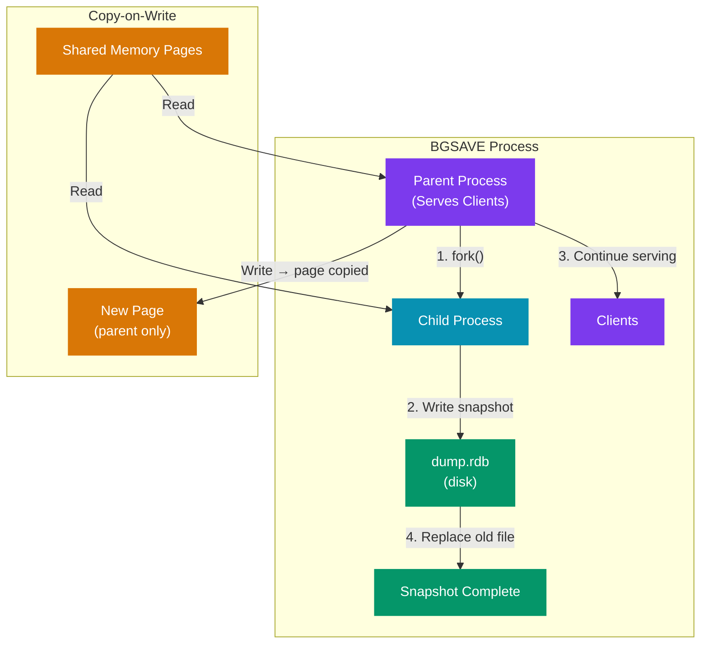

**Configuration:**

```properties
# redis.conf
# Pre-7.0 defaults (three separate lines):
# Save if at least 1 key changed in 900 seconds (15 min)
save 900 1
# Save if at least 10 keys changed in 300 seconds (5 min)
save 300 10
# Save if at least 10000 keys changed in 60 seconds (1 min)
save 60 10000

# Redis 7.0+ default (one line, three <seconds> <changes> pairs):
# save 3600 1 300 100 60 10000
# = 1 change in 1 hour, 100 changes in 5 min, or 10000 changes in 1 min

# RDB file name and location
dbfilename dump.rdb
dir /var/lib/redis/

# Compress RDB file (uses LZF compression)
rdbcompression yes

# Enable RDB checksum (CRC64)
rdbchecksum yes
```

**Manual Snapshot Commands:**

```properties
# Background save (non-blocking) — RECOMMENDED
BGSAVE

# Foreground save (BLOCKS all clients) — use only for shutdown
SAVE

# Unix time of the last successful save (for status, see INFO persistence)
LASTSAVE
```

| ✅ Advantages | ⚠️ Disadvantages |
|---|---|
| Compact single-file backup | Data loss between snapshots (up to `save` interval) |
| Perfect for backups and disaster recovery | `fork()` can be slow on large datasets (GBs of data) |
| Fast restart (load RDB file) | COW can temporarily double memory usage |
| Minimal performance impact during normal operation | Not suitable for zero data loss requirement |

📝 **Key Interview Points:**
- `BGSAVE` = non-blocking (uses fork)
- `SAVE` = blocking (never use in production)
- Data loss = all writes between last snapshot and crash
- Fork can cause latency spikes on large datasets

---

</details>

---

2. **📝 How does AOF (Append Only File) persistence work? 🔥**

<!-- -->
<details>
<summary>Answer</summary>

**Answer:**

AOF (Append Only File) logs **every write operation** that the server receives. On restart, Redis replays the AOF file to rebuild the dataset. This gives much better durability than RDB snapshots.

🧠 **How It Works:**

1. Client sends a write command (e.g., `SET user:1 "Alice"`)
2. Redis executes the command in memory
3. Redis appends the command to the AOF buffer
4. The buffer is flushed to disk based on the `fsync` policy

**AOF File Example:**

```
*3
$3
SET
$6
user:1
$5
Alice
*3
$3
SET
$6
user:2
$3
Bob
```

🔑 **fsync Policies:**

| 🎯 Policy | 📝 Behavior | ⚡ Performance | 🛡️ Durability |
|---|---|---|---|
| **`always`** | fsync after every write command | Slowest | Best — no acknowledged write is lost (fsync runs before the reply) |
| **`everysec`** | fsync every second (background thread) | Good balance | Usually about 1 second of data loss. Worst case about 2 seconds (see note below) |
| **`no`** | Let OS decide when to flush (typically every 30s) | Fastest | Up to 30 seconds of data loss |

> ⚠️ **Why `everysec` can lose about 2 seconds, not 1.** Sometimes the background fsync is still running when the next one is due (for example, the disk is slow). Then Redis delays new writes for up to 2 seconds before it blocks. So in the worst case, about 2 seconds of writes are lost on a crash.

**Configuration:**

```properties
# redis.conf
appendonly yes
appendfilename "appendonly.aof"

# fsync policy
appendfsync everysec    # Recommended balance

# AOF rewrite settings
auto-aof-rewrite-percentage 100    # Trigger rewrite when AOF doubles in size
auto-aof-rewrite-min-size 64mb     # Minimum AOF size before rewrite
```

🧠 **AOF Rewrite (Compaction):**

The AOF file grows over time, because it logs every command. AOF rewrite makes it smaller. It creates the smallest set of commands that can recreate the current dataset:

```properties
# Before rewrite (redundant commands):
SET counter 1
INCR counter
INCR counter
INCR counter
SET counter 10     # Overrides all previous

# After rewrite (compacted):
SET counter 10     # Only the final state
```

The `SET` above shows the idea only. Since Redis 5.0, `aof-use-rdb-preamble yes` is the default. So the rewritten base is a **binary RDB snapshot**, not a list of `SET` commands.

```properties
# Trigger manual rewrite
BGREWRITEAOF

# Check AOF status
INFO persistence
```

| ✅ Advantages | ⚠️ Disadvantages |
|---|---|
| Much better durability (sub-second data loss) | Larger file size than RDB |
| Command log is human-readable (the base part is binary RDB by default) | Slower restart (replay all commands) |
| Corruption is **recoverable**. You can repair a tail that a crash cut short (`aof-load-truncated yes` is the default, or `redis-check-aof --fix`). RDB is all-or-nothing | Write performance slightly lower (fsync overhead) |
| AOF rewrite compacts the file | AOF rewrite uses fork (same COW overhead as RDB) |

---

</details>

---

3. **⚖️ How do RDB and AOF compare? When would you use each? 🔥**

<!-- -->
<details>
<summary>Answer</summary>

**Answer:**

| 🎯 Feature | 📸 RDB | 📝 AOF |
|---|---|---|
| **What is saved** | Binary snapshot of entire dataset | Log of every write command |
| **File format** | Compact binary (`.rdb`) | Text-based command log (`.aof`) |
| **File size** | Smaller (compressed) | Larger (even after rewrite) |
| **Data loss on crash** | Up to last save interval (minutes) | Up to last fsync (seconds with `everysec`) |
| **Restart speed** | Fast (load binary directly) | Slower (replay all commands) |
| **Write performance** | No overhead during normal ops | Slight overhead from fsync |
| **Fork overhead** | Yes (for BGSAVE) | Yes (for AOF rewrite) |
| **Backup suitability** | Excellent (single file, easy to copy) | Harder (larger, may need rewrite first) |
| **Human readable** | No | Partly (commands yes; base part is RDB by default) |
| **Corruption recovery** | All or nothing | Can truncate corrupted tail |

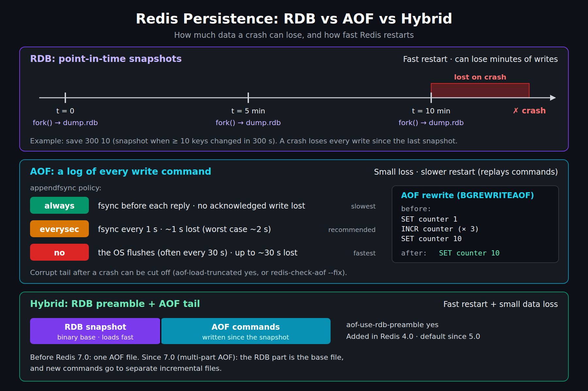

🧠 **When to Use Which:**

| 🎯 Use Case | 📝 Recommendation |
|---|---|
| Cache only (data loss OK) | RDB only (or no persistence) |
| Session store | AOF with `everysec` |
| Primary database | AOF with `always` or hybrid |
| Backup/disaster recovery | RDB snapshots + offsite copy |
| Maximum durability | Hybrid (RDB + AOF) |
| Performance-critical | RDB only (minimal overhead) |

**Disable Persistence Entirely (Pure Cache):**

```properties
# redis.conf — no persistence at all
save ""
appendonly no
```

💡 **Interview Answer:** "For a session store, or when Redis holds primary data, I'd use AOF with `everysec` fsync. It gives a good balance of durability and performance. For pure caching where data loss is acceptable, I'd disable persistence entirely. For critical data, I'd use hybrid persistence (RDB + AOF)."

---

</details>

---

4. **🔀 What is Hybrid Persistence and why was it introduced? ⚡**

<!-- -->
<details>
<summary>Answer</summary>

**Answer:**

Hybrid persistence (introduced in Redis 4.0) puts an RDB snapshot at the start of the AOF, followed by AOF commands. Before Redis 7.0 this is a **single AOF file**. Since 7.0 (multi-part AOF), the RDB part is the base file, and new commands go to separate incremental files. You get the benefits of both: fast restarts from RDB + minimal data loss from AOF.

🧠 **How It Works:**

When an AOF rewrite is triggered:

**Redis 7.0+ (multi-part AOF):**
1. The child process writes a new **base file** in RDB format (binary snapshot)
2. New write commands that arrive *during* the rewrite go to a **new incremental (incr) file**, in AOF command format
3. A **manifest file** lists the base file and the incr files. On restart, Redis loads the base, then replays the incr files in order

**Before Redis 7.0 (single file):**
1. Redis writes an **RDB snapshot** at the beginning of the new AOF file
2. New write commands that arrive *during* the rewrite are kept in a memory buffer, then appended after the RDB section
3. The resulting file starts with a binary RDB section followed by AOF commands

The diagram below shows the logical layout. In 7.0+ the two parts are separate files.

```
┌────────────────────────────────┐
│    RDB Binary Snapshot         │  ← Fast to load (bulk of data)
│    (point-in-time state)       │
├────────────────────────────────┤
│    AOF Commands                │  ← Commands since snapshot
│    SET key1 "value1"           │
│    INCR counter                │
│    ...                         │
└────────────────────────────────┘
```

**Configuration:**

```properties
# redis.conf
appendonly yes
aof-use-rdb-preamble yes    # Enable hybrid persistence (shipped as `no` in 4.0, default `yes` since 5.0)
```

| 🎯 Aspect | 📸 RDB Only | 📝 AOF Only | 🔀 Hybrid |
|---|---|---|---|
| **Restart speed** | Fast | Slow | Fast (RDB preamble) |
| **Data loss** | Minutes | Seconds | Seconds |
| **File size** | Smallest | Largest | Medium |
| **Complexity** | Low | Low | Low (automatic) |

✅ **Why Hybrid is the Best Default:**

- **Fast restart:** The bulk of data is loaded from the RDB preamble (binary, fast)
- **Small data loss:** Every write after the RDB preamble is still logged as AOF. So loss depends only on `appendfsync` (about 1 s with `everysec`, about 2 s in the worst case)
- **Automatic:** No extra configuration beyond enabling AOF

📝 **Introduced in Redis 4.0 but shipped disabled** (`aof-use-rdb-preamble no`, "turned off by default to avoid the surprise of a format change"). **Redis 5.0 changed the default to `yes`**. Since then you don't need to do anything special. Just enable AOF and it works.

---

</details>

---

5. **🤔 What are the trade-offs of Redis persistence and when would you disable it entirely? 💤**

<!-- -->
<details>
<summary>Answer</summary>

**Answer:**

Every persistence option adds overhead. Know the costs of each option, so you can pick the right one for your use case.

🔑 **Trade-offs Summary:**

| 🎯 Concern | 📝 Impact |
|---|---|
| **Fork latency** | Both RDB and AOF rewrite use `fork()`. Fork blocks Redis while it copies the page tables. Redis docs measure about 10–20 ms per GB on modern VMs. Old Xen VMs were much slower. So on a 25 GB dataset, one fork can take a few hundred ms. Clients see this as a latency spike |
| **Memory overhead** | COW during fork can use up to 2x memory for a short time. This happens if many keys change during save |
| **Disk I/O** | AOF `always` fsync impacts every write. RDB writes large files periodically |
| **Disk space** | AOF files grow continuously. RDB is compact but you may keep multiple snapshots |
| **Startup time** | Large AOF files = slow restart. RDB loads much faster |

🧠 **When to Disable Persistence:**

| 🎯 Scenario | 💡 Why |
|---|---|
| Pure cache (data can be regenerated from DB) | No need to persist data you can throw away |
| High-write-throughput with low-latency requirements | Remove fork() latency spikes |
| Redis in front of a durable primary store | Source of truth is elsewhere |
| Development/testing environments | Faster restart, no disk clutter |

**Disable Persistence:**

```properties
# redis.conf
save ""              # Disable RDB
appendonly no        # Disable AOF
```

⚠️ **When You Must Have Persistence:**

- Redis is the **primary/only** data store
- Session data that cannot be regenerated
- Rate limiting state that affects business logic
- Queue data (Redis Streams) that must survive restarts
- Any data where loss has business impact

📝 **Production Recommendation Matrix:**

| 📊 Setup | Persistence | Config |
|---|---|---|
| Cache layer | None | `save ""`, `appendonly no` |
| Cache with safety net | RDB only | `save 300 10` |
| Session store | AOF everysec | `appendonly yes`, `appendfsync everysec` |
| Primary database | Hybrid | `appendonly yes`, `aof-use-rdb-preamble yes` |
| Maximum durability | AOF always | `appendonly yes`, `appendfsync always` |

---

</details>

---

<a id="redis-high-availability"></a>

## 6. Redis High Availability, Operations and Security 🔥

1. **🔁 How does Redis Master-Slave replication work? ⚡**

<!-- -->
<details>
<summary>Answer</summary>

**Answer:**

Redis replication is a leader-follower (master-replica) model:

- **One master** accepts writes.
- **One or more replicas** keep copies of the master's data.
- Replicas can serve read requests, but only if the client is configured to send reads to them. This gives read scalability and data redundancy.

🧠 **Replication Process:**

1. An operator (or config) runs **`REPLICAOF <master-host> <port>` on the replica**. The command is never sent *to* the master. The replica then opens a connection to the master and sends **`PSYNC ? -1`** (on a first sync it has no replication ID or offset yet)
2. The master cannot serve a partial resync, so it replies `+FULLRESYNC`. It then makes an RDB snapshot. It either forks and writes it to disk (`BGSAVE`), or **streams it straight to the socket** (`repl-diskless-sync`, **default `yes` since Redis 7.0**)
3. Master sends the RDB payload to the replica (**full sync**)
4. While it sends the RDB, the master buffers all new write commands in the replica's output buffer
5. After the RDB transfer, the master flushes those buffered commands
6. From then on, the master forwards every write to the replica as it happens. This is the **replication stream (command propagation)**, *not* "partial sync"

> ⚠️ **Don't confuse the two.** **Command propagation** is the normal steady state. **Partial resynchronisation** is a specific recovery path. It happens only *after a disconnect*:
>
> - The replica sends `PSYNC <replid> <offset>` again.
> - Is that offset still inside the master's **replication backlog**? Then the master replays only the missing bytes. It does not do a full RDB transfer.
>
> Since Redis 4.0 (**PSYNC2**), partial resync works in two more cases. **After a replica restart:** the replica saves its replication ID and offset in the RDB file. **After a failover:** the promoted replica remembers the old master's replication ID, so the other replicas can continue from their offset.

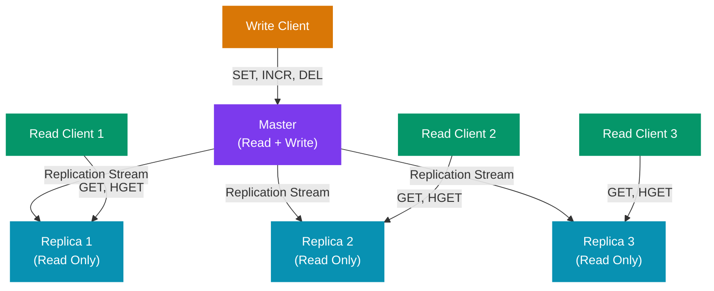

**Configuration:**

```properties
# On replica (redis.conf)
replicaof 192.168.1.100 6379    # Master IP and port
replica-read-only yes            # Replicas are read-only by default
masterauth "your-password"       # If master requires authentication

# On master (redis.conf)
requirepass "your-password"
min-replicas-to-write 1          # Require at least 1 replica to accept writes
min-replicas-max-lag 10          # Max replication lag in seconds
```

| 🎯 Feature | 📝 Detail |
|---|---|
| **Replication type** | Asynchronous (by default) |
| **Data consistency** | Eventual (replica may lag behind master) |
| **Read scaling** | Yes — distribute reads across replicas |
| **Write scaling** | No — all writes go to master only |
| **Chained replication** | Supported (Replica of Replica) |
| **Partial resync** | Yes — after brief disconnection, uses replication backlog. Since 4.0 (PSYNC2), also after a replica restart and after a failover |
| **Full resync** | On first connection or after long disconnection |

⚠️ **Replication is Asynchronous:** The master may acknowledge a write to the client before it reaches any replica. If the master crashes right after that write, the data is lost. For stronger guarantees, use the `WAIT` command:

```properties
# Wait for at least 1 replica to acknowledge, timeout 1000ms
WAIT 1 1000
```

<details>
<br/>
<summary><strong>🤔 Doubt: Does <code>WAIT</code> make a write durable?</strong></summary>

No. `WAIT` only confirms that N replicas **received** the write. It does not confirm that anyone wrote it to disk.

- The replica may still hold the write only in memory.
- An acknowledged write can still be lost on failover. For example, Sentinel may promote a replica that did not get the write.
- So `WAIT` makes loss less likely. It does not make Redis strongly consistent.

**Redis 7.2 added `WAITAOF`** for the disk part:

```properties
# WAITAOF numlocal numreplicas timeout
# Wait until the write is fsynced to the local AOF
# and to the AOF of at least 1 replica, timeout 1000ms
WAITAOF 1 1 1000
```

- `numlocal` = 1 → wait for fsync to the master's own AOF.
- `numreplicas` = N → wait for fsync to the AOF on N replicas.
- AOF must be on (`appendonly yes`) where you ask for the fsync.

**Interview one-liner:** `WAIT` = "the replicas have it". `WAITAOF` = "it is on disk". Neither one makes Redis a CP system.

---

</details>
<br/>

---

</details>

---

2. **🏰 What is Redis Sentinel and how does automatic failover work? ⚡**

<!-- -->
<details>
<summary>Answer</summary>

**Answer:**

Redis Sentinel is a **high-availability solution**. It monitors Redis instances and detects failures. It also performs **automatic failover**: when the current master fails, it promotes a replica to master.

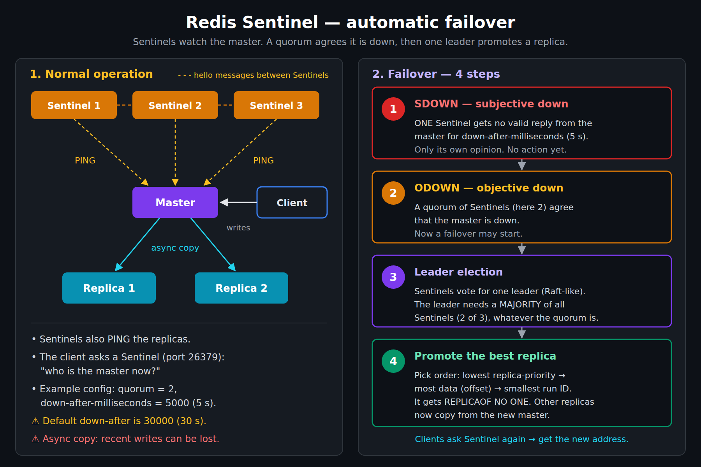

🧠 **Sentinel Responsibilities:**

1. **Monitoring** — checks all the time if master and replicas are working
2. **Notification** — alerts administrators or other programs about failures
3. **Automatic Failover** — promotes a replica to master if the master fails
4. **Configuration Provider** — clients ask Sentinel for the current master address

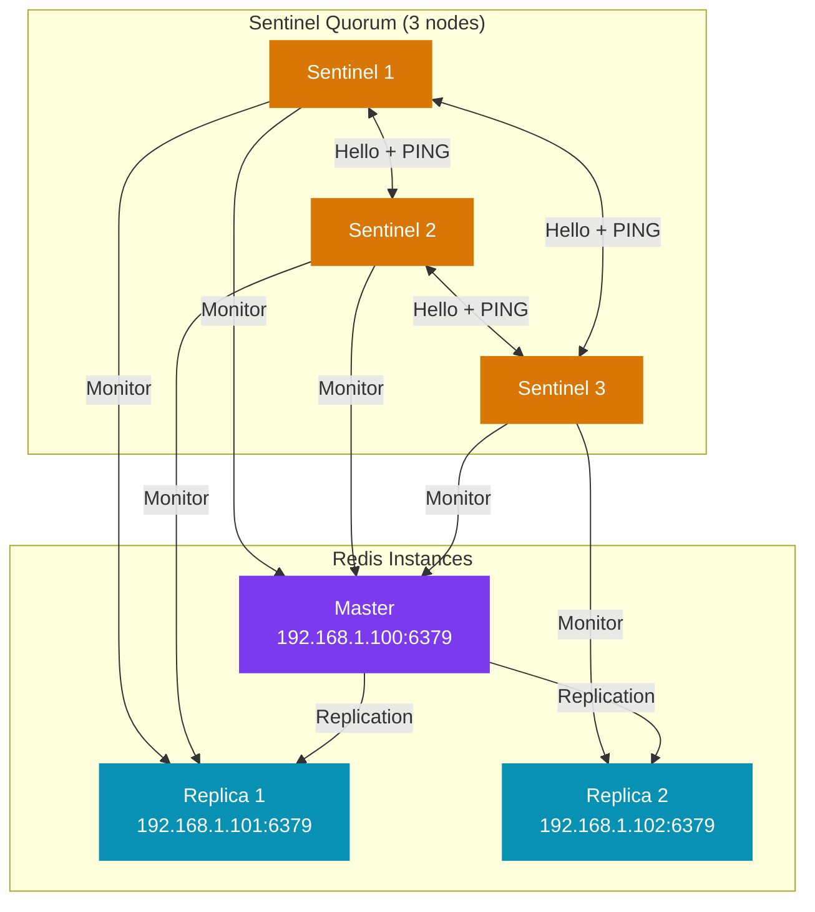

🔑 **Failover Process:**

1. **Subjective Down (SDOWN):** A single Sentinel decides the master is unreachable
2. **Objective Down (ODOWN):** A quorum of Sentinels agrees the master is down
3. **Leader Election:** Sentinels elect a leader to perform the failover (a Raft-like vote, not full Raft). The leader needs votes from a **majority** of all Sentinels, whatever the quorum value is
4. **Failover Execution**:
   - The leader Sentinel picks the best replica, in this order:
     1. Lowest `replica-priority` number wins (`0` = never promote this replica)
     2. If equal: the largest replication offset (the replica with the most data)
     3. If still equal: the smallest run ID (a simple tie-breaker)
   - Promotes the replica to master (`REPLICAOF NO ONE`)
   - Reconfigures other replicas to follow the new master
   - Updates Sentinel configuration with new master info

**Sentinel Configuration:**

```properties
# sentinel.conf
sentinel monitor mymaster 192.168.1.100 6379 2    # 2 = quorum
sentinel down-after-milliseconds mymaster 5000     # 5s to declare SDOWN
sentinel failover-timeout mymaster 60000           # 60s failover timeout
sentinel parallel-syncs mymaster 1                 # Replicas syncing simultaneously
sentinel auth-pass mymaster "your-password"
```

**Java Client Configuration (Spring Boot):**

```yaml
# application.yml
spring:
  data:
    redis:
      password: your-password            # master/replica password (their requirepass)
      sentinel:
        master: mymaster
        nodes:
          - sentinel1:26379
          - sentinel2:26379
          - sentinel3:26379
        password: sentinel-password      # only if the Sentinels themselves need a password
      lettuce:
        read-from: REPLICA_PREFERRED
```

```java
@Configuration
public class RedisSentinelConfig {

    @Bean
    public LettuceConnectionFactory redisConnectionFactory() {
        RedisSentinelConfiguration sentinelConfig = new RedisSentinelConfiguration()
            .master("mymaster")
            .sentinel("sentinel1", 26379)
            .sentinel("sentinel2", 26379)
            .sentinel("sentinel3", 26379);

        sentinelConfig.setPassword("your-password");             // = spring.data.redis.password (master's requirepass)
        // sentinelConfig.setSentinelPassword("sentinel-password"); // = spring.data.redis.sentinel.password

        return new LettuceConnectionFactory(sentinelConfig);
    }
}
```

> 💡 **`application.yml` vs Java `@Configuration` — are both required?**
>
> They are **independent options for different jobs**. You do not need both together:
>
> | Config type | What it controls |  
> |---|---|  
> | `application.yml` | Connection details — host, port, password, sentinel nodes |  
> | Java `@Configuration` | Behaviour — serialization, TTL, cache manager setup |
>
> - If you define `redisConnectionFactory()` in Java config, it **overrides** the `application.yml` connection settings fully.  
> - If you skip the Java config bean, Spring Boot **auto-configures** the connection from `application.yml` automatically.  
> - In production you usually use **both**, but for **different jobs**. Connection details go in `application.yml`. Serialization/TTL/cache manager go in `@Configuration`.
>
> **Simple rule:** Connection → `application.yml` · Serialization/TTL → Java `@Configuration`

| ✅ Advantages | ⚠️ Limitations |
|---|---|
| Automatic failover (no manual intervention) | No sharding — single master handles all writes |
| Well tested and production-ready | Downtime during failover. With the default `down-after-milliseconds 30000`, detection alone takes 30 s. A downtime of only a few seconds needs a tuned value, like the `5000` (5 s) above |
| Client auto-discovers new master | Needs 3+ Sentinel instances for a safe setup (recommended, not enforced) |
| Read scaling via replicas | Async replication — can lose recent writes on failover |

---

</details>

---

3. **🌐 How does Redis Cluster work with hash slots and resharding? 🔥**

<!-- -->
<details>
<summary>Answer</summary>

**Answer:**

Redis Cluster gives you two things:

- **Automatic data sharding** across multiple master nodes.
- **High availability** through built-in replication and failover.

It spreads data using **16,384 hash slots**.

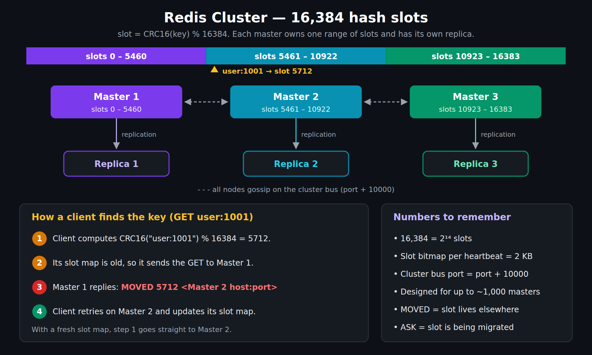

🧠 **Hash Slot Mapping:**

Every key is mapped to a hash slot using: `slot = CRC16(key) % 16384`

The 16,384 slots are spread across master nodes. Each master owns a subset of slots.

<details>
<br/>
<summary><strong>🤔 Doubt: Why exactly 16,384 slots?</strong></summary>

16,384 = 2¹⁴. Redis's creator Salvatore Sanfilippo chose this number for two clear reasons:

**1. Gossip message size**

Redis Cluster nodes exchange heartbeat messages all the time to share cluster state. Each message includes a **bitmap of which slots the node owns**.

| Slot count | Bitmap size per heartbeat |
|---|---|
| 16,384 slots | 16,384 bits = **2 KB** ✅ |
| 65,536 slots | 65,536 bits = **8 KB** ❌️ too heavy |

Hundreds of nodes gossip all the time. So 2 KB per message is the best balance:

- It is small enough for efficient gossip.
- It is large enough to split the data into small pieces.

**2. Practical cluster size limit**

Redis Cluster is not designed for more than ~1,000 master nodes. At that scale:

- 16,384 slots ÷ 1,000 nodes = ~16 slots per node — each node still gets a small, easy-to-manage share
- Going to 65,536 would be more than needed and would waste gossip bandwidth

**Bonus: bitwise optimization**

Redis computes the slot as `crc16(key) & 16383`. For a power of 2, this gives the same result as `% 16384`. A bitwise AND is a single, fast CPU instruction.

**Interview one-liner:** 16,384 = 2¹⁴. It was chosen so the slot ownership bitmap fits in 2 KB per gossip heartbeat. This keeps cluster communication efficient at scale.

---

</details>
<br/>

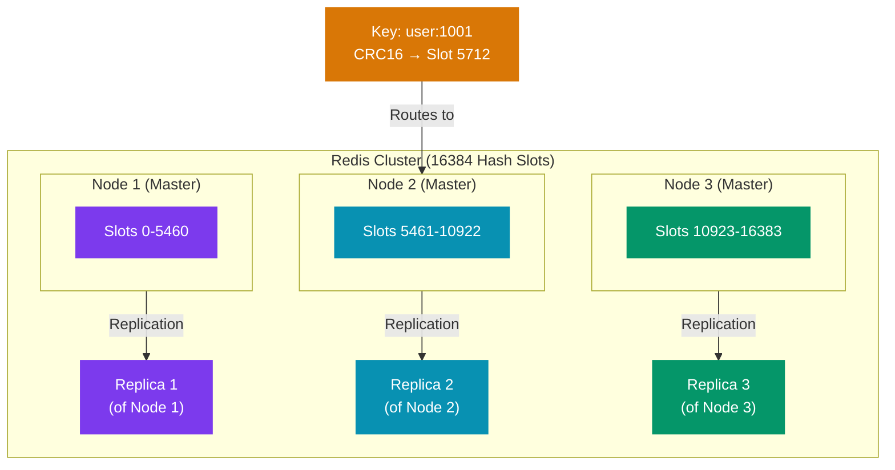

🔑 **Key Concepts:**

| 🎯 Concept | 📝 Description |
|---|---|
| **Hash Slots** | 16,384 slots partitioned across masters. `CRC16(key) % 16384` determines slot |
| **Hash Tags** | Force related keys to same slot: `{user:1001}:profile` and `{user:1001}:settings` share slot |
| **MOVED Redirect** | If a key's slot is on another node, client gets `MOVED slot host:port` |
| **ASK Redirect** | During resharding, client gets `ASK slot host:port` for migrating slots |
| **Gossip Protocol** | Nodes exchange health information using Cluster Bus (port + 10000) |

**Hash Tags Example:**

```properties
# Without hash tags — may land in different slots (multi-key ops fail with CROSSSLOT)
SET user:1001:name "Alice"      # Slot X
SET user:1001:email "a@t.com"   # Slot Y (different!)

# With hash tags — guaranteed same slot
SET {user:1001}:name "Alice"     # Slot Z (based on "user:1001")
SET {user:1001}:email "a@t.com"  # Slot Z (same!)
```

🔑 **Resharding (Adding a New Node):**

When you add a 4th master node, you need to **migrate slots** from existing nodes.

<details>
<br/>
<summary><strong>🤔 Doubt: What is a "node" exactly?</strong></summary>

A **node = a Redis server process**. It runs on a machine, VM, or container.

To add a node, you start a new Redis server instance and join it to the cluster. Redis cares about the **process**, not the physical machine. So a node could be:

- A new physical server
- A new VM on existing hardware
- A new container / Kubernetes pod

After the node joins, **resharding** moves some hash slots from existing nodes to the new one. So the new node takes a fair share of the data.

---

</details>
<br/>

```properties
# Before: 3 nodes
# Node 1: 0-5460, Node 2: 5461-10922, Node 3: 10923-16383

# After adding Node 4: each node ends with ~4096 slots
# Slots keep their numbers. Node 4 takes ~1365 slots from each old node,
# so its slots are not one range (e.g. 0-1364, 5461-6825, 10923-12287)

# Redis handles slot migration live (no downtime)
redis-cli --cluster reshard 192.168.1.100:6379
```

**Spring Boot Redis Cluster Config:**

```yaml
# application.yml
spring:
  data:
    redis:
      cluster:
        nodes:
          - node1:6379
          - node2:6379
          - node3:6379
        max-redirects: 3
      lettuce:
        cluster:
          refresh:
            adaptive: true
            period: 30s
```

⚠️ **Cluster Limitations:**
- Multi-key operations only work on keys in the **same hash slot** (use hash tags)
- No support for `SELECT` (multiple databases) — always database 0
- Lua scripts must use keys in the same slot
- `MGET`/`MSET` across different slots requires client-side routing

<details>
<br/>
<summary><strong>🤔 Doubt: What do these cluster limitations mean in practice?</strong></summary>

**1. Multi-key operations only work on keys in the same hash slot**

`MGET user:1 user:2 user:3` fails if those keys map to different **slots**. Redis throws `CROSSSLOT Keys in request don't hash to the same slot`. The check is by slot, not by node. It fails even when both slots sit on the same node today, because each slot can move to another node on its own during resharding.

**Fix — Hash Tags:** Wrap the shared part in `{}`. Redis hashes only the content inside `{}`:
```
{user:1001}:profile  → slot = CRC16("user:1001") % 16384
{user:1001}:settings → slot = CRC16("user:1001") % 16384  ← same slot
```
Now `MGET {user:1001}:profile {user:1001}:settings` works.

**2. No SELECT — always database 0**

Standalone Redis has 16 logical databases by default (`SELECT 0`–`SELECT 15`). The `databases` setting can change this number. Cluster disables `SELECT` fully. Only database 0 exists.

Why: logical databases would add a second dimension to routing (slot + database). That extra complexity is not worth it.

> 📝 **Valkey is different.** Valkey 9.0 (the open-source fork of Redis, Oct 2025) added numbered databases in cluster mode. The key still decides the slot, and each slot holds all the databases. This is true for Valkey only. Redis Cluster still allows only DB 0.

**Fix:** Use key prefixes instead — `cache:employee:1`, `session:user:42`, etc.

**3. Lua scripts must use keys in the same slot**

Lua scripts execute atomically on a **single node**. Suppose the script uses keys in different slots. Then Redis throws a `CROSSSLOT` error. This happens even if both slots are on the same node right now, because slots can move between nodes independently.

**Fix:** Hash-tag all keys used in the script so they land on the same slot.

**4. MGET/MSET across slots — the client handles it for you**

A single `MGET` command cannot span slots. But some smart clients (for example Lettuce's cluster client) handle this automatically:
1. Group keys by their hash slot
2. Send one `MGET` per slot, in parallel
3. Merge responses in the original key order

In your Java code it looks like one call. But inside the client it is N parallel requests. It is not atomic, but it is still fast.

| Limitation | Root Cause | Fix |
|---|---|---|
| Multi-key ops need same slot | Slots can move between nodes independently, so Redis checks by slot | Hash tags `{...}` |
| No SELECT | Cross-dimension routing complexity | Key prefixes |
| Lua same-slot restriction | Script runs on single node | Hash tags on all script keys |
| MGET/MSET across slots | No cross-node atomicity | Client auto-splits (e.g. Lettuce) |

---

</details>
<br/>

<details>
<br/>
<summary><strong>🤔 Doubt: What happens to the whole cluster when one shard dies?</strong></summary>

A shard = one master + its replicas. If the master dies, a replica takes over, and the cluster keeps working.

The problem starts when the master **and all its replicas** are down. Now some hash slots have no owner. These are **uncovered slots**.

| Setting | Default | What happens with uncovered slots |
|---|---|---|
| `cluster-require-full-coverage yes` | ✅ default | The **whole cluster** stops accepting queries. Even keys on healthy shards fail with `CLUSTERDOWN` |
| `cluster-require-full-coverage no` | | Healthy shards keep serving their slots. Only keys in the uncovered slots fail |
| `cluster-allow-reads-when-down yes` (6.0+) | `no` | Nodes still serve **reads** while the cluster is marked down. Writes still fail |

```properties
# redis.conf — keep serving the slots that are still covered
cluster-require-full-coverage no
cluster-allow-reads-when-down yes
```

- Use `yes` (the default) when partial data would give wrong answers.
- Use `no` for a cache. A cache miss on one shard is better than a full outage.

**Interview one-liner:** By default, one fully dead shard stops the whole cluster. Set `cluster-require-full-coverage no` to keep the rest serving.

---

</details>
<br/>

<details>
<br/>
<summary><strong>🤔 Doubt: How does Redis Cluster fail over without Sentinel?</strong></summary>

The cluster nodes do the work of Sentinel themselves. They talk over the **cluster bus** (port + 10000).

**Step 1 — Detect (PFAIL → FAIL)**

- Every node pings the others. If a node gets no reply within **`cluster-node-timeout`** (default **15000 ms**), it marks that node **PFAIL** ("possible failure"). This is only its own opinion.
- Nodes share these opinions through gossip.
- When a **majority of masters** report the same node as PFAIL, the node is marked **FAIL**. The FAIL message goes to the whole cluster.

**Step 2 — Elect a replica**

- The replicas of the failed master wait a short delay before they ask for votes:
  `500 ms + random(0–500 ms) + rank × 1000 ms`.
  The replica with the **most data** (the largest replication offset) has rank 0, so it usually asks first.
- It asks all masters for a vote. It needs votes from a **majority of masters**. Each master votes only once per election round.
- A replica whose data is too old does not try (`cluster-replica-validity-factor`).

**Step 3 — Take over**

- The winner gets a new, higher **config epoch** (a version number for the slot map).
- It takes the failed master's slots and tells the cluster.
- Other nodes update their slot map. Clients get `MOVED` and update theirs.

**Numbers to remember:**

| Item | Value |
|---|---|
| Detection | `cluster-node-timeout` = 15 s by default |
| Total failover | About 15–20 s with the default timeout. A lower timeout makes it faster, but a GC pause or network blip can then cause a false failover |
| Minimum masters | **3** — a majority must still be up to mark FAIL and to vote |

**Split-brain in Cluster:** a master on the minority side of a partition stops accepting writes after `cluster-node-timeout`. So the window for lost writes is about one node timeout (15 s by default). Replication is still async, so Cluster is still **not** a CP system.

**Interview one-liner:** "Nodes ping each other. No reply within `cluster-node-timeout` means PFAIL. A majority of masters agreeing means FAIL. The replica with the most data asks the masters for votes, wins with a majority, gets a new config epoch and takes the slots. With defaults this takes about 15–20 seconds."

---

</details>
<br/>

---

</details>

---

4. **🧩 What is the Split-Brain problem in Redis and how is it solved? ⚡**

<!-- -->
<details>
<summary>Answer</summary>

**Answer:**

Split-Brain happens like this:

- A **network partition** cuts the master off from its replicas and Sentinels.
- The master **keeps accepting writes**.
- At the same time, a replica is promoted to the new master.

The result is **two masters accepting writes at the same time**. This causes data divergence (the two copies of the data become different).

🧠 **Split-Brain Scenario:**

```
Before partition:
[Client] → [Master] ←→ [Replica 1] ←→ [Sentinel 1, 2, 3]

After network partition:
Partition A: [Client] → [Master]        ← Isolated, still accepts writes!
Partition B: [Replica 1] ←→ [Sentinel 1, 2, 3]
             Sentinel promotes Replica 1 to new Master

Result: TWO masters accepting writes → DATA DIVERGENCE
```

When the network partition ends, the old master becomes a replica of the new master. It **loses all writes** that happened during the split-brain.

🔑 **Defence Against Split-Brain (all 3 layers work together — not alternatives):**

**Defence Layer 1 — Redis Side: `min-replicas-to-write`**

```properties
# redis.conf (on master)
min-replicas-to-write 1       # Master needs at least 1 reachable replica to accept writes
min-replicas-max-lag 10       # Replica must have responded within 10 seconds
```

If the master is isolated (no reachable replicas), it **rejects all write commands** once no replica has answered within `min-replicas-max-lag` (10 s here). So it does not remove the problem. It limits the lost writes to about that 10 s window.

**Defence Layer 2 — Application Side: Client Sentinel Awareness**

After failover, clients that can reach Sentinel send new writes to the **new master**. This works because the client never hardcodes the master's IP. It uses the logical name `mymaster`. It asks Sentinel again to find out who the current master is.

⚠️ **This layer does not stop split-brain by itself.** It only fixes routing *after* the failover:

- Clients on the **minority side** of the partition cannot reach Sentinel. They keep writing to the old master.
- When the partition ends, the old master rejoins as a replica. It **throws away** those writes. The writes are lost silently, with no error to the client.
- Lettuce may also keep an open connection to the demoted master. Writes on it then fail with `READONLY You can't write against a read only replica` until the client reconnects.

So the real guard against lost writes is Layer 1 (`min-replicas-to-write`). Layer 2 only makes sure that healthy clients find the new master.

```yaml
spring:
  data:
    redis:
      sentinel:
        master: mymaster        # logical name — not a fixed IP
        nodes:
          - sentinel1:26379
          - sentinel2:26379
          - sentinel3:26379
```

> **Without this** (if you hardcoded `host: redis-master-ip`): Sentinel promotes a new master, but your app keeps writing to the old dead node → connection errors.

```java
// Lettuce client automatically discovers new master via Sentinel
// Old connections to the demoted master can get READONLY errors until they reconnect
@Bean
public LettuceConnectionFactory redisConnectionFactory() {
    RedisSentinelConfiguration config = new RedisSentinelConfiguration()
        .master("mymaster")
        .sentinel("sentinel1", 26379)
        .sentinel("sentinel2", 26379)
        .sentinel("sentinel3", 26379);

    LettuceClientConfiguration clientConfig = LettuceClientConfiguration.builder()
        .commandTimeout(Duration.ofSeconds(2))
        .build();

    return new LettuceConnectionFactory(config, clientConfig);
}
```

**Defence Layer 3 — Sentinel Side: Quorum Configuration**

```properties
# sentinel.conf
# Quorum = 2: two Sentinels must agree the master is down (ODOWN)
sentinel monitor mymaster 192.168.1.100 6379 2
```

The quorum only decides **ODOWN** (the master is really down). To start the failover, one Sentinel must also be elected leader by a **majority of all Sentinels**. So with 5 Sentinels and quorum 2, two Sentinels can mark ODOWN, but the failover still needs 3 votes. A Sentinel on the minority side of a partition can never run a failover.

| 🎯 Layer | 🔧 Config | 📝 What it protects against |
|---|---|---|
| Redis Side | `min-replicas-to-write 1` | Old master accepting writes while isolated |
| Redis Side | `min-replicas-max-lag 10` | Stale replicas counted as reachable |
| Sentinel Side | Quorum (2 of 3) for ODOWN + majority vote for the leader | False failover from one Sentinel's wrong decision |
| Application Side | Sentinel logical name (`mymaster`) | Healthy clients writing to the old master after failover (does **not** protect minority-side clients) |

⚠️ **Trade-off:** With `min-replicas-to-write 1`, if all replicas go down, the master also stops accepting writes. You get less availability but better consistency. This is the **CAP theorem** in practice. You move toward Consistency and give up some Availability during partitions. But Redis is still **not a CP system**. The isolated master keeps accepting writes until `min-replicas-max-lag` (10 s here) runs out, and those writes can still be lost.

---

</details>

---

5. **📋 How do Redis Cluster and Redis Sentinel compare? When would you use each? 🔥**

<!-- -->
<details>
<summary>Answer</summary>

**Answer:**

| 🎯 Feature | 🏰 Sentinel | 🌐 Cluster |
|---|---|---|
| **Primary purpose** | High availability (automatic failover) | Sharding + high availability |
| **Data distribution** | All data on one master | Data split across multiple masters |
| **Write scaling** | No (single master) | Yes (multiple masters) |
| **Read scaling** | Yes (read from replicas) | Yes (replicas per shard) |
| **Max dataset size** | Limited by single server RAM | Sum of all masters' RAM |
| **Multi-key operations** | Full support | Only within same hash slot |
| **Failover** | Sentinel-managed | Built-in (nodes vote) |
| **Minimum nodes** | 1 master + 1 replica + 3 Sentinels | 3 masters + 3 replicas (6 nodes) |
| **Complexity** | Lower | Higher |
| **Network overhead** | Sentinel hello messages + pings only | Gossip + cluster bus + redirects |
| **Lua scripts** | Full support | Keys must be in same slot |
| **Typical use** | Small-medium datasets (<50 GB) | Large datasets, high throughput |

🧠 **Decision Guide:**

| 🎯 Scenario | 📝 Recommendation |
|---|---|
| Dataset fits in one server's RAM | Sentinel |
| Need automatic failover only | Sentinel |
| Dataset > single server RAM | Cluster |
| Need write scaling (high write throughput) | Cluster |
| Simple setup, small team | Sentinel |
| Multi-key operations are critical | Sentinel |
| Enterprise scale, dedicated ops team | Cluster |
| Managed service (AWS ElastiCache, etc.) | Cluster is easier to run (AWS handles nodes and failover). But the client-side limits stay: `CROSSSLOT` errors, hash tags, DB 0 only |

💡 **Interview Answer:** "For most applications where data fits on a single server, I'd start with Sentinel. It is simple and supports all features. I'd move to Cluster in two cases: when the dataset is bigger than one server's capacity, or when write throughput is more than one master can handle."

📝 **Cloud Managed Options:**
- **AWS ElastiCache:** Supports both Cluster Mode Enabled and Cluster Mode Disabled (Sentinel-like)
- **Azure Cache for Redis:** Premium tier supports clustering. ⚠️ Being retired: Basic/Standard/Premium retire on 30 Sep 2028 (Enterprise tiers in Mar 2027). Microsoft points users to **Azure Managed Redis**
- **GCP Memorystore:** Supports Redis Cluster

---

</details>

---

6. **🧯 What are the operational safety rules for running Redis in production? 🔥**

<!-- -->
<details>
<summary>Answer</summary>

**Answer:**

> 💡 **In one line:** Redis runs commands on a single thread, so **any O(N) command blocks every other client**. Safe production use means only one thing: never send one.

🔑 **Rule 1 — `UNLINK`, not `DEL`, on large collections**

`DEL` frees every element **synchronously on the command thread**. If you delete a 5-million-member set, the whole server stops until the delete ends. `UNLINK` (Redis 4.0+) works in two steps:

- It removes the key from the keyspace immediately.
- It gives the job of freeing the memory to a background thread.

```properties
UNLINK big:set                  # O(1) from the caller's perspective
lazyfree-lazy-user-del yes      # make plain DEL behave like UNLINK
lazyfree-lazy-expire yes        # and expiry too
lazyfree-lazy-eviction yes      # and eviction
```

🔑 **Rule 2 — never `KEYS *`, and understand what `SCAN` actually guarantees**

`SCAN` is a **cursor**, not a snapshot. It promises only a few things, so state them exactly:

| `SCAN` guarantees | `SCAN` does **not** guarantee |
|---|---|
| Every key present for the **entire** iteration is returned at least once | That a key is returned **only once**. Duplicates are normal, so remove them on the client side |
| Never blocks the server (`COUNT` limits the work per call) | Anything about keys added or removed **during** the iteration. They may or may not appear |

`HSCAN` / `SSCAN` / `ZSCAN` do the same for a single large collection. Use them instead of `HGETALL` / `SMEMBERS` on a big key.

🔑 **Rule 3 — find big keys before they cause problems**

```bash
redis-cli --bigkeys              # sampled scan: biggest key per type
redis-cli --memkeys              # sampled memory usage per key
redis-cli MEMORY USAGE some:key  # exact bytes for one key
redis-cli --hotkeys              # needs an LFU maxmemory-policy (allkeys-lfu or volatile-lfu)
```

🔑 **Rule 4 — the latency toolkit**

| Tool | What it tells you |
|---|---|
| `SLOWLOG GET 10` | The last 10 commands that exceeded `slowlog-log-slower-than` (default 10,000 µs). It **excludes** network time, so a slow entry means the command itself was slow |
| `LATENCY DOCTOR` | A diagnosis in plain text, built from latency monitor events (fork time, expire cycle, AOF fsync) |
| `LATENCY HISTORY <event>` | Time series for one event class |
| `redis-cli --latency` | End-to-end round-trip latency including the network |
| `INFO commandstats` | Call count and mean µs per command. It finds the command that is slow *in total*, which `SLOWLOG` misses |

🔑 **Rule 5 — limit the client output buffers**

A slow consumer (especially a Pub/Sub subscriber or a replica) builds up unsent bytes on the server. With no limit, this can actually cause an OOM.

```properties
client-output-buffer-limit normal    0        0      0     # clients: unlimited by default
client-output-buffer-limit replica   256mb    64mb   60    # hard / soft / soft-seconds
client-output-buffer-limit pubsub    32mb     8mb    60
```

🔑 **Rule 6 — alert on the few metrics that matter**

You own Redis in production only if you get paged *before* users notice. All of these come from `INFO`:

| Metric | Where (`INFO …`) | Alert when |
|---|---|---|
| Hit ratio = `keyspace_hits / (keyspace_hits + keyspace_misses)` | `stats` | It drops well below its normal value (for example from 95% to 80%) — see §3 Q6 |
| `evicted_keys` (rate) | `stats` | It rises on a store that must not evict (locks, rate limits, sessions) |
| `used_memory` vs `maxmemory` | `memory` | Above ~80% of `maxmemory` |
| `mem_fragmentation_ratio` | `memory` | Above 1.5 (memory wasted), or below 1 (the OS is swapping Redis out) |
| `connected_clients`, `rejected_connections` | `clients`, `stats` | Clients near `maxclients` (default 10000), or any rejected connection |
| `master_link_status`, replica `lag` / offset gap | `replication` | Link is `down`, or the replica offset falls far behind `master_repl_offset` |
| `rdb_last_bgsave_status`, `aof_last_write_status` | `persistence` | Either one is `err` — persistence has silently stopped |
| `latest_fork_usec` | `stats` | Large (hundreds of ms) — fork pauses are hurting latency |

On **AWS ElastiCache** the same signals are CloudWatch metrics: `CacheHitRate`, `Evictions`, `DatabaseMemoryUsagePercentage`, `CurrConnections`, `ReplicationLag` and `EngineCPUUtilization`. Watch **`EngineCPUUtilization`**, not plain `CPUUtilization`, because the command thread uses only one core.

<details>
<br/>
<summary><strong>🤔 Doubt: How does this change on AWS ElastiCache / MemoryDB? 🛠️</strong></summary>

The rules are the same. Only the place where you change the settings is different.

| Topic | On ElastiCache |
|---|---|
| **`CONFIG SET`** | Blocked. You set `maxmemory-policy`, `hz`, lazyfree flags etc. through a **parameter group**. Some of them need a reboot |
| **Cluster Mode Disabled** | Still one primary + up to 5 replicas with Multi-AZ failover. "Disabled" only means *no sharding*, not *no HA*. Clients use the **primary endpoint** and the **reader endpoint** |
| **Cluster Mode Enabled** | Sharded across node groups. Clients use the single **configuration endpoint** and learn from it which node owns which slot |
| **Failover** | Multi-AZ automatic failover usually settles again in **~30–60 s** (DNS/endpoint), so the client must retry. This is why `spring.data.redis` timeouts and Lettuce topology refresh matter |
| **Durability** | ElastiCache is still a cache (snapshots + something like AOF, best effort). **MemoryDB** is the durable version. Writes go to a **multi-AZ transaction log** before the ack, so it can be a system of record |
| **Engine choice** | Since the 2024 licence change, AWS offers **Valkey** next to Redis OSS, and it is usually cheaper. It is wire-compatible, so no client change |

---

</details>
<br/>

💡 **Interview one-liner:** "Redis runs every command on one thread, so one slow command blocks everyone. My production rules are:"

- `UNLINK`, not `DEL`, on big keys.
- `SCAN` / `HSCAN`, not `KEYS` / `HGETALL`.
- `--bigkeys` in the runbook.
- `SLOWLOG` + `LATENCY DOCTOR` as the first debugging step.
- Limited client output buffers, so a slow subscriber cannot OOM the node.
- Alerts on hit ratio, evictions, memory, replication lag and persistence errors.

---

</details>

---

7. **🔒 How do you secure a Redis deployment? 🔥**

<!-- -->
<details>
<summary>Answer</summary>

**Answer:**

> 💡 **In one line:** By default, Redis has no authentication and no encryption. It assumes a trusted network. So security is **network isolation first**, then ACLs, then TLS.

🔑 **Layer 1 — Network isolation (the one that matters most)**

Redis in a public subnet is a well-known way for attackers to break in. With port 6379 open, an attacker can run `CONFIG SET dir` + `CONFIG SET dbfilename`. Then they can write any file they want (SSH key, cron entry) as the Redis user. The minimum you must always have:

```properties
bind 10.0.1.15 127.0.0.1   # never 0.0.0.0 on a routable interface
protected-mode yes         # default: refuses external connections when
                           # there is no password AND no explicit bind
```

Also use a private subnet / security group that lets in only the application tier.

> ⚠️ `protected-mode` is a **safety net, not a control**. It stops the default setup from being open to everyone by mistake. It does nothing once you set a password or an explicit bind.

🔑 **Layer 2 — Authentication: ACL users (Redis 6+) over `requirepass`**

`requirepass` is one shared secret with full privileges. It is the old (legacy) way. Redis 6 introduced **ACLs**: named users, with permissions per command and per key pattern.

```properties
# Lock down the implicit default user
user default off

# Application user — read/write only under its own key prefix, no admin commands
user app-svc on >S3cr3t ~app:* &* +@read +@write +@string +@hash +@list -@admin -@dangerous

# Read-only reporting user
user reporting on >An0ther ~app:* +@read
```

| Element | Meaning |
|---|---|
| `on` / `off` | Whether the user can authenticate |
| `>password` | Adds a password (`#hash` to supply a SHA-256 instead) |
| `~app:*` | Key patterns this user may touch |
| `&*` | Pub/Sub channel patterns |
| `+@read` / `-@admin` | Allow / deny a whole command **category** |

Use `ACL WHOAMI`, `ACL LIST`, `ACL GETUSER app-svc` to inspect users. Use `aclfile` to keep them out of `redis.conf`.

🔑 **Layer 3 — TLS in transit (Redis 6+)**

```properties
port 0                     # disable the plaintext port entirely
tls-port 6379
tls-cert-file /etc/redis/redis.crt
tls-key-file  /etc/redis/redis.key
tls-ca-cert-file /etc/redis/ca.crt
tls-auth-clients yes       # require client certs (mTLS); "optional" = cert not required
```

On the Spring side, `ssl.enabled: true` alone is **not enough** here. It only turns on TLS
with the JVM's default trust store, and it sends no client certificate. With
`tls-auth-clients yes` the server then rejects the handshake. Use an **SSL bundle** (Boot 3.1+)
that holds both sides:

- a **keystore** — the client certificate + key (this is the mTLS part),
- a **truststore** — the CA that signed the Redis server certificate.

```yaml
spring:
  ssl:
    bundle:
      jks:
        redis:
          keystore:
            location: classpath:redis-client.p12   # client cert + key
            password: ${REDIS_KEYSTORE_PASSWORD}
            type: PKCS12
          truststore:
            location: classpath:redis-ca.p12       # CA of the Redis server
            password: ${REDIS_TRUSTSTORE_PASSWORD}
            type: PKCS12
  data:
    redis:
      ssl:
        bundle: redis            # setting a bundle also turns TLS on
      host: redis.internal
      port: 6379
      username: app-svc          # ACL user
      password: ${REDIS_PASSWORD}
```

(A `spring.ssl.bundle.pem.redis` bundle works the same way with PEM files.) If you only want
server-side TLS, set `tls-auth-clients no` (or `optional`) on Redis. Then a truststore alone
is enough.

🔑 **Layer 4 — Disable the dangerous commands**

```properties
rename-command FLUSHALL ""      # empty string = remove the command entirely
rename-command FLUSHDB  ""
rename-command CONFIG   ""
rename-command KEYS     ""
```

> Since Redis 7.0, `DEBUG` and `MODULE` are already off by default
> (`enable-debug-command no`, `enable-module-command no`), so you do not need to rename them.

> **Prefer ACLs over `rename-command`.**
>
> - redis.conf marks `rename-command` as deprecated since Redis 6.
> - `-@dangerous` / `-@admin` on the application user works per user, not for the whole server.
> - It also does not break your ops tooling, which still needs those commands.

🧠 **Data at rest:** Redis does not encrypt RDB/AOF files. Use encrypted EBS/EFS volumes. Or use ElastiCache *encryption at rest*. On a node-based cluster you set it when you create the cluster. You cannot turn it on for an existing cluster. MemoryDB and ElastiCache Serverless always encrypt at rest.

---

</details>

---

<a id="distributed-locking-and-transactions"></a>

## 7. Distributed Locking and Transactions 🔥🔥

1. **🔐 How do you implement a distributed lock in Redis using `SET NX PX`? 🔥🔥**

<!-- -->
<details>
<summary>Answer</summary>

**Answer:**

A distributed lock makes sure that **only one process/thread** runs a critical section at a time. This holds across many servers. Redis gives you the atomic `SET NX EX` (or `SET NX PX` for milliseconds) command for this.

> The old `SETNX` command is deprecated since Redis 2.6.12. It cannot set a TTL in the same call. Use `SET key value NX PX <ms>` instead.

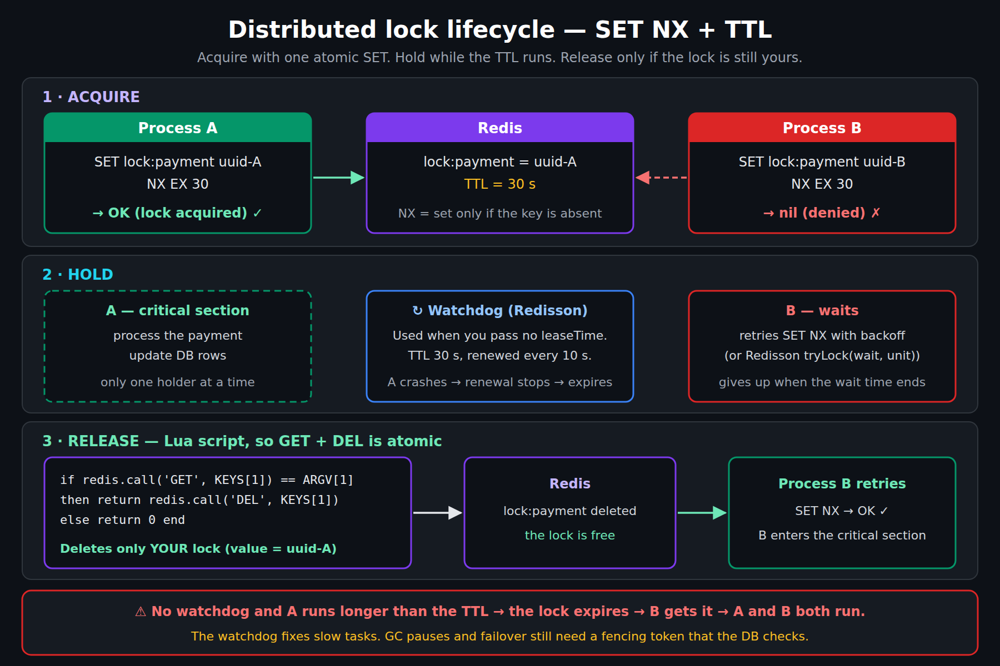

🧠 **Lock Mechanism:**

- **Acquire:** `SET lock_key unique_value NX EX ttl` — sets the key only if it doesn't exist, with a TTL
- **Release:** Delete the key only if the value matches (so only the owner can release it)
- **NX** = Not eXists (only set if key doesn't exist)
- **EX** = Expiry in seconds (prevents deadlock if lock holder crashes)

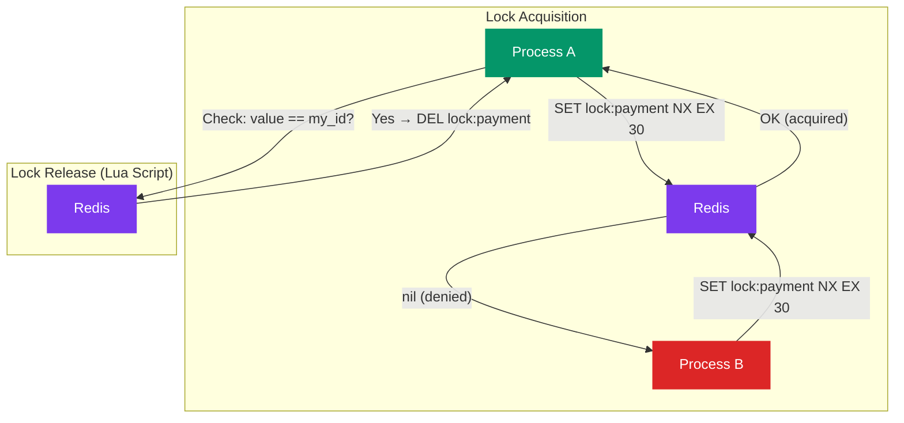

**Java Implementation:**

```java
@Component
@RequiredArgsConstructor
public class RedisDistributedLock {

    private final StringRedisTemplate redisTemplate;

    /**
     * Acquire a distributed lock.
     * @param lockKey   the lock key
     * @param requestId unique identifier for this lock holder (e.g., UUID)
     * @param ttl       lock expiry duration
     * @return true if lock was acquired
     */
    public boolean acquire(String lockKey, String requestId, Duration ttl) {
        Boolean result = redisTemplate.opsForValue()
            .setIfAbsent(lockKey, requestId, ttl);
        return Boolean.TRUE.equals(result);
    }

    /**
     * Release the lock ONLY if we own it (atomic via Lua script).
     */
    public boolean release(String lockKey, String requestId) {
        String luaScript =
            "if redis.call('get', KEYS[1]) == ARGV[1] then " +
            "    return redis.call('del', KEYS[1]) " +
            "else " +
            "    return 0 " +
            "end";

        DefaultRedisScript<Long> script = new DefaultRedisScript<>(luaScript, Long.class);
        Long result = redisTemplate.execute(script, List.of(lockKey), requestId);
        return result != null && result == 1;
    }
}
```

**Usage Example:**

```java
@Service
@RequiredArgsConstructor
public class PaymentService {

    private final RedisDistributedLock lock;

    public void processPayment(String orderId) {
        String lockKey = "lock:payment:" + orderId;
        String requestId = UUID.randomUUID().toString();
        Duration ttl = Duration.ofSeconds(30);

        boolean acquired = lock.acquire(lockKey, requestId, ttl);
        if (!acquired) {
            throw new ConcurrentPaymentException("Payment already in progress");
        }

        try {
            // Critical section — only one process executes this
            executePayment(orderId);
        } finally {
            lock.release(lockKey, requestId);
        }
    }
}
```

⚠️ **Why Use Lua Script for Release:**

Without Lua, the release is NOT atomic:
```java
// DANGEROUS — race condition between GET and DEL
if (requestId.equals(redisTemplate.opsForValue().get(lockKey))) {
    // Another process could acquire the lock HERE before DEL executes
    redisTemplate.delete(lockKey);
}
```

The Lua script runs `GET` and `DEL` atomically on the Redis server.

🔑 **Key Design Points:**
- Always use a **unique request ID** (UUID). It stops you from releasing another process's lock by mistake.
- Always set a **TTL**. It prevents deadlock if the lock holder crashes.
- Always use a **Lua script** for release. It makes the release atomic.
- Think about a **retry mechanism** with backoff when acquisition fails.

---

</details>

---

2. **🌍 What is the Redlock algorithm and when should you use it? 🔥**

<!-- -->
<details>
<summary>Answer</summary>

**Answer:**

Redlock is a **distributed lock algorithm**. Salvatore Sanfilippo, the creator of Redis, proposed it. It gives stronger safety guarantees than a single-instance lock. It does this by using **N independent Redis masters** (typically 5).

🧠 **Why Redlock?**

A lock on a single Redis instance fails if that instance goes down. Even with Sentinel, the lock can be lost during failover. The reason: the lock key may not have reached the replica yet. Redlock solves this. It needs a **majority** of independent Redis instances to agree.

🔑 **Redlock Algorithm (5 Redis Instances):**

1. Get the current time in milliseconds
2. Try to acquire the lock on **all N Redis instances** sequentially, with a short timeout per instance
3. Calculate the elapsed time. The lock counts as acquired only if both are true: it was acquired on a **majority (N/2 + 1 = 3)** of instances, and elapsed time < lock TTL
4. If lock acquisition fails, **release the lock on ALL instances** (even on those that succeeded)

**① Acquisition phase — try all 5 instances one after another, with a short timeout for each instance:**

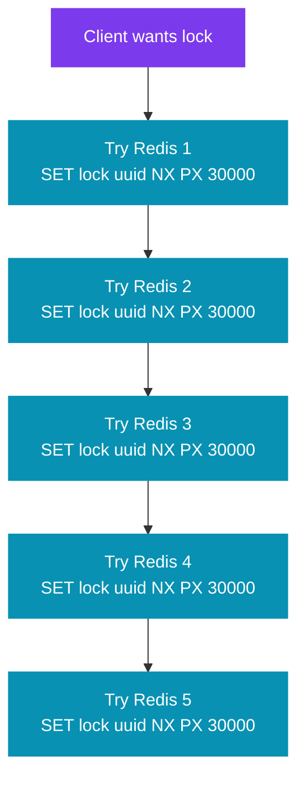

**② Validation phase — the quorum *and* the clock must both agree:**

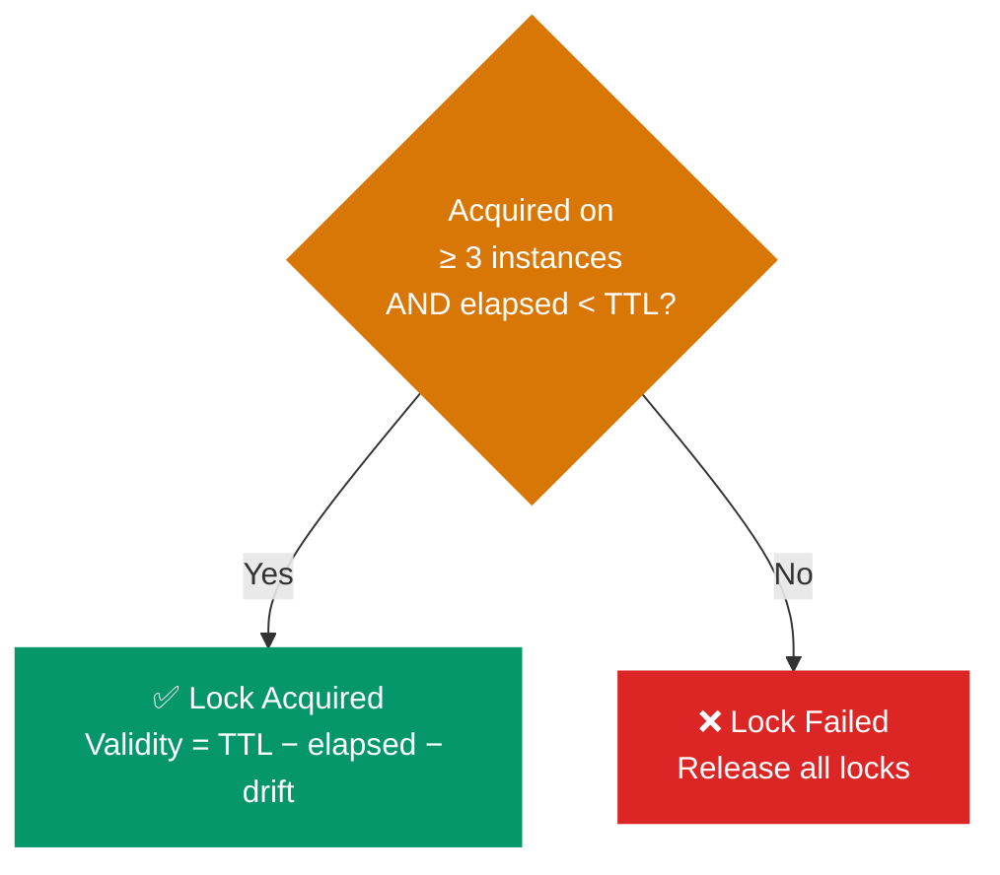

> Phase ② runs once, after the last instance in ① has answered. Two details are worth saying in an interview:  
> - Elapsed time is subtracted from the TTL. So a slow acquisition can leave a *valid but very short* lock.  
> - A clock-drift allowance is also subtracted. The Redlock spec uses drift ≈ 1% of TTL + 2 ms. So for a 30 s TTL, drift ≈ 302 ms.  
> - Every instance gets the **same random value** (unique per client) and a TTL in **milliseconds** (`PX`). The random value lets you release only your own lock.  
> - A failed acquisition must still release the lock on the instances that succeeded.  
> - **Restarts break Redlock unless you plan for them.** A node can crash and restart without the lock key (no persistence, or `appendfsync everysec` lost the last second). Then a second client can get a majority. The fix: keep a crashed node down for longer than the max lock TTL (**delayed restart**), or run it with `appendfsync always`.

**Java Implementation with Redisson:**

```java
// Redisson client setup. getLock() below is a single-instance lock, not Redlock
// (the multi-instance version is shown further down)
@Configuration
public class RedissonConfig {

    @Bean
    public RedissonClient redissonClient() {
        Config config = new Config();
        config.useSingleServer()
            .setAddress("redis://127.0.0.1:6379");
        return Redisson.create(config);
    }
}

@Service
@RequiredArgsConstructor
public class PaymentService {

    private final RedissonClient redisson;

    public void processPayment(String orderId) {
        RLock lock = redisson.getLock("lock:payment:" + orderId);

        try {
            // Wait up to 10s to acquire. No leaseTime → the watchdog stays ON
            // and keeps extending the lock while this thread is alive.
            boolean acquired = lock.tryLock(10, TimeUnit.SECONDS);

            if (!acquired) {
                throw new ConcurrentPaymentException("Could not acquire lock");
            }

            try {
                executePayment(orderId);
            } finally {
                lock.unlock();
            }
        } catch (InterruptedException e) {
            Thread.currentThread().interrupt();
            throw new RuntimeException("Lock acquisition interrupted", e);
        }
    }
}
```

> ⚠️ **Do not pass a `leaseTime` unless you mean it.** `tryLock(10, 30, TimeUnit.SECONDS)` sets a fixed 30 s lease. A fixed lease **turns OFF the watchdog** (Pitfall 1 below). If the task runs longer than 30 s, the lock expires in the middle of the work. Then `unlock()` throws `IllegalMonitorStateException`, because this thread no longer holds the lock. Use `tryLock(waitTime, TimeUnit)` (shown above) so the watchdog renews the lock.

**Locking several resources together — `RedissonMultiLock` (this is NOT Redlock):**

```java
RLock lock1 = redisson1.getLock("lock:payment:123");
RLock lock2 = redisson2.getLock("lock:payment:123");
RLock lock3 = redisson3.getLock("lock:payment:123");

// RedissonMultiLock = ALL-OR-NOTHING. It succeeds only if EVERY lock is acquired.
// If one node is down, you get no lock at all. That is the opposite of Redlock,
// which needs only a majority.
RedissonMultiLock multiLock = new RedissonMultiLock(lock1, lock2, lock3);

boolean acquired = multiLock.tryLock(10, TimeUnit.SECONDS);
if (acquired) {
    try {
        // Critical section
    } finally {
        multiLock.unlock();   // only unlock what we really hold
    }
}
```

> The `unlock()` sits **inside** `if (acquired)`. If it were in an outer `finally`, it would also run when `tryLock` returned `false`. Then it throws `IllegalMonitorStateException`. The real use of a MultiLock is to lock **several different resources** at once (for example, `lock:account:A` and `lock:account:B` for a transfer). It is not for fault tolerance.

> ⚠️ **`RedissonRedLock` is `@Deprecated`.** It still exists and still compiles on `3.27.0`. It even compiles on the 4.x line. It is a small subclass of `RedissonMultiLock`. It overrides `failedLocksLimit()` to allow a minority of failures (it needs `n/2 + 1` locks). It also overrides `calcLockWaitTime()` and `unlock()`. But Redisson no longer recommends it.  
> Current guidance:  
> - Use a plain `RLock` from `getLock()` for almost everything.  
> - Use `RFencedLock` when the protected resource must reject stale writers (it returns a fencing token — see the doubt below).  
> - Use `RedissonMultiLock` only to lock several different resources together. It needs all locks, so it does not give Redlock-style fault tolerance.  
>
> If an interviewer asks "would you use Redlock in production?", the honest answer is *no*. See the Kleppmann critique below.

| 🎯 Aspect | 🔐 Single Instance Lock | 🌍 Redlock |
|---|---|---|
| **Safety** | Lock lost if Redis fails | Tolerates **⌊N/2⌋** instance failures (N=5, quorum 3 → survives 2 down) — only with delayed restarts or `appendfsync always` |
| **Redisson class** | `RLock` (`getLock()`) | `RedissonRedLock` (deprecated). Not `RedissonMultiLock` — that one needs **all** nodes |
| **Complexity** | Simple | Higher (multiple instances) |
| **Infrastructure** | 1 Redis | N (typically 5) independent Redis instances |
| **Performance** | Faster | Slower (N sequential network calls) |
| **Use case** | Most applications | Correctness-critical (finance, inventory) |

⚠️ **Controversy:** Martin Kleppmann (author of "Designing Data-Intensive Applications") argued that Redlock is **not safe**. His points:

- **Process pauses and clock jumps.** A GC pause or a clock jump can make a client believe it still holds a lock that has already expired.
- **No fencing tokens — his central point.** Redlock does not produce a number that grows with every lock grant. A safe lock needs such a **fencing token**. The **protected resource** (for example, the database) must check it and reject a write with an older token. Redis cannot check a token on your database. So Redlock cannot stop a paused client from writing late.

For truly critical locks, think about a consensus system like **ZooKeeper** or **etcd**. Both give you a growing number you can use as a fencing token (ZooKeeper's `zxid`, etcd's revision).

💭 **Doubts**

<details>
<br/>
<summary><strong>🤔 Doubt: What is a fencing token and why does Redlock not give you one?</strong></summary>

A **fencing token** is a number that goes up by one every time someone gets the lock. The lock holder sends this number with every write. The storage remembers the highest number it has seen. It rejects any write with a lower number.

**The story it fixes:**

1. Client A gets the lock with token **33**. Then A enters a long GC pause.
2. The lock expires. Client B gets the lock with token **34** and writes with 34.
3. A wakes up and tries to write with 33.
4. The storage sees 33 < 34 and **rejects** A's write.

**Why Redlock cannot do this:**

- Redlock's lock value is a **random string**, not a growing number. Nothing orders two lock grants.
- Even with a number, the check must happen **in the database**, inside the same write. Redis is not in that write path. It cannot stop a late write to Postgres.

**How to get a token in practice:**

- A separate counter: `INCR lock:token` (single Redis node) — use the result as the token.
- Redisson 3.x+ `RFencedLock.lockAndGetToken()` — the lock returns a growing token.
- ZooKeeper `zxid` or etcd revision.

The database then does the check in the write itself:

```sql
UPDATE account
SET    balance = :newBalance, fence_token = :token
WHERE  id = :id
  AND  fence_token < :token;   -- 0 rows updated → a newer holder already wrote
```

---

</details>
<br/>

---

</details>

---

3. **🔄 How do MULTI/EXEC/WATCH work for optimistic locking in Redis? ⚡**

<!-- -->
<details>
<summary>Answer</summary>

**Answer:**

Redis transactions use `MULTI/EXEC` to batch commands atomically. They use `WATCH` for **optimistic locking** (detect a change, then retry).

🔑 **Commands:**

| Command | Purpose |
|---|---|
| `MULTI` | Start a transaction (commands are queued, not executed) |
| `EXEC` | Execute all queued commands atomically |
| `DISCARD` | Abort the transaction |
| `WATCH` | Monitor key(s) — if any watched key changes before `EXEC`, transaction fails |

🧠 **MULTI/EXEC (Basic Transaction):**

```properties
> MULTI
OK
> SET balance:1001 1000
QUEUED
> DECRBY balance:1001 200
QUEUED
> INCRBY balance:1002 200
QUEUED
> EXEC
1) OK
2) (integer) 800
3) (integer) 200
```

All commands between `MULTI` and `EXEC` run atomically. No other client can run commands in between them.

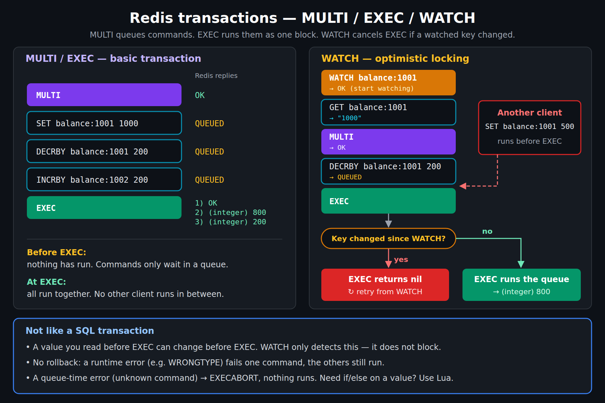

🧠 **WATCH (Optimistic Locking):**

```properties
> WATCH balance:1001          # Watch the key
OK
> GET balance:1001            # Read current value
"1000"
> MULTI                       # Start transaction
OK
> DECRBY balance:1001 200     # Deduct 200
QUEUED
> EXEC                        # Execute — returns nil if balance:1001 changed!
```

Suppose **any other client** changes `balance:1001` between `WATCH` and `EXEC`. Then `EXEC` returns `nil` (the transaction is aborted). The client must retry.

**Java Implementation (Optimistic Locking with Watch):**

```java
@Service
@RequiredArgsConstructor
public class BalanceService {

    private final StringRedisTemplate redisTemplate;
    private static final int MAX_RETRIES = 3;

    public boolean transferFunds(String fromAccount, String toAccount, long amount) {
        String fromKey = "balance:" + fromAccount;
        String toKey = "balance:" + toAccount;

        for (int attempt = 0; attempt < MAX_RETRIES; attempt++) {

            List<Object> result = redisTemplate.execute(new SessionCallback<>() {
                @Override
                @SuppressWarnings("unchecked")
                public List<Object> execute(RedisOperations operations) {
                    operations.watch(fromKey);

                    String raw = (String) operations.opsForValue().get(fromKey);
                    if (raw == null) {
                        operations.unwatch();
                        throw new IllegalStateException("Account not found: " + fromAccount);
                    }

                    long currentBalance = Long.parseLong(raw);
                    if (currentBalance < amount) {
                        operations.unwatch();
                        throw new InsufficientFundsException("Insufficient balance");
                    }

                    operations.multi();
                    operations.opsForValue().decrement(fromKey, amount);
                    operations.opsForValue().increment(toKey, amount);

                    return operations.exec(); // empty list (or null, depending on driver) if WATCH detected a change
                }
            });

            if (result != null && !result.isEmpty()) {
                return true; // transaction succeeded
            }
            // result null or empty → another client modified fromKey → retry
        }

        throw new ConcurrentModificationException("Transfer failed after " + MAX_RETRIES + " retries");
    }
}
```

| 🎯 Aspect | 📝 Detail |
|---|---|
| **Atomicity** | MULTI/EXEC commands execute without interleaving |
| **Isolation** | At `EXEC`, the queued commands run as one block, so no client sees a half-done transaction. But before `EXEC` nothing has run, so other clients can change the keys — use `WATCH` to detect that |
| **Rollback** | Not supported. Two cases: **(1) runtime error** (e.g. `WRONGTYPE`, `INCR` on a string) → the other commands still run, nothing is undone. **(2) queue-time error** (unknown command, wrong number of arguments) → `EXEC` returns `EXECABORT` and **nothing** runs (Redis ≥ 2.6.5) |
| **WATCH scope** | Per-connection — only current connection's WATCH is affected |
| **Optimistic vs Pessimistic** | WATCH = optimistic (no locks held, just detect changes) |

⚠️ **Redis Transactions vs RDBMS Transactions:**
- Redis transactions are NOT like SQL transactions
- No rollback on failure — a runtime error (e.g. `WRONGTYPE`) gives partial execution. Only a queue-time error (bad command or arity) aborts the whole block with `EXECABORT`
- No isolation levels — values you read before `MULTI` can change before `EXEC` (use `WATCH`)
- For true atomicity with if/else logic, use **Lua scripts**

---

</details>

---

4. **🧬 How does Lua scripting enable atomic operations in Redis? ⚡**

<!-- -->
<details>
<summary>Answer</summary>

**Answer:**

Redis runs Lua scripts **atomically** on the server side. While a Lua script runs, no other Redis command can run. There is one safety valve: after `busy-reply-threshold` (called `lua-time-limit` before Redis 7.0, default 5000 ms), the server starts replying `BUSY` to other clients. It then accepts only `SCRIPT KILL` (works if the script has not written yet) or `SHUTDOWN NOSAVE`. The script is **not** stopped on its own. This makes Lua scripts the most powerful way to do **complex atomic operations** in Redis.

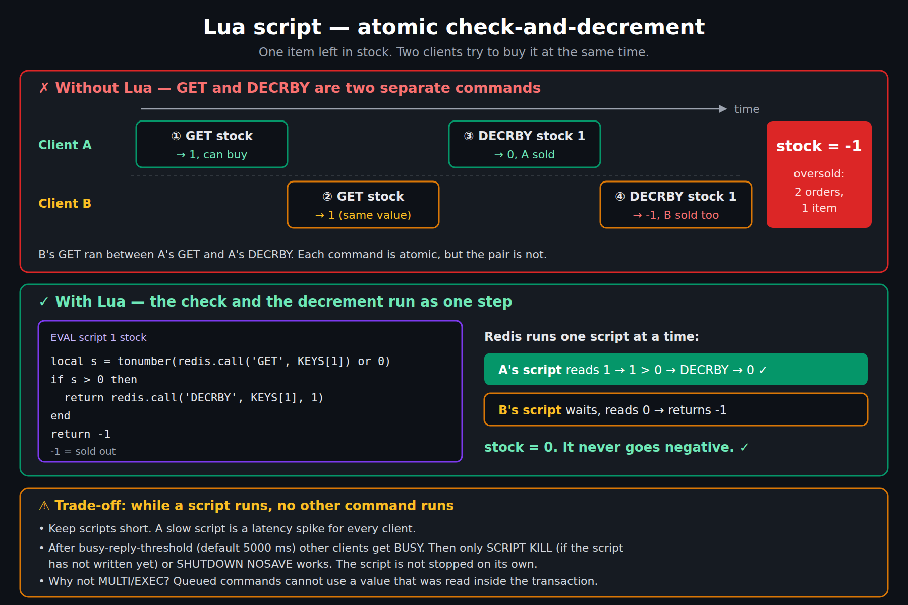

🧠 **Why Lua Scripts?**

- `MULTI/EXEC` can't use intermediate results (commands are queued, not executed)
- Lua scripts can read, compute, and write in a single atomic operation
- No round trips. The whole script runs on the server.

🔑 **Basic Syntax:**

```properties
# EVAL script numkeys key [key ...] arg [arg ...]
EVAL "return redis.call('GET', KEYS[1])" 1 mykey

# KEYS[1], KEYS[2] — key arguments
# ARGV[1], ARGV[2] — non-key arguments
```

```java
@Service
@RequiredArgsConstructor
public class LuaScriptExamples {

    private final StringRedisTemplate redisTemplate;

    // ─── Example 1: Atomic Rate Limiter ───────────────────────────────────────
    // Problem: INCR and EXPIRE are two separate commands. If the app crashes or
    // the connection drops between them, the TTL is never set and the counter lives forever.
    // Lua makes INCR + EXPIRE a single atomic operation.
    public boolean isAllowed(String clientId, int maxRequests, int windowSeconds) {
        String luaScript = """
            local current = redis.call('INCR', KEYS[1])
            -- First request in this window: set the expiry window
            -- (only on first INCR so the window doesn't keep resetting)
            if current == 1 then
                redis.call('EXPIRE', KEYS[1], ARGV[1])
            end
            -- Exceeded the limit — deny
            if current > tonumber(ARGV[2]) then
                return 0
            end
            return 1
            """;
        // KEYS[1] = "ratelimit:client123"
        // ARGV[1] = windowSeconds (e.g. 60)
        // ARGV[2] = maxRequests   (e.g. 100)
        DefaultRedisScript<Long> script = new DefaultRedisScript<>(luaScript, Long.class);
        Long result = redisTemplate.execute(
            script,
            List.of("ratelimit:" + clientId),
            String.valueOf(windowSeconds),
            String.valueOf(maxRequests)
        );
        return result != null && result == 1;
    }

    // ─── Example 2: Atomic Compare-and-Swap (CAS) ─────────────────────────────
    // Problem: GET then SET are two separate commands — another client can change
    // the value between them. Lua makes check-then-update a single atomic operation.
    public boolean compareAndSwap(String key, String expectedValue, String newValue) {
        String luaScript = """
            local current = redis.call('GET', KEYS[1])
            -- Only update if the current value matches what we expect
            -- (no one else has changed it since we last read it)
            if current == ARGV[1] then
                redis.call('SET', KEYS[1], ARGV[2])
                return 1  -- swap successful
            end
            return 0  -- value changed by someone else — abort
            """;
        // KEYS[1] = key to update
        // ARGV[1] = expectedValue (what we read before)
        // ARGV[2] = newValue      (what we want to write)
        DefaultRedisScript<Long> script = new DefaultRedisScript<>(luaScript, Long.class);
        Long result = redisTemplate.execute(
            script,
            List.of(key),
            expectedValue,
            newValue
        );
        return result != null && result == 1;
    }

    // ─── Example 3: Atomic Inventory Deduction ────────────────────────────────
    // Problem: two concurrent requests could both read stock=1, both pass the
    // "is stock enough?" check, and both deduct — stock goes negative (overselling).
    // Lua makes the read-check-deduct sequence atomic.
    public boolean deductInventory(String productId, int quantity) {
        String luaScript = """
            local stock = tonumber(redis.call('GET', KEYS[1]))
            if stock == nil then
                return -1  -- product not found in Redis
            end
            if stock < tonumber(ARGV[1]) then
                return 0   -- not enough stock
            end
            redis.call('DECRBY', KEYS[1], ARGV[1])
            return 1       -- deducted successfully
            """;
        // KEYS[1] = "inventory:product42"
        // ARGV[1] = quantity to deduct
        // returns: 1 = success, 0 = out of stock, -1 = product not found
        DefaultRedisScript<Long> script = new DefaultRedisScript<>(luaScript, Long.class);
        Long result = redisTemplate.execute(
            script,
            List.of("inventory:" + productId),
            String.valueOf(quantity)
        );
        return result != null && result == 1;
    }
}
```

| ✅ Advantages | ⚠️ Limits |
|---|---|
| Truly atomic (no interleaving) | Blocks ALL Redis commands while running |
| Can use intermediate results | Must be fast — long scripts degrade performance |
| Reduces network round trips | In Redis Cluster, all keys must be in the same hash slot |
| Reusable via `EVALSHA` (script caching) | Debugging is harder than normal Redis commands |

🔑 **Best Practices:**

- Keep scripts short and fast (< 5ms execution)
- Use `EVALSHA` with `SCRIPT LOAD` to avoid sending script text every time
- In Redis Cluster, all `KEYS[]` must hash to the same slot (use hash tags)
- Use `redis.log()` for debugging during development

```properties
# Load script and get SHA
SCRIPT LOAD "return redis.call('GET', KEYS[1])"
"d3c21d0c2b9ca22f82737626a27bcaf5d288f99f"

# Execute by SHA (avoids sending script text)
EVALSHA d3c21d0c2b9ca22f82737626a27bcaf5d288f99f 1 mykey
```

⚠️ **`NOSCRIPT` — the script cache is not saved.** Redis keeps loaded scripts only in memory. It does not write them to RDB/AOF. So `EVALSHA` fails with `NOSCRIPT` after:

- a restart,
- a failover to a replica that never loaded the script,
- `SCRIPT FLUSH`.

The client must catch `NOSCRIPT` and send the full script with `EVAL`. Spring Data Redis does this for you: `DefaultRedisScript` (run through `ScriptExecutor`) tries `EVALSHA` first and falls back to `EVAL` on `NOSCRIPT`.

🔑 **Redis Functions (Redis 7.0+) — the modern way to manage scripts in production:**

```properties
# Load a library once (it is saved in RDB/AOF and replicated)
FUNCTION LOAD "#!lua name=locklib
redis.register_function('release_if_owner', function(keys, args)
  if redis.call('GET', keys[1]) == args[1] then
    return redis.call('DEL', keys[1])
  end
  return 0
end)"

# Call it by name
FCALL release_if_owner 1 lock:payment:123 my-uuid
```

| | `EVAL` / `EVALSHA` | Functions (`FUNCTION LOAD` / `FCALL`) |
|---|---|---|
| Where the code lives | In the app; sent or cached per server | On the server, as a named library |
| Survives restart / failover | ❌️ (cache lost → `NOSCRIPT`) | ✅ persisted and replicated |
| Called by | SHA1 hash | Function name |

💡 **Interview line:** "In production I rely on Spring's `EVALSHA` → `EVAL` fallback. On Redis 7+, I deploy the logic as a Function library with `FUNCTION LOAD` and call it with `FCALL`. Functions survive restarts and failover."

---

</details>

---

5. **⚠️ What are the common pitfalls and edge cases with distributed locks in Redis? ⚡**

<!-- -->
<details>
<summary>Answer</summary>

**Answer:**

Distributed locking is harder than it looks. Here are the most common pitfalls:

🔑 **Pitfall 1: Lock Expiry Before Task Completion**

Suppose the lock TTL expires before the task finishes. Then another process can acquire the lock. Now there are **two processes in the critical section at the same time**.

```java
// PROBLEM: Task takes 45s but lock TTL is 30s
lock.acquire("mylock", requestId, Duration.ofSeconds(30));
longRunningTask(); // Takes 45 seconds
// Lock expired at 30s — another process already acquired it!
lock.release("mylock", requestId); // With the ownership check (Pitfall 2) this does nothing.
                                    // Without it, this would delete the OTHER process's lock!
```

**Solution: Lock Renewal (Watchdog Pattern)**

```java
// Redisson's watchdog automatically extends the lock
RLock lock = redisson.getLock("mylock");
lock.lock(); // Default 30s TTL, watchdog renews every 10s

try {
    longRunningTask(); // Lock is auto-extended
} finally {
    lock.unlock();
}
```

🔑 **Pitfall 2: Releasing Someone Else's Lock**

Without checking ownership, Process A might release Process B's lock.

```java
// WRONG — deletes any lock, not just ours
redisTemplate.delete("mylock");

// CORRECT — Lua script checks ownership
String luaScript = """
    if redis.call('get', KEYS[1]) == ARGV[1] then
        return redis.call('del', KEYS[1])
    end
    return 0
    """;
```

🔑 **Pitfall 3: Clock Drift (Redlock)**

Redis instances may have different clocks. Then the real TTL is different on each instance. One instance may expire the lock while others still hold it.

🔑 **Pitfall 4: GC Pauses (JVM)**

```
Process A acquires lock (TTL 30s)
Process A enters GC pause (20s)
Lock expires while A is in GC
Process B acquires lock, starts working
Process A exits GC, continues — BOTH in critical section!
```

**Solution: Fencing Tokens**

```java
// The token does NOT come from the plain Redis lock (its value is a random UUID).
// Get a growing number from a separate source:
Long fencingToken = redisTemplate.opsForValue().increment("lock:token");  // INCR lock:token
// or, Redisson 3.x+:  Long fencingToken = redisson.getFencedLock("mylock").lockAndGetToken();

// Pass the token to the protected resource. The DATABASE does the check:
//   UPDATE account SET balance = :b, fence_token = :token
//   WHERE id = :id AND fence_token < :token
int updated = accountRepository.updateIfNewer(accountId, newBalance, fencingToken);
if (updated == 0) {
    throw new StaleLockException("A newer lock holder already wrote");
}
```

> The key point: Redis hands out the number, but only the **resource** (the database) can reject the late write. Redis is not in the database's write path, so it cannot do this check for you.

🔑 **Pitfall 5: Redis Failover Data Loss**

With Sentinel, the master may crash right after a lock `SET` but before replication. Then the promoted replica does not have the lock. Another process can acquire it.

Redlock has the same problem with **restarts**. A node restarts without the lock key (no persistence, or lost by `appendfsync everysec`). Now a second client can win a majority. Fix: keep a crashed node down for longer than the max lock TTL (**delayed restart**), or use `appendfsync always`.

| 🎯 Pitfall | 🔧 Solution |
|---|---|
| Lock expires before task finishes | Watchdog / lock renewal |
| Releasing someone else's lock | Lua script with ownership check |
| Clock drift | Fencing tokens, or a consensus store (ZooKeeper/etcd) for critical locks. Redlock itself depends on clocks |
| GC pauses | Fencing tokens |
| Failover data loss | Redlock across independent instances — with delayed restarts or `appendfsync always`. Fencing tokens checked by the resource for full safety |
| Network partition | Short lock TTL + retry with backoff |
| Deadlock (lock holder crashes) | TTL ensures eventual release |

📝 **Production Checklist:**

- Always set a TTL on locks
- Always use unique request IDs
- Always use Lua scripts for release
- Consider lock renewal for long tasks
- Implement retry with exponential backoff
- Monitor lock acquisition failures
- Use Redisson in production. It handles lock renewal (watchdog) and safe release (owner check). It does **not** fix GC pauses, failover loss or clock jumps — those need fencing tokens checked by the protected resource

---

</details>

---

6. **🧾 How do you implement idempotency keys with Redis (e.g. for a payment API)? 🔥🔥**

<!-- -->
<details>
<summary>Answer</summary>

**Answer:**

**The problem:** a client sends "pay ₹500". The network times out, so the client does not know if it worked. It retries. Without protection, the server charges twice.

An **idempotency key** is a unique ID the client creates once per business action (usually a UUID). The client sends the same key on every retry. The server uses it to run the action **at most once** and to return the **same response** to every retry.

🧠 **The flow:**

1. Client sends `Idempotency-Key: 7f3a…` with the request.
2. Server runs `SET idem:<tenant>:<key> PROCESSING NX EX 60` — one atomic call.
3. **Key was set (we are first):** process the payment. Then overwrite the key with the final response (status + body) and a long TTL (e.g. `EX 86400`).
4. **Key already exists:**
   - value is `PROCESSING` → the first call is still running → return **409 Conflict** (some APIs use 425) "request in progress, retry later".
   - value is a stored response → **replay** it. Do not run the payment again.
5. Also store a **hash of the request body** with the key. Same key + different body → **422 Unprocessable Entity**. This catches a client bug that reuses a key for a different payment.

| Decision | Choice | Why |
|---|---|---|
| Key format | `idem:<tenant>:<key>` | A key from one tenant must not collide with another |
| TTL of `PROCESSING` | Short (e.g. 60 s, a bit more than the request timeout) | If the server crashes mid-way, the key frees itself and the client can retry |
| TTL of the final response | Long (e.g. 24 h = `86400` s) | Covers how long clients keep retrying. After that the key can expire |
| Atomic claim | `SET … NX EX` in **one** call | `GET` then `SET` is a race: two retries at the same moment both pass |

⚠️ **Redis is not the system of record.** A Sentinel failover can lose a key that was not yet replicated. Then a retry would run the payment again. For money, also put a **unique constraint** on the idempotency key in the database (for example, a `UNIQUE (tenant_id, idempotency_key)` column on the payments table). Redis is the fast first check. The database is the final guard.

```java
@Service
@RequiredArgsConstructor
public class IdempotentPaymentService {

    private static final Duration PROCESSING_TTL = Duration.ofSeconds(60);
    private static final Duration RESULT_TTL = Duration.ofHours(24);

    private final StringRedisTemplate redis;
    private final PaymentProcessor processor;
    private final ObjectMapper mapper;

    public StoredResponse pay(String tenant, String idemKey, PaymentRequest req) throws Exception {
        String key = "idem:" + tenant + ":" + idemKey;
        String bodyHash = DigestUtils.sha256Hex(mapper.writeValueAsString(req));

        Boolean claimed = redis.opsForValue()
            .setIfAbsent(key, "PROCESSING|" + bodyHash, PROCESSING_TTL);   // SET NX EX

        if (!Boolean.TRUE.equals(claimed)) {
            String existing = redis.opsForValue().get(key);
            if (existing == null) {
                throw new RetryLaterException();                 // expired just now; client retries
            }
            if (existing.startsWith("PROCESSING|")) {
                checkSameBody(existing, bodyHash);               // different body → 422
                throw new RequestInProgressException();          // → 409
            }
            StoredResponse stored = mapper.readValue(existing, StoredResponse.class);
            if (!stored.bodyHash().equals(bodyHash)) {
                throw new IdempotencyKeyReuseException();        // → 422
            }
            return stored;                                       // replay, no second charge
        }

        try {
            PaymentResult result = processor.charge(tenant, idemKey, req);   // DB has UNIQUE key too
            StoredResponse response = new StoredResponse(200, result, bodyHash);
            redis.opsForValue().set(key, mapper.writeValueAsString(response), RESULT_TTL);
            return response;
        } catch (PaymentRejectedException e) {
            redis.delete(key);                                   // nothing was charged → safe retry
            throw e;
        }
        // Any other error (e.g. a gateway timeout) keeps PROCESSING until its TTL ends.
        // We do not know if money moved, so the client must not retry at once.
    }

    private void checkSameBody(String processingValue, String bodyHash) {
        if (!processingValue.endsWith("|" + bodyHash)) {
            throw new IdempotencyKeyReuseException();
        }
    }
}
```

> **Delete the key only when you know nothing happened** (for example, the bank rejected the payment). If the payment gateway call timed out, you do not know whether money moved. Then keep the key, and check the payment status before you allow a retry. The database unique constraint stops a second charge either way.

💡 **Interview one-liner:** "The client sends an idempotency key. I claim it with one atomic `SET NX EX` as `PROCESSING`, with a short TTL. I store the final response under it for 24 hours and replay it on retries. The same key with a different body hash is rejected. And a unique constraint in the database backs it up, because Redis can lose a key on failover."

---

</details>

---

<a id="spring-data-redis-and-real-world-patterns"></a>

## 8. Spring Data Redis and Real-World Patterns 🔥

1. **🛠️ How do you configure RedisTemplate in Spring Boot and what operations does it support? 🔥**

<!-- -->
<details>
<summary>Answer</summary>

**Answer:**

`RedisTemplate` is the main class in Spring Data Redis for running Redis operations. It gives type-safe operations for all Redis data structures.

**Maven Dependency:**

```xml
<dependency>
    <groupId>org.springframework.boot</groupId>
    <artifactId>spring-boot-starter-data-redis</artifactId>
</dependency>
```

**Configuration:**

```yaml
# application.yml
spring:
  data:
    redis:
      host: localhost
      port: 6379
      password: your-password
      timeout: 2000ms
      lettuce:
        pool:               # ⚠️ ignored unless commons-pool2 is on the classpath (see §9 Q5)
          max-active: 16
          max-idle: 8
          min-idle: 4
          max-wait: 2000ms
```

**RedisTemplate Bean Configuration:**

```java
@Configuration
public class RedisConfig {

    @Bean
    public RedisTemplate<String, Object> redisTemplate(
            RedisConnectionFactory connectionFactory) {

        RedisTemplate<String, Object> template = new RedisTemplate<>();
        template.setConnectionFactory(connectionFactory);

        // Use String serializer for keys
        template.setKeySerializer(new StringRedisSerializer());
        template.setHashKeySerializer(new StringRedisSerializer());

        // Use JSON serializer for values (see the warnings below the table:
        // Java time types, security, and the Boot 4 replacement)
        GenericJackson2JsonRedisSerializer jsonSerializer =
            new GenericJackson2JsonRedisSerializer();
        template.setValueSerializer(jsonSerializer);
        template.setHashValueSerializer(jsonSerializer);

        template.afterPropertiesSet();
        return template;
    }

    @Bean
    public StringRedisTemplate stringRedisTemplate(
            RedisConnectionFactory connectionFactory) {
        return new StringRedisTemplate(connectionFactory);
    }
}
```

🔑 **Operations Interface Mapping:**

| 🎯 Operation | 📝 Redis Data Structure | 🔧 Access Method |
|---|---|---|
| `opsForValue()` | String | `GET`, `SET`, `INCR`, `SETEX` |
| `opsForHash()` | Hash | `HGET`, `HSET`, `HGETALL` |
| `opsForList()` | List | `LPUSH`, `RPOP`, `LRANGE` |
| `opsForSet()` | Set | `SADD`, `SMEMBERS`, `SINTER` |
| `opsForZSet()` | Sorted Set | `ZADD`, `ZRANGE`, `ZRANK` |
| `opsForHyperLogLog()` | HyperLogLog | `PFADD`, `PFCOUNT` |
| `opsForGeo()` | Geospatial | `GEOADD`, `GEOSEARCH` (`GEORADIUS` is deprecated since Redis 6.2) |

**Usage Examples:**

```java
@Service
@RequiredArgsConstructor
public class RedisOperationsDemo {

    private final RedisTemplate<String, Object> redisTemplate;

    // String operations
    public void stringOps() {
        redisTemplate.opsForValue().set("name", "Alice", Duration.ofMinutes(30));
        String name = (String) redisTemplate.opsForValue().get("name");
        redisTemplate.opsForValue().increment("counter");
    }

    // Hash operations
    public void hashOps() {
        redisTemplate.opsForHash().put("user:1001", "name", "Alice");
        redisTemplate.opsForHash().put("user:1001", "city", "New York");
        Map<Object, Object> user = redisTemplate.opsForHash().entries("user:1001");
    }

    // List operations (queue pattern)
    public void listOps() {
        redisTemplate.opsForList().leftPush("queue:tasks", "task1");
        redisTemplate.opsForList().leftPush("queue:tasks", "task2");
        Object task = redisTemplate.opsForList().rightPop("queue:tasks");
    }

    // Set operations
    public void setOps() {
        redisTemplate.opsForSet().add("tags:article:1", "java", "redis", "spring");
        Set<Object> tags = redisTemplate.opsForSet().members("tags:article:1");
    }

    // Sorted Set operations (leaderboard)
    public void zSetOps() {
        redisTemplate.opsForZSet().add("leaderboard", "player1", 1500);
        redisTemplate.opsForZSet().add("leaderboard", "player2", 2200);
        Set<Object> top10 = redisTemplate.opsForZSet()
            .reverseRange("leaderboard", 0, 9);
    }

    // Key operations
    public void keyOps() {
        redisTemplate.expire("name", Duration.ofMinutes(10));
        Boolean exists = redisTemplate.hasKey("name");
        redisTemplate.delete("name");
    }
}
```

⚠️ **Serialization Matters:**

| Serializer | Pros | Cons |
|---|---|---|
| `StringRedisSerializer` | Human-readable, no class info | Strings only |
| `JdkSerializationRedisSerializer` (default) | Works with any Serializable | Not human-readable, Java-only, fragile |
| `GenericJackson2JsonRedisSerializer` | JSON, human-readable, works for any type | Adds an `@class` Java type name to each value, so other languages cannot read it easily. Slightly larger |
| `Jackson2JsonRedisSerializer` | Clean JSON, no type info. Other languages can read it | Must specify target class |

✅ **Best Practice:** Always configure explicit serializers. The default `JdkSerializationRedisSerializer` writes byte arrays that people cannot read. It also breaks easily when a class changes.

⚠️ **Three things to know about `GenericJackson2JsonRedisSerializer`:**

- **Version.** It is fine on Boot 3.x (Spring Data Redis 3.x). In Spring Data Redis 4.x (Boot 4) it is **deprecated**. The replacement is `GenericJacksonJsonRedisSerializer`, which uses Jackson 3.
- **Java time types.** `new GenericJackson2JsonRedisSerializer()` builds its own `ObjectMapper` without `JavaTimeModule`. So a `LocalDateTime` field fails to serialize. Pass in your own `ObjectMapper` with `JavaTimeModule` registered.
- **Security.** It turns on Jackson "default typing": the JSON says which Java class to create. If an attacker can write to Redis, they can make your app create a dangerous class (a polymorphic deserialization attack). Limit the allowed classes with a `PolymorphicTypeValidator` (for example, only your own `com.mycompany.` package).

```java
ObjectMapper mapper = new ObjectMapper()
    .registerModule(new JavaTimeModule());
mapper.activateDefaultTyping(
    BasicPolymorphicTypeValidator.builder()
        .allowIfSubType("com.mycompany.")   // only your own classes
        .build(),
    ObjectMapper.DefaultTyping.NON_FINAL,
    JsonTypeInfo.As.PROPERTY);

var serializer = new GenericJackson2JsonRedisSerializer(mapper);
```

> Note: with your own `ObjectMapper`, the type info is only added if you call
> `activateDefaultTyping` yourself (as above). Without it, the serializer cannot know which
> class to rebuild on read.

---

</details>

---

2. **🎯 How do `@Cacheable`, `@CachePut`, and `@CacheEvict` work with Redis in Spring Boot? 🔥**

<!-- -->
<details>
<summary>Answer</summary>

**Answer:**

Spring's caching abstraction gives you annotations for the **Cache-Aside pattern** (Lazy Loading). You declare the caching with annotations instead of writing the code. When Redis stores the cache, these annotations read and write Redis automatically.

🔑 **Setup:**

```java
@SpringBootApplication
@EnableCaching  // Enable Spring Cache abstraction
public class Application {
    public static void main(String[] args) {
        SpringApplication.run(Application.class, args);
    }
}
```

```yaml
# application.yml
spring:
  cache:
    type: redis
    redis:
      time-to-live: 1800000  # 30 minutes in ms
      cache-null-values: false
      key-prefix: "app:"
      use-key-prefix: true
```

**Custom CacheManager Configuration:**

> ⚠️ **The YAML above and your own `CacheManager` bean do not work together.** Boot's Redis
> cache auto-config backs off as soon as you define any `CacheManager` bean. Then every
> `spring.cache.redis.*` property is ignored. Use one or the other:
>
> - **Option A — your own `RedisCacheManager` bean.** You set everything in Java. Delete the YAML.
> - **Option B — keep the YAML, and add only what YAML cannot say** (per-cache TTL, a custom
>   serializer). Use a `RedisCacheManagerBuilderCustomizer` bean. Boot still builds the
>   cache manager, so the YAML still applies.
>
> (A `RedisCacheConfiguration` bean also keeps auto-config. But Boot then uses it *instead of*
> the `spring.cache.redis.*` defaults, so it has the same "YAML is ignored" problem for TTL and prefix.)

```java
// Option A — full control in Java. spring.cache.redis.* is now ignored.
@Configuration
@EnableCaching
public class CacheConfig {

    @Bean
    public RedisCacheManager cacheManager(RedisConnectionFactory connectionFactory) {
        RedisCacheConfiguration defaultConfig = RedisCacheConfiguration.defaultCacheConfig()
            .entryTtl(Duration.ofMinutes(30))
            .serializeKeysWith(
                SerializationPair.fromSerializer(new StringRedisSerializer()))
            .serializeValuesWith(
                SerializationPair.fromSerializer(
                    new GenericJackson2JsonRedisSerializer()))
            .disableCachingNullValues();

        // Per-cache TTL configuration
        Map<String, RedisCacheConfiguration> cacheConfigs = Map.of(
            "users", defaultConfig.entryTtl(Duration.ofHours(1)),
            "products", defaultConfig.entryTtl(Duration.ofMinutes(15)),
            "sessions", defaultConfig.entryTtl(Duration.ofHours(24))
        );

        return RedisCacheManager.builder(connectionFactory)
            .cacheDefaults(defaultConfig)
            .withInitialCacheConfigurations(cacheConfigs)
            .build();
    }
}
```

```java
// Option B — keep the YAML defaults; only add per-cache TTLs on top.
@Configuration
@EnableCaching
public class CacheConfig {

    @Bean
    public RedisCacheManagerBuilderCustomizer perCacheTtl() {
        return builder -> builder
            .withCacheConfiguration("users",
                RedisCacheConfiguration.defaultCacheConfig()
                    .entryTtl(Duration.ofHours(1)))
            .withCacheConfiguration("products",
                RedisCacheConfiguration.defaultCacheConfig()
                    .entryTtl(Duration.ofMinutes(15)));
    }
}
```

> Note on Option B: a cache named here gets *this* configuration, not the YAML one. So the
> YAML defaults (`key-prefix`, `cache-null-values`) apply to every **other** cache. If you
> need them on `users` too, set them again on that `RedisCacheConfiguration`.

🔑 **Annotations:**

**@Cacheable — Cache the result (Read)**

```java
@Service
public class UserService {

    // First call → executes method, caches result
    // Subsequent calls with same id → returns from cache
    @Cacheable(value = "users", key = "#id")
    public User getUserById(Long id) {
        log.info("Loading user from DB: {}", id);
        return userRepository.findById(id)
            .orElseThrow(() -> new UserNotFoundException(id));
    }

    // Conditional caching
    @Cacheable(value = "users", key = "#id",
               condition = "#id > 0",           // Cache only if id > 0
               unless = "#result.status == 'INACTIVE'")  // Don't cache inactive users
    public User getUserByIdConditional(Long id) {
        return userRepository.findById(id).orElseThrow();
    }

    // Custom key using SpEL
    @Cacheable(value = "users", key = "#email.toLowerCase()")
    public User getUserByEmail(String email) {
        return userRepository.findByEmail(email);
    }
}
```

**@CachePut — Update cache (Write)**

```java
// ALWAYS executes the method and updates cache
@CachePut(value = "users", key = "#user.id")
public User updateUser(User user) {
    return userRepository.save(user);
}
```

**@CacheEvict — Remove from cache (Delete)**

```java
// Remove specific cache entry
@CacheEvict(value = "users", key = "#id")
public void deleteUser(Long id) {
    userRepository.deleteById(id);
}

// Remove ALL entries in the cache
@CacheEvict(value = "users", allEntries = true)
public void clearUserCache() {
    log.info("User cache cleared");
}

// Evict BEFORE method execution (useful if method might fail)
@CacheEvict(value = "users", key = "#id", beforeInvocation = true)
public void deleteUserSafe(Long id) {
    userRepository.deleteById(id);
}
```

**@Caching — Combine multiple cache operations**

```java
@Caching(
    put = { @CachePut(value = "users", key = "#result.id") },
    evict = { @CacheEvict(value = "userList", allEntries = true) }
)
public User createUser(UserRequest request) {
    return userRepository.save(mapToEntity(request));
}
```

| 🎯 Annotation | 📝 Behavior | 🔧 Use Case |
|---|---|---|
| `@Cacheable` | Returns cached value; executes method only on miss | Read operations |
| `@CachePut` | Always executes method and updates cache | Update operations |
| `@CacheEvict` | Removes cache entry | Delete operations |
| `@Caching` | Combines multiple cache annotations | Complex operations |

⚠️ **Common Mistakes:**
- Calling `@Cacheable` methods from within the **same class** (proxy bypass — won't cache)
- Not configuring serializers (default JDK serialization breaks easily)
- Caching mutable objects in an in-memory cache such as Caffeine or `ConcurrentMapCache` (changes to the returned object modify the cache). Redis does not have this problem: it stores a serialized copy
- Forgetting `@EnableCaching` annotation

<details>
<br/>
<summary><strong>🤔 Doubt: What does "proxy bypass" mean for @Cacheable?</strong></summary>

Spring's caching works through an **AOP proxy**. Spring wraps your bean in a proxy. The proxy intercepts method calls and runs the cache logic.

- When you call a method from **outside** the class, the call goes through the proxy. Caching works.
- When you call it from **within the same class** (`this.method()`), the call skips the proxy completely. Caching is never triggered.

```java
@Service
public class EmployeeService {

    @Cacheable("employees")
    public Employee getEmployee(int id) {         // ← cache works via proxy
        return repository.findById(id).orElseThrow();
    }

    public Employee getEmployeeWithDetails(int id) {
        // ❌️ internal call — bypasses proxy, @Cacheable does NOTHING, hits DB every time
        return this.getEmployee(id);
    }
}
```

**Fix — inject self or extract to a separate bean:**

```java
// Option 1: inject self (Spring injects the proxy, not 'this')
@Service
public class EmployeeService {

    @Autowired
    @Lazy  // needed on Boot 2.6+ (circular references are off by default)
    private EmployeeService self;

    public Employee getEmployeeWithDetails(int id) {
        return self.getEmployee(id);  // ✅ goes through proxy
    }
}

// Option 2: move cached method to a separate service (cleaner)
@Service
@RequiredArgsConstructor
public class EmployeeDetailsService {

    private final EmployeeService employeeService;  // injected proxy

    public Employee getEmployeeWithDetails(int id) {
        return employeeService.getEmployee(id);  // ✅ goes through proxy
    }
}
```

> **Interview one-liner:** `@Cacheable` is AOP-based. Internal `this.method()` calls skip the proxy, so the annotation is never triggered. Always call cached methods from a different bean.

---

</details>
<br/>

---

</details>

---

3. **⏱️ How do you implement rate limiting with Redis? 🔥**

<!-- -->
<details>
<summary>Answer</summary>

**Answer:**

Redis is a very good fit for rate limiting. It has atomic operations and TTL support. Here are the most common algorithms:

🔑 **Algorithm 1: Fixed Window Counter**

```java
@Component
@RequiredArgsConstructor
public class FixedWindowRateLimiter {

    private final StringRedisTemplate redisTemplate;

    /**
     * Allow up to maxRequests per windowSeconds for a given client.
     */
    // ⚠️ INCR then a separate EXPIRE is the bug this file warns about in §7.
    //    If the process dies between the two round trips, the key has no TTL.
    //    Here the key holds the window number, so the next window uses a new key:
    //    the client is not blocked, but the old key stays in memory forever (a leak).
    //    Without the window suffix, the client WOULD be blocked forever.
    //    Fix for both: do INCR + EXPIRE in one Lua script.
    private static final RedisScript<Long> SCRIPT = RedisScript.of("""
            local count = redis.call('INCR', KEYS[1])
            if count == 1 then
                redis.call('EXPIRE', KEYS[1], ARGV[1])
            end
            return count
            """, Long.class);

    public boolean isAllowed(String clientId, int maxRequests, int windowSeconds) {
        String key = "ratelimit:" + clientId + ":" + currentWindow(windowSeconds);

        Long count = redisTemplate.execute(
                SCRIPT, List.of(key), String.valueOf(windowSeconds));

        return count != null && count <= maxRequests;
    }

    private long currentWindow(int windowSeconds) {
        return Instant.now().getEpochSecond() / windowSeconds;
    }
}
```

🔑 **Algorithm 2: Sliding Window Log**

```java
@Component
@RequiredArgsConstructor
public class SlidingWindowRateLimiter {

    private final StringRedisTemplate redisTemplate;

    public boolean isAllowed(String clientId, int maxRequests, int windowSeconds) {
        String key = "ratelimit:" + clientId;
        long now = Instant.now().toEpochMilli();
        long windowStart = now - (windowSeconds * 1000L);

        // Lua script for atomicity
        String luaScript = """
            -- Remove entries outside the window
            redis.call('ZREMRANGEBYSCORE', KEYS[1], 0, ARGV[1])
            -- Count entries in window
            local count = redis.call('ZCARD', KEYS[1])
            if count < tonumber(ARGV[2]) then
                -- Add current request. ⚠️ score = timestamp, member = a UNIQUE id.
                -- Using `now` as both would make two requests in the same millisecond
                -- collide: ZADD would update the existing member instead of adding a
                -- second one, so ZCARD reports 1 where it should report 2 and the
                -- limiter leaks under exactly the burst it exists to stop.
                redis.call('ZADD', KEYS[1], ARGV[3], ARGV[5])
                redis.call('EXPIRE', KEYS[1], ARGV[4])
                return 1
            end
            return 0
            """;

        DefaultRedisScript<Long> script = new DefaultRedisScript<>(luaScript, Long.class);

        Long result = redisTemplate.execute(
            script,
            List.of(key),
            String.valueOf(windowStart),
            String.valueOf(maxRequests),
            String.valueOf(now),
            String.valueOf(windowSeconds),
            now + ":" + UUID.randomUUID()   // unique member
        );

        return result != null && result == 1;
    }
}
```

🔑 **Algorithm 3: Token Bucket**

```java
@Component
@RequiredArgsConstructor
public class TokenBucketRateLimiter {

    private final StringRedisTemplate redisTemplate;

    public boolean isAllowed(String clientId, int maxTokens, int refillRate) {
        String luaScript = """
            local key = KEYS[1]
            local max_tokens = tonumber(ARGV[1])
            local refill_rate = tonumber(ARGV[2])

            -- Read the clock INSIDE Redis. App-server time differs between pods
            -- (clock skew), and a pod that is behind would get free tokens.
            -- Calling TIME in a script is safe with effects replication
            -- (the default since Redis 5): replicas get the HSET, not the script.
            local t = redis.call('TIME')
            local now = tonumber(t[1]) + tonumber(t[2]) / 1000000

            local data = redis.call('HMGET', key, 'tokens', 'last_refill')
            local tokens = tonumber(data[1]) or max_tokens
            local last_refill = tonumber(data[2]) or now

            -- Refill tokens based on elapsed time
            local elapsed = now - last_refill
            local new_tokens = math.min(max_tokens,
                tokens + (elapsed * refill_rate))

            if new_tokens >= 1 then
                new_tokens = new_tokens - 1
                redis.call('HSET', key, 'tokens', new_tokens,
                    'last_refill', now)
                -- ⚠️ math.ceil is mandatory: Lua '/' can give a fraction (5/3*2 = 3.33). EXPIRE
                -- rejects it with "ERR value is not an integer or out of range",
                -- aborting the whole script.
                redis.call('EXPIRE', key, math.ceil(max_tokens / refill_rate * 2))
                return 1
            end

            redis.call('HSET', key, 'tokens', new_tokens,
                'last_refill', now)
            redis.call('EXPIRE', key, math.ceil(max_tokens / refill_rate * 2))
            return 0
            """;

        DefaultRedisScript<Long> script = new DefaultRedisScript<>(luaScript, Long.class);

        Long result = redisTemplate.execute(
            script,
            List.of("tokenbucket:" + clientId),
            String.valueOf(maxTokens),
            String.valueOf(refillRate)   // no app-server time: the script reads TIME
        );

        return result != null && result == 1;
    }
}
```

**Spring MVC Integration:**

```java
@Component
@RequiredArgsConstructor
public class RateLimitInterceptor implements HandlerInterceptor {

    private final TokenBucketRateLimiter rateLimiter;

    @Override
    public boolean preHandle(HttpServletRequest request,
                              HttpServletResponse response,
                              Object handler) throws Exception {

        String clientId = request.getRemoteAddr(); // or API key from header

        if (!rateLimiter.isAllowed(clientId, 100, 10)) { // 100 tokens, 10/sec refill
            response.setStatus(HttpStatus.TOO_MANY_REQUESTS.value());
            // One token comes back every 1/refillRate seconds. 1/10 s rounds up to 1 s.
            // (Retry-After takes whole seconds.)
            response.setHeader("Retry-After", "1");
            response.getWriter().write("{\"error\": \"Rate limit exceeded\"}");
            return false;
        }

        return true;
    }
}
```

| 🎯 Algorithm | ✅ Pros | ⚠️ Cons |
|---|---|---|
| **Fixed Window** | Simplest, lowest memory | Burst at window edges (2x limit possible) |
| **Sliding Window Log** | Most accurate | Higher memory (stores all timestamps) |
| **Token Bucket** | Smooth rate limiting, allows bursts | Slightly more complex |
| **Leaky Bucket** | Constant output rate | No burst allowance |

---

</details>

---

4. **🗂️ How do you implement session management with Redis in Spring Boot? ⚡**

<!-- -->
<details>
<summary>Answer</summary>

**Answer:**

By default, the HTTP session is stored in server memory. Spring Session with Redis replaces it with a **distributed session stored in Redis**. This lets many application instances share the same session. This is essential for horizontally scaled apps behind a load balancer.

**Maven Dependencies:**

```xml
<dependency>
    <groupId>org.springframework.boot</groupId>
    <artifactId>spring-boot-starter-data-redis</artifactId>
</dependency>
<dependency>
    <groupId>org.springframework.session</groupId>
    <artifactId>spring-session-data-redis</artifactId>
</dependency>
```

**Configuration:**

```yaml
# application.yml
spring:
  session:
    # (no store-type: it was removed in Boot 3 — Redis is detected from the classpath)
    redis:
      namespace: spring:session
      flush-mode: on_save     # or immediate
    timeout: 1800             # 30 minutes in seconds
  data:
    redis:
      host: localhost
      port: 6379
```

```java
// ⚠️ @EnableRedisHttpSession turns off Spring Boot's session auto-config.
//    Then the spring.session.* properties above are ignored. Use one or the other.
@Configuration
@EnableRedisHttpSession(maxInactiveIntervalInSeconds = 1800)
public class SessionConfig {

    @Bean
    public CookieSerializer cookieSerializer() {
        DefaultCookieSerializer serializer = new DefaultCookieSerializer();
        serializer.setCookieName("SESSION_ID");
        serializer.setCookiePath("/");
        serializer.setDomainNamePattern("^.+?\\.(\\w+\\.[a-z]+)$");
        serializer.setUseHttpOnlyCookie(true);
        serializer.setUseSecureCookie(true);
        serializer.setSameSite("Lax");
        return serializer;
    }
}
```

**Usage in Controller:**

```java
@RestController
@RequestMapping("/api")
public class SessionController {

    @PostMapping("/login")
    public ResponseEntity<String> login(HttpSession session,
                                         @RequestBody LoginRequest request) {
        // Authenticate user
        User user = authService.authenticate(request);

        // Store user data in Redis-backed session
        session.setAttribute("userId", user.getId());
        session.setAttribute("role", user.getRole());
        session.setAttribute("loginTime", Instant.now().toString());

        return ResponseEntity.ok("Logged in");
    }

    @GetMapping("/profile")
    public ResponseEntity<UserProfile> getProfile(HttpSession session) {
        Long userId = (Long) session.getAttribute("userId");
        if (userId == null) {
            return ResponseEntity.status(HttpStatus.UNAUTHORIZED).build();
        }

        return ResponseEntity.ok(userService.getProfile(userId));
    }

    @PostMapping("/logout")
    public ResponseEntity<String> logout(HttpSession session) {
        session.invalidate(); // Removes session from Redis
        return ResponseEntity.ok("Logged out");
    }
}
```

🧠 **How It Works Internally:**

```
Client → Request with SESSION cookie
       → Spring Session Filter intercepts
       → Looks up session in Redis: HGETALL spring:session:sessions:<sessionId>
       → Deserializes session attributes
       → Makes HttpSession available to controller
       → On response: updates Redis if session changed
```

**Redis Data Structure for Sessions:**

```properties
# Redis keys created by Spring Session:
spring:session:sessions:<sessionId>          # Hash: session attributes
# The two keys below exist only with RedisIndexedSessionRepository
# (@EnableRedisIndexedHttpSession). The default RedisSessionRepository
# (Spring Session 3+) relies on the hash key's own TTL.
spring:session:sessions:expires:<sessionId>  # String: TTL marker
spring:session:expirations:<timestamp>       # Set: sessions expiring at this time
```

| ✅ Advantages | ⚠️ Considerations |
|---|---|
| Session sharing across instances | Network latency per request (Redis lookup) |
| Survives server restarts | Session data must be serializable |
| Horizontal scaling without sticky sessions | Increased Redis memory usage |
| Centralized session management | Redis becomes a critical dependency |

💡 **Interview Tip:** Always mention that Redis-backed sessions enable **stateless application scaling**. Any instance can serve any request. This makes it easy to scale behind a load balancer.

If you built your own instead of using Spring Session, expect two follow-up questions:
- *"how do you expire an idle session?"* (sliding `EXPIRE` on the read path)
- *"what happens when Redis restarts?"* (DB fallback, or everyone gets logged out)

---

</details>

---

5. **🏆 How do you build a real-time leaderboard using Redis Sorted Sets? ⚡**

<!-- -->
<details>
<summary>Answer</summary>

**Answer:**

Redis Sorted Sets are **perfect for leaderboards**. They keep elements sorted by score. Insert is O(log N), and range queries are O(log N + M). This gives real-time ranking without expensive database queries.

**Java Implementation:**

```java
@Service
@RequiredArgsConstructor
public class LeaderboardService {

    private final StringRedisTemplate redisTemplate;
    private static final String LEADERBOARD_KEY = "leaderboard:global";

    // Add or update a player's score
    public void updateScore(String playerId, double score) {
        redisTemplate.opsForZSet().add(LEADERBOARD_KEY, playerId, score);
    }

    // Increment a player's score
    public Double incrementScore(String playerId, double delta) {
        return redisTemplate.opsForZSet()
            .incrementScore(LEADERBOARD_KEY, playerId, delta);
    }

    // Get top N players (highest scores first)
    public List<LeaderboardEntry> getTopPlayers(int count) {
        Set<ZSetOperations.TypedTuple<String>> results =
            redisTemplate.opsForZSet()
                .reverseRangeWithScores(LEADERBOARD_KEY, 0, count - 1);

        if (results == null) return List.of();

        int rank = 1;
        List<LeaderboardEntry> entries = new ArrayList<>();
        for (ZSetOperations.TypedTuple<String> tuple : results) {
            entries.add(new LeaderboardEntry(
                rank++,
                tuple.getValue(),
                tuple.getScore()
            ));
        }
        return entries;
    }

    // Get a player's rank (0-indexed, reverse = highest score is rank 0)
    public Long getPlayerRank(String playerId) {
        Long rank = redisTemplate.opsForZSet()
            .reverseRank(LEADERBOARD_KEY, playerId);
        return rank != null ? rank + 1 : null; // Convert to 1-indexed
    }

    // Get a player's score
    public Double getPlayerScore(String playerId) {
        return redisTemplate.opsForZSet().score(LEADERBOARD_KEY, playerId);
    }

    // Get players around a specific rank (e.g., rank 50-60)
    public List<LeaderboardEntry> getPlayersAroundRank(int rank, int range) {
        long index = rank - 1; // rank is 1-based; ZSet indexes are 0-based
        long start = Math.max(0, index - range);
        long end = index + range;

        Set<ZSetOperations.TypedTuple<String>> results =
            redisTemplate.opsForZSet()
                .reverseRangeWithScores(LEADERBOARD_KEY, start, end);

        if (results == null) return List.of();

        long currentRank = start + 1;
        List<LeaderboardEntry> entries = new ArrayList<>();
        for (ZSetOperations.TypedTuple<String> tuple : results) {
            entries.add(new LeaderboardEntry(
                (int) currentRank++,
                tuple.getValue(),
                tuple.getScore()
            ));
        }
        return entries;
    }

    // Get total player count
    public Long getTotalPlayers() {
        return redisTemplate.opsForZSet().zCard(LEADERBOARD_KEY);
    }
}

record LeaderboardEntry(int rank, String playerId, double score) {}
```

**REST Controller:**

```java
@RestController
@RequestMapping("/api/leaderboard")
@RequiredArgsConstructor
public class LeaderboardController {

    private final LeaderboardService leaderboardService;

    @PostMapping("/score")
    public ResponseEntity<Void> updateScore(
            @RequestParam String playerId,
            @RequestParam double score) {
        leaderboardService.incrementScore(playerId, score);
        return ResponseEntity.ok().build();
    }

    @GetMapping("/top/{count}")
    public List<LeaderboardEntry> getTopPlayers(@PathVariable int count) {
        return leaderboardService.getTopPlayers(count);
    }

    @GetMapping("/rank/{playerId}")
    public ResponseEntity<Map<String, Object>> getPlayerRank(
            @PathVariable String playerId) {
        Long rank = leaderboardService.getPlayerRank(playerId);
        Double score = leaderboardService.getPlayerScore(playerId);
        if (rank == null) {
            return ResponseEntity.notFound().build(); // Map.of rejects null values
        }

        return ResponseEntity.ok(Map.of(
            "playerId", playerId,
            "rank", rank,
            "score", score
        ));
    }
}
```

🔑 **Performance:**

| Operation | Time Complexity | Example |
|---|---|---|
| Add/Update score | O(log N) | 1M players → ~20 operations |
| Get rank | O(log N) | Near instant |
| Get top M | O(log N + M), M = entries returned | Top 100 from 1M → instant |
| Get score | O(1) | Instant |
| Count total | O(1) | Instant |

📝 **Advanced: Time-Partitioned Leaderboards**

```java
// Daily leaderboard
String dailyKey = "leaderboard:daily:" + LocalDate.now();
redisTemplate.opsForZSet().add(dailyKey, playerId, score);
redisTemplate.expire(dailyKey, Duration.ofDays(7));

// Weekly leaderboard (union of daily boards)
redisTemplate.opsForZSet().unionAndStore(
    "leaderboard:daily:2026-03-16",
    List.of("leaderboard:daily:2026-03-17", "leaderboard:daily:2026-03-18"),
    "leaderboard:weekly:2026-W12"
);
```

---

</details>

6. **⏲️ How do you run a job at a future time with Redis (a delayed queue)? Why not use key-expiry events? ⚡**

<!-- -->
<details>
<summary>Answer</summary>

**Answer:**

> 💡 **In one line:** Use a **Sorted Set** with score = run-at time, and move due jobs with one atomic Lua script. Do **not** rely on key-expiry notifications.

🚫 **The tempting answer: keyspace notifications**

The idea: `SET job:42 x EX 600`, turn on `notify-keyspace-events Ex`, and `SUBSCRIBE __keyevent@0__:expired`. When the key expires, run the job. It fails in four ways:

| Problem | Why |
|---|---|
| **Late** | The `expired` event fires when Redis actually **deletes** the key. That happens on access or in the active-expire cycle (§4 Q5), which can be seconds or minutes late |
| **Lost** | Notifications use Pub/Sub, which is **at-most-once**. If the worker is down or reconnecting, the event is gone |
| **Duplicated** | Every subscriber gets every event. With 3 pods, 3 pods run the job. There are no consumer groups |
| **Cluster** | Notifications are **per node**. You must subscribe on every master |

They are also **off by default** (`notify-keyspace-events ""`), because they cost CPU. Use them for cache-invalidation hints, not for work that must happen.

✅ **The right answer: a Sorted Set as a timer**

- **Schedule:** `ZADD {jobs}:delayed <runAtMillis> <jobId>`. The job payload lives in a hash or in the DB.
- **Poll:** every 500 ms or so, one script moves the due jobs to a ready queue. It does `ZRANGEBYSCORE` (score ≤ now), `ZREM`, then `XADD` to a Stream.
- **Atomic:** the script runs as one unit. So when many pods poll, each job moves **exactly once**.
- **Reliable work:** workers read the ready Stream with a consumer group and `XACK` after success (§9 Q3). A crashed worker's job stays in the PEL and is retried.

```java
@Component
@RequiredArgsConstructor
public class DelayedJobQueue {

    // Same hash tag {jobs} → both keys in one slot, so the script works on Cluster
    private static final String DELAYED = "{jobs}:delayed";
    private static final String READY   = "{jobs}:ready";

    // Move up to ARGV[1] due jobs from the ZSET to the Stream, in one atomic step.
    // The clock is read inside Redis (TIME), so pod clocks do not matter.
    private static final RedisScript<Long> MOVE_DUE = RedisScript.of("""
            local t = redis.call('TIME')
            local now = tonumber(t[1]) * 1000 + math.floor(tonumber(t[2]) / 1000)
            local due = redis.call('ZRANGEBYSCORE', KEYS[1], '-inf', now, 'LIMIT', 0, tonumber(ARGV[1]))
            for _, jobId in ipairs(due) do
                redis.call('ZREM', KEYS[1], jobId)
                redis.call('XADD', KEYS[2], '*', 'jobId', jobId)
            end
            return #due
            """, Long.class);

    private final StringRedisTemplate redis;

    public void schedule(String jobId, Instant runAt) {
        redis.opsForZSet().add(DELAYED, jobId, runAt.toEpochMilli());   // ZADD
    }

    @Scheduled(fixedDelay = 500)
    public void moveDueJobs() {
        redis.execute(MOVE_DUE, List.of(DELAYED, READY), "100");       // at most 100 per run
    }
}
```

**Numbers:**

- `ZADD` is O(log N). The poll is O(log N + M) for M due jobs. A ZSET with 10 million pending jobs is fine.
- A job runs up to one poll interval late (here 500 ms). For second-level timing that is enough.
- The ZSET lives in RAM. Turn on AOF (`everysec`) if pending jobs must survive a restart. Otherwise keep the source of truth in the DB and rebuild the ZSET on startup.

🔄 **Other options**

| Option | When |
|---|---|
| Redisson `RDelayedQueue` | Same idea (a ZSET plus a timer), already written for you |
| AWS SQS `DelaySeconds` | Delays up to **15 minutes** (900 s), fully managed |
| DB scheduler (a `run_at` column + `SELECT … FOR UPDATE SKIP LOCKED`) | Jobs must be durable and the rate is low |

💡 **Interview one-liner:** "Not expiry events — they fire late, Pub/Sub drops them, and every pod gets them. I put jobs in a Sorted Set with the run-at time as the score. A Lua script moves due jobs to a Stream in one atomic step, so each job moves once even with many pollers. Workers read the Stream with a consumer group and ack, so a crash means a retry, not a lost job."

---

</details>

---

<a id="optional-rarely-asked"></a>

## 9. Optional — Rarely Asked 💤

> 💤 **Optional.** SDE III / Senior interviews rarely go deep on these topics. For messaging, teams usually pick Kafka or SQS, not Redis. Read this section last, and only if you have time.  
> - **Pub/Sub vs Kafka (Q1–Q2):** a one-line answer is enough. Pub/Sub is fire-and-forget: a subscriber that is offline misses the message. Kafka keeps the message so it can be read again.  
> - **Streams (Q2–Q4):** know the basics of `XADD`, consumer groups and `XACK`. The delayed queue in §8 Q6 moves due jobs into a Stream.  
> - **Env config and versions (Q5–Q6):** setup knowledge, not interview depth. Skim them once.

1. **📡 (Optional) What is Redis Pub/Sub and how does it work? 💤**

<!-- -->
<details>
<summary>Answer</summary>

**Answer:**

Redis Pub/Sub (Publish/Subscribe) is a messaging pattern:

- **Publishers** send messages to **channels**. They do not know who will receive them.
- **Subscribers** listen to channels. They do not know who sends the messages.

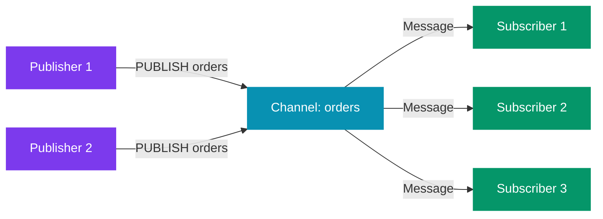

🔑 **Key Commands:**

> 💡 **To test Pub/Sub:** Open **two separate** `redis-cli` sessions: one for the subscriber and one for the publisher.

```bash
# ── Terminal 1 (Subscriber) ──────────────────────────────
# Subscribe to exact channels
SUBSCRIBE orders notifications

# OR subscribe with pattern matching
PSUBSCRIBE order.* user.*
# Output:
# 1) "psubscribe"
# 2) "order.*"
# 3) (integer) 1       ← 1 pattern subscribed (not messages)
# 1) "psubscribe"
# 2) "user.*"
# 3) (integer) 2       ← 2 patterns subscribed
# (now blocking and waiting for messages...)

# ── Terminal 2 (Publisher) ───────────────────────────────
PUBLISH order.created '{"orderId": 123, "status": "CREATED"}'
PUBLISH user.updated '{"userId": 456}'

# ── Terminal 1 will now show ─────────────────────────────
# 1) "pmessage"
# 2) "order.*"              ← pattern that matched
# 3) "order.created"        ← actual channel published to
# 4) "{\"orderId\": 123, \"status\": \"CREATED\"}"   ← message payload

# ── Unsubscribe ──────────────────────────────────────────
UNSUBSCRIBE orders
PUNSUBSCRIBE order.*
```

**Java Example with Lettuce:**

```java
// Publisher
RedisCommands<String, String> commands = connection.sync();
commands.publish("orders", "{\"orderId\": 123}");

// Subscriber
StatefulRedisPubSubConnection<String, String> pubSub = client.connectPubSub();
pubSub.addListener(new RedisPubSubAdapter<>() {
    @Override
    public void message(String channel, String message) {
        System.out.println("Received on " + channel + ": " + message);
    }
});
pubSub.sync().subscribe("orders");
```

| 🎯 Feature | 📝 Detail |
|---|---|
| **Delivery guarantee** | At-most-once (fire and forget) |
| **Message persistence** | None. If a subscriber is offline, its messages are lost |
| **Pattern matching** | `PSUBSCRIBE news.*` matches `news.sports`, `news.tech` |
| **Throughput** | Very high — lightweight message routing |
| **Consumer groups** | Not supported (use Redis Streams instead) |

⚠️ **Pub/Sub vs Redis Streams:**

| Aspect | Pub/Sub | Streams |
|---|---|---|
| Persistence | No | Yes |
| Consumer groups | No | Yes |
| Message replay | No | Yes |
| Delivery | At-most-once | At-least-once |
| Use case | Real-time notifications | Event sourcing, reliable messaging |

💡 **Interview Tip:** If asked about Redis messaging, say these two things:

- Pub/Sub is suitable for real-time notifications where message loss is acceptable.
- For reliable messaging with consumer groups and acknowledgments, recommend Redis Streams (or Kafka for high throughput).

> ⚠️ **Cluster trap — plain Pub/Sub broadcasts to every node.**  
> - In Redis Cluster, `PUBLISH` sends the message over the whole cluster bus. So a subscriber on any node receives it.  
> - So Pub/Sub traffic grows with **node count**, not with subscriber count.  
> - Redis **7.0 added sharded Pub/Sub** (`SPUBLISH` / `SSUBSCRIBE` / `SUNSUBSCRIBE`). Redis hashes the channel name to a slot, exactly like a key. Redis delivers the message only within that slot's shard.  
> - Use sharded Pub/Sub on Cluster. Without it, Pub/Sub can become the cluster's bottleneck instead of scaling.

---

</details>

---

2. **🌊 (Optional) What are Redis Streams and how do they differ from Pub/Sub and Kafka? 💤**

<!-- -->
<details>
<summary>Answer</summary>

**Answer:**

Redis Streams (introduced in Redis 5.0) is a **persistent, append-only log** data structure. Pub/Sub is fire-and-forget (it sends a message once and does not keep it). Streams are different:

- They keep messages in memory, and Redis persists them to disk like any other key (RDB/AOF).
- They support consumer groups.

This makes them a good fit for reliable event-driven processing.

**Core commands:**

| Command | What it does |
|---|---|
| `XADD stream * field value` | Append entry to stream. `*` auto-generates the ID |
| `XREAD COUNT 10 STREAMS stream 0` | Read 10 entries from beginning |
| `XREADGROUP GROUP g1 consumer1 COUNT 10 STREAMS stream >` | Read new (undelivered) entries as consumer in group |
| `XACK stream g1 <id>` | Acknowledge successful processing |
| `XLEN stream` | Number of entries in stream |
| `XRANGE stream - +` | Read all entries (oldest to newest) |

**Stream Entry ID format:** `<millisecondsTimestamp>-<sequenceNumber>`, for example `1716000000000-0`. Use `*` to let Redis auto-generate it.

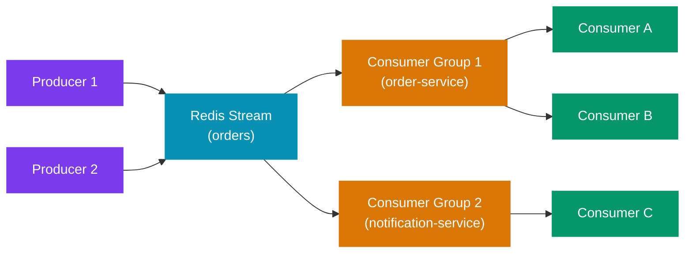

**Redis Streams vs Pub/Sub:**

| | Pub/Sub | Streams |
|---|---|---|
| **Persistence** | ❌️ No — lost if no subscriber | ✅ Yes — stored in memory/AOF |
| **Replay** | ❌️ No | ✅ Yes — read from any offset |
| **Consumer Groups** | ❌️ No | ✅ Yes |
| **Acknowledgement** | ❌️ No | ✅ XACK |
| **Offline consumers** | ❌️ Miss messages | ✅ Pick up on reconnect |
| **Use case** | Real-time notifications (best-effort) | Reliable event processing |

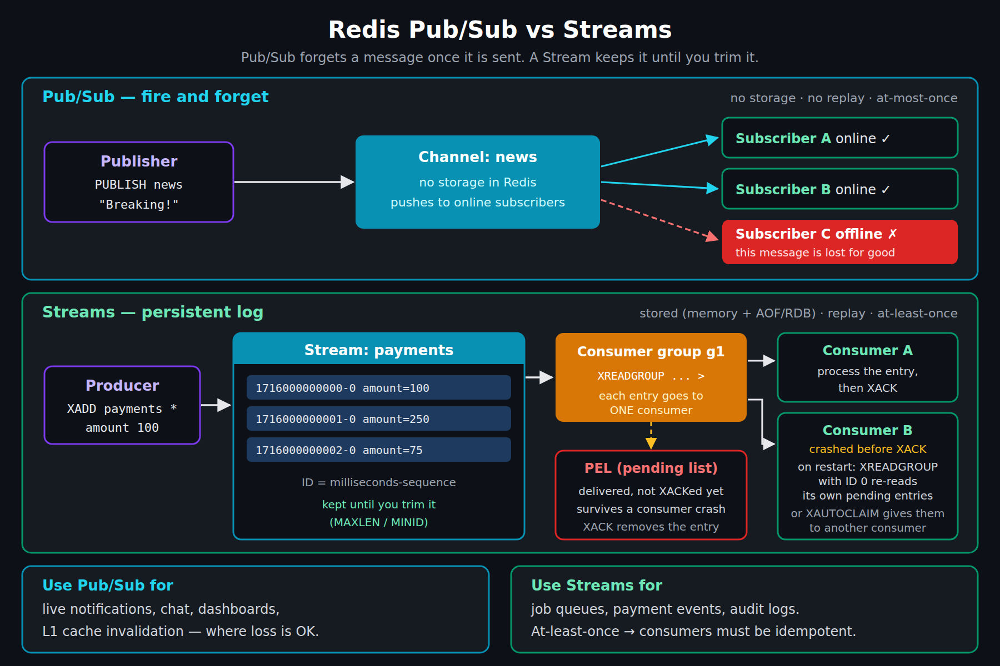

**Redis Streams vs Kafka:**

| | Redis Streams | Kafka |
|---|---|---|
| **Scale** | One shard takes well over 100k `XADD`/s. The real limits are **RAM** (the stream lives in memory) and **one stream key lives on one shard** — to scale out you split it into many keys yourself | Distributed (~billions/day), partitions spread across brokers |
| **Latency** | Sub-millisecond | Low millisecond |
| **Retention** | RAM-bound. Trim by count (`MAXLEN`) or by ID / age (`MINID`, Redis 6.2+), or set a TTL on the key | Disk-based, configurable forever |
| **Partitioning** | No native partitions | Built-in partitions per topic |
| **Schema Registry** | ❌️ No | ✅ Avro/Protobuf via Confluent |
| **Replay** | ✅ Yes (within retention) | ✅ Yes (full history) |
| **Ops complexity** | Low — already running Redis | High — separate Kafka cluster |
| **Consumer groups** | ✅ Yes | ✅ Yes |

**When to use Redis Streams over Kafka:**

- Events stay inside one service or move between 2–3 services. You don't need a full Kafka cluster
- You already have Redis running, so no extra infra
- Latency is critical (sub-millisecond vs low-millisecond)
- The stream fits in RAM after trimming, and one key per shard is enough (or you are happy to split keys yourself)
- Simpler retry/DLQ logic is acceptable

**When to use Kafka over Redis Streams:**

- Cross-team, cross-service event bus. Kafka is the standard here
- Long-term event retention (days, weeks)
- Very high throughput (hundreds of thousands/sec per topic)
- Schema evolution with Avro/Protobuf
- Exactly-once delivery with Kafka transactions

**Interview one-liner:** Redis Streams = lightweight persistent log with consumer groups. Use it when you need Kafka-like behaviour but don't want the extra work of running a Kafka cluster.

---

</details>

---

3. **👥 (Optional) How do consumer groups work in Redis Streams? 💤**

<!-- -->
<details>
<summary>Answer</summary>

**Answer:**

A consumer group splits the processing of a stream across multiple consumers. **Each delivery goes to exactly one consumer in the group.** Multiple groups can read the same stream, each on its own (like separate Kafka consumer groups).

> ⚠️ "One consumer per delivery" is not "processed exactly once". If a consumer is slow or crashes, `XCLAIM` / `XAUTOCLAIM` can give the same message to another consumer. Then two consumers may process it. So Streams are **at-least-once**, and consumers must be **idempotent**.

**Setup:**

```
XGROUP CREATE orders processing-group $ MKSTREAM
```
- `$` = start from new messages only (use `0` to start from beginning)
- `MKSTREAM` = create stream if it doesn't exist

**How delivery works:**

```
Stream: orders
Entries: [id1: order A] [id2: order B] [id3: order C] [id4: order D]

Consumer Group: processing-group
  worker-1 calls XREADGROUP ... COUNT 2 ... >  → gets id1, id2
  worker-2 calls XREADGROUP ... COUNT 2 ... >  → gets id3, id4
```

Each consumer calls `XREADGROUP GROUP processing-group worker-1 COUNT 2 STREAMS orders >`. The `>` means "give me messages not yet delivered to any consumer in this group".

There is **no round-robin**. Redis gives the next undelivered messages to **whichever consumer calls first**, up to its `COUNT`. A fast consumer that calls more often simply gets more messages.

**Pending Entry List (PEL):**

Every message that was delivered but not yet acknowledged sits in the **PEL**. If `worker-1` crashes before calling `XACK`, the message stays in PEL. It won't be lost.

```
XPENDING orders processing-group - + 10   ← list pending entries
XCLAIM orders processing-group worker-2 30000 <id>  ← reassign after 30s idle
```

**Acknowledgement:**

```
XACK orders processing-group <message-id>   ← removes from PEL
```

**Full flow — reliable processing:**

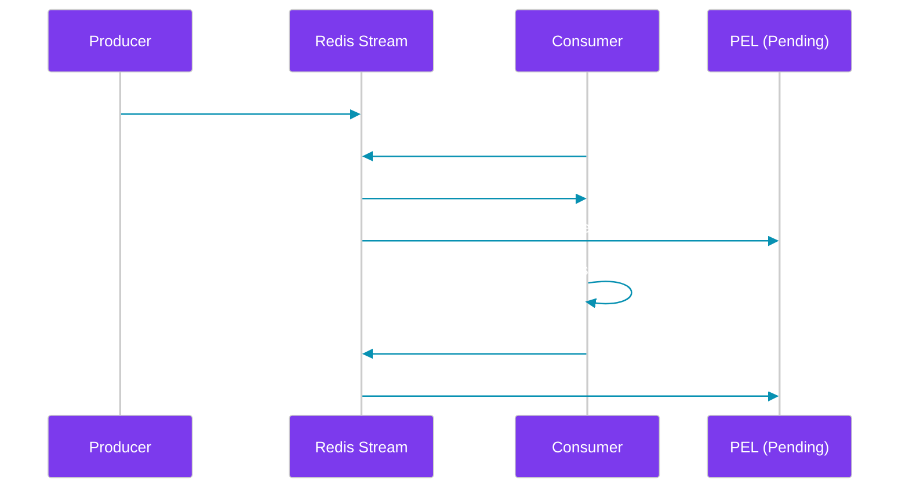

**Key concepts summary:**

| Concept | What it means |
|---|---|
| `>` in XREADGROUP | Only undelivered messages |
| `0` in XREADGROUP | Re-read **this consumer's own** pending (unacked) messages — not the other consumers' |
| PEL | Unacked messages. They survive a consumer crash |
| XACK | Remove from PEL. Confirms processing is done |
| XCLAIM | Reassign idle pending message to another consumer |
| XAUTOCLAIM | Like XCLAIM but auto-finds idle entries (Redis 6.2+) |

**Interview one-liner:** In a consumer group, each delivery goes to exactly one consumer. The PEL tracks unacked messages, so no work is lost if a consumer crashes. But a claimed message can be processed twice, so it is at-least-once and consumers must be idempotent.

---

</details>

---

4. **☕ (Optional) How do you implement Redis Streams with Spring Boot? 💤**

<!-- -->
<details>
<summary>Answer</summary>

**Answer:**

Spring Data Redis supports Streams through `RedisTemplate.opsForStream()`, and through the `StreamMessageListenerContainer` for async reading.

**Producer — publishing events:**

```java
@Service
public class OrderEventPublisher {

    @Autowired
    private RedisTemplate<String, String> redisTemplate;

    private static final String STREAM_KEY = "orders";

    public void publishOrder(Integer orderId, String status) {
        Map<String, String> fields = new HashMap<>();
        fields.put("orderId", String.valueOf(orderId));
        fields.put("status", status);
        fields.put("timestamp", String.valueOf(System.currentTimeMillis()));

        // XADD orders * orderId 101 status PLACED timestamp 1716000000000
        RecordId id = redisTemplate.opsForStream()
            .add(StreamRecords.newRecord()
                .in(STREAM_KEY)
                .ofMap(fields));

        System.out.println("Published event: " + id);
    }
}
```

**Consumer Group setup — run once on startup:**

```java
@Component
public class StreamGroupInitializer implements ApplicationRunner {

    @Autowired
    private RedisTemplate<String, String> redisTemplate;

    private static final String STREAM_KEY = "orders";
    private static final String GROUP_NAME = "order-processing-group";

    @Override
    public void run(ApplicationArguments args) {
        try {
            // Create group starting from new messages ($)
            redisTemplate.opsForStream()
                .createGroup(STREAM_KEY, ReadOffset.latest(), GROUP_NAME);
        } catch (RedisSystemException e) {
            // Group already exists — safe to ignore
            if (!e.getMostSpecificCause().getMessage().contains("BUSYGROUP")) {
                throw e;
            }
        }
    }
}
```

**Consumer — processing with acknowledgement:**

Two rules make retries actually happen:

- **Use a stable consumer name** (the pod or host name). The PEL is kept **per consumer name**. With a random UUID, every restart gets a new name, and the old name's pending messages are orphaned. Only `XAUTOCLAIM` / `XCLAIM` from another consumer can rescue them.
- **Re-read your own PEL** (offset `0`) on startup. Reading with `>` never returns a message that was already delivered once.

```java
@Service
public class OrderEventConsumer {

    @Autowired
    private RedisTemplate<String, String> redisTemplate;

    private static final String STREAM_KEY = "orders";
    private static final String GROUP_NAME = "order-processing-group";
    // ✅ Stable across restarts: in Kubernetes, HOSTNAME = pod name
    // (use a StatefulSet if the name must survive a reschedule)
    private static final String CONSUMER_NAME =
        "worker-" + System.getenv().getOrDefault("HOSTNAME", "local");

    // On startup: retry what this consumer read but never acked
    @EventListener(ApplicationReadyEvent.class)
    public void retryOwnPending() {
        // XREADGROUP ... STREAMS orders 0  → only THIS consumer's PEL
        // (simplified: reads one batch; loop until empty for a big PEL)
        process(ReadOffset.from("0"));
    }

    @Scheduled(fixedDelay = 100)
    public void consume() {
        // XREADGROUP GROUP order-processing-group worker-X COUNT 10 STREAMS orders >
        process(ReadOffset.lastConsumed());
    }

    private void process(ReadOffset offset) {
        List<MapRecord<String, Object, Object>> records = redisTemplate.opsForStream()
            .read(Consumer.from(GROUP_NAME, CONSUMER_NAME),
                StreamReadOptions.empty().count(10),
                StreamOffset.create(STREAM_KEY, offset));

        for (MapRecord<String, Object, Object> record : records) {
            try {
                Map<Object, Object> fields = record.getValue();
                processOrder((String) fields.get("orderId"), (String) fields.get("status"));

                // XACK — remove from PEL on success
                redisTemplate.opsForStream().acknowledge(STREAM_KEY, GROUP_NAME, record.getId());

            } catch (Exception e) {
                // Do NOT ack — the message stays in this consumer's PEL.
                // It is retried on the next startup, or claimed by the sweep below.
                System.err.println("Failed to process: " + record.getId());
            }
        }
    }

    private void processOrder(String orderId, String status) {
        // business logic — must be idempotent (a claimed message can arrive twice)
    }
}
```

Add a **periodic sweep** for messages whose consumer died for good (for example, a scaled-down pod).
Run `XAUTOCLAIM orders order-processing-group <me> 60000 0-0 COUNT 10` every minute. It moves
entries idle for more than 60 s to this consumer. In Spring Data Redis, use `XPENDING`
(`opsForStream().pending(...)`) + `opsForStream().claim(...)`, or send `XAUTOCLAIM` through
`execute(...)`. Also count deliveries — `XPENDING` shows a delivery counter for each message. After N failed
tries, move the message to a dead-letter stream and `XACK` it. Then one bad message cannot loop forever.

**Stream trimming — prevent unbounded growth:**

```java
// Keep about the last 10,000 entries. `true` = approximate trim (MAXLEN ~).
// Exact trimming on every publish costs more: Redis must cut inside a node.
// Approximate trimming removes only whole internal nodes, so it is cheap.
redisTemplate.opsForStream().trim(STREAM_KEY, 10000, true);

// Better: trim inside the XADD itself, in one round trip
// XADD orders MAXLEN ~ 10000 * orderId 101 status PLACED
// Spring Data Redis: XAddOptions.maxlen(10000).approximateTrimming(true)
// (check that your version has add(record, XAddOptions) on opsForStream())

// Or trim by age (Redis 6.2+): drop entries older than an ID / timestamp
// XTRIM orders MINID ~ 1716000000000
```

**Key configurations in `application.yml`:**

```yaml
spring:
  data:
    redis:
      host: localhost
      port: 6379
```

You need no extra dependency. `spring-boot-starter-data-redis` includes Stream support.

**Stream vs List vs Pub/Sub — when to use which in Spring Boot:**

| | `List` (LPUSH/BRPOP) | `Pub/Sub` | `Streams` |
|---|---|---|---|
| **Persistence** | ✅ | ❌️ | ✅ |
| **Consumer groups** | ❌️ manual | ❌️ | ✅ |
| **Replay** | ❌️ | ❌️ | ✅ |
| **At-least-once** | ✅ manual | ❌️ | ✅ via PEL |
| **Use case** | Simple task queue | Real-time broadcast | Reliable event log |

**Interview one-liner:** Use `opsForStream()` to publish with `XADD`, read with `XREADGROUP`, and always `XACK` on success. Unacked messages stay in the PEL. Use a stable consumer name, re-read your own PEL on startup, and run an `XAUTOCLAIM` sweep for dead consumers.

---

</details>

---

5. **📋 (Optional) How do you configure Redis in Spring Boot with application.yml for different environments? 💤**

<!-- -->
<details>
<summary>Answer</summary>

**Answer:**

Here is a full Redis configuration for Spring Boot. It covers standalone, Sentinel, and Cluster modes, with a profile for each environment.

**Standalone Configuration:**

```yaml
# application.yml
spring:
  data:
    redis:
      host: localhost
      port: 6379
      password: ${REDIS_PASSWORD:}
      database: 0
      timeout: 2000ms
      connect-timeout: 1000ms
      lettuce:
        pool:                   # ⚠️ needs org.apache.commons:commons-pool2, else ignored
          max-active: 16        # Max connections in pool
          max-idle: 8           # Max idle connections
          min-idle: 4           # Min idle connections (pre-warmed)
          max-wait: 2000ms      # Max wait for connection from pool
        shutdown-timeout: 200ms
  cache:
    type: redis
    redis:
      time-to-live: 1800000   # Default 30 min TTL
      cache-null-values: false
      key-prefix: "myapp:"
      use-key-prefix: true
```

**Sentinel Configuration (Production HA):**

```yaml
# application-prod.yml
spring:
  data:
    redis:
      sentinel:
        master: mymaster
        nodes:
          - sentinel1.prod.internal:26379
          - sentinel2.prod.internal:26379
          - sentinel3.prod.internal:26379
        password: ${REDIS_SENTINEL_PASSWORD:}
      password: ${REDIS_PASSWORD:}
      lettuce:
        pool:
          max-active: 32
          max-idle: 16
          min-idle: 8
          max-wait: 3000ms
        read-from: REPLICA_PREFERRED   # Read from replicas for scaling
```

**Cluster Configuration:**

```yaml
# application-cluster.yml
spring:
  data:
    redis:
      cluster:
        nodes:
          - redis-node1.prod.internal:6379
          - redis-node2.prod.internal:6379
          - redis-node3.prod.internal:6379
          - redis-node4.prod.internal:6379
          - redis-node5.prod.internal:6379
          - redis-node6.prod.internal:6379
        max-redirects: 3
      password: ${REDIS_PASSWORD:}
      lettuce:
        cluster:
          refresh:
            adaptive: true       # Auto-refresh cluster topology
            period: 30s          # Topology refresh interval
        pool:
          max-active: 32
          max-idle: 16
          min-idle: 8
```

**Java tuning — without losing Boot's auto-config:**

> ⚠️ **Do not define your own `RedisConnectionFactory` bean just to change one setting.**
> Boot's Redis auto-config backs off as soon as that bean exists. Then the Sentinel and
> Cluster profiles above are ignored, and you must hard-code pool sizes in Java.
> Use a `LettuceClientConfigurationBuilderCustomizer` instead. Boot still builds the factory
> from the YAML, and your customizer only adds to it.

```java
@Configuration
public class RedisClientConfig {

    // Example: read from replicas. Useful on Boot < 3.5, where the
    // spring.data.redis.lettuce.read-from YAML key does not exist yet.
    @Bean
    public LettuceClientConfigurationBuilderCustomizer readFromReplicas() {
        return builder -> builder.readFrom(ReadFrom.REPLICA_PREFERRED);
    }
}
```

> Careful with `builder.clientOptions(...)` in a customizer. In Cluster mode Boot puts the
> topology-refresh settings into the client options. A plain `ClientOptions` from you
> replaces them, and adaptive refresh is silently lost.

You do not need to write a health check. With Actuator on the classpath, Boot adds a
Redis health indicator by itself. It runs `INFO server` (or `CLUSTER INFO` in Cluster mode).

**Actuator Health Endpoint:**

```yaml
# application.yml
management:
  health:
    redis:
      enabled: true    # Enables /actuator/health/redis
  endpoints:
    web:
      exposure:
        include: health,info,metrics
```

🔑 **Does Lettuce even need a pool? Usually no.**

- `LettuceConnectionFactory` shares **one thread-safe native connection** across all threads by default (`shareNativeConnection = true`). Lettuce sends commands from many threads over that one connection (pipelining).
- The pool is used only for **dedicated** connections:
  - blocking commands (`BLPOP`, `BRPOP`, `XREAD ... BLOCK`),
  - `MULTI`/`EXEC` transactions,
  - or when you set `shareNativeConnection = false`.
- The pool needs **`org.apache.commons:commons-pool2`** on the classpath. Without it, every `spring.data.redis.lettuce.pool.*` property does **nothing** — Boot gives no error.

So the honest sizing rule: size the pool for the threads that run **blocking or transactional** commands at the same time — not for all request threads.

| 🎯 Property | 📝 Purpose | ✅ Starting value |
|---|---|---|
| `max-active` | Max dedicated connections | Number of threads that run blocking / `MULTI` commands at the same time, plus a small margin |
| `max-idle` | Max idle connections | Same as `max-active` (avoids closing and reopening connections) |
| `min-idle` | Pre-warmed connections | 0, unless you use blocking commands all the time |
| `max-wait` | Wait time for a pooled connection | 2–3 seconds |
| `timeout` | Command timeout | 2 seconds |
| `connect-timeout` | Connection timeout | 1 second |

⚠️ **Best Practices:**

- Always keep passwords outside the code, in environment variables
- Add a Lettuce pool **only** if you use blocking commands or `MULTI`/`EXEC`. Then add `commons-pool2` too — without it the pool settings are ignored
- Enable `adaptive` cluster topology refresh for Cluster mode
- Set appropriate timeouts to fail fast
- Monitor Redis command latency and (if you have one) pool metrics via Actuator
- Use `REPLICA_PREFERRED` for read scaling in Sentinel mode. But see the version warning in §3 Q4: the YAML key only binds on Boot **3.5+**
- **Know your client version, and check every pin after a Boot upgrade.** The Boot BOM picks a Lettuce version for you. A new version can change topology-refresh or connection behaviour, even when none of your code changes.

---

</details>

---

6. **🗓️ (Optional) Which Redis version should you assume in 2026 — and what changed in Redis 7/8 and the Valkey fork? 💤**

<!-- -->
<details>
<summary>Answer</summary>

**Answer:**

> 💡 **In short:** It depends on where Redis runs.  
> - **Managed services** (ElastiCache, MemoryDB, Memorystore): assume **Redis 7.x semantics**. Many of these now run **Valkey**, which forked from Redis 7.2.  
> - **Self-hosted, latest release:** assume **Redis 8.x**.  
> - Ask the interviewer which one they run. Most core answers are the same in both.  
>
> Know these facts:  
> - `ziplist` became `listpack`.  
> - AOF became multi-part.  
> - The March-2024 licence change led to the Linux Foundation's **Valkey** fork. AWS and Google Cloud now offer Valkey as a managed engine, next to Redis.  
> - Redis 8 moved the old "Redis Stack" modules into core Redis and added an AGPLv3 licence option.

🔑 **What actually changed (the parts interviewers ask about):**

| Version | Change | Why it matters in an answer |
|---|---|---|
| **7.0** | `ziplist` → **`listpack`** for hashes, sorted sets and quicklist nodes | `hash-max-ziplist-entries` renamed to `hash-max-listpack-entries` (old names kept as aliases); `OBJECT ENCODING` now reports `listpack` |
| **7.0** | **Multi-part AOF** — `appenddirname "appendonlydir"` holding a `.manifest` + `.base.rdb` + `.incr.aof` | Replaces the single `appendonly.aof` file. During a rewrite, new writes go to a new `.incr.aof` file, so Redis no longer needs an in-memory AOF rewrite buffer |
| **7.0** | **Sharded Pub/Sub** (`SPUBLISH`/`SSUBSCRIBE`) | Fixes Cluster's broadcast-to-every-node problem — see §9 Q1 (optional) |
| **7.0** | `repl-diskless-sync` default flipped to **`yes`** | A full resync can stream the RDB straight to the replica socket — no fork-to-disk |
| **7.0** | **Redis Functions** (`FUNCTION LOAD`) | Persisted, replicated, named server-side libraries — the successor to ad-hoc `EVAL` scripts |
| **7.2** | `WAITAOF` | The durable counterpart to `WAIT` — blocks until writes are fsync'd locally/on replicas, not just replicated |
| **7.2** | `listpack` encoding extended to small non-integer sets | Sets used to be `intset` or `hashtable` only |
| **7.4** | **Hash-field TTL** — `HEXPIRE`, `HPEXPIRE`, `HTTL`, `HPERSIST` | Each field in a hash can now expire on its own. Before, TTL worked only on the whole key |
| **8.0** | **JSON, Query Engine (search), TimeSeries and probabilistic types** (Bloom, Cuckoo, Count-min sketch, Top-K, t-digest) moved into **core Redis Open Source** | These used to be separate modules ("Redis Stack"). Now they ship in the main build |
| **8.0** | Licence: **AGPLv3** added as a third option, next to RSALv2 / SSPLv1 | Redis is again OSI open-source if you choose AGPLv3 |
| **8.0** | **New I/O threading** — threads also read requests and parse the protocol | `io-threads-do-reads` is no longer needed. Commands still run on the main thread |
| **8.0** | **Vector sets** (`VADD`, `VSIM`) — preview | A new type for vector similarity search. It was marked preview (beta) in 8.0 |
| **8.6** | Eviction policies **`allkeys-lrm`** and **`volatile-lrm`** | "Least recently modified" — evicts by last write, not last read. The total is now 10 policies. Check the release notes for exact behaviour |

🧠 **The licence change (a live 2026 question):**

In **March 2024** Redis Ltd. changed the Redis licence from BSD to a dual **RSALv2 / SSPLv1** model. This is source-available (you can read the code, but the licence limits how you use it), not OSI open-source. The Linux Foundation forked the last BSD commit as **Valkey**. AWS, Google Cloud and Oracle backed Valkey. Results you should be able to state:

- **AWS ElastiCache and MemoryDB now offer Valkey** as a fully supported (and cheaper) engine, next to Redis OSS.
- Valkey is wire-compatible. The same clients (Lettuce, Jedis, Redisson) and the same commands work.
- Redis Ltd. later added back an AGPL option (Redis 8). But by then the fork was already widely used.
- Valkey does **not** contain the Redis 8 features above (built-in JSON/search, `lrm` policies). Valkey adds its own features in its own releases (8.x, 9.x); its version numbers do not match Redis features. Do not assume the two match after 7.2.

💡 **Interview one-liner:** "On a managed service I target Redis 7.x semantics: listpack encodings, multi-part AOF, and sharded Pub/Sub on Cluster. On a self-hosted latest build I'd assume Redis 8, with JSON and search in core. I'd also point out that on AWS the default managed engine is increasingly **Valkey** after the 2024 relicence. Valkey is wire-compatible, so the application code is unchanged."

---

</details>

---

---

> **Coverage note**
>
> For Tier-1 product interviews, this file covers these topics in depth, with code: caching patterns, cache-failure modes, eviction, persistence, HA, distributed locking, key expiration mechanics, operational safety, security, and Spring Boot integration. That is most of what interviewers ask.
>
> The four topics this note used to list as weak spots are now covered:
>
> - **Client-side caching / RESP3 `CLIENT TRACKING`** (the fix for a stale L1 Caffeine cache across pods) — §2 Q8.
> - **`cluster-require-full-coverage`**, and what a cluster does when one shard dies — the doubt block in §6 Q3.
> - **`WAITAOF`**, the durable version of `WAIT` — §6 Q1.
> - **Bloom filters cannot delete** (and Cuckoo filters, which can) — §3 Q2.
>
> Also new: **idempotency keys** with Redis — §7 Q6.
>
> For FAANG-level depth, these are covered too:
>
> - **Memory internals:** listpack / intset encoding limits (§1 Q4), sizing Redis for N keys (§4 Q6), and fragmentation with `activedefrag` and `MEMORY DOCTOR` (the doubt block in §4 Q4).
> - **Redis in system design:** rate limiter, sessions, leaderboard and delayed queue (§8 Q3–Q6), idempotency keys (§7 Q6) and hot keys (§3 Q4). Full designs are in `system-design/05_designs/`.

---
